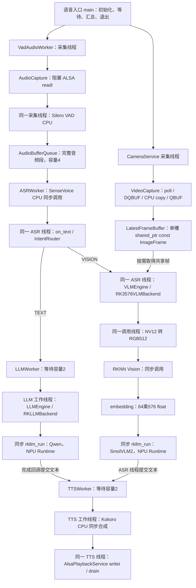
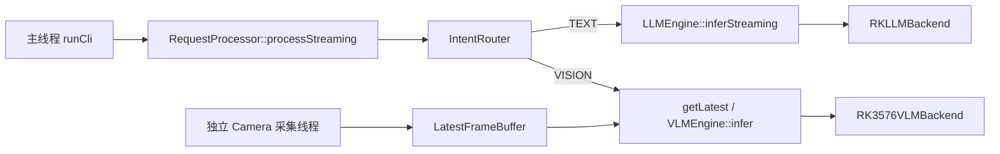
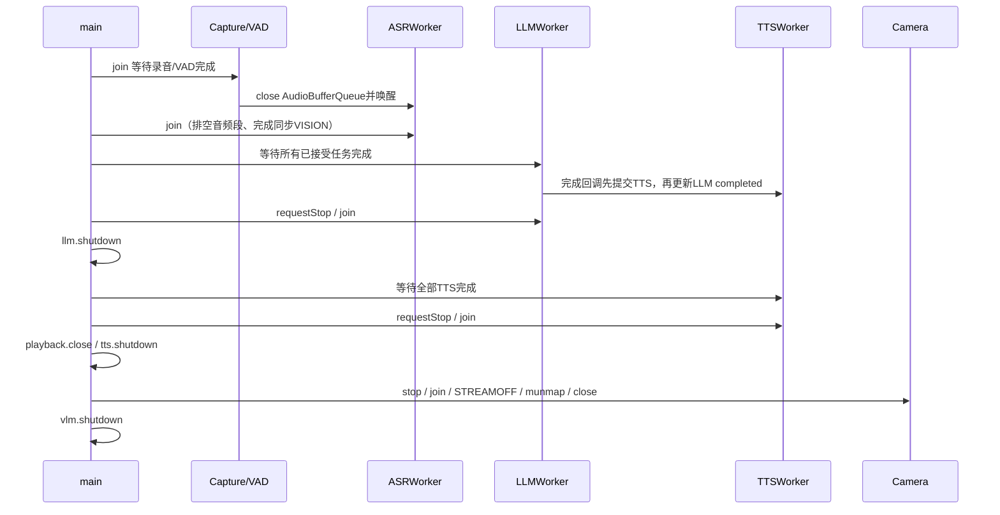

# 第五阶段 5.1：源码架构审计与安全改进

日期：2026-10-17（Asia/Hong_Kong）。对应任务书 5.1。**当前正式状态：5.1 已通过 ARM64 构建、板端 CTest、完整 TEXT/VISION 语音与本人听音确认、自然/信号退出和资源检查。** 最新证据、最小信号修复、完整差异与风险见 [5.1正式实机验收](stage5_01_board_acceptance.md)。5.2尚未开始。

> 版本说明：以下三段和前期源码审计正文保留当时的审查状态，“SIGINT尚未修复/板端未执行”属于历史。第三阶段已先实测缺陷，再修改三个生产文件、ARM64重编并复测；当前状态以本页首段及正式验收报告为准，不能把历史待验收描述当成当前结果。

> 本轮复审：已读取原24文件补丁及validation_summary并保存不可覆盖的审查输入；逐文件问题、类/函数/成员、接口/线程影响、风险与测试映射见 [5.1代码审查和隔离实机回归方案](stage5_01_board_review.md)。当前**完整语音入口无协作SIGINT**，以及SDK回归未执行，均阻止5.1验收。用户要求5.1验收前不进入大规模5.2修改，本轮遵循该门槛，仅新增本地准备工具与文档，不改生产C++。

> 本轮新增本地验证：Python准备工具7项单测、四个Bash脚本语法检查通过；这是测试工具的静态/合成输入验证，与下文原6项C++ CTest分开。原补丁中的生产C++及CMake保持不变。所有板端项目仍为尚未执行，待用户明确确认操作范围。

> 分阶段授权后的最新状态：2026-10-17 18:27完成第一阶段**只读预检**，SSH、独立目录不存在、磁盘预算、321项原工程/旧构建指纹、模型/SDK路径、目标设备空闲均通过。原始输出、一次fuser参数错误及修正复查均保留。见 [只读实测和第二阶段申请](stage5_01_readonly_preflight.md)。这只更新环境证据；ARM64编译、CTest和硬件回归仍未执行。以上“尚未执行”段落是前一轮准备时的历史状态。

## 操作 1：核对工程、入口和历史版本

### 当前工程和证据来源

当前根目录是 `Z:\master_T\Linux\资料\code\rk3576_multimodal_stage5_source\rk3576_multimodal`。任务书已完整阅读，五节具体计划见 [stage5_plan.md](stage5_plan.md)。本节没有 SSH、上传、部署或远程覆盖操作。

| 材料 | 能确认的内容 | 不能据此确认的内容 |
|---|---|---|
| 当前 CMake、include/src/tests | 文件实际实现、构建开关、调用和生命周期 | 目标端运行效果 |
| `4.md` 操作及原样 Stage5 验收日志 | 历史 Camera/ASR/VLM/LLM/TTS 完整链路成功，用户曾确认出声 | 本轮修改的回归或长期稳定性 |
| 第三阶段手册 | Kokoro/ALSA 调试、曾发生的 OOM、TTS 慢与成功播报 | 当前新代码已验证 |
| 第一节 ASR、第二阶段手册 | SenseVoice CPU、VAD、Qwen RKLLM 与原 Worker 的演进 | 与当前所有 Prompt/接口完全一致 |
| `reports/op10_*` | ASR/路由独立测试原始日志及部分 CPU/RSS | 完整 NPU/TTS 链路性能 |
| 本轮 `reports/stage5_01_local/` | Windows 配置、构建、CTest、源码差异和 hash | ARM64、V4L2、ALSA、RKNN/RKLLM 实测 |

旧 `docs/architecture.md`、`run.md`、`validation.md` 的“真实后端尚未实现”“无 ASR/TTS”等内容属于早期快照；现在已存在真实 RKLLM/VLM/音频实现和可选构建。旧文件保留历史正文并加版本提示，避免把旧证据改写为新证据。

当前目录没有 Git 仓库；`git status --short` 实际返回 `fatal: not a git repository`。修改前快照为 `backups/stage5_01_before/`，可审查补丁为 `reports/stage5_01_local/changes.patch`，新增文件也纳入补丁。SHA256 清单用于精确比对当前副本，不能代替板端 hash。

【真实执行】修改前 CMake、完整语音入口、VLM后端、Router 的四个 SHA256 与 `4.md` 所列重建源码指纹逐一相同，原始值保存在 `baseline_fingerprints.txt`。这使本次修改有可核对的起点；历史文档也明确其 hash 不是板端现场独立采样，因此本轮不能据此宣称已与当前开发板逐字一致。

### 两个实际入口

1. `src/main.cpp → parseArguments → CameraService/LLMEngine/VLMEngine → RequestProcessor → runCli`：主线程读文本并同步推理；没有麦克风和 TTS。
2. `src/audio/asr_llm_tts_smoke.cpp`：完整语音闭环的组装和业务回调。该入口直接调用 Router/LLMWorker/VLMEngine/TTSWorker，没有经过 RequestProcessor。

因此“已有 RequestProcessor”不等于“当前全部入口已统一”。5.1 先修生命周期和明确接口；5.2 再逐步统一异步业务，保留入口特有的 Prompt 策略。

## 操作 2：还原真实架构、线程和模型调用

### 实际调用图



图中线程是项目自己创建的 `std::thread`，不表示 SDK 内部只有这些线程。`ASRService` 配置 `num_threads=2`，VAD 为 1，TTS 从 CLI 接受 1～8、默认 2；这只是配置值，实际 ORT 调度和线程数量待板端观测。两个 RKLLM backend 均设 `is_async=false`。C 回调可能由 Runtime 内部线程调用，当前源码不能证明其真实线程 ID 或所有回调完全串行；须加观测核对。

CLI 单独的调用关系：



### 模块职责、依赖与所有权

| 模块 | 职责/资源所有权 | 并发边界 |
|---|---|---|
| VideoCapture | fd、V4L2 MMAP planes、streaming；析构 shutdown | Camera 线程采集；stop 在 join 后释放 |
| CameraService | 拥有 VideoCapture 和采集 thread；引用 frames | lifecycle mutex 串行 start/stop；atomic running；独立 stats mutex |
| LatestFrameBuffer | 拥有最新帧 shared_ptr；消费者共同持有旧帧 | mutex 内 swap/复制指针，锁外释放和推理 |
| ASRService | 一个常驻 recognizer；stream/result 用专用删除器 | 初始化在 owner，识别在单 ASRWorker，join 后销毁 |
| VadAudioWorker / AudioWorker | 线程内拥有 AudioCapture；VAD 有专用 unique_ptr | 借用队列/日志锁；关闭输入唤醒消费者 |
| AudioBufferQueue | deque<AudioSegment>，保存 float samples 或 S16 PCM | mutex + 带谓词 cv；满时丢最旧段，close 后排空 |
| IntentRouter | 无模型，ASCII 小写及 UTF-8 子串规则 | route const，局部字符串 |
| RequestProcessor | 引用 frames、两个 Engine，拥有 Router | 同步入口；不同 Engine 锁互相独立 |
| LLMEngine / VLMEngine | unique_ptr 独占 backend；初始化与异常转换 | 各自 mutex 包围 initialize/infer/shutdown |
| RKLLMBackend | PImpl 拥有 LLMHandle/模型路径 | 由 Engine 串行使用；RunContext 有 mutex |
| RK3576VLMBackend | PImpl 拥有 RKNN context 和 SmolVLM2 handle | 由 VLMEngine 串行使用；GenerationState 依赖 SDK 回调语义 |
| LLMWorker | 拥有 thread/deque<Task>，借用 Engine | 锁保护队列，锁外推理/完成回调；stop 取消待执行任务 |
| TTSService | Kokoro/MeloTTS sherpa 句柄；生成 PCM 复制到 vector | 当前由一个 TTSWorker 使用，不能并发 shutdown |
| TTSWorker | 拥有 thread/deque<Task>，借用 TTS/Playback | 同一个线程先合成后播放；stop 取消等待任务 |
| AlsaPlaybackService | PCM 播放句柄，float 转 S16、write/recover/drain | 单线程使用；工作线程退出后 close |

Service/Engine 是同步业务/资源封装；Worker 负责排队、线程和回调；Backend 隔离供应商接口。相机和音频采集不依赖模型后端；业务不应直接操作 SDK handle。

### Prompt 与模型兼容边界

- 语音 TEXT 在 ASR 文本后附加“一句话、不超过25个汉字”的原有指令。
- 语音 VISION 固定 `What do you see? Answer briefly.`；中文只用于触发路由。
- CLI 的 RequestProcessor 给 VLM 原问题，并非固定英文。
- SmolVLM2：512×512 RGB，单图、64 tokens、576 维，原特殊 token/chat template 不变。
- Qwen/SmolVLM2 各自 mutex 不形成全局 NPU 互斥。ASR 线程可能在 LLMWorker 运行时进入 VLM；确实存在并发调用机会，但是否会发生 Runtime 冲突或性能下降尚无本轮实验结论。

## 操作 3：审计问题与修复取舍

### 已落实的安全修复

| 问题与源码依据 | 改动及原因 | 验证边界 |
|---|---|---|
| 语音入口先构造 Worker，后构造回调引用的 mutex/cv/统计量；逆序析构时状态先失效 | 将状态放到 Worker 之前；TTSWorker 仍早于 LLMWorker，后者析构回调仍可访问 TTSWorker | 源码检查；LLM/ASR 异常退栈回归；真实语音入口板端待编译 |
| `asr_llm_smoke`、LLM/TTS 单 Worker smoke 有同类声明顺序 | 同样调整依赖顺序；为改动的入口添加函数 try-block，异常离开函数体时先析构局部对象，再记录 fatal 并返回1 | LLM smoke 额外本机编译；TTS smoke 目标端待验证 |
| 原 `ASRWorker::~ASRWorker` 只 join，pop 在开放空队列上可永久等待 | 析构在 joinable 时 requestStop，关闭输入并唤醒；保留 close 后排空，不取消正在识别的任务 | idle destructor、owner 抛异常、drain 测试 |
| Audio/VAD/ASR 的线程入口未统一捕获普通 C++ 异常 | run 调 runImpl，外层捕获标准/未知异常，保存失败并关闭队列；原采集/VAD算法放在 runImpl | ASR 服务/回调故障注入；Audio/VAD SDK 路径未编译/未实机测试 |
| 对仍 joinable 的 std::thread 重复赋值会 terminate；join 后再次 start 原状态也不明确 | 三个音频 Worker 增加 started 标记；owner 串行生命周期，一次启动，重复时 logic_error | ASR 活动期间/已 join 后重复 start 测试；生产者分支待目标端 |
| RKNN outputs_get 成功后 embeddings.assign 可能抛异常，跳过手工 outputs_release | 非复制栈上 RknnOutputOwner 成功取得后置 acquired，析构释放；嵌套作用域保持在 RKLLM 前释放 | 仅源码审查；未使用占位 SDK，目标端 ABI/故障回归待做 |
| `audio_preprocessor_tests.cpp` 存在但没注册 | 作为独立、无 SDK 的 CTest target 恢复 | 本轮本机通过 |
| core/CLI 缺 Runtime 测试只排除 RKLLM，未排除真实 VLM | 两者 OFF 才注册这两个不可用后端专用测试 | 默认路径通过；VLM ON 目标端待验证 |
| 两个 TTS smoke 重复列举 Service/Playback 源码 | 链接已有 multimodal_tts；不再单独编译相同实现 | CMake 默认配置通过；ENABLE_SHERPA_ASR=ON 待目标端构建 |

### 结构性问题和后续处理

| 优先级 | 源码确认的问题/限制 | 后续位置 |
|---|---|---|
| 高 | VLM 同步阻塞 ASR；音频满队列丢旧且 push 仍返回 true | 5.2 业务调度和可观测背压 |
| 高 | LLM/TTS 180/600秒等待超时后仍 join；不能中断卡住的 Runtime | 5.2/5.5 停止契约和故障测试；不能承诺硬退出上限 |
| 高 | 语音 smoke 没有 CLI 那样的 SIGINT/SIGTERM handler；默认信号终止不保证 RAII | 5.2/5.5 统一正常退出流程 |
| 高 | TTS 合成/播放串行，历史已出现十几秒合成和几十秒排队 | 5.4 profiling 后优化 |
| 中 | AlsaPlaybackService::play 末尾检查累计 xrun_count_ != 0；首次 XRUN 会影响以后同实例无新 XRUN 的请求 | 5.2/5.5 修为按次诊断并加故障回归；本次不更改已验收播放路径 |
| 中 | VLM GenerationState 没有锁；其安全依赖同步 run 和 SDK 回调串行/完成语义 | 查当前 SDK、记录回调线程，实验证实后最小修改 |
| 中 | TTSService 初始化的 new_tts 在错误字符串构造前还没有 RAII owner；极端分配异常路径存在释放风险 | 后续统一 SDK 临时句柄管理；本轮已修最高优先级 RKNN 输出路径 |
| 中 | Camera 超时会保留旧帧，没有最大帧龄策略；CPU 预处理与参考 Lanczos 不完全相同 | 5.2 新鲜度策略、5.3 输入质量与性能 |
| 中 | TTS 根据目录名是否包含 kokoro 选择配置；没有结构化总配置 | 后续显式配置，先兼容现有参数 |
| 中 | 非原子 Worker 结果只允许 join 后读取；回调不得 self-join、销毁 Worker 或重入同一 Engine | 当前契约明确；5.2 统一 owner/API |
| 低 | `tests/vlm_*_smoke.cpp` 及已有 ELF 不属于当前 CMake/CTest target | 作为历史独立诊断材料，不计入本轮6项测试 |

【理论分析】不把潜在风险写成历史已发生事故；也不把当前测试覆盖解释为消除所有竞态。没有运行 ThreadSanitizer，没有板端 NPU 并发实验。内存分配彻底失败或 OS/SDK 强制终止不在普通异常恢复保证内。

## 操作 4：解释线程与对象生命周期

### 完整语音入口的正常停止



join 不持有 print/state mutex。`completed_cv.wait_for` 使用谓词；状态锁在打印前释放。先提交 TTS 再记 LLM completed，防止 main 误判不会再产生 TTS。TTS completed 可能早于 accepted 更新，但两者受 state mutex 保护；main 在 ASR 和 LLM 已静止后等待最终计数，不把临时先后当作任务丢失。

### 异常退栈顺序

依赖遵循“先构造被依赖对象，后构造使用者”：

```text
LLM/ASR/TTS/Playback Service
  -> audio_queue / print_mutex / state_mutex / completed_cv / counters
  -> TTSWorker
  -> LLMWorker
  -> frames / camera / vlm
  -> on_text 回调对象
  -> ASRWorker（复制持有 on_text）
  -> VadAudioWorker
```

反向销毁：生产者 stop/join → ASRWorker 关闭输入/排空/join → 释放回调/相机/VLM → LLMWorker stop/join → TTSWorker stop/join → 锁/计数 → Service。LLM 回调只使用仍然存活的状态和 TTSWorker；VISION 已随 ASR join 结束。帧缓存先于 Camera 构造，Camera 销毁后才销毁缓存。

异常路径的 Worker 析构会取消未执行的 LLM/TTS 任务并回调；它不承诺正常路径那样全部成功播报。ASR requestStop 则关闭并排空音频队列，两种语义应区分。活跃的同步 RKLLM、TTS 和 ALSA 调用仍等待自然返回。

### Buffer 释放关系

VideoCapture 请求4个 MMAP buffer（实际数量以驱动返回为准）→ DQBUF → plane 有效 payload 复制到 ImageFrame::data → QBUF。Camera 用 `make_shared<const ImageFrame>(std::move(frame))` 转移 vector；缓存只交换 shared_ptr。VLM 持帧期间，Camera 发布新帧也不会释放该旧帧。

VLM 每次分配 RGB vector，CPU 进行 BT.709 limited-range 转换，Y 双线性/UV近邻，拉伸到512方图；不是 letterbox。普通 `rknn_inputs_set` 不足以证明 Runtime 内部零复制。RKNN float 输出再复制为 embedding vector；本次新增 owner 在复制抛异常时也释放 RKNN 输出。embedding 活到同步 rkllm_run 返回。这里没有 DMA-BUF、RGA 或全链路 zero-copy。

## 操作 5：修改文件和关键语法学习

### 文件清单

完整差异见补丁，文件 hash 见清单。新增 `src/audio/audio_worker.cpp` 是从原 Pipeline 文件移出原有类，不是新建平行框架。

- `CMakeLists.txt`：加入移出的源文件和两项可移植测试；修正测试条件与 TTS 库复用。
- `include/audio/asr_pipeline.h`、`vad_audio_worker.h`：stop/一次启动/状态读取契约与私有 runImpl。
- `src/audio/asr_pipeline.cpp`、`audio_worker.cpp`、`vad_audio_worker.cpp`：队列消费者析构唤醒、异常边界和启动保护。
- `include/ai/llm_worker.h`、`include/audio/tts_worker.h`：明确 owner 生命周期及捕获状态寿命。
- `asr_llm_tts_smoke.cpp`、`asr_llm_smoke.cpp`、`llm_worker_smoke.cpp`、`tts_worker_smoke.cpp`：声明顺序和函数 try-block。
- `src/ai/rk3576_vlm_backend.cpp`：局部 RKNN 输出 RAII。
- `tests/asr_pipeline_tests.cpp`（新增）、`tests/llm_worker_tests.cpp`：故障与生命周期回归。
- 文档和 README：标记历史版本，记录计划、真实测试及下一步。

修改后的完整关键源码保存在 [stage5_01_source_appendix.md](stage5_01_source_appendix.md)，包含文件路径和 SHA256。以下解释本轮改变的关键语句；后续最终手册继续汇总五节完整源代码和逐句分析，不用简化示例替代真实源码。

### 线程入口和启动约束

`if (started_) throw std::logic_error(...)`：bool 标记一次成功创建线程，不是线程当前运行状态；只允许 owner 串行操作，所以它不需要 atomic，亦不支持多线程同时 start。赋值 std::thread 成功后才置 true，创建失败时仍可报告/清理。join 后标记不重置，避免使用已经关闭的队列重新启动。

`thread_ = std::thread(&ASRWorker::run, this)`：成员函数指针和 this 指定线程执行哪个对象；this 的寿命必须覆盖该线程。run 中 try/catch 把普通识别或容器异常转换为 error_，不能让异常穿出 std::thread 入口触发 terminate。runImpl 保留原队列、预处理、识别、计时和回调流程。catch 中 queue.close 唤醒/终止输入，不释放仍被别的线程使用的 Runtime。

`if (thread_.joinable()) requestStop(); join();`：joinable 表示线程资源可回收，不表示它仍在运行。析构先关闭队列，等待在 pop 的线程才有条件退出；join 建立同步，使之后读取 ok/error/count 有定义。若仍有任务，close 后继续 drain；同步模型运行无法被 close 强制中断。

### 锁、条件变量与回调

`std::lock_guard<std::mutex> lock(mutex_)`：std 是标准命名空间，lock_guard 是类模板，模板实参 mutex 指定被管理的互斥锁类型；变量 lock 在构造时加锁，离开作用域自动解锁，包括 return 和异常退栈。mutex 负责共享数据，lock_guard 负责锁的 RAII 生命周期，不拥有业务对象。

`std::unique_lock<std::mutex>` 可由 condition_variable 暂时 unlock、等待、重新 lock；带谓词的 wait 反复检查 closed 或非空状态，抵抗虚假唤醒。修改状态在同一 mutex 下完成，之后 notify_all；通知不是可累计事件，谓词才是正确性依据。

`[&, question_at]` 把时间点复制进回调，其余实际使用对象按引用捕获。复制 lambda 只复制引用，不延长 mutex/counter 的寿命。必须依赖本轮调整的声明顺序和 join；shared_ptr 只解决所指对象寿命，仍不自动保护其字段。引擎锁可能在流式回调期间仍持有，因此不得从该回调重入同一个 Engine。

### RKNN 输出 owner

`RknnOutputOwner owner(impl_->rknn)` 是栈上所有权对象，存 context 和零初始化的 output；不额外申请堆内存。删除复制构造/赋值防止双重 release。outputs_get 返回成功后才设 `acquired=true`。`auto& result=owner.output` 是别名，没有复制 SDK buffer。

embeddings.assign 将 SDK 内存复制到 vector；异常会先销毁 owner 再由 VLMEngine 捕获。嵌套花括号使正常路径也在 RKLLM 前释放 RKNN 输出。析构 noexcept、忽略 release 返回值，保持原有错误处理语义；释放失败的 SDK 诊断仍是后续可观测性工作。该代码尚未经本轮目标端编译，不能写成已验证无泄漏。

## 操作 6：执行本地构建和回归

### 工具、命令及实际失败

【真实执行】Windows PowerShell；CMake 4.3.2；MinGW g++ 16.1.0，x86_64、posix-seh；`MinGW Makefiles`；Debug；两个 Rockchip 选项和 ENABLE_SHERPA_ASR 默认 OFF。`cmake --version`、`g++ --version` 仅打印版本，不修改 SDK/系统。

首先在当前中文路径执行：

```powershell
cmake -S . -B build/stage5_01_baseline -G 'MinGW Makefiles' -DCMAKE_BUILD_TYPE=Debug -DBUILD_TESTING=ON
cmake --build build/stage5_01_baseline --parallel 3
```

配置退出0，构建退出2。关键真实输出：

```text
CMake Error: Target DependInfo.cmake file not found
No rule to make target 'Z:/master_T/Linux/资料/code/rk3576_multimodal_stage5_source/rk3576_multimodal/src/video/latest_frame_buffer.cpp'
```

日志见 `baseline_configure.log`、`baseline_build.log`。同一份源码复制到 ASCII 临时路径后可构建；故本轮采用该方式回归。不据此判定 ARM64 源码错误，也没有改系统区域、安装编译器或删除现有目录。MinGW/路径处理的更底层根因未单独定位。

### ASCII 临时副本构建

修改前用 `rk3576_stage5_01_baseline`，修改后用 `rk3576_stage5_01_after`。实际命令逻辑：

```powershell
$stage5Temp = Join-Path $env:TEMP 'rk3576_stage5_01_after'
New-Item -ItemType Directory -Force $stage5Temp | Out-Null
Copy-Item -LiteralPath CMakeLists.txt -Destination $stage5Temp
foreach ($d in @('src','include','tests')) {
    Copy-Item -LiteralPath $d -Destination $stage5Temp -Recurse -Force
}
cmake -S $stage5Temp -B "$stage5Temp/build" -G 'MinGW Makefiles' -DCMAKE_BUILD_TYPE=Debug -DBUILD_TESTING=ON
cmake --build "$stage5Temp/build" --parallel 3
ctest --test-dir "$stage5Temp/build" --output-on-failure
```

`Join-Path` 组合用户临时目录与任务专属名；`$env:TEMP` 只读取既有变量。New-Item 创建目录，Force 允许目录已存在；Copy-Item 的 LiteralPath 不展开通配符，Recurse 复制子目录，Force 更新该任务临时副本。不复制模型/SDK，不远程传输。实际目录为 `C:/Users/53009/AppData/Local/Temp/rk3576_stage5_01_after`。如复用同名临时目录，它会更新其中源码，不影响开发板或工作区原文件。

`cmake -S` 指定源码，`-B` 指定独立生成目录，`-G` 选 Windows 可用生成器，`-D` 设置缓存项；Debug 保留调试信息，BUILD_TESTING 打开测试。`--build` 进入已有构建树，`--parallel 3` 限制构建并行度，与模型推理线程数无关。CTest 的 `--test-dir` 指定已构建测试树，`--output-on-failure` 在失败时显示输出。

实际执行通过 `2>&1 | Tee-Object -FilePath reports/stage5_01_local/对应日志名` 保存标准输出与错误；Tee-Object 同时显示和写文件，每步检查 `$LASTEXITCODE`，失败即停止下一步。成功标准是配置/构建/CTest 均退出0；CTest 通过数只解释为这些测试 target 通过。

### 实际结果及证据范围

修改前 ASCII 副本：`baseline_ascii_configure.log`、`baseline_ascii_build.log`、`baseline_ascii_ctest.log`，**4/4 通过**。修改后首轮：`after_configure.log`、`after_build.log`、`after_ctest.log`，**6/6 通过**。最终复核结果见 `final_build.log`、`final_ctest.log` 和结构化 `validation_summary.json`。

| 测试 | 真实覆盖 | 明确不覆盖 |
|---|---|---|
| asr_pipeline_tests | 生产队列、丢旧、close唤醒/排空、无生产者析构、异常退栈、两种输入、重复启动、服务和回调异常 | ASR 替身，未加载 SenseVoice/sherpa；不验证音质/准确率/性能 |
| audio_preprocessor_tests | 原有 PCM 归一化和非法采样率/声道/空输入 | 硬件录音/重采样 |
| llm_worker_tests | FIFO、容量、流式传递、停止取消、新增 chunk/done 异常后继续处理与析构 join | GatedLLM 替身，无 NPU |
| core_tests | Router、Engine异常/缺模型/缺Runtime、共享帧生命周期和慢消费者 | 真实后端和模型输出 |
| cli_smoke | 文本/视觉路由、无帧、参数、EOF/exit、明确不可用诊断 | 完整语音入口、Linux signal分支 |
| camera_service_tests | Camera 生命周期、超时/错误/异常、持帧与重复启停 | VideoCapture 测试替身，无 V4L2 |

没有把六个 CTest target 当作六次 AI 请求；没有从这些毫秒级测试时间导出模型 latency、P50/P95 或板端性能。

最终复核【真实执行】：构建退出0，CTest **6/6、0失败**，总测试时间0.45秒（仅本机测试进程用时）；明细与 JUnit XML 一起保留。额外把 `src/ai/llm_worker_smoke.cpp` 与本机构建的占位 core 链接，编译退出0，缺参数运行退出2并输出原 Usage；这只增加该入口翻译单元/参数路径覆盖，仍不使用 RKLLM SDK 或 NPU。

源码和差异归档命令：

```powershell
python tools/stage5_review.py
```

python 使用本机已安装的解释器，脚本只读修改前快照和当前源码，生成 patch、hash清单及完整源码附录；没有网络或远程操作。它还逐字比较未改的 Camera/Qwen backend、VLM预处理/初始化/token、音频算法，以及两个语音入口的完整路由/Prompt/回调区间，结果见 `source_invariants.json`。这些是源码相等性检查，不能替代实机功能回归。输出或清单写入失败会使命令失败；任一相等性检查失败退出非零。

【真实执行】补丁在原始快照的独立临时副本中通过 `git apply --check --ignore-space-change changes.patch`，退出0、无错误输出，记录为 `patch_check.log`。`--check` 只校验可应用性，不修改文件；`--ignore-space-change` 允许本次 Windows 副本的行尾空白差异。这里使用 Git 的补丁校验能力，没有创建仓库、提交或部署。

### 尚未验证

所有 ENABLE_SHERPA_ASR=ON 的生产代码、真实 RKNN 输出 owner、TTS 目标库链接变化、Linux Camera/信号分支尚未在本轮 ARM64 编译/运行。未在开发板故意制造分配失败、线程创建失败、断开设备、并发 NPU 或测量长时间 RSS。历史 PASS 不能为这些修改背书。

## 操作 7：准备目标端验收命令

### 只读预检（建议，尚未执行）

```powershell
ssh -o BatchMode=yes -o ConnectTimeout=5 cat@192.168.10.27 'uname -m; uname -r; free -h; cd /home/cat/projects/RK3576/rk3576_multimodal && sha256sum CMakeLists.txt src/audio/asr_llm_tts_smoke.cpp src/ai/rk3576_vlm_backend.cpp'
```

ssh 连接既定主机；BatchMode 禁止交互密码提示，ConnectTimeout 限制连接等待；引号内命令只读架构/内核/内存/hash，cd 成功后才查项目文件。连接失败不代表代码失败；无对应输出保存，因此此处不写典型假日志。部署前另行确认独立目录和已有程序备份，不能直接把补丁覆盖板端。

### ARM64 构建及原链路回归（批准部署后建议执行）

在用户批准的**独立源码目录**执行，不在当前已验收副本上覆盖：

```bash
mkdir -p reports/stage5_01_board
set -o pipefail
cmake -S . -B build/stage5_01_board -DCMAKE_BUILD_TYPE=Release \
  -DBUILD_TESTING=ON -DBUILD_WITH_RKLLM=ON -DBUILD_WITH_VLM=ON \
  -DENABLE_SHERPA_ASR=ON 2>&1 | tee reports/stage5_01_board/configure.log
cmake --build build/stage5_01_board --parallel 3 2>&1 | tee reports/stage5_01_board/build.log
ctest --test-dir build/stage5_01_board --output-on-failure 2>&1 | tee reports/stage5_01_board/ctest.log
```

mkdir -p 仅创建本次报告目录；pipefail 使管道左边编译失败不会被 tee 的成功掩盖。三个 ON 开关启用原有真实 NPU/音频后端；Release 为板端性能/功能构建。SDK 默认路径相对新源码目录，若与独立目录不匹配，必须显式设置 `RKLLM_SDK_ROOT`、`RKNN_INCLUDE_DIR`、`RKNN_RUNTIME_LIBRARY`、`SHERPA_ONNX_ROOT` 指向板端已有真实依赖。此组合注册 ASR Pipeline、音频预处理、LLMWorker、CameraService 四项可移植测试，不等于硬件已通过；原 core/CLI 缺Runtime测试不会注册于此组合。

用历史参数形式回归（设备编号需先以 arecord/aplay 实际核对；模型路径须指向板端已验证文件）：

```bash
./build/stage5_01_board/asr_llm_tts_smoke \
  plughw:1,0 \
  models/asr/sherpa-onnx-sense-voice-zh-en-ja-ko-yue-int8-2024-07-17 \
  models/vad/silero_vad.onnx \
  models/llm/Qwen2.5-1.5B-Instruct_RK3576_w4a16.rkllm \
  models/tts/kokoro-multi-lang-v1_1 \
  plughw:1,0 15 2 17 \
  models/vlm/smolvlm2_256m_w4a16_rk3576.rkllm \
  models/vlm/smolvlm_vision_scatterfix_rk3576.rknn \
  /dev/video11 2>&1 | tee reports/stage5_01_board/voice.log
```

这是**建议模板，尚未执行**；ASR/Qwen/Kokoro 子目录需与板端真实路径核对，不能把模板当作已确认的部署布局。位置参数依次为 capture、ASR目录、VAD、Qwen、TTS目录、playback、录音秒数、TTS线程数、speaker、Smol语言模型、Vision RKNN、Camera。15秒保持原短测窗口，2/17保持原线程/音色；本轮不建议任意改模型或 Prompt。

先逐条一问一答，确认 TEXT、VISION、TTS success 与本人听到输出；再进行多轮测试。验收须保留真实返回码、原日志和资源观测。当前无这些命令的本轮输出。SIGINT 安全退出尚未实现于语音 smoke，因此此节不能据此给出信号退出 PASS。

## 操作 8：面试题与参考答案

### 1. 为什么只使用智能指针还会出现生命周期错误？

unique_ptr/shared_ptr 管理其拥有的对象；本项目的 Worker 借用 Service，lambda 借用 mutex/counter。引用捕获不会延长它们寿命。必须使被引用状态先构造、后销毁，并在其销毁前 stop/join 使用者。Runtime handle 自动释放也不能代替线程先结束。

### 2. 为什么析构里的 join 可能一直等待？

join 只等待，不通知。消费者卡在开放空队列的 cv.wait 时，必须先在锁内改变 closed 状态，再 notify，谓词为真才能返回。即便队列已关闭，活跃的同步 SDK 卡住仍会使 join 等待；线程回收不是强制取消机制。

### 3. 为什么不把 ASR、LLM、TTS 一起 requestStop？

上游完成回调还可能生产下游请求。正常排空必须先结束采集/ASR，再确认 LLM 不再向 TTS 提交，最后排空 TTS。提前 stop TTS 会拒绝仍然合法的回答。异常退出允许取消等待任务，但要明确结果并保留状态寿命。

### 4. shared_ptr<const ImageFrame> 是否是零拷贝？

缓存交换与消费者取指针没有整帧复制，但之前 MMAP payload 已复制到 vector，后面还有 RGB 转换和 embedding 复制。局部共享对象不等于全链路零拷贝。QBUF 后驱动复用映射内存，去掉自有帧复制需要重设计归还/共享所有权和同步。

### 5. 两个 Engine 都有 mutex，能否证明 NPU 没有资源冲突？

不能。两个 mutex 保护两个实例，LLMWorker 与 ASR 的 VLM 分支仍可并行调用同一硬件。应记录重叠、Runtime错误、延迟和资源；确认冲突后再选择共享调度，不能凭推测增加全局锁并声称已经解决硬件问题。

### 6. 有界队列容量2为什么可能存在3个任务？

代码把执行中的任务弹出 deque 后才推理，因此容量只限制等待任务。单消费者最多1个活跃任务加2个等待任务。音频队列满丢旧、LLM/TTS满拒绝是不同策略，统计和业务反馈不能混用。

### 7. 如何避免 C SDK buffer 在 C++ 异常时泄漏？

取得成功后立即由不可复制的 RAII owner 管理，析构调用配套 SDK release；输出仍需复制到业务自有 vector 时也受保护。必须保证 owner 的 context 比它活得久、析构不抛异常、只释放已成功取得的资源。并不意味着 SDK release 自身永不失败。

### 8. Windows 6/6 CTest 能证明什么？

证明当前 MinGW 构建的六项测试符合其断言，覆盖队列/异常/状态/替身生命周期等可移植逻辑。它不编译真实 RKNN/ALSA 实现，不验证 ARM64 ABI、模型精度、NPU并发、音质或板端性能。工程验收必须补目标端构建及真实设备日志。

### 下一步

5.1 的三阶段工作均已完成；完整硬件链路和本人听音确认通过，已实测并修复SIGINT/SIGTERM，板端CTest两轮均4/4通过，321项原工程指纹保持一致。详见 [正式实机验收](stage5_01_board_acceptance.md)。后续具备进入5.2的条件，但本轮没有开始异步Pipeline重构。
