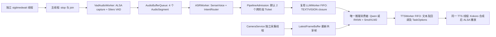

# 5.2 多线程与异步 Pipeline 工程记录

状态：5.2 工程验收通过，完整证据见 `stage5_02_board_acceptance.md`，本轮暂停在 5.3 之前。日期：2026-10-17。

## 操作 1：继承 5.1 验收与授权边界

已完整读取任务书及 `stage5_01_board_acceptance.md`。5.1 的真实语音闭环、用户听音及协作式信号退出是基线，不算作 5.2 已通过的证据。仅修改本地和 `/home/cat/projects/RK3576/rk3576_multimodal_stage5_review`。原工程、原 `build/stage5_full`、模型、SDK、驱动、设备树及系统配置不写入。没有上传用户明确不需要的 `stage5_01_acceptance_local.tgz`。

本地无 Git 元数据，以 `backups/stage5_02_before/` 的 107 文件快照、SHA256 和 Git no-index 格式差异记录版本。5.1 初始包清单与最终修复源码有差异，本节继承正式验收的最终源码。

## 操作 2：源码定位与最小方案

`ASRWorker::run()` 同步调用 `on_text`。原 TEXT 分支提交 LLMWorker；VISION 分支却直接执行 `vlm->infer(frame, vlm_question)`，包含 RKNN Vision 和 SmolVLM2 RKLLM，阻塞 ASR 工作线程。CameraService 已独立采集，LatestFrameBuffer 保存共享最新帧；无需重建 Camera 框架。原 TTSWorker 在一个线程中合成和播放，等待容量 2，但局部队列限制不代表全部在途回答有界。

实施顺序为冻结基线及 NPU 实测、复用推理 FIFO、跨阶段额度及过期/取消、Fake 并发测试、ARM64 与真实语音回归。模型算法和 SDK 不改。

| 文件 | 具体改动 | 验收方法 |
|---|---|---|
| `common/work_control.h` | 停止模式、截止时间、等待期限、取消 flag 和统计 | Fake 过期与取消断言 |
| `ai/llm_worker.h/.cpp` | 保留 TEXT 接口，新增 submitTask、显式 restart、终态统计 | FIFO、满载、抛异常、停止重启 |
| `app/pipeline_admission.h` | 一个 Ticket 覆盖推理至播放全过程 | 最后引用释放与 close 并发测试 |
| `audio/asr_llm_tts_smoke.cpp` | VLM 异步提交、执行时取最新帧、ID/期限传递、退出语义 | 同输入 A/B、真实语音、信号 |
| `audio/tts_worker.h/.cpp` | 保留原合成及播放，加入过期/取消/统计/重启 | Fake TTS 与 Kokoro/ALSA |
| `audio/asr_pipeline.h/.cpp` | 保留原丢旧音频策略，增加 ID 日志、峰值及计数 | 原 ASR 测试和连续采集 |
| TTS/ALSA service 头与实现、`tts_smoke.cpp` | 公共头用前置声明，实际调用显式 include SDK | 真实 SDK 全目标编译 |
| `tests/async_pipeline_tests.cpp` | 闸门控制的确定性线程测试 | 本地和 ARM64 CTest |
| `tests/stage5_02_npu_probe.cpp` | 顺序/重叠 NPU 调用对照，手工诊断 target | 真实 SDK 实测；不注册 CTest |
| `tools/stage5_02_*`、回放 TSV | 隔离路径、PID 检查、超时、证据收集 | 原始退出码、日志、321 项指纹 |

## 操作 3：真实线程与队列架构

这些是应用线程，SDK 内部线程仍由各 SDK 管理。ASR 只负责识别、路由、申请额度和提交 closure，不等待推理或 TTS。视觉帧在执行时取最新共享帧，不把 4K 图像积在队列里。共享推理消费者覆盖本入口的两种 RKLLM 与 RKNN 调用；独立程序不受该 FIFO 管理，因此运行前仍检查设备占用。

## 操作 4：有界性、背压与终态

默认 `max_inflight=2`，Ticket 一直持有到 TTS 完成或其他终态回调及 closure 释放。局部推理等待和 TTS 等待容量均保留 2；默认额度下存在活动 TTS 时最多一个等待回答。额度满拒绝新请求，打印请求 ID、路由与原因并统计；不覆盖已接收回答。

默认推理排队上限 10000 ms、TTS 排队上限 12000 ms、跨阶段生存期 45000 ms，使用 steady_clock。在阶段执行前检查，过期不调用 SDK，但仍回调终态、计数、归还额度。活跃 SDK 不强制中断，因此这些期限不构成硬实时完成保证。

`completed` 表示所有终态，包括取消和过期；`started` 才是执行过 SDK/任务体，`failed` 是运行错误。策略拒绝、过期、成功播放必须分别报告，不能将 completed 当推理成功或把丢弃带来的吞吐下降隐藏。配置解析严格校验范围，非法值明确失败。提供 `cancel(id)`，本入口尚未实现用户口头打断命令。

## 操作 5：生命周期、竞态与退出审查

start 保留一次性语义；restart 仅由唯一 owner 在 requestStop、join 后调用，本轮统计重置、generation 递增。submit 与 requestStop 使用同一个队列 mutex；start/join/restart/析构不能由多个 owner 并发调用，回调不能 join 自己。

Drain 关闭新入口并完成已接收任务，仍尊重原期限。CancelPending 取消尚未开始的阶段，活跃 SDK 或播放正常结束；正在推理的请求结束后若取消，不再进入 TTS。取消关闭与提交竞争产生的 NotRunning 单独记为预期取消，不误报为运行失败。

Worker 不持有队列锁执行 SDK 或业务回调。回调后先销毁 task captures，再锁内发布 completed/active=0，最后 notify；main 观察到 idle 时，TTS 转交及额度归还均已完成。Admission 表内保存 weak_ptr<atomic<bool>>，避免锁内暂时取得最后一个 Ticket 引用并析构，再次锁同一 mutex。状态、帧缓冲、VLM/Camera 声明早于 Worker，反向析构先 join Worker，后销毁被借用对象。

停止顺序为停止/唤醒录音、关闭音频队列、join VAD/ASR、关闭 Admission、排空或取消推理、join 推理、destroy Qwen、排空或取消 TTS、join TTS、close ALSA/destroy TTS、Camera stop/join、VLM/RKNN destroy。继承 5.1 sigtimedwait，不在异步 signal handler 中加锁、打印或调用 SDK。

剩余边界：SDK 永久阻塞时，C++ join 无硬截止保证。外层保护只允许终止本次已核实 PID，必须将强制终止记为退出失败。没有以有限回归宣称无任何竞态，也没有声称已完成 ASan/TSan 或长期压力。

## 操作 6：回声与 TTS 调度取舍

HyperX 耳机降低回灌，不等于 AEC。保持播放期间 ASR 可继续处理，以端到端额度限制误触发积压。冷却、PTT、AEC、打断需要明确产品语义，本节未实现。没有把 TTS 拆为合成和播放两个线程，避免增加预合成 PCM 积压与资源生命周期；模型计算优化留在 5.4。

## 操作 7：构建问题与证据分类

首次 ARM64 构建暴露 `tts_smoke.cpp` 对 SherpaOnnxWriteWave 的间接 include 依赖。公共头解耦后补显式 SDK C API include，保留原失败日志及复测日志。修复后全目标构建成功，ARM64 CTest 5/5，0.29 s；本地 portable CTest 7/7，0.53 s。CTest 中 Fake/Mock 不代表硬件推理；下文另记真实模型回归。

完整数据见 `stage5_02_performance.md` 和 `stage5_02_board_acceptance.md`；完整关键源码见 `stage5_02_source_appendix.md`，逐句解释及面试题见 `stage5_02_statement_notes.md`。本节已完成，等待用户审阅后再进入 5.3。

## 操作 8：适用范围补充

CancelPending 针对尚未开始的推理/TTS 阶段；音频队列仍沿用 5.1 的关闭并排空方式。已采集音频段可能继续被 ASR 识别，但 Admission 已关闭，会明确拒绝新业务提交。因此取消退出仍可能包含残留 ASR 和当前 SDK/播放的耗时，不承诺瞬时停止所有计算。

仅默认 `STAGE5_MAX_INFLIGHT=2` 完成了本轮硬件验收。上调至 8 不会无限增长，但局部等待队列仍为 2，可能产生额外 QueueFull 及程序失败状态；放宽额度前需结合容量和实际负载重新验收。

并发控制没有消除 TTS 的 CPU/内存带宽竞争。真实连续测试中 VLM 有一次 2793.65 ms，不能把单消费者描述为所有延迟均固定或下降。模型成功率和请求交付率分别报告；播放成功仍需要用户听音确认。
