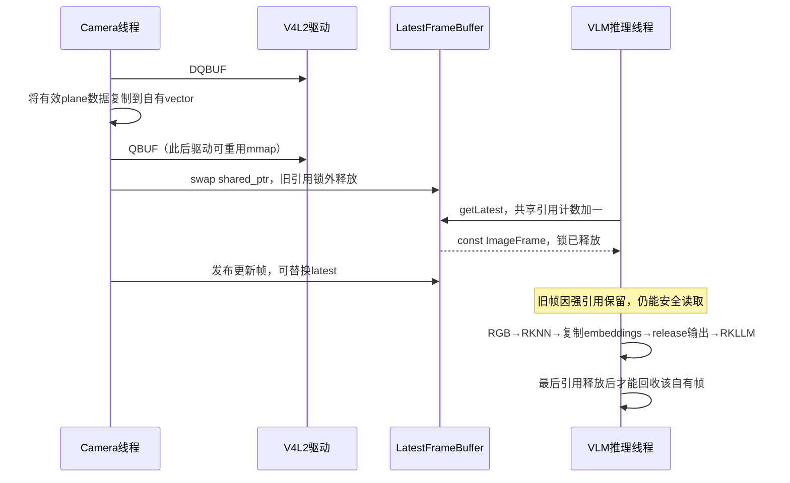
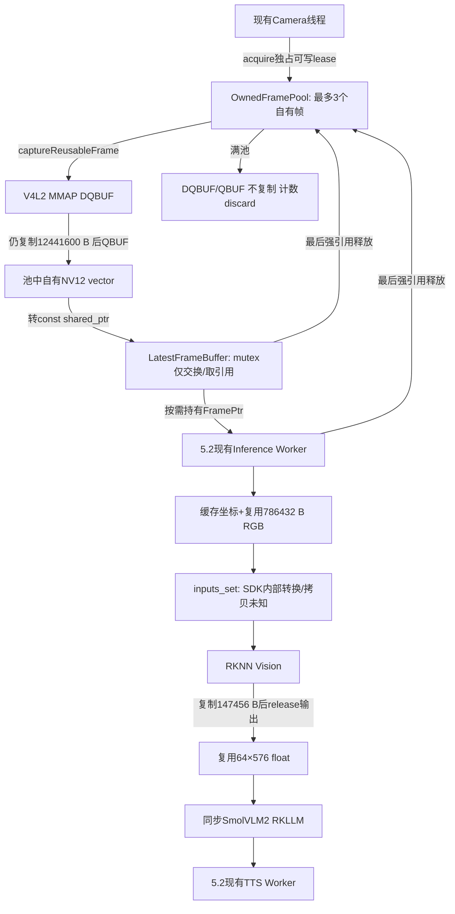
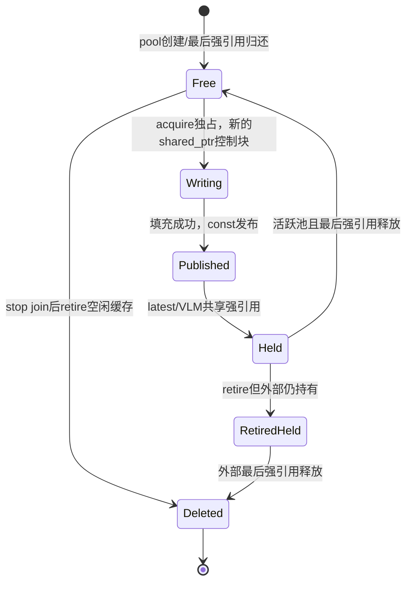

# 5.3 RK3576 内存管理与 Camera→VLM 数据链路

状态：CPU 路径优化、ARM64 回归和证据整理完成，提交 5.3 有限范围验收；RGA 实验失败未启用，暂停等待用户验收。日期：2026-10-17（Asia/Hong_Kong）。

## 操作 1：继承版本与保护范围

已读取任务书 5.3 要求、5.2 正式验收及当前真实源码。5.2 的异步推理 FIFO、跨阶段额度、期限/取消、SIGINT/SIGTERM 不在本节重构。原稳定工程及 5.1/5.2 已验收构建保留。只向 `/home/cat/projects/RK3576/rk3576_multimodal_stage5_review` 写入。

本地 `backups/stage5_03_before/` 冻结 126 文件，SHA256 在 `reports/stage5_03_local/baseline_manifest.json`。板端保存 5.2 最终 80 项源码快照、原工程指纹与已验收二进制指纹于 `reports/stage5_03_board/`。5.3 使用新的源码子目录与构建目录，不覆盖隔离根目录的 5.2 源码。

## 操作 2：基于源码回答十个问题

| 问题 | 审计事实与依据 |
|---|---|
| V4L2 内存模式 | `VideoCapture::initMMap` 指定 `request.memory=V4L2_MEMORY_MMAP`，REQBUFS 请求 4 个、QUERYBUF 后逐 plane mmap；没有 EXPBUF、DMA-BUF FD 传递或 RKNN set_io_mem。mmap 不等于端到端零拷贝。 |
| 实际输出 | 本轮只读 `v4l2-ctl --get-fmt-video` 为 3840×2160、NV12、1 plane、bytesperline=3840、sizeimage=12441600。初始化还会记录 S_FMT 真正返回字段，避免只采用历史查询结果。 |
| stride/padding | 当前 stride=width，没有行 padding。CPU 验证 stride>=width、stride*(height+height/2)<=data.size；按 y*stride+x 取 Y，UV 起点 stride*height，因此支持单 plane 的行 padding。多 plane 被预处理明确拒绝；隐含 height-stride padding 未单独描述/支持，不能泛化任意 NV12 布局。 |
| LatestFrameBuffer 是否复制 NV12 | 不复制。CameraService 使用 make_shared<const ImageFrame>(std::move(frame))，LatestFrameBuffer::update 在锁内 swap(shared_ptr)，旧引用在锁外释放。实际整帧复制发生于 captureFrame 的 vector::insert，位于 QBUF 之前。 |
| 两线程共享 | Camera 发布 shared_ptr<const ImageFrame>，推理执行时 getLatest 按值取一份共享所有权，退出 getLatest 后不持 mutex 推理。VLMEngine 另持自身 mutex 保护 Runtime；这是不同的锁。 |
| shared_ptr/mutex/move 职责 | shared_ptr 延长已拥有帧的寿命；const 限制消费者修改；mutex 保护 latest 指针交换/读取，不锁整段像素运算；move 转移 vector 的存储所有权，避免第二次整帧复制。shared_ptr 本身不能防止另一个可写别名覆盖像素。 |
| V4L2 重用风险 | 当前复制了 bytesused-data_offset 到自有 vector 后才 QBUF。驱动之后重写 mmap 不影响该 vector。严禁把 mmap 裸指针塞进 shared_ptr 便称安全；强引用只能保护包装对象，不能自动阻止驱动覆盖。 |
| 转换/缩放位置 | RK3576VLMBackend::infer 内同步 CPU 执行 frameToRgb512。一个循环融合 Y 双线性采样、UV 最近邻采样、BT.709 limited-range 转 RGB，输出 512×512 RGB；整幅视野直接拉伸，没有 crop/letterbox，无中间 4K RGB。 |
| RKNN 二次 memcpy | 应用没有在 RGB 与 rknn_input.buf 之间再 memcpy，直接指向 rgb.data；rknn_inputs_set(pass_through=0,UINT8,NHWC) 交给 SDK 做模型一致的转换。SDK 内部拷贝/分配次数不可由闭源接口精确推出，标记未测量，不当成零拷贝。输出 embeddings.assign 另复制 64*576 个 float，随后 release RKNN 输出。 |
| 拷贝与分配数 | 单 plane 每个采集帧有 1 次显式整帧拷贝 12441600 B；原应用每帧有 4 个 vector 首次扩容点（V4L2 plane 描述、stride、plane_sizes、像素）及 1 次 make_shared 对象/控制块分配。每个 VLM 请求另新建 786432 B RGB vector、147456 B embeddings vector，SDK 输出缓冲由 SDK 分配/释放。字符串、SDK 与系统 allocator 的内部总次数未测量。Camera 持续采集，不能把整段交互期间所有 Camera 拷贝归成“每请求固定一次”。 |

驱动当前报告 Quantization=Full Range，而已验收 CPU 算法使用 limited-range；Colorspace/YCbCr Encoding 为 Default。这是必须记录的元数据/算法语义差异，不足以证明 ISP 的物理色彩响应。性能优化先保持旧像素值，不能悄悄改颜色矩阵。要纠正物理色彩需固定色卡/ISP 配置的独立校准，本节不修改系统。

## 操作 3：真实数据流与生命周期

```mermaid
flowchart LR
  Sensor[IMX415 / ISP] --> Driver[V4L2 驱动 Buffer: 请求4个]
  Driver --> Map[用户 MMAP: 驱动拥有像素存储]
  Map -->|poll等待后 DQBUF| CPU[Camera线程临时独占出队 Buffer]
  CPU -->|显式复制 12441600 B| Owned[自有 ImageFrame::data NV12]
  CPU -->|复制完成才 QBUF| Driver
  Owned -->|move vector / make_shared| Shared[shared_ptr const ImageFrame]
  Shared -->|mutex内只swap| Latest[LatestFrameBuffer 单个最新指针]
  Latest -->|mutex内复制shared_ptr| Infer[VLM Worker 持有共享帧]
  Infer --> Fused[CPU融合采样缩放和NV12转RGB]
  Fused --> RGB[786432 B RGB]
  RGB -->|inputs_set: SDK转换/传送不透明| RKNN[RKNN Vision]
  RKNN --> Out[SDK输出缓冲 want_float=1]
  Out -->|assign复制147456 B| Embed[自有36864个float]
  Out --> Release[rknn_outputs_release RAII]
  Embed -->|同步rkllm_run借用| Smol[SmolVLM2: 64 tokens / 576维]
```

本节任何池化必须以“最后一个强引用消失才归还池”为条件；不能仅在 use_count()==1 时覆盖一个仍可被 weak_ptr.lock 重新取得的帧。

## 操作 4：先测量，再优化（执行前计划与基线记录）（执行前计划与基线记录）

1. 保留未经修改的 5.2 库与程序，新增独立诊断程序链接旧库，执行 12 次真实 Camera→VLM 并保存 3 个固定 NV12 帧。该轮已实际完成：12/12 成功、约 29.8983 FPS、694 帧、0 timeout，源码与旧构建未修改；完整日志见 raw_5_2_baseline。这个粗基线没有细分预处理计时，不补造缺失指标。
2. 仅提取原预处理函数并增加埋点，原算术函数体校验一致；在独立 `stage5_03_baseline_source` / `build/stage5_03_baseline` 构建，保留每帧/每请求 JSONL。该版本保留旧分配和复制策略，作为可比较的细分基线。
3. 区分 poll 等帧、DQBUF、metadata/reserve、owned copy、QBUF、shared 对象分配、latest swap/旧引用释放/get、融合预处理、RKNN descriptor/inputs_set/run/outputs_get/embedding copy/release。单独 NV12→RGB 与 Resize 时间因融合而未测量，不用两个虚假数字拆分。日志 I/O 发生在被计时边界之后；上层 wall time可能仍含诊断开销，不能混用。
4. 优先依据数据评估坐标缓存、RGB/embedding 缓冲复用、descriptor 避免堆分配，以及保持生命周期安全的有界自有帧池。保留原 CPU reference 和原按帧分配路径作回退。
5. 用同一固定帧比较 RGB 和 embeddings，再测独立 RGA 路径；RGA 可用不等于更快，也不等于 DMA-BUF 或零拷贝。通过 SDK 真实输出检查 512×512、RGB、输入类型、64×576 特征，模型内嵌 mean/std 若不能可靠读取则明确说明。
6. Fake 边界/所有权测试、本地 portable CTest、ARM64 CTest、Camera/VLM 多次采样、真实完整语音与 SIGINT/SIGTERM。最后核对原工程和已验收程序指纹、设备释放。通过后才作 5.3 验收，暂停在 5.4 之前。

## 操作 5：RGA 环境初查与命令异常

实际存在 `/dev/rga`、`/dev/dma_heap/system`、`system-uncached`；reserved heap 仅 root 权限，不申请改权限。系统安装 librga-dev/librga2 2.2.0-1，链接文件为 `/usr/lib/aarch64-linux-gnu/librga.so.2.1.0`，头文件在 `/usr/include/rga/`。包版本、SO 文件名和 API 版本不能互相当作同一版本号。

`v4l2-ctl --get-parm` 实际返回 255，设备不支持该 ioctl，因此 FPS 通过捕获帧数/单调时钟实测。普通 cat 的 PATH 未找到 ldconfig；已有库路径和 dpkg 查询仍已核实，后续可以只读调用 `/sbin/ldconfig -p`，不执行更新缓存。原始错误保留，不能把失败查询写成成功。

RGA 参数将以板端真实头文件为准，并参照 [Rockchip 官方开发指南](https://github.com/airockchip/librga/blob/main/docs/Rockchip_Developer_Guide_RGA_CN.md) 与 [官方 FAQ](https://github.com/airockchip/librga/blob/main/docs/Rockchip_FAQ_RGA_CN.md) 的色彩空间说明；显式设定颜色矩阵，避免依赖随版本变化的默认值。

<!-- STAGE5_03_MEASURED -->
## 操作 6：最终低风险实现与版本边界

生产路径采用三槽 OwnedFramePool、自有 NV12 vector 容量复用、栈上 V4L2 plane 描述、512×512 坐标缓存、RGB/Embedding vector 复用。没有新增 Worker，没有改变 5.2 推理队列、跨模型串行策略、ASR/TTS 功能或 5.1 信号机制。

`VideoCapture::captureFrame` 保持旧成功后提交语义；新增 captureReusableFrame（独占 lease 直接填充）与 discardFrame（池满时出队后直接归还）。ImageFrame 字段未改变。CameraStats 增加 driver_sequence_gaps/pool_discarded；旧接口仍可调用。新增池和预处理类是工程内部实现。`STAGE5_CAMERA_POOL=0` 和 `STAGE5_VISION_PREPROCESS=reference` 可同时恢复旧 CPU/逐帧分配路径，已经实测；生产默认 pool=1/cached。未知值启动时明确失败。

完整修改文件、逐文件 SHA256 与 Git 格式差异在 `reports/stage5_03_local/change_manifest.json`、`changes.patch`。这里没有 Git 仓库元数据，因此使用 git diff --no-index，并不虚构 commit。完整源码见 [源码附录](stage5_03_source_appendix.md)，关键语句、线程与生命周期审查见 [逐句解释](stage5_03_statement_notes.md)。

| 文件/类别 | 具体问题、修改与验证 |
|---|---|
| include/common/image_profile.h | 无细分指标；新增可关闭 JSONL，输出失败显式 ERROR；真实日志验证，计时不含本条写文件时间。 |
| include/video/owned_frame_pool.h | 每帧重新分配；增加最多三帧独占空闲槽，每次 lease 新控制块，最后强引用归还。Fake 检查满池、weak_ptr、stop/restart、并发读、retire。 |
| include/video/image_preprocessor.h、src/video/image_preprocessor.cpp | 原函数内重复计算坐标；冻结 reference，增加 512 项坐标缓存。固定帧真实 RGB/Embedding 比较和随机 padding 测试。 |
| include/video/video_capture.h、src/video/video_capture.cpp | plane 描述和帧 vector 每帧分配；新可复用填充/主动 discard/序号计数，保留 QBUF 前 memcpy。真实采集及 Fake 满载验证。 |
| include/video/camera_service.h、src/video/camera_service.cpp | 建立池所有权、退役与配置边界，新增统计，无新线程；真实语音/信号和 Fake 生命周期验证。 |
| src/video/latest_frame_buffer.cpp | 只埋点 swap/get/锁外释放；这里原来就没有整帧复制，没有重建队列。 |
| src/ai/rk3576_vlm_backend.cpp | 复用 RGB/Embedding，保留 Engine mutex 与输出 RAII，记录 tensor 属性和分段时间；真实固定帧/Camera/VLM 验证。 |
| tests/image_pipeline_tests.cpp、tests/camera_test_capture.cpp、src/video/video_capture_unavailable.cpp | 新边界/所有权测试，Fake 补齐新增 API；不冒充硬件测试。 |
| tests/stage5_03_memory_probe.cpp、tests/stage5_03_rga_probe.cpp | 手动真实采样与可失败 RGA 实验；不在自动 CTest 隐式启动硬件。 |
| CMakeLists.txt | 复用已有 core/SDK 链接，加入预处理、单元测试与可选手动探针，没有新 AI Demo 框架。 |
| tools/stage5_03_*.py | 独占部署、真实采样、PID 安全超时、收集、分析、报告、源码/补丁导出；脚本全文也进入附录。 |

旧 weak_ptr 对上一 lease 的控制块永久过期，即使物理帧地址复用也不能复活；池 deleter 不捕获 Camera 裸指针。共享控制块创建在池锁外，异常归还不会重锁死锁。池 retire 锁内只换空闲数组，锁外释放大 buffer；新一代 Camera 使用新 State。坐标/RGB/Embedding 均由既有 Engine mutex 串行化。SDK 指针使用结束前不会被下一请求覆盖，输出先复制再 release。剩余通用内存分配异常沿用 Worker/Camera 的错误传播与停止路径；不声称覆盖了所有 SDK 内部故障。

## 操作 7：测量条件与统计口径

全部主表使用同一 RK3576、/dev/video11、3840×2160 NV12、stride=3840、sizeimage=12441600、4 个实际 MMAP（每个长度12441600），Release、原有模型/SDK和相同问题。未复制大型模型。原始 5.2 未修改基线 raw_5_2_baseline 完成12次；细分基线 baseline_live_12_retry1 与最终优化 candidate_live_final_12 各12次，固定帧各6次（3帧×2）。采集与推理并发，温度/调频/其他系统负载未锁定；不是大规模随机交叉性能试验。

计时用 steady_clock。P50/P95 为 nearest-rank，无插值；n=12 的 P95 即最大值，小样本不能推断长期尾延迟。NV12→RGB 与 Resize 原来就是同一融合循环，单独两项均标“未单独测量”。rknn_input_descriptor 和 inputs_set 分开；后者包含真实 SDK 处理，不推测内部 memcpy 数量。捕获 poll 是等下一帧，单列显示而不算预处理计算。

每行埋点结束后才写 JSONL，所有版本同样开启埋点；日志 I/O 仍可能影响系统负载。capture_alloc_prepare 与内部 reserve 存在嵌套，不能相加。释放计时只覆盖 latest 旧引用 reset 与 RKNN outputs_release，不等于全进程 free 总耗时。RGB 首次分配包含在 preprocess_fused；Embeddings 首次分配与复制合测。全进程分配/释放次数、SDK 内部内存和光学曝光 Frame Age 均未测量。

Frame Age 从主机 DQBUF 后 received_at 到引擎取用测量，不是 sensor exposure timestamp。基线前三个请求保存原始 fixture，会增加 age；主比较在两组均剔除前三个，剩9个。最终优化轮通过 STAGE5_CAPTURE_FIXTURES=0 关闭额外 raw 文件保存；内层 preprocess/run 计时不含这些写入。RGB dump 只在固定帧实验开启，固定帧 wall time 不当 Camera 端到端性能。

## 操作 8：真实优化前后数据

以下全部时间单位 ms；每格顺序为 **平均 / P50 / P95 / 最小 / 最大 (样本数)**。完整所有 case/stage 见 `reports/stage5_03_local/performance.csv` 与 `performance.json`，原始 JSONL 在板端同名报告及本地 collection 中。

| 边界 | 旧策略细分基线 | 最终优化 |
|---|---|---|
| poll等待（非计算） | 22.200904 / 22.325500 / 27.552300 / 12.527100 / 80.955300 (n=696) | 21.855840 / 21.953600 / 27.113300 / 8.204060 / 80.135100 (n=636) |
| DQBUF | 0.012889 / 0.011343 / 0.023245 / 0.003404 / 0.061898 (n=696) | 0.012815 / 0.012267 / 0.022270 / 0.004473 / 0.039392 (n=636) |
| plane描述准备 | 0.003642 / 0.003234 / 0.006538 / 0.000421 / 0.079541 (n=696) | 0.000987 / 0.000896 / 0.001841 / 0.000302 / 0.011032 (n=636) |
| vector分配/元数据准备 | 0.009229 / 0.008803 / 0.018424 / 0.001765 / 0.044074 (n=696) | 0.004934 / 0.004266 / 0.008485 / 0.001416 / 0.099917 (n=636) |
| 其中payload reserve（嵌套） | 0.004568 / 0.004226 / 0.008467 / 0.000731 / 0.040046 (n=696) | 0.000688 / 0.000287 / 0.000681 / 0.000051 / 0.091602 (n=636) |
| 自有NV12显式复制 | 9.458733 / 9.312950 / 13.926900 / 2.593630 / 16.547200 (n=696) | 9.735613 / 9.740140 / 14.485400 / 4.843090 / 22.815200 (n=636) |
| QBUF | 1.405019 / 1.144770 / 2.718100 / 0.872174 / 3.965390 (n=696) | 1.434083 / 1.146310 / 3.100710 / 0.871660 / 3.893830 (n=636) |
| 发布shared_ptr准备 | 0.002107 / 0.001787 / 0.003694 / 0.000524 / 0.060622 (n=695) | 0.000102 / 0.000080 / 0.000262 / 0.000050 / 0.000729 (n=635) |
| latest发布指针swap | 0.000852 / 0.000680 / 0.001804 / 0.000123 / 0.013714 (n=699) | 0.000958 / 0.000772 / 0.001910 / 0.000100 / 0.017940 (n=639) |
| 旧引用锁外释放 | 0.007960 / 0.003948 / 0.008497 / 0.000049 / 1.098070 (n=699) | 0.006533 / 0.005996 / 0.011213 / 0.000049 / 0.110587 (n=639) |
| latest取强引用 | 0.000712 / 0.000668 / 0.000949 / 0.000571 / 0.000949 (n=12) | 0.000484 / 0.000474 / 0.000815 / 0.000350 / 0.000815 (n=12) |
| 融合Resize+NV12→RGB | 11.051650 / 10.540300 / 12.640000 / 10.220000 / 12.640000 (n=12) | 8.324731 / 8.378250 / 9.495260 / 7.656490 / 9.495260 (n=12) |
| RKNN输入描述 | 0.000188 / 0.000175 / 0.000300 / 0.000150 / 0.000300 (n=12) | 0.000205 / 0.000153 / 0.000391 / 0.000125 / 0.000391 (n=12) |
| RKNN SDK输入准备 | 11.045550 / 11.097500 / 12.554200 / 10.068700 / 12.554200 (n=12) | 11.298375 / 11.077400 / 12.673800 / 10.539300 / 12.673800 (n=12) |
| RKNN Vision run | 1160.708333 / 1160.380000 / 1166.640000 / 1158.740000 / 1166.640000 (n=12) | 1163.490833 / 1162.410000 / 1168.060000 / 1160.550000 / 1168.060000 (n=12) |
| SDK取浮点输出 | 0.737297 / 0.789449 / 1.006530 / 0.320910 / 1.006530 (n=12) | 0.716351 / 0.790512 / 0.872674 / 0.201465 / 0.872674 (n=12) |
| Embedding分配/复制 | 0.115226 / 0.107932 / 0.286089 / 0.041462 / 0.286089 (n=12) | 0.094729 / 0.105193 / 0.110868 / 0.032899 / 0.110868 (n=12) |
| RKNN输出释放 | 0.005266 / 0.004356 / 0.018349 / 0.002119 / 0.018349 (n=12) | 0.004419 / 0.004349 / 0.009334 / 0.001959 / 0.009334 (n=12) |

| 汇总指标 | 细分基线 | 最终优化 |
|---|---|---|
| Camera发布FPS（stop前） | 29.8862 | 29.8773 |
| Camera发布帧数 | 695 | 635 |
| Frame Age暖态（ms，n=9） | 26.850922 / 20.631400 / 43.942900 / 11.512700 / 43.942900 (n=9) | 28.383678 / 32.865500 / 38.874600 / 14.314700 / 38.874600 (n=9) |
| RSS采样峰值 MiB | 554.426（n=95） | 552.043（n=87） |
| /proc VmHWM已观测最大 MiB | 554.426 | 552.043 |
| 每采集帧整帧memcpy次数/数据量 | 1 / 12441600 B | 1 / 12441600 B |
| latest发布/读取整帧memcpy | 0 / 0 B | 0 / 0 B |
| 应用RGB→RKNN额外memcpy | 0；SDK内部未知 | 0；SDK内部未知 |
| 每请求Embedding复制 | 1 / 147456 B | 1 / 147456 B |
| 暖态每帧源码可见分配点 | 4个vector+1个make_shared | 1个lease控制块；无vector扩容 |
| RGB容量增长/12请求 | 12 | 1 |
| Embedding容量增长/12请求 | 12 | 1 |
| 真实Camera超时/引擎失败 | 0 / 0 | 0 / 0 |
| driver sequence gaps / pool discard | 未埋点 / 无池 | 0 / 0 |

融合预处理平均降低 **24.67%**（约 2.727 ms）。每帧暖态源码可见分配点从5降为1；这不是进程 malloc 总数，冷启动另有池State、最多三个ImageFrame以及各槽vector首次容量。最终轮636次acquire、633次复用、3帧创建、0满池，停止in_use=0；metadata/data共9次首次容量增长，之后复用。每次 lease 控制块仍需分配，故不是“零分配”。

NV12 memcpy 平均没有改善，Frame Age 均值也没有改善；FPS基本保持30。RSS观测峰值只差约2.38 MiB，不应当作可靠的大幅省内存结论，池的设计上限为三块NV12（约35.60 MiB）加对象/控制块与RGB/Embedding缓存。RKNN run约1.16秒，计算没有加速。两轮完整VLM wall time受回答长度/现场画面等影响，不能把其差值归因于这约2.73 ms的局部优化。没有将本节成果写成完整语音端到端等比例加速。

## 操作 9：固定帧与模型视觉正确性

18组比较来自 candidate_fixed_6、candidate_fallback_fixed_6、candidate_fixed_final_6 对同一 baseline_fixed_6 的各6个样本。每组512×512×3 RGB（786432 B）与64×576 float（147456 B）均逐字节一致；RGB最大/平均绝对误差0，Embedding最大绝对误差0，非零向量cosine约1；全部对应回答文本相同。具体SHA256、误差、问题/回答在 `fixed_frame_comparison.json`。原始3帧、metadata、6份每轮RGB/F32与终端日志均保留。没有用另外现场画面硬凑像素对比。

已人工查看三帧RGB预览 `reports/stage5_03_local/fixed_frame_preview.png`；画面为实际倾斜的显示器及其背面/支架，物理安装方向保持，未因本次转换出现新增错位或条纹。显示器拍摄的纹理不能当作新的软件故障。合成测试检查红色通道、上下方向、range、不同尺寸/stride和非法布局；固定帧精确一致进一步证明未引入RGB/BGR交换、crop或采样变化。没有独立色卡物理标定。

真实Tensor查询：输入FLOAT16/NHWC、dims=1,512,512,3、n_elems=786432、size_with_stride=1572864、w_stride=512；应用传UINT8/NHWC/pass_through=0，保留SDK转换。输出原生FLOAT16、dims=1,64,576、n_elems=36864，want_float=1取得147456 B。mean/std是模型转换内嵌属性，当前Runtime tensor query不能可靠还原；历史4.md记载127.5/127.5（[-1,1]），只作版本参考，原转换脚本预期路径本轮不存在，不宣称重新验证了导出流程。模型文件和调用dtype均未改变，固定RGB/Embedding精确比较是本轮真实一致性证据。

配对CPU补充试验（同一个固定fixture0，单进程交替reference/cached，各100次，RGB均复用；只用于确认坐标缓存效果，不属于成功RGA样本）：

| 实验 | 模式 | 平均/P50/P95/最小/最大 ms |
|---|---|---|
| rga_diagnostic | cpu_reference_reused | 10.284052 / 10.328400 / 10.356800 / 10.107900 / 10.371100 (n=100) |
| rga_diagnostic | cpu_cached | 8.427162 / 8.560230 / 8.630680 / 7.927180 / 8.669240 (n=100) |
| rga_diagnostic_dma | cpu_reference_reused | 10.308338 / 10.313500 / 10.335500 / 10.269400 / 10.354600 (n=100) |
| rga_diagnostic_dma | cpu_cached | 8.054985 / 8.051230 / 8.143190 / 7.937770 / 8.189810 (n=100) |
| rga_diagnostic_split | cpu_reference_reused | 10.304793 / 10.319700 / 10.342000 / 10.096400 / 10.358500 (n=100) |
| rga_diagnostic_split | cpu_cached | 8.347797 / 8.375150 / 8.441630 / 7.634750 / 8.814920 (n=100) |

## 操作 10：RGA/DMA-BUF 实际评估与失败边界

板端Runtime/header API为1.10.3_[3]，querystring显示RGA_2_PRO，不从芯片型号推断RGA3。包librga-dev/librga2为2.2.0-1，SO实际文件名librga.so.2.1.0。存在/dev/rga与system/system-uncached heap，cat具备video组访问；reserved heap无权限，未更改。当前Camera仍是MMAP，没有调用EXPBUF，故没有Camera DMA-BUF直通路径。

三次实验：虚拟地址import的融合NV12→RGB+resize（3.774s）；system DMA-BUF import的融合转换（5.305s）；DMA-BUF分步先NV12→NV12 resize再CSC（5.561s）。均子进程退出1，首个硬件job失败，分步版本甚至未到CSC。import/参数校验成功不等于job成功。内核出现RGA hardware timeout及驱动自发soft reset/abort；没有手动重置、改驱动、设备树、权限或系统配置。全部探针释放FD，最终/dev/rga无占用。

DMA试验包含CPU把12.44MB fixture拷入heap，以及计划中的RGB读取/比较，不能称零拷贝；实际输入staging单次分别约11.14ms/8.92ms，非有效多样本RGA速度统计。只完成fixture0的100次配对CPU预处理计时后首个RGA job就失败，未完成计划的3帧RGA迭代，也没有RGA像素/Embedding质量通过数据。RGA耗时分位数、质量误差和收益均标“未测量/未通过”。

可以确认当前环境下三条实验路径不可采用；不能凭这些日志指定唯一SDK/驱动/地址映射根因。**RGA未启用到生产路径，CPU cached/reference均保留。** 如未来继续定位需独立版本兼容性/驱动分析；超出隔离目录的修复另行申请，不能为追求名义零拷贝破坏稳定链路。

## 操作 11：自动测试、真实闭环与安全退出

最终ARM64 CTest6/6（0.88s，退出0），每项<=30s；本地portable8/8（1.74s，退出0）。ARM注册：image_pipeline_tests（Fake Camera+真实CPU预处理）、async_pipeline_tests（Fake）、asr_pipeline_tests（Fake）、audio_preprocessor_tests（纯CPU）、llm_worker_tests（Fake）、camera_service_tests（Fake）。本地另有core_tests和cli_smoke；不能把它们当真实SDK推理。26个候选Target构建成功，最后修复生产配置边界后重编译成功，RGA分步仅重编手动诊断目标。没有修改通过的5.1/5.2构建。

真实voice_natural_retry1使用USB麦克风→Silero→SenseVoice→TEXT/Qwen和VISION/IMX415/RKNN/Smol→Kokoro→HyperX ALSA。实际5个VAD/ASR段（包括一次短“十”及重复提问），3次LLM、2次VLM、5次TTS全部成功；音频队列丢弃0、请求拒绝0、XRUN/Suspend/Recovery/RecoveryFailure均0。首个短段不能当目标算术准确识别；后续“一加一等于几”识别两次，回答“一加一等于二”。视觉两次回答涉及桌面设备，用户原话“相符”“两个都实际听到了”，独立保存于user_confirmations.json，不借用5.1/5.2反馈。真实麦克风轮最终0退出，Camera3687帧、29.9583FPS、无driver gap/pool discard，池in_use=0。

| 场景 | 子进程退出码 | 信号至退出/EOF秒 | 输入关闭标记至退出秒 | 强杀/超时 |
|---|---|---|---|---|
| voice_natural_retry1 | 0 | 自然结束 | 1.714209 | False/False |
| sigint_idle_final | 0 | 1.9074078209996514 | 1.753296 | False/False |
| sigterm_vision_cancel_final | 0 | 3.318924645000152 | 2.337289 | False/False |
| sigterm_tts_drain_final | 0 | 12.231117747000098 | 32.824472 | False/False |

信号测试均实际观察trigger后向已确认exe/PID start token的本次子进程发送；不是kill命令成功就算通过。cancel场景当前VLM完成后取消尚未提交的下游TTS（downstream_cancelled=1）；drain场景两个已接受回答都TTS完成。排空12秒包含仍在进行的TTS，不应被报告成取消延迟或死锁。所有成功轮均shutdown complete、进程消失、Camera/ALSA/NPU无占用、帧池in_use=0。无新增明显生命周期故障，但没有ASan/TSan、长时间压力/泄漏证明或独立NPU内部内存测量。

## 操作 12：全部异常、根因与保留记录

| 真实事件 | 定位与处理 | 结论/证据 |
|---|---|---|
| v4l2 get-parm=255 | 当前驱动不支持查询，改用实际帧数/单调时钟 | readonly_environment、FPS真实采样；没有改驱动 |
| ldconfig普通PATH未找到 | 只读用/sbin/ldconfig -p核实 | 不更新系统缓存 |
| baseline_live_12准备脚本KeyError STAGE5_VLM | source后的变量未export到env -0 | 加set -a，保留setup_failure与runner旧源码；retry1通过 |
| 池初稿停止时可能延迟释放缓存 | weak控制块捕获State、空闲缓存退役语义审查 | deleter move捕获State、retire锁外释放；Fake生命周期/ARM复测通过 |
| 配置解析原先在采集线程 | 错误配置不应延迟为线程异常 | 移至start try内，返回false/last_error，新增Fake测试 |
| 三条RGA硬件路径首job失败 | 真实Runtime/kernel证据；唯一根因未证实 | 不采用，3份失败原日志保留；不是已修复通过 |
| RGA DMA首轮包装脚本选中了已存在目录 | exclusive mkdir拒绝，子进程未启动 | 使用新case名，未覆盖原失败证据 |
| voice_natural_final=1 | 90秒窗口没有任何VAD段，未能及时通知用户发问 | 完整失败日志保留；120秒retry1按实际监听通知并通过 |
| 首个短段识别“十”、英语phoneme告警 | 不是本节Camera优化根因，没有删日志 | 后续目标提问与用户听音确认成功；不宣称ASR/TTS语言模型全无问题 |
| CSI2/vblank内核告警 | 基线与候选均已有；当前观察未导致应用超时/序号缺口 | 保留dmesg，不冒称内核零错误，不改设备配置 |

本地一次读取包含特殊字符的终端输出遇GBK编码异常、部分查询文件名不匹配，只影响显示/定位；原UTF-8文件仍完整，后续显式UTF-8。不会将命令失败删去或伪装为硬件验证成功。全部原始SSH命令/日志/退出码仍保留于ssh_时间目录。

## 操作 13：保护检查、交付与验收边界

最终只读检查：原稳定工程321项（包含build/stage5_full）全部一致；已验收5.1/5.2二进制SHA256一致；隔离根5.2源码80项一致；细分基线源码83项未变；候选86项与本地最终源码相同。最终可用磁盘2038575104 B（约1944.14 MiB），高于500 MiB；完整free/df、设备、dmesg与指纹在板端reports/stage5_03_board/final_state并收回本地。系统内存以free原日志为准，不能把进程RSS当整机空闲内存。没有复制模型或修改原模型/SDK/内核/驱动/设备树/系统配置。

交付文件：本报告、源码全文附录、逐句解释、[命令说明](stage5_03_commands.md)、[15道面试题及答案](stage5_03_interview.md)、Git差异与逐文件变更、CSV/JSON与原始日志、固定帧及预览、用户听音确认、最终保护指纹。补丁在临时精确基线apply --check及真实apply后逐字节校验，结果单列，不替代ARM验证。

工程结论：**CPU缓冲复用/预处理优化及原功能、退出回归已完成，提交5.3有限范围验收；RGA实验未通过且未进入生产，零拷贝未实现。** 剩余风险为Full Range元数据与旧limited算法的既有物理色彩差异、实际模型mean/std未从当前二进制反查、闭源SDK内部拷贝不透明、小样本/非锁频、长期稳定性未覆盖和RGA唯一根因未定位。Frame Age均值未改善、全帧copy没减少，均如实保留。5.4尚未开始；待用户验收后才转入TTS/端到端性能优化。

任务书要求在5.1～5.5完成后汇编内容一致的完整Word/Markdown工程手册。本节材料已按可汇编结构保存，当前不把未完成的5.4/5.5伪装成完整手册，也不提前宣布最终Word已交付。
