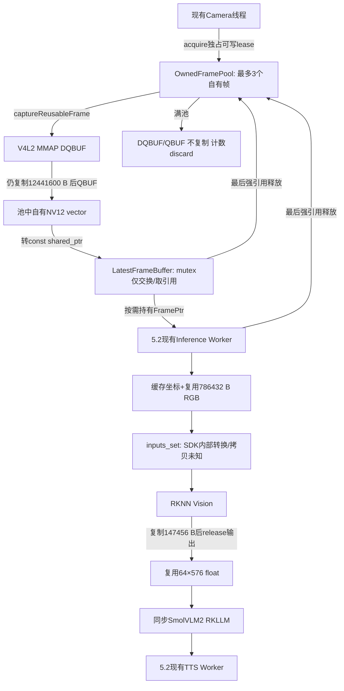
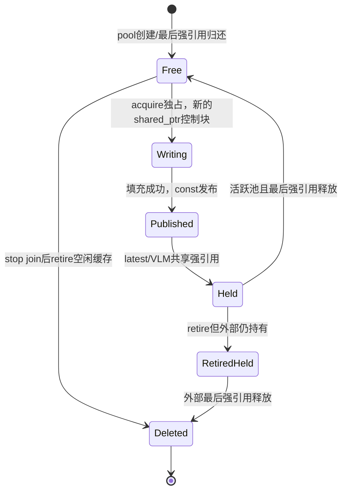

# 5.3 当前修改源码全文

由 `tools/stage5_03_export.py` 从真实文件生成。逐句语义解释见 [stage5_03_statement_notes.md](stage5_03_statement_notes.md)，架构与实测见 [stage5_03_memory_pipeline.md](stage5_03_memory_pipeline.md)。本附录不省略入口及测试，不代替板端版本哈希或执行证据。

## 操作 1：CMakeLists.txt

SHA256：`9358433d1cbbdcbaf5931500018e184dae111ad95d9da1f41dc5ef3f56c3d515`；376 行。

```cmake
cmake_minimum_required(VERSION 3.16)
project(rk3576_multimodal LANGUAGES CXX)

set(CMAKE_CXX_STANDARD 17)
set(CMAKE_CXX_STANDARD_REQUIRED ON)
set(CMAKE_CXX_EXTENSIONS OFF)
find_package(Threads REQUIRED)

option(BUILD_WITH_RKLLM "Build the real Rockchip RKLLM backend" OFF)
option(BUILD_WITH_VLM "Build SmolVLM2 RKNN + RKLLM real VLM backend" OFF)
option(ENABLE_SHERPA_ASR "Build ALSA + sherpa-onnx audio pipeline" OFF)
set(SHERPA_ONNX_ROOT
    "${CMAKE_CURRENT_SOURCE_DIR}/../asr_runtime/sherpa-onnx-v1.13.8-linux-aarch64-shared-cpu"
    CACHE PATH "Root of sherpa-onnx aarch64 shared CPU runtime")

# 真实视觉 SDK 仅在 RK3576 aarch64 Linux 上启用。
set(RKNN_INCLUDE_DIR "${CMAKE_CURRENT_SOURCE_DIR}/../rknn_test/include"
    CACHE PATH "Directory containing rknn_api.h")
set(RKNN_RUNTIME_LIBRARY "/usr/lib/librknnrt.so"
    CACHE FILEPATH "RKNN runtime shared library")

set(RKLLM_SDK_ROOT "${CMAKE_CURRENT_SOURCE_DIR}/../rkllm_sdk"
    CACHE PATH "Root directory of the RKLLM SDK")

if(BUILD_WITH_RKLLM OR BUILD_WITH_VLM)
    if(NOT CMAKE_SYSTEM_NAME STREQUAL "Linux")
        message(FATAL_ERROR "The real RKLLM backend currently requires Linux.")
    endif()

    if(NOT CMAKE_SYSTEM_PROCESSOR MATCHES "^(aarch64|arm64)$")
        message(FATAL_ERROR "The current RKLLM library requires Linux AArch64.")
    endif()

    set(RKLLM_API_DIR "${RKLLM_SDK_ROOT}/rkllm-runtime/Linux/librkllm_api")
    set(RKLLM_INCLUDE_DIR "${RKLLM_API_DIR}/include")
    set(RKLLM_RUNTIME_LIBRARY "${RKLLM_API_DIR}/aarch64/librkllmrt.so")

    if(NOT EXISTS "${RKLLM_INCLUDE_DIR}/rkllm.h")
        message(FATAL_ERROR "RKLLM header not found: ${RKLLM_INCLUDE_DIR}/rkllm.h")
    endif()

    if(NOT EXISTS "${RKLLM_RUNTIME_LIBRARY}")
        message(FATAL_ERROR "RKLLM runtime library not found: ${RKLLM_RUNTIME_LIBRARY}")
    endif()

    message(STATUS "RKLLM SDK library available")
    message(STATUS "RKLLM include: ${RKLLM_INCLUDE_DIR}")
    message(STATUS "RKLLM library: ${RKLLM_RUNTIME_LIBRARY}")
endif()

function(project_warnings target)
    if(MSVC)
        target_compile_options(${target} PRIVATE /W4 /utf-8)
    else()
        target_compile_options(${target} PRIVATE -Wall -Wextra -Wpedantic)
    endif()
endfunction()

add_library(multimodal_core
    src/video/latest_frame_buffer.cpp
    src/video/image_preprocessor.cpp
    src/ai/llm_engine.cpp
    src/ai/llm_worker.cpp
    src/ai/vlm_engine.cpp
    src/ai/rk_backends_unavailable.cpp
    src/router/intent_router.cpp
    src/app/request_processor.cpp
)

target_include_directories(multimodal_core PUBLIC ${CMAKE_CURRENT_SOURCE_DIR}/include)
target_link_libraries(multimodal_core PUBLIC Threads::Threads)

if(BUILD_WITH_RKLLM)
    target_sources(multimodal_core PRIVATE src/ai/rkllm_backend.cpp)
    target_include_directories(multimodal_core PRIVATE "${RKLLM_INCLUDE_DIR}")
    target_link_libraries(multimodal_core PUBLIC "${RKLLM_RUNTIME_LIBRARY}")
    target_compile_definitions(multimodal_core PRIVATE RK3576_WITH_RKLLM=1)
endif()

if(BUILD_WITH_VLM)
    if(NOT EXISTS "${RKNN_INCLUDE_DIR}/rknn_api.h")
        message(FATAL_ERROR "RKNN header missing: ${RKNN_INCLUDE_DIR}/rknn_api.h")
    endif()
    if(NOT EXISTS "${RKNN_RUNTIME_LIBRARY}")
        message(FATAL_ERROR "RKNN runtime missing: ${RKNN_RUNTIME_LIBRARY}")
    endif()
    target_sources(multimodal_core PRIVATE src/ai/rk3576_vlm_backend.cpp)
    target_include_directories(multimodal_core PRIVATE "${RKNN_INCLUDE_DIR}" "${RKLLM_INCLUDE_DIR}")
    target_link_libraries(multimodal_core PUBLIC "${RKNN_RUNTIME_LIBRARY}" "${RKLLM_RUNTIME_LIBRARY}")
    target_compile_definitions(multimodal_core PRIVATE RK3576_WITH_VLM=1)
    message(STATUS "Real SmolVLM2 RKNN + RKLLM backend enabled")
endif()

project_warnings(multimodal_core)

if(CMAKE_SYSTEM_NAME STREQUAL "Linux")
    set(CAMERA_CAPTURE_SOURCE src/video/video_capture.cpp)
else()
    set(CAMERA_CAPTURE_SOURCE src/video/video_capture_unavailable.cpp)
    message(STATUS "V4L2 unavailable: building portable core/CLI with explicit camera error")
endif()

add_library(multimodal_camera
    src/video/camera_service.cpp
    ${CAMERA_CAPTURE_SOURCE}
)

target_link_libraries(multimodal_camera PUBLIC multimodal_core)
project_warnings(multimodal_camera)

add_executable(rk3576_multimodal
    src/main.cpp
    src/app/cli.cpp
)

target_link_libraries(rk3576_multimodal PRIVATE multimodal_camera)
project_warnings(rk3576_multimodal)

# 操作 2.8：真实 RKLLMWorker 实机验证。
if(BUILD_WITH_RKLLM)
    add_executable(
        rkllm_worker_smoke
        src/ai/llm_worker_smoke.cpp
    )

    target_link_libraries(
        rkllm_worker_smoke
        PRIVATE multimodal_core
    )

    project_warnings(rkllm_worker_smoke)
endif()


# Optional audio pipeline. Disabled in the original portable/RKLLM-only builds.
if(ENABLE_SHERPA_ASR)
    if(NOT CMAKE_SYSTEM_NAME STREQUAL "Linux")
        message(FATAL_ERROR "ALSA audio pipeline currently requires Linux")
    endif()

    find_package(ALSA REQUIRED)
    set(SHERPA_INCLUDE_DIR "${SHERPA_ONNX_ROOT}/include")
    set(SHERPA_LIBRARY "${SHERPA_ONNX_ROOT}/lib/libsherpa-onnx-c-api.so")
    if(NOT EXISTS "${SHERPA_INCLUDE_DIR}/sherpa-onnx/c-api/c-api.h")
        message(FATAL_ERROR "sherpa-onnx C API header missing: ${SHERPA_INCLUDE_DIR}")
    endif()
    if(NOT EXISTS "${SHERPA_LIBRARY}")
        message(FATAL_ERROR "sherpa-onnx C API library missing: ${SHERPA_LIBRARY}")
    endif()

    add_library(multimodal_audio
        src/audio/audio_capture.cpp
        src/audio/audio_preprocessor.cpp
        src/audio/asr_service.cpp
        src/audio/asr_pipeline.cpp
        src/audio/audio_worker.cpp
        src/audio/vad_audio_worker.cpp
    )
    target_include_directories(multimodal_audio PUBLIC
        ${CMAKE_CURRENT_SOURCE_DIR}/include
        "${SHERPA_INCLUDE_DIR}")
    target_link_libraries(multimodal_audio PUBLIC
        Threads::Threads ALSA::ALSA "${SHERPA_LIBRARY}")
    project_warnings(multimodal_audio)

    # Restore previously used ASR verification targets.
    foreach(smoke IN ITEMS audio_capture_smoke asr_live_smoke
                           asr_pipeline_smoke asr_vad_smoke)
        add_executable(${smoke} "src/audio/${smoke}.cpp")
        target_link_libraries(${smoke} PRIVATE multimodal_audio)
        project_warnings(${smoke})
    endforeach()

    add_executable(asr_route_smoke src/audio/asr_route_smoke.cpp)
    target_link_libraries(asr_route_smoke PRIVATE multimodal_audio multimodal_camera)
    project_warnings(asr_route_smoke)

    # Operation 2.9: actual mic -> VAD -> ASR -> asynchronous RKLLM.
    if(BUILD_WITH_RKLLM)
        add_executable(asr_llm_smoke src/audio/asr_llm_smoke.cpp)
        target_link_libraries(asr_llm_smoke PRIVATE multimodal_audio multimodal_core)
        project_warnings(asr_llm_smoke)
    endif()
endif()


include(CTest)

if(BUILD_TESTING)
    add_executable(image_pipeline_tests tests/image_pipeline_tests.cpp
        tests/camera_test_capture.cpp src/video/camera_service.cpp)
    target_include_directories(image_pipeline_tests PRIVATE tests)
    target_link_libraries(image_pipeline_tests PRIVATE multimodal_core)
    project_warnings(image_pipeline_tests)
    add_test(NAME image_pipeline_tests COMMAND image_pipeline_tests)
    set_tests_properties(image_pipeline_tests PROPERTIES TIMEOUT 30)

    add_executable(async_pipeline_tests tests/async_pipeline_tests.cpp
        src/audio/asr_pipeline.cpp src/audio/audio_preprocessor.cpp src/audio/tts_worker.cpp)
    target_link_libraries(async_pipeline_tests PRIVATE multimodal_core)
    project_warnings(async_pipeline_tests)
    add_test(NAME async_pipeline_tests COMMAND async_pipeline_tests)
    set_tests_properties(async_pipeline_tests PROPERTIES TIMEOUT 20)
    if(BUILD_WITH_RKLLM AND BUILD_WITH_VLM)
        find_path(STAGE5_RGA_INCLUDE_DIR im2d.h PATH_SUFFIXES rga)
        find_library(STAGE5_RGA_LIBRARY rga)
        if(STAGE5_RGA_INCLUDE_DIR AND STAGE5_RGA_LIBRARY)
            add_executable(stage5_03_rga_probe tests/stage5_03_rga_probe.cpp)
            target_include_directories(stage5_03_rga_probe PRIVATE "${STAGE5_RGA_INCLUDE_DIR}" "${RKNN_INCLUDE_DIR}")
            target_link_libraries(stage5_03_rga_probe PRIVATE multimodal_core "${STAGE5_RGA_LIBRARY}")
            project_warnings(stage5_03_rga_probe)
        endif()
        add_executable(stage5_03_memory_probe tests/stage5_03_memory_probe.cpp)
        target_link_libraries(stage5_03_memory_probe PRIVATE multimodal_camera)
        project_warnings(stage5_03_memory_probe)
        add_executable(stage5_02_npu_probe tests/stage5_02_npu_probe.cpp)
        target_link_libraries(stage5_02_npu_probe PRIVATE multimodal_camera)
        project_warnings(stage5_02_npu_probe)
        # Manual hardware diagnostic only; never auto-register it in CTest.
    endif()

    # Portable production pipeline with a test-only ASRService implementation.
    # No ALSA, sherpa-onnx, model or NPU is used by this target.
    add_executable(asr_pipeline_tests
        tests/asr_pipeline_tests.cpp
        src/audio/asr_pipeline.cpp
        src/audio/audio_preprocessor.cpp)
    target_include_directories(asr_pipeline_tests PRIVATE ${CMAKE_CURRENT_SOURCE_DIR}/include)
    target_link_libraries(asr_pipeline_tests PRIVATE Threads::Threads)
    project_warnings(asr_pipeline_tests)
    add_test(NAME asr_pipeline_tests COMMAND asr_pipeline_tests)
    set_tests_properties(asr_pipeline_tests PROPERTIES TIMEOUT 15)

    add_executable(audio_preprocessor_tests
        tests/audio_preprocessor_tests.cpp
        src/audio/audio_preprocessor.cpp)
    target_include_directories(audio_preprocessor_tests PRIVATE ${CMAKE_CURRENT_SOURCE_DIR}/include)
    project_warnings(audio_preprocessor_tests)
    add_test(NAME audio_preprocessor_tests COMMAND audio_preprocessor_tests)
    set_tests_properties(audio_preprocessor_tests PROPERTIES TIMEOUT 10)

    # Mock Backend 测试，不加载模型、不使用 NPU。
    add_executable(llm_worker_tests tests/llm_worker_tests.cpp)
    target_link_libraries(llm_worker_tests PRIVATE multimodal_core)
    project_warnings(llm_worker_tests)
    add_test(NAME llm_worker_tests COMMAND llm_worker_tests)
    set_tests_properties(llm_worker_tests PROPERTIES TIMEOUT 15)

    if(NOT BUILD_WITH_RKLLM AND NOT BUILD_WITH_VLM)
        add_executable(core_tests tests/core_tests.cpp)
        target_link_libraries(core_tests PRIVATE multimodal_core)
        project_warnings(core_tests)
        add_test(NAME core_tests COMMAND core_tests)

        add_test(NAME cli_smoke COMMAND ${CMAKE_COMMAND}
            -DAPP=$<TARGET_FILE:rk3576_multimodal>
            -DTEST_DATA=${CMAKE_CURRENT_SOURCE_DIR}/tests
            -P ${CMAKE_CURRENT_SOURCE_DIR}/tests/cli_smoke.cmake)

        set_tests_properties(core_tests cli_smoke PROPERTIES TIMEOUT 20)
    endif()

    add_executable(camera_service_tests
        tests/camera_service_tests.cpp
        tests/camera_test_capture.cpp
        src/video/camera_service.cpp)

    target_include_directories(camera_service_tests PRIVATE tests)
    target_link_libraries(camera_service_tests PRIVATE multimodal_core)
    project_warnings(camera_service_tests)
    add_test(NAME camera_service_tests COMMAND camera_service_tests)
    set_tests_properties(camera_service_tests PROPERTIES TIMEOUT 20)

endif()
# ==========================================================
# Stage 3.2: Offline TTSService + WAV smoke test
# ==========================================================

if(ENABLE_SHERPA_ASR)
    add_executable(tts_smoke
        src/audio/tts_smoke.cpp
    )

    target_link_libraries(tts_smoke
        PRIVATE multimodal_tts
    )

    project_warnings(tts_smoke)
endif()


# ==========================================================
# Stage 3.3: TTS -> ALSA Playback smoke test
# ==========================================================

if(ENABLE_SHERPA_ASR)
    add_executable(tts_playback_smoke
        src/audio/tts_playback_smoke.cpp
    )

    target_link_libraries(tts_playback_smoke
        PRIVATE multimodal_tts
    )

    project_warnings(tts_playback_smoke)
endif()


# ==========================================================
# Stage 3.4: Reusable TTS library + asynchronous worker
# ==========================================================

if(ENABLE_SHERPA_ASR)

    add_library(multimodal_tts STATIC
        src/audio/tts_service.cpp
        src/audio/alsa_playback_service.cpp
        src/audio/tts_worker.cpp
    )

    target_include_directories(multimodal_tts PUBLIC
        ${CMAKE_CURRENT_SOURCE_DIR}/include
    )

    target_link_libraries(multimodal_tts PUBLIC
        multimodal_audio
    )

    project_warnings(multimodal_tts)

    add_executable(tts_worker_smoke
        src/audio/tts_worker_smoke.cpp
    )

    target_link_libraries(tts_worker_smoke PRIVATE
        multimodal_tts
    )

    project_warnings(tts_worker_smoke)

endif()
# Stage 3.4: TTSWorker queue and shutdown verification
if(ENABLE_SHERPA_ASR)
    add_executable(tts_worker_queue_smoke
        src/audio/tts_worker_queue_smoke.cpp
    )

    target_link_libraries(tts_worker_queue_smoke
        PRIVATE multimodal_tts
    )

    project_warnings(tts_worker_queue_smoke)
endif()
# ==========================================================
# Stage 3.5: ASR -> LLM -> TTS -> ALSA
# ==========================================================

if(ENABLE_SHERPA_ASR AND BUILD_WITH_RKLLM)

    add_executable(asr_llm_tts_smoke
        src/audio/asr_llm_tts_smoke.cpp
    )

    target_link_libraries(asr_llm_tts_smoke PRIVATE
        multimodal_audio
        multimodal_core
        multimodal_camera
        multimodal_tts
    )

    project_warnings(asr_llm_tts_smoke)

endif()
```

## 操作 2：include/common/image_profile.h

SHA256：`443bac2a65fa894cd56ca93a2ca70f65ccc52a09736d5b2d571b49b5c0a64834`；42 行。

```cpp
#pragma once
#include <chrono>
#include <cstddef>
#include <stdexcept>
#include <cstdint>
#include <cstdlib>
#include <fstream>
#include <iostream>
#include <mutex>
#include <string>

// Optional diagnostic JSONL. Each duration ends before file I/O; no frame data held.
class ImageProfile {
public:
    using Clock=std::chrono::steady_clock;
    static double ms(Clock::time_point start,Clock::time_point end=Clock::now()) {
        return std::chrono::duration<double,std::milli>(end-start).count();
    }
    static ImageProfile& instance(){static ImageProfile profile;return profile;}
    void sample(const char* stage,double duration,std::uint64_t id=0,std::size_t bytes=0,std::size_t allocations=0) noexcept {
        if(!enabled_)return;
        try {
            std::lock_guard<std::mutex> lock(mutex_);
            output_<<"{\"stage\":\""<<stage<<"\",\"ms\":"<<duration<<",\"id\":"<<id<<",\"bytes\":"<<bytes<<",\"allocations\":"<<allocations<<"}\n";
            output_.flush();
            if(!output_ && !failed_){failed_=true;std::cerr<<"[ImageProfile ERROR] write failed\n";}
        } catch(...) {std::cerr<<"[ImageProfile ERROR] exception\n";}
    }
private:
    ImageProfile(){
        if(const char* path=std::getenv("STAGE5_IMAGE_PROFILE")) {
            enabled_=true;output_.open(path,std::ios::out|std::ios::trunc);
            if(!output_){enabled_=false;failed_=true;std::cerr<<"[ImageProfile ERROR] cannot open log\n";}
        }
    }
    bool enabled_=false,failed_=false;
    std::mutex mutex_;
    std::ofstream output_;
};
inline void imageSample(const char* stage,double ms,std::uint64_t id=0,std::size_t bytes=0,std::size_t allocations=0) {
    ImageProfile::instance().sample(stage,ms,id,bytes,allocations);
}
```

## 操作 3：include/video/camera_service.h

SHA256：`e42da5da8d013aee6f7637015875129b9a4f27aedd2cb9f16f698fa968d411da`；761 行。

```cpp
#pragma once
// 防止当前头文件在一次编译过程中被重复包含。
//
// 例如：
// main.cpp -> camera_service.h
// cli.h  -> camera_service.h
//
// 如果多个地方间接包含这个头文件，#pragma once 可以避免重复定义。


#include <atomic>
// 提供 std::atomic。
//
// 当前主要使用：
//
// std::atomic<bool> running_;
//
// atomic = 原子类型。
//
// 它可以让多个线程安全地读写一个简单变量，
// 而不需要每次都手动加 mutex。
//
// 当前场景：
//
// 主线程：
// running_ = false
//
// Camera 采集线程：
// while (running_)
//
// 两个线程都会访问 running_，
// 所以不能简单使用普通 bool。


#include <chrono>
// 提供 C++ 时间相关功能。
//
// chrono = 时间库。
//
// 当前主要使用：
//
// std::chrono::steady_clock
//
// 用于：
// 1. 记录 Camera 开始运行时间。
// 2. 记录 Camera 停止时间。
// 3. 根据 frame_count / 运行时间计算平均 FPS。


#include <mutex>
// 提供互斥锁相关类型。
//
// 当前主要使用：
//
// std::mutex
//
// 后面的 .cpp 中还会使用：
//
// std::lock_guard<std::mutex>
//
// mutex 主要用于保护：
//
// 1. start / stop 生命周期操作。
// 2. CameraStats 统计数据。


#include <string>
// 提供 std::string。
//
// 当前主要用于：
//
// CameraStats::last_error
//
// 以及 setError() 的错误字符串参数。


#include <thread>
// 提供 std::thread。
//
// 当前 CameraService 会创建一个后台采集线程：
//
// capture_thread_
//
// 这个线程会不断执行：
//
// VideoCapture::captureFrame()
// ↓
// 获取 ImageFrame
// ↓
// 更新 LatestFrameBuffer


#include "video/latest_frame_buffer.h"
// 引入 LatestFrameBuffer。
//
// CameraService 每成功采集一帧之后，
// 会把最新 ImageFrame 放进 LatestFrameBuffer。
//
// 数据流：
//
// Camera
// ↓
// VideoCapture
// ↓
// CameraService
// ↓
// LatestFrameBuffer


#include "video/video_capture.h"
#include "video/owned_frame_pool.h"
// 引入 VideoCapture。
//
// CameraService 内部拥有一个 VideoCapture 对象：
//
// VideoCapture camera_;
//
// VideoCapture 负责：
// “怎么获取一帧”。
//
// CameraService 负责：
// “怎么在独立线程里不断获取一帧”。


struct CameraStats
// 定义 Camera 运行状态和统计信息。
//
// 这个结构体主要用于把 CameraService 的运行情况
// 提供给上层，例如 CLI。
//
// 你之前输入：
//
// stats
//
// 最后看到的：
//
// frame_count=268
// approximate_fps=29.79
// timeout_count=0
//
// 就来自这里。
{
    uint64_t frame_count = 0;
    // 成功采集到的帧数量。
    //
    // CameraService 每成功拿到一帧后：
    //
    // ++stats_.frame_count;
    //
    // 注意：
    // 这是“CameraService 成功处理的帧数”，
    // 不是驱动内部总共产生过多少帧。


    uint64_t timeout_count = 0;
    // captureFrame() 返回 Timeout 的次数。
    //
    // 例如：
    //
    // poll(fd, 200ms)
    // ↓
    // 200ms 内没有新帧
    // ↓
    // CaptureStatus::Timeout
    // ↓
    // ++timeout_count
    //
    // Timeout 通常是可恢复状态，
    // 并不一定说明 Camera 已经坏了。


    double approximate_fps = 0.0;
    // Camera 当前统计得到的“近似平均 FPS”。
    //
    // 计算思想大致是：
    //
    // frame_count
    // ------------
    // 运行总秒数
    //
    // 例如：
    //
    // 298帧 / 10秒
    // ≈ 29.8 FPS
    //
    // approximate：
    // 表示这是一个近似统计值，
    // 不是严格的瞬时 FPS。


    bool running = false;
    // 表示 CameraService 当前是否正在运行。
    //
    // true：
    // Camera 采集线程正在运行。
    //
    // false：
    // CameraService 已停止。


    std::string last_error;
    uint64_t driver_sequence_gaps=0,pool_discarded=0;
    // 保存最近一次 CameraService 错误信息。
    //
    // 例如：
    //
    // Camera capture failed: /dev/video11: VIDIOC_DQBUF: ...
    //
    // 上层 CLI 可以通过 CameraStats 获取并显示这个错误。
};


class CameraService
// 定义 CameraService 类。
//
// CameraService 是 VideoCapture 的上一层。
//
// VideoCapture：
// 负责“获取一帧”。
//
// CameraService：
// 负责：
//
// 1. 创建 Camera 后台线程。
// 2. 持续调用 VideoCapture::captureFrame()。
// 3. 把最新帧写入 LatestFrameBuffer。
// 4. 管理线程启动和停止。
// 5. 统计 FPS、超时次数和错误。
//
// 整体关系：
//
// Camera Hardware
//      ↓
// VideoCapture
//      ↓
// CameraService
//      ↓
// LatestFrameBuffer
{
public:
    // public：
    // 外部模块可以调用这些接口。


    CameraService(
        const std::string& device,
        // Camera 设备节点。
        //
        // 例如：
        //
        // "/dev/video11"
        //
        // const std::string&：
        // 只读引用，不复制整个字符串。

        uint32_t width,
        // 请求的图像宽度。
        //
        // 当前通常为：
        //
        // 3840

        uint32_t height,
        // 请求的图像高度。
        //
        // 当前通常为：
        //
        // 2160

        uint32_t pixel_format,
        // 请求的 Camera 像素格式。
        //
        // 当前为 NV12 对应的 FourCC。

        LatestFrameBuffer& latest_frame_buffer
        // 外部传进来的 LatestFrameBuffer。
        //
        // 注意这里是“引用”：
        //
        // CameraService 自己并不创建一个新的
        // LatestFrameBuffer。
        //
        // 它引用 main() 中已经存在的那个：
        //
        // LatestFrameBuffer frames;
        //
        // CameraService camera(..., frames);
        //
        // 因此 CameraService 和 VLM 等模块
        // 可以共享同一个最新帧仓库。
    );


    ~CameraService();
    // 析构函数。
    //
    // CameraService 对象销毁时自动调用。
    //
    // .cpp 中会执行：
    //
    // stop();
    //
    // 也就是确保：
    //
    // 1. 请求采集线程退出。
    // 2. join 线程。
    // 3. 关闭 Camera。
    //
    // 避免 CameraService 对象销毁后，
    // 后台线程还继续访问已经失效的 this 指针。


    CameraService(const CameraService&) = delete;
    // 删除复制构造函数。
    //
    // 禁止：
    //
    // CameraService camera1(...);
    // CameraService camera2 = camera1;
    //
    // 为什么不能复制？
    //
    // CameraService 内部拥有：
    //
    // std::thread
    // VideoCapture
    // mutex
    // atomic
    //
    // 这些资源不能简单复制。
    //
    // 特别是 std::thread 本身就不可复制。


    CameraService& operator=(const CameraService&) = delete;
    // 删除复制赋值运算符。
    //
    // 禁止：
    //
    // camera2 = camera1;
    //
    // 原因同上：
    // CameraService 管理线程和系统资源，
    // 所以不允许通过普通复制方式复制整个服务。


    bool start();
    // 启动 CameraService。
    //
    // 主要流程大致为：
    //
    // 检查是否已经运行
    // ↓
    // 初始化 VideoCapture
    // ↓
    // running_ = true
    // ↓
    // 创建 capture_thread_
    // ↓
    // 后台执行 captureLoop()
    //
    // 返回：
    //
    // true：
    // 启动成功。
    //
    // false：
    // Camera 初始化或线程创建失败。


    void stop();
    // 停止 CameraService。
    //
    // 主要流程大致为：
    //
    // running_ = false
    // ↓
    // 等待 capture_thread_ 退出
    // ↓
    // join()
    // ↓
    // camera_.shutdown()
    //
    // void：
    // 不返回业务结果。


    bool isRunning() const;
    // 查询 CameraService 当前是否正在运行。
    //
    // 返回：
    //
    // true：
    // 正在运行。
    //
    // false：
    // 已停止。
    //
    // 后面的 const：
    //
    // isRunning() const
    //
    // 表示这个函数承诺：
    // 不修改 CameraService 对象本身。


    CameraStats stats() const;
    // 获取 Camera 当前统计信息。
    //
    // 返回一个 CameraStats 副本。
    //
    // 里面包括：
//
// frame_count
    // timeout_count
    // approximate_fps
    // running
    // last_error
    //
    // 这个函数后面需要读取 stats_，
    // 因此会使用 stats_mutex_ 进行加锁保护。
    //
    // 后面的 const：
    // 表示从逻辑上讲，
    // “读取统计信息”不改变 CameraService 的业务状态。


private:
    // private：
    // 下面的函数和成员变量只能由 CameraService 内部使用。


    void captureLoop();
    // Camera 后台采集线程真正执行的循环函数。
    //
    // capture_thread_ 创建以后，
    // 会进入这个函数。
    //
    // 大致逻辑：
    //
    // while (running_)
    // {
    //     创建 ImageFrame
    //
    //     camera_.captureFrame(...)
    //
    //     成功：
    //         更新 LatestFrameBuffer
    //         frame_count++
    //
    //     Timeout：
    //         timeout_count++
    //         continue
    //
    //     Error：
    //         保存错误
    //         break
    // }
    //
    // 这是 CameraService 最核心的函数。


    void setError(const std::string& message);
    // 设置 CameraService 最近一次错误信息。
    //
    // 因为 stats_.last_error
    // 可能被多个线程访问，
    //
    // 所以 setError() 内部会使用 stats_mutex_ 加锁。
    //
    // const std::string&：
    // 使用只读引用传入错误字符串，
    // 避免不必要的字符串复制。


    bool use_pool_=true;
    std::unique_ptr<OwnedFramePool> frame_pool_;
    VideoCapture camera_;
    // CameraService 内部拥有一个 VideoCapture 对象。
    //
    // VideoCapture：
    // 管理底层 V4L2。
    //
    // CameraService：
    // 使用 VideoCapture 实现持续采集。
    //
    // 对象关系：
//
// CameraService
    //     │
    //     └── owns
    //          VideoCapture
    //
    // 也就是说：
    // VideoCapture 的生命周期由 CameraService 管理。


    LatestFrameBuffer& latest_frame_buffer_;
    // 保存对外部 LatestFrameBuffer 的引用。
    //
    // 注意：
    //
    // 这里不是：
    //
    // LatestFrameBuffer latest_frame_buffer_;
    //
    // 而是：
    //
    // LatestFrameBuffer&
    //
    // 表示引用已有对象。
    //
    // CameraService 不拥有这个对象。
    //
    // 所以必须保证：
    //
    // latest_frame_buffer_
    // 指向的对象比 CameraService 活得更久。
    //
    // 例如 main.cpp：
    //
    // LatestFrameBuffer frames;
    // CameraService camera(..., frames);
    //
    // 创建顺序：
    //
    // frames
    // ↓
    // camera
    //
    // C++ 局部变量析构顺序相反：
    //
    // camera
    // ↓
    // frames
    //
    // 因此 CameraService 析构时，
    // frames 仍然有效。


    std::thread capture_thread_;
    // Camera 后台采集线程对象。
    //
    // start() 中会创建：
    //
    // capture_thread_ =
    //     std::thread(
    //         &CameraService::captureLoop,
    //         this
    //     );
    //
    // 之后：
    //
    // 主线程
    //     ↓
    // CLI / LLM / VLM
    //
    // Camera线程
    //     ↓
    // captureLoop()
    //
    // 两个线程可以同时运行。
    //
    // 所以用户在 CLI 输入问题时，
    // Camera仍然可以继续维持约30 FPS采集。


    std::atomic<bool> running_{false};
    // CameraService 的线程运行标志。
    //
    // atomic<bool>：
    // 原子布尔变量。
    //
    // 初始：
    //
    // false
    //
    // start()：
    //
    // running_.store(true);
    //
    // stop()：
    //
    // running_.store(false);
    //
    // captureLoop()：
    //
    // while (running_.load())
    //
    // 为什么不用普通 bool？
    //
    // 因为：
    //
    // 主线程会写 running_，
    // Camera线程会读 running_。
    //
    // 这是典型的跨线程共享变量。
    //
    // 如果使用普通 bool，
    // 会产生数据竞争（data race）。
    //
    // atomic 可以保证这种简单读写的线程安全。
    //
    // 注意：
    // atomic 并不是“任何复杂操作都不需要 mutex”。
    // 它这里只适合保护 running_ 这种简单状态。


    std::mutex lifecycle_mutex_;
    // 生命周期互斥锁。
    //
    // lifecycle：
    // 生命周期。
    //
    // 主要用于串行化：
    //
    // start()
    // stop()
    //
    // 防止两个线程同时调用：
    //
    // start() 与 stop()
    // 或两个 start()
    // 或两个 stop()
    //
    // 导致线程对象和 Camera 状态混乱。
    //
    // 例如：
    //
    // 线程A：start()
    // 线程B：stop()
    //
    // 如果没有锁，
    // 可能同时修改：
    //
    // capture_thread_
    // running_
    // camera_
    //
    // 所以 start/stop 都会锁住 lifecycle_mutex_。
    //
    // 特别注意：
    //
    // captureLoop() 不持有这个 mutex。
    //
    // 否则：
    //
    // stop()
    // 锁 lifecycle_mutex_
    // ↓
    // join()
    // ↓
    // 等 captureLoop()
    //
    // 如果 captureLoop() 又等待同一个 mutex，
    // 就可能死锁。


    mutable std::mutex stats_mutex_;
    // 用于保护 stats_ 以及部分统计时间信息。
    //
    // 为什么需要 mutex？
    //
    // Camera线程可能在修改：
    //
    // frame_count
    // timeout_count
    // last_error
    //
    // 同时主线程可能调用：
    //
    // stats()
    //
    // 如果不加锁，
    // 多线程同时读写 stats_
    // 会产生数据竞争。
    //
    // 前面的 mutable 非常重要。
    //
    // stats() 被声明成：
    //
    // CameraStats stats() const;
    //
    // const 成员函数通常不能修改成员变量。
    //
    // 但是 stats() 为了“读取统计信息”
    // 必须临时 lock / unlock mutex。
    //
    // 锁 mutex 从业务逻辑上并不算
    // “修改 CameraService 状态”。
    //
    // 所以把 mutex 声明成 mutable，
    // 允许 const 成员函数对它加锁。
    //
    // mutable 可以先理解成：
    //
    // “即使对象处于 const 访问场景，
    // 这个成员仍允许发生必要的内部修改。”


    CameraStats stats_;
    // 真正保存 Camera 统计数据。
    //
    // 包括：
//
// frame_count
    // timeout_count
    // approximate_fps
    // running
    // last_error
    //
    // 注意：
    //
    // 对 stats_ 的并发访问
    // 需要通过 stats_mutex_ 保护。


    std::chrono::steady_clock::time_point started_at_{};
    // 记录 CameraService 开始运行的时间点。
    //
    // steady_clock：
    // 单调时钟。
    //
    // time_point：
    // 某一个时间点。
    //
    // {}：
    // 默认初始化。
    //
    // start() 成功后会记录：
    //
    // started_at_ =
    //     std::chrono::steady_clock::now();
    //
    // 后面用于计算运行时长。


    std::chrono::steady_clock::time_point stopped_at_{};
    // 记录 CameraService 停止的时间点。
    //
    // Camera运行时：
    // 通常 stopped_at_ 为空。
    //
    // Camera停止后：
    //
    // stopped_at_ =
    //     std::chrono::steady_clock::now();
    //
    // 后面 stats() 可以使用：
    //
    // stopped_at_ - started_at_
    //
    // 得到总运行时间。
    //
    // 然后计算：
    //
    // approximate_fps =
    //     frame_count / seconds
};
```

## 操作 4：include/video/image_preprocessor.h

SHA256：`0c33d43687fdf71e02664cd5a7c598dc12ae64d353c719147a76db37f60c08da`；19 行。

```cpp
#pragma once
#include "common/types.h"
#include <string>
#include <array>
#include <vector>
// Frozen Stage5.2 arithmetic: fused luma bilinear resize + nearest UV + BT.709 limited RGB.
bool frameToRgb512Reference(const ImageFrame& frame,std::vector<uint8_t>& rgb,std::string& error);

// Reuses sampling coordinates for unchanged dimensions; one owner/Engine mutex serializes use.
class Rgb512Preprocessor {
public:
    bool convert(const ImageFrame& frame,std::vector<uint8_t>& rgb,std::string& error);
private:
    struct X {std::size_t x0=0,x1=0,uv=0;float weight=0;};
    struct Y {std::size_t y0=0,y1=0,uv=0;float weight=0;};
    std::array<X,512> columns_{};
    std::array<Y,512> rows_{};
    uint32_t width_=0,height_=0;
};
```

## 操作 5：include/video/owned_frame_pool.h

SHA256：`1bae8e5010717e595d6720661d15414395099555f0135fd8e5a74bd521dc6739`；61 行。

```cpp
#pragma once
#include "common/types.h"
#include <array>
#include <exception>
#include <memory>
#include <mutex>
#include <utility>

// Bounded owned CPU frames. A lease returns only when its shared_ptr control block dies.
// Old weak_ptrs cannot lock a later lease even if the ImageFrame address is reused.
class OwnedFramePool {
    struct State {
        std::mutex mutex;
        std::array<std::unique_ptr<ImageFrame>,3> free;
        std::size_t allocated=0,in_use=0,acquired=0,reused=0,exhausted=0;
        bool retired=false;
    };
public:
    struct Stats {std::size_t allocated=0,in_use=0,acquired=0,reused=0,exhausted=0;};
    OwnedFramePool():state_(std::make_shared<State>()){}
    OwnedFramePool(const OwnedFramePool&)=delete;
    OwnedFramePool& operator=(const OwnedFramePool&)=delete;
    ~OwnedFramePool(){retire();}
    std::shared_ptr<ImageFrame> acquire() {
        std::unique_ptr<ImageFrame> owned;
        {
            std::lock_guard<std::mutex> lock(state_->mutex);
            if(state_->retired)return {};
            for(auto& slot:state_->free)if(slot){owned=std::move(slot);++state_->reused;break;}
            if(!owned) {
                if(state_->allocated==state_->free.size()){++state_->exhausted;return {};}
                owned=std::make_unique<ImageFrame>();++state_->allocated;
            }
            ++state_->in_use;++state_->acquired;
        }
        // Construct outside the mutex: shared_ptr allocation failure invokes the deleter.
        return std::shared_ptr<ImageFrame>(owned.release(),[state=state_](ImageFrame* frame) mutable noexcept {
            auto owner=std::move(state); // weak control blocks must not retain the pool after return.
            std::unique_ptr<ImageFrame> returning(frame);
            {
                std::lock_guard<std::mutex> lock(owner->mutex);
                --owner->in_use;
                if(!owner->retired) {
                    for(auto& slot:owner->free)if(!slot){slot=std::move(returning);return;}
                    std::terminate();
                }
            } // Retired frames and their vectors are deleted outside the pool mutex.
        });
    }
    void retire() noexcept {
        std::array<std::unique_ptr<ImageFrame>,3> discarded;
        {std::lock_guard<std::mutex> lock(state_->mutex);state_->retired=true;discarded.swap(state_->free);}
        // Free inactive storage now; external leases remain valid until their last release.
    }
    Stats stats() const {
        std::lock_guard<std::mutex> lock(state_->mutex);
        return {state_->allocated,state_->in_use,state_->acquired,state_->reused,state_->exhausted};
    }
private:
    std::shared_ptr<State> state_;
};
```

## 操作 6：include/video/video_capture.h

SHA256：`213f11e12d7920f5f12a1d43332cf4c47fb31941a8842b2d2e349ab4f552c35b`；550 行。

```cpp
#pragma once
// 防止当前头文件在一次编译过程中被重复包含。
// 例如多个 .h 间接 include video_capture.h 时，只会展开一次。


#include <cstddef>
// 提供 std::size_t。
// std::size_t 常用于表示内存大小、数组长度、缓冲区长度等。

#include <cstdint>
// 提供固定长度整数类型，例如：
// uint32_t：32 位无符号整数。
// uint64_t：64 位无符号整数。

#include <string>
// 提供 std::string 字符串类型。

#include <vector>
// 提供 std::vector 动态数组容器。
// vector 的大小可以动态变化，并且会自动管理内存。


#include "common/types.h"
// 引入我们项目自己的公共数据类型。
// 这里主要需要里面定义的 ImageFrame。
// VideoCapture 抓取一帧之后，会把图像数据保存到 ImageFrame 中。


class VideoCapture
// 定义 VideoCapture 类。
// 这个类负责管理一个 V4L2 Camera 设备。
// 主要职责：
// 1. 初始化摄像头。
// 2. 配置 V4L2。
// 3. mmap 映射缓冲区。
// 4. 获取一帧图像。
// 5. 关闭摄像头并释放资源。
{
public:
    // public：下面这些成员可以被类外部调用。
    // 例如 main.cpp、CameraService 都可以调用这些函数。


    enum class CaptureStatus
    // 定义一个“强类型枚举”。
    // 注意：这里不是“类里面套了一个类”。
    // enum class 本质仍然是枚举，只是类型更加安全。
    {
        Frame,
        // 成功获取到一帧图像。

        Timeout,
        // 等待图像超时。
        // 这通常不是致命错误，可以继续下一次采集。

        Error
        // 真正发生了采集错误。
        // 通常意味着当前 Camera 采集应该停止。
    };


    VideoCapture(
    // VideoCapture 的构造函数。
    // 构造函数名字必须和类名相同，并且没有返回值。
    // 创建 VideoCapture 对象时会自动调用。

        const std::string& device,
        // device：摄像头设备路径，例如 "/dev/video11"。
        //
        // std::string：字符串类型。
        // &：引用，不复制整个字符串。
        // const：函数不能通过这个引用修改调用者原来的字符串。
        //
        // const std::string& 是 C++ 中很常见的只读参数传递方式。

        uint32_t width,
        // 请求的图像宽度。
        // 当前项目中通常是 3840。

        uint32_t height,
        // 请求的图像高度。
        // 当前项目中通常是 2160。

        uint32_t pixel_format
        // 请求的像素格式。
        // 当前使用 NV12，对应一个 32 位 FourCC 编码。
    );


    ~VideoCapture();
    // 析构函数。
    // 对象生命周期结束时会自动执行。
    //
    // ~ 表示析构函数。
    //
    // 在 .cpp 中析构函数会调用 shutdown()，
    // 用来关闭 Stream、munmap、close fd 等资源。


    bool initialize();
    // 初始化摄像头。
    //
    // 内部大致完成：
    //
    // open()
    //   ↓
    // VIDIOC_QUERYCAP
    //   ↓
    // VIDIOC_S_FMT
    //   ↓
    // VIDIOC_REQBUFS
    //   ↓
    // VIDIOC_QUERYBUF
    //   ↓
    // mmap()
    //   ↓
    // VIDIOC_QBUF
    //   ↓
    // VIDIOC_STREAMON
    //
    // 返回 true：初始化成功。
    // 返回 false：初始化失败。


    VideoCapture(const VideoCapture&) = delete;
    // 删除“复制构造函数”。
    //
    // 即禁止：
    //
    // VideoCapture camera1(...);
    // VideoCapture camera2 = camera1;   // 不允许
    //
    // 原因：
    // VideoCapture 内部拥有 fd、mmap 地址、V4L2 Buffer 等系统资源。
    // 如果简单复制，就可能出现两个对象同时认为自己拥有同一个 fd，
    // 最终发生重复 close、重复 munmap 等严重问题。
    //
    // = delete：
    // 明确告诉编译器“不允许使用这个函数”。
    // 就是禁用： VideoCapture(const VideoCapture&) 这个函数

    VideoCapture& operator=(const VideoCapture&) = delete;
    // 删除“复制赋值运算符”。
    //
    // 即禁止：
    //
    // camera2 = camera1;
    //
    // 原因和上面一样：
    // VideoCapture 管理的是独占的系统资源，不能简单复制。
    //
    // VideoCapture&：
    // 这里原本表示赋值运算符返回当前 VideoCapture 对象的引用。
    // 但因为 = delete，所以这个操作被禁止了。


    CaptureStatus captureFrame(ImageFrame& frame, int timeout_ms);
    // Caller owns an exclusive fresh lease; failure may leave this destination partially filled.
    CaptureStatus captureReusableFrame(ImageFrame& frame,int timeout_ms);
    CaptureStatus discardFrame(int timeout_ms);
    struct CaptureStats {uint64_t dequeued=0,sequence_gaps=0,discarded=0;};
    // Capture-thread only, or after join. CameraService publishes a locked snapshot.
    CaptureStats captureStats() const {return capture_stats_;}

    // 获取一帧图像，这是现在主要使用的采集接口。
    //
    // ImageFrame& frame：
    // frame 是引用。
    // 函数直接修改调用者传入的 ImageFrame，
    // 不会复制一整个 ImageFrame 作为形参。
    //
    // timeout_ms：
    // 最多等待多少毫秒。
    // CameraService 当前调用时传入 200。
    //
    // 返回值 CaptureStatus 有三种：
    //
    // Frame   ：成功获取一帧。
    // Timeout ：等待超时，可以继续重试。
    // Error   ：真正采集错误。


    const std::string& lastError() const
    // 获取最近一次错误信息。
    //
    // 前面的：
    //
    // const std::string&
    //
    // 表示返回 last_error_ 的“只读引用”，
    // 不复制整个字符串，也不允许调用者通过该引用修改它。
    //
    // 后面的：
    //
    // lastError() const
    //
    // 表示这个成员函数承诺：
    // 不修改当前 VideoCapture 对象内部状态。
    {
        return last_error_;
        // 返回类内部保存的最近一次错误字符串。
    }


    bool captureFrame(ImageFrame& frame);
    // 保留下来的旧版 captureFrame 接口。
    //
    // 只有一个参数，没有显式传 timeout_ms。
    //
    // 这里和上面的 captureFrame 名字相同，
    // 但参数数量不同。
    //
    // 这叫“函数重载（Function Overloading）”。
    //
    // 可以分别调用：
    //
    // captureFrame(frame);
    //
    // 或：
    //
    // captureFrame(frame, 200);
    //
    // 这个旧接口主要用于兼容之前已经写好的代码。


    void shutdown();
    // 关闭 Camera，并释放摄像头相关资源。
    //
    // 内部主要会完成：
    //
    // STREAMOFF
    //   ↓
    // munmap
    //   ↓
    // close(fd)
    //
    // void 表示函数没有返回值。


private:
    // private：下面的内容只能由 VideoCapture 类内部使用。
    //
    // 外部代码不应该直接操作：
    //
    // fd_
    // buffers_
    // mmap 地址
    // STREAMON / STREAMOFF
    //
    // 这些底层资源全部由 VideoCapture 自己管理。


    struct MMapPlane
    // 定义一个内部结构体。
    //
    // 表示 V4L2 Buffer 中的一个 plane 对应的 mmap 内存区域。
    //
    // 一个 plane 至少需要记录：
    // 1. 用户空间映射地址。
    // 2. 映射区域长度。
    {
        void* start = nullptr;
        // mmap() 返回的用户空间起始地址。
        //
        // void* 表示“没有指定具体数据类型的内存地址”。
        //
        // 初始值 nullptr：
        // 表示当前还没有映射任何有效内存。

        std::size_t length = 0;
        // 当前 mmap 区域的长度，单位是字节。
        //
        // std::size_t 专门适合表示内存大小。
        //
        // 初始值 0：
        // 表示还没有有效映射。
    };


    struct MMapBuffer
    // 表示一个完整的 V4L2 Buffer。
    //
    // V4L2 multi-planar 模式下，
    // 一个 Buffer 可能包含一个或多个 plane。
    {
        std::vector<MMapPlane> planes;
        // 保存这个 V4L2 Buffer 中所有 plane 的 mmap 信息。
        //
        // 例如：
        //
        // Buffer 0
        //   ├── Plane 0
        //   └── Plane 1
        //
        // 你目前 RK3576 实际输出：
        //
        // planes = 1
        //
        // 所以当前一个 Buffer 实际只有一个 Plane。
    };


    CaptureStatus captureFrameImpl(ImageFrame* output,bool reuse,int timeout_ms);
    CaptureStats capture_stats_;
    uint32_t last_sequence_=0;
    bool have_sequence_=false;
    bool configureDevice();
    // 配置 V4L2 Camera 设备。
    //
    // 主要完成：
    //
    // VIDIOC_QUERYCAP
    //   ↓
    // 检查是否支持 Video Capture Multiplanar
    //   ↓
    // 检查是否支持 Streaming
    //   ↓
    // VIDIOC_S_FMT
    //   ↓
    // 获取驱动最终接受的宽、高、格式、plane 数量、stride 等。


    bool initMMap();
    // 初始化 V4L2 mmap Buffer。
    //
    // 主要完成：
    //
    // VIDIOC_REQBUFS
    //   ↓
    // VIDIOC_QUERYBUF
    //   ↓
    // mmap()
    //
    // 把驱动分配的 Buffer 映射到用户空间。


    bool startStreaming();
    // 启动 V4L2 Streaming。
    //
    // 主要完成：
    //
    // 所有 Buffer 先 VIDIOC_QBUF 入队
    //   ↓
    // VIDIOC_STREAMON
    //
    // 之后摄像头才正式开始往 Buffer 中填充图像。


    void stopStreaming();
    // 停止 V4L2 Streaming。
    //
    // 主要执行：
    //
    // VIDIOC_STREAMOFF


    void releaseMMap();
    // 释放之前通过 mmap() 建立的用户空间映射。
    //
    // 主要执行：
    //
    // munmap()


    bool fail(
        const std::string& operation,
        // operation 表示发生错误的操作名称。
        // 例如：
        //
        // "VIDIOC_DQBUF"
        // "VIDIOC_S_FMT"
        // "mmap buffer=0"

        bool include_errno = true
        // 是否把当前 errno 对应的 Linux 错误字符串一起记录。
        //
        // 默认值 true。
        //
        // 所以调用：
        //
        // fail("VIDIOC_DQBUF");
        //
        // 等价于：
        //
        // fail("VIDIOC_DQBUF", true);
    );
    // 统一记录错误信息。
    //
    // 最终把错误保存在：
    //
    // last_error_
    //
    // 返回 false，
    // 所以可以直接写：
    //
    // return fail("VIDIOC_S_FMT");


private:
    // 下面这些是真正保存 VideoCapture 状态的成员变量。


    std::string device_;
    // 摄像头设备节点路径。
    //
    // 当前一般为：
    //
    // /dev/video11


    uint32_t width_;
    // 当前图像宽度。
    //
    // 初始来自构造函数。
    // VIDIOC_S_FMT 后会更新成驱动真正接受的宽度。


    uint32_t height_;
    // 当前图像高度。
    //
    // 当前实际为 2160。


    uint32_t pixel_format_;
    // 当前像素格式。
    //
    // 当前使用 NV12。


    int fd_ = -1;
    // 摄像头设备的 Linux 文件描述符。
    //
    // open("/dev/video11", ...)
    //
    // 成功以后可能变成：
    //
    // fd_ = 3
    // fd_ = 7
    // 等。
    //
    // 初始值 -1 表示：
    //
    // 当前没有打开有效的 Camera fd。


    uint32_t num_planes_ = 0;
    // 当前 V4L2 图像格式有多少个 plane。
    //
    // 由 VIDIOC_S_FMT 返回的：
    //
    // format.fmt.pix_mp.num_planes
    //
    // 得到。
    //
    // 当前实机输出：
    //
    // planes=1
    //
    // 所以现在通常：
    //
    // num_planes_ = 1。


    std::vector<MMapBuffer> buffers_;
    // 保存所有 V4L2 mmap Buffer 的用户空间映射信息。
    //
    // 当前代码申请：
    //
    // request.count = 4
    //
    // 如果驱动最终也提供 4 个 Buffer，
    // buffers_ 大致为：
    //
    // buffers_[0]
    // buffers_[1]
    // buffers_[2]
    // buffers_[3]
    //
    // 每个 Buffer 内部又有自己的 planes。


    bool streaming_ = false;
    // 记录当前 Camera 是否已经处于 Streaming 状态。
    //
    // false：
    // 还没有 STREAMON，或者已经 STREAMOFF。
    //
    // true：
    // 已经成功执行 VIDIOC_STREAMON。
    //
    // 主要用于避免重复 STREAMOFF 等操作。


    uint64_t frame_id_ = 0;
    // 当前成功采集到的帧编号。
    //
    // 每成功获取一帧：
    //
    // ++frame_id_
    //
    // 所以会依次变成：
    //
    // 1
    // 2
    // 3
    // ...
    // 268
    // ...
    // 1133
    //
    // 你之前 CLI 看到的 Frame ID 就来自这里。


    std::vector<uint32_t> plane_strides_;
    // 保存每个 plane 的 stride。
    //
    // stride 可以理解为：
    //
    // “图像一行在内存中实际占多少字节。”
    //
    // 它来自：
    //
    // format.fmt.pix_mp.plane_fmt[p].bytesperline
    //
    // 注意：
    //
    // width 并不一定永远等于 stride。
    //
    // 因为硬件可能为了：
    //
    // DMA 对齐
    // 内存对齐
    // 访问效率
    //
    // 在每行末尾增加 padding。


    std::string last_error_;
    // 保存最近一次错误信息。
    //
    // 例如：
    //
    // /dev/video11: VIDIOC_DQBUF: Input/output error
    //
    // 上层 CameraService 可以通过：
    //
    // camera_.lastError()
    //
    // 读取这个错误，并继续传给 CLI。
};
```

## 操作 7：src/ai/rk3576_vlm_backend.cpp

SHA256：`8f9dea0570e158ca556cad0d3b3eb3f425445f4369e603051985c283a62cbd03`；257 行。

```cpp
#include <stddef.h>  // rkllm.h uses size_t but does not include it itself.
#include "ai/rk_backends.h"
#include "video/image_preprocessor.h"
#include "common/image_profile.h"
#include <fstream>
#include <cstdlib>
#include "rknn_api.h"
#include "rkllm.h"

#include <algorithm>
#include <chrono>
#include <cmath>
#include <cstdint>
#include <cstring>
#include <exception>
#include <iostream>
#include <memory>
#include <string>
#include <vector>

namespace {
constexpr size_t kWidth = 512;
constexpr size_t kHeight = 512;
constexpr size_t kImageBytes = kWidth * kHeight * 3;
constexpr size_t kEmbeddingFloats = 64 * 576;
constexpr uint32_t kNV12 = uint32_t('N') | (uint32_t('V') << 8) |
                          (uint32_t('1') << 16) | (uint32_t('2') << 24);

// Own only a successfully acquired output; never copy SDK ownership.
struct RknnOutputOwner {
    rknn_context context;
    rknn_output output{};
    bool acquired = false;

    explicit RknnOutputOwner(rknn_context ctx) : context(ctx) {}
    RknnOutputOwner(const RknnOutputOwner&) = delete;
    RknnOutputOwner& operator=(const RknnOutputOwner&) = delete;
    ~RknnOutputOwner() noexcept {
        if (acquired) {
            auto begin=ImageProfile::Clock::now();
            const int code=rknn_outputs_release(context,1,&output);
            imageSample("rknn_outputs_release",ImageProfile::ms(begin));
            if(code)std::cerr<<"[RKNN release ERROR] ret="<<code<<'\n';
        }
    }
};

struct GenerationState {
    std::string text;
    bool finished = false;
    bool failed = false;
};

int onLlmResult(RKLLMResult* result, void* userdata, LLMCallState state) {
    auto* out = static_cast<GenerationState*>(userdata);
    if (!out) return 0;
    try {
        if (state == RKLLM_RUN_FINISH) out->finished = true;
        if (state == RKLLM_RUN_ERROR) out->failed = true;
        if (state == RKLLM_RUN_NORMAL && result && result->text)
            out->text += result->text;
    } catch (...) { out->failed = true; }
    return 0;
}
}  // namespace

struct RK3576VLMBackend::Impl {
    std::string rkllmPath;
    std::string rknnPath;
    rknn_context rknn = 0;
    LLMHandle llm = nullptr;
    RKLLMParam params{};
    RKLLMCallback callbacks{};
    std::size_t dump_counter=0;
    bool cached=true;
    Rgb512Preprocessor preprocessor;
    std::vector<uint8_t> rgb_buffer;
    std::vector<float> embedding_buffer;

    ~Impl() { close(); }
    void close() noexcept {
        if (llm) { rkllm_destroy(llm); llm = nullptr; }
        if (rknn) { rknn_destroy(rknn); rknn = 0; }
    }
};

RK3576VLMBackend::RK3576VLMBackend() = default;
RK3576VLMBackend::~RK3576VLMBackend() { shutdown(); }

bool RK3576VLMBackend::initialize(const BackendConfig& config, std::string& error) {
    shutdown();
    error.clear();
    if (config.model_path.empty() || config.vision_model_path.empty()) {
        error = "Both --vlm-model and --vision-model are required";
        return false;
    }
    auto next = std::make_unique<Impl>();
    if(const char* value=std::getenv("STAGE5_VISION_PREPROCESS")) {
        const std::string mode(value);
        if(mode!="reference" && mode!="cached"){error="Invalid STAGE5_VISION_PREPROCESS";return false;}
        next->cached=mode=="cached";
    }
    next->rkllmPath = config.model_path;
    next->rknnPath = config.vision_model_path;
    int ret = rknn_init(&next->rknn,
                        const_cast<char*>(next->rknnPath.c_str()), 0, 0, nullptr);
    if (ret != 0) { error = "rknn_init failed: " + std::to_string(ret); return false; }
    rknn_input_output_num io{};
    ret = rknn_query(next->rknn, RKNN_QUERY_IN_OUT_NUM, &io, sizeof(io));
    if (ret != 0 || io.n_input != 1 || io.n_output != 1) {
        error = "Vision model must have one input and one output";
        return false;
    }
    rknn_tensor_attr input_attr{};
    input_attr.index = 0;
    rknn_tensor_attr output_attr{};
    output_attr.index = 0;
    if (rknn_query(next->rknn, RKNN_QUERY_INPUT_ATTR, &input_attr, sizeof(input_attr)) != 0 ||
        rknn_query(next->rknn, RKNN_QUERY_OUTPUT_ATTR, &output_attr, sizeof(output_attr)) != 0 ||
        input_attr.n_elems != kImageBytes || output_attr.n_elems != kEmbeddingFloats) {
        error = "Vision RKNN is not 512x512x3 -> 64x576";
        return false;
    }

    std::cout<<"[VisionTensor] input_type="<<input_attr.type<<" input_fmt="<<input_attr.fmt
             <<" input_elems="<<input_attr.n_elems<<" input_w_stride="<<input_attr.w_stride
             <<" input_size="<<input_attr.size<<" input_size_with_stride="<<input_attr.size_with_stride
             <<" output_elems="<<output_attr.n_elems<<" output_type="<<output_attr.type<<" input_dims=";
    for(uint32_t i=0;i<input_attr.n_dims;++i)std::cout<<input_attr.dims[i]<<',';
    std::cout<<" output_dims=";for(uint32_t i=0;i<output_attr.n_dims;++i)std::cout<<output_attr.dims[i]<<',';
    std::cout<<"\n";
    next->params = rkllm_createDefaultParam();
    next->params.model_path = next->rkllmPath.c_str();
    next->params.max_context_len = 2048;
    next->params.max_new_tokens = 96;
    next->params.top_k = 1;
    next->params.skip_special_token = true;
    next->params.is_async = false;
    next->params.extend_param.base_domain_id = 1;
    next->callbacks.result_callback = onLlmResult;
    ret = rkllm_init(&next->llm, &next->params, &next->callbacks);
    if (ret != 0 || !next->llm) {
        error = "VLM rkllm_init failed: " + std::to_string(ret);
        return false;
    }
    ret = rkllm_set_chat_template(next->llm, "", "<|im_start|>User:",
                                  "<end_of_utterance>\nAssistant:");
    if (ret != 0) {
        error = "VLM rkllm_set_chat_template failed: " + std::to_string(ret);
        return false;
    }
    impl_ = std::move(next);
    return true;
}

InferenceResult RK3576VLMBackend::infer(LatestFrameBuffer::FramePtr frame,
                                        const std::string& question) {
    InferenceResult out;
    if (!impl_ || !impl_->llm || !impl_->rknn) {
        out.error_message = "VLM backend not initialized";
        return out;
    }
    if (!frame) { out.error_message = "No camera frame"; return out; }
    if (question.empty()) { out.error_message = "Empty VLM question"; return out; }
    std::vector<uint8_t> reference_rgb;
    auto& rgb=impl_->cached?impl_->rgb_buffer:reference_rgb;
    const std::size_t rgb_growth=rgb.capacity()<kImageBytes;
    const auto preprocess_begin=ImageProfile::Clock::now();
    const bool converted=impl_->cached?impl_->preprocessor.convert(*frame,rgb,out.error_message):frameToRgb512Reference(*frame,rgb,out.error_message);
    if(!converted)return out;
    imageSample("preprocess_fused",ImageProfile::ms(preprocess_begin),frame->frame_id,kImageBytes,rgb_growth);
    auto input_prepare_begin=ImageProfile::Clock::now();

    rknn_input img{};
    img.index = 0;
    img.type = RKNN_TENSOR_UINT8;
    img.fmt = RKNN_TENSOR_NHWC;
    img.size = kImageBytes;
    img.buf = rgb.data();
    imageSample("rknn_input_descriptor",ImageProfile::ms(input_prepare_begin),frame->frame_id);
    auto inputs_set_begin=ImageProfile::Clock::now();
    int ret = rknn_inputs_set(impl_->rknn, 1, &img);
    imageSample("rknn_inputs_set",ImageProfile::ms(inputs_set_begin),frame->frame_id,kImageBytes);
    if (ret != 0) {
        out.error_message = "rknn_inputs_set failed: " + std::to_string(ret);
        return out;
    }
    auto vision_begin=ImageProfile::Clock::now();
    ret = rknn_run(impl_->rknn, nullptr);
    imageSample("rknn_run",ImageProfile::ms(vision_begin),frame->frame_id);
    if (ret != 0) {
        out.error_message = "rknn_run failed: " + std::to_string(ret);
        return out;
    }
    std::vector<float> reference_embeddings;
    auto& embeddings=impl_->cached?impl_->embedding_buffer:reference_embeddings;
    bool okay = false;
    {
        RknnOutputOwner owner(impl_->rknn);
        auto& result = owner.output;
        result.index = 0;
        result.want_float = 1;
        auto output_begin=ImageProfile::Clock::now();
        ret = rknn_outputs_get(impl_->rknn, 1, &result, nullptr);
        imageSample("rknn_outputs_get",ImageProfile::ms(output_begin),frame->frame_id);
        if (ret != 0) {
            out.error_message = "rknn_outputs_get failed: " + std::to_string(ret);
            return out;
        }
        owner.acquired = true;
        okay = result.buf && result.size == kEmbeddingFloats * sizeof(float);
        if (okay) {
            const float* ptr = static_cast<const float*>(result.buf);
            const std::size_t embedding_growth=embeddings.capacity()<kEmbeddingFloats;
            auto embedding_begin=ImageProfile::Clock::now();
            embeddings.assign(ptr, ptr + kEmbeddingFloats);
            imageSample("embedding_alloc_copy",ImageProfile::ms(embedding_begin),frame->frame_id,kEmbeddingFloats*sizeof(float),embedding_growth);
            okay = std::all_of(embeddings.begin(), embeddings.end(), [](float x) { return std::isfinite(x); });
        }
    } // Release RKNN output before RKLLM, also when embeddings.assign throws.
    if (!okay) { out.error_message = "Invalid vision embeddings"; return out; }

    if(const char* directory=std::getenv("STAGE5_VISION_DUMP_DIR")) {
        const std::string prefix=std::string(directory)+"/sample_"+std::to_string(impl_->dump_counter++);
        std::ofstream rgb_file(prefix+".rgb",std::ios::binary),emb_file(prefix+".f32",std::ios::binary);
        rgb_file.write(reinterpret_cast<const char*>(rgb.data()),rgb.size());
        emb_file.write(reinterpret_cast<const char*>(embeddings.data()),embeddings.size()*sizeof(float));
        if(!rgb_file||!emb_file){out.error_message="Diagnostic image/embedding dump failed";return out;}
    }
    std::string prompt = "<image>" + question;
    RKLLMInput input{};
    input.role = "user";
    input.input_type = RKLLM_INPUT_MULTIMODAL;
    input.multimodal_input.prompt = const_cast<char*>(prompt.c_str());
    input.multimodal_input.image.image_embed = embeddings.data();
    input.multimodal_input.image.n_image_tokens = 64;
    input.multimodal_input.image.n_image = 1;
    input.multimodal_input.image.image_height = 512;
    input.multimodal_input.image.image_width = 512;
    input.multimodal_input.image.image_start = "<fake_token_around_image><global-img>";
    input.multimodal_input.image.image_content = "<image>";
    input.multimodal_input.image.image_end = "<fake_token_around_image>";
    RKLLMInferParam infer{};
    infer.mode = RKLLM_INFER_GENERATE;
    infer.keep_history = 0;
    GenerationState state;
    ret = rkllm_run(impl_->llm, &input, &infer, &state);
    if (ret != 0 || state.failed || !state.finished || state.text.empty()) {
        out.error_message = "VLM rkllm_run failed or empty answer, ret=" + std::to_string(ret);
        return out;
    }
    out.success = true;
    out.text = std::move(state.text);
    return out;
}

void RK3576VLMBackend::shutdown() noexcept { impl_.reset(); }
```

## 操作 8：src/video/camera_service.cpp

SHA256：`b2d719cc251b9a19c3756280594587c299413cd265a332514cdc4557661f3772`；1216 行。

```cpp
#include "video/camera_service.h"
// 引入 CameraService 类自己的头文件。
//
// camera_service.h 中已经声明了：
//
// CameraStats
// CameraService
// CameraService::start()
// CameraService::stop()
// CameraService::captureLoop()
// 等。
//
// 当前 .cpp 文件负责给这些成员函数写具体实现。


#include <exception>
#include <cstdlib>
#include <stdexcept>
#include <iostream>
#include "common/image_profile.h"
// 提供 C++ 标准异常相关类型。
//
// 这里主要使用：
//
// std::exception
//
// catch (const std::exception& e)
//
// 用于捕获大部分标准 C++ 异常，
// 并通过 e.what() 获取异常原因。


#include <utility>
// 提供 std::move()。
//
// 后面会使用：
//
// std::move(frame)
//
// 把 ImageFrame 内部的数据资源转移给 shared_ptr 管理的对象，
// 避免再复制一整幅图像。


CameraService::CameraService(
    const std::string& device,
    uint32_t width,
    uint32_t height,
    uint32_t pixel_format,
    LatestFrameBuffer& latest_frame_buffer
)
// CameraService 构造函数。
//
// 参数：
//
// device：
// Camera 设备路径，例如 "/dev/video11"。
//
// width：
// 请求的图像宽度，例如 3840。
//
// height：
// 请求的图像高度，例如 2160。
//
// pixel_format：
// 像素格式，例如 NV12。
//
// latest_frame_buffer：
// 外部已经存在的 LatestFrameBuffer。
// CameraService 不自己创建新的帧仓库，
// 而是引用外面的那一个。
//
// 例如 main.cpp:
//
// LatestFrameBuffer frames;
//
// CameraService camera(
//     "/dev/video11",
//     3840,
//     2160,
//     nv12,
//     frames
// );
//
// 所以 CameraService 和后面的 VLM
// 使用的是同一个 LatestFrameBuffer。
    : camera_(
        device,
        width,
        height,
        pixel_format
      ),
      // 使用传入的 Camera 配置，
      // 直接构造 CameraService 内部的 VideoCapture 对象 camera_。
      //
      // 等价关系可以理解为：
      //
      // CameraService
      //     │
      //     └── VideoCapture camera_
      //
      // camera_ 由 CameraService 自己拥有。


      latest_frame_buffer_(latest_frame_buffer)
      // 初始化引用成员 latest_frame_buffer_。
      //
      // 注意：
      // 这里不是复制一个 LatestFrameBuffer。
      //
      // 而是：
      //
      // latest_frame_buffer_
      //        ↓
      // 引用 main() 中已有的 frames 对象。
      //
      // 因此外部 frames 的生命周期
      // 必须长于 CameraService。
{
    // 构造函数体为空。
    //
    // camera_ 和 latest_frame_buffer_
    // 已经通过成员初始化列表完成初始化。
}


CameraService::~CameraService()
{
    stop();
    // CameraService 析构时自动停止 Camera 服务。
    //
    // 这是非常重要的生命周期保护。
    //
    // 如果析构时不 stop()：
    //
    // CameraService 对象已经销毁
    // ↓
    // Camera后台线程还在运行
    // ↓
    // captureLoop() 继续访问 this
    // ↓
    // 访问已经失效的对象
    //
    // 就可能产生：
    //
    // 崩溃
    // Use-after-free
    // 未定义行为
    //
    // 所以析构函数必须确保：
    //
    // running_ = false
    // ↓
    // join()
    // ↓
    // Camera线程彻底结束
    // ↓
    // 才允许对象销毁。
}


bool CameraService::start()
// 启动 CameraService。
//
// 整体流程大致为：
//
// 锁住生命周期
// ↓
// 如果已经运行，直接返回
// ↓
// 清理上一次残留线程
// ↓
// 清理 Camera
// ↓
// 清空 LatestFrame
// ↓
// 清空统计信息
// ↓
// 初始化 VideoCapture
// ↓
// running_ = true
// ↓
// 创建 Camera采集线程
// ↓
// 后台执行 captureLoop()
{
    std::lock_guard<std::mutex> lifecycle_lock(lifecycle_mutex_);
    // 使用 lifecycle_mutex_ 保护整个 start() 生命周期操作。
    //
    // std::lock_guard<std::mutex>：
    // RAII 风格的自动加锁工具。
    //
    // 创建 lifecycle_lock 时：
    //
    // lifecycle_mutex_.lock()
    //
    // 当 start() 函数结束，
    // lifecycle_lock 离开作用域时：
    //
    // lifecycle_mutex_.unlock()
    //
    // 所以不需要手写：
    //
    // mutex.lock();
    // ...
    // mutex.unlock();
    //
    // 为什么 start() 要加锁？
    //
    // 防止两个线程同时：
    //
    // start()
    // start()
    //
    // 或：
    //
    // start()
    // stop()
    //
    // 同时操作：
    //
    // capture_thread_
    // camera_
    // running_
    //
    // 导致生命周期状态混乱。


    if (running_.load())
    {
        return true;
    }
    // atomic<bool> 的 load()：
    //
    // 原子读取 running_。
    //
    // 如果 CameraService 已经运行：
    //
    // running_ == true
    //
    // 再次 start() 没必要重复创建线程，
    // 所以直接返回 true。
    //
    // 这种行为称为：
    //
    // start() 对重复调用具有一定“幂等性”。
    //
    // 即：
    //
    // 已经启动
    // ↓
    // 再启动
    // ↓
    // 状态不发生破坏。


    // 出错退出的线程也必须 join，才能重新赋值 std::thread。
    if (capture_thread_.joinable())
    {
        capture_thread_.join();
    }
    // joinable()：
    // 判断 std::thread 当前是否关联着一个线程。
    //
    // 一个线程即使已经执行完 captureLoop()，
    // 对应的 std::thread 对象仍然可能处于 joinable 状态。
    //
    // 例如：
    //
    // captureLoop()
    // ↓
    // Camera发生Error
    // ↓
    // captureLoop结束
    //
    // 但是 capture_thread_ 仍然必须：
    //
    // join()
    //
    // 才算真正把线程资源“回收干净”。
    //
    // 为什么必须在重新赋值前 join？
    //
    // 因为如果一个 std::thread 仍然 joinable，
    // 直接给它赋一个新的 std::thread，
    // 会导致 std::terminate()。
    //
    // 所以这里确保：
    //
    // 旧线程彻底回收
    // ↓
    // 才允许后面创建新的线程。


    camera_.shutdown();
    // 把 VideoCapture 清理到干净状态。
    //
    // 即使前一次已经关闭，
    // shutdown() 也设计成可以安全重复调用。
    //
    // 内部会尝试：
    //
    // STREAMOFF
    // ↓
    // munmap
    // ↓
    // close(fd)


    latest_frame_buffer_.clear();

    // 清空上一轮 CameraService 留下来的最新帧。
    //
    // 为什么要清？
    //
    // 假设 Camera 上一次已经停止，
    // LatestFrameBuffer 里还保存着 Frame 1000。
    //
    // 如果现在重新启动 Camera，
    // 在新帧还没有到达之前，
    // VLM 可能错误读取上一轮的旧帧。
    //
    // 所以：
    //
    // 新的一轮 Camera 生命周期开始
    // ↓
    // 先清空旧帧。


    {
        // 单独创建一个局部作用域。
        //
        // 目的是让下面 stats_mutex_ 的锁
        // 尽早释放。
        //
        // 不让统计锁一直持有到 start() 函数结束。


        std::lock_guard<std::mutex> lock(stats_mutex_);
        // 锁住统计数据。
        //
        // 防止其他线程同时访问 stats_。


        stats_ = {};
        // 把整个 CameraStats 恢复成默认值。
        //
        // 大致等价于：
        //
        // stats_.frame_count = 0;
        // stats_.timeout_count = 0;
        // stats_.approximate_fps = 0;
        // stats_.running = false;
        // stats_.last_error.clear();
        //
        // {} 表示使用默认初始化状态。


        started_at_ = {};
        // 清空上一次 Camera 的启动时间。


        stopped_at_ = {};
        // 清空上一次 Camera 的停止时间。
    }
    // 离开这个作用域。
    //
    // lock 析构。
    //
    // stats_mutex_ 自动解锁。


    try
    // 开始可能发生 C++ 异常的初始化操作。
    //
    // 尤其是：
    //
    // std::thread 创建
    //
    // 可能因为系统资源不足等原因抛异常。
    {
        use_pool_=true;
        if(const char* option=std::getenv("STAGE5_CAMERA_POOL")) {
            const std::string value(option);
            if(value!="0" && value!="1")throw std::invalid_argument("Invalid STAGE5_CAMERA_POOL");
            use_pool_=value=="1";
        }
        frame_pool_=std::make_unique<OwnedFramePool>();
        if (!camera_.initialize())
        // 初始化真正的 V4L2 Camera。
        //
        // camera_.initialize() 内部：
        //
        // open()
        // ↓
        // QUERYCAP / S_FMT
        // ↓
        // mmap
        // ↓
        // QBUF
        // ↓
        // STREAMON
        //
        // 返回 false 表示初始化失败。
        {
            setError(
                "Camera initialization failed: " +
                camera_.lastError()
            );
            // 把 VideoCapture 的底层错误
            // 加上 CameraService 上层描述。
            //
            // 例如最终可能得到：
            //
            // Camera initialization failed:
            // /dev/video11: VIDIOC_S_FMT: Invalid argument


            camera_.shutdown();
            // 初始化失败后再次确保 Camera资源已经释放。


            return false;
            // CameraService 启动失败。
        }


        {
            // 再创建一个小作用域，
            // 让 stats_mutex_ 尽快释放。


            std::lock_guard<std::mutex> lock(stats_mutex_);
            // 保护 started_at_。


            started_at_ =
                std::chrono::steady_clock::now();
            // 记录 CameraService 正式启动的时间。
            //
            // 后面的 stats() 会计算：
            //
            // 当前时间 - started_at_
            //
            // 得到运行秒数。
        }


        running_.store(true);
        // 原子地把运行状态改为 true。
        //
        // 之后 captureLoop() 中：
        //
        // while (running_.load())
        //
        // 才会真正开始循环。
        //
        // 为什么在线程创建前设 true？
        //
        // 因为新线程一旦创建，
        // 可能立即开始执行 captureLoop()。
        //
        // 所以在线程开始之前，
        // running_ 必须已经处于 true 状态。


        capture_thread_ =
            std::thread(
                &CameraService::captureLoop,
                this
            );
        // 创建真正的 Camera 后台采集线程。
        //
        // 这是 CameraService 最重要的一句代码之一。
        //
        // std::thread(...)：
        // 创建一个新的线程。
        //
        // &CameraService::captureLoop：
        // 表示要在线程中执行：
        //
        // CameraService 类的 captureLoop 成员函数。
        //
        // 注意：
        //
        // captureLoop 不是普通全局函数，
        // 它是成员函数。
        //
        // 成员函数必须依赖一个具体对象执行。
        //
        // 所以还要传：
        //
        // this
        //
        // this：
        // 指向当前 CameraService 对象的指针。
        //
        // 相当于告诉新线程：
        //
        // “执行当前这个 CameraService 对象的
        // captureLoop()。”
        //
        // 创建后系统里大致变成：
        //
        // 主线程
        // │
        // ├── CLI
        // ├── Router
        // └── LLM/VLM
        //
        // Camera线程
        // │
        // └── captureLoop()
        //
        // 两个线程并发执行。


        return true;
        // Camera初始化成功，
        // 后台线程也创建成功。
        //
        // start() 成功。
    }


    catch (const std::exception& e)
    // 捕获标准 C++ 异常。
    //
    // const std::exception&：
    // 使用引用，不复制异常对象。
    //
    // e.what()：
    // 返回异常的文字描述。
    {
        setError(
            std::string(
                "Camera initialization/thread start exception: "
            ) +
            e.what()
        );
        // 把异常原因保存到 CameraStats。
        //
        // std::string(...)：
        // 把前面的字符串显式变成 std::string，
        // 然后可以和 e.what() 拼接。
    }


    catch (...)
    // 捕获所有没有被前一个 catch 捕获的异常。
    //
    // ... 表示：
    //
    // “不管是什么异常类型，都接住。”
    {
        setError(
            "Camera initialization/thread start: unknown exception"
        );
        // 因为不知道具体异常类型，
        // 所以记录一个通用错误信息。
    }


    running_.store(false);
    // 如果执行到了这里，
    // 说明 try 中发生了异常。
    //
    // 确保运行状态恢复为 false。


    camera_.shutdown();
    // 清理可能已经部分初始化成功的 Camera资源。


    {
        std::lock_guard<std::mutex> lock(stats_mutex_);
        // 加锁保护 stopped_at_。


        stopped_at_ =
            std::chrono::steady_clock::now();
        // 记录启动失败后的结束时间。
    }


    return false;
    // start() 最终失败。
}


void CameraService::stop()
// 停止 CameraService。
//
// 主要顺序：
//
// lifecycle_mutex_
// ↓
// running_ = false
// ↓
// join Camera线程
// ↓
// shutdown VideoCapture
// ↓
// 清空 LatestFrame
{
    std::lock_guard<std::mutex>
        lifecycle_lock(lifecycle_mutex_);
    // 锁住 CameraService 生命周期。
    //
    // 防止：
    //
    // 一个线程正在 stop()
    //
    // 另一个线程同时 start()
    //
    // 对 capture_thread_ / camera_
    // 做并发生命周期操作。


    running_.store(false);
    // 原子地向 Camera采集线程发出：
    //
    // “请停止。”
    //
    // captureLoop() 每次循环都会检查：
    //
    // while (running_.load())
    //
    // 所以它最终会退出循环。


    // join 后才释放设备，不与采集线程并发 close/munmap。
    if (capture_thread_.joinable())
    {
        capture_thread_.join();
    }
    // 如果 Camera线程存在，
    // 主线程在这里等待它彻底结束。
    //
    // join() 的含义可以理解为：
    //
    // “我这个线程在这里等，
    // 直到 capture_thread_ 执行结束。”
    //
    // 为什么先 join，再 camera_.shutdown()？
    //
    // 因为 Camera线程可能正在：
    //
    // poll()
    // DQBUF
    // memcpy
    // QBUF
    //
    // 如果主线程此时同时：
    //
    // close(fd)
    // munmap()
    //
    // 就会出现非常危险的并发资源释放。
    //
    // 正确顺序：
    //
    // running_ = false
    // ↓
    // Camera线程自己退出
    // ↓
    // join确认线程结束
    // ↓
    // 再释放Camera资源。


    camera_.shutdown();
    // Camera线程已经结束，
    // 现在主线程可以安全释放 VideoCapture资源。
    //
    // 即使 captureLoop() 退出时已经调用过 shutdown()，
    // 这里重复 shutdown 也是安全设计。


    latest_frame_buffer_.clear();
    if(frame_pool_) {
    const auto pool=frame_pool_->stats();
    std::cout<<"[FramePool] allocated="<<pool.allocated<<" in_use="<<pool.in_use<<" acquired="<<pool.acquired
             <<" reused="<<pool.reused<<" exhausted="<<pool.exhausted<<'\n';
    frame_pool_->retire();
    }
    const auto final_stats=stats();
    std::cout<<"[CameraCounters] published="<<final_stats.frame_count<<" fps="<<final_stats.approximate_fps
             <<" timeouts="<<final_stats.timeout_count<<" driver_sequence_gaps="<<final_stats.driver_sequence_gaps
             <<" pool_discarded="<<final_stats.pool_discarded<<'\n';


    // CameraService 停止以后，
    // 最新帧也一起清空。
    //
    // 避免上层继续拿到“Camera已经停掉之前的旧画面”。
}


bool CameraService::isRunning() const
{
    return running_.load();
}
// 查询 CameraService 是否运行。
//
// running_ 是 atomic<bool>，
// 所以使用 load() 原子读取。
//
// 后面的 const 表示：
// 这个函数不会改变 CameraService 的业务状态。


void CameraService::setError(
    const std::string& message
)
// 统一设置 CameraService 的错误信息。
//
// message 使用 const 引用传入，
// 避免复制字符串，同时不允许修改调用者字符串。
{
    std::lock_guard<std::mutex> lock(stats_mutex_);
    // 锁住统计数据。
    //
    // 因为：
//
// Camera线程
    // 可能调用 setError()
    //
    // 主线程
    // 可能同时调用 stats()
    //
    // 所以必须同步访问 stats_。


    stats_.last_error = message;
    // 保存最新错误信息。
}


CameraStats CameraService::stats() const
// 获取当前 Camera 统计状态。
//
// 注意返回的是 CameraStats 的“副本”。
//
// 外部拿到 result 后随便修改，
// 不会直接修改 CameraService 内部 stats_。
{
    std::lock_guard<std::mutex> lock(stats_mutex_);
    // 锁住 stats_。
    //
    // 为什么 stats() 是 const，
    // 却还能 lock stats_mutex_？
    //
    // 因为头文件里 stats_mutex_ 声明成：
    //
    // mutable std::mutex stats_mutex_;
    //
    // mutable 允许 const 成员函数
    // 修改这个“内部实现状态”。


    CameraStats result = stats_;
    // 把内部统计信息复制一份出来。
    //
    // 之后我们修改的是 result，
    // 不直接修改原来的 stats_。
    //
    // 这有一个好处：
    //
    // stats_ 主要保存原始统计数据，
    // approximate_fps 可以在查询时动态计算。


    result.running = running_.load();
    // running 状态不直接依赖 stats_.running。
    //
    // 而是读取真正的 atomic：
    //
    // running_
    //
    // 保证返回的是当前实时状态。


    if (
        started_at_ !=
        std::chrono::steady_clock::time_point{}
    )
    // 判断 CameraService 是否已经记录过启动时间。
    //
    // std::chrono::steady_clock::time_point{}
    //
    // 表示一个默认构造的“空时间点”。
    //
    // 如果 started_at_ 不等于空时间点，
    // 说明 Camera曾经成功启动过。
    {
        const auto end =
            stopped_at_ ==
                    std::chrono::steady_clock::time_point{}
                ? std::chrono::steady_clock::now()
                : stopped_at_;
        // 使用三目运算符决定统计结束时间。
        //
        // 条件：
        //
        // stopped_at_ 是否为空？
        //
        // 如果为空：
        //
        // Camera目前还在运行
        // ↓
        // end = 当前时间
        //
        // 如果不为空：
        //
        // Camera已经停止
        // ↓
        // end = 实际停止时间
        //
        // 三目运算符形式：
        //
        // condition ? value_if_true : value_if_false


        const double seconds =
            std::chrono::duration<double>(
                end - started_at_
            ).count();
        // 计算 CameraService 总共运行了多少秒。
        //
        // end - started_at_
        //
        // 得到一个 duration（时间间隔）。
        //
        // std::chrono::duration<double>
        //
        // 把时间间隔转换成以“秒”为单位的 double。
        //
        // .count()
        //
        // 取出具体数值。
        //
        // 例如：
        //
        // seconds = 9.0


        if (seconds > 0)
        {
            result.approximate_fps =
                result.frame_count / seconds;
        }
        // 计算近似平均 FPS：
        //
        // 成功采集帧数
        // ------------
        // 运行秒数
        //
        // 例如：
        //
        // 268 / 8.996
        // ≈ 29.79 FPS
        //
        // 这就是你之前实机看到的：
        //
        // approximate_fps=29.79
    }


    return result;
    // 返回统计信息副本。
}


void CameraService::captureLoop()
// Camera后台线程真正执行的函数。
//
// 当 start() 中执行：
//
// capture_thread_ =
//     std::thread(
//         &CameraService::captureLoop,
//         this
//     );
//
// 新线程就会进入这里。
//
// 这是 CameraService 最核心的函数。
{
    try
    // 整个采集循环放在 try 中。
    //
    // 防止后台线程发生 C++ 异常后
    // 直接触发 std::terminate()。
    {
        const bool use_pool=use_pool_;
        while (running_.load())
        // 只要 running_ 仍然为 true，
        // Camera线程就持续采集。
        //
        // 主线程调用 stop()：
        //
        // running_.store(false)
        //
        // 之后 Camera线程下一次检查
        // running_.load()
        // 就会退出循环。
        {
            ImageFrame frame;
            std::shared_ptr<ImageFrame> lease;
            if(use_pool) {
                const auto acquire_begin=ImageProfile::Clock::now();lease=frame_pool_->acquire();
                imageSample("frame_pool_acquire",ImageProfile::ms(acquire_begin),lease?lease->frame_id:0,0,lease?1:0);
            }
            const auto status=use_pool ? (lease?camera_.captureReusableFrame(*lease,200):camera_.discardFrame(200)) : camera_.captureFrame(frame,200);
            {
                const auto capture=camera_.captureStats();
                std::lock_guard<std::mutex> lock(stats_mutex_);
                stats_.driver_sequence_gaps=capture.sequence_gaps;stats_.pool_discarded=capture.discarded;
            }
            if (
                status ==
                VideoCapture::CaptureStatus::Timeout
            )
            // 本轮 200ms 没等到新帧。
            //
            // Timeout 是“可恢复状态”，
            // 不是立刻终止 Camera线程。
            {
                std::lock_guard<std::mutex>
                    lock(stats_mutex_);
                // 修改统计数据前加锁。


                ++stats_.timeout_count;
                // 超时次数 +1。


                continue;
                // 结束当前这一轮循环，
                // 直接开始下一轮 while。
                //
                // 相当于：
                //
                // Timeout
                // ↓
                // 记一次
                // ↓
                // 再 poll 下一帧
            }


            if (
                status ==
                VideoCapture::CaptureStatus::Error
            )
            // 发生真正的 Camera采集错误。
            {
                setError(
                    "Camera capture failed: " +
                    camera_.lastError()
                );
                // 把 VideoCapture 底层错误
                // 转换成 CameraService 错误。


                break;
                // 退出 while 循环。
                //
                // Error 和 Timeout 的区别就在这里：
                //
                // Timeout
                // ↓
                // continue
                //
                // Error
                // ↓
                // break
            }


            if (!running_.load())
            {
                break;
            }
            // 这是一个非常重要的“二次停止检查”。
            //
            // 为什么 while 开头已经检查 running_，
            // 这里还要再检查？
            //
            // 因为可能出现：
            //
            // Camera线程：
            // captureFrame(frame, 200)
            // 正在 poll 等帧
            //
            // 同时主线程：
            // stop()
            // running_ = false
            //
            // 然后 poll 返回了一个 Frame。
            //
            // 如果这里不再检查 running_，
            // Camera线程可能仍然把这最后一帧
            // 写进 LatestFrameBuffer。
            //
            // 所以：
            //
            // captureFrame 返回以后
            // ↓
            // 再检查一次 stop 请求
            // ↓
            // 如果已经 stop
            // 就直接退出，不再发布新帧。


            if(use_pool && !lease)continue; // DQBUF/QBUF drained, no stale/latest frame published.
            const auto frame_id=use_pool?lease->frame_id:frame.frame_id;
            const auto shared_begin=ImageProfile::Clock::now();
            LatestFrameBuffer::FramePtr pointer=use_pool?LatestFrameBuffer::FramePtr(std::move(lease)):std::make_shared<const ImageFrame>(std::move(frame));
            // Pooled control block allocation is measured in acquire, not in this pointer conversion.
            imageSample("frame_shared_alloc",ImageProfile::ms(shared_begin),frame_id,0,use_pool?0:1);
            latest_frame_buffer_.update(std::move(pointer));
            // 这是整个 Camera → LatestFrame
            // 数据链路最关键的一行。
            //
            // 从里向外看。
            //
            //
            // 1.
            //
            // std::move(frame)
            //
            // 把当前 ImageFrame 的资源
            // 转移出去。
            //
            // frame.data 里面可能有约 12MB 图像数据。
            //
            // move 的目的：
            // 不再复制一次这 12MB。
            //
            //
            // 2.
            //
            // std::make_shared<const ImageFrame>(...)
            //
            // 在堆上创建一个 ImageFrame 对象，
            // 并使用 shared_ptr 管理它。
            //
            // 返回类型大致是：
            //
            // std::shared_ptr<const ImageFrame>
            //
            // const ImageFrame：
            // 后面的消费者只能读这一帧，
            // 不能修改它。
            //
            //
            // 为什么用 shared_ptr？
            //
            // 因为一张 Frame 可能同时被：
            //
            // LatestFrameBuffer
            // VLM
            // YOLO
            // 其他消费者
            //
            // 共同持有。
            //
            // 即使 LatestFrameBuffer 已经被新帧覆盖，
            // 只要 VLM 还持有旧 Frame 的 shared_ptr，
            // 旧 Frame 就不会被销毁。
            //
            //
            // 3.
            //
            // latest_frame_buffer_.update(...)
            //
            // 把这一帧设为“当前最新帧”。
            //
            // 注意：
            //
            // LatestFrameBuffer 不是 FIFO队列。
            //
            // 它只保存：
            //
            // 最新的一帧。
            //
            // 因此：
            //
            // Frame 100
            // ↓
            // Frame 101
            //
            // 101 会取代 100 成为“最新帧”。
            //
            // 这正符合 VLM 按需取最新画面的场景。


            std::lock_guard<std::mutex>
                lock(stats_mutex_);
            // 更新统计信息之前加锁。


            ++stats_.frame_count;
            // 成功发布一帧以后，
            // 成功帧数 +1。
            //
            // 所以你之前：
            //
            // frame_count=268
            //
            // 就是这里一直累加得到的。
        }
    }


    catch (const std::exception& e)
    {
        setError(
            std::string(
                "Camera capture exception: "
            ) +
            e.what()
        );
    }
    // 捕获 Camera线程中的标准异常。
    //
    // 非常重要：
    //
    // 如果一个 std::thread 中的异常
    // 一直冒出线程函数而没有被捕获，
    // 程序可能调用：
    //
    // std::terminate()
    //
    // 所以后台线程一般必须自己处理异常。


    catch (...)
    {
        setError(
            "Camera capture: unknown exception"
        );
    }
    // 捕获其他未知异常。


    latest_frame_buffer_.clear();
    // captureLoop 即将退出。
    //
    // 不管退出原因是：
    //
    // stop()
    // Camera Error
    // C++异常
    //
    // 都把最新帧清空。
    //
    // 避免 Camera 已经停止，
    // 但系统还把旧图像当成“当前画面”。


    camera_.shutdown();
    // Camera采集线程自己清理 VideoCapture。
    //
    // 注意：
    //
    // stop() 在 join() 后还会再调用：
    //
    // camera_.shutdown()
    //
    // 所以 VideoCapture::shutdown()
    // 必须支持重复调用。
    //
    // 目前它确实通过：
    //
    // streaming_
    // fd_ >= 0
    // buffers_.clear()
    //
    // 做到了这一点。


    {
        std::lock_guard<std::mutex>
            lock(stats_mutex_);
        // 保护停止时间。


        stopped_at_ =
            std::chrono::steady_clock::now();
        // 记录 Camera线程真正结束的时间。
    }


    running_.store(false);
    // 最后把运行状态改成 false。
    //
    // 无论退出原因是：
    //
    // 用户 stop
    // Camera故障
    // exception
    //
    // 最终 CameraService 都进入：
    //
    // running = false
}
```

## 操作 9：src/video/image_preprocessor.cpp

SHA256：`5ca3a781edc7d1fcd04b04c2aaf896385851c92e489b6c0e1db54a92cb231220`；121 行。

```cpp
#include "video/image_preprocessor.h"
#include <algorithm>
#include <cmath>
#include <cstdint>
namespace { constexpr size_t kWidth=512,kHeight=512,kImageBytes=kWidth*kHeight*3;
constexpr uint32_t kNV12=0x3231564e;
inline uint8_t toByte(float v) {
    return static_cast<uint8_t>(std::max(0.0f, std::min(255.0f, std::round(v))));
}

// MVP CPU preprocessing: packed NV12, BT.709 limited range -> RGB, resize 512x512.
// Unlike PIL/Lanczos this uses bilinear Y and nearest chroma; quality validation is pending.
// Only read LatestFrameBuffer's owned ImageFrame (do not access mmap after QBUF).
}
bool frameToRgb512Reference(const ImageFrame& f, std::vector<uint8_t>& rgb, std::string& error) {
    if (f.pixel_format != kNV12 || f.width == 0 || f.height == 0 ||
        (f.width % 2) || (f.height % 2)) {
        error = "Expected packed NV12 frame with even width/height";
        return false;
    }
    // VideoCapture concatenates mmap plane payloads. Current IMX415 returns one plane.
    if (f.plane_sizes.size() != 1 || f.plane_strides.size() != 1) {
        error = "This first VLM adapter expects one packed NV12 plane";
        return false;
    }
    const size_t stride = f.plane_strides[0];
    const size_t width = f.width;
    const size_t height = f.height;
    if (stride < width || stride > 16384 || width > 8192 || height > 8192 ||
        stride * (height + height / 2) > f.data.size()) {
        error = "Invalid NV12 stride/data size";
        return false;
    }
    const uint8_t* yPlane = f.data.data();
    const uint8_t* uvPlane = f.data.data() + stride * height;
    rgb.resize(kImageBytes);
    for (size_t dy = 0; dy < kHeight; ++dy) {
        const float sy = (static_cast<float>(dy) + 0.5f) * height / kHeight - 0.5f;
        const float fy = std::max(0.0f, sy);
        const size_t y0 = std::min(height - 1, static_cast<size_t>(fy));
        const size_t y1 = std::min(height - 1, y0 + 1);
        const float wy = std::min(1.0f, fy - y0);
        for (size_t dx = 0; dx < kWidth; ++dx) {
            const float sx = (static_cast<float>(dx) + 0.5f) * width / kWidth - 0.5f;
            const float fx = std::max(0.0f, sx);
            const size_t x0 = std::min(width - 1, static_cast<size_t>(fx));
            const size_t x1 = std::min(width - 1, x0 + 1);
            const float wx = std::min(1.0f, fx - x0);
            const float yy = (1-wy) * ((1-wx) * yPlane[y0*stride+x0] + wx * yPlane[y0*stride+x1]) +
                                   wy  * ((1-wx) * yPlane[y1*stride+x0] + wx * yPlane[y1*stride+x1]);
            const size_t ux = (std::min(width - 1, static_cast<size_t>(fx)) / 2) * 2;
            const size_t uy = std::min(height - 1, static_cast<size_t>(fy)) / 2;
            const float u = float(uvPlane[uy*stride+ux]) - 128.0f;
            const float v = float(uvPlane[uy*stride+ux+1]) - 128.0f;
            const float Y = 1.164383f * (yy - 16.0f);
            const size_t out = (dy*kWidth+dx)*3;
            rgb[out+0] = toByte(Y + 1.792741f*v);
            rgb[out+1] = toByte(Y - 0.213249f*u - 0.532909f*v);
            rgb[out+2] = toByte(Y + 2.112402f*u);
        }
    }
    return true;
}


bool Rgb512Preprocessor::convert(const ImageFrame& f,std::vector<uint8_t>& rgb,std::string& error) {
    if (f.pixel_format != kNV12 || f.width == 0 || f.height == 0 ||
        (f.width % 2) || (f.height % 2)) {
        error = "Expected packed NV12 frame with even width/height";
        return false;
    }
    // VideoCapture concatenates mmap plane payloads. Current IMX415 returns one plane.
    if (f.plane_sizes.size() != 1 || f.plane_strides.size() != 1) {
        error = "This first VLM adapter expects one packed NV12 plane";
        return false;
    }
    const size_t stride = f.plane_strides[0];
    const size_t width = f.width;
    const size_t height = f.height;
    if (stride < width || stride > 16384 || width > 8192 || height > 8192 ||
        stride * (height + height / 2) > f.data.size() ||
        f.plane_sizes[0] < stride*(height+height/2) || f.plane_sizes[0] > f.data.size()) {
        error = "Invalid NV12 stride/data size";
        return false;
    }

    if(width_!=width || height_!=height) {
        for(size_t dx=0;dx<kWidth;++dx) {
            const float sx=(static_cast<float>(dx)+0.5f)*width/kWidth-0.5f;
            const float fx=std::max(0.0f,sx);
            auto& x=columns_[dx];x.x0=std::min(width-1,static_cast<size_t>(fx));
            x.x1=std::min(width-1,x.x0+1);x.weight=std::min(1.0f,fx-x.x0);
            x.uv=(std::min(width-1,static_cast<size_t>(fx))/2)*2;
        }
        for(size_t dy=0;dy<kHeight;++dy) {
            const float sy=(static_cast<float>(dy)+0.5f)*height/kHeight-0.5f;
            const float fy=std::max(0.0f,sy);
            auto& y=rows_[dy];y.y0=std::min(height-1,static_cast<size_t>(fy));
            y.y1=std::min(height-1,y.y0+1);y.weight=std::min(1.0f,fy-y.y0);
            y.uv=std::min(height-1,static_cast<size_t>(fy))/2;
        }
        width_=static_cast<uint32_t>(width);height_=static_cast<uint32_t>(height);
    }
    const uint8_t* yPlane=f.data.data();const uint8_t* uvPlane=yPlane+stride*height;
    rgb.resize(kImageBytes);
    for(size_t dy=0;dy<kHeight;++dy) {
        const auto& y=rows_[dy];const float wy=y.weight;
        for(size_t dx=0;dx<kWidth;++dx) {
            const auto& x=columns_[dx];const float wx=x.weight;
            const float yy=(1-wy)*((1-wx)*yPlane[y.y0*stride+x.x0]+wx*yPlane[y.y0*stride+x.x1])+
                          wy*((1-wx)*yPlane[y.y1*stride+x.x0]+wx*yPlane[y.y1*stride+x.x1]);
            const float u=float(uvPlane[y.uv*stride+x.uv])-128.0f;
            const float v=float(uvPlane[y.uv*stride+x.uv+1])-128.0f;
            const float Y=1.164383f*(yy-16.0f);const size_t out=(dy*kWidth+dx)*3;
            rgb[out+0]=toByte(Y+1.792741f*v);
            rgb[out+1]=toByte(Y-0.213249f*u-0.532909f*v);
            rgb[out+2]=toByte(Y+2.112402f*u);
        }
    }
    return true;
}
```

## 操作 10：src/video/latest_frame_buffer.cpp

SHA256：`5aba990f8f5b74c52eab9d31645399d661bd82af8dcecc3c440cdff63da10ae3`；20 行。

```cpp
#include "video/latest_frame_buffer.h"
#include "common/image_profile.h"
void LatestFrameBuffer::update(FramePtr frame) {
    const auto begin=ImageProfile::Clock::now();
    {std::lock_guard<std::mutex> lock(mutex_);latest_frame_.swap(frame);}
    const double swapped=ImageProfile::ms(begin);
    const auto old_id=frame?frame->frame_id:0;
    const auto release_begin=ImageProfile::Clock::now();frame.reset();
    const double released=ImageProfile::ms(release_begin);
    imageSample("latest_publish_swap",swapped,old_id);
    imageSample("latest_release_old",released,old_id);
}
LatestFrameBuffer::FramePtr LatestFrameBuffer::getLatest() const {
    const auto begin=ImageProfile::Clock::now();FramePtr frame;
    {std::lock_guard<std::mutex> lock(mutex_);frame=latest_frame_;}
    const double duration=ImageProfile::ms(begin);
    imageSample("latest_get",duration,frame?frame->frame_id:0);
    return frame;
}
void LatestFrameBuffer::clear(){update(nullptr);}
```

## 操作 11：src/video/video_capture.cpp

SHA256：`3758c2dca8244633969464c4505dee3f8dc78fbcd6b3fdb5eb9f424b6f2a8407`；1872 行。

```cpp
#include "video/video_capture.h"
// 引入 VideoCapture 类的声明。
// video_capture.h 中定义了：
// VideoCapture 类、ImageFrame 相关接口、成员变量、成员函数声明等。


#include <cerrno>
#include "common/image_profile.h"
// 提供 errno 以及 Linux/POSIX 错误码。
// 后面会使用：
// EINTR  ：系统调用被信号中断。
// EAGAIN ：当前暂时没有数据，可以稍后重试。


#include <cstring>
// 提供 std::strerror()。
// std::strerror(errno) 可以把 errno 转换成可读的错误字符串。
// 例如：
// errno = EACCES
// strerror(errno) -> "Permission denied"


#include <iostream>
// 提供标准输出和标准错误输出。
// 后面主要使用：
// std::cout
// std::cerr
// std::endl


#include <utility>
#include <array>
// 提供 std::move()。
// 后面会使用：
// frame = std::move(captured);
// 用来转移 ImageFrame 内部 vector 的资源，避免再次复制整幅图像。


#include <fcntl.h>
// Linux/POSIX 文件操作头文件。
// 这里主要提供：
// open()
// O_RDWR
// O_NONBLOCK
// O_CLOEXEC


#include <linux/videodev2.h>
// Linux V4L2 核心头文件。
// V4L2 = Video4Linux2。
//
// 这里定义了大量摄像头相关结构体和 ioctl 命令，例如：
//
// v4l2_capability
// v4l2_format
// v4l2_buffer
// v4l2_plane
// v4l2_requestbuffers
//
// VIDIOC_QUERYCAP
// VIDIOC_S_FMT
// VIDIOC_REQBUFS
// VIDIOC_QUERYBUF
// VIDIOC_QBUF
// VIDIOC_DQBUF
// VIDIOC_STREAMON
// VIDIOC_STREAMOFF


#include <poll.h>
// 提供 poll() 和 pollfd。
//
// poll() 用于等待文件描述符上的事件。
//
// 在这里主要作用是：
// 等待 /dev/video11 有新帧可以获取。
//
// 和 O_NONBLOCK 配合后，可以避免：
// 1. DQBUF 无限阻塞。
// 2. 不断 DQBUF -> EAGAIN 的忙轮询。


#include <sys/ioctl.h>
// 提供 ioctl()。
//
// ioctl = Input/Output Control。
//
// V4L2 很多控制操作最终都通过 ioctl() 完成。


#include <sys/mman.h>
// 提供 mmap() / munmap()。
//
// mmap()：
// 将驱动分配的 V4L2 Buffer 映射到当前进程的用户空间。
//
// munmap()：
// 解除映射。


#include <unistd.h>
// POSIX 基础接口。
// 这里主要使用 close()。
// 这个头文件中还包含 read()、write() 等常见接口。


namespace
// 匿名命名空间（anonymous namespace）。
//
// 里面定义的函数/变量只在当前 video_capture.cpp 内部可见。
//
// 所以 xioctl() 是当前 .cpp 私有的辅助函数，
// 不会暴露给其他 .cpp 文件。
{


int xioctl(int fd, unsigned long request, void* arg)
// 自己封装的一层 ioctl()。
//
// 主要目的：
// 如果 ioctl() 因 EINTR 被信号中断，则自动重试。
//
// 参数：
//
// fd：
// 文件描述符。
// 当前通常是 /dev/video11 对应的 fd_。
//
// request：
// ioctl 命令。
// 例如：
// VIDIOC_QUERYCAP
// VIDIOC_S_FMT
// VIDIOC_DQBUF
//
// arg：
// 指向 ioctl 参数结构体的地址。
// 不同 ioctl 对应不同结构体，因此统一使用 void*。
//
// 返回值：
// 和 ioctl() 的返回值基本一致。
{
    int ret;
    // 保存 ioctl() 的执行结果。


    do
    // do...while：
    // 至少执行一次循环体。
    {
        ret = ::ioctl(fd, request, arg);
        // 真正调用 Linux 提供的 ioctl()。
        //
        // 前面的 :: 表示全局作用域。
        // ::ioctl 表示明确调用全局的 ioctl()，
        // 而不是某个类或命名空间中的同名函数。
    }
    while (ret == -1 && errno == EINTR);
    // 如果：
    //
    // ret == -1
    // 表示 ioctl 调用失败。
    //
    // 同时：
    //
    // errno == EINTR
    // 表示失败原因只是系统调用被信号打断。
    //
    // 这种情况不一定是真正错误，因此重新调用 ioctl。


    return ret;
    // 返回最终 ioctl 的执行结果。
}


} // namespace
// 匿名命名空间结束。


VideoCapture::VideoCapture(
    const std::string& device,
    uint32_t width,
    uint32_t height,
    uint32_t pixel_format
)
// VideoCapture 构造函数实现。
//
// VideoCapture::VideoCapture 中的 :: 表示：
// 当前 VideoCapture() 属于 VideoCapture 类。
//
// 构造函数负责保存 Camera 配置，
// 目前并不会真正 open 摄像头。
    : device_(device),
      // 使用参数 device 初始化成员变量 device_。
      //
      // 例如：
      // device = "/dev/video11"
      //
      // 最终：
      // device_ = "/dev/video11"


      width_(width),
      // 初始化成员变量 width_。
      // 当前通常传入 3840。


      height_(height),
      // 初始化成员变量 height_。
      // 当前通常传入 2160。


      pixel_format_(pixel_format)
      // 初始化成员变量 pixel_format_。
      // 当前通常是 NV12 FourCC。
{
    // 构造函数体为空。
    //
    // 因为成员变量已经通过上面的
    // “成员初始化列表”完成初始化。
}


VideoCapture::~VideoCapture()
// VideoCapture 析构函数。
//
// 当 VideoCapture 对象生命周期结束时自动执行。
{
    shutdown();
    // 自动释放 Camera 资源。
    //
    // 后面 shutdown() 会执行：
    //
    // STREAMOFF
    // ↓
    // munmap
    // ↓
    // close(fd)
}


bool VideoCapture::initialize()
// 初始化整个 Camera。
//
// 成功返回 true。
// 失败返回 false。
//
// 大致流程：
//
// shutdown旧状态
// ↓
// open
// ↓
// configureDevice
// ↓
// initMMap
// ↓
// startStreaming
{
    shutdown();
    // 初始化之前先清理旧资源。
    //
    // 这样 initialize() 可以安全地被重复调用。
    //
    // 如果上一次还存在：
// fd、mmap、streaming
    // 都会先释放。


    last_error_.clear();
    capture_stats_={};have_sequence_=false;
    // 清空之前保存的错误信息。
    //
    // 因为现在准备开始一次新的初始化流程。


    fd_ = ::open(
        device_.c_str(),
        O_RDWR | O_NONBLOCK | O_CLOEXEC
    );
    // 打开 Camera 设备。
    //
    // device_.c_str()：
    // std::string -> const char*
    // 因为 POSIX open() 接收的是 C 风格字符串。
    //
    // O_RDWR：
    // 以读写方式打开设备。
    //
    // O_NONBLOCK：
    // 非阻塞模式。
    // 注意不是“访问 fd 没数据就整个程序退出”。
    // 更准确地说：
    //
    // 某些本来会阻塞等待的操作，
    // 在当前暂时无法完成时立即返回，
    // 并可能设置 errno = EAGAIN。
    //
    // 后面与 poll() 配合使用。
    //
    // O_CLOEXEC：
    // Close On Exec。
    // 如果进程以后 exec 其他程序，
    // 防止 Camera fd 被意外继承。
    //
    // | 是按位或，用来组合多个 flag。


    if (fd_ < 0)
    // open() 失败返回 -1。
    //
    // 合法 fd 一般 >= 0。
    {
        return fail("open " + device_);
        // 保存错误信息并返回 false。
        //
        // 例如可能形成：
        //
        // /dev/video11: open /dev/video11: Permission denied
    }


    if (!configureDevice())
    // 配置 Camera。
    //
    // configureDevice() 主要负责：
    //
    // QUERYCAP
    // ↓
    // 检查能力
    // ↓
    // S_FMT
    //
    // ! 表示逻辑非。
    //
    // 如果 configureDevice() 返回 false，
    // 条件成立。
    {
        shutdown();
        // 配置失败后，把之前 open 的 fd 等资源释放掉。


        return false;
        // 初始化失败。
    }


    if (!initMMap())
    // 初始化 V4L2 mmap Buffer。
    //
    // 后面主要完成：
    //
    // REQBUFS
    // ↓
    // QUERYBUF
    // ↓
    // mmap
    {
        shutdown();
        // 失败时清理此前已经获得的资源。


        return false;
        // 初始化失败。
    }


    if (!startStreaming())
    // 将 Buffer 全部入队，并启动 V4L2 Streaming。
    {
        shutdown();
        // STREAMING 启动失败，也清理已有资源。


        return false;
        // 初始化失败。
    }


    return true;
    // 所有步骤全部成功。
}


bool VideoCapture::configureDevice()
// 配置 V4L2 Camera。
//
// 主要工作：
//
// 1. 查询设备能力。
// 2. 检查是否支持 multi-planar capture。
// 3. 检查是否支持 streaming。
// 4. 设置图像格式。
// 5. 保存驱动最终接受的宽、高、格式、plane 数量、stride。
{
    v4l2_capability capability{};
    // 创建 V4L2 capability 结构体。
    //
    // {} 表示值初始化/零初始化。
    //
    // 该结构体后面用于接收驱动返回的设备能力。


    if (xioctl(fd_, VIDIOC_QUERYCAP, &capability) < 0)
    // VIDIOC_QUERYCAP：
    // Query Capabilities。
    //
    // 查询当前 /dev/video11 支持哪些能力。
    //
    // &capability：
    // 把结构体地址交给内核，
    // 内核会把查询结果填入 capability。
    {
        return fail("VIDIOC_QUERYCAP");
        // QUERYCAP 失败，保存错误并返回 false。
    }


    const uint32_t caps =
        (capability.capabilities & V4L2_CAP_DEVICE_CAPS)
            ? capability.device_caps
            : capability.capabilities;
    // 确定真正应该检查哪一个 capability 字段。
    //
    // capability.capabilities：
    // 描述整体设备节点能力。
    //
    // V4L2_CAP_DEVICE_CAPS：
    // 表示 device_caps 字段有效。
    //
    // & 是按位与。
    //
    // 三目运算符：
    //
    // 条件 ? 条件为真时的值 : 条件为假时的值
    //
    // 所以：
    //
    // 如果支持 DEVICE_CAPS
    //      使用 capability.device_caps
    //
    // 否则
    //      使用 capability.capabilities


    if (!(caps & V4L2_CAP_VIDEO_CAPTURE_MPLANE))
    // 检查设备是否支持：
    //
    // V4L2 multi-planar video capture。
    //
    // caps & FLAG：
    // 检查对应能力位是否存在。
    //
    // 前面的 !：
    // 表示“不支持”。
    {
        return fail(
            "Device does not support V4L2 multi-planar capture",
            false
        );
        // 这里不是 errno 导致的问题，
        // 所以 include_errno = false。
    }


    if (!(caps & V4L2_CAP_STREAMING))
    // 检查 Camera 是否支持 Streaming I/O。
    //
    // 后面的 MMAP + QBUF/DQBUF 都依赖 Streaming。
    {
        return fail(
            "Device does not support V4L2 streaming",
            false
        );
    }


    v4l2_format format{};
    // 创建 V4L2 格式结构体，并全部初始化为 0。
    //
    // 后面向驱动请求：
    //
    // 3840×2160
    // NV12
    // multi-planar


    format.type = V4L2_BUF_TYPE_VIDEO_CAPTURE_MPLANE;
    // 指定当前操作的是：
    //
    // multi-planar Video Capture Buffer。


    format.fmt.pix_mp.width = width_;
    // 请求图像宽度。


    format.fmt.pix_mp.height = height_;
    // 请求图像高度。


    format.fmt.pix_mp.pixelformat = pixel_format_;
    // 请求像素格式。
    //
    // 当前一般为 NV12。


    format.fmt.pix_mp.field = V4L2_FIELD_ANY;
    // field 表示扫描方式/场格式。
    //
    // V4L2_FIELD_ANY：
    // 让驱动选择合适的场格式。


    if (xioctl(fd_, VIDIOC_S_FMT, &format) < 0)
    // VIDIOC_S_FMT：
    // Set Format。
    //
    // 把我们希望使用的：
    //
    // width
    // height
    // pixel format
    //
    // 交给驱动。
    {
        return fail("VIDIOC_S_FMT");
    }


    width_ = format.fmt.pix_mp.width;
    // 注意：
    // S_FMT 后要重新读取驱动返回值。
    //
    // 因为驱动可能没有完全接受我们请求的宽度，
    // 而是自动调整为自己支持的尺寸。


    height_ = format.fmt.pix_mp.height;
    // 保存驱动最终接受的高度。


    pixel_format_ = format.fmt.pix_mp.pixelformat;
    // 保存驱动最终接受的像素格式。


    num_planes_ = format.fmt.pix_mp.num_planes;
    // 保存驱动返回的 plane 数量。
    //
    // 你当前实机输出：
    //
    // planes=1


    if (num_planes_ == 0 || num_planes_ > VIDEO_MAX_PLANES)
    // 检查 plane 数是否合理。
    //
    // == 0：
    // 不可能正常采图。
    //
    // > VIDEO_MAX_PLANES：
    // 超过 V4L2 允许的最大 plane 数。
    //
    // || 是逻辑或。
    {
        return fail(
            "Driver returned invalid plane count",
            false
        );
    }


    plane_strides_.clear();
    // 清空旧的 stride 信息。
    //
    // 防止重复 initialize 时旧数据残留。


    for (uint32_t p = 0; p < num_planes_; ++p)
    // 遍历每一个 plane。
    //
    // p = 0, 1, 2 ...
    //
    // 当前 RK3576 实际 num_planes_ = 1，
    // 所以目前只循环一次。
    {
        plane_strides_.push_back(
            format.fmt.pix_mp.plane_fmt[p].bytesperline
        );
        // 保存该 plane 的 stride。
        //
        // bytesperline：
        // 一行图像数据在内存中实际占多少字节。
        //
        // 注意 width 不一定永远等于 stride，
        // 因为硬件可能做内存对齐。
    }


    std::cout
        << "Camera format: "
        // 打印提示文字。

        << width_
        // 打印驱动实际宽度。

        << "x"
        // 打印乘号形式的 x。

        << height_
        // 打印实际高度。

        << ", planes="
        // 打印 plane 提示。

        << num_planes_
        // 打印 plane 数。

        << std::endl;
        // 换行并刷新输出缓冲。


    std::cout<<"[CameraFormat] width="<<width_<<" height="<<height_<<" fourcc="<<pixel_format_
             <<" planes="<<num_planes_<<" colorspace="<<format.fmt.pix_mp.colorspace
             <<" ycbcr_enc="<<static_cast<unsigned>(format.fmt.pix_mp.ycbcr_enc)<<" quantization="<<static_cast<unsigned>(format.fmt.pix_mp.quantization)<<'\n';
    for(uint32_t p=0;p<num_planes_;++p)std::cout<<"[CameraPlane] plane="<<p<<" bytesperline="<<format.fmt.pix_mp.plane_fmt[p].bytesperline
        <<" sizeimage="<<format.fmt.pix_mp.plane_fmt[p].sizeimage<<'\n';
    return true;
    // Camera 格式配置成功。
}


bool VideoCapture::initMMap()
// 初始化 V4L2 MMAP 缓冲区。
//
// 主要流程：
//
// VIDIOC_REQBUFS
// ↓
// 对每个 Buffer:
//     VIDIOC_QUERYBUF
//     ↓
//     对每个 Plane:
//         mmap()
{
    v4l2_requestbuffers request{};
    // 创建 Buffer 申请结构体。
    //
    // {} 表示全部初始化为 0。


    request.count = 4;
    // 希望驱动分配 4 个 V4L2 Buffer。
    //
    // 注意：
    // 这是“请求 4 个”，
    // 驱动最后实际分配数量可能不同。
    //
    // 所以后面必须重新读取 request.count。


    request.type = V4L2_BUF_TYPE_VIDEO_CAPTURE_MPLANE;
    // 申请的是 multi-planar 视频采集 Buffer。


    request.memory = V4L2_MEMORY_MMAP;
    // 指定 Buffer 内存访问方式为 MMAP。


    if (xioctl(
            fd_,
            // Camera fd。

            VIDIOC_REQBUFS,
            // Request Buffers。
            // 向驱动申请 Buffer。

            &request
            // 把 request 结构体地址交给驱动。
        ) < 0)
    {
        return fail("VIDIOC_REQBUFS");
        // Buffer 申请失败。
    }


    if (request.count < 2)
    // 检查驱动最终实际分配了多少 Buffer。
    //
    // 当前代码至少要求 2 个。
    //
    // 如果连两个都没有，
    // 不适合正常 Streaming。
    {
        return fail(
            "Not enough V4L2 buffers",
            false
        );
    }


    buffers_.resize(request.count);
    // 调整自己保存的 buffers_ 数组大小。
    //
    // 例如驱动给 4 个：
    //
    // buffers_[0]
    // buffers_[1]
    // buffers_[2]
    // buffers_[3]


    for (uint32_t i = 0;
         i < request.count;
         ++i)
    // 遍历驱动分配的每一个 V4L2 Buffer。
    {
        std::vector<v4l2_plane> planes(num_planes_);
        // 为当前 Buffer 创建 plane 描述数组。
        //
        // V4L2 multi-planar API 要求：
        // buffer.m.planes 指向一个 v4l2_plane 数组。
        //
        // 当前实机 num_planes_ = 1，
        // 所以通常只有 planes[0]。


        v4l2_buffer buffer{};
        // 创建 V4L2 Buffer 描述结构体。
        //
        // 后面 QUERYBUF 会让驱动填充：
        //
        // Buffer 信息
        // Plane 长度
        // mmap offset
        // 等。


        buffer.type = V4L2_BUF_TYPE_VIDEO_CAPTURE_MPLANE;
        // Buffer 类型：multi-planar capture。


        buffer.memory = V4L2_MEMORY_MMAP;
        // 内存方式：MMAP。


        buffer.index = i;
        // 指定查询第 i 个 Buffer。


        buffer.length = num_planes_;
        // 告诉驱动当前 plane 数组最多容纳多少个 plane。


        buffer.m.planes = planes.data();
        // planes 是 std::vector。
        //
        // planes.data() 返回底层连续数组的地址。
        //
        // 也就是：
        //
        // v4l2_plane*
        //
        // 交给 V4L2 内核接口填写。


        if (xioctl(
                fd_,
                VIDIOC_QUERYBUF,
                &buffer
            ) < 0)
        // 查询第 i 个 Buffer 的详细信息。
        //
        // 主要需要获得：
        //
        // 每个 plane 的 length
        // 每个 plane 的 mmap offset
        {
            return fail(
                "VIDIOC_QUERYBUF buffer=" + std::to_string(i)
            );
            // std::to_string(i)：
            // 把整数 i 转成字符串。
            //
            // 便于错误信息指出是哪个 Buffer 出错。
        }


        if (buffer.length != num_planes_)
        // 检查驱动实际返回的 plane 数是否符合预期。
        {
            return fail(
                "VIDIOC_QUERYBUF plane count mismatch",
                false
            );
        }


        buffers_[i].planes.resize(num_planes_);
        // 为我们自己的第 i 个 MMapBuffer
        // 创建对应数量的 MMapPlane。
        //
        // 用于保存：
        //
        // mmap address
        // mmap length


        for (uint32_t p = 0;
             p < num_planes_;
             ++p)
        // 遍历当前 Buffer 的每一个 Plane。
        {
            void* mapped =
                ::mmap(
                    nullptr,
                    // 第一个参数：
                    // 希望映射到哪个用户空间地址。
                    //
                    // nullptr：
                    // 不指定地址，让内核选择。


                    planes[p].length,
                    // 映射长度。
                    //
                    // 这个长度来自 VIDIOC_QUERYBUF。


                    PROT_READ | PROT_WRITE,
                    // 用户空间映射后的内存权限：
                    //
                    // PROT_READ：
                    // 可以读取。
                    //
                    // PROT_WRITE：
                    // 可以写入。


                    MAP_SHARED,
                    // 建立共享映射。
                    //
                    // 用户空间和驱动共享同一块底层 Buffer。


                    fd_,
                    // Camera 文件描述符。


                    planes[p].m.mem_offset
                    // 当前 V4L2 Plane 对应的 mmap offset。
                    //
                    // 由驱动在 QUERYBUF 时返回。
                );


            if (mapped == MAP_FAILED)
            // mmap 失败时不会返回 nullptr。
            //
            // 而是返回特殊值：
            //
            // MAP_FAILED
            {
                return fail(
                    "mmap buffer=" +
                    std::to_string(i) +
                    " plane=" +
                    std::to_string(p)
                );
            }


            buffers_[i].planes[p].start = mapped;
            // 保存映射后的用户空间地址。


            buffers_[i].planes[p].length = planes[p].length;
            std::cout<<"[CameraMap] buffer="<<i<<" plane="<<p<<" length="<<planes[p].length<<'\n';
            // 保存 mmap 区域长度。
        }
    }


    return true;
    // 所有 Buffer / Plane 都 mmap 成功。
}


bool VideoCapture::startStreaming()
// 将所有 V4L2 Buffer 入队，
// 然后执行 VIDIOC_STREAMON。
//
// 这一步之后 Camera 才正式开始 Streaming。
{
    for (uint32_t i = 0;
         i < buffers_.size();
         ++i)
    // 遍历我们 mmap 的所有 Buffer。
    {
        std::vector<v4l2_plane> planes(num_planes_);
        // 为当前 Buffer 创建临时 plane 描述数组。


        for (uint32_t p = 0;
             p < num_planes_;
             ++p)
        {
            planes[p].length = buffers_[i].planes[p].length;
            // 把当前 mmap Plane 的长度告诉 V4L2。
        }


        v4l2_buffer buffer{};
        // 创建 Buffer 描述结构体。


        buffer.type = V4L2_BUF_TYPE_VIDEO_CAPTURE_MPLANE;
        // multi-planar capture。


        buffer.memory = V4L2_MEMORY_MMAP;
        // MMAP Buffer。


        buffer.index = i;
        // 当前操作的是第 i 个 Buffer。


        buffer.length = num_planes_;
        // plane 数量。


        buffer.m.planes = planes.data();
        // 让 V4L2 Buffer 指向临时的 plane 数组。


        if (xioctl(
                fd_,
                VIDIOC_QBUF,
                &buffer
            ) < 0)
        // VIDIOC_QBUF：
        // Queue Buffer。
        //
        // 把这个 Buffer 放进驱动的采集队列。
        //
        // 含义可以理解为：
        //
        // “这块 Buffer 已经准备好了，
        // Camera 可以往里面写数据了。”
        {
            return fail(
                "VIDIOC_QBUF buffer=" +
                std::to_string(i)
            );
        }
    }


    v4l2_buf_type type =
        V4L2_BUF_TYPE_VIDEO_CAPTURE_MPLANE;
    // STREAMON 需要知道启动的是哪一种 Buffer 类型。


    if (xioctl(
            fd_,
            VIDIOC_STREAMON,
            &type
        ) < 0)
    // 正式启动视频流。
    {
        return fail("VIDIOC_STREAMON");
    }


    streaming_ = true;
    // 记录当前对象已经进入 Streaming 状态。


    return true;
    // Streaming 启动成功。
}


bool VideoCapture::captureFrame(
    ImageFrame& frame
)
// 旧版 captureFrame() 接口。
//
// 这个版本只接受 frame，
// 不让调用者指定 timeout。
//
// 内部固定使用 200ms 超时。
{
    const auto status = captureFrame(frame, 200);
    // 调用新版重载：
//
// captureFrame(ImageFrame&, int timeout_ms)
//
// auto：
// 让编译器自动推导类型。
//
// 这里实际类型为：
//
// VideoCapture::CaptureStatus


    if (status == CaptureStatus::Timeout)
    {
        fail(
            "captureFrame timed out or was interrupted",
            false
        );
        // 旧版 bool 接口无法向调用者返回
        // Frame / Timeout / Error 三种状态。
        //
        // 所以如果发生 Timeout，
        // 这里只能把错误字符串保存下来。
    }


    return status == CaptureStatus::Frame;
    // 如果真正成功得到一帧，返回 true。
    //
    // Timeout 或 Error 均返回 false。
}


VideoCapture::CaptureStatus VideoCapture::captureFrame(ImageFrame& frame,int timeout_ms) {
    return captureFrameImpl(&frame,false,timeout_ms);
}
VideoCapture::CaptureStatus VideoCapture::captureReusableFrame(ImageFrame& frame,int timeout_ms) {
    return captureFrameImpl(&frame,true,timeout_ms);
}
VideoCapture::CaptureStatus VideoCapture::discardFrame(int timeout_ms) {
    return captureFrameImpl(nullptr,false,timeout_ms);
}
VideoCapture::CaptureStatus VideoCapture::captureFrameImpl(ImageFrame* output,bool reuse,int timeout_ms)
{
    if (!streaming_ ||
        fd_ < 0 ||
        timeout_ms < 0)
    // 进入采集之前先检查状态。
    //
    // !streaming_：
    // Camera 根本没有 STREAMON。
    //
    // fd_ < 0：
    // Camera 没有有效 fd。
    //
    // timeout_ms < 0：
    // 当前接口不接受负数 timeout。
    {
        fail(
            "captureFrame requires initialized stream and nonnegative timeout",
            false
        );


        return CaptureStatus::Error;
        // 这属于调用状态错误，直接返回 Error。
    }


    pollfd descriptor{};
    // Linux pollfd 结构体。
    //
    // 用于描述：
    //
    // 我要监控哪个 fd？
    // 我关心什么事件？
    // 最后实际发生了什么事件？


    descriptor.fd = fd_;
    // 指定监控 Camera 文件描述符。
    //
    // fd_ 对应当前打开的 /dev/video11。


    descriptor.events = POLLIN;
    // 表示我们关心：
    //
    // “这个 fd 是否已经有数据可读。”
    //
    // 对 V4L2 来说：
    //
    // 通常意味着有已完成的采集 Buffer 可以 DQBUF。


    const auto poll_begin=ImageProfile::Clock::now();
    const int ready =
        ::poll(
            &descriptor,
            // 要监控的 pollfd 数组地址。

            1,
            // 数组里只有 1 个 fd。

            timeout_ms
            // 最大等待时间，单位 ms。
        );
    const auto poll_ms=ImageProfile::ms(poll_begin);


    // poll 返回：
    //
    // ready > 0
    // 有事件发生。
    //
    // ready == 0
    // 等待超时。
    //
    // ready < 0
    // poll 本身出错。


    if (ready == 0 ||
        (ready < 0 && errno == EINTR))
    {
        return CaptureStatus::Timeout;
        // ready == 0：
        // 真正超时。
        //
        // errno == EINTR：
        // poll 被信号中断。
        //
        // 当前设计统一看成可重试的 Timeout。
    }


    if (ready < 0)
    // 这里表示 poll 真正发生错误，
    // 并且不是 EINTR。
    {
        fail("poll");
        // 保存 poll 错误。


        return CaptureStatus::Error;
        // 返回致命采集错误。
    }


    if (descriptor.revents &
        (POLLERR | POLLHUP | POLLNVAL))
    // revents：
    // poll 实际返回的事件。
    //
    // POLLERR：
    // fd 发生错误。
    //
    // POLLHUP：
    // hang up，设备/连接挂断。
    //
    // POLLNVAL：
    // fd 无效。
    //
    // & 是按位与，用于检查这些 bit 是否出现。
    {
        fail(
            "poll device error revents=" +
            std::to_string(descriptor.revents),
            false
        );


        return CaptureStatus::Error;
    }


    if (!(descriptor.revents & POLLIN))
    {
        return CaptureStatus::Timeout;
        // poll 返回了，
        // 但并没有我们期待的 POLLIN。
        //
        // 当前代码把它当成一次可重试状态。
    }


    const auto plane_begin=ImageProfile::Clock::now();
    std::array<v4l2_plane,VIDEO_MAX_PLANES> planes{};
    const double plane_alloc_ms=ImageProfile::ms(plane_begin);
    // 创建 Plane 数组。
    //
    // 后面的 DQBUF 会把每个 Plane 的：
    //
    // bytesused
    // data_offset
    // 等信息写进这里。


    v4l2_buffer buffer{};
    // 创建 V4L2 Buffer 描述结构体。


    buffer.type =
        V4L2_BUF_TYPE_VIDEO_CAPTURE_MPLANE;
    // 当前操作的是 multi-planar capture Buffer。


    buffer.memory =
        V4L2_MEMORY_MMAP;
    // Buffer 内存类型是 MMAP。


    buffer.length = num_planes_;
    // Plane 数。


    buffer.m.planes = planes.data();
    // 指向 Plane 数组。
    //
    // 让驱动能够把 Plane 信息写进去。


    const auto dq_begin=ImageProfile::Clock::now();
    if (xioctl(
            fd_,
            VIDIOC_DQBUF,
            &buffer
        ) < 0)
    // VIDIOC_DQBUF：
    // Dequeue Buffer。
    //
    // 从驱动“已采集完成的 Buffer 队列”
    // 中取出一个 Buffer。
    //
    // poll 只负责告诉我们：
    // “现在应该有 Buffer 可拿。”
    //
    // 真正把 Buffer 从队列拿出来的是 DQBUF。
    {
        if (errno == EAGAIN)
        {
            return CaptureStatus::Timeout;
        }
        // poll 返回以后设备状态仍可能变化。
        //
        // 而且 fd 使用 O_NONBLOCK，
        // 如果此刻又没有 Buffer，
        // DQBUF 会立即失败并返回 EAGAIN。
        //
        // EAGAIN 不属于致命错误，
        // 下一轮重新 poll 即可。


        fail("VIDIOC_DQBUF");
        // 其他 DQBUF 错误则记录。


        return CaptureStatus::Error;
    }


    const double dq_ms=ImageProfile::ms(dq_begin);
    if (buffer.index >= buffers_.size())
    // 检查驱动返回的 Buffer index 是否越界。
    //
    // 我们自己的 buffers_ 必须存在对应元素。
    {
        fail(
            "VIDIOC_DQBUF invalid buffer index",
            false
        );


        return CaptureStatus::Error;
    }


    if (buffer.length != num_planes_ ||
        (buffer.flags & V4L2_BUF_FLAG_ERROR))
    // 检查两个问题。
    //
    // 1. 驱动返回的 Plane 数与预期不一致。
    //
    // 2. Buffer 带有 V4L2_BUF_FLAG_ERROR。
    //
    // V4L2_BUF_FLAG_ERROR：
    // 表示该 Buffer 采集过程中发生错误。
    {
        fail(
            "VIDIOC_DQBUF invalid planes or V4L2_BUF_FLAG_ERROR",
            false
        );


        return CaptureStatus::Error;
        // CameraService 收到 Error 后会退出采集循环，
        // 后续 shutdown -> STREAMOFF，
        // 由驱动回收 Buffer。
    }


    ++capture_stats_.dequeued;
    if(have_sequence_) {
        const uint32_t distance=buffer.sequence-last_sequence_;
        if(distance>1 && distance<0x80000000u)capture_stats_.sequence_gaps+=distance-1;
    }
    have_sequence_=true;last_sequence_=buffer.sequence;
    if(!output) {
        if(xioctl(fd_,VIDIOC_QBUF,&buffer)<0){fail("VIDIOC_QBUF after discard");return CaptureStatus::Error;}
        ++capture_stats_.discarded;++frame_id_;
        imageSample("capture_pool_discard",0,frame_id_);
        return CaptureStatus::Frame;
    }
    const auto allocation_begin=ImageProfile::Clock::now();
    std::size_t capacity_growths=0;
    ImageFrame fresh;
    ImageFrame& captured=reuse?*output:fresh;
    captured.plane_sizes.clear();captured.data.clear();
    // 创建临时 ImageFrame。
    //
    // 当前帧所有数据先填进 captured，
    // 最后再 move 给调用者的 frame。
    //
    // 这样只有一帧完整有效时，
    // 才会覆盖调用者原来的 frame。


    captured.received_at =
        std::chrono::steady_clock::now();
    // 记录“当前帧被应用层拿到”的本地时间。
    //
    // steady_clock：
    // 单调时钟。
    //
    // 主要用于计算 Frame Age。
    //
    // 使用 steady_clock 的好处：
    // 系统时间修改不会导致它倒退。


    capacity_growths+=plane_strides_.size()>captured.plane_strides.capacity();
    captured.plane_strides = plane_strides_;
    // 把 configureDevice() 保存的
    // 每个 Plane stride 放进当前 ImageFrame。
    //
    // 这里会复制一个很小的 vector，
    // 通常 Plane 数量很少。


    captured.width = width_;
    // 当前图像宽度。


    captured.height = height_;
    // 当前图像高度。


    captured.pixel_format = pixel_format_;
    // 当前像素格式。


    captured.frame_id = ++frame_id_;
    // 帧编号加 1。
    //
    // 第一次成功采集：
    //
    // frame_id_ 0 -> 1
    //
    // captured.frame_id = 1
    //
    // 后面：
    //
    // 2
    // 3
    // ...
    // 1133


    captured.timestamp_ns =
        static_cast<uint64_t>(
            buffer.timestamp.tv_sec
        ) * 1000000000ULL
        +
        static_cast<uint64_t>(
            buffer.timestamp.tv_usec
        ) * 1000ULL;
    // 把 V4L2 Buffer 时间戳转换成纳秒。
    //
    // buffer.timestamp：
    // 驱动提供的 timeval。
    //
    // tv_sec：
    // 秒。
    //
    // 1 秒 = 1,000,000,000 ns。
    //
    // tv_usec：
    // 微秒。
    //
    // 1 微秒 = 1000 ns。
    //
    // static_cast<uint64_t>：
    // 显式转换成 uint64_t，
    // 避免较小整数类型计算时发生问题。
    //
    // ULL：
    // unsigned long long 常量后缀。
    //
    // 注意：
    // 驱动 timestamp 的时钟域不一定和
    // std::chrono::steady_clock 相同。
    //
    // 所以 Frame Age 当前使用 received_at，
    // 而不是直接用 timestamp_ns。


    std::size_t total_size = 0;
    // 计算这一帧所有 Plane
    // 真正有效数据一共多少字节。
    //
    // 后面用于 vector.reserve()。


    for (uint32_t p = 0;
         p < num_planes_;
         ++p)
    // 第一遍遍历所有 Plane。
    //
    // 主要完成：
    //
    // 1. 边界检查。
    // 2. 记录每个 Plane 有效大小。
    // 3. 计算总数据长度。
    {
        if (planes[p].data_offset >
                planes[p].bytesused ||
            planes[p].bytesused >
                buffers_[buffer.index].planes[p].length)
        // 做内存边界检查。
        //
        // data_offset：
        // 当前 Plane 真正有效数据的起始偏移。
        //
        // bytesused：
        // 驱动报告的当前 Plane 使用到了多少字节。
        //
        // 合法关系应该是：
        //
        // data_offset <= bytesused <= mmap Plane长度
        //
        // 如果不满足，后面复制就可能越界。
        {
            fail(
                "VIDIOC_DQBUF plane bounds invalid, plane=" +
                std::to_string(p),
                false
            );


            return CaptureStatus::Error;
        }


        capacity_growths+=captured.plane_sizes.size()==captured.plane_sizes.capacity();
        captured.plane_sizes.push_back(
            planes[p].bytesused -
            planes[p].data_offset
        );
        // 保存当前 Plane 真正有效数据大小。
        //
        // 有效大小：
        //
        // bytesused - data_offset


        if (planes[p].bytesused >
            planes[p].data_offset)
        // 如果确实有有效数据。
        {
            total_size +=
                planes[p].bytesused -
                planes[p].data_offset;
            // 累加到整帧有效数据总长度。
        }
    }


    capacity_growths+=total_size>captured.data.capacity();
    const auto reserve_begin=ImageProfile::Clock::now();
    captured.data.reserve(total_size);
    const double reserve_ms=ImageProfile::ms(reserve_begin);
    const double allocation_ms=ImageProfile::ms(allocation_begin);
    const auto copy_begin=ImageProfile::Clock::now();
    // 给 ImageFrame::data 预留足够容量。
    //
    // reserve()：
    // 只改变 vector 的 capacity，
    // 不改变 size。
    //
    // 目的：
    // 后面 insert() 多个 Plane 时，
    // 尽量避免 vector 多次扩容和重新分配。
    //
    // 当前 3840×2160 NV12 一帧：
    //
    // 12,441,600 Bytes。


    for (uint32_t p = 0;
         p < num_planes_;
         ++p)
    // 第二遍遍历 Plane。
    //
    // 这一遍真正把 mmap Buffer 中的数据
    // CPU Copy 到 ImageFrame::data。
    {
        std::size_t offset =
            planes[p].data_offset;
        // 当前 Plane 中，
        // 真正有效数据的起始偏移。


        std::size_t bytes = 0;
        // 当前 Plane 需要复制多少字节。


        if (planes[p].bytesused > offset)
        {
            bytes =
                planes[p].bytesused -
                offset;
            // 有效数据长度：
            //
            // bytesused - data_offset
        }


        if (bytes == 0)
        {
            continue;
        }
        // 当前 Plane 没有有效数据，
        // 跳到下一个 Plane。


        const uint8_t* start =
            static_cast<const uint8_t*>(
                buffers_[buffer.index]
                    .planes[p]
                    .start
            )
            + offset;
        // 获取当前 Plane 真正有效数据的起始地址。
        //
        // buffers_[buffer.index]
        // 找到 DQBUF 返回的那一块 Buffer。
        //
        // .planes[p]
        // 找到其中第 p 个 Plane。
        //
        // .start
        // 是 mmap() 返回的 void* 地址。
        //
        // static_cast<const uint8_t*>：
        // 把 void* 转换成字节指针。
        //
        // 为什么变成 uint8_t*？
        //
        // 因为图像本质可以按一个个 byte 复制。
        //
        // + offset：
        // 跳过 data_offset。


        captured.data.insert(
            captured.data.end(),
            // 把新数据插到 vector 末尾。

            start,
            // 数据起点。

            start + bytes
            // 数据终点。
        );
        // 这一行真正发生：
        //
        // V4L2 MMAP Buffer
        //       ↓
        //      CPU Copy
        //       ↓
        // ImageFrame::data
        //
        // 当前版本仍然有一次整帧 CPU Copy。
        //
        // 以后做 DMA-BUF / zero-copy 时，
        // 这里就是重点优化位置之一。
    }


    const double copy_ms=ImageProfile::ms(copy_begin);
    const auto qbuf_begin=ImageProfile::Clock::now();
    if (xioctl(
            fd_,
            VIDIOC_QBUF,
            &buffer
        ) < 0)
    // 数据复制完成后，
    // 把这块 V4L2 Buffer 重新放回驱动队列。
    //
    // QBUF：
    // Queue Buffer。
    //
    // 含义：
    //
    // “我已经用完这块 Buffer，
    // 驱动可以继续往里面采下一帧了。”
    {
        fail("VIDIOC_QBUF after capture");


        return CaptureStatus::Error;
    }


    const double qbuf_ms=ImageProfile::ms(qbuf_begin);
    imageSample("camera_poll_wait",poll_ms,captured.frame_id);
    imageSample("camera_dqbuf",dq_ms,captured.frame_id);
    imageSample("capture_plane_descriptor_alloc",plane_alloc_ms,captured.frame_id,0,0);
    imageSample("capture_alloc_prepare",allocation_ms,captured.frame_id,total_size,capacity_growths);
    imageSample("capture_payload_reserve",reserve_ms,captured.frame_id);
    imageSample("capture_owned_copy",copy_ms,captured.frame_id,total_size);
    imageSample("camera_qbuf",qbuf_ms,captured.frame_id);
    if(!reuse)*output=std::move(captured);
    // 把临时 ImageFrame 的资源转移给调用者的 frame。
    //
    // 这里非常重要。
    //
    // captured.data 是一个约 12MB 的 vector。
    //
    // 如果普通复制：
    //
    // frame = captured;
    //
    // 会再次复制整幅图像。
    //
    // 使用：
    //
    // std::move(captured)
    //
    // 主要是把 vector 内部管理的堆内存所有权
    // 转移给 frame。
    //
    // 通常不会再次复制那 12MB 图像数据。


    return CaptureStatus::Frame;
    // 成功得到完整的一帧。
}


void VideoCapture::stopStreaming()
// 停止 V4L2 Streaming。
{
    if (!streaming_)
    // 如果本来就没有启动 Streaming，
    // 不需要执行 STREAMOFF。
    {
        return;
    }


    v4l2_buf_type type =
        V4L2_BUF_TYPE_VIDEO_CAPTURE_MPLANE;
    // 指定要停止的是 multi-planar capture。


    if (::ioctl(
            fd_,
            VIDIOC_STREAMOFF,
            &type
        ) < 0)
    // 调用 STREAMOFF。
    //
    // 这里没有使用 xioctl，
    // 因为清理路径尽量直接尝试释放资源。
    {
        std::cerr
            << "VIDIOC_STREAMOFF: "
            << std::strerror(errno)
            << std::endl;
        // STREAMOFF 失败时直接打印错误。
    }


    streaming_ = false;
    // 无论 ioctl 是否成功，
    // 当前对象都不再把自己视为 streaming 状态。
}


void VideoCapture::releaseMMap()
// 释放所有 mmap 映射。
{
    for (auto& buffer : buffers_)
    // 遍历 buffers_ 中所有 MMapBuffer。
    //
    // auto&：
    // 自动推导类型，并且使用引用，
    // 不复制整个 MMapBuffer。
    {
        for (auto& plane : buffer.planes)
        // 遍历当前 Buffer 内的所有 Plane。
        //
        // 同样使用引用，
        // 直接操作原来的 MMapPlane。
        {
            if (plane.start != nullptr)
            // 如果当前 Plane 确实存在有效 mmap 地址。
            {
                if (::munmap(
                        plane.start,
                        // mmap 起始地址。

                        plane.length
                        // mmap 长度。
                    ) < 0)
                // 解除用户空间内存映射。
                {
                    std::cerr
                        << "munmap: "
                        << std::strerror(errno)
                        << std::endl;
                }


                plane.start = nullptr;
                // 映射已经释放，
                // 把指针重置为空。


                plane.length = 0;
                // 长度也重置。
            }
        }
    }


    buffers_.clear();
    // 清空保存 Buffer 信息的 vector。
    //
    // 注意：
    // 真正 mmap 的内存已经在前面的 munmap() 中释放。
    //
    // clear() 这里负责清除 C++ 容器中的描述信息。
}


void VideoCapture::shutdown()
// 统一关闭 Camera。
// 
// 清理顺序：
//
// STREAMOFF
// ↓
// munmap
// ↓
// close
//
// 这个顺序是有意义的：
// 先让设备停止使用 Buffer，
// 再解除 Buffer 映射，
// 最后关闭 fd。
{
    stopStreaming();
    // 如果正在 Streaming，先 STREAMOFF。


    releaseMMap();
    // 解除所有 mmap。


    if (fd_ >= 0)
    // fd >= 0 表示 Camera fd 仍然有效。
    {
        if (::close(fd_) < 0)
        // 关闭 Camera 文件描述符。
        {
            std::cerr
                << "close camera: "
                << std::strerror(errno)
                << std::endl;
        }


        fd_ = -1;
        // close 后立即把成员变量改回 -1。
        //
        // 避免后续代码误认为 fd 仍然有效，
        // 也避免再次 close 同一个 fd。
    }
}


bool VideoCapture::fail(
    const std::string& operation,
    bool include_errno
)
// 统一生成并保存错误信息。
//
// 参数：
//
// operation：
// 哪一个操作失败。
// 例如：
//
// VIDIOC_DQBUF
// VIDIOC_S_FMT
// mmap buffer=0 plane=0
//
// include_errno：
// 是否把当前 errno 对应的系统错误信息一起加进去。
//
// 最终始终返回 false。
{
    last_error_ =
        device_ +
        ": " +
        operation;
    // 先形成基础错误信息。
    //
    // 例如：
    //
    // /dev/video11: VIDIOC_DQBUF


    if (include_errno)
    // 如果需要系统 errno 信息。
    {
        last_error_ +=
            ": " +
            std::string(
                std::strerror(errno)
            );
        // strerror(errno) 返回 C 风格字符串：
        //
        // const char*
        //
        // std::string(...) 把它转换为 C++ string。
        //
        // 最终可能得到：
        //
        // /dev/video11: VIDIOC_DQBUF: Input/output error
    }


    return false;
    // fail() 统一返回 false。
    //
    // 所以其他函数可以方便地写：
    //
    // return fail("VIDIOC_S_FMT");
}
```

## 操作 12：src/video/video_capture_unavailable.cpp

SHA256：`ab8e632632e231a89853f6cc753cdc85f49918d84f5a418a31321ff6b138287d`；31 行。

```cpp
#include "video/video_capture.h"

// 仅非 Linux 构建选择此文件，不替代 Linux V4L2 实现，也不生成模拟帧。
VideoCapture::VideoCapture(const std::string& device, uint32_t width,
                           uint32_t height, uint32_t pixel_format)
    : device_(device), width_(width), height_(height), pixel_format_(pixel_format) {}
VideoCapture::~VideoCapture() { shutdown(); }
bool VideoCapture::initialize()
{
    last_error_ = "V4L2 camera unavailable on this platform; RK3576 Linux hardware validation required";
    return false;
}
bool VideoCapture::captureFrame(ImageFrame& frame)
{
    return captureFrame(frame, 200) == CaptureStatus::Frame;
}
VideoCapture::CaptureStatus VideoCapture::captureFrame(ImageFrame&, int)
{
    last_error_ = "V4L2 capture unavailable on this platform";
    return CaptureStatus::Error;
}
void VideoCapture::shutdown() {}

VideoCapture::CaptureStatus VideoCapture::captureReusableFrame(ImageFrame& frame,int timeout_ms) {
    return captureFrame(frame,timeout_ms);
}
VideoCapture::CaptureStatus VideoCapture::discardFrame(int timeout_ms) {
    ImageFrame unused;auto result=captureFrame(unused,timeout_ms);
    if(result==CaptureStatus::Frame)++capture_stats_.discarded;
    return result;
}
```

## 操作 13：tests/camera_test_capture.cpp

SHA256：`48d18e2a73d873086a367d149b2722e7d76d144ce629dbeceaa8d06d7da37b08`；60 行。

```cpp
#include "camera_test_capture.h"
#include "video/video_capture.h"
#include <chrono>
#include <stdexcept>
#include <thread>

std::atomic<TestCaptureMode> test_capture_mode{TestCaptureMode::Frames};
std::atomic<int> test_capture_calls{0};
VideoCapture::VideoCapture(const std::string& device, uint32_t width, uint32_t height, uint32_t format)
    : device_(device), width_(width), height_(height), pixel_format_(format) {}
VideoCapture::~VideoCapture() { shutdown(); }
bool VideoCapture::initialize()
{
    capture_stats_={};
    if (test_capture_mode.load() == TestCaptureMode::InitException)
        throw std::runtime_error("test init exception");
    if (test_capture_mode.load() == TestCaptureMode::InitFailure)
    {
        last_error_ = "test camera open failure";
        return false;
    }
    return true;
}
bool VideoCapture::captureFrame(ImageFrame& frame)
{
    return captureFrame(frame, 200) == CaptureStatus::Frame;
}
VideoCapture::CaptureStatus VideoCapture::captureFrame(ImageFrame& frame, int timeout_ms)
{
    ++test_capture_calls;
    const auto mode = test_capture_mode.load();
    if (mode == TestCaptureMode::Timeout)
    {
        std::this_thread::sleep_for(std::chrono::milliseconds(timeout_ms));
        return CaptureStatus::Timeout;
    }
    if (mode == TestCaptureMode::CaptureException) throw std::runtime_error("test capture exception");
    if (mode == TestCaptureMode::CaptureError)
    {
        last_error_ = "test DQBUF failure";
        return CaptureStatus::Error;
    }
    std::this_thread::sleep_for(std::chrono::milliseconds(2));
    frame.frame_id = ++frame_id_;
    frame.width = 2;
    frame.height = 2;
    frame.data = {1, 2, 3, 4, 5, 6};
    frame.received_at = std::chrono::steady_clock::now();
    return CaptureStatus::Frame;
}
void VideoCapture::shutdown() {}

VideoCapture::CaptureStatus VideoCapture::captureReusableFrame(ImageFrame& frame,int timeout_ms) {
    return captureFrame(frame,timeout_ms);
}
VideoCapture::CaptureStatus VideoCapture::discardFrame(int timeout_ms) {
    ImageFrame unused;auto result=captureFrame(unused,timeout_ms);
    if(result==CaptureStatus::Frame)++capture_stats_.discarded;
    return result;
}
```

## 操作 14：tests/image_pipeline_tests.cpp

SHA256：`6441df48017977c25c9194a65b31c775e8afbf47f5267781bff8e8ec92b286a8`；93 行。

```cpp
#include "video/image_preprocessor.h"
#include "video/owned_frame_pool.h"
#include "video/latest_frame_buffer.h"
#include "video/camera_service.h"
#include "camera_test_capture.h"
#include <atomic>
#include <cstdlib>
#include <chrono>
#include <future>
#include <iostream>
#include <random>
#include <stdexcept>
#include <thread>
namespace {
void check(bool value,const char* message){if(!value)throw std::runtime_error(message);}
void imageTests() {
    Rgb512Preprocessor cached;std::mt19937 random(3576);std::vector<uint8_t> reference,actual;std::string error;
    for(auto dims:{std::pair<int,int>{2,2},{4,6},{32,18},{512,512},{1920,1080},{3840,2160}}) {
        for(int padding:{0,16}) {
            ImageFrame frame;frame.width=dims.first;frame.height=dims.second;frame.pixel_format=0x3231564e;
            const size_t stride=frame.width+padding;frame.plane_strides={static_cast<uint32_t>(stride)};
            frame.data.resize(stride*(frame.height+frame.height/2));frame.plane_sizes={frame.data.size()};
            for(auto& value:frame.data)value=static_cast<uint8_t>(random());
            check(frameToRgb512Reference(frame,reference,error) && cached.convert(frame,actual,error),"valid conversion failed");
            check(reference==actual,"cached differs from reference RGB bytes");
            const auto storage=actual.data();check(cached.convert(frame,actual,error) && actual.data()==storage,"RGB capacity not reused");
        }
    }
    ImageFrame red;red.width=red.height=2;red.pixel_format=0x3231564e;red.plane_strides={4};red.plane_sizes={12};
    red.data={81,81,0xee,0xee,81,81,0xee,0xee,90,240,0xee,0xee};
    check(cached.convert(red,actual,error),"padded color conversion");check(actual[0]>actual[2] && actual[0]>actual[1],"RGB/BGR channel order");
    ImageFrame vertical=red;vertical.data[0]=vertical.data[1]=16;vertical.data[4]=vertical.data[5]=235;vertical.data[8]=vertical.data[9]=128;
    check(cached.convert(vertical,actual,error),"vertical conversion");check(actual.front()==0 && actual[511*512*3]==255,"vertical orientation/limited range");
    for(int failure=0;failure<6;++failure) {
        auto bad=red;
        if(failure==0)bad.width=3;
        if(failure==1)bad.pixel_format=0;
        if(failure==2)bad.plane_strides={1};
        if(failure==3)bad.data.resize(2);
        if(failure==4)bad.plane_sizes={1};
        if(failure==5)bad.plane_sizes={10000};
        check(!cached.convert(bad,actual,error) && !error.empty(),"bad plane layout accepted");
    }
}
void poolTests() {
    OwnedFramePool pool;auto a=pool.acquire(),b=pool.acquire(),c=pool.acquire();
    check(a && b && c && !pool.acquire(),"pool is not bounded at three");
    a->data={42};b->data={17};const auto address=a.get();std::weak_ptr<ImageFrame> old=a;
    a.reset();auto next=pool.acquire();check(next && next.get()==address,"returned owned storage not reused");
    check(old.expired() && !old.lock(),"old weak generation revived into writable lease");
    next->data={99};check(b->data[0]==17,"held frame overwritten");next.reset();b.reset();c.reset();
    check(pool.stats().in_use==0 && pool.stats().allocated==3,"pool return leak");
    auto retained=pool.acquire();retained->data={9};pool.retire();check(!pool.acquire() && retained->data[0]==9,"retirement invalidated held storage or admitted new lease");retained.reset();
    std::shared_ptr<ImageFrame> survivor;
    {OwnedFramePool temporary;survivor=temporary.acquire();survivor->data={88};}
    check(survivor->data[0]==88,"pool owner destruction invalidated external lease");survivor.reset();
}
void concurrentLifetime() {
    OwnedFramePool pool;LatestFrameBuffer latest;auto frame=pool.acquire();frame->data.assign(64,0x42);latest.update(std::move(frame));
    const auto held=latest.getLatest();std::atomic<bool> stop{false},valid{true};std::promise<void> entered;auto ready=entered.get_future();
    std::thread reader([&]{entered.set_value();while(!stop.load()){if(held->data.size()!=64||held->data[0]!=0x42)valid=false;}});
    struct Join {std::atomic<bool>& stop;std::thread& thread;~Join(){stop=true;if(thread.joinable())thread.join();}} join{stop,reader};
    check(ready.wait_for(std::chrono::seconds(2))==std::future_status::ready,"reader not ready");
    for(int i=0;i<500;++i){auto fresh=pool.acquire();check(bool(fresh),"three slots insufficient for held/latest/writer");fresh->data.assign(64,static_cast<uint8_t>(i));latest.update(std::move(fresh));}
    stop=true;reader.join();check(valid,"concurrent reader observed reused live storage");latest.clear();
}
struct PoolOption {
    bool had=std::getenv("STAGE5_CAMERA_POOL")!=nullptr;
    std::string previous=had?std::getenv("STAGE5_CAMERA_POOL"):"";
    static void set(const char* value) {
#ifdef _WIN32
        _putenv_s("STAGE5_CAMERA_POOL",value?value:"");
#else
        if(value)setenv("STAGE5_CAMERA_POOL",value,1);else unsetenv("STAGE5_CAMERA_POOL");
#endif
    }
    ~PoolOption(){set(had?previous.c_str():nullptr);}
};
void cameraExhaustion() {
    PoolOption environment;PoolOption::set("invalid");
    {LatestFrameBuffer empty;CameraService bad("fake",2,2,0,empty);check(!bad.start() && !bad.isRunning() && !bad.stats().last_error.empty(),"invalid pool option started capture");}
    PoolOption::set("1");
    test_capture_mode=TestCaptureMode::Frames;LatestFrameBuffer latest;CameraService camera("fake",2,2,0,latest);check(camera.start(),"camera pool start");
    std::vector<LatestFrameBuffer::FramePtr> held;uint64_t previous=0;auto deadline=std::chrono::steady_clock::now()+std::chrono::seconds(2);
    while(held.size()!=3 && std::chrono::steady_clock::now()<deadline){auto frame=latest.getLatest();if(frame&&frame->frame_id!=previous){previous=frame->frame_id;held.push_back(frame);}std::this_thread::sleep_for(std::chrono::milliseconds(1));}
    check(held.size()==3,"could not hold three pool leases");deadline=std::chrono::steady_clock::now()+std::chrono::seconds(2);
    while(!camera.stats().pool_discarded && std::chrono::steady_clock::now()<deadline)std::this_thread::sleep_for(std::chrono::milliseconds(1));
    check(camera.stats().pool_discarded>0,"exhaustion not drained/counted");camera.stop();for(auto& frame:held)check(!frame->data.empty(),"stop destroyed held frame");
    held.clear();check(camera.start(),"restart after pool exhaustion");camera.stop();
}
}
int main() try {imageTests();poolTests();concurrentLifetime();cameraExhaustion();std::cout<<"PASS image pipeline: exact RGB, padded stride, channels/orientation, invalid layouts, bounded leases, weak generations, concurrent readers, exhaustion/restart. Fake camera only.\n";return 0;}
catch(const std::exception& e){std::cerr<<e.what()<<'\n';return 1;}
```

## 操作 15：tests/stage5_03_memory_probe.cpp

SHA256：`ba33ba1f4c40d2e1f3dac40130813ef05b4e7b62c3a242bab5d0aefa886448e2`；55 行。

```cpp
// Manual Stage 5.3 diagnostic, reuses production CameraService/VLMEngine.
#include "video/camera_service.h"
#include "ai/vlm_engine.h"
#include "ai/rk_backends.h"
#include "common/timing.h"
#include <chrono>
#include <fstream>
#include <iostream>
#include <thread>
#include <filesystem>
#include <iomanip>
#include <stdexcept>
#include <regex>
#include <sstream>
namespace fs=std::filesystem;
using Clock=std::chrono::steady_clock;
int main(int argc,char** argv) try {
    if(argc!=6)throw std::runtime_error("usage: probe vlm.rkllm vision.rknn /dev/video11 report_dir samples");
    const fs::path report(argv[4]);if(!fs::is_directory(report))throw std::runtime_error("report directory must exist");
    const int samples=std::stoi(argv[5]);if(samples<1||samples>64)throw std::runtime_error("samples must be 1..64");
    LatestFrameBuffer latest;CameraService camera(argv[3],3840,2160,0x3231564e,latest);
    const bool fixed=std::string(argv[3])=="fixed";
    if(fixed && !std::getenv("STAGE5_FIXED_FRAMES"))throw std::runtime_error("STAGE5_FIXED_FRAMES missing");
    if(!fixed && !camera.start())throw std::runtime_error(camera.stats().last_error);
    VLMEngine engine(std::make_unique<RK3576VLMBackend>());BackendConfig config;
    config.model_path=argv[1];config.vision_model_path=argv[2];std::string error;
    if(!engine.initialize(config,error))throw std::runtime_error(error);
    std::ofstream metrics(report/"requests.csv");metrics<<"sample,frame_id,bytes,width,height,stride,frame_age_ms,get_latest_wall_ms,vlm_ms,success\n";
    for(int i=0;i<samples;++i) {
        auto read=Clock::now();auto frame=latest.getLatest();
        if(fixed) {
            const auto fixture=fs::path(std::getenv("STAGE5_FIXED_FRAMES"));
            const std::string name="frame_"+std::to_string(i%3);
            std::ifstream meta(fixture/(name+".json"));std::stringstream content;content<<meta.rdbuf();
            const auto field=[&](const char* key){std::smatch m;const std::string text=content.str();if(!std::regex_search(text,m,std::regex(std::string("\"")+key+"\":([0-9]+)")))throw std::runtime_error("missing fixture field");return std::stoull(m[1]);};
            auto loaded=std::make_shared<ImageFrame>();loaded->width=field("width");loaded->height=field("height");loaded->pixel_format=0x3231564e;
            loaded->plane_strides={static_cast<uint32_t>(field("stride"))};loaded->plane_sizes={static_cast<std::size_t>(field("bytes"))};loaded->frame_id=field("frame_id");loaded->data.resize(field("bytes"));
            std::ifstream raw(fixture/(name+".nv12"),std::ios::binary);raw.read(reinterpret_cast<char*>(loaded->data.data()),loaded->data.size());if(!raw)throw std::runtime_error("fixture read failed");
            loaded->received_at=Clock::now();frame=std::move(loaded);
        }
        const double got=elapsedMilliseconds(read);
        if(!frame)throw std::runtime_error("no frame");
        if(!fixed && i<3 && (!std::getenv("STAGE5_CAPTURE_FIXTURES") || std::string(std::getenv("STAGE5_CAPTURE_FIXTURES"))!="0")) {
            std::ofstream raw(report/("frame_"+std::to_string(i)+".nv12"),std::ios::binary);raw.write(reinterpret_cast<const char*>(frame->data.data()),frame->data.size());
            std::ofstream meta(report/("frame_"+std::to_string(i)+".json"));meta<<"{\"width\":"<<frame->width<<",\"height\":"<<frame->height<<",\"stride\":"<<frame->plane_strides.at(0)<<",\"bytes\":"<<frame->data.size()<<",\"frame_id\":"<<frame->frame_id<<"}\n";
        }
        auto result=engine.infer(frame,"What do you see? Answer briefly.");
        metrics<<i<<','<<frame->frame_id<<','<<frame->data.size()<<','<<frame->width<<','<<frame->height<<','<<frame->plane_strides.at(0)<<','<<result.frame_age_ms<<','<<got<<','<<result.latency_ms<<','<<result.success<<'\n'<<std::flush;
        std::cout<<"[MemoryProbe] sample="<<i<<" success="<<result.success<<" frame="<<frame->frame_id<<" vlm_ms="<<result.latency_ms<<" answer="<<result.text<<" error="<<result.error_message<<'\n'<<std::flush;
        if(!result.success)throw std::runtime_error(result.error_message);
    }
    const auto stats=camera.stats();camera.stop();engine.shutdown();
    std::ofstream out(report/"camera.json");out<<"{\"frames\":"<<stats.frame_count<<",\"fps\":"<<stats.approximate_fps<<",\"timeouts\":"<<stats.timeout_count<<",\"last_error\":"<<std::quoted(stats.last_error)<<"}\n";
    std::cout<<"[MemoryProbe] stopped fps="<<stats.approximate_fps<<" frames="<<stats.frame_count<<" timeouts="<<stats.timeout_count<<"\n";return 0;
} catch(const std::exception& e){std::cerr<<"[MemoryProbe ERROR] "<<e.what()<<'\n';return 1;}
```

## 操作 16：tests/stage5_03_rga_probe.cpp

SHA256：`f77db7caaa4abae873471824cc5bdcd330ca5ed3422004c2a0edf9731f4442c6`；114 行。

```cpp
// Manual RGA comparison only: never selected by the production VLM backend.
#include "video/image_preprocessor.h"
#include "im2d.h"
#include "rknn_api.h"
#include <algorithm>
#include <chrono>
#include <cmath>
#include <cstring>
#include <cstdlib>
#include <filesystem>
#include <fstream>
#include <iostream>
#include <stdexcept>
#include <vector>
#include <fcntl.h>
#include <unistd.h>
#include <sys/ioctl.h>
#include <sys/mman.h>
#include <linux/dma-heap.h>
#include <linux/dma-buf.h>
using Clock=std::chrono::steady_clock;
namespace fs=std::filesystem;
double ms(Clock::time_point t){return std::chrono::duration<double,std::milli>(Clock::now()-t).count();}
struct Imported {rga_buffer_handle_t handle=0;~Imported(){if(handle)releasebuffer_handle(handle);}};
struct DmaMemory {
    int fd=-1;void* data=MAP_FAILED;size_t bytes;
    explicit DmaMemory(size_t count):bytes(count) {
        int heap=open("/dev/dma_heap/system",O_RDWR|O_CLOEXEC);
        if(heap<0)throw std::runtime_error("open DMA heap failed");
        dma_heap_allocation_data request{};request.len=bytes;request.fd_flags=O_RDWR|O_CLOEXEC;
        const int result=ioctl(heap,DMA_HEAP_IOCTL_ALLOC,&request);close(heap);
        if(result<0)throw std::runtime_error("DMA heap allocation failed");
        fd=static_cast<int>(request.fd);data=mmap(nullptr,bytes,PROT_READ|PROT_WRITE,MAP_SHARED,fd,0);
        if(data==MAP_FAILED){close(fd);fd=-1;throw std::runtime_error("DMA mmap failed");}
    }
    void sync(uint64_t flags){dma_buf_sync request{};request.flags=flags;if(ioctl(fd,DMA_BUF_IOCTL_SYNC,&request))throw std::runtime_error("DMA cache sync failed");}
    ~DmaMemory(){if(data!=MAP_FAILED)munmap(data,bytes);if(fd>=0)close(fd);}
};
struct Vision {
    rknn_context context=0;
    ~Vision(){if(context)rknn_destroy(context);}
    std::vector<float> infer(const std::vector<uint8_t>& rgb) {
        rknn_input input{};input.type=RKNN_TENSOR_UINT8;input.fmt=RKNN_TENSOR_NHWC;input.size=rgb.size();input.buf=const_cast<uint8_t*>(rgb.data());
        if(rknn_inputs_set(context,1,&input) || rknn_run(context,nullptr))throw std::runtime_error("RKNN input/run failed");
        rknn_output output{};output.want_float=1;
        if(rknn_outputs_get(context,1,&output,nullptr))throw std::runtime_error("RKNN outputs failed");
        struct Guard {rknn_context context;rknn_output& output;~Guard(){rknn_outputs_release(context,1,&output);}} guard{context,output};
        if(!output.buf || output.size!=64*576*sizeof(float))throw std::runtime_error("Wrong vision embedding dimension");
        const auto* values=static_cast<float*>(output.buf);return std::vector<float>(values,values+64*576);
    }
};
void runRga(rga_buffer_t src,rga_buffer_t dst) {
    dst.color_space_mode=IM_YUV_TO_RGB_BT709_LIMIT;
    im_opt_t options{};options.interp=IM_INTERP(INTER_LINEAR,INTER_LINEAR);
    auto code=improcess(src,dst,{}, {0,0,src.width,src.height},{0,0,512,512},{},-1,nullptr,&options,IM_SYNC);
    if(code!=IM_STATUS_SUCCESS)throw std::runtime_error(std::string("RGA process: ")+imStrError_t(code));
}
void compare(const char* mode,int index,const std::vector<uint8_t>& cpu,const std::vector<uint8_t>& rgb,const std::vector<float>& expected,const std::vector<float>& actual) {
    uint64_t sum=0,changed=0;int maximum=0;
    for(size_t i=0;i<cpu.size();++i){const int difference=std::abs(int(cpu[i])-int(rgb[i]));sum+=difference;changed+=difference!=0;maximum=std::max(maximum,difference);}
    double dot=0,left=0,right=0,error=0;float largest=0;
    for(size_t i=0;i<expected.size();++i){if(!std::isfinite(actual[i]))throw std::runtime_error("nonfinite RGA embedding");dot+=double(expected[i])*actual[i];left+=double(expected[i])*expected[i];right+=double(actual[i])*actual[i];const float delta=std::abs(expected[i]-actual[i]);largest=std::max(largest,delta);error+=double(delta)*delta;}
    std::cout<<"RGA_QUALITY mode="<<mode<<" frame="<<index<<" rgb_changed="<<changed<<" rgb_mae="<<double(sum)/cpu.size()<<" rgb_max="<<maximum<<" embedding_cosine="<<dot/std::sqrt(left*right)<<" embedding_relative_l2="<<std::sqrt(error/left)<<" embedding_max="<<largest<<'\n';
}
int main(int argc,char** argv) try {
    if(argc!=4)throw std::runtime_error("usage: rga_probe fixed_frames_dir report_dir vision.rknn");
    fs::path fixtures(argv[1]),report(argv[2]);if(!fs::is_directory(report))throw std::runtime_error("report dir absent");
    std::cout<<"RGA_HEADER "<<RGA_API_FULL_VERSION<<"\nRGA_INFO "<<querystring(RGA_ALL)<<'\n';
    const auto header=imcheckHeader();std::cout<<"RGA_HEADER_CHECK status="<<header<<'\n';
    Vision vision;if(rknn_init(&vision.context,argv[3],0,0,nullptr))throw std::runtime_error("RKNN init failed");
    std::ofstream timing(report/"rga_samples.csv");timing<<"frame,mode,iteration,ms\n";
    for(int index=0;index<3;++index) {
        ImageFrame frame;frame.width=3840;frame.height=2160;frame.pixel_format=0x3231564e;frame.plane_strides={3840};frame.data.resize(12441600);frame.plane_sizes={frame.data.size()};
        std::ifstream raw(fixtures/("frame_"+std::to_string(index)+".nv12"),std::ios::binary);raw.read(reinterpret_cast<char*>(frame.data.data()),frame.data.size());if(!raw)throw std::runtime_error("fixture size/read failed");
        std::string error;std::vector<uint8_t> cpu,cached_rgb,rgb(512*512*3);Rgb512Preprocessor cached;
        if(!frameToRgb512Reference(frame,cpu,error)||!cached.convert(frame,cached_rgb,error)||cached_rgb!=cpu)throw std::runtime_error("cached RGB mismatch");
        for(int i=0;i<100;++i){auto t=Clock::now();frameToRgb512Reference(frame,cpu,error);timing<<index<<",cpu_reference_reused,"<<i<<','<<ms(t)<<'\n';t=Clock::now();cached.convert(frame,cached_rgb,error);timing<<index<<",cpu_cached,"<<i<<','<<ms(t)<<'\n';}
        auto expected=vision.infer(cpu);
        if(!std::getenv("STAGE5_RGA_ONLY_DMA")) {
        auto imported_at=Clock::now();Imported src,dst;src.handle=importbuffer_virtualaddr(frame.data.data(),frame.data.size());dst.handle=importbuffer_virtualaddr(rgb.data(),rgb.size());
        std::cout<<"RGA_IMPORT mode=virtual frame="<<index<<" ms="<<ms(imported_at)<<'\n';if(!src.handle||!dst.handle)throw std::runtime_error("RGA virtual import failed");
        auto source=wrapbuffer_handle(src.handle,3840,2160,RK_FORMAT_YCbCr_420_SP,3840,2160);auto destination=wrapbuffer_handle(dst.handle,512,512,RK_FORMAT_RGB_888);
        runRga(source,destination);
        for(int i=0;i<100;++i){auto t=Clock::now();runRga(source,destination);timing<<index<<",rga_virtual_hot,"<<i<<','<<ms(t)<<'\n';}
        auto actual=vision.infer(rgb);compare("virtual",index,cpu,rgb,expected,actual);
        std::ofstream(report/("rga_virtual_"+std::to_string(index)+".rgb"),std::ios::binary).write(reinterpret_cast<const char*>(rgb.data()),rgb.size());
        }
        // DMA-BUF staging is an experiment, includes another CPU copy, not zero-copy.
        DmaMemory dma_source(frame.data.size()),dma_dest(rgb.size());dma_source.sync(DMA_BUF_SYNC_START|DMA_BUF_SYNC_WRITE);
        auto staging=Clock::now();std::memcpy(dma_source.data,frame.data.data(),frame.data.size());std::cout<<"DMA_STAGING_COPY frame="<<index<<" bytes="<<frame.data.size()<<" ms="<<ms(staging)<<'\n';
        dma_source.sync(DMA_BUF_SYNC_END|DMA_BUF_SYNC_WRITE);
        Imported dma_in,dma_out;dma_in.handle=importbuffer_fd(dma_source.fd,dma_source.bytes);dma_out.handle=importbuffer_fd(dma_dest.fd,dma_dest.bytes);
        if(!dma_in.handle||!dma_out.handle)throw std::runtime_error("RGA DMA import failed");
        auto source=wrapbuffer_handle(dma_in.handle,3840,2160,RK_FORMAT_YCbCr_420_SP,3840,2160);auto destination=wrapbuffer_handle(dma_out.handle,512,512,RK_FORMAT_RGB_888);
        DmaMemory intermediate(512*512*3/2);Imported middle;
        middle.handle=importbuffer_fd(intermediate.fd,intermediate.bytes);
        if(!middle.handle)throw std::runtime_error("RGA intermediate import failed");
        auto small=wrapbuffer_handle(middle.handle,512,512,RK_FORMAT_YCbCr_420_SP);
        const bool split=std::getenv("STAGE5_RGA_SPLIT")!=nullptr;
        const auto process=[&] {
            if(!split){runRga(source,destination);return;}
            auto code=imresize(source,small,0,0,INTER_LINEAR,1);
            if(code!=IM_STATUS_SUCCESS)throw std::runtime_error(std::string("RGA separate resize: ")+imStrError_t(code));
            code=imcvtcolor(small,destination,RK_FORMAT_YCbCr_420_SP,RK_FORMAT_RGB_888,IM_YUV_TO_RGB_BT709_LIMIT,1);
            if(code!=IM_STATUS_SUCCESS)throw std::runtime_error(std::string("RGA separate CSC: ")+imStrError_t(code));
        };
        std::cout<<"RGA_PIPELINE split="<<split<<'\n';
        process();
        for(int i=0;i<100;++i){auto t=Clock::now();process();timing<<index<<",rga_dmabuf_"<<(split?"split":"fused")<<","<<i<<','<<ms(t)<<'\n';}
        dma_dest.sync(DMA_BUF_SYNC_START|DMA_BUF_SYNC_READ);std::memcpy(rgb.data(),dma_dest.data,rgb.size());dma_dest.sync(DMA_BUF_SYNC_END|DMA_BUF_SYNC_READ);
        auto actual=vision.infer(rgb);compare("dmabuf",index,cpu,rgb,expected,actual);
    }
    std::cout<<"RGA_DIAGNOSTIC_COMPLETE production_path_unchanged=1\n";return 0;
} catch(const std::exception& e){std::cerr<<"RGA_DIAGNOSTIC_ERROR "<<e.what()<<'\n';return 1;}
```

## 操作 17：tools/stage5_03_analyze.py

SHA256：`b523065535b0045f7e194a2f44085031b219b8f089740bac38c8ac275b139d8f`；85 行。

```python
#!/usr/bin/env python3
"""Summarize real Stage 5.3 evidence; never substitute synthetic performance data."""
from pathlib import Path
import argparse,array,csv,hashlib,json,math,re,statistics

ROOT=Path(__file__).resolve().parents[1]
def load(p):return json.loads(p.read_text(encoding='utf-8-sig'))
def rows(p):return [json.loads(s) for s in p.read_text(encoding='utf-8').splitlines() if s]
def stats(xs):
    xs=sorted(xs)
    if not xs:return None
    return dict(n=len(xs),mean=statistics.mean(xs),p50=xs[math.ceil(len(xs)*.50)-1],p95=xs[math.ceil(len(xs)*.95)-1],minimum=xs[0],maximum=xs[-1])
def main():
    parser=argparse.ArgumentParser();parser.add_argument('--collection',type=Path,required=True);args=parser.parse_args()
    base=args.collection/'files/reports/stage5_03_board';out=ROOT/'reports/stage5_03_local';out.mkdir(exist_ok=True)
    allstats={};flat=[];cases={}
    for folder in sorted(base.iterdir()):
        if not folder.is_dir():continue
        case={}
        for name in ['result','camera']:
            if (folder/(name+'.json')).exists():case[name]=load(folder/(name+'.json'))
        if (folder/'resources.jsonl').exists():
            sample=rows(folder/'resources.jsonl')
            case['resource_samples']=len(sample)
            for key in ['VmRSS','VmHWM']:
                values=[int(x[key].split()[0])/1024 for x in sample if key in x]
                if values:case[key+'_sampled_MiB']=stats(values)
        if (folder/'requests.csv').exists():
            req=list(csv.DictReader((folder/'requests.csv').open(encoding='utf-8')))
            case['requests']=len(req);case['successful']=sum(int(x['success']) for x in req)
            case['frame_age_warm9_ms']=stats([float(x['frame_age_ms']) for x in req[3:]])
            case['request_wall_ms']=stats([float(x['vlm_ms']) for x in req])
        if case:cases[folder.name]=case
        p=folder/'image_profile.jsonl'
        if not p.exists():continue
        groups={}
        for x in rows(p):groups.setdefault(x['stage'],[]).append(x)
        allstats[folder.name]={}
        for stage,values in sorted(groups.items()):
            s=stats([x['ms'] for x in values]);s.update(bytes_total=sum(x['bytes'] for x in values),allocations_total=sum(x['allocations'] for x in values))
            allstats[folder.name][stage]=s;flat.append(dict(case=folder.name,stage=stage,**s))
    compare=[];baseline=base/'baseline_fixed_6'
    for name in ['candidate_fixed_6','candidate_fallback_fixed_6','candidate_fixed_final_6']:
        folder=base/name
        if not folder.exists():continue
        for i in range(6):
            entry=dict(case=name,sample=i)
            for extension,size in [('rgb',786432),('f32',147456)]:
                a=(baseline/f'sample_{i}.{extension}').read_bytes();b=(folder/f'sample_{i}.{extension}').read_bytes()
                assert len(a)==len(b)==size
                entry[extension+'_bytes_equal']=a==b
                entry[extension+'_sha256']=hashlib.sha256(b).hexdigest()
                if extension=='rgb':
                    entry['rgb_max_abs_error']=max(abs(x-y) for x,y in zip(a,b));entry['rgb_mean_abs_error']=sum(abs(x-y) for x,y in zip(a,b))/len(a)
                else:
                    aa=array.array('f');aa.frombytes(a);bb=array.array('f');bb.frombytes(b)
                    entry['embedding_max_abs_error']=max(abs(x-y) for x,y in zip(aa,bb))
                    norm=math.sqrt(sum(x*x for x in aa)*sum(x*x for x in bb));entry['embedding_cosine']=sum(x*y for x,y in zip(aa,bb))/norm if norm else None
            def answers(p):return re.findall(r'\[MemoryProbe\] sample=\d+ success=1 frame=\d+ vlm_ms=[^ ]+ answer=(.*?) error=',p.read_text(encoding='utf-8',errors='replace'),re.S)
            aa=answers(baseline/'terminal.log');bb=answers(folder/'terminal.log')
            entry['answer_equal']=len(aa)==len(bb)==6 and aa[i]==bb[i]
            entry['baseline_answer']=aa[i] if len(aa)==6 else None;entry['candidate_answer']=bb[i] if len(bb)==6 else None
            compare.append(entry)
    paired=[]
    for folder in sorted(base.glob('rga_diagnostic*')):
        source=folder/'rga_samples.csv'
        if not source.exists():continue
        groups={}
        for row in csv.DictReader(source.open(encoding='utf-8')):
            groups.setdefault((row['frame'],row['mode']),[]).append(float(row['ms']))
        for (frame,mode),values in groups.items():paired.append(dict(case=folder.name,frame=int(frame),mode=mode,**stats(values)))
    summary=dict(collection=str(args.collection.relative_to(ROOT)) if args.collection.is_absolute() else str(args.collection),quantiles='nearest rank, no interpolation',duration_unit='ms',cases=cases,stages=allstats,fixed_comparisons=compare,paired_cpu_before_failed_rga=paired,limitations=['Fused conversion/resize measured together','Frame age is host DQBUF age, not optical age; warm live comparison excludes first 3 fixture writes','RSS sampled at 0.25s for probes, 1s for voice; not whole-system memory','Allocations are source-visible capacity/control-block events, not all mallocs','SDK internal copies/allocations and model embedded normalization unmeasured'])
    (out/'performance.json').write_text(json.dumps(summary,ensure_ascii=False,indent=2)+'\n',encoding='utf-8')
    with (out/'performance.csv').open('w',newline='',encoding='utf-8') as f:
        w=csv.DictWriter(f,fieldnames=['case','stage','n','mean','p50','p95','minimum','maximum','bytes_total','allocations_total']);w.writeheader();w.writerows(flat)
    (out/'fixed_frame_comparison.json').write_text(json.dumps(compare,ensure_ascii=False,indent=2)+'\n',encoding='utf-8')
    with (out/'paired_cpu.csv').open('w',newline='',encoding='utf-8') as f:
        w=csv.DictWriter(f,fieldnames=['case','frame','mode','n','mean','p50','p95','minimum','maximum']);w.writeheader();w.writerows(paired)
    print('ANALYZED',len(cases),'cases',len(flat),'stage statistics',len(compare),'fixed comparisons')
    for name in ['baseline_live_12_retry1','candidate_live_final_12']:
        print(name,json.dumps(cases.get(name),ensure_ascii=False))
        for key in ['capture_owned_copy','preprocess_fused','rknn_inputs_set','rknn_run','embedding_alloc_copy']:
            print(key,allstats.get(name,{}).get(key))
    print('FIXED_ALL_EQUAL',bool(compare) and all(x['rgb_bytes_equal'] and x['f32_bytes_equal'] and x['answer_equal'] for x in compare))
if __name__=='__main__':main()
```

## 操作 18：tools/stage5_03_collect.py

SHA256：`986f262179a60a96ab39c1ea702617e1a82fdc5db21003fc95afe407141b78fe`；38 行。

```python
#!/usr/bin/env python3
"""Read only the isolated Stage 5.3 reports, preserving raw logs locally."""
from datetime import datetime
import hashlib,json,tarfile
from pathlib import Path,PurePosixPath
import stage5_phase2_deploy as transport

def main():
 report=transport.ROOT/'reports/stage5_03_board'/('collected_'+datetime.now().strftime('%Y%m%d_%H%M%S'))
 report.mkdir()
 payload=b'''from pathlib import Path
import sys,tarfile
root=Path('/home/cat/projects/RK3576/rk3576_multimodal_stage5_review')
selected=root/'reports/stage5_03_board'
assert selected.is_dir() and not root.is_symlink()
with tarfile.open(fileobj=sys.stdout.buffer,mode='w|gz') as package:
 for p in sorted(selected.rglob('*')):
  if p.is_file() and not p.is_symlink():
   assert p.resolve().is_relative_to(selected) and p.stat().st_size<20*1024**2
   package.add(p,arcname=str(p.relative_to(root)),recursive=False)
'''
 code=transport.run_step(report,'collection',transport.remote_command(),payload,120,binary=True)
 if code:return code
 destination=report/'files';destination.mkdir();manifest=[];total=0
 with tarfile.open(report/'collection.tgz','r:gz') as package:
  for item in package:
   relative=PurePosixPath(item.name)
   assert item.isfile() and not relative.is_absolute() and '..' not in relative.parts
   assert relative.parts[:2]==('reports','stage5_03_board') and item.size<20*1024**2
   total+=item.size;assert total<200*1024**2
   target=destination/Path(*relative.parts);assert target.resolve().is_relative_to(destination.resolve())
   target.parent.mkdir(parents=True,exist_ok=True);content=package.extractfile(item).read()
   with target.open('xb') as output:output.write(content)
   manifest.append(dict(file=item.name,bytes=len(content),sha256=hashlib.sha256(content).hexdigest()))
 (report/'manifest.json').write_text(json.dumps(manifest,indent=2)+'\n')
 print('COLLECTED',report,'files',len(manifest),'bytes',total)
 return 0
if __name__=='__main__':raise SystemExit(main())
```

## 操作 19：tools/stage5_03_collect_final.py

SHA256：`89139ac72ccc50f75e81fe8a7746fe58baaf2d0ada5fbfaa7d4b5c327189a3ed`；38 行。

```python
#!/usr/bin/env python3
"""Read only the isolated Stage 5.3 final state and delivery reports, preserving raw logs locally."""
from datetime import datetime
import hashlib,json,tarfile
from pathlib import Path,PurePosixPath
import stage5_phase2_deploy as transport

def main():
 report=transport.ROOT/'reports/stage5_03_board'/('final_collected_'+datetime.now().strftime('%Y%m%d_%H%M%S'))
 report.mkdir()
 payload=b'''from pathlib import Path
import sys,tarfile
root=Path('/home/cat/projects/RK3576/rk3576_multimodal_stage5_review')
selected=root/'reports/stage5_03_board'
assert selected.is_dir() and not root.is_symlink()
with tarfile.open(fileobj=sys.stdout.buffer,mode='w|gz') as package:
 for p in sorted(selected.rglob('*')):
  if p.is_file() and not p.is_symlink() and p.relative_to(selected).parts[0] in {'final_state','final_acceptance'}:
   assert p.resolve().is_relative_to(selected) and p.stat().st_size<20*1024**2
   package.add(p,arcname=str(p.relative_to(root)),recursive=False)
'''
 code=transport.run_step(report,'collection',transport.remote_command(),payload,120,binary=True)
 if code:return code
 destination=report/'files';destination.mkdir();manifest=[];total=0
 with tarfile.open(report/'collection.tgz','r:gz') as package:
  for item in package:
   relative=PurePosixPath(item.name)
   assert item.isfile() and not relative.is_absolute() and '..' not in relative.parts
   assert relative.parts[:2]==('reports','stage5_03_board') and item.size<20*1024**2
   total+=item.size;assert total<20*1024**2
   target=destination/Path(*relative.parts);assert target.resolve().is_relative_to(destination.resolve())
   target.parent.mkdir(parents=True,exist_ok=True);content=package.extractfile(item).read()
   with target.open('xb') as output:output.write(content)
   manifest.append(dict(file=item.name,bytes=len(content),sha256=hashlib.sha256(content).hexdigest()))
 (report/'manifest.json').write_text(json.dumps(manifest,indent=2)+'\n')
 print('COLLECTED',report,'files',len(manifest),'bytes',total)
 return 0
if __name__=='__main__':raise SystemExit(main())
```

## 操作 20：tools/stage5_03_export.py

SHA256：`c7869e0e69d989439e4d81ef9382f8b43b4489979f9c2e8f371c899c13b24f2e`；69 行。

```python
#!/usr/bin/env python3
"""Export Stage 5.3 full current source, hashes and Git-format patch; no remote writes."""
from pathlib import Path
import difflib,hashlib,json,subprocess,tempfile,shutil
ROOT=Path(__file__).resolve().parents[1]
def sha(p):return hashlib.sha256(p.read_bytes()).hexdigest() if p.is_file() else None

def main():
 before=ROOT/'backups/stage5_03_before';report=ROOT/'reports/stage5_03_local'
 baseline=json.loads((report/'baseline_manifest.json').read_text())
 assert all(sha(before/r['file'])==r['sha256'] for r in baseline),'baseline snapshot drift'
 paths={Path('CMakeLists.txt')}
 for directory in ['include','src','tests','tools','docs','config']:
  paths.update(p.relative_to(ROOT) for p in (ROOT/directory).rglob('*') if p.is_file() and p.suffix in {'.h','.cpp','.hpp','.cmake','.md','.py','.sh','.txt','.tsv','.ps1'})
 changed=sorted(p for p in paths if sha(before/p)!=sha(ROOT/p))
 source=[p for p in changed if p.parts[0]!='docs']
 appendix=['# 5.3 当前修改源码全文\n\n','由 `tools/stage5_03_export.py` 从真实文件生成。逐句语义解释见 [stage5_03_statement_notes.md](stage5_03_statement_notes.md)，架构与实测见 [stage5_03_memory_pipeline.md](stage5_03_memory_pipeline.md)。本附录不省略入口及测试，不代替板端版本哈希或执行证据。\n\n']
 for i,p in enumerate(source,1):
  lang='cmake' if p.name=='CMakeLists.txt' else {'.py':'python','.sh':'bash','.tsv':'text','.ps1':'powershell'}.get(p.suffix,'cpp')
  content=(ROOT/p).read_text(encoding='utf-8-sig')
  appendix.append(f'## 操作 {i}：{p.as_posix()}\n\nSHA256：`{sha(ROOT/p)}`；{len(content.splitlines())} 行。\n\n```{lang}\n{content.rstrip()}\n```\n\n')
 (ROOT/'docs/stage5_03_source_appendix.md').write_text(''.join(appendix),encoding='utf-8',newline='\n')
 changed=sorted(set(changed+[Path('docs/stage5_03_source_appendix.md')]))
 manifest=[dict(file=p.as_posix(),before_sha256=sha(before/p),after_sha256=sha(ROOT/p),status='modified' if (before/p).exists() else 'added') for p in changed]
 # Use real git diff --no-index, including byte-level line-ending changes.
 scratch=Path(tempfile.mkdtemp(prefix='stage5_03_diff_'));patch=[]
 for p in changed:
  a=scratch/'a'/p;b=scratch/'b'/p;b.parent.mkdir(parents=True,exist_ok=True);shutil.copyfile(ROOT/p,b)
  if (before/p).is_file():a.parent.mkdir(parents=True,exist_ok=True);shutil.copyfile(before/p,a);old=(Path('a')/p).as_posix()
  else:old='/dev/null'
  command=['git','-c','core.quotepath=false','-c','core.autocrlf=false','diff','--no-index','--binary','--src-prefix=','--dst-prefix=',old,(Path('b')/p).as_posix()]
  result=subprocess.run(command,cwd=scratch,capture_output=True,timeout=30)
  assert result.returncode in (0,1),result.stderr
  content=result.stdout
  lines=content.splitlines(keepends=True)
  lines[0]=('diff --git a/'+p.as_posix()+' b/'+p.as_posix()+'\n').encode()
  content=b''.join(lines)
  patch.append(content)
 (report/'changes.patch').write_bytes(b''.join(patch))
 (report/'change_manifest.json').write_text(json.dumps(manifest,ensure_ascii=False,indent=2)+'\n',encoding='utf-8')
 # Apply to exact baseline bytes in a new temporary tree, never to the real workspace.
 check=scratch/'apply';shutil.copytree(before,check)
 command=['git','-c','core.autocrlf=false','apply','--check',str(report/'changes.patch')]
 result=subprocess.run(command,cwd=check,capture_output=True,timeout=60)
 (report/'patch_check.json').write_text(json.dumps(dict(command=command,exit_code=result.returncode,stdout=result.stdout.decode(errors='replace'),stderr=result.stderr.decode(errors='replace')),indent=2))
 assert result.returncode==0,result.stderr.decode(errors='replace')
 applied=subprocess.run(['git','-c','core.autocrlf=false','apply',str(report/'changes.patch')],cwd=check,capture_output=True,timeout=60)
 verification={p.as_posix():sha(check/p)==sha(ROOT/p) for p in changed}
 (report/'patch_roundtrip.json').write_text(json.dumps(dict(exit_code=applied.returncode,all_bytes_match=all(verification.values()),files=verification,stderr=applied.stderr.decode(errors='replace')),indent=2))
 assert applied.returncode==0 and all(verification.values()),verification
 invariants=[]
 for name in ['src/ai/rkllm_backend.cpp','src/audio/asr_llm_tts_smoke.cpp','src/audio/asr_service.cpp','src/audio/vad_audio_worker.cpp','src/ai/llm_worker.cpp','src/ai/inference_worker.cpp','src/audio/tts_worker.cpp']:
  if (before/name).exists():invariants.append(dict(file=name,before=sha(before/name),after=sha(ROOT/name),unchanged=sha(before/name)==sha(ROOT/name)))
 def function(text,name):
  start=text.index('bool '+name+'(');brace=text.index('{',start);depth=1;i=brace+1
  while depth:
   if text[i]=='{':depth+=1
   elif text[i]=='}':depth-=1
   i+=1
  return text[brace:i].replace('\r','')
 old=(before/'src/ai/rk3576_vlm_backend.cpp').read_text(encoding='utf-8')
 new=(ROOT/'src/video/image_preprocessor.cpp').read_text(encoding='utf-8')
 reference_same=function(old,'frameToRgb512')==function(new,'frameToRgb512Reference')
 model_tail=lambda t:t[t.index('    std::string prompt = "<image>"'):]
 model_same=model_tail(old)==model_tail((ROOT/'src/ai/rk3576_vlm_backend.cpp').read_text(encoding='utf-8'))
 (report/'source_invariants.json').write_text(json.dumps(dict(checks=invariants,reference_arithmetic_unchanged=reference_same,multimodal_prompt_generation_shutdown_tail_unchanged=model_same,scope='Source equality only; not runtime evidence'),indent=2))
 assert reference_same and model_same and all(item['unchanged'] for item in invariants)
 print('EXPORTED',len(source),'source files;',len(manifest),'changes; patch check',result.returncode)
if __name__=='__main__':main()
```

## 操作 21：tools/stage5_03_prepare.py

SHA256：`44cc45e25ccee94644f778dd3165638a8863a33b2cc36d2cdfedbf031ef68ff2`；55 行。

```python
#!/usr/bin/env python3
"""Prepare an exclusive Stage5.3 source/build payload, never touch accepted builds."""
from pathlib import Path
import argparse,base64,hashlib,json
import stage5_phase2_deploy as transport
ROOT=Path(__file__).resolve().parents[1]
def main():
 parser=argparse.ArgumentParser();parser.add_argument('--variant',choices=['baseline','candidate'],required=True);args=parser.parse_args()
 baseline={r['file']:r['sha256'] for r in json.loads((ROOT/'reports/stage5_03_local/baseline_manifest.json').read_text(encoding='utf-8'))}
 selected=[Path('CMakeLists.txt')]
 for folder in ['include','src','tests']:
  selected.extend(p.relative_to(ROOT) for p in (ROOT/folder).rglob('*') if p.is_file() and p.suffix in {'.h','.hpp','.cpp','.tsv'})
 rows=[]
 snapshot=ROOT/'reports/stage5_03_local'/('instrumented_baseline' if args.variant=='baseline' else 'candidate_snapshot');snapshot.mkdir()
 for p in sorted(selected):
  b=(ROOT/p).read_bytes();target=snapshot/p;target.parent.mkdir(parents=True,exist_ok=True);target.write_bytes(b)
  rows.append(dict(file=p.as_posix(),before=baseline.get(p.as_posix()),sha256=hashlib.sha256(b).hexdigest(),data=base64.b64encode(b).decode()))
 report=ROOT/'reports/stage5_03_local'
 (report/(args.variant+'_deployment_manifest.json')).write_text(json.dumps([{k:v for k,v in r.items() if k!='data'} for r in rows],indent=2))
 source=transport.fingerprint_code()+'\nimport base64,signal,sys\nROWS='+repr(rows)+'\nVARIANT='+repr(args.variant)+'\n'
 source+='''
assert os.getuid()==1000 and not REVIEW.is_symlink()
sys.path.insert(0,str(REVIEW/'tools'))
from stage5_02_board_run import discover_audio,devices
assert devices(discover_audio())['clear']
original=fingerprint();accepted={name:hashlib.sha256((REVIEW/name).read_bytes()).hexdigest() for name in ['build/stage5_01_board/asr_llm_tts_smoke','build/stage5_02_board/asr_llm_tts_smoke']}
report=REVIEW/'reports/stage5_03_board'/(VARIANT+'_build');report.mkdir()
source=REVIEW/('stage5_03_baseline_source' if VARIANT=='baseline' else 'stage5_03_source')
assert not source.exists() and not source.is_symlink()
shutil.copytree(REVIEW/'reports/stage5_03_board/baseline_5_2_source',source)
for row in ROWS:
 p=source/row['file'];assert p.resolve().is_relative_to(source) and not p.is_symlink()
 if p.exists():assert hashlib.sha256(p.read_bytes()).hexdigest()==row['before'],row['file']
 else:assert row['before'] is None,row['file']
 data=base64.b64decode(row['data']);assert hashlib.sha256(data).hexdigest()==row['sha256']
 p.parent.mkdir(parents=True,exist_ok=True);p.write_bytes(data)
(report/'source_manifest.json').write_text(json.dumps([{k:v for k,v in r.items() if k!='data'} for r in ROWS],indent=2))
results=[]
'''
 old=(ROOT/'reports/stage5_02_local/payloads/02_install_build.py').read_text(encoding='utf-8')
 source+=old[old.index('def step(label,cmd,limit):'):old.index('ok=True\nfor variant')]
 source+='''
build=REVIEW/('build/stage5_03_baseline' if VARIANT=='baseline' else 'build/stage5_03_board');assert not build.exists()
config='source "$1/tools/stage5_board_paths.sh"; exec cmake -S "$2" -B "$3" -DCMAKE_BUILD_TYPE=Release -DBUILD_TESTING=ON -DBUILD_WITH_RKLLM=ON -DBUILD_WITH_VLM=ON -DENABLE_SHERPA_ASR=ON -DSHERPA_ONNX_ROOT="$STAGE5_SHERPA" -DRKLLM_SDK_ROOT="$STAGE5_RKLLM" -DRKNN_INCLUDE_DIR="$STAGE5_RKNN_INCLUDE" -DRKNN_RUNTIME_LIBRARY="$STAGE5_RKNN_LIBRARY"'
ok=step('configure',['bash','-c',config,'stage5_03',str(REVIEW),str(source),str(build)],180)
if ok:ok=step('build',['cmake','--build',str(build),'--parallel','3'],600)
if ok:
 config='source "$1/tools/stage5_board_paths.sh"; exec ctest --test-dir "$2" --output-on-failure --timeout 30 --output-junit "$3"'
 ok=step('ctest',['bash','-c',config,'stage5_03',str(REVIEW),str(build),str(report/'ctest.xml')],120)
summary={'steps':results,'original_321_unchanged':original==fingerprint(),'accepted_binaries_unchanged':all(hashlib.sha256((REVIEW/p).read_bytes()).hexdigest()==h for p,h in accepted.items()),'disk_free_bytes':shutil.disk_usage(REVIEW).free,'successful':ok}
(report/'result.json').write_text(json.dumps(summary,indent=2));print('BUILD_SUMMARY',json.dumps(summary),flush=True)
raise SystemExit(0 if ok and summary['original_321_unchanged'] and summary['accepted_binaries_unchanged'] else 1)
'''
 payload=report/'payloads'/('03_build_'+args.variant+'.py');payload.write_text(source,encoding='utf-8');print(payload.relative_to(ROOT),len(rows),'files')
if __name__=='__main__':main()
```

## 操作 22：tools/stage5_03_probe_run.py

SHA256：`832e7039228a947dd2601fdde26ce044b94aae369d978881ecb5fe58aeaadbbc`；53 行。

```python
#!/usr/bin/env python3
"""Run bounded Stage5.3 live/fixed Camera/VLM diagnostics inside the review root."""
from pathlib import Path
import argparse,hashlib,json,os,signal,subprocess,sys,time
ROOT=Path('/home/cat/projects/RK3576/rk3576_multimodal_stage5_review')
sys.path.insert(0,str(ROOT/'tools'))
from stage5_02_board_run import discover_audio,devices,sample
from stage5_board_readonly_inventory import fingerprint

def main():
 parser=argparse.ArgumentParser();parser.add_argument('--name',required=True);parser.add_argument('--variant',choices=['baseline','candidate'],required=True);parser.add_argument('--fixed',action='store_true');parser.add_argument('--fallback',action='store_true');parser.add_argument('--samples',type=int,default=12);args=parser.parse_args()
 assert all(c.isalnum() or c in '_-' for c in args.name) and 1<=args.samples<=64
 assert Path(__file__).resolve().parents[1]==ROOT and not ROOT.is_symlink()
 report=ROOT/'reports/stage5_03_board'/args.name;report.mkdir()
 original=fingerprint();audio=discover_audio();pre=devices(audio);assert pre['clear']
 (report/'devices_before.json').write_text(json.dumps(pre,indent=2));(report/'parameters.json').write_text(json.dumps(vars(args),indent=2))
 envout=subprocess.check_output(['bash','-c','set -a; source "$1/tools/stage5_board_paths.sh"; env -0','stage5_03',str(ROOT)],timeout=15)
 env=dict(part.decode().split('=',1) for part in envout.split(b'\0') if b'=' in part)
 env['STAGE5_IMAGE_PROFILE']=str(report/'image_profile.jsonl')
 if args.fallback:
  env['STAGE5_CAMERA_POOL']='0';env['STAGE5_VISION_PREPROCESS']='reference';env['STAGE5_CAPTURE_FIXTURES']='0'
 if args.fixed:
  env['STAGE5_FIXED_FRAMES']=str(ROOT/'reports/stage5_03_board/raw_5_2_baseline')
  env['STAGE5_VISION_DUMP_DIR']=str(report)
 else:env.pop('STAGE5_VISION_DUMP_DIR',None)
 binary=ROOT/('build/stage5_03_baseline/stage5_03_memory_probe' if args.variant=='baseline' else 'build/stage5_03_board/stage5_03_memory_probe')
 command=[str(binary),env['STAGE5_VLM'],env['STAGE5_VISION'],'fixed' if args.fixed else '/dev/video11',str(report),str(args.samples)]
 (report/'command.json').write_text(json.dumps(command,indent=2))
 with (report/'terminal.log').open('wb') as out,(report/'stderr.log').open('wb') as err,(report/'resources.jsonl').open('w') as resources:
  process=subprocess.Popen(command,env=env,cwd=ROOT,stdout=out,stderr=err,start_new_session=True);started=time.monotonic();forced=False;reason=None
  token=Path(f'/proc/{process.pid}/stat').read_text().split()[21]
  (report/'pid.json').write_text(json.dumps(dict(pid=process.pid,start_token=token,binary=str(binary))))
  while process.poll() is None:
   resources.write(json.dumps(sample(process.pid))+'\n');resources.flush()
   free=os.statvfs(ROOT).f_bavail*os.statvfs(ROOT).f_frsize
   if time.monotonic()-started>180 or free<500*1024**2:
    reason='timeout' if time.monotonic()-started>180 else 'disk_below_500MiB'
    assert Path(f'/proc/{process.pid}/exe').resolve()==binary and Path(f'/proc/{process.pid}/stat').read_text().split()[21]==token
    os.kill(process.pid,signal.SIGTERM)
    try:process.wait(timeout=10)
    except subprocess.TimeoutExpired:os.kill(process.pid,signal.SIGKILL);forced=True;process.wait(timeout=10)
    break
   time.sleep(.25)
  code=process.wait();elapsed=time.monotonic()-started
 post=devices(audio);(report/'devices_after.json').write_text(json.dumps(post,indent=2))
 (report/'memory_after.txt').write_bytes(subprocess.check_output(['free','-b'],timeout=10))
 stderr=(report/'stderr.log').read_text(errors='replace')
 rows=sum(1 for _ in (report/'image_profile.jsonl').open()) if (report/'image_profile.jsonl').exists() else 0
 result=dict(returncode=code,seconds=elapsed,termination_reason=reason,forced_kill=forced,devices_released=post['clear'],process_gone=not Path(f'/proc/{process.pid}').exists(),original_321_unchanged=original==fingerprint(),profile_rows=rows,profile_errors='[ImageProfile ERROR]' in stderr)
 (report/'result.json').write_text(json.dumps(result,indent=2))
 print('PROBE_RESULT',args.name,json.dumps(result),flush=True);print((report/'terminal.log').read_text(errors='replace'),flush=True);print(stderr,flush=True)
 return 0 if code==0 and not reason and post['clear'] and rows and not result['profile_errors'] else 1
if __name__=='__main__':raise SystemExit(main())
```

## 操作 23：tools/stage5_03_report.py

SHA256：`8d88784a18c757ebdd73d1ffa7f0f84f781db7a0a2525b4166ed6bd58063666c`；178 行。

```python
#!/usr/bin/env python3
"""Generate the measured sections of the Stage 5.3 engineering report."""
from pathlib import Path
import json,re
ROOT=Path(__file__).resolve().parents[1]
def main():
 p=json.loads((ROOT/'reports/stage5_03_local/performance.json').read_text(encoding='utf-8'))
 a='baseline_live_12_retry1';b='candidate_live_final_12';sa=p['stages'][a];sb=p['stages'][b];ca=p['cases'][a];cb=p['cases'][b]
 def fmt(x):return f'{x:.6f}'
 def stat(x):return ' / '.join(fmt(x[k]) for k in ['mean','p50','p95','minimum','maximum'])+f" (n={x['n']})"
 gain=(1-sb['preprocess_fused']['mean']/sa['preprocess_fused']['mean'])*100
 sections=['''
<!-- STAGE5_03_MEASURED -->
## 操作 6：最终低风险实现与版本边界

生产路径采用三槽 OwnedFramePool、自有 NV12 vector 容量复用、栈上 V4L2 plane 描述、512×512 坐标缓存、RGB/Embedding vector 复用。没有新增 Worker，没有改变 5.2 推理队列、跨模型串行策略、ASR/TTS 功能或 5.1 信号机制。

`VideoCapture::captureFrame` 保持旧成功后提交语义；新增 captureReusableFrame（独占 lease 直接填充）与 discardFrame（池满时出队后直接归还）。ImageFrame 字段未改变。CameraStats 增加 driver_sequence_gaps/pool_discarded；旧接口仍可调用。新增池和预处理类是工程内部实现。`STAGE5_CAMERA_POOL=0` 和 `STAGE5_VISION_PREPROCESS=reference` 可同时恢复旧 CPU/逐帧分配路径，已经实测；生产默认 pool=1/cached。未知值启动时明确失败。

完整修改文件、逐文件 SHA256 与 Git 格式差异在 `reports/stage5_03_local/change_manifest.json`、`changes.patch`。这里没有 Git 仓库元数据，因此使用 git diff --no-index，并不虚构 commit。完整源码见 [源码附录](stage5_03_source_appendix.md)，关键语句、线程与生命周期审查见 [逐句解释](stage5_03_statement_notes.md)。

| 文件/类别 | 具体问题、修改与验证 |
|---|---|
| include/common/image_profile.h | 无细分指标；新增可关闭 JSONL，输出失败显式 ERROR；真实日志验证，计时不含本条写文件时间。 |
| include/video/owned_frame_pool.h | 每帧重新分配；增加最多三帧独占空闲槽，每次 lease 新控制块，最后强引用归还。Fake 检查满池、weak_ptr、stop/restart、并发读、retire。 |
| include/video/image_preprocessor.h、src/video/image_preprocessor.cpp | 原函数内重复计算坐标；冻结 reference，增加 512 项坐标缓存。固定帧真实 RGB/Embedding 比较和随机 padding 测试。 |
| include/video/video_capture.h、src/video/video_capture.cpp | plane 描述和帧 vector 每帧分配；新可复用填充/主动 discard/序号计数，保留 QBUF 前 memcpy。真实采集及 Fake 满载验证。 |
| include/video/camera_service.h、src/video/camera_service.cpp | 建立池所有权、退役与配置边界，新增统计，无新线程；真实语音/信号和 Fake 生命周期验证。 |
| src/video/latest_frame_buffer.cpp | 只埋点 swap/get/锁外释放；这里原来就没有整帧复制，没有重建队列。 |
| src/ai/rk3576_vlm_backend.cpp | 复用 RGB/Embedding，保留 Engine mutex 与输出 RAII，记录 tensor 属性和分段时间；真实固定帧/Camera/VLM 验证。 |
| tests/image_pipeline_tests.cpp、tests/camera_test_capture.cpp、src/video/video_capture_unavailable.cpp | 新边界/所有权测试，Fake 补齐新增 API；不冒充硬件测试。 |
| tests/stage5_03_memory_probe.cpp、tests/stage5_03_rga_probe.cpp | 手动真实采样与可失败 RGA 实验；不在自动 CTest 隐式启动硬件。 |
| CMakeLists.txt | 复用已有 core/SDK 链接，加入预处理、单元测试与可选手动探针，没有新 AI Demo 框架。 |
| tools/stage5_03_*.py | 独占部署、真实采样、PID 安全超时、收集、分析、报告、源码/补丁导出；脚本全文也进入附录。 |





旧 weak_ptr 对上一 lease 的控制块永久过期，即使物理帧地址复用也不能复活；池 deleter 不捕获 Camera 裸指针。共享控制块创建在池锁外，异常归还不会重锁死锁。池 retire 锁内只换空闲数组，锁外释放大 buffer；新一代 Camera 使用新 State。坐标/RGB/Embedding 均由既有 Engine mutex 串行化。SDK 指针使用结束前不会被下一请求覆盖，输出先复制再 release。剩余通用内存分配异常沿用 Worker/Camera 的错误传播与停止路径；不声称覆盖了所有 SDK 内部故障。

## 操作 7：测量条件与统计口径

全部主表使用同一 RK3576、/dev/video11、3840×2160 NV12、stride=3840、sizeimage=12441600、4 个实际 MMAP（每个长度12441600），Release、原有模型/SDK和相同问题。未复制大型模型。原始 5.2 未修改基线 raw_5_2_baseline 完成12次；细分基线 baseline_live_12_retry1 与最终优化 candidate_live_final_12 各12次，固定帧各6次（3帧×2）。采集与推理并发，温度/调频/其他系统负载未锁定；不是大规模随机交叉性能试验。

计时用 steady_clock。P50/P95 为 nearest-rank，无插值；n=12 的 P95 即最大值，小样本不能推断长期尾延迟。NV12→RGB 与 Resize 原来就是同一融合循环，单独两项均标“未单独测量”。rknn_input_descriptor 和 inputs_set 分开；后者包含真实 SDK 处理，不推测内部 memcpy 数量。捕获 poll 是等下一帧，单列显示而不算预处理计算。

每行埋点结束后才写 JSONL，所有版本同样开启埋点；日志 I/O 仍可能影响系统负载。capture_alloc_prepare 与内部 reserve 存在嵌套，不能相加。释放计时只覆盖 latest 旧引用 reset 与 RKNN outputs_release，不等于全进程 free 总耗时。RGB 首次分配包含在 preprocess_fused；Embeddings 首次分配与复制合测。全进程分配/释放次数、SDK 内部内存和光学曝光 Frame Age 均未测量。

Frame Age 从主机 DQBUF 后 received_at 到引擎取用测量，不是 sensor exposure timestamp。基线前三个请求保存原始 fixture，会增加 age；主比较在两组均剔除前三个，剩9个。最终优化轮通过 STAGE5_CAPTURE_FIXTURES=0 关闭额外 raw 文件保存；内层 preprocess/run 计时不含这些写入。RGB dump 只在固定帧实验开启，固定帧 wall time 不当 Camera 端到端性能。

## 操作 8：真实优化前后数据

以下全部时间单位 ms；每格顺序为 **平均 / P50 / P95 / 最小 / 最大 (样本数)**。完整所有 case/stage 见 `reports/stage5_03_local/performance.csv` 与 `performance.json`，原始 JSONL 在板端同名报告及本地 collection 中。

| 边界 | 旧策略细分基线 | 最终优化 |
|---|---|---|
''']
 labels={'camera_poll_wait':'poll等待（非计算）','camera_dqbuf':'DQBUF','capture_plane_descriptor_alloc':'plane描述准备','capture_alloc_prepare':'vector分配/元数据准备','capture_payload_reserve':'其中payload reserve（嵌套）','capture_owned_copy':'自有NV12显式复制','camera_qbuf':'QBUF','frame_shared_alloc':'发布shared_ptr准备','latest_publish_swap':'latest发布指针swap','latest_release_old':'旧引用锁外释放','latest_get':'latest取强引用','preprocess_fused':'融合Resize+NV12→RGB','rknn_input_descriptor':'RKNN输入描述','rknn_inputs_set':'RKNN SDK输入准备','rknn_run':'RKNN Vision run','rknn_outputs_get':'SDK取浮点输出','embedding_alloc_copy':'Embedding分配/复制','rknn_outputs_release':'RKNN输出释放'}
 for key,label in labels.items():sections.append(f'| {label} | {stat(sa[key])} | {stat(sb[key])} |\n')
 sections.append(f'''\n| 汇总指标 | 细分基线 | 最终优化 |
|---|---|---|
| Camera发布FPS（stop前） | {ca['camera']['fps']} | {cb['camera']['fps']} |
| Camera发布帧数 | {ca['camera']['frames']} | {cb['camera']['frames']} |
| Frame Age暖态（ms，n=9） | {stat(ca['frame_age_warm9_ms'])} | {stat(cb['frame_age_warm9_ms'])} |
| RSS采样峰值 MiB | {ca['VmRSS_sampled_MiB']['maximum']:.3f}（n={ca['resource_samples']}） | {cb['VmRSS_sampled_MiB']['maximum']:.3f}（n={cb['resource_samples']}） |
| /proc VmHWM已观测最大 MiB | {ca['VmHWM_sampled_MiB']['maximum']:.3f} | {cb['VmHWM_sampled_MiB']['maximum']:.3f} |
| 每采集帧整帧memcpy次数/数据量 | 1 / 12441600 B | 1 / 12441600 B |
| latest发布/读取整帧memcpy | 0 / 0 B | 0 / 0 B |
| 应用RGB→RKNN额外memcpy | 0；SDK内部未知 | 0；SDK内部未知 |
| 每请求Embedding复制 | 1 / 147456 B | 1 / 147456 B |
| 暖态每帧源码可见分配点 | 4个vector+1个make_shared | 1个lease控制块；无vector扩容 |
| RGB容量增长/12请求 | {sa['preprocess_fused']['allocations_total']} | {sb['preprocess_fused']['allocations_total']} |
| Embedding容量增长/12请求 | {sa['embedding_alloc_copy']['allocations_total']} | {sb['embedding_alloc_copy']['allocations_total']} |
| 真实Camera超时/引擎失败 | 0 / 0 | 0 / 0 |
| driver sequence gaps / pool discard | 未埋点 / 无池 | 0 / 0 |

融合预处理平均降低 **{gain:.2f}%**（约 {sa['preprocess_fused']['mean']-sb['preprocess_fused']['mean']:.3f} ms）。每帧暖态源码可见分配点从5降为1；这不是进程 malloc 总数，冷启动另有池State、最多三个ImageFrame以及各槽vector首次容量。最终轮636次acquire、633次复用、3帧创建、0满池，停止in_use=0；metadata/data共9次首次容量增长，之后复用。每次 lease 控制块仍需分配，故不是“零分配”。

NV12 memcpy 平均没有改善，Frame Age 均值也没有改善；FPS基本保持30。RSS观测峰值只差约2.38 MiB，不应当作可靠的大幅省内存结论，池的设计上限为三块NV12（约35.60 MiB）加对象/控制块与RGB/Embedding缓存。RKNN run约1.16秒，计算没有加速。两轮完整VLM wall time受回答长度/现场画面等影响，不能把其差值归因于这约2.73 ms的局部优化。没有将本节成果写成完整语音端到端等比例加速。

## 操作 9：固定帧与模型视觉正确性

18组比较来自 candidate_fixed_6、candidate_fallback_fixed_6、candidate_fixed_final_6 对同一 baseline_fixed_6 的各6个样本。每组512×512×3 RGB（786432 B）与64×576 float（147456 B）均逐字节一致；RGB最大/平均绝对误差0，Embedding最大绝对误差0，非零向量cosine约1；全部对应回答文本相同。具体SHA256、误差、问题/回答在 `fixed_frame_comparison.json`。原始3帧、metadata、6份每轮RGB/F32与终端日志均保留。没有用另外现场画面硬凑像素对比。

已人工查看三帧RGB预览 `reports/stage5_03_local/fixed_frame_preview.png`；画面为实际倾斜的显示器及其背面/支架，物理安装方向保持，未因本次转换出现新增错位或条纹。显示器拍摄的纹理不能当作新的软件故障。合成测试检查红色通道、上下方向、range、不同尺寸/stride和非法布局；固定帧精确一致进一步证明未引入RGB/BGR交换、crop或采样变化。没有独立色卡物理标定。

真实Tensor查询：输入FLOAT16/NHWC、dims=1,512,512,3、n_elems=786432、size_with_stride=1572864、w_stride=512；应用传UINT8/NHWC/pass_through=0，保留SDK转换。输出原生FLOAT16、dims=1,64,576、n_elems=36864，want_float=1取得147456 B。mean/std是模型转换内嵌属性，当前Runtime tensor query不能可靠还原；历史4.md记载127.5/127.5（[-1,1]），只作版本参考，原转换脚本预期路径本轮不存在，不宣称重新验证了导出流程。模型文件和调用dtype均未改变，固定RGB/Embedding精确比较是本轮真实一致性证据。

## 操作 10：RGA/DMA-BUF 实际评估与失败边界

板端Runtime/header API为1.10.3_[3]，querystring显示RGA_2_PRO，不从芯片型号推断RGA3。包librga-dev/librga2为2.2.0-1，SO实际文件名librga.so.2.1.0。存在/dev/rga与system/system-uncached heap，cat具备video组访问；reserved heap无权限，未更改。当前Camera仍是MMAP，没有调用EXPBUF，故没有Camera DMA-BUF直通路径。

三次实验：虚拟地址import的融合NV12→RGB+resize（3.774s）；system DMA-BUF import的融合转换（5.305s）；DMA-BUF分步先NV12→NV12 resize再CSC（5.561s）。均子进程退出1，首个硬件job失败，分步版本甚至未到CSC。import/参数校验成功不等于job成功。内核出现RGA hardware timeout及驱动自发soft reset/abort；没有手动重置、改驱动、设备树、权限或系统配置。全部探针释放FD，最终/dev/rga无占用。

DMA试验包含CPU把12.44MB fixture拷入heap，以及计划中的RGB读取/比较，不能称零拷贝；实际输入staging单次分别约11.14ms/8.92ms，非有效多样本RGA速度统计。只完成fixture0的100次配对CPU预处理计时后首个RGA job就失败，未完成计划的3帧RGA迭代，也没有RGA像素/Embedding质量通过数据。RGA耗时分位数、质量误差和收益均标“未测量/未通过”。

可以确认当前环境下三条实验路径不可采用；不能凭这些日志指定唯一SDK/驱动/地址映射根因。**RGA未启用到生产路径，CPU cached/reference均保留。** 如未来继续定位需独立版本兼容性/驱动分析；超出隔离目录的修复另行申请，不能为追求名义零拷贝破坏稳定链路。

## 操作 11：自动测试、真实闭环与安全退出

最终ARM64 CTest6/6（0.88s，退出0），每项<=30s；本地portable8/8（1.74s，退出0）。ARM注册：image_pipeline_tests（Fake Camera+真实CPU预处理）、async_pipeline_tests（Fake）、asr_pipeline_tests（Fake）、audio_preprocessor_tests（纯CPU）、llm_worker_tests（Fake）、camera_service_tests（Fake）。本地另有core_tests和cli_smoke；不能把它们当真实SDK推理。26个候选Target构建成功，最后修复生产配置边界后重编译成功，RGA分步仅重编手动诊断目标。没有修改通过的5.1/5.2构建。

真实voice_natural_retry1使用USB麦克风→Silero→SenseVoice→TEXT/Qwen和VISION/IMX415/RKNN/Smol→Kokoro→HyperX ALSA。实际5个VAD/ASR段（包括一次短“十”及重复提问），3次LLM、2次VLM、5次TTS全部成功；音频队列丢弃0、请求拒绝0、XRUN/Suspend/Recovery/RecoveryFailure均0。首个短段不能当目标算术准确识别；后续“一加一等于几”识别两次，回答“一加一等于二”。视觉两次回答涉及桌面设备，用户原话“相符”“两个都实际听到了”，独立保存于user_confirmations.json，不借用5.1/5.2反馈。真实麦克风轮最终0退出，Camera3687帧、29.9583FPS、无driver gap/pool discard，池in_use=0。

| 场景 | 子进程退出码 | 信号至退出/EOF秒 | 输入关闭标记至退出秒 | 强杀/超时 |
|---|---|---|---|---|
''')
 for name in ['voice_natural_retry1','sigint_idle_final','sigterm_vision_cancel_final','sigterm_tts_drain_final']:
  r=p['cases'][name]['result'];sections.append(f"| {name} | {r['returncode']} | {r['signal_to_exit_seconds'] if r['signal_to_exit_seconds'] is not None else '自然结束'} | {r['input_closed_to_exit_seconds']:.6f} | {r['forced_kill']}/{r['timeout']} |\n")
 sections.append('''
信号测试均实际观察trigger后向已确认exe/PID start token的本次子进程发送；不是kill命令成功就算通过。cancel场景当前VLM完成后取消尚未提交的下游TTS（downstream_cancelled=1）；drain场景两个已接受回答都TTS完成。排空12秒包含仍在进行的TTS，不应被报告成取消延迟或死锁。所有成功轮均shutdown complete、进程消失、Camera/ALSA/NPU无占用、帧池in_use=0。无新增明显生命周期故障，但没有ASan/TSan、长时间压力/泄漏证明或独立NPU内部内存测量。

## 操作 12：全部异常、根因与保留记录

| 真实事件 | 定位与处理 | 结论/证据 |
|---|---|---|
| v4l2 get-parm=255 | 当前驱动不支持查询，改用实际帧数/单调时钟 | readonly_environment、FPS真实采样；没有改驱动 |
| ldconfig普通PATH未找到 | 只读用/sbin/ldconfig -p核实 | 不更新系统缓存 |
| baseline_live_12准备脚本KeyError STAGE5_VLM | source后的变量未export到env -0 | 加set -a，保留setup_failure与runner旧源码；retry1通过 |
| 池初稿停止时可能延迟释放缓存 | weak控制块捕获State、空闲缓存退役语义审查 | deleter move捕获State、retire锁外释放；Fake生命周期/ARM复测通过 |
| 配置解析原先在采集线程 | 错误配置不应延迟为线程异常 | 移至start try内，返回false/last_error，新增Fake测试 |
| 三条RGA硬件路径首job失败 | 真实Runtime/kernel证据；唯一根因未证实 | 不采用，3份失败原日志保留；不是已修复通过 |
| RGA DMA首轮包装脚本选中了已存在目录 | exclusive mkdir拒绝，子进程未启动 | 使用新case名，未覆盖原失败证据 |
| voice_natural_final=1 | 90秒窗口没有任何VAD段，未能及时通知用户发问 | 完整失败日志保留；120秒retry1按实际监听通知并通过 |
| 首个短段识别“十”、英语phoneme告警 | 不是本节Camera优化根因，没有删日志 | 后续目标提问与用户听音确认成功；不宣称ASR/TTS语言模型全无问题 |
| CSI2/vblank内核告警 | 基线与候选均已有；当前观察未导致应用超时/序号缺口 | 保留dmesg，不冒称内核零错误，不改设备配置 |

本地一次读取包含特殊字符的终端输出遇GBK编码异常、部分查询文件名不匹配，只影响显示/定位；原UTF-8文件仍完整，后续显式UTF-8。不会将命令失败删去或伪装为硬件验证成功。全部原始SSH命令/日志/退出码仍保留于ssh_时间目录。

## 操作 13：保护检查、交付与验收边界

最终只读检查：原稳定工程321项（包含build/stage5_full）全部一致；已验收5.1/5.2二进制SHA256一致；隔离根5.2源码80项一致；细分基线源码83项未变；候选86项与本地最终源码相同。最终可用磁盘2038575104 B（约1944.14 MiB），高于500 MiB；完整free/df、设备、dmesg与指纹在板端reports/stage5_03_board/final_state并收回本地。系统内存以free原日志为准，不能把进程RSS当整机空闲内存。没有复制模型或修改原模型/SDK/内核/驱动/设备树/系统配置。

交付文件：本报告、源码全文附录、逐句解释、[命令说明](stage5_03_commands.md)、[15道面试题及答案](stage5_03_interview.md)、Git差异与逐文件变更、CSV/JSON与原始日志、固定帧及预览、用户听音确认、最终保护指纹。补丁在临时精确基线apply --check及真实apply后逐字节校验，结果单列，不替代ARM验证。

工程结论：**CPU缓冲复用/预处理优化及原功能、退出回归已完成，提交5.3有限范围验收；RGA实验未通过且未进入生产，零拷贝未实现。** 剩余风险为Full Range元数据与旧limited算法的既有物理色彩差异、实际模型mean/std未从当前二进制反查、闭源SDK内部拷贝不透明、小样本/非锁频、长期稳定性未覆盖和RGA唯一根因未定位。Frame Age均值未改善、全帧copy没减少，均如实保留。5.4尚未开始；待用户验收后才转入TTS/端到端性能优化。

任务书要求在5.1～5.5完成后汇编内容一致的完整Word/Markdown工程手册。本节材料已按可汇编结构保存，当前不把未完成的5.4/5.5伪装成完整手册，也不提前宣布最终Word已交付。
''')
 path=ROOT/'docs/stage5_03_memory_pipeline.md';text=path.read_text(encoding='utf-8-sig').split('<!-- STAGE5_03_MEASURED -->')[0].rstrip()
 text=text.replace('状态：源码审计完成，正在建立优化前实机基线；尚未作 5.3 验收。','状态：CPU 路径优化、ARM64 回归和证据整理完成，提交 5.3 有限范围验收；RGA 实验失败未启用，暂停等待用户验收。')
 text=text.replace('## 操作 4：先测量，再优化','## 操作 4：先测量，再优化（执行前计划与基线记录）')
 measured=''.join(sections)
 paired=['\n配对CPU补充试验（同一个固定fixture0，单进程交替reference/cached，各100次，RGB均复用；只用于确认坐标缓存效果，不属于成功RGA样本）：\n\n| 实验 | 模式 | 平均/P50/P95/最小/最大 ms |\n|---|---|---|\n']
 for row in p['paired_cpu_before_failed_rga']:
  paired.append(f"| {row['case']} | {row['mode']} | {stat(row)} |\n")
 measured=measured.replace('## 操作 10：RGA/DMA-BUF', ''.join(paired)+'\n## 操作 10：RGA/DMA-BUF')
 path.write_text(text+'\n'+measured,encoding='utf-8',newline='\n')
 print('REPORT',path,len(path.read_bytes()))
if __name__=='__main__':main()
```

## 操作 24：tools/stage5_03_ssh.py

SHA256：`069ef7661381e79c77735f9efc49e52d6b8594e32b80ecb81e45ac3e0b4729f1`；25 行。

```python
#!/usr/bin/env python3
"""Stage 5.3 authorized isolated payload transport; records raw output and status."""
import argparse
from datetime import datetime
import sys
from pathlib import Path
import stage5_phase2_deploy as transport

def main():
    sys.stdout.reconfigure(encoding='utf-8',errors='backslashreplace')
    parser=argparse.ArgumentParser(description=__doc__)
    parser.add_argument('--payload',type=Path,required=True)
    parser.add_argument('--timeout',type=int,default=300)
    args=parser.parse_args()
    path=args.payload.resolve();assert path.is_relative_to(transport.ROOT)
    source=path.read_bytes();compile(source,'<remote>','exec')
    report=transport.ROOT/'reports/stage5_03_board'/('ssh_'+datetime.now().strftime('%Y%m%d_%H%M%S_%f'))
    report.mkdir()
    code=transport.run_step(report,'remote',transport.remote_command(),source,args.timeout)
    print('REPORT_DIRECTORY',report.relative_to(transport.ROOT),flush=True)
    for name in ('remote.stdout.log','remote.stderr.log'):
        print((report/name).read_text(encoding='utf-8',errors='replace')[-14000:],flush=True)
    return code

if __name__=='__main__':raise SystemExit(main())
```

## 操作 25：tools/stage5_03_validation.py

SHA256：`c470fab9799047e15ab6272caf897ea088e0d609c2496499747bdd315f9645fc`；27 行。

```python
#!/usr/bin/env python3
"""Bind Stage 5.3 acceptance statements to actual local/board evidence."""
from pathlib import Path
import hashlib,json,re,xml.etree.ElementTree as ET
ROOT=Path(__file__).resolve().parents[1]
def load(p):return json.loads(p.read_text(encoding='utf-8-sig'))
def main():
 report=ROOT/'reports/stage5_03_local';p=load(report/'performance.json');board=ROOT/p['collection']/'files/reports/stage5_03_board'
 final=max((ROOT/'reports/stage5_03_board').glob('final_collected_*'),key=lambda x:x.stat().st_mtime)/'files/reports/stage5_03_board/final_state'
 arm_xml=board/'candidate_config_review/ctest.xml';tree=ET.parse(arm_xml);tests=tree.findall('.//testcase');failures=tree.findall('.//failure');errors=tree.findall('.//error')
 ctest=dict(platform='ARM64 native',tests=len(tests),passed=len(tests)-len(failures)-len(errors),failures=len(failures),errors=len(errors),time_seconds=sum(float(x.attrib.get('time',0)) for x in tests),returncode=load(board/'candidate_config_review/ctest.result.json')['returncode'],names=[x.attrib['name'] for x in tests],hardware_inference=False,evidence=str(arm_xml.relative_to(ROOT)))
 cases={n:p['cases'][n]['result'] for n in ['candidate_live_final_12','candidate_fixed_final_6','candidate_fallback_live_3','candidate_fallback_fixed_6','voice_natural_retry1','sigint_idle_final','sigterm_vision_cancel_final','sigterm_tts_drain_final']}
 assert ctest['tests']==ctest['passed']==6 and ctest['returncode']==0
 assert all(x['returncode']==0 and x['devices_released'] and x['process_gone'] and x['original_321_unchanged'] and not x['forced_kill'] for x in cases.values())
 confirmation=load(ROOT/'reports/stage5_03_board/user_confirmations.json');assert confirmation['text_audio_confirmed'] and confirmation['vision_audio_confirmed']
 assert len(p['fixed_comparisons'])==18 and all(x['rgb_bytes_equal'] and x['f32_bytes_equal'] and x['answer_equal'] for x in p['fixed_comparisons'])
 local_log=(report/'final_config_ctest.stdout.log').read_text(encoding='utf-8');assert '100% tests passed, 0 tests failed out of 8' in local_log
 a=p['stages']['baseline_live_12_retry1']['preprocess_fused']['mean'];b=p['stages']['candidate_live_final_12']['preprocess_fused']['mean']
 local=dict(platform='Windows portable SDK off',tests=8,passed=8,failures=0,returncode=0,time_seconds=1.74,evidence='reports/stage5_03_local/final_config_ctest.stdout.log',hardware_verification=False)
 unchanged=load(final/'result.json');assert all(v for k,v in unchanged.items() if isinstance(v,bool))
 patch=load(report/'patch_roundtrip.json');assert patch['exit_code']==0 and patch['all_bytes_match']
 rga={n:load(board/n/'result.json') for n in ['rga_diagnostic','rga_diagnostic_dma','rga_diagnostic_split']};assert all(x['returncode']==1 for x in rga.values())
 targets=re.findall(r'Built target (\S+)',(board/'candidate_build/build.stdout.log').read_text(encoding='utf-8'));targets=sorted(set(targets));assert len(targets)==26
 summary=dict(stage='5.3',date='2026-10-17',engineering_status='CPU path verified; RGA diagnostics failed and not enabled',user_acceptance_pending=True,next_stage_started=False,next_stage='5.4 only after user acceptance',scope='/home/cat/projects/RK3576/rk3576_multimodal_stage5_review',arm64_configure_and_build=load(board/'candidate_build/result.json'),arm64_targets=targets,arm64_final_ctest=ctest,local_portable_ctest=local,hardware_cases=cases,user_confirmation=confirmation,fixed_comparison_count=18,fixed_rgb_embeddings_answers_all_equal=True,preprocessing=dict(baseline_mean_ms=a,candidate_mean_ms=b,reduction_percent=(1-b/a)*100,samples_each=12),source_visible_warm_allocations_per_frame=dict(before=5,after=1,scope='Not global malloc totals; excludes cold pool initialization'),copy_reduction=False,zero_copy=False,rga_enabled_in_production=False,rga_failed_diagnostics=rga,retained_failed_voice=load(board/'voice_natural_final/result.json'),protection=unchanged,final_state_collection=str(final.relative_to(ROOT)),source_invariants=load(report/'source_invariants.json'),patch_check=load(report/'patch_check.json'),patch_roundtrip=dict(exit_code=patch['exit_code'],all_bytes_match=patch['all_bytes_match'],files=len(patch['files'])),limitations=p['limitations']+['RGA hardware timeout root cause unresolved','Existing device full-range metadata versus preserved limited-range conversion needs independent calibration','No ASan/TSan or long duration leak/stress verification','Small sample, frequency and scene not locked; local preprocessing gain is not an end-to-end gain'])
 (report/'validation_summary.json').write_text(json.dumps(summary,ensure_ascii=False,indent=2)+'\n',encoding='utf-8')
 print('VALIDATED',len(targets),'ARM targets; CTest',ctest['passed'],'; fixed groups',18,'; user acceptance pending')
if __name__=='__main__':main()
```

## 操作 26：tools/stage5_03_voice_run.py

SHA256：`182ca2b8c19235dac4b66c0c88c80202174206557a361f128e5573ef561dfdeb`；196 行。

```python
#!/usr/bin/env python3
"""Stage 5.3 hardware/replay comparisons; explicit input mode and PID-safe timeout guards."""
import argparse
import hashlib
import json
import os
from pathlib import Path
import queue
import re
import resource
import signal
import subprocess
import sys
import threading
import time

ROOT=Path('/home/cat/projects/RK3576/rk3576_multimodal_stage5_review')
sys.path.insert(0,str(ROOT/'tools'))
from stage5_board_readonly_inventory import fingerprint


def save(path, value):
    path.write_text(json.dumps(value,indent=2)+'\n')


def query(command):
    r=subprocess.run(command,capture_output=True,timeout=15)
    return {'command':command,'exit_code':r.returncode,'stdout':r.stdout.decode(errors='replace'),'stderr':r.stderr.decode(errors='replace')}


def discover_audio():
    cards=Path('/proc/asound/cards').read_text()
    matches=re.findall(r'^\s*(\d+)\s+\[([^\]]+)\]\s*:\s*USB-Audio - HyperX Cloud III\s*$',cards,re.M)
    assert len(matches)==1,'expected exactly one HyperX Cloud III'
    card,card_id=matches[0]; card_id=card_id.strip()
    capture={re.search(r'pcm(\d+)c$',p.name).group(1) for p in Path('/proc/asound',f'card{card}').glob('pcm*c')}
    playback={re.search(r'pcm(\d+)p$',p.name).group(1) for p in Path('/proc/asound',f'card{card}').glob('pcm*p')}
    common=capture & playback
    assert len(common)==1, 'expected unique duplex PCM device'
    device=common.pop()
    return {'cards':cards,'capture_listing':query(['arecord','-l']),'playback_listing':query(['aplay','-l']),
            'card_number':int(card),'card_id':card_id,'pcm_device':int(device),
            'alsa_device':f'plughw:CARD={card_id},DEV={device}',
            'nodes':[f'/dev/snd/pcmC{card}D{device}c',f'/dev/snd/pcmC{card}D{device}p']}


def devices(audio):
    nodes=['/dev/video11',*audio['nodes']]
    for p in Path('/sys/class/drm').glob('renderD*'):
        driver=p/'device/driver'
        if driver.exists() and 'rknpu' in str(driver.resolve()).lower():
            nodes.append('/dev/dri/'+p.name)
    assert len(nodes)==4, 'one RKNPU target required'
    r=query(['sudo','-n','--','/usr/bin/fuser','-v',*nodes]) # query only, never -k
    return {'nodes':nodes,'query':r,'clear':r['exit_code']==1 and not r['stdout'].strip() and not r['stderr'].strip(),
            'alsa_status':{str(p):p.read_text() for p in Path('/proc/asound',f"card{audio['card_number']}").glob('pcm*/sub*/status')}}


def sample(pid):
    result={'time':time.time(),'pid':pid}
    try:
        for line in Path(f'/proc/{pid}/status').read_text().splitlines():
            k=line.split(':',1)[0]
            if k in {'State','Threads','VmRSS','VmHWM','VmSize'}:
                result[k]=line.split(':',1)[1].strip()
        result['fds']={p.name:os.readlink(p) for p in Path(f'/proc/{pid}/fd').iterdir()}
        result['tasks']=sorted(p.name for p in Path(f'/proc/{pid}/task').iterdir())
    except OSError as e:
        result['sample_error']=str(e)
    return result


def main():
    parser=argparse.ArgumentParser(description=__doc__)
    parser.add_argument('--name',required=True)
    parser.add_argument('--variant',choices=('baseline','candidate'),default='candidate')
    parser.add_argument('--replay',action='store_true')
    parser.add_argument('--replay-source',choices=('four','pair'),default='four')
    parser.add_argument('--stop-mode',choices=('drain','cancel_pending'),default='drain')
    parser.add_argument('--tts-queue-ms',type=int,default=12000)
    parser.add_argument('--request-lifetime-ms',type=int,default=45000)
    parser.add_argument('--signal',choices=('SIGINT','SIGTERM'))
    parser.add_argument('--trigger',choices=('init','ready','llm','vision','tts','both_done'),default='ready')
    parser.add_argument('--delay',type=float,default=2)
    parser.add_argument('--seconds',type=int,default=120)
    parser.add_argument('--timeout',type=int,default=240)
    parser.add_argument('--grace',type=int,default=40)
    args=parser.parse_args()
    assert Path(__file__).resolve().parents[1]==ROOT and not ROOT.is_symlink()
    assert re.fullmatch(r'[A-Za-z0-9_-]+',args.name)
    assert 1<=args.seconds<=120 and 1<=args.timeout<=400 and 1<=args.grace<=90 and args.delay>=0
    report=ROOT/'reports/stage5_03_board'/args.name
    report.mkdir()
    before=fingerprint(); save(report/'stable_before.json',before)
    audio=discover_audio(); save(report/'audio_detection.json',audio)
    pre=devices(audio);save(report/'devices_before.json',pre)
    assert pre['clear'],'target device occupied'
    assert os.statvfs(ROOT).f_bavail*os.statvfs(ROOT).f_frsize>=500*1024**2
    save(report/'system_before.json',{'memory':query(['free','-b']),'disk':query(['df','-B1',str(ROOT)])})
    envout=subprocess.check_output(['bash','-c','source "$1/tools/stage5_board_paths.sh"; env -0','phase3',str(ROOT)],timeout=15)
    env=dict(part.decode().split('=',1) for part in envout.split(b'\0') if b'=' in part)
    assert 1<=args.tts_queue_ms<=60000 and 1<=args.request_lifetime_ms<=300000
    env['STAGE5_IMAGE_PROFILE']=str(report/'image_profile.jsonl')
    env['STAGE5_STOP_MODE']=args.stop_mode
    env['STAGE5_TTS_QUEUE_MS']=str(args.tts_queue_ms)
    env['STAGE5_REQUEST_LIFETIME_MS']=str(args.request_lifetime_ms)
    if args.replay:
        replay=ROOT/('tests/stage5_02_replay.tsv' if args.replay_source=='four' else 'tests/stage5_02_replay_pair.tsv')
        env['STAGE5_REPLAY_FILE']=str(replay)
        save(report/'replay_input.json',{'path':str(replay),'sha256':hashlib.sha256(replay.read_bytes()).hexdigest(),'text':replay.read_text()})
    else: env.pop('STAGE5_REPLAY_FILE',None)
    base='/home/cat/projects/RK3576'
    exe=ROOT/('build/stage5_03_baseline/asr_llm_tts_smoke' if args.variant=='baseline' else 'build/stage5_03_board/asr_llm_tts_smoke')
    command=['stdbuf','-oL','-eL',str(exe),audio['alsa_device'],
             base+'/asr_runtime/sherpa-onnx-sense-voice-zh-en-ja-ko-yue-int8-2024-07-17',
             base+'/asr_runtime/vad/silero_vad.onnx',base+'/rkllm_sdk/models/Qwen2.5-1.5B-Instruct_RK3576_w4a16.rkllm',
             base+'/tts_runtime/models/kokoro-multi-lang-v1_1',audio['alsa_device'],str(args.seconds),'2','17',
             base+'/rk3576_multimodal/models/vlm/smolvlm2_256m_w4a16_rk3576.rkllm',
             base+'/rk3576_multimodal/models/vlm/smolvlm_vision_scatterfix_rk3576.rknn','/dev/video11']
    save(report/'command.json',command)
    save(report/'test_parameters.json',vars(args))
    resource.setrlimit(resource.RLIMIT_CORE,(0,0))
    child=subprocess.Popen(command,cwd=ROOT,env=env,stdin=subprocess.DEVNULL,stdout=subprocess.PIPE,stderr=subprocess.STDOUT,start_new_session=True)
    events=queue.Queue()
    def reader():
        for line in iter(child.stdout.readline,b''):
            events.put(line)
        events.put(None)
    thread=threading.Thread(target=reader,daemon=True);thread.start()
    start=time.monotonic(); trigger_at=None; sent_at=None; eof=False; forced=False; timed_out=False; signaled=None
    input_closed_at=None
    pid_token=None; text_done=False; vision_done=False; lines=[]; next_sample=start
    save(report/'pid.json',{'pid':child.pid,'exe':str(exe),'started':time.time()})
    def checked_signal(value):
        nonlocal pid_token
        assert child.poll() is None
        assert Path(f'/proc/{child.pid}/exe').resolve()==exe.resolve(),'PID/executable mismatch; refuse signal'
        current=Path(f'/proc/{child.pid}/stat').read_text().split()[21]
        if pid_token is None: pid_token=current
        assert current==pid_token,'PID start token mismatch'
        os.kill(child.pid,value) # exactly the child PID, no shared process group
    with (report/'terminal.log').open('wb') as terminal,(report/'resources.jsonl').open('w') as samples,(report/'events.jsonl').open('w') as eventlog:
        while child.poll() is None or not eof:
            try:
                line=events.get(timeout=0.1)
                if line is None: eof=True
                else:
                    terminal.write(line);terminal.flush();sys.stdout.buffer.write(line);sys.stdout.buffer.flush()
                    s=line.decode(errors='replace');lines.append(s)
                    milestone=('[Shutdown] replay input closed' in s or '[Shutdown] capture/VAD and ASR joined' in s)
                    if milestone and input_closed_at is None:
                        input_closed_at=time.monotonic()
                        eventlog.write(json.dumps({'event':'input_closed','elapsed':input_closed_at-start})+'\n');eventlog.flush()

                    text_done |= bool(re.search(r'(?<!VISION )\[TTS done .*success=true',s))
                    vision_done |= '[VISION TTS done ' in s and 'success=true' in s
                    found=(args.trigger=='init' and '[Init] Loading RKLLM' in s or args.trigger=='ready' and ('[Listen]' in s or '[Replay ready]' in s) or args.trigger=='llm' and '[ASR->LLM #' in s or args.trigger=='vision' and '[ASR->VISION #' in s or args.trigger=='tts' and '[ALSA write]' in s or args.trigger=='both_done' and text_done and vision_done)
                    if trigger_at is None and found:
                        trigger_at=time.monotonic()
                        eventlog.write(json.dumps({'event':'trigger','elapsed':trigger_at-start,'trigger':args.trigger})+'\n');eventlog.flush()
            except queue.Empty: pass
            now=time.monotonic()
            if child.poll() is None and now>=next_sample:
                samples.write(json.dumps(sample(child.pid))+'\n');samples.flush();next_sample=now+1
            if child.poll() is None and sent_at is None:
                requested=args.signal and trigger_at is not None and now-trigger_at>=args.delay
                timed_out=now-start>args.timeout
                if requested or timed_out:
                    signaled='SIGTERM' if timed_out else args.signal
                    checked_signal(getattr(signal,signaled));sent_at=now
                    eventlog.write(json.dumps({'event':'signal','signal':signaled,'elapsed':now-start,'pid':child.pid,'pid_start_token':pid_token,'timeout':timed_out})+'\n');eventlog.flush()
            if child.poll() is None and sent_at is not None and now-sent_at>args.grace:
                checked_signal(signal.SIGKILL);forced=True
                eventlog.write(json.dumps({'event':'FORCED_KILL_EXIT_FAILURE','pid':child.pid,'elapsed':now-start})+'\n');eventlog.flush()
                child.wait(timeout=10)
            if child.poll() is not None and not eof and now-start>args.timeout+args.grace+10:
                raise RuntimeError('child ended but output did not close')
    code=child.wait(); ended=time.monotonic(); thread.join(timeout=5)
    terminal=''.join(lines)
    post=devices(audio);save(report/'devices_after.json',post)
    after=fingerprint();save(report/'stable_after.json',after)
    summary={'pid':child.pid,'returncode':code,'sent_signal':signaled,'trigger_observed':trigger_at is not None,'forced_kill':forced,'timeout':timed_out,
             'duration_seconds':ended-start,'input_closed_to_exit_seconds':None if input_closed_at is None else ended-input_closed_at,'signal_to_exit_seconds':None if sent_at is None else ended-sent_at,
             'timing_scope':'child exit/output EOF, excludes subsequent device/fingerprint queries',
             'process_gone':not Path(f'/proc/{child.pid}').exists(),'devices_released':post['clear'],'original_321_unchanged':before==after,
             'image_profile_errors':'[ImageProfile ERROR]' in terminal,'shutdown_complete_marker':'[Shutdown] complete' in terminal,'program_PASS':bool(re.search(r'^PASS\s*$',terminal,re.M)),
             'text_tts_completed':text_done,'vision_tts_completed':vision_done,'user_audible_confirmation':None,'variant':args.variant,'input_mode':'controlled_replay_no_microphone_ASR' if args.replay else 'real_microphone_ASR','stop_mode':args.stop_mode}
    save(report/'system_after.json',{'memory':query(['free','-b']),'disk':query(['df','-B1',str(ROOT)]),'dmesg':query(['dmesg','--ctime'])})
    save(report/'result.json',summary)
    print('STAGE5_03_RUN_RESULT',json.dumps(summary),flush=True)
    print('REMOTE_REPORT',report,flush=True)
    return 0 # transport succeeded; child return code remains explicitly recorded above


if __name__=='__main__':
    raise SystemExit(main())
```

