# 5.4 RK3576 端到端 Profiling、TTS 优化与量化验证

状态：全部记录内验证完成，等待用户验收；未进入5.5。

## 操作 1：继承版本、授权和不可变基线

用户已正式验收 5.3 CPU 路径，批准 5.4 在既有隔离目录连续开发/构建/测试。板端写入范围仅 `/home/cat/projects/RK3576/rk3576_multimodal_stage5_review`。原稳定工程、build/stage5_full、5.1/5.2/5.3 已验收源码与二进制、模型、SDK、系统配置均保持不变。RGA 三条试验在 5.3 未通过，继续使用 CPU cached 路径，不重启 RGA 实验。

已完整读取根任务书，复核 5.1 安全退出、5.2 有界异步调度及 5.3 内存优化报告。当前本地生产源码 86 项与 5.3 最终 SHA256 清单完全一致后，冻结 149 项源码/测试/工具/文档到 `backups/stage5_04_before/`，清单在 `reports/stage5_04_local/baseline_manifest.json`。板端冻结 5.3 生产源码到 `reports/stage5_04_board/baseline_5_3_source/`，保存原工程321项与三个已验收可执行文件指纹。

新生产源码和产物将使用 stage5_04_baseline_source/build/stage5_04_baseline、stage5_04_source/build/stage5_04_board，创建前要求路径不存在，不覆盖旧阶段目录。完整未经优化的原 TTS 库首先直接链接到独立手动 benchmark；该方式不改 5.3 库或构建。后续仅增加埋点的基线与候选使用一致统计边界。

## 操作 2：实际源码调用关系与瓶颈依据

```mermaid
flowchart LR
  A[现有VAD采集线程: ALSA readi 320帧] --> S16[S16→float / 512采样VAD窗口]
  S16 --> V[Silero VAD与预滚]
  V --> AQ[AudioBufferQueue: 容量4,覆盖旧段有计数]
  AQ --> ASR[ASRWorker: SenseVoice同步识别]
  ASR --> R[完整语音入口on_text→IntentRouter]
  R --> AD[PipelineAdmission: 默认最多2个在途]
  AD --> IQ[现有InferenceWorker: TEXT/VISION共用有界FIFO]
  IQ --> Q[Qwen RKLLM同步run + 文本chunk callback]
  IQ --> F[最新帧引用→5.3缓存预处理→RKNN→Smol RKLLM]
  Q --> TQ[现有TTSWorker: 容量2]
  F --> TQ
  TQ --> TS[Kokoro GenerateWithConfig 同步整段生成]
  TS --> CP[复制SDK float PCM到vector]
  CP --> AL[S16转换→ALSA writei→drain]
  AL --> TQ
```



完整语音入口直接使用 IntentRouter，**不经过 RequestProcessor**；RequestProcessor 是另一条 CLI 业务入口，按路由同步调用 Engine。不能把两条入口的关系画混。Camera 仍独立采集、只发布最新帧，VLM 按需执行；5.3 的三槽所有权池、坐标/RGB/Embedding复用保持。

| 真实源码 | 已确认事实及目前计时缺口 |
|---|---|
| AudioCapture::readFrames | 同步阻塞 readi，目标16000Hz单声道S16；320帧一批。read结束的主机时间不是 ADC 硬件采样时间。XRUN/suspend 有计数。 |
| VadAudioWorker | 512采样窗，阈值0.5、静音端点0.6s、最短语音0.25s、最长8s；保留3200采样预滚。旧 end_estimated_at 基于最后read时间和采样索引，无XRUN/suspend才有效。旧 vad_ready_at 在复制段后设置，不是底层VAD内部精确触发时刻。 |
| AudioBufferQueue / ASRWorker | 有入队、出队、识别开始/结束的局部steady计时；callback原来只传文本，VAD序号与后面的业务ID可能不一致，不能直接拼为同一请求。 |
| ASRService | 旧latency包含建stream、AcceptWaveform、Decode和取文本，不是纯ONNX算子执行时间。 |
| IntentRouter | 简单关键词规则；旧代码未计路由耗时。完整入口生成request_id较晚；必须在路由前继承ASR上下文。 |
| LLMWorker | 5.2统一TEXT/VISION串行工作线程；TaskOptions携带取消/期限，队列记录入队和服务耗时。0.0x ms Dispatch只是提交回调，不是模型推理。 |
| RKLLMBackend | 同步run，first_text_ms来自首个非空text callback。SDK文本chunk不保证与单个token一一对应，应称首文本chunk延迟，不能声称精确token ID级TTFT。 |
| RK3576VLMBackend | 5.3已有融合预处理、inputs_set、run、outputs_get、Embedding拷贝及释放计时，但以frame_id为主；原来没有首文本chunk计时。 |
| TTSService | main启动时只initialize一次，synthesize没有重复加载模型。GenerateWithConfig包括SDK前端、模型、输出处理；原synthesis_ms不含应用PCM复制。cfg.model.num_threads=调用参数，默认2，provider=cpu。 |
| TTSWorker | 同一线程先合成整段，再播放整段并drain；服务时间=合成+复制/转换+播放。下一条任务必须等这些完成，排队不是纯模型推理耗时。 |
| ALSAPlaybackService | float→S16遍历一次，writei按period提交，最后drain。原 `[ALSA write]` 打印发生在全部数据写入后，不能作为首次提交时刻；没有声学设备时间戳。 |

## 操作 3：最小实施方案、风险及验收方法

1. 复用 `ImageProfile` JSONL sink 和 steady_clock，加入请求事件与作用域上下文，不建立新的任务框架或中央无界请求表。frame_id与request_id分别记录；TaskOptions/AudioSegment共享小型RequestTrace，Worker和SDK callback在自己的生命周期内持有它。
2. 向ASR增加兼容旧callback的可选context callback；语音段最终确定后按同一ID补记实际已观察到的VAD检测时间。主机采样索引估算的语音起止独立命名，遇XRUN就不算。重放输入明确标replay，没有VAD/麦克风指标。
3. 在现有生成与播放代码的真实API边界插入事件；Kokoro进度callback只记首个非空音频批次、始终返回1，不能截断或提前播放借用指针。记录完整自有PCM就绪、首个成功writei的调用开始/返回、drain完成。下游还是原串行语义，先测量再决定是否有必要重构。
4. 先跑旧5.3 TTS中英文各30个暖态样本（另记每文本first-use和warm-up），再小样本筛查1/2/4等线程数；如需要仅对本次子进程试taskset，不改系统governor或全机亲和性。只有胜出配置才进入足量重复和原功能回归。模型/说话人17/语速1/文本完全保持，RTF按各自实际音频时长计算。
5. 固定16kHz音频ASR与固定原始NV12/VLM各尽量30次；端到端自然语音与受控排队另行记录有限样本。不把不同输出长度直接作同条件合成比较。冷加载、first-use、warm-up、稳定测量分组。
6. 确定性测试验证上下文跨线程、显式SDK回调、ID不混同、作用域恢复、完成后引用释放；沿用并扩展已有Fake并发测试。然后ARM64全构建/CTest、TEXT/VISION、Camera、真实听音、排队/拒绝/取消/到期、SIGINT/SIGTERM和原工程保护检查。

主要风险：SDK callback的借用PCM寿命；新增共享上下文被回调意外长期保留；MinGW与ARM TLS实现差异；诊断I/O对耗时的影响；线程增加造成ASR竞争；队列过期与拒绝掩盖慢请求；SDK内部阶段不透明。测试守护有明确PID/exe/start-token与超时，强制终止一律失败；不使用强杀证明安全退出。

## 操作 4：实际环境与基线进行情况

实际SSH成功，旧三个阶段指纹冻结完毕，Camera/ALSA/NPU无占用，磁盘约2.03GB可用（原始df/statvfs分别保存，时间略有差异）。系统8核，lscpu显示4×Cortex-A53和4×Cortex-A72；cpu_capacity分别442/1024，默认ondemand。未更改频率、设备或配置。

pidstat和perf没有查到可执行路径，top/taskset存在。使用 `/proc/PID/stat/status/task/*/stat`、smaps_rollup与只读sysfs采样，CPU%注明相对单核口径。NPU cur_freq/load可读，但未启动推理时load也返回`100@950000000Hz`；保留原字符串，不能直接宣称100%有效利用率。没有带宽或功耗仪，相关项未测量。

实际SDK头文件保存 `reports/stage5_04_local/sherpa_c_api.h`。官方 [v1.13.8 session.cc](https://github.com/k2-fsa/sherpa-onnx/blob/v1.13.8/sherpa-onnx/csrc/session.cc) 将num_threads设置为intra-op和inter-op；这属于源码依据，板端运行版本与进程实际线程/亲和性另取证，不能把配置值等同于进程线程总数。[Kokoro实现](https://github.com/k2-fsa/sherpa-onnx/blob/v1.13.8/sherpa-onnx/csrc/offline-tts-kokoro-impl.h) 的音频callback位于批次生成后，借用数据仅在callback期间有效；它不是采样级流式vocoder。SDK内部文本前端、音素化、ORT算子阶段若不能直接测量，会明确标未测量。模型未重新导出。

【真实执行】原冻结5.3 TTS库的独立基线已经完成；固定中英文各30个有效暖态样本，另列首次使用和预热。自动合成不等于人工听音确认，最终人工回归状态见下文。

本地首次构建发现MinGW对inline thread_local shared_ptr的TLS初始化符号重复定义，已改为inline accessor中的函数局部thread_local；原始失败日志保留。第二轮CLI测试因本地快照漏拷`.txt`输入fixture失败，修复的是快照脚本，未改CLI逻辑。第三轮portable CTest9/9通过；它不构成ARM64实机验证。


<!-- STAGE5_04_MEASURED -->
## 操作 5：最终实现、版本与交付索引

【源码确认】生产优化是 Kokoro 默认线程数 2→4，保留显式 2 线程回退。复用现有 RequestTrace/ImageProfile 埋点和有界 Worker，未增加合成线程、切换模型、改音色/语速、截断答案或重构播放流水线。另修复显式回放的长 sleep 等待信号问题及新音频回放的 ASR 成功条件。

5.3 原始149项快照、未优化86项板端源码、4个早期/候选构建均保留；最终使用 stage5_04_source_v3 与 build/stage5_04_board_v3。v2→v3 只修正音频回放的错误检查，正常路径模型参数不变。v2 的大样本模型/固定输入回归与 v3 的全构建/CTest、自然语音和信号复测分别标版本，不能互相冒充。

完整修改前/后文件见 [源码附录](stage5_04_source_appendix.md)，关键语句与寿命审查见 [逐句说明](stage5_04_statement_notes.md)，命令详解见 [命令记录](stage5_04_commands.md)，14道完整问答见 [面试题](stage5_04_interview.md)。Git 格式补丁、逐文件SHA、应用验证和字节级roundtrip见 reports/stage5_04_local/changes.patch、change_manifest.json、patch_check.json、patch_roundtrip.json。这里没有 Git 仓库元数据，不虚构 commit。

## 操作 6：15个观测点与指标定义

| 点 | 原始事件 | 解释 |
|---|---|---|
| 1 | `vad_detected_start` | 喂入VAD后观察到detected上升沿的主机时点；不是声学起点 |
| 2 | `vad_endpoint_confirmed` | 完整segment可取，复制前记录 |
| 3 | `asr_enqueued` | 实际音频段入队；fixture写盘额外耗时单列 |
| 4 | `asr_begin` | 预处理后进入ASRService |
| 5 | `asr_end` | 已得到文本 |
| 6 | `router_end` | 路由完成，value=0 TEXT/1 VISION |
| 7 | `inference_enqueued` | 现有共同推理队列入队 |
| 8 | `inference_begin` | 既有Worker开始执行 |
| 9 | `first_text_chunk` | 首个非空SDK文本chunk；精确首token未测量 |
| 10 | `decoder_end / inference_end` | 同步decoder返回 / 完整任务返回 |
| 11 | `tts_enqueued` | 原TTS队列入队 |
| 12 | `tts_synthesis_begin` | TTSWorker进入合成 |
| 13 | `tts_first_audio_callback / tts_full_audio_ready` | SDK首批借用音频 / 全段自有PCM；当前只在全段返回后播放 |
| 14 | `alsa_first_submit_begin / complete` | 首次成功writei的调用前及返回；不等于实际声学输出 |
| 15 | `alsa_drain_complete` | ALSA排空完成；不宣称声学尾音测量 |

ASR API 与 Decode、VAD端点估算、router、各队列、decoder、合成、复制/转换、首次提交与drain均独立。区间可以嵌套，不能简单全部相加。语音起/止估算基于主机read和样本索引，无ADC时间戳；无效估算不计算。音频回放真实运行ASR但绕过麦克风/VAD，单列asr_enqueued→首次提交/播放结束；文本回放更不含ASR。缺少的事件保持null，不补零。

## 操作 7：统计条件与公平性

【真实执行】主 TTS 对照：同一台 RK3576、同一个直接链接冻结5.3 TTS库的 benchmark、同模型/Runtime/文本、sid17、speed1、silence_scale0.2；唯一参数差为线程2/4。每种语言各 iteration0 first_use、iteration1 warmup，随后30个暖态样本，不混入主统计。英文first_use已是模型的第二次调用，不称整模型冷启动。模型初始化另列。

固定中文：`一加一等于二。`；固定英文：`A computer monitor displaying a webpage with some text and images.`。中英文分别统计。API可能生成略有不同的PCM长度，记录每次长度并计算RTF；不要求随机生成逐字节一致。peak/RMS/非有限数与实际听音共同检查，无客观MOS/声学仪器。

CPU governor保持ondemand，未改频率/亲和性/系统配置。采样`/proc`每秒一次，smaps每5次一次；CPU单核=100%，CLK_TCK取板端sysconf。CPU“80s后”是统一时间截断的尾段口径，不冒称全部预热样本。不同温度/频率和未完全控制的系统负载仍是限制，不是随机交叉试验。P50/P95为nearest-rank，表格均为平均/P50/P95/最小/最大（样本数），时间单位ms；audio_seconds为秒，RTF/peak/RMS无量纲。

## 操作 8：TTS主对照与候选筛查

| 语言/指标 | 2线程基线 | 4线程最终 |
|---|---|---|
| 中文 synthesis_ms | 9945.095 / 9952.273 / 10112.211 / 9751.473 / 10112.484（n=30） | 6920.197 / 6925.889 / 7042.744 / 6561.039 / 7516.827（n=30） |
| 中文 call_wall_ms | 9945.117 / 9952.293 / 10112.234 / 9751.493 / 10112.509（n=30） | 6920.222 / 6925.912 / 7042.770 / 6561.061 / 7516.861（n=30） |
| 中文 audio_seconds | 1.954 / 1.956 / 1.958 / 1.940 / 1.958（n=30） | 1.952 / 1.950 / 1.956 / 1.946 / 1.956（n=30） |
| 中文 rtf | 5.090 / 5.099 / 5.172 / 4.982 / 5.185（n=30） | 3.545 / 3.542 / 3.604 / 3.354 / 3.843（n=30） |
| 中文 peak | 0.411 / 0.410 / 0.431 / 0.387 / 0.433（n=30） | 0.409 / 0.406 / 0.431 / 0.386 / 0.435（n=30） |
| 中文 rms | 0.076 / 0.076 / 0.076 / 0.076 / 0.076（n=30） | 0.076 / 0.076 / 0.076 / 0.076 / 0.076（n=30） |
| 英文 synthesis_ms | 17758.202 / 17730.550 / 18084.155 / 17412.983 / 18168.473（n=30） | 12476.125 / 12473.974 / 12609.867 / 11875.170 / 13485.418（n=30） |
| 英文 call_wall_ms | 17758.260 / 17730.599 / 18084.203 / 17413.056 / 18168.545（n=30） | 12476.181 / 12474.030 / 12609.922 / 11875.224 / 13485.476（n=30） |
| 英文 audio_seconds | 4.114 / 4.114 / 4.116 / 4.112 / 4.117（n=30） | 4.114 / 4.115 / 4.117 / 4.111 / 4.117（n=30） |
| 英文 rtf | 4.316 / 4.309 / 4.396 / 4.230 / 4.416（n=30） | 3.032 / 3.032 / 3.064 / 2.885 / 3.278（n=30） |
| 英文 peak | 0.402 / 0.403 / 0.417 / 0.379 / 0.421（n=30） | 0.406 / 0.405 / 0.428 / 0.388 / 0.434（n=30） |
| 英文 rms | 0.061 / 0.061 / 0.061 / 0.060 / 0.061（n=30） | 0.061 / 0.061 / 0.061 / 0.060 / 0.061（n=30） |

中文暖态平均合成耗时下降 **30.42%**；此结论仅适用于这组同条件测试，不代表任意文本或完整语音端到端都按此比例加速。


英文暖态平均合成耗时下降 **29.74%**；此结论仅适用于这组同条件测试，不代表任意文本或完整语音端到端都按此比例加速。

| 筛查配置 | 中文均值ms / RTF | 英文均值ms / RTF | 结论 |
|---|---|---|---|
| 1线程 每语言n=3 | 17167.999 / 8.771 | 31067.223 / 7.551 | 更慢，不采用 |
| 4线程 每语言n=3 | 6616.383 / 3.386 | 11863.309 / 2.883 | 进入足量复测 |
| 6线程 每语言n=3 | 6917.397 / 3.542 | 11324.201 / 2.753 | 中文更慢、英文小幅收益但CPU更高，不采用 |

筛查只用于选候选，不能替代n=30主比较；1/6线程的慢结果保留原CSV。没有先合成和播放重叠改造，也没有模型重新初始化优化，因为源码和日志已经确认初始化只做一次。


### 模型实例初始化与首次使用（不是清空页缓存后的断电冷启动）

| case | initialize墙钟ms | 中文first_use / warmup ms | 英文first_use / warmup ms |
|---|---|---|---|
| raw_tts_baseline_2t | 6765 | 10006.922 / 9857.102 | 17363.565 / 17782.579 |
| raw_tts_final_4t | 6129.75 | 6615.462 / 6500.744 | 11755.131 / 11817.252 |

两组各64次Generate调用、各60个measured样本，波形有限数/采样率/长度在validation检查。固定ASR和VLM前后各32次调用（含2次初始调用），实际成功输出和固定RGB/Embedding逐字节对比另列，不用这些样本替代真实听音。

## 操作 9：TTS内部诊断与无法测量的边界

| 语言/阶段 | Generate API ms | ORT model_run ms | 差值ms（非纯音素化） |
|---|---|---|---|
| zh/first_use | 10049.997 | 10048.437 | 1.560 |
| en/first_use | 17984.737 | 17975.786 | 8.951 |
| zh/warmup | 9907.669 | 9906.305 | 1.364 |
| en/warmup | 18087.038 | 18083.986 | 3.052 |
| zh/measured | 9859.075 | 9857.668 | 1.407 |
| en/measured | 18148.260 | 18144.897 | 3.363 |

该独立诊断六次model_run合计占API **99.9766%**，支持主要瓶颈是模型计算。诊断有trace开销，不纳入主加速百分比。Conv等算子累计占用在JSON保留，算子可能并行/嵌套，不能当硬件利用率或直接把所有dur相加当总墙钟。SDK文本前端、音素化、内部波形处理没有独立可靠回调，分别标未单独测量；差值包含这些以及其他运行开销。

### baseline_tts_ort_detail

| 组别 | 首批callback | 完整自有音频ready | 应用PCM复制 |
|---|---|---|---|
| NOT_ROUTED/first_use/stage_only_or_incomplete/zh | 10049.888 / 10049.888 / 10049.888 / 10049.888 / 10049.888（n=1） | 10050.057 / 10050.057 / 10050.057 / 10050.057 / 10050.057（n=1） | 0.032 / 0.032 / 0.032 / 0.032 / 0.032（n=1） |
| NOT_ROUTED/first_use/stage_only_or_incomplete/en | 17984.559 / 17984.559 / 17984.559 / 17984.559 / 17984.559（n=1） | 17984.850 / 17984.850 / 17984.850 / 17984.850 / 17984.850（n=1） | 0.074 / 0.074 / 0.074 / 0.074 / 0.074（n=1） |
| NOT_ROUTED/warmup/stage_only_or_incomplete/zh | 9907.569 / 9907.569 / 9907.569 / 9907.569 / 9907.569（n=1） | 9907.729 / 9907.729 / 9907.729 / 9907.729 / 9907.729（n=1） | 0.032 / 0.032 / 0.032 / 0.032 / 0.032（n=1） |
| NOT_ROUTED/warmup/stage_only_or_incomplete/en | 18086.889 / 18086.889 / 18086.889 / 18086.889 / 18086.889（n=1） | 18087.139 / 18087.139 / 18087.139 / 18087.139 / 18087.139（n=1） | 0.068 / 0.068 / 0.068 / 0.068 / 0.068（n=1） |
| NOT_ROUTED/measured/stage_only_or_incomplete/zh | 9858.968 / 9858.968 / 9858.968 / 9858.968 / 9858.968（n=1） | 9859.137 / 9859.137 / 9859.137 / 9859.137 / 9859.137（n=1） | 0.034 / 0.034 / 0.034 / 0.034 / 0.034（n=1） |
| NOT_ROUTED/measured/stage_only_or_incomplete/en | 18148.046 / 18148.046 / 18148.046 / 18148.046 / 18148.046（n=1） | 18148.404 / 18148.404 / 18148.404 / 18148.404 / 18148.404（n=1） | 0.105 / 0.105 / 0.105 / 0.105 / 0.105（n=1） |
### candidate_tts_profile_4t

| 组别 | 首批callback | 完整自有音频ready | 应用PCM复制 |
|---|---|---|---|
| NOT_ROUTED/first_use/stage_only_or_incomplete/zh | 6618.447 / 6618.447 / 6618.447 / 6618.447 / 6618.447（n=1） | 6618.603 / 6618.603 / 6618.603 / 6618.603 / 6618.603（n=1） | 0.032 / 0.032 / 0.032 / 0.032 / 0.032（n=1） |
| NOT_ROUTED/first_use/stage_only_or_incomplete/en | 12201.410 / 12201.410 / 12201.410 / 12201.410 / 12201.410（n=1） | 12201.628 / 12201.628 / 12201.628 / 12201.628 / 12201.628（n=1） | 0.059 / 0.059 / 0.059 / 0.059 / 0.059（n=1） |
| NOT_ROUTED/warmup/stage_only_or_incomplete/zh | 6813.443 / 6813.443 / 6813.443 / 6813.443 / 6813.443（n=1） | 6813.622 / 6813.622 / 6813.622 / 6813.622 / 6813.622（n=1） | 0.037 / 0.037 / 0.037 / 0.037 / 0.037（n=1） |
| NOT_ROUTED/warmup/stage_only_or_incomplete/en | 12503.234 / 12503.234 / 12503.234 / 12503.234 / 12503.234（n=1） | 12503.527 / 12503.527 / 12503.527 / 12503.527 / 12503.527（n=1） | 0.100 / 0.100 / 0.100 / 0.100 / 0.100（n=1） |
| NOT_ROUTED/measured/stage_only_or_incomplete/zh | 7026.506 / 7047.291 / 7140.464 / 6891.764 / 7140.464（n=3） | 7026.687 / 7047.487 / 7140.647 / 6891.928 / 7140.647（n=3） | 0.034 / 0.034 / 0.034 / 0.033 / 0.034（n=3） |
| NOT_ROUTED/measured/stage_only_or_incomplete/en | 12757.259 / 12773.911 / 12827.526 / 12670.341 / 12827.526（n=3） | 12757.512 / 12774.179 / 12827.767 / 12670.590 / 12827.767（n=3） | 0.071 / 0.070 / 0.077 / 0.066 / 0.077（n=3） |

“首批callback更早”没有在本轮改成更早播放，当前首音频提交仍需完整合成。额外 float复制和S16转换实测很小，本轮保留安全所有权，不声称零拷贝，也不将其当秒级瓶颈。

## 操作 10：同音频、同图像完整请求和排队对照

留存自然基线指定的segment1/2，固定NV12 frame0，SHA与TSV在fixed_inputs/paired_inputs。三组VISION(0/40/80s)→TEXT(+1s)，真实ASR、原路由/队列/模型/TTS/ALSA；没有麦克风/VAD，不计算这些阶段的虚假时间。Camera仍独立采集，固定图像的Frame Age不计。两组max_wait=60000ms、request_lifetime=180000ms，避免用默认旧任务过期制造加速；生产默认期限不变。每路n=3有限样本，首组有首次使用，后两组才是暖态重复，不能外推长期P95。

| case/路由 | ASR入队→首提交 | ASR入队→drain | TTS队列等待 | 模型服务 |
|---|---|---|---|---|
| baseline_pipeline_pairs_2t/VISION/first_pair/success | 17034.801 / 17034.801 / 17034.801 / 17034.801 / 17034.801（n=1） | 20394.933 / 20394.933 / 20394.933 / 20394.933 / 20394.933（n=1） | 0.084 / 0.084 / 0.084 / 0.084 / 0.084（n=1） | 1814.447 / 1814.447 / 1814.447 / 1814.447 / 1814.447（n=1） |
| baseline_pipeline_pairs_2t/TEXT/first_pair/success | 28149.321 / 28149.321 / 28149.321 / 28149.321 / 28149.321（n=1） | 30134.188 / 30134.188 / 30134.188 / 30134.188 / 30134.188（n=1） | 16416.370 / 16416.370 / 16416.370 / 16416.370 / 16416.370（n=1） | 1574.638 / 1574.638 / 1574.638 / 1574.638 / 1574.638（n=1） |
| baseline_pipeline_pairs_2t/VISION/warm_pair/success | 16313.552 / 16311.786 / 16315.317 / 16311.786 / 16315.317（n=2） | 19673.012 / 19671.440 / 19674.585 / 19671.440 / 19674.585（n=2） | 0.050 / 0.025 / 0.075 / 0.025 / 0.075（n=2） | 1590.857 / 1583.058 / 1598.656 / 1583.058 / 1598.656（n=2） |
| baseline_pipeline_pairs_2t/TEXT/warm_pair/success | 27393.046 / 27387.040 / 27399.052 / 27387.040 / 27399.052（n=2） | 29377.719 / 29372.041 / 29383.398 / 29372.041 / 29383.398（n=2） | 16609.210 / 16595.666 / 16622.753 / 16595.666 / 16622.753（n=2） | 936.963 / 913.473 / 960.453 / 913.473 / 960.453（n=2） |
| candidate_pipeline_pairs_4t/VISION/first_pair/success | 13662.230 / 13662.230 / 13662.230 / 13662.230 / 13662.230（n=1） | 17021.453 / 17021.453 / 17021.453 / 17021.453 / 17021.453（n=1） | 0.037 / 0.037 / 0.037 / 0.037 / 0.037（n=1） | 1766.384 / 1766.384 / 1766.384 / 1766.384 / 1766.384（n=1） |
| candidate_pipeline_pairs_4t/TEXT/first_pair/success | 22685.172 / 22685.172 / 22685.172 / 22685.172 / 22685.172（n=1） | 24670.315 / 24670.315 / 24670.315 / 24670.315 / 24670.315（n=1） | 12883.744 / 12883.744 / 12883.744 / 12883.744 / 12883.744（n=1） | 1823.324 / 1823.324 / 1823.324 / 1823.324 / 1823.324（n=1） |
| candidate_pipeline_pairs_4t/VISION/warm_pair/success | 13169.587 / 13162.941 / 13176.232 / 13162.941 / 13176.232（n=2） | 16528.856 / 16522.162 / 16535.550 / 16522.162 / 16535.550（n=2） | 0.052 / 0.028 / 0.077 / 0.028 / 0.077（n=2） | 1551.620 / 1531.188 / 1572.051 / 1531.188 / 1572.051（n=2） |
| candidate_pipeline_pairs_4t/TEXT/warm_pair/success | 22180.010 / 22179.128 / 22180.891 / 22179.128 / 22180.891（n=2） | 24165.307 / 24163.488 / 24167.126 / 24163.488 / 24167.126（n=2） | 13221.038 / 13174.094 / 13267.981 / 13174.094 / 13267.981（n=2） | 1221.437 / 1147.344 / 1295.530 / 1147.344 / 1295.530（n=2） |

固定输入不代表模型输出一定逐字一致，回答文本在各case answers/terminal.log保留。若答案或生成长度不同，只作为完整场景观测，不把全部变化归因于线程数；严格收益依据仍是固定文本n=30主对照。队列等待会包含前一条的合成和完整播放，当前串行语义没有改。【理论分析】服务时间减少通常有助于缩短等待，但受输入间隔和输出长度影响，不能保证任意负载的固定比例收益。


【真实执行】这组n=3的TEXT推理服务均值从约1149.5ms升至1422.1ms；同时其完整ASR入队→播放完成从约29.63s降至24.33s。VISION完整请求从约19.91s降至16.69s。没有把局部回退隐藏在总延迟收益中：CPU竞争/热状态可能影响Qwen，有限样本不足以单独确定因果。4线程是当前整体等待收益与资源开销的折中，不是所有子阶段都加速。默认12秒TTS等待策略仍保留，本轮公平对照才单独使用60秒；生产连续请求仍可能按原策略过期。

## 操作 11：真实语音、ASR/VLM、Camera与并发回归

| case | 原始退出码 | 有效样本/结果摘要 |
|---|---|---|
| baseline_asr_30 | 0 | `{"CSV总行数":32,"measured样本":30,"成功非空文本":32}` |
| candidate_asr_30 | 0 | `{"CSV总行数":32,"measured样本":30,"成功非空文本":32}` |
| baseline_vision_30 | 0 | `{"CSV总行数":32,"measured样本":30,"成功非空文本":32}` |
| candidate_vision_30 | 0 | `{"CSV总行数":32,"measured样本":30,"成功非空文本":32}` |
| baseline_voice_2t | 0 | `{"dispatched":7,"accepted":5,"rejected":2,"inflight":0,"peak":2,"limit":2,"vision_accepted":1,"vision_rejected":0,"llm_cancelled":0,"llm_expired":0,"vision_cancelled":0,"vision_expired":0,"cancelled_before_submit":0,"downstream_cancelled":0,"tts_cancelled":0,"tts_expired":0}` |
| candidate_voice_4t_final_retry1 | 0 | `{"dispatched":2,"accepted":2,"rejected":0,"inflight":0,"peak":1,"limit":2,"vision_accepted":1,"vision_rejected":0,"llm_cancelled":0,"llm_expired":0,"vision_cancelled":0,"vision_expired":0,"cancelled_before_submit":0,"downstream_cancelled":0,"tts_cancelled":0,"tts_expired":0}` |
| candidate_burst_audio | 0 | `{"dispatched":4,"accepted":2,"rejected":2,"inflight":0,"peak":2,"limit":2,"vision_accepted":1,"vision_rejected":0,"llm_cancelled":0,"llm_expired":0,"vision_cancelled":0,"vision_expired":0,"cancelled_before_submit":0,"downstream_cancelled":0,"tts_cancelled":0,"tts_expired":0}` |
| candidate_expiry_audio | 0 | `{"dispatched":2,"accepted":2,"rejected":0,"inflight":0,"peak":2,"limit":2,"vision_accepted":1,"vision_rejected":0,"llm_cancelled":0,"llm_expired":0,"vision_cancelled":0,"vision_expired":0,"cancelled_before_submit":0,"downstream_cancelled":0,"tts_cancelled":0,"tts_expired":1}` |

自然基线120秒有额外说话：7段识别、5接收、2忙碌拒绝，不能把全部TEXT回答混作同一固定文本性能。当前用户确认优化前两个指定回答都实际听到；优化版确认单列user_feedback，不复用5.3反馈。语音起/止估算→首提交及播放结束的全量逐请求数据见requests.csv；麦克风不是自动固定输入试验。Camera FPS/FramePool/XRUN均保留terminal_counters，实际释放用fuser及/proc/asound状态复核。

### 最终优化版人工确认与设备终态

用户反馈原文及确认边界：

```json
{
  "case": "candidate_voice_4t_final_retry1",
  "recorded_at": "2026-10-17T23:17:42.838533+08:00",
  "initial_reply": "两个都回答了",
  "clarification_question": "这两个回答是否都通过 HyperX 耳机实际听到了？若有明显杂音、缺字或视觉描述不符，也请说明。",
  "clarification_reply": "两个都通过耳机实际听到了",
  "both_TEXT_VISION_audible": true,
  "visual_match_confirmed": null,
  "no_audio_quality_defect_confirmed": null,
  "note": "用户明确确认耳机实际听到两条回答；没有额外明确确认视觉匹配或无杂音，不推断。"
}
```

最终优化版Camera、队列和ALSA计数（实际日志解析）：

```json
{
  "ALSA": {
    "XRUN": 0,
    "Suspends": 0,
    "Recoveries": 0,
    "RecoveryFailures": 0
  },
  "FramePool": {
    "allocated": 3,
    "in_use": 0,
    "acquired": 2113,
    "reused": 2110,
    "exhausted": 0
  },
  "CameraCounters": {
    "published": 2112,
    "fps": 29.9249,
    "timeouts": 0,
    "driver_sequence_gaps": 0,
    "pool_discarded": 0
  },
  "AudioQueueStats": {
    "pushed": 2,
    "popped": 2,
    "dropped": 0,
    "rejected_closed": 0,
    "peak": 1,
    "pending": 0
  },
  "QueueStats/inference": {
    "stage": "inference",
    "generation": 1,
    "accepted": 2,
    "completed": 2,
    "started": 2,
    "failed": 0,
    "cancelled": 0,
    "expired": 0,
    "rejected_full": 0,
    "rejected_stopped": 0,
    "peak": 1,
    "pending": 0,
    "active": 0,
    "callback_errors": 0,
    "queue_sum_ms": 0.115197,
    "queue_max_ms": 0.08329,
    "service_sum_ms": 2985.96
  },
  "QueueStats/tts": {
    "stage": "tts",
    "generation": 1,
    "accepted": 2,
    "completed": 2,
    "started": 2,
    "failed": 0,
    "cancelled": 0,
    "expired": 0,
    "rejected_full": 0,
    "rejected_stopped": 0,
    "peak": 1,
    "pending": 0,
    "active": 0,
    "callback_errors": 0,
    "queue_sum_ms": 0.29903,
    "queue_max_ms": 0.275741,
    "service_sum_ms": 25044.9
  },
  "PipelineStats": {
    "dispatched": 2,
    "accepted": 2,
    "rejected": 0,
    "inflight": 0,
    "peak": 1,
    "limit": 2,
    "vision_accepted": 1,
    "vision_rejected": 0,
    "llm_cancelled": 0,
    "llm_expired": 0,
    "vision_cancelled": 0,
    "vision_expired": 0,
    "cancelled_before_submit": 0,
    "downstream_cancelled": 0,
    "tts_cancelled": 0,
    "tts_expired": 0
  }
}
```

### 自然语音的逐阶段时点差（有限样本，不是公平加速主表）

每列为该轮首个成功的对应路由，单位ms；两轮真实说话不完全相同，基线还留存fixture写盘，不能据此作同条件加速百分比。

| 指标 | baseline_voice_2t/TEXT/ID1 | baseline_voice_2t/VISION/ID2 | candidate_voice_4t_final_retry1/TEXT/ID1 | candidate_voice_4t_final_retry1/VISION/ID2 |
|---|---|---|---|---|
| vad_endpoint_host_estimate_ms | 613.390 | 608.010 | 607.019 | 617.818 |
| asr_queue_ms | 0.096 | 0.208 | 0.216 | 0.280 |
| asr_api_ms | 608.793 | 542.511 | 499.917 | 500.028 |
| asr_decode_ms | 593.529 | 528.388 | 483.007 | 481.510 |
| router_ms | 0.010 | 0.008 | 0.010 | 0.009 |
| inference_queue_ms | 0.096 | 0.041 | 0.083 | 0.032 |
| inference_service_ms | 1148.562 | 1760.542 | 1166.582 | 1819.167 |
| inference_first_text_chunk_ms | 436.948 | 1421.863 | 441.761 | 1428.268 |
| tts_queue_ms | 0.274 | 0.077 | 0.276 | 0.023 |
| tts_generate_api_ms | 8771.746 | 14638.369 | 6225.892 | 12346.304 |
| tts_first_audio_callback_ms | 8771.650 | 14638.243 | 6225.780 | 12346.154 |
| tts_full_audio_ready_ms | 8771.844 | 14638.458 | 6226.007 | 12346.431 |
| playback_conversion_ms | 0.472 | 0.758 | 0.488 | 1.776 |
| synthesis_to_first_submit_ms | 8772.372 | 14639.269 | 6226.572 | 12348.256 |
| alsa_submit_to_drain_ms | 1984.267 | 3735.222 | 1984.912 | 4484.592 |
| vad_detected_to_first_submit_ms | 12206.423 | 18400.830 | 9193.149 | 16000.225 |
| speech_start_host_estimate_to_submit_ms | 12524.714 | 18708.014 | 9496.999 | 16313.169 |
| speech_end_host_estimate_to_submit_ms | 11146.714 | 17554.014 | 8502.999 | 15287.169 |
| speech_start_host_estimate_to_playback_end_ms | 14508.980 | 22443.236 | 11481.912 | 20797.761 |

应用只有SDK float→自有vector复制及float→S16转换，没有新增应用重采样。plughw内部可能进行格式/采样率转换，其独立耗时未测量；提交/排空墙钟不等于声学时间。

## 操作 12：安全退出、排空、取消与错误统计

| case | 信号/模式 | 退出码 | 信号→退出s | 强杀/超时 | 设备释放 |
|---|---|---|---|---|---|
| candidate_sigint_drain | SIGINT/drain | 0 | 17.141 | False/False | True |
| candidate_sigterm_cancel_tts | SIGTERM/cancel_pending | 0 | 12.712 | False/False | True |
| candidate_sigterm_cancel_waiting | SIGTERM/cancel_pending | 0 | 3.416 | False/False | True |
| candidate_final_sigterm_drain | SIGTERM/drain | 0 | 16.225 | False/False | True |
| candidate_voice_4t_final_retry1 | SIGINT/drain | 0 | 1.965 | False/False | True |

排空会播完已接收工作；取消等待保留当前同步SDK调用安全完成、撤销未开始TTS或阻止新增下游。取消不是中断NPU/ORT。长等待case第二个输入安排100秒后，候选20ms检查信号，退出时间必须看实际记录，不能用杀进程冒充。所有Worker accepted/completed及pending/active/inflight、cancelled/expired/callback_errors均在JSON和原始日志，测试守护的退出码与SSH传输码分别保存。

### 最终v3的原默认期限回归

`tts_queue_ms=12000`、`request_lifetime_ms=45000`，保留原策略。实际终态：

```json
{
  "FramePool": {
    "allocated": 2,
    "in_use": 0,
    "acquired": 561,
    "reused": 559,
    "exhausted": 0
  },
  "CameraCounters": {
    "published": 560,
    "fps": 29.7213,
    "timeouts": 0,
    "driver_sequence_gaps": 0,
    "pool_discarded": 0
  },
  "AudioQueueStats": {
    "pushed": 2,
    "popped": 2,
    "dropped": 0,
    "rejected_closed": 0,
    "peak": 1,
    "pending": 0
  },
  "QueueStats/inference": {
    "stage": "inference",
    "generation": 1,
    "accepted": 2,
    "completed": 2,
    "started": 2,
    "failed": 0,
    "cancelled": 0,
    "expired": 0,
    "rejected_full": 0,
    "rejected_stopped": 0,
    "peak": 1,
    "pending": 0,
    "active": 0,
    "callback_errors": 0,
    "queue_sum_ms": 741.248,
    "queue_max_ms": 741.173,
    "service_sum_ms": 3507.55
  },
  "QueueStats/tts": {
    "stage": "tts",
    "generation": 1,
    "accepted": 2,
    "completed": 2,
    "started": 1,
    "failed": 0,
    "cancelled": 0,
    "expired": 1,
    "rejected_full": 0,
    "rejected_stopped": 0,
    "peak": 1,
    "pending": 0,
    "active": 0,
    "callback_errors": 0,
    "queue_sum_ms": 12520.9,
    "queue_max_ms": 12520.8,
    "service_sum_ms": 14179.3
  },
  "PipelineStats": {
    "dispatched": 2,
    "accepted": 2,
    "rejected": 0,
    "inflight": 0,
    "peak": 2,
    "limit": 2,
    "vision_accepted": 1,
    "vision_rejected": 0,
    "llm_cancelled": 0,
    "llm_expired": 0,
    "vision_cancelled": 0,
    "vision_expired": 0,
    "cancelled_before_submit": 0,
    "downstream_cancelled": 0,
    "tts_cancelled": 0,
    "tts_expired": 1
  }
}
```

到期任务有明确日志、计数与终态；它不属于模型推理失败，也不属于性能主对照的成功样本。没有为了加速擅自截断或静默删除。

## 操作 13：CPU、内存、热状态与NPU限制

| standalone TTS | CPU%（80s后，单核100%） | RSS峰值MiB | VmHWM采样最大MiB | 线程数最大 |
|---|---|---|---|---|
| raw_tts_baseline_2t | 199.652 / 199.831 / 200.738 / 193.828 / 201.350（n=803） | 647.262 | 647.262 | 2 |
| raw_tts_final_4t | 398.439 / 399.584 / 400.827 / 378.264 / 401.693（n=525） | 647.328 | 647.328 | 4 |


【真实执行】增加线程的代价是更多CPU与热负载。温度、各核频率分布和完整进程RSS/线程曲线在performance.json，不隐藏降频或额外资源占用。RSS采样峰值不是全进程分配追踪，也不等于完整多模态进程内存；VmHWM为读取到的进程高水位。NPU原始load在CPU-only时也可固定100，不能直接换算有效利用率；带宽/功耗未测量。

raw_tts_baseline_2t：所读thermal传感器最高值 76.692°C，CPU4频率kHz 2206206.116 / 2208000.000 / 2208000.000 / 1416000.000 / 2208000.000（n=883）。传感器与频率原路径保留，不将温度当功耗。

raw_tts_final_4t：所读thermal传感器最高值 85.888°C，CPU4频率kHz 2084304.636 / 2016000.000 / 2208000.000 / 1416000.000 / 2208000.000（n=604）。传感器与频率原路径保留，不将温度当功耗。

### 原始人工回归未完成的保留记录

第一轮最终版120秒监听没有检测到VAD语音段/ASR文本，程序正常释放资源后返回1。没有超时或强杀，不能算听音通过；重试必须使用新目录，不能覆盖这一轮。实际记录：

```json
{
  "pid": 29394,
  "returncode": 1,
  "sent_signal": null,
  "trigger_observed": false,
  "forced_kill": false,
  "timeout": false,
  "duration_seconds": 143.2196699729975,
  "input_closed_to_exit_seconds": 1.7274548940004024,
  "signal_to_exit_seconds": null,
  "timing_scope": "child exit/output EOF, excludes subsequent device/fingerprint queries",
  "process_gone": true,
  "devices_released": true,
  "original_321_unchanged": true,
  "image_profile_errors": false,
  "shutdown_complete_marker": true,
  "program_PASS": false,
  "text_tts_completed": false,
  "vision_tts_completed": false,
  "user_audible_confirmation": null,
  "variant": "candidate",
  "input_mode": "real_microphone_ASR",
  "stop_mode": "drain"
}
```

## 操作 14：失败记录、回退和剩余风险

1. MinGW inline TLS shared_ptr链接失败：改函数局部TLS accessor，保留v1失败日志。
2. 本地portable CLI因测试快照漏.txt而失败：补快照脚本，未改CLI实现。
3. 1线程明显慢，6线程资源代价较大：未进入生产默认，原始数据保留。
4. 新音频回放原本沿用文本回放免ASR检查：最终v3明确检查consumer.ok并输出错误，未更改模型/调度。
5. 回放sleep_until延迟信号：v2起采用有限等待检查；v3继承。
6. SDK未知音素警告在前后存在，原stderr保留，未擅改词典或文本。

回退可在最终隔离程序显式传tts_threads=2；旧5.3可执行文件和源码仍在原处，不需要覆盖/删除。【尚未验证】未做多小时压力、全部SDK故障注入、声学延迟/MOS、精确token TTFT、可信NPU利用率/功耗；4线程在更高并发或更热环境下仍需重新评估。有限回归中无明显泄漏/死锁/重复释放证据，不宣称覆盖所有内部故障。

## 操作 15：最终验收状态与下一步

自动验证汇总：

```json
{
  "stage": "5.4",
  "engineering_status": "verified within recorded scenarios; user acceptance pending",
  "user_acceptance_pending": true,
  "next_stage_started": false,
  "scope": "authorized isolated review directory only",
  "checks": {
    "raw_tts_baseline_2t": true,
    "raw_tts_final_4t": true,
    "baseline_asr_30": true,
    "candidate_asr_30": true,
    "baseline_vision_30": true,
    "candidate_vision_30": true,
    "baseline_pipeline_pairs_2t": true,
    "candidate_pipeline_pairs_4t": true,
    "baseline_voice_2t": true,
    "candidate_voice_4t_final_retry1": true,
    "candidate_burst_audio": true,
    "candidate_expiry_audio": true,
    "candidate_sigint_drain": true,
    "candidate_sigterm_cancel_tts": true,
    "candidate_sigterm_cancel_waiting": true,
    "candidate_final_sigterm_drain": true,
    "candidate_default_queue_audio": true,
    "raw_tts_baseline_2t_30_per_language": true,
    "raw_tts_baseline_2t_finite_PCM": true,
    "raw_tts_final_4t_30_per_language": true,
    "raw_tts_final_4t_finite_PCM": true,
    "frozen_TTS_benchmark_binary_unchanged": true,
    "same_fixed_TTS_input_bytes": true,
    "baseline_tts_ort_detail_TTS_initialized_once": true,
    "candidate_tts_profile_4t_TTS_initialized_once": true,
    "baseline_pipeline_pairs_2t_TTS_initialized_once": true,
    "candidate_pipeline_pairs_4t_TTS_initialized_once": true,
    "asr_30_each": true,
    "asr_output_texts_equal": true,
    "vision_30_each": true,
    "vision_output_texts_equal": true,
    "RGB_32_pairs_byte_equal": true,
    "embeddings_32_pairs_byte_equal": true,
    "baseline_pipeline_pairs_2t_all_six_complete": true,
    "candidate_pipeline_pairs_4t_all_six_complete": true,
    "baseline_asr_30_no_profile_errors": true,
    "candidate_asr_30_no_profile_errors": true,
    "baseline_vision_30_no_profile_errors": true,
    "candidate_vision_30_no_profile_errors": true,
    "baseline_pipeline_pairs_2t_QueueStats/inference_settled": true,
    "baseline_pipeline_pairs_2t_QueueStats/tts_settled": true,
    "baseline_pipeline_pairs_2t_no_profile_errors": true,
    "candidate_pipeline_pairs_4t_QueueStats/inference_settled": true,
    "candidate_pipeline_pairs_4t_QueueStats/tts_settled": true,
    "candidate_pipeline_pairs_4t_no_profile_errors": true,
    "baseline_voice_2t_QueueStats/inference_settled": true,
    "baseline_voice_2t_QueueStats/tts_settled": true,
    "baseline_voice_2t_no_profile_errors": true,
    "candidate_voice_4t_final_retry1_QueueStats/inference_settled": true,
    "candidate_voice_4t_final_retry1_QueueStats/tts_settled": true,
    "candidate_voice_4t_final_retry1_no_profile_errors": true,
    "candidate_burst_audio_QueueStats/inference_settled": true,
    "candidate_burst_audio_QueueStats/tts_settled": true,
    "candidate_burst_audio_no_profile_errors": true,
    "candidate_expiry_audio_QueueStats/inference_settled": true,
    "candidate_expiry_audio_QueueStats/tts_settled": true,
    "candidate_expiry_audio_no_profile_errors": true,
    "candidate_sigint_drain_QueueStats/inference_settled": true,
    "candidate_sigint_drain_QueueStats/tts_settled": true,
    "candidate_sigint_drain_no_profile_errors": true,
    "candidate_sigterm_cancel_tts_QueueStats/inference_settled": true,
    "candidate_sigterm_cancel_tts_QueueStats/tts_settled": true,
    "candidate_sigterm_cancel_tts_no_profile_errors": true,
    "candidate_sigterm_cancel_waiting_QueueStats/inference_settled": true,
    "candidate_sigterm_cancel_waiting_QueueStats/tts_settled": true,
    "candidate_sigterm_cancel_waiting_no_profile_errors": true,
    "candidate_final_sigterm_drain_QueueStats/inference_settled": true,
    "candidate_final_sigterm_drain_QueueStats/tts_settled": true,
    "candidate_final_sigterm_drain_no_profile_errors": true,
    "candidate_default_queue_audio_QueueStats/inference_settled": true,
    "candidate_default_queue_audio_QueueStats/tts_settled": true,
    "candidate_default_queue_audio_no_profile_errors": true,
    "burst_exact_backpressure": true,
    "expiry_is_observed": true,
    "cancelled_waiting_TTS_observed": true,
    "cancel_future_input_did_not_wait_100s": true,
    "candidate_sigint_drain_drained_active_request": true,
    "candidate_final_sigterm_drain_drained_active_request": true,
    "baseline_voice_2t_user_actually_heard_both": true,
    "baseline_voice_2t_TEXT_VISION_success": true,
    "baseline_voice_2t_zero_XRUN": true,
    "baseline_voice_2t_frame_pool_released": true,
    "candidate_voice_4t_final_retry1_user_actually_heard_both": true,
    "candidate_voice_4t_final_retry1_TEXT_VISION_success": true,
    "candidate_voice_4t_final_retry1_zero_XRUN": true,
    "candidate_voice_4t_final_retry1_frame_pool_released": true,
    "final_ARM64_config_build_ctest": true,
    "ARM64_CTest_7_passed": true,
    "local_portable_checks": true,
    "protection": true,
    "patch_byte_roundtrip": true,
    "source_matches_final_ARM64": true
  },
  "all_checks_passed": true,
  "final_ARM64_targets": [
    "asr_pipeline_tests",
    "audio_preprocessor_tests",
    "multimodal_audio",
    "audio_capture_smoke",
    "stage5_04_asr_bench",
    "multimodal_core",
    "asr_live_smoke",
    "asr_pipeline_smoke",
    "asr_vad_smoke",
    "asr_llm_smoke",
    "image_pipeline_tests",
    "request_profile_tests",
    "stage5_03_rga_probe",
    "async_pipeline_tests",
    "llm_worker_tests",
    "camera_service_tests",
    "stage5_04_vision_bench",
    "multimodal_tts",
    "rkllm_worker_smoke",
    "tts_smoke",
    "tts_playback_smoke",
    "multimodal_camera",
    "tts_worker_smoke",
    "stage5_04_tts_bench",
    "tts_worker_queue_smoke",
    "asr_route_smoke",
    "rk3576_multimodal",
    "stage5_02_npu_probe",
    "stage5_03_memory_probe",
    "asr_llm_tts_smoke"
  ],
  "final_ARM64_CTest": {
    "total": 7,
    "passed": 7,
    "seconds": 0.90052233,
    "type": "Fake/deterministic unit tests; hardware cases separate"
  },
  "local_portable": {
    "platform": "Windows portable SDK off",
    "hardware_verification": false,
    "steps": [
      {
        "command": [
          "cmake",
          "-S",
          "C:\\Users\\53009\\AppData\\Local\\Temp\\rk3576_stage5_04_mtn0mgdc\\source",
          "-B",
          "C:\\Users\\53009\\AppData\\Local\\Temp\\rk3576_stage5_04_mtn0mgdc\\build",
          "-G",
          "MinGW Makefiles",
          "-DCMAKE_BUILD_TYPE=Debug",
          "-DBUILD_TESTING=ON",
          "-DBUILD_WITH_RKLLM=OFF",
          "-DBUILD_WITH_VLM=OFF",
          "-DENABLE_SHERPA_ASR=OFF"
        ],
        "returncode": 0,
        "seconds": 2.5160000000032596
      },
      {
        "command": [
          "cmake",
          "--build",
          "C:\\Users\\53009\\AppData\\Local\\Temp\\rk3576_stage5_04_mtn0mgdc\\build",
          "--parallel",
          "3"
        ],
        "returncode": 0,
        "seconds": 14.68699999999808
      },
      {
        "command": [
          "ctest",
          "--test-dir",
          "C:\\Users\\53009\\AppData\\Local\\Temp\\rk3576_stage5_04_mtn0mgdc\\build",
          "--output-on-failure",
          "--timeout",
          "30",
          "--output-junit",
          "Z:\\master_T\\Linux\\资料\\code\\rk3576_multimodal_stage5_source\\rk3576_multimodal\\reports\\stage5_04_local\\instrumentation_local_v6\\ctest.xml"
        ],
        "returncode": 0,
        "seconds": 2.063000000001921
      }
    ],
    "successful": true
  },
  "TTS_warm_measured_each_language": 30,
  "performance_comparison": {
    "zh": {
      "before_mean_ms": 9945.094501466667,
      "after_mean_ms": 6920.1972025
    },
    "en": {
      "before_mean_ms": 17758.201598166666,
      "after_mean_ms": 12476.125436066666
    }
  },
  "fixed_vision_RGB_pairs": 32,
  "fixed_vision_embedding_pairs": 32,
  "protection": {
    "checked_at_UTC": "2026-10-17T15:17:47Z",
    "phase": "after_manual_retry",
    "checks": {
      "original_321_unchanged": true,
      "accepted_5_1_5_2_5_3_binaries_unchanged": true,
      "accepted_5_3_source_86_unchanged": true,
      "frozen_baseline_5_3_source_86_unchanged": true,
      "devices_clear": true
    },
    "frozen_stage5_04_sources": {
      "baseline_build": {
        "files": 94,
        "all_sha_match": true
      },
      "baseline_build_v2": {
        "files": 96,
        "all_sha_match": true
      },
      "candidate_build": {
        "files": 95,
        "all_sha_match": true
      },
      "candidate_build_v2": {
        "files": 96,
        "all_sha_match": true
      },
      "candidate_build_v3": {
        "files": 96,
        "all_sha_match": true
      }
    },
    "disk_free_bytes": 1870479360,
    "memory": {
      "command": [
        "free",
        "-b"
      ],
      "exit_code": 0,
      "stdout": "               total        used        free      shared  buff/cache   available\n内存：    4084207616   757645312  2760785920    16846848   635338752  3326562304\n交换：             0           0           0\n",
      "stderr": ""
    },
    "original_fingerprint_count": 321,
    "accepted_binaries": {
      "build/stage5_01_board/asr_llm_tts_smoke": "7b44730ad55cdb49f252de3e801b3e6680169a93ed0cb59d80fdc8f6720a10b7",
      "build/stage5_02_board/asr_llm_tts_smoke": "1bf59ddf68cb0290e30df3ed945347dc73b7ff477a44d69c8f1f80a51f49d9b7",
      "build/stage5_03_board/asr_llm_tts_smoke": "687892f86b7dc421d0326657a740be4af897cb5e4ef6efed76e9ebd4c48237db"
    },
    "stage5_03_source_files": 86,
    "scope": "read-only fingerprint and device check; ordinary cat user",
    "models_SDK_system_config_writes": false
  },
  "source_invariants": {
    "checks": [
      {
        "file": "src/video/image_preprocessor.cpp",
        "before": "5ca3a781edc7d1fcd04b04c2aaf896385851c92e489b6c0e1db54a92cb231220",
        "after": "5ca3a781edc7d1fcd04b04c2aaf896385851c92e489b6c0e1db54a92cb231220",
        "unchanged": true
      },
      {
        "file": "include/video/image_preprocessor.h",
        "before": "0c33d43687fdf71e02664cd5a7c598dc12ae64d353c719147a76db37f60c08da",
        "after": "0c33d43687fdf71e02664cd5a7c598dc12ae64d353c719147a76db37f60c08da",
        "unchanged": true
      },
      {
        "file": "include/video/owned_frame_pool.h",
        "before": "1bae8e5010717e595d6720661d15414395099555f0135fd8e5a74bd521dc6739",
        "after": "1bae8e5010717e595d6720661d15414395099555f0135fd8e5a74bd521dc6739",
        "unchanged": true
      },
      {
        "file": "src/video/video_capture.cpp",
        "before": "3758c2dca8244633969464c4505dee3f8dc78fbcd6b3fdb5eb9f424b6f2a8407",
        "after": "3758c2dca8244633969464c4505dee3f8dc78fbcd6b3fdb5eb9f424b6f2a8407",
        "unchanged": true
      },
      {
        "file": "src/video/camera_service.cpp",
        "before": "b2d719cc251b9a19c3756280594587c299413cd265a332514cdc4557661f3772",
        "after": "b2d719cc251b9a19c3756280594587c299413cd265a332514cdc4557661f3772",
        "unchanged": true
      },
      {
        "file": "src/video/latest_frame_buffer.cpp",
        "before": "5aba990f8f5b74c52eab9d31645399d661bd82af8dcecc3c440cdff63da10ae3",
        "after": "5aba990f8f5b74c52eab9d31645399d661bd82af8dcecc3c440cdff63da10ae3",
        "unchanged": true
      },
      {
        "file": "src/audio/audio_capture.cpp",
        "before": "fe1b1a1ad0b26d6c7c62b48e83c07f749d11dc04628ea4258ff79502269395d6",
        "after": "fe1b1a1ad0b26d6c7c62b48e83c07f749d11dc04628ea4258ff79502269395d6",
        "unchanged": true
      },
      {
        "file": "src/ai/inference_worker.cpp",
        "before": null,
        "after": null,
        "unchanged": true
      }
    ],
    "model_generation_parameters_unchanged": {
      "src/audio/tts_service.cpp": true,
      "src/ai/rkllm_backend.cpp": true,
      "src/ai/rk3576_vlm_backend.cpp": true
    },
    "StopSignals_unchanged": true,
    "final_source_matches_ARM64_candidate_v3": true,
    "scope": "Source equality only; runtime evidence is separate"
  },
  "patch_roundtrip": {
    "exit_code": 0,
    "all_bytes_match": true,
    "files": 40
  },
  "selected_voice_case": "candidate_voice_4t_final_retry1",
  "retained_failed_voice_trial": {
    "pid": 29394,
    "returncode": 1,
    "sent_signal": null,
    "trigger_observed": false,
    "forced_kill": false,
    "timeout": false,
    "duration_seconds": 143.2196699729975,
    "input_closed_to_exit_seconds": 1.7274548940004024,
    "signal_to_exit_seconds": null,
    "timing_scope": "child exit/output EOF, excludes subsequent device/fingerprint queries",
    "process_gone": true,
    "devices_released": true,
    "original_321_unchanged": true,
    "image_profile_errors": false,
    "shutdown_complete_marker": true,
    "program_PASS": false,
    "text_tts_completed": false,
    "vision_tts_completed": false,
    "user_audible_confirmation": null,
    "variant": "candidate",
    "input_mode": "real_microphone_ASR",
    "stop_mode": "drain"
  },
  "collection": "reports\\stage5_04_board\\collected_20261017_231748",
  "limitations": [
    "Natural speech and full-pipeline repeats are finite small samples",
    "ALSA submit/drain is not acoustic latency",
    "True token-granular TTFT unmeasured",
    "TTS frontend/phonemization not separately measured",
    "No reliable NPU utilization/bandwidth/power measurement",
    "Higher CPU and temperature with four TTS threads",
    "No long-duration stress, sanitizer proof or full real-SDK failure injection",
    "Full n30 fixed-model and paired regressions use v2; final v3 changes only audio-replay error checks and is separately rebuilt/CTest/live-voice/signal tested"
  ]
}
```

本节提交用户验收后暂停，**没有开始5.5**。最终阶段工程手册会在5.5汇编Word/Markdown；本节完整Markdown、源代码、逐句说明、命令、问答、图表和证据均已留档。具体验收边界以validation_summary及当前用户听音反馈为准。
