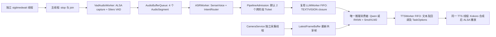
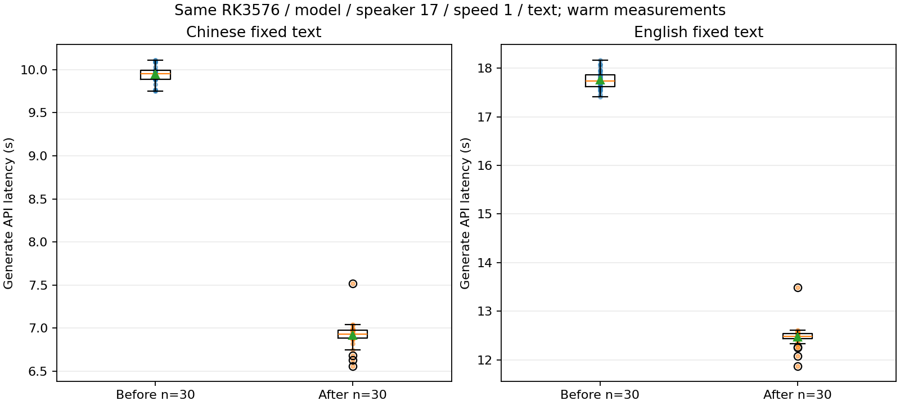
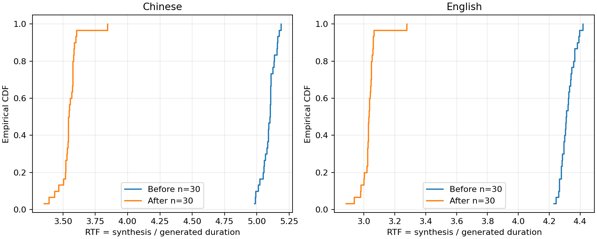
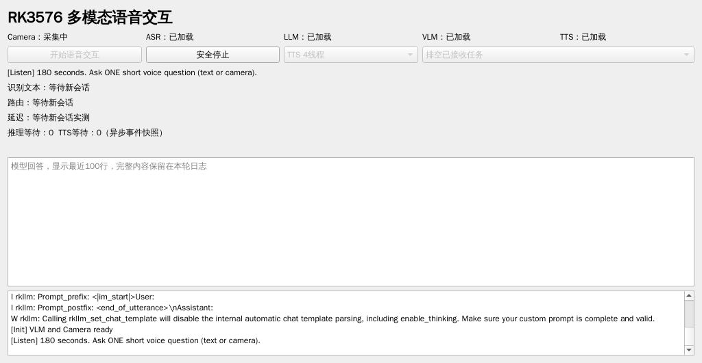
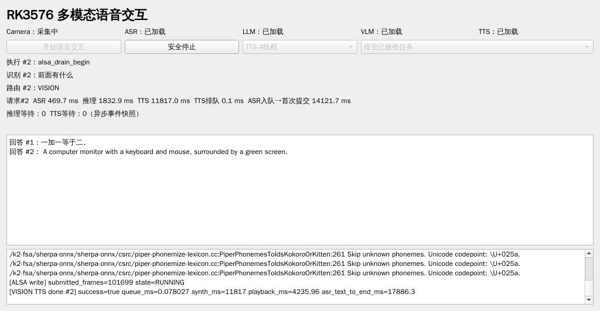
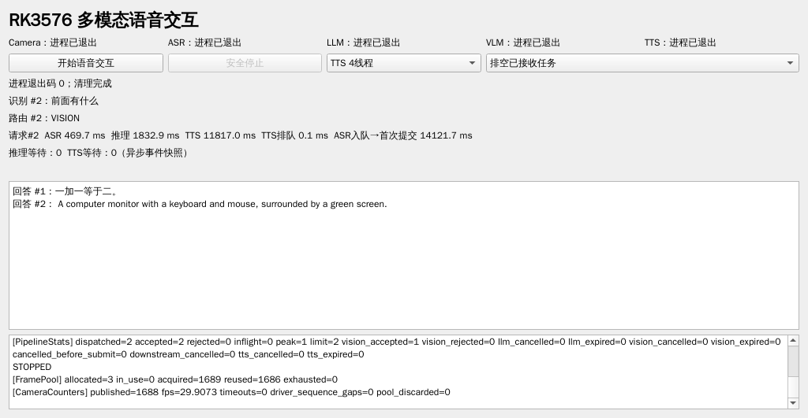
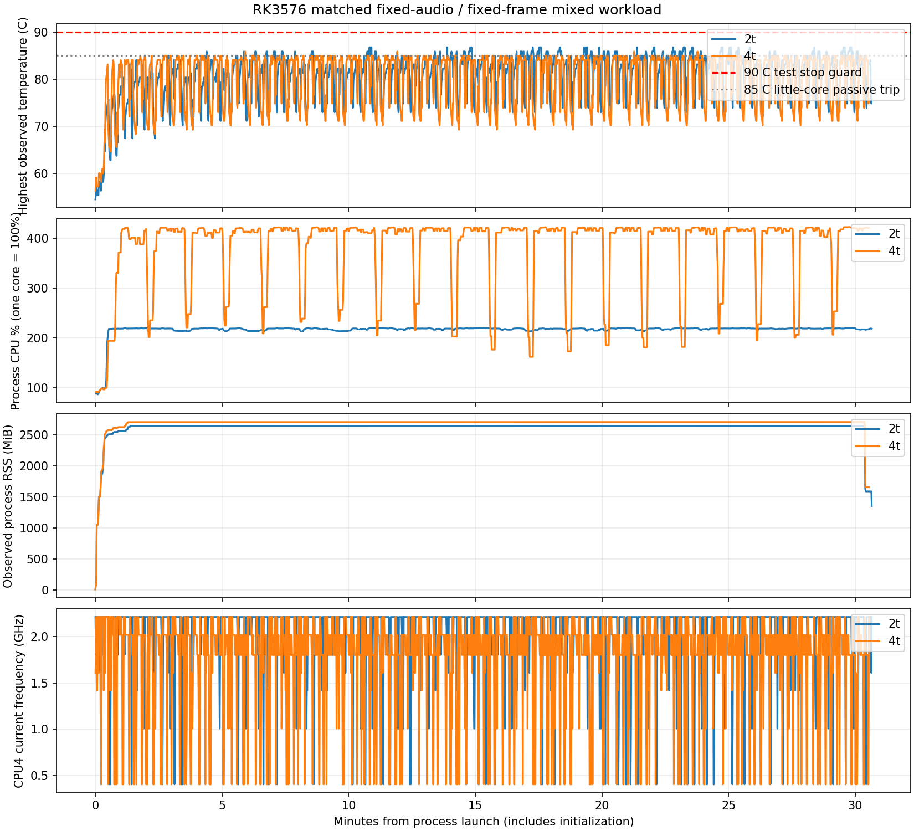
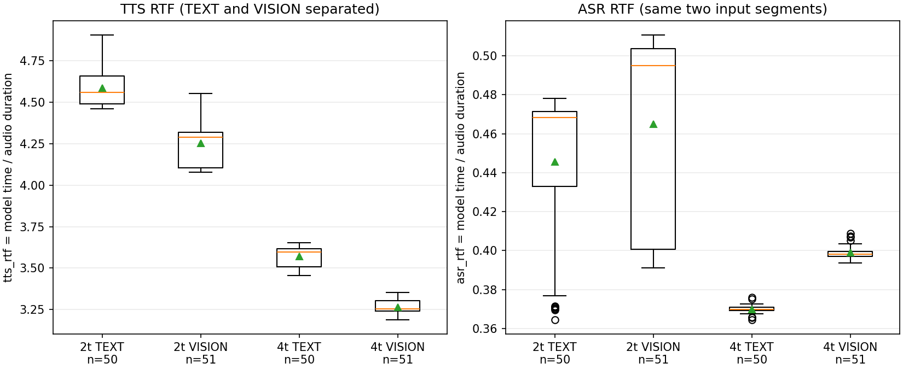
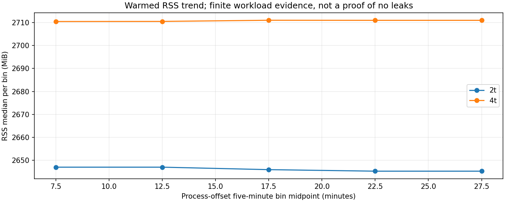

# RK3576 端侧多模态系统集成与性能优化工程手册

本手册面向Linux C++与嵌入式AI工程学习、复现和项目验收，覆盖RK3576上的Camera、ASR、Qwen、SmolVLM2、Kokoro、异步任务、性能测量、Qt与稳定性。5.1～5.4已经用户验收；5.5的最终审核以本节验收清单及真实日志为准。隔离版本没有覆盖主工程。

本版已完成记录场景内的工程验证，等待用户对最终项目审核。未独立测量的声学延迟、精确首Token与可靠NPU利用率继续保留为空；有限长测不等于任意工况的永久稳定保证。

<!-- WORD_TOC -->

<!-- PAGE_BREAK -->

## 1 工程环境与证据规则

硬件为LubanCat 3 RK3576，4个Cortex A53和4个Cortex A72，约4GB物理内存、当前无Swap；Linux 6.1.99-rk3576、aarch64、Debian GCC12.2.0、CMake/CTest3.25.1。IMX415通过V4L2 `/dev/video11`采集3840×2160 NV12，stride3840、sizeimage12441600，四个MMAP驱动槽。HyperX Cloud III每次动态发现，历史实际ID为III，不能把历史数字声卡写死。

| 模块 | 真实模型或Runtime | 执行与限制 |
|---|---|---|
| ASR | Silero VAD与SenseVoice INT8，sherpa onnx1.13.8 | CPU；实时采集与预分段回放必须区分 |
| TEXT | Qwen2.5 1.5B W4A16，RKLLM1.3.1 | 模型制品toolkit1.2.3；RKNPU driver0.9.8 |
| VISION | SmolVLM2 256M W4A16加scatterfix RKNN Vision | RGB512×512，64×576浮点特征；语言制品toolkit1.3.1 |
| TTS | Kokoro multi lang v1_1，ORT1.28.2 | CPU，sid17，speed1，silence_scale0.2，24kHz |
| Qt | Qt5.15.8 Widgets与Test | 可选构建，现有xcb桌面，不安装新软件 |

原稳定目录是`/home/cat/projects/RK3576/rk3576_multimodal`，唯一授权写目录是其同级`rk3576_multimodal_stage5_review`。模型及SDK继续引用原路径，源码和构建使用新目录。根目录历史笔记和早期architecture/run文档不能替代源码或终端；没有Git仓库时使用真实git diff no-index并验证补丁，不虚构commit。

```bash
#!/usr/bin/env bash
# Source this file. Historical paths from 4.md, verified on board before use.
STAGE5_BASE=/home/cat/projects/RK3576
STAGE5_ORIGINAL="$STAGE5_BASE/rk3576_multimodal"
STAGE5_REVIEW="$STAGE5_BASE/rk3576_multimodal_stage5_review"
STAGE5_ASR="$STAGE5_BASE/asr_runtime/sherpa-onnx-sense-voice-zh-en-ja-ko-yue-int8-2024-07-17"
STAGE5_VAD="$STAGE5_BASE/asr_runtime/vad/silero_vad.onnx"
STAGE5_QWEN="$STAGE5_BASE/rkllm_sdk/models/Qwen2.5-1.5B-Instruct_RK3576_w4a16.rkllm"
STAGE5_KOKORO="$STAGE5_BASE/tts_runtime/models/kokoro-multi-lang-v1_1"
STAGE5_VLM="$STAGE5_ORIGINAL/models/vlm/smolvlm2_256m_w4a16_rk3576.rkllm"
STAGE5_VISION="$STAGE5_ORIGINAL/models/vlm/smolvlm_vision_scatterfix_rk3576.rknn"
STAGE5_SHERPA="$STAGE5_BASE/asr_runtime/sherpa-onnx-v1.13.8-linux-aarch64-shared-cpu"
STAGE5_RKLLM="$STAGE5_BASE/rkllm_sdk"
STAGE5_RKNN_INCLUDE="$STAGE5_BASE/rknn_test/include"
STAGE5_RKNN_LIBRARY=/usr/lib/librknnrt.so
# Prefer the stable build's explicit SDK cache paths, never eval its contents.
```

路径变量只是环境引用，不复制模型。`source`影响当前shell，`set -a`使变量导出到子进程；LD_LIBRARY_PATH仅为本次进程指定已存在共享库，不修改系统缓存。每次实际参数、版本、声卡、PID、退出码、原工程指纹都与对应case共同保留。

## 2 开发时间线与最终系统关系

| 阶段 | 时间依据 | 具体目标与结果 |
|---|---|---|
| 5.1 | 2026年10月17日报告及SSH日志 | 生命周期审计、RKLLM回调/输出释放、协作式SIGINT和SIGTERM |
| 5.2 | 2026年10月17日报告及ARM日志 | ASR解耦、共同推理FIFO、有界背压、取消与排空 |
| 5.3 | 2026年10月17日报告及固定帧 | 三槽自有帧池、缓存预处理，RGA失败保留 |
| 5.4 | 2026年10月17日固定输入与听音 | 统一请求计时、TTS2/4线程同条件n30比较 |
| 5.5 | 2026年10月17日晚至18日实测 | Qt适配、热对照、最终源码长测、异常与完整交付 |

最终语音入口直接使用IntentRouter，没有经过另一个CLI中的RequestProcessor。Camera、采集/VAD、ASR、推理、TTS和信号接收分别承担职责。InferenceWorker是include/ai/llm_worker.h中的using别名，实际实现为src/ai/llm_worker.cpp的LLMWorker，并不存在另一个inference_worker.cpp。TEXT和VISION共用同一个推理消费者；ASR只提交，不同步执行VLM。TTS仍先合成完整PCM再播放，下一条不能越过当前合成和drain。本节没有引入新的AI框架或模型。


## 3 第五阶段 5.1 生命周期审计和安全退出

审计首先发现两个真实入口、Worker对Service的借用、lambda引用捕获以及SDK回调状态的寿命边界。join只等待，不通知；开放空ASR队列会使析构永久等待。正确顺序是停止输入并关闭/唤醒队列，join使用者，再销毁Service和Runtime。5.1原完整语音入口没有协作式信号处理，先记录真实缺陷，再最小修复，不能把SIGKILL叫安全退出。

RKLLM的Pimpl保存参数和callback，析构先destroy handle，随后成员才析构；每次同步run的RunContext与用户callback状态持续到run返回。RKNN输出只在outputs_get成功后归owner，业务先复制Embedding，再在正常/异常退栈路径release。release自身仍可能失败，当前记录错误；这不是SDK所有内部失败路径的证明。

### 完整关键源码 include/app/stop_signals.h

```cpp
#pragma once
#include <atomic>
#include <cerrno>
#include <stdexcept>
#include <thread>
#include <pthread.h>
#include <signal.h>

// Construct before SDKs/workers: all descendant threads inherit the blocked set.
// sigtimedwait runs in an ordinary thread; there is no asynchronous signal handler.
class StopSignals {
public:
    StopSignals()
    {
        sigemptyset(&signals_);
        sigaddset(&signals_, SIGINT);
        sigaddset(&signals_, SIGTERM);
        if (pthread_sigmask(SIG_BLOCK, &signals_, &previous_) != 0)
            throw std::runtime_error("Cannot block stop signals");
        try
        {
            thread_ = std::thread([this] {
                const timespec interval{0, 100000000};
                while (!finished_.load())
                {
                    const int received = sigtimedwait(&signals_, nullptr, &interval);
                    if (received == SIGINT || received == SIGTERM)
                    {
                        int empty = 0;
                        signal_.compare_exchange_strong(empty, received);
                    }
                    else if (received < 0 && errno != EAGAIN && errno != EINTR)
                    {
                        wait_failed_.store(true);
                        break;
                    }
                }
            });
        }
        catch (...)
        {
            pthread_sigmask(SIG_SETMASK, &previous_, nullptr);
            throw;
        }
    }
    ~StopSignals()
    {
        finished_.store(true);
        if (thread_.joinable()) thread_.join();
        pthread_sigmask(SIG_SETMASK, &previous_, nullptr);
    }
    StopSignals(const StopSignals&) = delete;
    StopSignals& operator=(const StopSignals&) = delete;
    int received() const noexcept { return signal_.load(); }
    bool failed() const noexcept { return wait_failed_.load(); }
private:
    sigset_t signals_{};
    sigset_t previous_{};
    std::atomic<int> signal_{0};
    std::atomic<bool> finished_{false};
    std::atomic<bool> wait_failed_{false};
    std::thread thread_;
};
```

### 完整关键源码 src/ai/rkllm_backend.cpp struct RunContext

```cpp
struct RunContext
{
    std::mutex mutex;
    std::string text;
    const LLMStreamCallback* on_chunk = nullptr;
    std::chrono::steady_clock::time_point start;
    double first_text_ms = -1.0;
    bool failed = false;
    RequestTracePtr trace;
};
```

### 完整关键源码 src/ai/rkllm_backend.cpp int onRKLLMResult(

```cpp
int onRKLLMResult(RKLLMResult* result, void* userdata, LLMCallState state)
{
    auto* context = static_cast<RunContext*>(userdata);
    if (context == nullptr) return 0;

    if (state == RKLLM_RUN_ERROR)
    {
        std::lock_guard<std::mutex> lock(context->mutex);
        context->failed = true;
        return 0;
    }

    if (state != RKLLM_RUN_NORMAL || result == nullptr ||
        result->text == nullptr || result->text[0] == '\0')
        return 0;

    try
    {
        // 必须在当前回调期间复制 Runtime 提供的字符数据。
        const std::string chunk(result->text);
        {
            std::lock_guard<std::mutex> lock(context->mutex);
            if (context->first_text_ms < 0.0)
            {
                const auto now = std::chrono::steady_clock::now();
                context->first_text_ms =
                    std::chrono::duration<double, std::milli>(now - context->start).count();
                if(context->trace)context->trace->mark("first_text_chunk",now,static_cast<double>(chunk.size()));
            }
            context->text.append(chunk);
        }

        // 不持有 RunContext 的 mutex 调用上层，避免锁重入。
        // 第一版要求回调只做短小的、非阻塞的处理。
        if (context->on_chunk != nullptr && *context->on_chunk)
            (*context->on_chunk)(chunk);
    }
    catch (...)
    {
        std::lock_guard<std::mutex> lock(context->mutex);
        context->failed = true;
    }
    return 0;
}
```

### 完整关键源码 src/ai/rkllm_backend.cpp struct RKLLMBackend::Impl

```cpp
struct RKLLMBackend::Impl
{
    std::string model_path;
    LLMHandle handle = nullptr;
    RKLLMParam params{};
    RKLLMCallback callbacks{};

    ~Impl() noexcept
    {
        if (handle != nullptr)
        {
            (void)rkllm_destroy(handle);
            handle = nullptr;
        }
    }
};
```

### 完整关键源码 src/ai/rk3576_vlm_backend.cpp struct RknnOutputOwner

```cpp
struct RknnOutputOwner {
    rknn_context context;
    rknn_output output{};
    bool acquired = false;

    explicit RknnOutputOwner(rknn_context ctx) : context(ctx) {}
    RknnOutputOwner(const RknnOutputOwner&) = delete;
    RknnOutputOwner& operator=(const RknnOutputOwner&) = delete;
    ~RknnOutputOwner() noexcept {
        if (acquired) {
            auto begin=ImageProfile::Clock::now();
            const int code=rknn_outputs_release(context,1,&output);
            imageSample("rknn_outputs_release",ImageProfile::ms(begin));
            if(code)std::cerr<<"[RKNN release ERROR] ret="<<code<<'\n';
        }
    }
};
```

### 完整关键源码 src/audio/asr_service.cpp bool ASRService::recognize(

```cpp
bool ASRService::recognize(
    const std::vector<float>& samples,
    std::string& text,
    double& latency_ms,
    std::string& error)
{
    error.clear();
    text.clear();
    latency_ms = 0.0;

    // 1. 检查模型是否初始化。
    if (recognizer_ == nullptr)
    {
        error = "ASR model is not initialized";
        return false;
    }

    // 2. 检查输入音频。
    if (samples.empty() ||
        samples.size() >
            static_cast<std::size_t>(
                std::numeric_limits<int32_t>::max()))
    {
        error = "Invalid audio sample count";
        return false;
    }

    // 开始计时。
    const auto start =
        std::chrono::steady_clock::now();

    // 3. 创建本次识别使用的 OfflineStream。
    //
    // 使用 unique_ptr + SDK 专用销毁函数。
    // 离开作用域时自动释放 Stream。
    using StreamPtr = std::unique_ptr<
        const SherpaOnnxOfflineStream,
        decltype(&SherpaOnnxDestroyOfflineStream)>;

    traceMark("asr_stream_create_begin");
    StreamPtr stream(
        SherpaOnnxCreateOfflineStream(recognizer_),
        &SherpaOnnxDestroyOfflineStream
    );

    traceMark("asr_stream_create_end");
    if (!stream)
    {
        error = "Failed to create offline stream";
        return false;
    }

    // 4. 将 Float32 PCM 直接传入模型。
    // 输入采样率为 16000 Hz。
    //
    // 离线识别要求一次提交完整语音。
    traceMark("asr_accept_wave_begin");
    SherpaOnnxAcceptWaveformOffline(
        stream.get(),
        16000,
        samples.data(),
        static_cast<int32_t>(samples.size())
    );

    // 5. 同步执行推理。
    traceMark("asr_accept_wave_end");
    traceMark("asr_decode_begin");
    SherpaOnnxDecodeOfflineStream(
        recognizer_,
        stream.get()
    );

    // 6. 获取识别结果。
    //
    // 结果由 SDK 分配，需要调用 SDK 的销毁接口。
    traceMark("asr_decode_end");
    using ResultPtr = std::unique_ptr<
        const SherpaOnnxOfflineRecognizerResult,
        decltype(&SherpaOnnxDestroyOfflineRecognizerResult)>;

    ResultPtr result(
        SherpaOnnxGetOfflineStreamResult(stream.get()),
        &SherpaOnnxDestroyOfflineRecognizerResult
    );

    if (!result)
    {
        error = "Failed to obtain ASR result";
        return false;
    }

    // 7. 复制识别文本。
    // 不能长期保存 SDK 返回的原始指针。
    if (result->text != nullptr)
    {
        text = result->text;
    }

    // 8. 结束计时。
    const auto end =
        std::chrono::steady_clock::now();

    latency_ms =
        std::chrono::duration<double, std::milli>(
            end - start
        ).count();

    return true;
}
```

### 完整关键源码 src/audio/asr_pipeline.cpp void ASRWorker::run()

```cpp
void ASRWorker::run()
{
    try
    {
        runImpl();
    }
    catch (const std::exception& e)
    {
        ok_ = false;
        error_ = std::string("ASRWorker exception: ") + e.what();
        queue_.close();
    }
    catch (...)
    {
        ok_ = false;
        error_ = "ASRWorker: unknown exception";
        queue_.close();
    }
}
```

### 完整关键源码 src/audio/asr_pipeline.cpp void ASRWorker::runImpl()

```cpp
void ASRWorker::runImpl()
{
    AudioSegment segment;

    while (queue_.pop(segment))
    {
        using Clock = std::chrono::steady_clock;

        // 消费者真正从队列取出音频的时间。
        const auto popped_at = Clock::now();
        RequestTraceScope trace_scope(segment.trace);
        traceMark("asr_dequeued",popped_at);

        std::vector<float> samples;
        std::string error;

        if (!segment.samples.empty())
        {
            // VAD 已输出 Float32，直接移动。
            samples = std::move(segment.samples);
        }
        else
        {
            // 兼容原始 S16_LE 录音流水线。
            if (!AudioPreprocessor::convertS16ToFloat32(
                    segment.pcm,
                    16000,
                    1,
                    samples,
                    error))
            {
                error_ = "Preprocessing: " + error;
                queue_.close();
                return;
            }
        }

        if (samples.empty())
        {
            error_ = "Empty ASR audio segment";
            queue_.close();
            return;
        }

        std::string text;
        double latency_ms = 0.0;

        // 推理开始时间。
        const auto infer_start = Clock::now();
        traceMark("asr_begin",infer_start);

        if (!asr_.recognize(
                samples,
                text,
                latency_ms,
                error))
        {
            traceMark("asr_failed");
            error_ = "ASR: " + error;
            queue_.close();
            return;
        }

        // 获取文字结果的时间。
        const auto result_ready = Clock::now();
        traceMark("asr_end",result_ready);

        ++processed_;

        const double audio_duration_ms =
            1000.0 *
            static_cast<double>(samples.size()) /
            16000.0;

        const double rtf =
            latency_ms / audio_duration_ms;

        // 统一使用 steady_clock 时间差。
        auto elapsed_ms = [](
            Clock::time_point first,
            Clock::time_point second)
        {
            return std::chrono::duration<
                double, std::milli
            >(second - first).count();
        };

        {
            std::lock_guard<std::mutex> lock(
                print_mutex_
            );

            // 原始 ASR 输出格式保持不变。
            std::cout
                << "[ASR] Segment #"
                << segment.sequence
                << ": "
                << (text.empty() ? "<empty>" : text)
                << " | latency="
                << latency_ms
                << " ms"
                << " | RTF="
                << rtf
                << '\n';

            // 仅对来自 VAD 的有效时间戳计算。
            if (segment.timing_valid)
            {
                std::cout
                    << "[Timing] Segment #"
                    << segment.sequence

                    << " endpoint_est_ms="
                    << elapsed_ms(
                        segment.audio_end_estimated_at,
                        segment.vad_ready_at
                    )

                    << " vad_to_queue_ms="
                    << elapsed_ms(
                        segment.vad_ready_at,
                        segment.enqueued_at
                    )

                    << " queue_wait_ms="
                    << elapsed_ms(
                        segment.enqueued_at,
                        popped_at
                    )

                    << " preprocess_ms="
                    << elapsed_ms(
                        popped_at,
                        infer_start
                    )

                    << " asr_wall_ms="
                    << elapsed_ms(
                        infer_start,
                        result_ready
                    )

                    << " total_est_ms="
                    << elapsed_ms(
                        segment.audio_end_estimated_at,
                        result_ready
                    )

                    << '\n';
            }
        }

        // ASR 完成后调用业务回调；完整语音入口直接路由，未经过 RequestProcessor。
        // 必须在释放 print_mutex_ 后执行。
        if ((on_text_ || on_context_) && !text.empty())
        {
            try
            {
                if(on_context_)on_context_(text,segment);
                else on_text_(text);
            }
            catch (const std::exception& e)
            {
                error_ =
                    std::string("ASR text callback: ") +
                    e.what();

                queue_.close();
                return;
            }
            catch (...)
            {
                error_ =
                    "ASR text callback: unknown exception";

                queue_.close();
                return;
            }
        }
        else if(text.empty())traceMark("asr_empty_text");
    }

    ok_ = true;
}
```

语法与执行次序：`std::thread(&ASRWorker::run,this)`借用对象地址，因此对象必须活到join之后。入口catch捕获标准和未知异常，设置错误并关闭队列；不能让异常穿出线程入口触发terminate。`lock_guard`在return或异常时自动解锁；`unique_lock`允许condition_variable临时释放并重新获取锁。状态与谓词在同一mutex下更新，notify_all使空队列等待者重新判断closed；通知本身不是可累计事件。

`StopSignals`在所有线程创建前阻塞SIGINT/SIGTERM，普通线程调用sigtimedwait，atomic发布首个信号。析构置finished、join、恢复原mask。没有handler调用Qt、日志、malloc、mutex或join。构造/析构应由同一owner线程执行。活动同步推理仍允许完成；无法保证闭源SDK永久卡住时存在硬截止。

5.1最终实机注册CTest4/4、完整TEXT/VISION语音、实际耳机、自然及信号退出和321项保护检查通过。Windows当时6/6只证明portable逻辑，不能替代ARM64。完整缺陷原表现、修复diff和日志在stage5_01_board_acceptance及相应reports目录。

### 本节面试题与完整答案

以下问题保留5.1当时语境，其Windows6项计数与当时双Engine并发问题不是最终版本现状。

### 1. 为什么只使用智能指针还会出现生命周期错误？

unique_ptr/shared_ptr 管理其拥有的对象；本项目的 Worker 借用 Service，lambda 借用 mutex/counter。引用捕获不会延长它们寿命。必须使被引用状态先构造、后销毁，并在其销毁前 stop/join 使用者。Runtime handle 自动释放也不能代替线程先结束。

### 2. 为什么析构里的 join 可能一直等待？

join 只等待，不通知。消费者卡在开放空队列的 cv.wait 时，必须先在锁内改变 closed 状态，再 notify，谓词为真才能返回。即便队列已关闭，活跃的同步 SDK 卡住仍会使 join 等待；线程回收不是强制取消机制。

### 3. 为什么不把 ASR、LLM、TTS 一起 requestStop？

上游完成回调还可能生产下游请求。正常排空必须先结束采集/ASR，再确认 LLM 不再向 TTS 提交，最后排空 TTS。提前 stop TTS 会拒绝仍然合法的回答。异常退出允许取消等待任务，但要明确结果并保留状态寿命。

### 4. shared_ptr<const ImageFrame> 是否是零拷贝？

缓存交换与消费者取指针没有整帧复制，但之前 MMAP payload 已复制到 vector，后面还有 RGB 转换和 embedding 复制。局部共享对象不等于全链路零拷贝。QBUF 后驱动复用映射内存，去掉自有帧复制需要重设计归还/共享所有权和同步。

### 5. 两个 Engine 都有 mutex，能否证明 NPU 没有资源冲突？

不能。两个 mutex 保护两个实例，LLMWorker 与 ASR 的 VLM 分支仍可并行调用同一硬件。应记录重叠、Runtime错误、延迟和资源；确认冲突后再选择共享调度，不能凭推测增加全局锁并声称已经解决硬件问题。

### 6. 有界队列容量2为什么可能存在3个任务？

代码把执行中的任务弹出 deque 后才推理，因此容量只限制等待任务。单消费者最多1个活跃任务加2个等待任务。音频队列满丢旧、LLM/TTS满拒绝是不同策略，统计和业务反馈不能混用。

### 7. 如何避免 C SDK buffer 在 C++ 异常时泄漏？

取得成功后立即由不可复制的 RAII owner 管理，析构调用配套 SDK release；输出仍需复制到业务自有 vector 时也受保护。必须保证 owner 的 context 比它活得久、析构不抛异常、只释放已成功取得的资源。并不意味着 SDK release 自身永不失败。

### 8. Windows 6/6 CTest 能证明什么？

证明当前 MinGW 构建的六项测试符合其断言，覆盖队列/异常/状态/替身生命周期等可移植逻辑。它不编译真实 RKNN/ALSA 实现，不验证 ARM64 ABI、模型精度、NPU并发、音质或板端性能。工程验收必须补目标端构建及真实设备日志。

### 9 为什么不能在signal handler中调用条件变量

POSIX异步信号可能打断持有同一锁的线程；mutex、condition_variable和Qt操作不保证异步信号安全，会死锁或破坏运行状态。本项目通过阻塞信号加普通sigwait线程，把通知和停止放回正常线程上下文。

### 10 析构顺序为什么是并发接口的一部分

局部对象逆声明顺序析构，成员也逆声明顺序析构。Worker持有的引用不会自动延长Service、mutex或counter寿命；必须在析构依赖对象前stop/join。只把句柄换成智能指针而不检查谁仍在使用它，仍可能造成use-after-free。

## 4 第五阶段 5.2 有界异步任务和NPU调度

## 5.2 多线程与异步 Pipeline 工程记录

状态：5.2 工程验收通过，完整证据见 `stage5_02_board_acceptance.md`，本轮暂停在 5.3 之前。日期：2026-10-17。

### 操作 1：继承 5.1 验收与授权边界

已完整读取任务书及 `stage5_01_board_acceptance.md`。5.1 的真实语音闭环、用户听音及协作式信号退出是基线，不算作 5.2 已通过的证据。仅修改本地和 `/home/cat/projects/RK3576/rk3576_multimodal_stage5_review`。原工程、原 `build/stage5_full`、模型、SDK、驱动、设备树及系统配置不写入。没有上传用户明确不需要的 `stage5_01_acceptance_local.tgz`。

本地无 Git 元数据，以 `backups/stage5_02_before/` 的 107 文件快照、SHA256 和 Git no-index 格式差异记录版本。5.1 初始包清单与最终修复源码有差异，本节继承正式验收的最终源码。

### 操作 2：源码定位与最小方案

`ASRWorker::run()` 同步调用 `on_text`。原 TEXT 分支提交 LLMWorker；VISION 分支却直接执行 `vlm->infer(frame, vlm_question)`，包含 RKNN Vision 和 SmolVLM2 RKLLM，阻塞 ASR 工作线程。CameraService 已独立采集，LatestFrameBuffer 保存共享最新帧；无需重建 Camera 框架。原 TTSWorker 在一个线程中合成和播放，等待容量 2，但局部队列限制不代表全部在途回答有界。

实施顺序为冻结基线及 NPU 实测、复用推理 FIFO、跨阶段额度及过期/取消、Fake 并发测试、ARM64 与真实语音回归。模型算法和 SDK 不改。

| 文件 | 具体改动 | 验收方法 |
|---|---|---|
| `common/work_control.h` | 停止模式、截止时间、等待期限、取消 flag 和统计 | Fake 过期与取消断言 |
| `ai/llm_worker.h/.cpp` | 保留 TEXT 接口，新增 submitTask、显式 restart、终态统计 | FIFO、满载、抛异常、停止重启 |
| `app/pipeline_admission.h` | 一个 Ticket 覆盖推理至播放全过程 | 最后引用释放与 close 并发测试 |
| `audio/asr_llm_tts_smoke.cpp` | VLM 异步提交、执行时取最新帧、ID/期限传递、退出语义 | 同输入 A/B、真实语音、信号 |
| `audio/tts_worker.h/.cpp` | 保留原合成及播放，加入过期/取消/统计/重启 | Fake TTS 与 Kokoro/ALSA |
| `audio/asr_pipeline.h/.cpp` | 保留原丢旧音频策略，增加 ID 日志、峰值及计数 | 原 ASR 测试和连续采集 |
| TTS/ALSA service 头与实现、`tts_smoke.cpp` | 公共头用前置声明，实际调用显式 include SDK | 真实 SDK 全目标编译 |
| `tests/async_pipeline_tests.cpp` | 闸门控制的确定性线程测试 | 本地和 ARM64 CTest |
| `tests/stage5_02_npu_probe.cpp` | 顺序/重叠 NPU 调用对照，手工诊断 target | 真实 SDK 实测；不注册 CTest |
| `tools/stage5_02_*`、回放 TSV | 隔离路径、PID 检查、超时、证据收集 | 原始退出码、日志、321 项指纹 |

### 操作 3：真实线程与队列架构



这些是应用线程，SDK 内部线程仍由各 SDK 管理。ASR 只负责识别、路由、申请额度和提交 closure，不等待推理或 TTS。视觉帧在执行时取最新共享帧，不把 4K 图像积在队列里。共享推理消费者覆盖本入口的两种 RKLLM 与 RKNN 调用；独立程序不受该 FIFO 管理，因此运行前仍检查设备占用。

### 操作 4：有界性、背压与终态

默认 `max_inflight=2`，Ticket 一直持有到 TTS 完成或其他终态回调及 closure 释放。局部推理等待和 TTS 等待容量均保留 2；默认额度下存在活动 TTS 时最多一个等待回答。额度满拒绝新请求，打印请求 ID、路由与原因并统计；不覆盖已接收回答。

默认推理排队上限 10000 ms、TTS 排队上限 12000 ms、跨阶段生存期 45000 ms，使用 steady_clock。在阶段执行前检查，过期不调用 SDK，但仍回调终态、计数、归还额度。活跃 SDK 不强制中断，因此这些期限不构成硬实时完成保证。

`completed` 表示所有终态，包括取消和过期；`started` 才是执行过 SDK/任务体，`failed` 是运行错误。策略拒绝、过期、成功播放必须分别报告，不能将 completed 当推理成功或把丢弃带来的吞吐下降隐藏。配置解析严格校验范围，非法值明确失败。提供 `cancel(id)`，本入口尚未实现用户口头打断命令。

### 操作 5：生命周期、竞态与退出审查

start 保留一次性语义；restart 仅由唯一 owner 在 requestStop、join 后调用，本轮统计重置、generation 递增。submit 与 requestStop 使用同一个队列 mutex；start/join/restart/析构不能由多个 owner 并发调用，回调不能 join 自己。

Drain 关闭新入口并完成已接收任务，仍尊重原期限。CancelPending 取消尚未开始的阶段，活跃 SDK 或播放正常结束；正在推理的请求结束后若取消，不再进入 TTS。取消关闭与提交竞争产生的 NotRunning 单独记为预期取消，不误报为运行失败。

Worker 不持有队列锁执行 SDK 或业务回调。回调后先销毁 task captures，再锁内发布 completed/active=0，最后 notify；main 观察到 idle 时，TTS 转交及额度归还均已完成。Admission 表内保存 weak_ptr<atomic<bool>>，避免锁内暂时取得最后一个 Ticket 引用并析构，再次锁同一 mutex。状态、帧缓冲、VLM/Camera 声明早于 Worker，反向析构先 join Worker，后销毁被借用对象。

停止顺序为停止/唤醒录音、关闭音频队列、join VAD/ASR、关闭 Admission、排空或取消推理、join 推理、destroy Qwen、排空或取消 TTS、join TTS、close ALSA/destroy TTS、Camera stop/join、VLM/RKNN destroy。继承 5.1 sigtimedwait，不在异步 signal handler 中加锁、打印或调用 SDK。

剩余边界：SDK 永久阻塞时，C++ join 无硬截止保证。外层保护只允许终止本次已核实 PID，必须将强制终止记为退出失败。没有以有限回归宣称无任何竞态，也没有声称已完成 ASan/TSan 或长期压力。

### 操作 6：回声与 TTS 调度取舍

HyperX 耳机降低回灌，不等于 AEC。保持播放期间 ASR 可继续处理，以端到端额度限制误触发积压。冷却、PTT、AEC、打断需要明确产品语义，本节未实现。没有把 TTS 拆为合成和播放两个线程，避免增加预合成 PCM 积压与资源生命周期；模型计算优化留在 5.4。

### 操作 7：构建问题与证据分类

首次 ARM64 构建暴露 `tts_smoke.cpp` 对 SherpaOnnxWriteWave 的间接 include 依赖。公共头解耦后补显式 SDK C API include，保留原失败日志及复测日志。修复后全目标构建成功，ARM64 CTest 5/5，0.29 s；本地 portable CTest 7/7，0.53 s。CTest 中 Fake/Mock 不代表硬件推理；下文另记真实模型回归。

完整数据见 `stage5_02_performance.md` 和 `stage5_02_board_acceptance.md`；完整关键源码见 `stage5_02_source_appendix.md`，逐句解释及面试题见 `stage5_02_statement_notes.md`。本节已完成，等待用户审阅后再进入 5.3。

### 操作 8：适用范围补充

CancelPending 针对尚未开始的推理/TTS 阶段；音频队列仍沿用 5.1 的关闭并排空方式。已采集音频段可能继续被 ASR 识别，但 Admission 已关闭，会明确拒绝新业务提交。因此取消退出仍可能包含残留 ASR 和当前 SDK/播放的耗时，不承诺瞬时停止所有计算。

仅默认 `STAGE5_MAX_INFLIGHT=2` 完成了本轮硬件验收。上调至 8 不会无限增长，但局部等待队列仍为 2，可能产生额外 QueueFull 及程序失败状态；放宽额度前需结合容量和实际负载重新验收。

并发控制没有消除 TTS 的 CPU/内存带宽竞争。真实连续测试中 VLM 有一次 2793.65 ms，不能把单消费者描述为所有延迟均固定或下降。模型成功率和请求交付率分别报告；播放成功仍需要用户听音确认。

## 5.2 实测性能数据

本表由 `tools/stage5_02_performance.py` 从采集的原始终端/JSON 生成。设备、模型、构建和限制见 [验收报告](stage5_02_board_acceptance.md)。日期 2026-10-17，RK3576 真机；Fake 测试不纳入这些性能数字。

统计均为毫秒（吞吐表除外），P50/P95 使用 nearest-rank，n=2 的 P50 为较小值，n≤4 的 P95 常等于最大值。每个 case 仅运行一次、请求数很小，没有置信区间或生产尾延迟结论；频率、温度、图像和生成长度未严格固定。

### 操作 1：NPU 实际 SDK 调用对照

| 调用方式（每类 n=3） | 指标 | 平均 ms | P50 ms | P95 ms |
|---|---|---:|---:|---:|
| 顺序 | Qwen 调用 | 945.432 | 867.519 | 1110.670 |
| 顺序 | RKNN+SmolVLM2 调用 | 1927.090 | 1989.400 | 2046.740 |
| 顺序 | 一对任务完成 | 2872.523 | 2856.920 | 2904.850 |
| 顺序 | SDK 调用区间交集 | 0.000 | 0.000 | 0.000 |
| 重叠 | Qwen 调用 | 2338.717 | 2306.140 | 2409.420 |
| 重叠 | RKNN+SmolVLM2 调用 | 2667.267 | 2656.390 | 2718.580 |
| 重叠 | 一对任务完成 | 2667.267 | 2656.390 | 2718.580 |
| 重叠 | SDK 调用区间交集 | 2338.717 | 2306.140 | 2409.420 |

6/6 对成功。重叠未观察到崩溃，但 Qwen 调用变慢；区间交集不是 NPU 硬件利用率。统一消费者是响应可预测性的选择，不是“并行已经被证明不安全”的结论。

### 操作 2：ASR 业务回调/受控提交阻塞

| case | n | 平均 ms | P50 ms | P95 ms |
|---|---:|---:|---:|---:|
| baseline_equal_work_pair | 2 | 868.872 | 0.014 | 1737.730 |
| baseline_replay_overload | 4 | 957.756 | 0.014 | 1920.580 |
| candidate_cancel_active_vision | 1 | 0.032 | 0.032 | 0.032 |
| candidate_equal_work_pair | 2 | 0.090 | 0.035 | 0.144 |
| candidate_idle_sigint | 0 | — | — | — |
| candidate_replay_overload | 4 | 0.128 | 0.047 | 0.367 |
| candidate_stop_cancel_pending | 4 | 0.075 | 0.024 | 0.183 |
| candidate_stop_drain | 4 | 0.078 | 0.037 | 0.195 |
| candidate_voice_burst | 4 | 0.031 | 0.031 | 0.039 |
| candidate_voice_natural | 2 | 0.310 | 0.023 | 0.597 |

baseline 的 VISION 耗时落在调用者线程；candidate 的 VISION 工作落在推理 Worker。表中混合 TEXT/VISION；过载 case 的 n 包括被拒绝请求，应同时读接受率。受控文本模式测同一个生产回调，不测 ASR 模型；真实 microphone case 才包含 USB/VAD/SenseVoice。

### 操作 3：各队列等待

| case | 推理排队 n / 平均 / P50 / P95 ms | TTS 终态 n / 平均 / P50 / P95 ms |
|---|---|---|
| baseline_equal_work_pair | 1 / 0.075 / 0.075 / 0.075 | 2 / 7852.470 / 0.039 / 15704.900 |
| baseline_replay_overload | 2 / 706.132 / 0.085 / 1412.180 | 3 / 22385.326 / 22963.900 / 44192.000 |
| candidate_cancel_active_vision | 1 / 0.086 / 0.086 / 0.086 | 0 / — / — / — |
| candidate_equal_work_pair | 2 / 460.445 / 0.088 / 920.802 | 2 / 10201.036 / 0.071 / 20402.000 |
| candidate_idle_sigint | 0 / — / — / — | 0 / — / — / — |
| candidate_replay_overload | 2 / 475.481 / 0.090 / 950.871 | 2 / 11021.560 / 0.020 / 22043.100 |
| candidate_stop_cancel_pending | 2 / 425.233 / 0.078 / 850.388 | 2 / 10222.646 / 0.092 / 20445.200 |
| candidate_stop_drain | 2 / 445.267 / 0.130 / 890.404 | 2 / 11128.593 / 0.087 / 22257.100 |
| candidate_voice_burst | 3 / 0.046 / 0.042 / 0.072 | 3 / 1274.973 / 0.095 / 3824.760 |
| candidate_voice_natural | 2 / 0.046 / 0.021 / 0.071 | 2 / 0.118 / 0.018 / 0.218 |

baseline 推理队列 n 只包含异步 TEXT，VISION 直接同步执行，没有相应 queue_ms；不能把缺失数据当零后混平均。TTS 统计包括过期/取消的真实驻留；取消回调兼容值 -1 已用 `[TTS cancelled]` 的实际驻留代替。过期出队时检查，实际驻留可超过配置期限。

### 操作 4：深度、接受/拒绝、成功率和完整交付


#### 峰值与退出状态

| case | 推理峰值 / TTS 峰值 | 跨阶段峰值 | 子进程码 |
|---|---|---|---|
| baseline_equal_work_pair | 1/1 | 无跨阶段限制 | 0 |
| baseline_replay_overload | 1/2 | 无跨阶段限制 | 1 |
| candidate_cancel_active_vision | 1/0 | 1 | 0 |
| candidate_equal_work_pair | 1/1 | 2 | 0 |
| candidate_idle_sigint | 0/0 | 0 | 0 |
| candidate_replay_overload | 1/1 | 2 | 0 |
| candidate_stop_cancel_pending | 1/1 | 2 | 0 |
| candidate_stop_drain | 1/1 | 2 | 0 |
| candidate_voice_burst | 1/1 | 2 | 0 |
| candidate_voice_natural | 1/1 | 1 | 0 |


#### 实际执行 完整交付与策略终态

| case | 推理成功/实际执行 | 播放/输入请求 | Admission 拒绝 | TTS 过期/取消 |
|---|---|---|---|---|
| baseline_equal_work_pair | 2/2 | 2/2 | 不适用 | 无该策略 |
| baseline_replay_overload | 4/4 | 3/4 | 不适用 | 无该策略 |
| candidate_cancel_active_vision | 1/1 | 0/1 | 0 | 0/0 |
| candidate_equal_work_pair | 2/2 | 2/2 | 0 | 0/0 |
| candidate_idle_sigint | 0/0 | 0/0 | 0 | 0/0 |
| candidate_replay_overload | 2/2 | 1/4 | 2 | 1/0 |
| candidate_stop_cancel_pending | 2/2 | 1/4 | 2 | 0/1 |
| candidate_stop_drain | 2/2 | 2/4 | 2 | 0/0 |
| candidate_voice_burst | 3/3 | 3/4 | 1 | 0/0 |
| candidate_voice_natural | 2/2 | 2/2 | 0 | 0/0 |


baseline_replay_overload 另有 1 次 TTS 队列满拒绝，退出 1；其余子程序返回 0。candidate_cancel_active_vision 下游取消 1，不启动 TTS。不能把推理成功率当请求最终交付率；没有执行的请求不计进模型成功分母。音频队列两轮真实 microphone 均峰值 1、dropped 0。

### 操作 5：有限批次吞吐和自然排空退出

| case | ready 至退出 s | 成功推理 / s | 完成播放 / s | 输入关闭至退出 s |
|---|---:|---:|---:|---:|
| baseline_equal_work_pair | 30.981 | 0.065 | 0.065 | 29.114 |
| baseline_replay_overload | 61.218 | 0.065 | 0.049 | — |
| candidate_equal_work_pair | 36.158 | 0.055 | 0.055 | 34.973 |
| candidate_idle_sigint | 3.918 | 0.000 | 0.000 | — |
| candidate_replay_overload | 27.033 | 0.074 | 0.037 | — |
| candidate_voice_burst | 82.621 | 0.036 | 0.036 | — |
| candidate_voice_natural | 92.016 | 0.022 | 0.022 | — |

吞吐分母包含 drain/退出；真实 microphone case 还包含等待用户和静音窗口，不能称持续最大吞吐。两请求 equal_work_pair 都接受并播放 2/2，TTL 放宽到 60 s 排队/120 s 生命周期以避免策略丢弃。源输入相同，但 VLM 分别生成12 与 17 个英文词，PCM 帧数 80696 与 107578，未保持计算工作量完全相同；candidate 的批次排空实际更慢，不能宣称端到端加速。其主要收益是 VISION 回调不再占用 ASR。

### 操作 6：停止模式和资源采样

| case | 信号 | 模式 | 信号至退出 s | 采样峰值 RSS KiB | 采样线程峰值 |
|---|---|---|---:|---:|---:|
| baseline_equal_work_pair | 自然结束 | drain | — | 2511620 | 12 |
| baseline_replay_overload | 自然结束 | drain | — | 2582112 | 13 |
| candidate_cancel_active_vision | SIGTERM | cancel_pending | 3.413 | 2505916 | 7 |
| candidate_equal_work_pair | 自然结束 | drain | — | 2507400 | 9 |
| candidate_idle_sigint | SIGINT | drain | 1.907 | 2496948 | 9 |
| candidate_replay_overload | 自然结束 | drain | — | 2514388 | 10 |
| candidate_stop_cancel_pending | SIGTERM | cancel_pending | 1.532 | 2519368 | 10 |
| candidate_stop_drain | SIGTERM | drain | 12.229 | 2522504 | 10 |
| candidate_voice_burst | 自然结束 | drain | — | 2638328 | 12 |
| candidate_voice_natural | 自然结束 | drain | — | 2634780 | 12 |

信号延迟从 harness 发送时刻至子进程退出/输出 EOF，排除后续 fuser/指纹查询。Drain 与 CancelPending 完成工作量不同，不是同等计算加速。采样周期约 1 s，可能漏过短峰值；RSS 包含 SDK、模型映射和工作缓冲，不能当 C++ heap 泄漏大小。全部 case 无超时/强制终止且设备释放。长期稳定性留后续独立验收。

### 操作 7：模型计算时间与局限

| case | 成功 TTS n | 合成平均 ms | P50 ms | P95 ms |
|---|---:|---:|---:|---:|
| baseline_equal_work_pair | 2 | 11365.685 | 8659.770 | 14071.600 |
| baseline_replay_overload | 3 | 15382.090 | 17654.400 | 19986.900 |
| candidate_cancel_active_vision | 0 | — | — | — |
| candidate_equal_work_pair | 2 | 13256.445 | 8842.090 | 17670.800 |
| candidate_idle_sigint | 0 | — | — | — |
| candidate_replay_overload | 1 | 18855.800 | 18855.800 | 18855.800 |
| candidate_stop_cancel_pending | 1 | 17753.000 | 17753.000 | 17753.000 |
| candidate_stop_drain | 2 | 13819.420 | 8643.440 | 18995.400 |
| candidate_voice_burst | 3 | 14853.563 | 16361.800 | 18687.700 |
| candidate_voice_natural | 2 | 12545.760 | 8656.320 | 16435.200 |

回答文本长度、CPU 竞争和 Camera 场景不同，合成数值波动不能归因为异步化提升模型速度。本节未改变 Kokoro 模型或合成算法。5.4 再按固定语料、更多样本和统一时间链路分析计算性能。

前文是5.2当时完成记录；其“后续5.3”属于时间线。最终仍复用同一队列和Worker，而非两套并行Demo。

### 完整关键源码 include/ai/llm_worker.h

```cpp
#pragma once

#include "ai/llm_engine.h"

#include <chrono>
#include <condition_variable>
#include <cstddef>
#include <cstdint>
#include <deque>
#include <functional>
#include <mutex>
#include <string>
#include <thread>

enum class LLMSubmitStatus
{
    Accepted,
    NotRunning,
    QueueFull
};

using LLMWorkerChunk =
    std::function<void(std::uint64_t, const std::string&)>;

using LLMWorkerDone =
    std::function<void(std::uint64_t, const InferenceResult&, double)>;

// 单消费者、有界排队；不拥有 LLMEngine。
// Engine 必须比 Worker 活得更久。
// 回调中不得销毁 Worker，也不能 join Worker 自己的线程。
// start/join/destruction must be serialized by the owner thread.
// Callback captures (including mutexes/counters) must outlive the joined Worker.
class LLMWorker final
{
public:
    explicit LLMWorker(LLMEngine& engine, std::size_t capacity = 2);
    // Reuse the same FIFO for custom inference, including VLM; owns no Engine.
    explicit LLMWorker(std::size_t capacity = 2);
    ~LLMWorker();

    LLMWorker(const LLMWorker&) = delete;
    LLMWorker& operator=(const LLMWorker&) = delete;

    // 只允许启动一次。
    bool start(std::string& error);
    // Explicit restart only after requestStop + join; start itself retains its one-shot contract.
    bool restart(std::string& error);

    // 正在执行的任务不占用等待队列容量。
    LLMSubmitStatus submit(std::uint64_t id,
                           std::string question,
                           LLMWorkerChunk on_chunk = {},
                           LLMWorkerDone on_done = {},
                           TaskOptions options = {});
    using Inference = std::function<InferenceResult(const LLMStreamCallback&)>;
    LLMSubmitStatus submitTask(std::uint64_t id, Inference inference,
                              LLMWorkerChunk on_chunk = {}, LLMWorkerDone on_done = {},
                              TaskOptions options = {});

    // 停止接收新请求，排队任务取消。
    void requestStop(StopMode mode = StopMode::CancelPending) noexcept;

    // 需要先 requestStop，且不能从 Worker 线程内部调用。
    void join();

    std::size_t pendingCount() const;
    std::size_t rejectedCount() const;
    WorkerStats stats() const;
    bool waitIdleFor(std::chrono::milliseconds timeout);

private:
    struct Task
    {
        std::uint64_t id = 0;
        Inference inference;
        LLMWorkerChunk on_chunk;
        LLMWorkerDone on_done;
        std::chrono::steady_clock::time_point enqueued_at{};
        TaskOptions options;
    };

    void run();

    LLMEngine* engine_ = nullptr;
    const std::size_t capacity_;

    mutable std::mutex mutex_;
    std::condition_variable cv_;
    std::deque<Task> pending_;

    std::thread thread_;

    bool started_ = false;
    bool stop_requested_ = false;
    StopMode stop_mode_ = StopMode::CancelPending;
    std::size_t rejected_ = 0;
    WorkerStats stats_;
};

// Descriptive alias; no second queue implementation or second AI framework.
using InferenceWorker = LLMWorker;
```

### 完整关键源码 src/ai/llm_worker.cpp

```cpp
#include "ai/llm_worker.h"
#include <algorithm>
#include <atomic>
#include <exception>
#include <iostream>
#include <stdexcept>
#include <utility>

LLMWorker::LLMWorker(LLMEngine& engine,std::size_t capacity):LLMWorker(capacity){engine_=&engine;}
LLMWorker::LLMWorker(std::size_t capacity):capacity_(capacity) {
    if (!capacity_) throw std::invalid_argument("LLMWorker capacity must be greater than zero");
}
LLMWorker::~LLMWorker(){requestStop();join();}
bool LLMWorker::start(std::string& error) {
    std::lock_guard<std::mutex> lock(mutex_);error.clear();
    if (started_ || stop_requested_) {error="LLMWorker can only be started once; use restart after stop/join";return false;}
    try {thread_=std::thread(&LLMWorker::run,this);started_=true;++stats_.generation;}
    catch(const std::exception& e){error=std::string("LLMWorker thread creation failed: ")+e.what();return false;}
    return true;
}
bool LLMWorker::restart(std::string& error) {
    {std::lock_guard<std::mutex> lock(mutex_);
     if (!started_ || !stop_requested_ || thread_.joinable() || !pending_.empty()) {error="restart requires stopped and joined worker";return false;}
     started_=false;stop_requested_=false;rejected_=0;
     const auto generation=stats_.generation;stats_={};stats_.generation=generation;}
    return start(error);
}
LLMSubmitStatus LLMWorker::submit(std::uint64_t id,std::string question,LLMWorkerChunk chunk,LLMWorkerDone done,TaskOptions options) {
    if (!engine_) throw std::logic_error("submit(text) requires an LLMEngine");
    return submitTask(id,[this,question=std::move(question)](const LLMStreamCallback& callback){
        return engine_->inferStreaming(question,callback);
    },std::move(chunk),std::move(done),std::move(options));
}
LLMSubmitStatus LLMWorker::submitTask(std::uint64_t id,Inference inference,LLMWorkerChunk chunk,LLMWorkerDone done,TaskOptions options) {
    if (!inference) throw std::invalid_argument("Empty inference task");
    const auto trace=options.trace;std::chrono::steady_clock::time_point enqueued{};std::size_t depth=0;
    {std::lock_guard<std::mutex> lock(mutex_);
     if (!started_ || stop_requested_) {++stats_.rejected_stopped;if(trace)trace->mark("inference_rejected_stopped");return LLMSubmitStatus::NotRunning;}
     if (pending_.size()>=capacity_) {++rejected_;++stats_.rejected_full;if(trace)trace->mark("inference_rejected_full");return LLMSubmitStatus::QueueFull;}
     Task task;task.id=id;task.inference=std::move(inference);task.on_chunk=std::move(chunk);task.on_done=std::move(done);
     task.enqueued_at=std::chrono::steady_clock::now();enqueued=task.enqueued_at;task.options=std::move(options);
     pending_.push_back(std::move(task));++stats_.accepted;depth=pending_.size();stats_.peak_depth=std::max(stats_.peak_depth,depth);}
    if(trace)trace->mark("inference_enqueued",enqueued,static_cast<double>(depth));
    cv_.notify_one();return LLMSubmitStatus::Accepted;
}
void LLMWorker::requestStop(StopMode mode) noexcept {
    {std::lock_guard<std::mutex> lock(mutex_);
     if (!stop_requested_ || mode==StopMode::CancelPending) stop_mode_=mode;
     stop_requested_=true;}
    cv_.notify_all();
}
void LLMWorker::join(){if(thread_.joinable())thread_.join();}
std::size_t LLMWorker::pendingCount() const {std::lock_guard<std::mutex> lock(mutex_);return pending_.size();}
std::size_t LLMWorker::rejectedCount() const {std::lock_guard<std::mutex> lock(mutex_);return rejected_;}
WorkerStats LLMWorker::stats() const {std::lock_guard<std::mutex> lock(mutex_);auto copy=stats_;copy.pending=pending_.size();return copy;}
bool LLMWorker::waitIdleFor(std::chrono::milliseconds timeout) {
    std::unique_lock<std::mutex> lock(mutex_);
    return cv_.wait_for(lock,timeout,[&]{return pending_.empty() && stats_.active==0;});
}
void LLMWorker::run() {
    using Clock=std::chrono::steady_clock;
    for (;;) {
        Task task;bool cancel=false;
        {std::unique_lock<std::mutex> lock(mutex_);
         cv_.wait(lock,[&]{return stop_requested_ || !pending_.empty();});
         if (pending_.empty() && stop_requested_) return;
         task=std::move(pending_.front());pending_.pop_front();stats_.active=1;
         cancel=stop_requested_ && stop_mode_==StopMode::CancelPending;}
        const auto begin=Clock::now();
        RequestTraceScope trace_scope(task.options.trace);
        traceMark("inference_dequeued",begin);
        const double waited=std::chrono::duration<double,std::milli>(begin-task.enqueued_at).count();
        InferenceResult result;
        result.disposition=task.options.disposition(task.enqueued_at,begin,cancel);
        const auto disposition=result.disposition;
        if (disposition!=TaskDisposition::Completed) {
            traceMark(disposition==TaskDisposition::Cancelled?"inference_cancelled":"inference_expired");
            result.error_message=std::string("Inference task ")+dispositionName(disposition);
            std::cerr<<"[Inference "<<dispositionName(disposition)<<" #"<<task.id<<"] queue_ms="<<waited<<'\n';
        } else {
            {std::lock_guard<std::mutex> lock(mutex_);++stats_.started;}
            traceMark("inference_begin");
            std::atomic<bool> chunk_failed{false};
            try {
                result=task.inference([&](const std::string& chunk){
                    if (task.on_chunk) try {task.on_chunk(task.id,chunk);} catch(...) {chunk_failed.store(true);}
                });
            } catch(const std::exception& e) {result.success=false;result.text.clear();result.error_message=std::string("LLMWorker inference exception: ")+e.what();}
              catch(...) {result.success=false;result.text.clear();result.error_message="LLMWorker inference: unknown exception";}
            if (chunk_failed.load()) {result.success=false;result.text.clear();result.error_message="LLMWorker chunk callback threw an exception";}
            traceMark(result.success?"inference_end":"inference_failed");
        }
        const double service=std::chrono::duration<double,std::milli>(Clock::now()-begin).count();
        bool callback_failed=false;
        if (task.on_done) try {task.on_done(task.id,result,disposition==TaskDisposition::Cancelled?-1.0:waited);}
        catch(...) {callback_failed=true;std::cerr<<"[Inference callback error #"<<task.id<<"]\n";}
        const bool failed=disposition==TaskDisposition::Completed && !result.success;
        task=Task{};
        {std::lock_guard<std::mutex> lock(mutex_);
         ++stats_.completed;stats_.active=0;stats_.failed+=failed;
         stats_.cancelled+=disposition==TaskDisposition::Cancelled;stats_.expired+=disposition==TaskDisposition::Expired;
         stats_.callback_errors+=callback_failed;stats_.queue_wait_sum_ms+=waited;
         stats_.queue_wait_max_ms=std::max(stats_.queue_wait_max_ms,waited);stats_.service_sum_ms+=service;}
        cv_.notify_all();
    }
}
```

### 完整关键源码 include/app/pipeline_admission.h

```cpp
#pragma once
#include "common/work_control.h"
#include <algorithm>
#include <map>
#include <mutex>
#include <stdexcept>

// One credit covers inference, TTS waiting, synthesis and playback, not just one queue.
// Captured shared tickets release credit on all callback/exception/cancellation paths.
class PipelineAdmission {
    struct State;
public:
    struct Stats {std::size_t accepted=0,rejected=0,inflight=0,peak=0;bool closed=false;};
    class Ticket {
    public:
        ~Ticket();
        TaskOptions options(std::chrono::milliseconds max_wait,RequestTracePtr trace={}) const {
            TaskOptions result;result.deadline=deadline_;result.max_queue_wait=max_wait;result.cancelled=cancelled_;result.trace=std::move(trace);return result;
        }
        bool cancelled() const noexcept {return cancelled_->load();}
    private:
        friend class PipelineAdmission;
        Ticket(std::shared_ptr<State> state,std::uint64_t id,TaskOptions::Clock::time_point deadline)
            :state_(std::move(state)),id_(id),deadline_(deadline),cancelled_(std::make_shared<std::atomic<bool>>(false)){}
        std::shared_ptr<State> state_;
        std::uint64_t id_;
        TaskOptions::Clock::time_point deadline_;
        std::shared_ptr<std::atomic<bool>> cancelled_;
        bool admitted_=false;
    };
    explicit PipelineAdmission(std::size_t capacity):state_(std::make_shared<State>(capacity)) {
        if(!capacity)throw std::invalid_argument("Pipeline admission capacity must be positive");
    }
    std::shared_ptr<Ticket> tryAcquire(std::uint64_t id,std::chrono::milliseconds lifetime) {
        std::lock_guard<std::mutex> lock(state_->mutex);
        if(state_->stats.closed || state_->stats.inflight>=state_->capacity || state_->tickets.count(id)) {
            ++state_->stats.rejected;return {};
        }
        auto ticket=std::shared_ptr<Ticket>(new Ticket(state_,id,TaskOptions::Clock::now()+lifetime));
        state_->tickets.emplace(id,ticket->cancelled_);
        ticket->admitted_=true;++state_->stats.accepted;++state_->stats.inflight;
        state_->stats.peak=std::max(state_->stats.peak,state_->stats.inflight);
        return ticket;
    }
    bool cancel(std::uint64_t id) {
        std::lock_guard<std::mutex> lock(state_->mutex);
        const auto found=state_->tickets.find(id);
        if(found==state_->tickets.end())return false;
        if(auto flag=found->second.lock()){flag->store(true);return true;}
        return false;
    }
    void close(bool cancel_waiting) {
        std::lock_guard<std::mutex> lock(state_->mutex);state_->stats.closed=true;
        if(cancel_waiting)for(auto& row:state_->tickets)if(auto flag=row.second.lock())flag->store(true);
    }
    Stats stats() const {std::lock_guard<std::mutex> lock(state_->mutex);return state_->stats;}
private:
    struct State {
        explicit State(std::size_t size):capacity(size){}
        std::mutex mutex;
        const std::size_t capacity;
        Stats stats;
        // Weak cancellation flags avoid destroying a Ticket recursively while this mutex is held.
        std::map<std::uint64_t,std::weak_ptr<std::atomic<bool>>> tickets;
    };
    std::shared_ptr<State> state_;
};
inline PipelineAdmission::Ticket::~Ticket() {
    if(admitted_){std::lock_guard<std::mutex> lock(state_->mutex);--state_->stats.inflight;state_->tickets.erase(id_);}
}
```

### 完整关键源码 src/audio/tts_worker.cpp void TTSWorker::run()

```cpp
void TTSWorker::run()
{
    for (;;)
    {
        Task task;
        bool cancelled = false;

        {
            std::unique_lock<std::mutex> lock(mutex_);

            // 没有任务时休眠，不进行忙轮询。
            cv_.wait(lock, [this] {
                return stop_requested_ ||
                       !pending_.empty();
            });

            // 队列清空且要求停止时，退出线程。
            if (pending_.empty() && stop_requested_)
            {
                return;
            }

            // FIFO：取出队首任务。
            task = std::move(pending_.front());
            pending_.pop_front();

            // 停止请求到来后，
            // 尚未开始的排队任务转为取消结果。
            cancelled = stop_requested_ && stop_mode_ == StopMode::CancelPending;
            stats_.active = 1;
        }

        const auto begin = std::chrono::steady_clock::now();
        RequestTraceScope trace_scope(task.options.trace);
        traceMark("tts_dequeued",begin);
        const double waited = std::chrono::duration<double,std::milli>(begin-task.enqueued_at).count();
        TTSWorkerResult result;
        result.disposition = task.options.disposition(task.enqueued_at, begin, cancelled);
        const auto disposition = result.disposition;
        const double queue_wait_ms = disposition == TaskDisposition::Cancelled ? -1.0 : waited;
        if (disposition != TaskDisposition::Completed)
        {
            traceMark(disposition==TaskDisposition::Cancelled?"tts_cancelled":"tts_expired");
            result.error_message = std::string("TTS task ") + dispositionName(disposition);
            std::cerr << "[TTS " << dispositionName(disposition) << " #" << task.id << "] queue_ms=" << waited << '\n';
        }
        else
        {
            { std::lock_guard<std::mutex> lock(mutex_); ++stats_.started; }
            try
            {
                TTSAudio audio;
                std::string error;
                traceMark("tts_synthesis_begin");

                // 1. 在工作线程中执行 TTS。
                if (!tts_.synthesize(
                        task.text, audio, error))
                {
                    result.error_message =
                        "TTS synthesize: " + error;
                }
                else if (
                    audio.sample_rate <= 0 ||
                    audio.samples.empty())
                {
                    result.error_message =
                        "TTS returned invalid PCM";
                }
                else
                {
                    result.synthesis_ms =
                        audio.synthesis_ms;

                    result.sample_rate =
                        audio.sample_rate;

                    result.audio_seconds =
                        static_cast<double>(
                            audio.samples.size()
                        ) / audio.sample_rate;

                    // 记录本次播放前的 XRUN 总数。
                    const std::uint64_t xruns_before =
                        playback_.xrunCount();

                    const auto play_start =
                        std::chrono::steady_clock::now();

                    // 2. 在同一工作线程中播放 PCM。
                    const bool played = playback_.play(
                        audio.samples.data(),
                        audio.samples.size(),
                        error
                    );

                    const auto play_end =
                        std::chrono::steady_clock::now();

                    result.playback_ms =
                        std::chrono::duration<
                            double, std::milli
                        >(
                            play_end - play_start
                        ).count();

                    result.xrun_count =
                        playback_.xrunCount() -
                        xruns_before;

                    if (!played)
                    {
                        result.error_message =
                            "ALSA playback: " + error;
                    }
                    else if (result.xrun_count != 0)
                    {
                        result.error_message =
                            "ALSA detected XRUN";
                    }
                    else
                    {
                        result.success = true;
                    }
                }
            }
            catch (const std::exception& e)
            {
                result.error_message =
                    std::string(
                        "TTSWorker exception: "
                    ) + e.what();
            }
            catch (...)
            {
                result.error_message =
                    "TTSWorker: unknown exception";
            }
        }

        const double service = std::chrono::duration<double,std::milli>(std::chrono::steady_clock::now()-begin).count();
        traceMark(result.success?"request_complete":disposition==TaskDisposition::Completed?"tts_failed":"tts_terminal");
        bool callback_failed = false;
        if (task.on_done)
        {
            try { task.on_done(task.id, result, queue_wait_ms); }
            catch (...) { callback_failed=true; std::cerr << "[TTS callback error #" << task.id << "]\n"; }
        }
        const bool failed = disposition == TaskDisposition::Completed && !result.success;
        task = Task{}; // release captured admission tickets outside the queue lock
        {
            std::lock_guard<std::mutex> lock(mutex_);
            ++stats_.completed; stats_.active=0; stats_.failed+=failed;
            stats_.cancelled+=disposition==TaskDisposition::Cancelled;
            stats_.expired+=disposition==TaskDisposition::Expired;
            stats_.callback_errors+=callback_failed;
            stats_.queue_wait_sum_ms+=waited; stats_.queue_wait_max_ms=std::max(stats_.queue_wait_max_ms,waited);
            stats_.service_sum_ms+=service;
        }
        cv_.notify_all();
    }
}
```

# 5.2 关键语句解释与接口审查

本文件与 `stage5_02_source_appendix.md` 配套：附录给出未经省略的当前完整文件及 SHA256；此处按实际语句执行顺序解释。一个跨多行的 `std::cout << ...;` 是一条表达式语句，不把每个输出操作误当独立控制流程。

### 操作 1：公共类型与 C++ 语法

- `#pragma once` 避免头文件在一个翻译单元中重复展开。`#include` 引入类型声明，不初始化设备。`std::` 指标准库 namespace，例如 `std::chrono::steady_clock` 属于嵌套 namespace；不是项目自建时钟。
- `enum class StopMode` 是强类型枚举，必须写 `StopMode::Drain`，避免与其他整数/枚举意外混用。`TaskDisposition` 的 Completed 表示执行路径正常进入，是否业务成功仍由 result.success 判断。
- `dispositionName(...) noexcept` 返回静态字符串字面量，生命周期覆盖整个进程，不返回局部 string.c_str()。嵌套条件表达式只选择三个固定名字。
- `using Clock=std::chrono::steady_clock` 是类型别名，不建立时钟对象。steady_clock 单调递增，适合等待和期限，系统校时不会改变结果。
- `Clock::time_point deadline=...::max()` 与 `milliseconds::max()` 表示默认不启用该限制。`milliseconds` 是 duration 的类型别名，实际模板包含计数表示类型和 `std::ratio<1,1000>` 周期。
- `std::shared_ptr<std::atomic<bool>> cancelled` 共享取消位的所有权。atomic 的 load/store 默认顺序一致性，保证主线程与 Worker 对标志的访问没有数据竞争；它不使其他对象自动线程安全。
- `disposition(enqueued,now,stopping) const noexcept` 不改变选项本身。先判停止/取消，再判 deadline 或 queue wait；因此同时发生时取消优先。短路 `&&` 在指针为空时不会解引用，毫秒最大值先判断再比较，避免不必要换算。
- `WorkerStats` 的 `{}` 和成员 `=0` 提供确定初始值；generation 区分显式重启轮次。size_t 是无符号容器计数类型，uint64_t 是固定宽度请求/轮次编号。统计只由 Worker mutex 保护，不能绕过 stats() 读成员。

### 操作 2：PipelineAdmission 逐句所有权解释

- `struct State;` 在类开头前置声明私有内部类型，使 Ticket 能先声明 `shared_ptr<State>`。完整 State 定义随后出现；没有在不完整类型上调用 sizeof 或 delete。
- `Stats` 为快照值类型，不包含 mutex。`class Ticket` 内 `friend class PipelineAdmission` 只允许外层类调用私有构造器，不把构造权限交给调用者。
- Ticket 构造器初始化列表按成员声明顺序建立 state、id、deadline 和新 atomic flag。`std::move(state)` 转移参数中的 shared_ptr 所有权，不移动底层 State 对象。
- `options(max_wait)` 创建独立 TaskOptions，把同一个 deadline 和 shared flag 复制到下游，允许不同阶段使用不同 max_queue_wait。它不把 Ticket 本身放进 flag，避免所有权环。
- `cancelled() const noexcept` 只读取 atomic，不锁 Admission mutex。调用者必须持有 Ticket，才能保证 flag 存活。
- Admission 构造器先 make_shared<State>(capacity) 建立状态，再检查 capacity 是否为零；抛 invalid_argument 时已经构造的 shared_ptr 自动析构，不泄漏。
- `tryAcquire` 的 `lock_guard<std::mutex> lock(state_->mutex)` 在构造时调用 mutex.lock()，离开块或异常退栈时析构调用 unlock()。模板参数 mutex 指定可锁对象类型，局部变量 lock 承担 RAII，不应误写成无名临时对象。
- closed、inflight>=capacity、tickets.count(id) 在同一临界区检查，拒绝时只增 rejected 并返回空 shared_ptr。重复 ID 不会覆盖已有取消标记。
- `shared_ptr<Ticket>(new Ticket(...))` 使用私有构造器，分配/控制块失败会释放已分配对象。此时 admitted_=false，因此析构不会错误扣减计数。
- `tickets.emplace(id,ticket->cancelled_)` 在所有 accepted/inflight 更新之前插入 weak flag，若 map 分配异常，Ticket 尚未计入额度，析构不会再次获取 State mutex。
- `admitted_=true` 后才增加 accepted/inflight 和 peak。`std::max` 比较历史峰值与当前在途数，不表示队列等待长度。成功返回前 lock_guard 已释放锁。
- `cancel(id)` 同锁查 map；找不到返回 false。weak_ptr.lock() 建立 flag 的临时强引用，存在时 atomic.store(true)。临时销毁的是 atomic flag 引用，不是 Ticket，因此不会锁内递归触发 Ticket 析构。
- `close(cancel_waiting)` 先设置 closed，拒绝此后新请求；若取消则逐个设置仍存活 flag。Drain 调用 close(false) 保留已有任务状态。
- `stats() const` 通过 shared State mutex 保护并按值返回快照，调用者不会持锁遍历生产对象。
- State 的 shared_ptr 由 Admission 和所有 Ticket 共享，Ticket 即使晚于 Admission 对象销毁，State mutex 仍存在。map 保存弱引用，既不保活 Ticket，也不形成循环。
- `Ticket::~Ticket()` 只有 admitted_ 为真时才锁状态、减 inflight、erase(id)。最后引用可来自推理或 TTS closure；Worker 在队列锁之外清除 closure，避免双锁反向依赖。

### 操作 3：LLMWorker 的构造、提交与线程语句

- 带 Engine 构造器委托给容量构造器，再保存非拥有指针 `engine_=&engine`。别名 `InferenceWorker=LLMWorker` 没有新对象布局和新队列。容量零抛 invalid_argument。
- 析构器依次 requestStop()、join()，不能由自身回调销毁 Worker。Engine、callback 引用和同步对象均必须晚于 join 才销毁。
- start 在 mutex 内清理 error、检查 started/stop_requested；创建 `std::thread(&LLMWorker::run,this)` 将成员函数指针和对象地址传给新线程。新线程需要同锁，直到创建者设置 started/generation 并解锁后才能操作队列。
- thread 创建异常被转换为 error + false，没有假装线程已启动。restart 在同锁检查已停止、已 join、队列空，重置本轮状态再调用 start；这依赖 start/join/restart 由同一 owner 串行执行。
- submit(text) 检查 engine_，无 Engine 的通用 Worker 不允许错误调用 TEXT 便捷接口。lambda `[this,question=std::move(question)]` 捕获 Worker 地址与自有文本，调用已有 inferStreaming；不引用提交栈上的 question。
- submitTask 检查 inference 非空；锁内检查 running/容量，分别增加 stopped/full 拒绝计数。创建 Task，移动函数对象和回调、写 enqueue 时间和 options，再 push_back。push 成功后增加 accepted/peak；异常前不虚增 accepted。
- 解锁后 notify_one，减少被唤醒线程立即争锁。通知不是条件本身；即使 notify 早于 wait，队列谓词仍可防丢唤醒。
- requestStop 在锁内设置 stop_requested。已经取消后不允许 Drain 降级回排空；随后 notify_all 唤醒空队列等待。该 noexcept 函数仍依赖有效 mutex，不可放进异步 signal handler。
- join 只在 joinable 时等待，不能同时由两个 owner 调用。stats/pendingCount/rejectedCount 都在锁内读取；stats 按值返回，并用当前 deque.size() 更新 pending。
- waitIdleFor 使用 unique_lock，因为 condition_variable 在等待时必须暂时解锁、醒来重新加锁。谓词要求 pending.empty 且 active==0，虚假唤醒不会提前成功。

### 操作 4：推理 run 循环的每个执行阶段

1. 每轮创建局部 Task 和 cancel 标记。unique_lock 后 wait(stop||非空)。空且 stop 时 return；否则 move 队首并 pop，设置 active=1，在同锁读本轮停止模式。
2. begin-enqueued_at 转为 `duration<double,std::milli>` 得毫秒浮点等待时间；TaskOptions 根据队列时刻、当前时刻、stop 决定终态。
3. 取消/过期路径只填 error_message、输出 ID/queue_ms，不执行推理体。它们仍走后面的 done 和统计，不能静默丢失。
4. 可执行路径先增加 started。局部 atomic chunk_failed 供 SDK 回调报告用户 chunk 异常；回调 lambda 引用本轮 Task 和 flag，只在同步 inferStreaming 有效期内使用。
5. task.inference 返回 InferenceResult。std::exception 和未知异常都转为 success=false、清空 text 并记录原因，防止半段答案被当完整成功结果。chunk 回调异常同样使本次失败，不让异常穿过 C SDK 边界。
6. service 计时在 done 之前截止，因此表示任务体及必要包装耗时，不包括业务 done 的转交时间。waitIdle 则包含 done 完成，不会用这两种口径混称同一指标。
7. done 在队列锁外调用。Cancelled 为兼容旧接口传 -1 等待值；统计保留实际等待。done 抛异常单独计 callback_errors 并打印 ID，继续清理，不吞成成功。
8. failed 仅对真实执行且 result.success=false 计入。`task=Task{}` 在队列锁外清空函数对象及 Ticket 捕获；随后锁内增加 completed、归零 active、累积失败/取消/过期/回调异常/等待和服务时间。最后 notify_all 允许主线程观察完整终态。

### 操作 5：TTSWorker 及不变的设备路径

TTSWorker 的 start/submit/stop/stats/waitIdle/restart 与推理 Worker 的锁和谓词相同，但 start 先检查 tts.ready 与 playback.ready。它借用两个 Service，仍不拥有设备。

run 将队首 Task move 到局部，锁外判取消/过期。执行分支先增加 started，调用原 `tts_.synthesize(task.text,audio,error)`；失败填合成错误，成功仍验证 sample_rate>0 和 samples 非空。audio 是局部 TTSAudio，vector<float> 自动释放 PCM。

随后保存 synthesis_ms、sample_rate、audio_seconds，读取 XRUN 基线，记录 play_start，调用原 `playback_.play(audio.samples.data(),audio.samples.size(),error)`。data() 的借用指针只在同步 play 期间有效，audio 作用域覆盖该调用。play_end-play_start 转毫秒，XRUN 用调用前后计数差。写失败、XRUN 非零分别填错误；只有两者都正常才 success=true。

完成回调在锁外执行并捕获异常。service 和 waited 分别累计；与推理 Worker 一样，先清除 task 再发布 active=0。过期/取消时 synthesis_ms/playback_ms 保持默认零，不伪造模型执行。

TTS/ALSA 公共头改为不完整 C 类型指针，只需声明就能存储指针；具体 SDK include 在 cpp 中，析构器也在 cpp 中实现。`tts_smoke.cpp` 自己调用 SherpaOnnxWriteWave，因此必须自己 include C API；这是首次 ARM64 编译暴露并修复的具体依赖。

### 操作 6：完整语音入口的语句与捕获

初始化顺序继承 5.1：StopSignals 在 SDK 线程之前阻塞信号；初始化 Qwen、SenseVoice、Kokoro、ALSA，然后建立状态/互斥量/Admission/帧缓冲与 Worker。VLM/Camera 指针声明提前，但模型初始化步骤不变。异常反向析构先停止借用它们的 Worker。

每次 on_text 创建 DispatchTimer，router.route 产生 RouteDecision，next_id++ 分配唯一 ID，tryAcquire 申请 Ticket。额度失败增加 pipeline_rejected、打印 route/limit 并 return；局部计时析构仍输出本次提交耗时。计时包含同步日志开销，不是纯 CPU 指令耗时。

VISION 禁用时保持原 skipped 行为。启用时保留英文短问句，submitTask 的 `[&,vlm_question]` 按值保留问题，只按引用借用 owner 的 vlm/frames。执行时 frames.getLatest() 返回有所有权的共享帧；infer 同步结束后才释放局部帧，不捕获 ASR 的 recognized 引用。

VISION done 按值捕获 question_at 和 ticket，先在 state_mutex 下更新 completed/成功/失败/取消/过期，再单独在 print_mutex 下输出。没有同时持 state_mutex 和 print_mutex。成功非空但 ticket 已取消时只记 downstream_cancelled；未取消才向 TTS 提交，TTS done 再按值持 Ticket。submit 返回 Accepted 后计业务 accepted；失败路径记录，不泄漏额度。

TEXT 分支复用原 prompt。prefix_printed 为每请求 shared_ptr<bool>，所有流式和 done 对它的访问由 print_mutex 保护。问题和时间不是借用提交栈。TEXT done 依据 disposition 区分运行错误与取消/过期，成功答案交给已有 TTSWorker；下游捕获同一 Ticket 和原始时刻，用 steady_clock 计算 ASR 文本至播放结束时间。

原 ASRWorker 和 VAD 模型处理保持。仅测试环境指定 STAGE5_REPLAY_FILE 时，显式打印 NO_MICROPHONE_ASR_OR_VAD_INFERENCE，按 TSV 绝对偏移 sleep_until 后调用同一个 on_text；不启动生产者/识别者，也不把其 ok 计作通过。正常麦克风路径仍启动 consumer、producer，20ms 轮询完成/信号，停止捕获后 join 二者。

ASR join 后关闭 Admission，禁止再提交。wait_for_jobs 用 Worker waitIdleFor(100ms)，不是 accepted/completed 业务条件变量。CancelPending 信号设置所有 Ticket 标志并停止接收推理；TTS 当前执行不受强制打断。等待期限到只报告失败，后续 join 仍需 SDK 协作，外层测试保护负责记录无限等待风险。

推理 join 后才 shutdown Qwen，TTS join 后才 close playback 和 shutdown TTS，Camera stop 后才 VLM shutdown。最后输出每级统计。passed 检查资源计数、终态完整、零运行/回调错误和零额度泄漏；允许有显式策略拒绝/过期，所以 PASS 是调度一致性结果，完整回答率要另看 successful。

### 操作 7：测试语句及可证明范围

Gate 使用 promise/shared_future：entered 通知任务已进入，release 阻塞执行直到测试主动释放，不用碰运气的 sleep 模拟重推理。OpenOnExit 在测试抛异常时释放 gate，避免析构 Worker join 死锁。ASR 测试用真实 ASRWorker/AudioBufferQueue 加 Fake recognize，第一推理阻塞时断言三段都已识别提交，随后检查 FIFO 和不同线程 ID。

满载测试容量一，先闸住活动任务，第二入队，第三必须 QueueFull；取消 flag 后断言第二执行体绝不调用。过期 deadline 在过去，同样不得执行任务体，但都要完成终态回调。restart 检查 generation=2；throwing done 必须 callback_errors=1 且 waitIdle 成功。

停止模式分别验证 Drain 执行两项、CancelPending 只执行活动一项且两项都有终态。Admission 检查总额度、按 ID 取消、归还和关闭，再运行 200 轮末引用释放与 close 竞争。Fake TTS 模拟同步 synth/play、队列满和过期/重启。它们证明指定并发交错，不证明真实 Runtime 无内部问题，也不是模型质量测试。

### 操作 8：面试题与参考答案

1. 为什么两个 Engine 各自 mutex 还不能证明 NPU 并行安全？锁的互斥域不同，共用 Runtime/driver 资源仍可能争用。本项目先实测调用重叠代价，再用一个消费者统一调度，不声称已证明并行崩溃。
2. 队列有界为什么还会积压？局部容量不包含其他阶段与活动任务。跨阶段 Ticket 才能限制尚未结束回答总数；PCM、音频段和最新帧仍须分别有界。
3. 为什么 condition_variable 要谓词？通知可能先于等待、也可能虚假唤醒；锁保护状态，谓词决定是否继续。停止必须改变谓词并 notify_all。
4. 为什么 done 后才 active=0？done 可能向 TTS 提交。先宣告空闲，main 会过早关闭 TTS 或销毁 callback 引用。
5. shared_ptr 能消灭死锁吗？不能。最后引用析构可能获得另一把锁；本项目将 Ticket 释放放到队列锁外，取消表只弱持 flag。
6. 为什么 cancellation 不等于中断？flag 只能影响协作检查点；硬中断 SDK 会破坏回调和模型状态。活跃阶段完成、等待阶段取消是明确可测试的语义。
7. ASR 异步化会使 NPU 更快吗？不会必然加速模型计算；它减少 ASR 被业务回调占用的时间。总吞吐和成功播放率必须单独报告。
8. 如何解释 P95？先说明样本数、nearest-rank 等算法和条件；4 个样本的 P95 等于最大值，不能宣传生产尾延迟已稳定。
9. 如何验证设备释放？Worker join、Runtime shutdown 日志之外，还查进程消失、Camera/ALSA/NPU fuser、ALSA status 和原工程指纹。仅打印 success 不够。
10. 为什么不用 TTS 播放期间关闭 ASR？会破坏连续输入。耳机环境本节保留输入并背压；AEC、PTT 和打断属于另需定义的能力。

### 核心实测取舍

真实SDK每类n3：顺序Qwen调用均值945.432ms，重叠时2338.717ms；Vision加Smol从1927.090ms到2667.267ms。6/6对均成功，所以没有证明并行必崩；选择共同消费者是降低竞争、明确顺序与背压。异步VISION回调1737.730ms到0.034758ms是提交阻塞改善，不能当VLM推理变成0.035ms。

5.2 ARM64 CTest5/5，所有是Fake/确定性逻辑测试；真实耳机和交替/连续输入另行验证。过载可以拒绝输入或过期旧任务，必须统计全部终态。推理成功率的分母是实际执行，语音交付率的分母是全部输入，不能混用。

## 5 第五阶段 5.3 Camera内存和预处理

V4L2采用MMAP，不是DMA-BUF。DQBUF后按实际plane stride/size复制到自有NV12，再QBUF。驱动随即可以重用映射内存，因此异步VLM不能借用映射裸指针。LatestFrameBuffer发布/读取只交换共享指针，没有每次再复制整帧；CPU预处理融合NV12到RGB和Resize，单独转换与Resize时间未拆分。

每帧仍有一次12,441,600字节自有NV12复制，按需生成786,432字节RGB，SDK输入内部转换/复制不透明，Vision输出复制147,456字节浮点Embedding。池有三槽，空闲是unique_ptr独占，发布是shared_ptr<const ImageFrame>，最后强引用释放才归还。每次lease新建控制块，旧weak_ptr不能在地址复用后复活。池满只做DQBUF/QBUF并计数，不无界分配。

### 完整关键源码 include/video/owned_frame_pool.h

```cpp
#pragma once
#include "common/types.h"
#include <array>
#include <exception>
#include <memory>
#include <mutex>
#include <utility>

// Bounded owned CPU frames. A lease returns only when its shared_ptr control block dies.
// Old weak_ptrs cannot lock a later lease even if the ImageFrame address is reused.
class OwnedFramePool {
    struct State {
        std::mutex mutex;
        std::array<std::unique_ptr<ImageFrame>,3> free;
        std::size_t allocated=0,in_use=0,acquired=0,reused=0,exhausted=0;
        bool retired=false;
    };
public:
    struct Stats {std::size_t allocated=0,in_use=0,acquired=0,reused=0,exhausted=0;};
    OwnedFramePool():state_(std::make_shared<State>()){}
    OwnedFramePool(const OwnedFramePool&)=delete;
    OwnedFramePool& operator=(const OwnedFramePool&)=delete;
    ~OwnedFramePool(){retire();}
    std::shared_ptr<ImageFrame> acquire() {
        std::unique_ptr<ImageFrame> owned;
        {
            std::lock_guard<std::mutex> lock(state_->mutex);
            if(state_->retired)return {};
            for(auto& slot:state_->free)if(slot){owned=std::move(slot);++state_->reused;break;}
            if(!owned) {
                if(state_->allocated==state_->free.size()){++state_->exhausted;return {};}
                owned=std::make_unique<ImageFrame>();++state_->allocated;
            }
            ++state_->in_use;++state_->acquired;
        }
        // Construct outside the mutex: shared_ptr allocation failure invokes the deleter.
        return std::shared_ptr<ImageFrame>(owned.release(),[state=state_](ImageFrame* frame) mutable noexcept {
            auto owner=std::move(state); // weak control blocks must not retain the pool after return.
            std::unique_ptr<ImageFrame> returning(frame);
            {
                std::lock_guard<std::mutex> lock(owner->mutex);
                --owner->in_use;
                if(!owner->retired) {
                    for(auto& slot:owner->free)if(!slot){slot=std::move(returning);return;}
                    std::terminate();
                }
            } // Retired frames and their vectors are deleted outside the pool mutex.
        });
    }
    void retire() noexcept {
        std::array<std::unique_ptr<ImageFrame>,3> discarded;
        {std::lock_guard<std::mutex> lock(state_->mutex);state_->retired=true;discarded.swap(state_->free);}
        // Free inactive storage now; external leases remain valid until their last release.
    }
    Stats stats() const {
        std::lock_guard<std::mutex> lock(state_->mutex);
        return {state_->allocated,state_->in_use,state_->acquired,state_->reused,state_->exhausted};
    }
private:
    std::shared_ptr<State> state_;
};
```

### 完整关键源码 src/video/latest_frame_buffer.cpp

```cpp
#include "video/latest_frame_buffer.h"
#include "common/image_profile.h"
void LatestFrameBuffer::update(FramePtr frame) {
    const auto begin=ImageProfile::Clock::now();
    {std::lock_guard<std::mutex> lock(mutex_);latest_frame_.swap(frame);}
    const double swapped=ImageProfile::ms(begin);
    const auto old_id=frame?frame->frame_id:0;
    const auto release_begin=ImageProfile::Clock::now();frame.reset();
    const double released=ImageProfile::ms(release_begin);
    imageSample("latest_publish_swap",swapped,old_id);
    imageSample("latest_release_old",released,old_id);
}
LatestFrameBuffer::FramePtr LatestFrameBuffer::getLatest() const {
    const auto begin=ImageProfile::Clock::now();FramePtr frame;
    {std::lock_guard<std::mutex> lock(mutex_);frame=latest_frame_;}
    const double duration=ImageProfile::ms(begin);
    imageSample("latest_get",duration,frame?frame->frame_id:0);
    return frame;
}
void LatestFrameBuffer::clear(){update(nullptr);}
```

### 完整关键源码 src/video/image_preprocessor.cpp

```cpp
#include "video/image_preprocessor.h"
#include <algorithm>
#include <cmath>
#include <cstdint>
namespace { constexpr size_t kWidth=512,kHeight=512,kImageBytes=kWidth*kHeight*3;
constexpr uint32_t kNV12=0x3231564e;
inline uint8_t toByte(float v) {
    return static_cast<uint8_t>(std::max(0.0f, std::min(255.0f, std::round(v))));
}

// MVP CPU preprocessing: packed NV12, BT.709 limited range -> RGB, resize 512x512.
// Unlike PIL/Lanczos this uses bilinear Y and nearest chroma; quality validation is pending.
// Only read LatestFrameBuffer's owned ImageFrame (do not access mmap after QBUF).
}
bool frameToRgb512Reference(const ImageFrame& f, std::vector<uint8_t>& rgb, std::string& error) {
    if (f.pixel_format != kNV12 || f.width == 0 || f.height == 0 ||
        (f.width % 2) || (f.height % 2)) {
        error = "Expected packed NV12 frame with even width/height";
        return false;
    }
    // VideoCapture concatenates mmap plane payloads. Current IMX415 returns one plane.
    if (f.plane_sizes.size() != 1 || f.plane_strides.size() != 1) {
        error = "This first VLM adapter expects one packed NV12 plane";
        return false;
    }
    const size_t stride = f.plane_strides[0];
    const size_t width = f.width;
    const size_t height = f.height;
    if (stride < width || stride > 16384 || width > 8192 || height > 8192 ||
        stride * (height + height / 2) > f.data.size()) {
        error = "Invalid NV12 stride/data size";
        return false;
    }
    const uint8_t* yPlane = f.data.data();
    const uint8_t* uvPlane = f.data.data() + stride * height;
    rgb.resize(kImageBytes);
    for (size_t dy = 0; dy < kHeight; ++dy) {
        const float sy = (static_cast<float>(dy) + 0.5f) * height / kHeight - 0.5f;
        const float fy = std::max(0.0f, sy);
        const size_t y0 = std::min(height - 1, static_cast<size_t>(fy));
        const size_t y1 = std::min(height - 1, y0 + 1);
        const float wy = std::min(1.0f, fy - y0);
        for (size_t dx = 0; dx < kWidth; ++dx) {
            const float sx = (static_cast<float>(dx) + 0.5f) * width / kWidth - 0.5f;
            const float fx = std::max(0.0f, sx);
            const size_t x0 = std::min(width - 1, static_cast<size_t>(fx));
            const size_t x1 = std::min(width - 1, x0 + 1);
            const float wx = std::min(1.0f, fx - x0);
            const float yy = (1-wy) * ((1-wx) * yPlane[y0*stride+x0] + wx * yPlane[y0*stride+x1]) +
                                   wy  * ((1-wx) * yPlane[y1*stride+x0] + wx * yPlane[y1*stride+x1]);
            const size_t ux = (std::min(width - 1, static_cast<size_t>(fx)) / 2) * 2;
            const size_t uy = std::min(height - 1, static_cast<size_t>(fy)) / 2;
            const float u = float(uvPlane[uy*stride+ux]) - 128.0f;
            const float v = float(uvPlane[uy*stride+ux+1]) - 128.0f;
            const float Y = 1.164383f * (yy - 16.0f);
            const size_t out = (dy*kWidth+dx)*3;
            rgb[out+0] = toByte(Y + 1.792741f*v);
            rgb[out+1] = toByte(Y - 0.213249f*u - 0.532909f*v);
            rgb[out+2] = toByte(Y + 2.112402f*u);
        }
    }
    return true;
}


bool Rgb512Preprocessor::convert(const ImageFrame& f,std::vector<uint8_t>& rgb,std::string& error) {
    if (f.pixel_format != kNV12 || f.width == 0 || f.height == 0 ||
        (f.width % 2) || (f.height % 2)) {
        error = "Expected packed NV12 frame with even width/height";
        return false;
    }
    // VideoCapture concatenates mmap plane payloads. Current IMX415 returns one plane.
    if (f.plane_sizes.size() != 1 || f.plane_strides.size() != 1) {
        error = "This first VLM adapter expects one packed NV12 plane";
        return false;
    }
    const size_t stride = f.plane_strides[0];
    const size_t width = f.width;
    const size_t height = f.height;
    if (stride < width || stride > 16384 || width > 8192 || height > 8192 ||
        stride * (height + height / 2) > f.data.size() ||
        f.plane_sizes[0] < stride*(height+height/2) || f.plane_sizes[0] > f.data.size()) {
        error = "Invalid NV12 stride/data size";
        return false;
    }

    if(width_!=width || height_!=height) {
        for(size_t dx=0;dx<kWidth;++dx) {
            const float sx=(static_cast<float>(dx)+0.5f)*width/kWidth-0.5f;
            const float fx=std::max(0.0f,sx);
            auto& x=columns_[dx];x.x0=std::min(width-1,static_cast<size_t>(fx));
            x.x1=std::min(width-1,x.x0+1);x.weight=std::min(1.0f,fx-x.x0);
            x.uv=(std::min(width-1,static_cast<size_t>(fx))/2)*2;
        }
        for(size_t dy=0;dy<kHeight;++dy) {
            const float sy=(static_cast<float>(dy)+0.5f)*height/kHeight-0.5f;
            const float fy=std::max(0.0f,sy);
            auto& y=rows_[dy];y.y0=std::min(height-1,static_cast<size_t>(fy));
            y.y1=std::min(height-1,y.y0+1);y.weight=std::min(1.0f,fy-y.y0);
            y.uv=std::min(height-1,static_cast<size_t>(fy))/2;
        }
        width_=static_cast<uint32_t>(width);height_=static_cast<uint32_t>(height);
    }
    const uint8_t* yPlane=f.data.data();const uint8_t* uvPlane=yPlane+stride*height;
    rgb.resize(kImageBytes);
    for(size_t dy=0;dy<kHeight;++dy) {
        const auto& y=rows_[dy];const float wy=y.weight;
        for(size_t dx=0;dx<kWidth;++dx) {
            const auto& x=columns_[dx];const float wx=x.weight;
            const float yy=(1-wy)*((1-wx)*yPlane[y.y0*stride+x.x0]+wx*yPlane[y.y0*stride+x.x1])+
                          wy*((1-wx)*yPlane[y.y1*stride+x.x0]+wx*yPlane[y.y1*stride+x.x1]);
            const float u=float(uvPlane[y.uv*stride+x.uv])-128.0f;
            const float v=float(uvPlane[y.uv*stride+x.uv+1])-128.0f;
            const float Y=1.164383f*(yy-16.0f);const size_t out=(dy*kWidth+dx)*3;
            rgb[out+0]=toByte(Y+1.792741f*v);
            rgb[out+1]=toByte(Y-0.213249f*u-0.532909f*v);
            rgb[out+2]=toByte(Y+2.112402f*u);
        }
    }
    return true;
}
```

### 完整关键源码 src/ai/rk3576_vlm_backend.cpp InferenceResult RK3576VLMBackend::infer(

```cpp
InferenceResult RK3576VLMBackend::infer(LatestFrameBuffer::FramePtr frame,
                                        const std::string& question) {
    InferenceResult out;
    if (!impl_ || !impl_->llm || !impl_->rknn) {
        out.error_message = "VLM backend not initialized";
        return out;
    }
    if (!frame) { out.error_message = "No camera frame"; return out; }
    if (question.empty()) { out.error_message = "Empty VLM question"; return out; }
    std::vector<uint8_t> reference_rgb;
    auto& rgb=impl_->cached?impl_->rgb_buffer:reference_rgb;
    const std::size_t rgb_growth=rgb.capacity()<kImageBytes;
    const auto preprocess_begin=ImageProfile::Clock::now();
    const bool converted=impl_->cached?impl_->preprocessor.convert(*frame,rgb,out.error_message):frameToRgb512Reference(*frame,rgb,out.error_message);
    if(!converted)return out;
    imageSample("preprocess_fused",ImageProfile::ms(preprocess_begin),frame->frame_id,kImageBytes,rgb_growth);
    auto input_prepare_begin=ImageProfile::Clock::now();

    rknn_input img{};
    img.index = 0;
    img.type = RKNN_TENSOR_UINT8;
    img.fmt = RKNN_TENSOR_NHWC;
    img.size = kImageBytes;
    img.buf = rgb.data();
    imageSample("rknn_input_descriptor",ImageProfile::ms(input_prepare_begin),frame->frame_id);
    auto inputs_set_begin=ImageProfile::Clock::now();
    int ret = rknn_inputs_set(impl_->rknn, 1, &img);
    imageSample("rknn_inputs_set",ImageProfile::ms(inputs_set_begin),frame->frame_id,kImageBytes);
    if (ret != 0) {
        out.error_message = "rknn_inputs_set failed: " + std::to_string(ret);
        return out;
    }
    auto vision_begin=ImageProfile::Clock::now();
    ret = rknn_run(impl_->rknn, nullptr);
    imageSample("rknn_run",ImageProfile::ms(vision_begin),frame->frame_id);
    if (ret != 0) {
        out.error_message = "rknn_run failed: " + std::to_string(ret);
        return out;
    }
    std::vector<float> reference_embeddings;
    auto& embeddings=impl_->cached?impl_->embedding_buffer:reference_embeddings;
    bool okay = false;
    {
        RknnOutputOwner owner(impl_->rknn);
        auto& result = owner.output;
        result.index = 0;
        result.want_float = 1;
        auto output_begin=ImageProfile::Clock::now();
        ret = rknn_outputs_get(impl_->rknn, 1, &result, nullptr);
        imageSample("rknn_outputs_get",ImageProfile::ms(output_begin),frame->frame_id);
        if (ret != 0) {
            out.error_message = "rknn_outputs_get failed: " + std::to_string(ret);
            return out;
        }
        owner.acquired = true;
        okay = result.buf && result.size == kEmbeddingFloats * sizeof(float);
        if (okay) {
            const float* ptr = static_cast<const float*>(result.buf);
            const std::size_t embedding_growth=embeddings.capacity()<kEmbeddingFloats;
            auto embedding_begin=ImageProfile::Clock::now();
            embeddings.assign(ptr, ptr + kEmbeddingFloats);
            imageSample("embedding_alloc_copy",ImageProfile::ms(embedding_begin),frame->frame_id,kEmbeddingFloats*sizeof(float),embedding_growth);
            okay = std::all_of(embeddings.begin(), embeddings.end(), [](float x) { return std::isfinite(x); });
        }
    } // Release RKNN output before RKLLM, also when embeddings.assign throws.
    if (!okay) { out.error_message = "Invalid vision embeddings"; return out; }

    if(const char* directory=std::getenv("STAGE5_VISION_DUMP_DIR")) {
        const std::string prefix=std::string(directory)+"/sample_"+std::to_string(impl_->dump_counter++);
        std::ofstream rgb_file(prefix+".rgb",std::ios::binary),emb_file(prefix+".f32",std::ios::binary);
        rgb_file.write(reinterpret_cast<const char*>(rgb.data()),rgb.size());
        emb_file.write(reinterpret_cast<const char*>(embeddings.data()),embeddings.size()*sizeof(float));
        if(!rgb_file||!emb_file){out.error_message="Diagnostic image/embedding dump failed";return out;}
    }
    std::string prompt = "<image>" + question;
    RKLLMInput input{};
    input.role = "user";
    input.input_type = RKLLM_INPUT_MULTIMODAL;
    input.multimodal_input.prompt = const_cast<char*>(prompt.c_str());
    input.multimodal_input.image.image_embed = embeddings.data();
    input.multimodal_input.image.n_image_tokens = 64;
    input.multimodal_input.image.n_image = 1;
    input.multimodal_input.image.image_height = 512;
    input.multimodal_input.image.image_width = 512;
    input.multimodal_input.image.image_start = "<fake_token_around_image><global-img>";
    input.multimodal_input.image.image_content = "<image>";
    input.multimodal_input.image.image_end = "<fake_token_around_image>";
    RKLLMInferParam infer{};
    infer.mode = RKLLM_INFER_GENERATE;
    infer.keep_history = 0;
    GenerationState state;
    state.trace=currentRequestTrace();
    state.decoder_start=std::chrono::steady_clock::now();
    traceMark("decoder_begin",state.decoder_start);
    ret = rkllm_run(impl_->llm, &input, &infer, &state);
    traceMark("decoder_end");
    std::lock_guard<std::mutex> state_lock(state.mutex);
    if (ret != 0 || state.failed || !state.finished || state.text.empty()) {
        out.error_message = "VLM rkllm_run failed or empty answer, ret=" + std::to_string(ret);
        return out;
    }
    out.success = true;
    out.text = std::move(state.text);
    out.first_text_ms=state.first_text_ms;
    return out;
}
```

## 5.3 关键 C++ 逐句解释与审查

完整文件见 `stage5_03_source_appendix.md`，此处解释新增或改变的关键语句；原有长篇注释保留在完整源码，不以本表代替源码。行号以最终附录为准。所有权安全依据是 C++ 强引用和锁的规则，实测只是有限场景证据。

### OwnedFramePool：有界所有权，不能用 use_count 猜测独占

| 语句 | 解释与约束 |
|---|---|
| `struct State` | 独立于 CameraService 的池状态，外部 lease 可以跨 Camera 停止存活，不能捕获 Camera 的裸 `this`。 |
| `std::array<std::unique_ptr<ImageFrame>,3> free` | 最多三个自有帧对象。unique_ptr 表示空闲对象只有池拥有；不是三个驱动 MMAP Buffer。 |
| `allocated/in_use/acquired/reused/exhausted` | 分别统计当前代创建过的帧、未归还 lease、取得次数、复用次数和满池次数；都由同一个 mutex 保护。 |
| `bool retired` | 停止后拒绝新 lease，归还帧改为释放，不能把旧帧加入下一代池。 |
| `state_(make_shared<State>())` | 让状态可被 lease 的 deleter 延长寿命；池对象自身的生命周期与状态生命周期分离。 |
| 删除拷贝构造和赋值 | 禁止两个外层池意外共享同一停止职责。 |
| `~OwnedFramePool(){retire();}` | 析构关闭入口、释放空闲缓存，不销毁仍被消费者持有的像素。 |
| `unique_ptr<ImageFrame> owned` | 从空闲列表取出到局部独占对象，后续控制块创建失败也有明确回收方式。 |
| `lock_guard lock(state_->mutex)` | 只保护池管理数据，不包住预处理、RKNN 或像素拷贝。 |
| `if(retired)return {}` | 已关闭的池不能重新发放帧。Camera 重启创建新 State。 |
| `for(slot) if(slot){owned=move(slot);...}` | 将空闲对象转移出来，不复制 ImageFrame 的 vector，空槽不会与使用者同时写同一帧。 |
| `if(allocated==free.size()){++exhausted;return {};}` | 满池返回空而不额外分配第 4 帧。Camera 对应 DQ/QBUF 丢弃并计数。 |
| `owned=make_unique<ImageFrame>();++allocated` | 仅没有空闲对象且未达到三帧时创建对象；分配抛异常则尚未递增成功分配数。 |
| `++in_use;++acquired` | 已获得一个将交付给调用方的独占帧，强引用控制块创建失败的 deleter 也会减少 in_use。 |
| `shared_ptr(owned.release(), [state=state_](...) mutable noexcept {...})` | 每次 lease 创建新控制块。帧地址可以复用，旧 weak_ptr 却不能锁定下一次 lease。shared_ptr 构造分配失败也会调用传入 deleter；因此必须在池锁外构造。 |
| `auto owner=move(state)` | 最后一个强引用释放时把 deleter 捕获的状态转移到局部。旧 weak_ptr 的控制块即使仍在，也不会把整个池缓存长期留住。不是等待所有 weak_ptr 析构才回收帧。 |
| `unique_ptr returning(frame)` | 原始指针重新进入独占 RAII 所有权；退出函数时若没有放回池就自动释放。 |
| `--owner->in_use` | 归还数与取得数配对，锁内修改。 |
| `if(!retired) for(empty slot) slot=move(returning)` | 活跃池接收归还对象，保留 data/stride/size vector 容量，下次取得时才允许写入。 |
| `std::terminate()` | 仅表示内部不变量被破坏：最多三个已分配对象的池不可能在归还时没有空槽。不是正常满池策略，满池发生在 acquire。 |
| retire 分支离开锁后 `returning` 析构 | 大块像素存储释放不在池 mutex 内，减少持锁时间。 |
| `discarded.swap(state_->free)` | retire 锁内仅交换 unique_ptr 数组；局部数组在解锁后析构。正在被 VLM 持有的帧不在 free 数组。 |
| `Stats stats() const` | 加同一 mutex 后按值复制计数，不暴露可变内部引用。 |

边界：池构造/销毁必须遵守外层生命周期，不能在另一个线程销毁同一个 Pool 对象的同时调用它的成员；外部 lease 可以晚于 Pool 对象销毁。Camera 的 start/stop 由已有 lifecycle_mutex 串行化，stop join 后才 retire。

### VideoCapture：减少分配，保留 QBUF 前的所有权边界

| 语句/函数 | 逐句含义 |
|---|---|
| `captureFrame(...) -> captureFrameImpl(&output,false,...)` | 保留旧接口成功后才替换输出的语义，供回退路径与原调用者使用。 |
| `captureReusableFrame(...) -> captureFrameImpl(&output,true,...)` | 调用者保证 frame lease 独占；直接填入其已有容量，失败可能留下半成品，Camera 不得发布失败帧。 |
| `discardFrame(...) -> captureFrameImpl(nullptr,true,...)` | 仍正常 poll、DQBUF、QBUF，避免驱动停止流转，但不复制像素；只用于池满时。 |
| `poll` 的开始/结束埋点 | 单独记录等下一帧的时间，不混入图像计算时间。超时仍沿用原错误/超时分类。 |
| `std::array<v4l2_plane,VIDEO_MAX_PLANES>` | 固定描述数组放栈上，消除旧 vector 的每帧堆分配；不是把 12 MB 像素放在线程栈上。 |
| DQBUF 成功后 sequence 差值 | 无符号差值可处理序号回绕；只统计连续捕获中的驱动序号缺口，不把主动 pool discard 和 latest 替换混成一个数。 |
| `ImageFrame temporary; ImageFrame& frame=reuse?*output:temporary` | 旧语义使用临时对象，新语义直接使用独占 lease。没有把一个 ImageFrame move 赋值给自身。 |
| `clear()` metadata/data | 清 size，保留 capacity，不清空底层整幅数据。随后重新填入全部有效字节，旧帧不能在这时还有读者。 |
| `reserve(total_bytes)` | 只有容量不足才扩容；首次三个池槽分别热身，后续通常不增长。capacity 指标不等于全进程 malloc 总数。 |
| `insert(end,start,start+used)` | 每个有效 plane 的 CPU 显式拷贝仍然存在；mmap 指针不能跨 QBUF 借给 VLM。 |
| `bytesused-data_offset` 与 plane 记录 | 按有效负载复制，不使用映射最大长度当作有效图像大小；保留 stride 和 plane_sizes 作后续校验。 |
| QBUF | 只有数据已复制到自有帧才把驱动 Buffer 归还；discard 分支不读取像素，直接归还。 |
| `if(!reuse) *output=move(temporary)` | 旧接口只在成功后提交结果，vector 的存储转移，不发生第二次整帧拷贝。 |
| `capture_stats_={}` | 每次初始化清除上一代驱动计数，防止重启把不同流的序号连接起来。 |

### CameraService、LatestFrameBuffer 与退出

start 先锁生命周期、join 已退出的旧线程、shutdown 旧设备、clear latest、清统计。在 try 内解析 `STAGE5_CAMERA_POOL`，只接受 `0` 和 `1`，然后创建新池、初始化设备、设置 running、创建线程。非法配置成为可观察的 start=false/last_error；不在工作线程中才抛一个启动配置错误。

captureLoop 每次 acquire 独占可写 lease，成功才 captureReusableFrame；池满调用 discardFrame，并增加 pool_discarded。捕获成功后转换为 `shared_ptr<const ImageFrame>` 发布，不再通过可写别名继续修改。回退使用旧 captureFrame 和 make_shared(move(frame))。Stats 在采集线程写，外部按已有 stats_mutex 读；底层 CaptureStats 只有采集线程或 join 后的 stop 访问。

LatestFrameBuffer::update 的 `swap` 和 getLatest 的 shared_ptr 复制在 mutex 内；旧引用 reset 在锁外。getLatest 取得的是强引用，不是某个像素裸指针。重置 latest 不会使 VLM 已取得的 frame 失效。这里原本没有 NV12 memcpy，本节没有宣称消除一个并不存在的拷贝。

stop 保持 running=false→join→shutdown→clear→统计→retire 的顺序。循环尾也会 clear/shutdown，依赖 5.1 已验证的幂等关闭。池停止时空闲对象立即释放；外部 lease 可以继续读，最后归还时因 retired 被释放。重启不会重新使用旧 State。没有新增 Worker，也没有改变 5.2 的推理 FIFO 或信号处理线程。

### Rgb512Preprocessor：算术保持一致，缓存坐标

| 语句 | 含义 |
|---|---|
| 验证 NV12、非零偶数宽高 | UV 为 2×2 子采样，奇数布局不在当前支持范围。 |
| 验证单 plane、stride、尺寸、data 与 plane_sizes | 只接受一块打包 NV12，限制尺寸避免不受控索引；candidate 比 reference 多检查 plane_sizes 有效界限。 |
| `if(width_!=width \|\| height_!=height)` | 输入尺寸不变时不重复为每个输出像素计算坐标。stride 不进入坐标表，真正读取时仍使用本帧 stride。 |
| `(dx+0.5f)*width/512-0.5f` | 保留半像素中心变换和原 float 运算顺序，不能用另一个插值库替换后假定像素相同。 |
| `max(0, sx)`、`min(width-1,...)` | 边界采样钳制；x1/y1 不越界。 |
| 缓存 `x0/x1/weight/uv` 与对应 y 字段 | 每个方向 512 项 std::array，无额外堆分配；UV 仍用旧算法的最近邻规则。 |
| `rgb.resize(512*512*3)` | 复用 Impl 的 vector 容量；首次增长初始化的成本包含在融合预处理里，热身后 size 不变。 |
| yy 双线性表达式 | 按原次序混合 Y，保留 float 精度、舍入与编译选项；测试在本地与 ARM 分别比较，不把跨编译器相同当成无需验证的保证。 |
| `u/v -128`, `1.164383*(yy-16)` | BT.709 limited-range 数值约定，仍与旧路径一致。与设备 Full Range 元数据的既有差异另记。 |
| 三个 `toByte` 写入 RGB | R/G/B 顺序、饱和/舍入沿用旧函数，没有中间全尺寸 RGB，也没有 crop。 |

### RK3576VLMBackend：输入与输出寿命

Impl 新增 cached 开关、坐标表和两个复用 vector；由 VLMEngine 已有 mutex 串行保护。initialize 在 Runtime 创建前拒绝未知预处理模式。reference 模式使用局部 RGB/embeddings vector，保留旧分配路径。

`auto& rgb=...` 选择持久或局部存储；`capacity()<kImageBytes` 只记录容量增长。预处理完成后栈上 `rknn_input img{}` 零初始化使 pass_through 保持 0；设置 UINT8、NHWC、786432 B、buf=rgb.data()。应用没有另一个 RGB memcpy。rknn_inputs_set 与 rknn_run 各自计时，闭源 SDK 的转换/拷贝不被当成“没有”。

`RknnOutputOwner` 先构造，outputs_get 成功才 acquired=true；校验 result.buf 和浮点输出精确大小。`embeddings.assign(ptr,ptr+36864)` 在 owner 存活时复制，随后检查所有元素 finite。正常、早返回和 assign 抛异常都沿用 5.1 的 RAII 输出释放；释放后不再使用 ptr。持久 embedding vector 不因 SDK 输出释放失效。诊断 dump 检查文件状态，失败返回错误，不伪造比较文件。

RKLLM 同步调用借用 embedding.data()；n_image_tokens=64、n_image=1、height/width=512、提示模板保持不变。栈上的 GenerationState 覆盖整个同步 rkllm_run，未改为异步回调；5.1 的 callback/destroy 顺序保持。Worker 停止并 join 后 Engine 才 shutdown，Impl close 依次 destroy LLM 和 RKNN 后成员 vector 才析构。

### 埋点、诊断与测试的界限

ImageProfile 的静态初始化由 C++ 保证只完成一次。enabled 在构造后不再改变，多个线程用同一 mutex 写 JSONL；计时结束后才序列化和 flush。诊断 I/O 仍可能影响整个系统负载，上层 wall time不能与内层计时直接相减得到“纯计算”。打不开或写失败有 ERROR，测试 harness 明确检查，不把诊断失败当成功。该 logger 不保存 frame 引用。

memory_probe 复用生产 CameraService 和 VLMEngine，不另建推理框架；固定帧从原始 fixture 读入，真实 Camera 模式保存前三帧。首次保存会增加 Frame Age，因此主比较剔除前三个请求。rga_probe 是独立手动实验目标，不被完整语音调用；其三条硬件路径实际失败，不能以编译或 imcheck 成功替代图像正确性。

### 与实现对应的测试

image_pipeline_tests 在 Fake Camera 与实际 CPU 代码上检查：尺寸/padding/非法布局、RGB 与 reference 精确相等、颜色通道与上下方向、复用 capacity、三槽满载、旧 weak_ptr、持有帧期间更新、池析构后 lease、retire、Camera stop/restart、非法启动配置与主动 discard。它不包含 V4L2 ioctl、真实 DMA 或 RKNN 硬件。

async_pipeline_tests、llm_worker_tests、asr_pipeline_tests 保留原确定性 Fake Worker/队列测试；ARM64 CTest 的真实 SDK 链接并不把这些 Fake 变成 NPU 推理测试。另以 memory_probe、固定帧 SDK 推理、真实语音与信号测试提供硬件证据。没有运行 ASan/TSan 或长期泄漏检测，不给出数学意义上的无竞态/无泄漏证明。

| 5.3指标 | 优化前 | 优化后 | 统计边界 |
|---|---|---|---|
| 融合预处理平均/P50/P95 ms | 11.052/10.540/12.640 | 8.325/8.378/9.495 | 各n12，含首次调用 |
| 显式NV12复制平均ms | 9.459 | 9.736 | 每帧仍一次全帧复制，没有加速 |
| Frame Age平均ms | 26.851 | 28.384 | 各n9，剔除前三个保存fixture请求，未改善 |
| RKNN run平均ms | 1160.708 | 1163.491 | 各n12，模型计算没有加速 |
| Vision进程采样RSS峰值MiB | 554.426 | 552.043 | 非完整多模态进程，不宣称大幅省内存 |

预处理平均下降24.67%，约2.727ms，不等于完整语音按比例加速。暖态源码可见每帧分配点5降1，最终636次acquire、633次复用、3帧创建、0满池，停止in_use=0；每次lease控制块仍分配，不是零分配。RGA三条硬件路径首job失败，未用于生产；未实现端到端零拷贝。NV12元数据Full Range与原limited算法的既有差异、模型内部mean/std未反查等限制保留，优化只要求与原CPU路径回归一致。

## 5.3 面试题与完整参考答案

### 1. mmap 摄像头是否就是零拷贝？

不是。mmap 把驱动 Buffer 映射到用户虚拟地址，减少 read 系统调用搬运，但本工程在 DQBUF 和 QBUF 之间仍把 NV12 复制到 ImageFrame::data。此后 SDK 的 inputs_set 还可能转换/传送。要声称端到端零拷贝，必须证明各消费者共享同一合适的存储、同步与所有权都成立，且没有暗含 staging memcpy；不能仅凭一个 mmap 或 DMA-BUF FD。

### 2. 为什么不直接把 V4L2 指针交给异步 VLM？

QBUF 之后驱动可以立即重写 Buffer，而推理可能持续数秒。shared_ptr 只管理包装对象，不能约束驱动重用。可以建立 dequeue lease 并延迟 QBUF，但这会占用有限驱动槽、影响采集；还需要停止时处理所有外借 Buffer。5.3 选择保留一次所有权拷贝，池化自有帧，风险更小。

### 3. shared_ptr 的 use_count()==1 能证明可以覆盖吗？

不能用一次计数观察替代同步协议，其他线程可能从 weak_ptr.lock 取得强引用。若复用同一个控制块，旧 weak_ptr 甚至可能在帧被重新填充后读到另一代数据。本实现每次 lease 生成新控制块，只有最后一个强引用消失、deleter 执行后才回池；旧 weak_ptr 永久过期，地址复用不会复活旧 lease。

### 4. 有界三帧池如何避免读写竞态？

空闲帧由 unique_ptr 独占，acquire 将它移出池后才填像素，发布后只交付 shared_ptr<const ImageFrame>。采集线程不保留可写别名。latest 与 VLM 可以共享一帧，最后强引用释放才归还。三槽支持一个推理持有帧、一个 latest 和一个正在采集的帧；若额外消费者保留更多帧，池满只 DQ/QBUF、计数丢弃，不无界分配。池大小是应用策略，不能假定任意消费者都不触发背压。

### 5. 为什么 shared_ptr 自定义 deleter 要在 mutex 外构造？

shared_ptr 的控制块分配可能抛 bad_alloc；接受裸指针和 deleter 的构造失败时会调用 deleter。如果此时仍持池 mutex，deleter 再锁池会死锁。因此在锁内完成槽位和计数转换，锁外构造控制块；失败也由同一归还逻辑恢复 in_use。

### 6. Camera.stop 后，正在读旧帧的线程怎么办？

停止采集、join、关闭驱动、clear latest 后 retire 池。空闲像素立即释放；外部强引用仍保护已取得的自有帧。State 被 lease 延长寿命，归还时发现 retired 就直接删除。Camera 重启用新 State，不接纳旧代帧。消费者必须持有 FramePtr，不能只提取 data() 裸指针后丢掉所有者。

### 7. stride 与 width 为什么不能互换？

width 是有效像素宽度，stride 是相邻行起点间的字节跨度，可能包含 padding。当前单 plane NV12 的 Y 起点 y*stride，UV 起点 stride*height，UV 同样按 stride 走行。本板实测 stride=3840=width，但测试额外验证 padding=16。多 plane、独立 UV stride、垂直 padding 不能套用这个公式，需要新的格式元数据和验证。

### 8. RGB 复用为什么必须考虑 Engine 锁与 SDK？

一个 vector 复用意味着其内容会在下次请求覆盖；若两个推理同时使用它，SDK 可能读取正在改变的输入。当前 VLMEngine mutex 串行化 backend infer，inputs_set→run→outputs_get 都在本次调用内完成；RGB 在 SDK 使用期间不 resize/reassign。Embeddings 独立复制后同步 rkllm_run，直到返回才允许下一次覆盖。若未来改 SDK async，必须重新设计事件和多 buffer 生命周期，现有结论不能直接继承。

### 9. NV12 转 RGB 优化后尺寸相同，为何还要逐像素比较？

矩阵 BT.601/709、limited/full、RGB/BGR、插值半像素坐标、UV 采样、饱和与舍入都能改变结果。相同 512×512 不等于相同模型输入。5.3 先比较固定原始帧的 RGB 字节，再比较 64×576 float Embeddings 和回答；还用合成红色/方向图确认通道与上下关系。真实画面用户确认补充语义证据，但不替代色彩标定。

### 10. 如何判断缓存坐标是有效优化？

先在旧算术上建立基线，保持模型、帧、编译模式一致，分离 poll 等待和预处理计算。缓存每个输出行/列的坐标，消除重复的浮点除法/边界计算；对相同输入验证像素。报告样本数、平均、nearest-rank P50/P95、最小/最大，并承认小样本和系统负载影响。总延迟还受约秒级 RKNN、语言生成和 TTS 影响，不能把几毫秒预处理改善说成完整交互等比例加速。

### 11. DMA-BUF、物理连续内存和缓存一致性是什么关系？

DMA-BUF 是共享内存对象及其 FD/同步约定，不自动保证物理连续；system heap 通常提供可通过 IOMMU 映射的页，是否支持要由实际硬件驱动/Runtime 确认。CPU 映射读写 DMA 缓冲要遵守 begin/end CPU access 或相应 sync ioctl。导入 FD 成功只说明对象被接受，不证明硬件处理成功。本节 system heap FD 实验仍在首个 RGA job 失败，不能把它描述为完成 DMA 摄像头链路。

### 12. RGA 校验和 import 成功，为什么运行仍失败？

参数校验和导入是不同阶段，硬件提交还依赖实际驱动、地址映射、格式组合、stride/缩放能力和运行状态。本板虚拟地址、DMA fused、DMA resize 三条路径均在第一个 job 报错，并有内核硬件超时。证据不足以指定唯一根因；正确做法是保留日志、停止扩大试验、保持 CPU 生产路径，不把驱动自己 soft reset 当作应用修复成功。

### 13. 为什么 RSS 上升不一定是泄漏，但也不能忽略？

池保留三帧容量和 RGB/embedding 缓存，允许以常驻内存换取分配减少；allocator 与 SDK 也可能缓存。泄漏指不可达或不再需要的资源未释放，不能仅凭单个 RSS 值判断。需要观察 bounded 峰值、停止时归还计数、设备 FD 关闭、重复生命周期和长期趋势。5.3 只有有限轮次采样和生命周期测试，没有长期泄漏工具证据，因此明确保留风险，并公开峰值增加的代价。

### 14. 如何保证统计不“美化”结果？

保留原始版本、所有失败轮次、退出码、输入元数据和测量脚本。区分源代码可见分配事件与 malloc 总次数；区分 Host Frame Age 与曝光时间；融合操作不拆出虚构独立耗时；P95 小样本常等于最大值。排除前三个保存 fixture 的 Frame Age 时必须写明规则并保留原数据。RGA 没有成功样本就标未测量，SDK 内部未知就标未知。

### 15. drain 与 cancel_pending 的安全退出区别是什么？

两者先关闭新输入，再处理已接收工作。drain 排空有效的已接收任务；cancel_pending 取消等待执行或尚未提交到下游的任务，同时允许已经进入 SDK 的调用返回。取消不是在任意指令点破坏 Runtime。之后按 ASR→推理 Worker→TTS→设备/模型销毁的依赖顺序 join；信号处理机制沿用 5.1，不在异步 signal handler 中调用 mutex、日志、析构或 SDK。强杀只能是超时后的失败保护，不能证明优雅退出。

## 6 第五阶段 5.4 统一Profiling和TTS优化

统一使用steady_clock，Request ID随AudioSegment、TaskOptions及完成回调传递。scope恢复线程局部上下文，SDK回调显式携带共享Trace，没有全局无界请求map。Frame ID和Request ID不同，不能拼错。每次请求记录VAD检测与端点、ASR队列与推理、路由、推理队列/执行、首文本chunk、整段答案、TTS队列/合成、首音频回调、自有PCM、ALSA首次成功提交及drain。

SDK首个非空文本chunk不等于精确首token；首音频callback只保证一批借用float，当前实现仍等待完整生成再播放。ALSA首次writei提交与drain不是耳机真实声学输出。ASR API包括stream、AcceptWaveform、Decode与取文本；VAD采样索引给出的是主机时间估算，XRUN使其无效。所有缺失观测保持未测量，不能用0或文本长度推算。

### 完整关键源码 include/common/request_trace.h

```cpp
#pragma once
#include "common/image_profile.h"
#include <memory>
#include <utility>

// One bounded-lifetime object travels through existing queue/task ownership.
// No central map retains completed requests. Raw timestamps use steady_clock.
class RequestTrace {
public:
    using Clock=std::chrono::steady_clock;
    explicit RequestTrace(std::uint64_t id):id_(id){}
    std::uint64_t id() const noexcept {return id_;}
    void mark(const char* event,Clock::time_point at=Clock::now(),double value=-1) const noexcept {
        ImageProfile::instance().request(id_,event,at,value);
    }
    void text(const char* event,std::string_view value) const noexcept {
        ImageProfile::instance().text(id_,event,value);
    }
private:
    const std::uint64_t id_;
};
using RequestTracePtr=std::shared_ptr<RequestTrace>;
inline RequestTracePtr makeRequestTrace(std::uint64_t id) {
    return ImageProfile::instance().enabled()?std::make_shared<RequestTrace>(id):RequestTracePtr{};
}
inline RequestTracePtr& currentRequestTrace(){static thread_local RequestTracePtr trace;return trace;}
class RequestTraceScope {
public:
    explicit RequestTraceScope(RequestTracePtr trace):previous_(std::move(currentRequestTrace())),previous_id_(image_profile_request_id) {
        currentRequestTrace()=std::move(trace);image_profile_request_id=currentRequestTrace()?currentRequestTrace()->id():0;
    }
    ~RequestTraceScope(){currentRequestTrace()=std::move(previous_);image_profile_request_id=previous_id_;}
    RequestTraceScope(const RequestTraceScope&)=delete;
    RequestTraceScope& operator=(const RequestTraceScope&)=delete;
private:
    RequestTracePtr previous_;
    std::uint64_t previous_id_;
};
inline void traceMark(const char* event,RequestTrace::Clock::time_point at=RequestTrace::Clock::now(),double value=-1) noexcept {
    if(currentRequestTrace())currentRequestTrace()->mark(event,at,value);
}
```

### 完整关键源码 include/common/image_profile.h

```cpp
#pragma once
#include <chrono>
#include <cstddef>
#include <stdexcept>
#include <cstdint>
#include <cstdlib>
#include <fstream>
#include <iostream>
#include <mutex>
#include <string>
#include <string_view>

// Frame IDs and request IDs belong to different namespaces. SDK callbacks carry
// an explicit RequestTrace; ordinary synchronous stages inherit this scoped ID.
inline thread_local std::uint64_t image_profile_request_id=0;

// Optional diagnostic JSONL. Each duration ends before file I/O; no frame data held.
class ImageProfile {
public:
    using Clock=std::chrono::steady_clock;
    static double ms(Clock::time_point start,Clock::time_point end=Clock::now()) {
        return std::chrono::duration<double,std::milli>(end-start).count();
    }
    static ImageProfile& instance(){static ImageProfile profile;return profile;}
    bool enabled() const noexcept {return enabled_;}
    void sample(const char* stage,double duration,std::uint64_t id=0,std::size_t bytes=0,std::size_t allocations=0) noexcept {
        if(!enabled_ || (!background_ && image_profile_request_id==0))return;
        try {
            std::lock_guard<std::mutex> lock(mutex_);
            output_<<"{\"stage\":\""<<stage<<"\",\"ms\":"<<duration<<",\"id\":"<<id<<",\"request_id\":"<<image_profile_request_id<<",\"bytes\":"<<bytes<<",\"allocations\":"<<allocations<<"}\n";
            output_.flush();
            if(!output_ && !failed_){failed_=true;std::cerr<<"[ImageProfile ERROR] write failed\n";}
        } catch(...) {std::cerr<<"[ImageProfile ERROR] exception\n";}
    }
    void request(std::uint64_t id,const char* event,Clock::time_point at,double value=-1) noexcept {
        if(!enabled_)return;
        try {
            const auto ns=std::chrono::duration_cast<std::chrono::nanoseconds>(at.time_since_epoch()).count();
            std::lock_guard<std::mutex> lock(mutex_);
            output_<<"{\"kind\":\"request\",\"stage\":\"request_event\",\"ms\":0,\"id\":0,\"bytes\":0,\"allocations\":0,\"request_id\":"<<id<<",\"event\":\""<<event<<"\",\"at_ns\":"<<ns<<",\"value\":"<<value<<"}\n";
            output_.flush();
            if(!output_ && !failed_){failed_=true;std::cerr<<"[ImageProfile ERROR] request write failed\n";}
        }catch(...){std::cerr<<"[ImageProfile ERROR] request exception\n";}
    }
    // Complete user-visible text shares the existing JSONL mutex and clock.
    // Console streaming from several threads is not a reliable GUI protocol.
    void text(std::uint64_t id,const char* event,std::string_view value) noexcept {
        if(!enabled_)return;
        try {
            const auto ns=std::chrono::duration_cast<std::chrono::nanoseconds>(Clock::now().time_since_epoch()).count();
            std::lock_guard<std::mutex> lock(mutex_);
            output_<<"{\"kind\":\"request\",\"stage\":\"request_event\",\"ms\":0,\"id\":0,\"request_id\":"<<id
                   <<",\"event\":\""<<event<<"\",\"at_ns\":"<<ns<<",\"value\":-1,\"text\":\"";
            constexpr char hex[]="0123456789abcdef";
            for(unsigned char c:value) {
                if(c=='"')output_<<"\\\"";
                else if(c=='\\')output_<<"\\\\";
                else if(c=='\n')output_<<"\\n";
                else if(c=='\r')output_<<"\\r";
                else if(c=='\t')output_<<"\\t";
                else if(c<0x20)output_<<"\\u00"<<hex[c>>4]<<hex[c&15];
                else output_.put(static_cast<char>(c));
            }
            output_<<"\"}\n";output_.flush();
            if(!output_ && !failed_){failed_=true;std::cerr<<"[ImageProfile ERROR] text write failed\n";}
        }catch(...){std::cerr<<"[ImageProfile ERROR] text exception\n";}
    }
private:
    ImageProfile(){
        const char* path=std::getenv("STAGE5_PROFILE");
        background_=path==nullptr; // Legacy image profiling retains all Camera samples.
        if(!path)path=std::getenv("STAGE5_IMAGE_PROFILE");
        if(path) {
            enabled_=true;output_.open(path,std::ios::out|std::ios::trunc);
            if(!output_){enabled_=false;failed_=true;std::cerr<<"[ImageProfile ERROR] cannot open log\n";}
        }
    }
    bool enabled_=false,failed_=false,background_=true;
    std::mutex mutex_;
    std::ofstream output_;
};
inline void imageSample(const char* stage,double ms,std::uint64_t id=0,std::size_t bytes=0,std::size_t allocations=0) {
    ImageProfile::instance().sample(stage,ms,id,bytes,allocations);
}
```

### 完整关键源码 src/audio/tts_service.cpp bool TTSService::synthesize(

```cpp
bool TTSService::synthesize(
    const std::string& text,
    TTSAudio& output,
    std::string& error)
{
    output = TTSAudio{};
    error.clear();

    if (tts_ == nullptr)
    {
        error = "TTSService is not initialized";
        return false;
    }

    if (text.empty())
    {
        error = "Input text is empty";
        return false;
    }

    SherpaOnnxGenerationConfig gen{};

    // 关键：使用初始化时选定的说话人。
    gen.sid = speaker_id_;

    gen.speed = 1.0f;
    gen.silence_scale = 0.2f;

    using AudioDeleter = decltype(
        &SherpaOnnxDestroyOfflineTtsGeneratedAudio
    );

    using AudioOwner = std::unique_ptr<
        const SherpaOnnxGeneratedAudio,
        AudioDeleter
    >;

    const auto start =
        std::chrono::steady_clock::now();
    traceMark("tts_generate_begin",start);
    AudioProgress progress;progress.trace=currentRequestTrace();

    // 真正执行 ONNX TTS 推理。
    AudioOwner audio(
        SherpaOnnxOfflineTtsGenerateWithConfig(
            tts_,
            text.c_str(),
            &gen,
            progress.trace?audioProgress:nullptr,
            progress.trace?&progress:nullptr
        ),
        &SherpaOnnxDestroyOfflineTtsGeneratedAudio
    );

    const auto finish =
        std::chrono::steady_clock::now();
    traceMark("tts_generate_end",finish);

    if (!audio ||
        !audio->samples ||
        audio->n <= 0 ||
        audio->sample_rate <= 0)
    {
        error =
            "TTS generation returned invalid audio";
        return false;
    }

    try
    {
        traceMark("tts_pcm_copy_begin");
        // 复制 SDK PCM 到 C++ 自有缓冲区。
        output.samples.assign(
            audio->samples,
            audio->samples + audio->n
        );
        traceMark("tts_pcm_copy_end");
    }
    catch (const std::exception& e)
    {
        error =
            std::string("PCM copy failed: ") +
            e.what();

        return false;
    }

    output.sample_rate = audio->sample_rate;
    traceMark("tts_full_audio_ready",RequestTrace::Clock::now(),static_cast<double>(audio->n));

    output.synthesis_ms =
        std::chrono::duration<double, std::milli>(
            finish - start
        ).count();

    // audio 离开作用域时自动调用 SDK 删除器。
    return true;
}
```

### 完整关键源码 src/audio/alsa_playback_service.cpp bool AlsaPlaybackService::play(

```cpp
bool AlsaPlaybackService::play(
    const float* samples,
    std::size_t sample_count,
    std::string& error)
{
    error.clear();

    if (pcm_ == nullptr)
    {
        error = "ALSA device is not initialized";
        return false;
    }

    if (samples == nullptr || sample_count == 0)
    {
        error = "Invalid audio samples";
        return false;
    }

    // 1. 先在内存中完成全部格式转换，
    // 避免播放期间进行耗时的逐样本转换。
    std::vector<std::int16_t> pcm_data;
    traceMark("playback_convert_begin");

    try
    {
        pcm_data.resize(sample_count);
    }
    catch (const std::bad_alloc&)
    {
        error = "Cannot allocate playback PCM buffer";
        return false;
    }

    for (std::size_t i = 0; i < sample_count; ++i)
    {
        float value = samples[i];

        if (!std::isfinite(value))
        {
            value = 0.0f;
        }

        value = std::max(
            -1.0f,
            std::min(1.0f, value)
        );

        const float scale =
            value < 0.0f ? 32768.0f : 32767.0f;

        pcm_data[i] = static_cast<std::int16_t>(
            std::lround(value * scale)
        );
    }

    // 2. 准备播放设备。
    traceMark("playback_convert_end");
    int rc = snd_pcm_prepare(pcm_);

    if (rc < 0)
    {
        error = std::string("snd_pcm_prepare: ") +
                snd_strerror(rc);
        return false;
    }

    // 查询 period，以便按照设备缓冲节奏提交数据。
    snd_pcm_uframes_t buffer_frames = 0;
    snd_pcm_uframes_t period_frames = 0;

    rc = snd_pcm_get_params(
        pcm_,
        &buffer_frames,
        &period_frames
    );

    if (rc < 0 || period_frames == 0)
    {
        error = "Cannot query playback period size";
        return false;
    }

    std::size_t offset = 0;
    int consecutive_recoveries = 0;
    int wait_timeouts = 0;
    bool first_submission=true;

    // 3. 持续将音频送入 ALSA。
    while (offset < pcm_data.size())
    {
        const std::size_t remaining =
            pcm_data.size() - offset;

        const snd_pcm_uframes_t frames =
            static_cast<snd_pcm_uframes_t>(
                std::min(
                    remaining,
                    static_cast<std::size_t>(
                        period_frames
                    )
                )
            );

        const auto submit_begin=std::chrono::steady_clock::now();
        const snd_pcm_sframes_t written =
            snd_pcm_writei(
                pcm_,
                pcm_data.data() + offset,
                frames
            );

        if (written > 0)
        {
            if(first_submission){
                traceMark("alsa_first_submit_begin",submit_begin,static_cast<double>(written));
                traceMark("alsa_first_submit_complete",std::chrono::steady_clock::now(),static_cast<double>(written));
                first_submission=false;
            }
            offset += static_cast<std::size_t>(written);

            consecutive_recoveries = 0;
            wait_timeouts = 0;
            continue;
        }

        if (written == -EAGAIN || written == 0)
        {
            const int wait_rc =
                snd_pcm_wait(pcm_, 1000);

            if (wait_rc < 0)
            {
                error = std::string("snd_pcm_wait: ") +
                        snd_strerror(wait_rc);
                return false;
            }

            if (wait_rc == 0)
            {
                if (++wait_timeouts > 5)
                {
                    error = "ALSA wait timeout";
                    return false;
                }
            }

            continue;
        }

        // EPIPE 表示播放缓冲区欠载。
        if (written == -EPIPE)
        {
            ++xrun_count_;

            std::cerr
                << "[ALSA XRUN] write offset="
                << offset
                << " total=" << pcm_data.size()
                << '\n';
        }

        const int recover_rc = snd_pcm_recover(
            pcm_,
            static_cast<int>(written),
            1
        );

        if (recover_rc < 0)
        {
            error = std::string("snd_pcm_recover: ") +
                    snd_strerror(recover_rc);
            return false;
        }

        if (++consecutive_recoveries > 5)
        {
            error = "Too many ALSA recoveries";
            return false;
        }
    }

    // 4. 记录全部数据写入后的 PCM 状态。
    snd_pcm_state_t state = snd_pcm_state(pcm_);

    std::cout
        << "[ALSA write]"
        << " submitted_frames=" << offset
        << " state=" << snd_pcm_state_name(state)
        << '\n';

    // 对短音频：如果还未达到自动启动阈值，
    // 显式启动播放，再进行 drain。
    if (state == SND_PCM_STATE_PREPARED)
    {
        rc = snd_pcm_start(pcm_);

        if (rc < 0)
        {
            error = std::string("snd_pcm_start: ") +
                    snd_strerror(rc);
            return false;
        }
    }

    // 5. 等待 ALSA 将缓冲区中的音频播放完。
    traceMark("alsa_drain_begin");
    rc = snd_pcm_drain(pcm_);

    if (rc < 0)
    {
        if (rc == -EPIPE)
        {
            ++xrun_count_;
        }

        state = snd_pcm_state(pcm_);

        error = std::string("snd_pcm_drain: ") +
                snd_strerror(rc) +
                " state=" +
                snd_pcm_state_name(state);

        return false;
    }

    // XRUN 即使恢复成功，也说明本次播放可能存在断续。
    if (xrun_count_ != 0)
    {
        error = "Playback completed with detected XRUN";
        return false;
    }

    traceMark("alsa_drain_complete");
    return true;
}
```

## 5.4 关键源码逐句说明与生命周期审查

本文与 [完整前后源码附录](stage5_04_source_appendix.md)、[性能报告](stage5_04_performance_profiling.md) 配套。附录从实际文件导出，不用伪代码替代生产入口。这里解释新增语句的语法、调用次序及边界；既有大段设备初始化和模型参数沿用 5.1～5.3。

### 操作 1：统一时钟、日志与请求所有权

`include/common/image_profile.h` 继续使用原来的单例、文件和互斥锁。`using Clock=std::chrono::steady_clock` 是类型别名，时间不随系统校时跳变。`time_since_epoch()` 仅供同一进程内相减，不解释为 UTC。`duration_cast<nanoseconds>` 后输出整数，分析器先做整数相减再转毫秒，避免大绝对值浮点数抵消。

`inline thread_local std::uint64_t image_profile_request_id=0` 为每个线程保存独立的请求编号；`inline` 允许头文件被多个翻译单元包含。它不是共享状态，不需要互斥。SDK 自建回调线程不会自动继承这个值，必须显式传 `RequestTracePtr`。

构造函数先查 `STAGE5_PROFILE`，不存在才查旧的 `STAGE5_IMAGE_PROFILE`。`background_=path==nullptr` 在回退前求值：旧图像诊断仍保留背景 Camera 采样；新请求诊断省去没有请求关联的每帧日志，避免每秒数百条日志干扰 CPU。它没有关闭 Camera 或改变帧池。

`request(id,event,at,value)` 在锁外把时点转成整数，在 `lock_guard` 作用域内写一整行再 flush。`request_id` 和图像样本的 `id` 分开：一次请求可以使用一帧，多次请求也可以使用同一帧。`value` 供队列深度、路由或样本数使用，不混作时间。事件名来自编译期常量，不接收未经转义的用户文本。

`enabled_`、`background_` 在单例构造后只读；`failed_` 和文件写入受同一把锁保护。写失败显式打印 ERROR，不编造零耗时；它是诊断失败，验收脚本将其列为失败条件。捕获异常避免诊断代码跨 SDK C 回调传播。日志 I/O 会影响相邻区间，微秒级 router 数据是带埋点的墙钟区间，并非无扰动纯计算时间。

`include/common/request_trace.h` 的 `RequestTrace` 只有不可变 ID，没有可变阶段表。`makeRequestTrace` 仅在诊断启用时分配一个控制块；没有中央 map 永久保留请求。`shared_ptr` 使音频段、排队任务和完成回调各持有自己的强引用，最后一个持有者释放时自动销毁。

`currentRequestTrace()` 返回函数局部 `thread_local shared_ptr` 的引用。首次实现用头文件中的 inline TLS shared_ptr，在 MinGW 链接时出现初始化符号重复；改为 accessor 后本地构建通过，原失败日志保留。ARM64 另行构建验证，不能从 Windows 结果推断。

`RequestTraceScope` 构造时 `std::move` 取走原 TLS 引用，设置本次引用和数字 ID；析构时恢复上一层。移动 shared_ptr 转移引用，不复制请求对象。禁止复制 scope，防止两次恢复。嵌套同步调用和异常展开均按栈次序恢复；回调需要跨线程时显式捕获 shared_ptr，不能捕获 scope 的地址。

### 操作 2：沿已有队列传递上下文

`include/common/work_control.h` 给 `TaskOptions` 增加 `RequestTracePtr trace`，未改变 `deadline`、`max_queue_wait`、原子取消标志或 disposition 优先级。`PipelineAdmission::Ticket::options(max_wait,trace={})` 的第二参数有默认值，旧调用仍有效；`std::move(trace)` 转移本次局部引用，票据的 deadline/cancelled 仍共享原状态。

`AudioSegment` 增加同类型成员。音频 vector 的所有权仍随原队列移动，不为埋点再复制音频。`AudioBufferQueue::push` 先保留一个 trace 引用和实际 enqueued_at；队列关闭时记拒绝，满载覆盖最旧段前记被替换请求。成功 push 仍在同一队列锁下，日志和唤醒沿原流程；分析按时间戳而非文件行出现顺序排序，因为出队线程可能先写日志。

`ASRWorker` 新增可选 `ContextCallback(text,const AudioSegment&)`，原 TextCallback 和原构造调用保留。若提供 context callback 就只调用它，避免一次识别发出两次业务请求。`const AudioSegment&` 只在同步 callback 执行期间有效；入口只复制 trace 引用，不保存 segment 引用，也不保存 samples 裸指针。

出队后创建 `RequestTraceScope(segment.trace)`，随后记 dequeue、ASR begin/end，并包住原业务 callback。原音频预处理、识别参数及队列关闭逻辑保留。ASRService 内部 stream 创建、AcceptWaveform、Decode 另设标记：外层 API 时间包含这些步骤及文本取回，Decode 区间也不是纯 ONNX 算子时间。

LLMWorker 和 TTSWorker 从既有 `TaskOptions` 取上下文。记录成功入队时的等待队列深度、真正出队、服务开始及终态；取消和过期在原 disposition 分支记录。工作函数在队列锁外执行，未把模型推理搬入队列临界区。拒绝路径记明确事件，原统计和终态 callback 仍执行。

循环末尾 `task=Task{}` 释放 inference/done 捕获的票据、上下文和其他对象；scope 的额外引用在本次循环离开时释放。测试通过 weak_ptr 检查 joined 后不再持有上下文。新增的唯一动态对象受原有界队列与在途上限约束，没有无界增长容器。

### 操作 3：VAD 时间的真实意义

`VadAudioWorker` 每次喂入原 512 样本窗口后观察 SDK 的 detected 状态，记录上升沿的主机 steady 时点。确认完整 segment 可取时，先记录 endpoint，再复制原有 pre-roll 和语音数据。segment 创建后才有 sequence，因此用 `trace->mark(event, earlier_time)` 回填已观察到的时点，而不是重新调用 now 冒充起点。

`audio_start_estimated` 和 `audio_end_estimated` 用最后一次 read 完成时点与采样索引差回推。只沿用原有无 XRUN/suspend 的 timing_valid 条件；不是声卡 ADC 时间戳，也不是精确人声起止。检测起点、估算起点和预滚起点分别解释，不能相互代替。

可选 `STAGE5_CAPTURE_AUDIO_FIXTURES` 只在专用测试打开，复制完 VAD 段后写出自有 float 样本及元数据。开始/结束独立计时；写文件会增加 vad_to_queue 和整请求延迟。报告区分留存语音的自然基线与不写 fixture 的后续测量，不拿这点额外 I/O 伪造加速。

### 操作 4：RKLLM callback 和 VLM 状态

Qwen 的 `RunContext` 增加 shared_ptr，在同步 `rkllm_run` 前复制当前上下文。原 mutex 保护 text、failed、first_text_ms。首次非空 chunk 时记录同一个 now；SDK callback 借用的 `result->text` 仍复制进 string，不能保留该指针。

SmolVLM2 的 `GenerationState` 增加 mutex、decoder_start、first_text_ms 和 trace。callback 的所有状态读取/写入置于 `lock_guard` 内；异常展开先销毁 guard，再进入 catch 重新加锁置 failed，避免同线程重复锁。同步 run 返回后主线程先记 decoder_end，再锁 state 检查 finished/failed/text 并移动文本。

state 仍为同步调用栈上的对象，SDK 参数保持 `is_async=false`。run 返回并确认回调结束之前 state 不析构；destroy 仍在 Worker join 之后。若未来换为异步 SDK，必须重审这一契约，不能照搬栈对象。

首回调是“首个非空文本 chunk”，可能包含多个 token；不宣称精确 token 级 TTFT。VISION 的 inference_begin 到首 chunk 包含预处理、RKNN 和语言 decoder；decoder_begin 到首 chunk 只含语言阶段，二者不混用。5.3 的 RGB/Embedding 缓存、输出 RAII、输入转换及固定英文视觉问题全部保留。

### 操作 5：TTS 和 ALSA 的测量边界

`TTSService::initialize` 仍仅启动时创建一次 SDK 对象。候选把默认 num_threads 从 2 改为 4，命令行显式传 2 可回退；speaker、speed、silence_scale、模型和 provider 的生产默认均未改变。没有新增 TTS 合成线程，也没有自动裁剪答案。

`AudioProgress` 持有 trace 与原子 seen 标记。首个 `n>0 && samples!=nullptr` 回调只记录时间和长度，始终返回 1；不持有 SDK 借用 PCM 指针，不在回调播放，不在回调停止或截断生成。`GenerateWithConfig` 是同步调用，progress 活到调用返回。

`AudioOwner` 仍用 unique_ptr 和 sherpa 删除器托管返回音频。无效输出直接失败，PCM vector::assign 异常返回明确错误，owner 随作用域释放，成功也先复制再释放。分别记录 SDK Generate、应用 PCM copy、完整自有音频 ready。callback 给出第一批音频可用时间，但当前播放路径仍等待整个 Generate 返回；不能把 callback 时间当首个 ALSA 提交时间。

诊断开关 `STAGE5_TTS_ORT_PROFILE_CONFIG` 只用于独立 ORT 实验；配置必须存在，所有输出位于新报告目录。它不是生产默认配置，也不进入主公平对照。ORT model_run 能看到模型会话区间，API 减去 model_run 的剩余值包含文本前端、输出处理、调度及诊断开销，不能直接命名为“纯音素化时间”。

ALSA 沿原 float→S16 转换和写入循环。对首次成功 writei 保存“调用前”时点和成功返回时点；只有 written>0 才记首次提交，错误返回不冒充已提交。全段 writei 完成后的旧 `[ALSA write]` 日志仍保留，但不用于首次提交指标。

`snd_pcm_drain` 前后另记事件。`alsa_drain_complete` 表示驱动/ALSA 排空语义，不是麦克风测到的实际声学尾音。buffer=12000、period=3000、start_threshold=6000 的现有配置不改；首次 write 成功也不代表耳机那一刻已经发声。

### 操作 6：固定输入、回放与信号等待

`include/app/profiling_inputs.h` 仅在显式测试环境变量启用。NV12 元数据检查非零偶数尺寸、stride≥width、上限、最少 NV12 字节数及文件长度，再读入自有 ImageFrame。没有伪造 received_at，所以固定帧 Frame Age 不可用。该强引用在入口作用域活到异步 Worker join 之后，后台 Camera 的 V4L2 重用不会覆盖这个独立 vector。

音频加载限制 16kHz 单声道 float、最长 16 秒、字节数整除 sizeof(float)，并逐样本检查有限数和范围。部署机 ARM64/Windows 均为小端，文件声明 f32le；不能把其他编码直接送入此接口。fixture 写入拒绝已存在的相同 ID 文件。它用于当前受控新建目录，不是面向不可信并发写者的通用存储服务。

完整入口的 `on_text(recognized,supplied_trace={})` 在路由前继承 ASR ID。原文本回放没有 trace 时仍分配 next_id。音频回放生产者使用独立 `audio_replay_sequence`，不与 ASR callback 线程同时修改 next_id，避免新数据竞争。

`STAGE5_REPLAY_AUDIO_FILE` 走原 ASRWorker、IntentRouter、InferenceWorker、TTSWorker 和真实 ALSA；绕过麦克风与 VAD，必须在输出和报告中注明。固定帧只允许与显式回放和 VISION 一起使用，普通自然语音仍取最新 Camera 帧。

原文本回放等待使用 sleep_until，长达 100 秒的未来输入会推迟信号响应。候选改为每 20ms 检查既有 StopSignals，再处理原定时刻；没有在信号 handler 做锁、iostream、join 或 destroy。main 退出仍先停生产者/ASR，再排空或取消推理，join 后释放 Qwen，再完成/取消 TTS，最后关闭播放、Camera 与 VLM。取消只作用未开始任务，正在执行的 SDK 调用仍等待其返回；有限超时由测试守护独立记录，强制终止不能算优雅退出。

### 操作 7：验证如何覆盖这些语句

- request_profile_tests：同一 request_id、不同 frame_id、跨真实 std::thread 的显式回调、TLS 恢复、JSONL flush；固定 PCM roundtrip、NaN 拒绝、覆盖拒绝、NV12 stride 检查及无伪造采集时间。
- async_pipeline_tests：保留原满载/取消/到期/交替任务/停止重启测试，增加 trace 在推理、完成回调、Fake TTS、ASR context callback 间传递及 weak_ptr 最终释放。
- image_pipeline_tests/camera_service_tests：继续验证 5.3 Buffer 所有权、复用与并发读取；使用 Fake，不能当真实摄像头或 NPU 结果。
- 独立手动 benchmark：原 SDK 的真实 ASR/VLM/TTS，固定输入、warm-up 和 CSV；不注册为自动 CTest，避免普通 ctest 隐式占硬件或运行数十分钟。
- 板端完整入口：真实设备释放、信号、排空/取消、队列过期与拒绝；自然语音的耳机效果由当前用户确认，不由 success=true 推断。

测试逐项结果、退出码和剩余边界见主报告及 validation_summary.json。没有 ASan/TSan/Valgrind 的全进程硬件证明，不把本轮有限回归写成任意运行时长下绝无泄漏。

### 操作 8：手动 benchmark、CMake 与分析脚本

`stage5_04_tts_bench.cpp` 的 argv 长度必须为5，包括程序名；stoi 后限制线程1～8、有效重复1～64。initialize 在循环外调用一次；双层循环外层 iteration，内层中文/英文，顺序固定。iteration0 与1分别记录 first_use/warmup，剩余 N 才是 measured。`TTSAudio` 每轮为局部对象，合成返回后按实际样本数/采样率求音频秒数；RTF 使用毫秒除以音频秒数×1000。逐样本检查 finite、abs最大值、平方和均方根和逐字节FNV，不能由hash不同直接推断退化。仅首个 measured 保存实际PCM，其余仍逐行flush CSV。

`stage5_04_asr_bench.cpp` 用 SDK Wave 读取器和自定义删除器持有固定16kHz单声道输入，同一 ASRService 循环使用，保存识别文本并检查一致。wall 包含调用外层开销，ASR API时间来自原服务内部。CSV helper 将引号变为双引号，符合CSV约定，不用C++ quoted的反斜杠逃逸冒充CSV。

`stage5_04_vision_bench.cpp` 启动时加载三个固定NV12自有帧，循环 `i%3` 选择fixture，避免每轮读盘混进模型耗时。2轮初始调用后30个样本，恰好每fixture10个；这不代表每张图都独立做两次预热。真实VLMEngine和既有模型路径保持。输入RGB和64×576 float输出可选保存，文件以递增sample编号命名，重复使用frame_id不会覆盖其他样本。

CMake 复用 multimodal_core/audio/tts 及现有SDK传递依赖；target_link_libraries PRIVATE表示仅该手动程序使用依赖，原库的PUBLIC头文件/链接传播仍保留。TTS target 的 STAGE5_BENCH_TRACE=1 只启用诊断探针的上下文，不改变库的模型参数。手动探针只 add_executable，不 add_test，因此 ctest 不会隐式占用麦克风、Camera/NPU或运行30轮大模型。request_profile_tests 才注册为带超时的确定性测试。

`stage5_04_prepare.py` 把实际字节和SHA放入payload，源目录/快照必须不存在。先从冻结5.3副本复制，再逐项核对before哈希后覆盖**新的本节副本**；不会覆盖已验收路径。revision支持v1/v2/v3，旧产物全保留。baseline v2仅把默认线程退回2，其他测量路径保持同源。每个构建step记录argv/stdout/stderr/退出码/磁盘采样；余量低于500MiB或超时才终止本次新建编译进程组。

`stage5_04_run.py` 和 voice_run 逐次发现HyperX，查询四个实际设备节点是否空闲。采样器只读/proc和sysfs，CLK_TCK来自sysconf。设备权限不靠更改系统配置；sudo仅只读fuser。每个case目录独占创建。信号守护核对exe和/proc启动token后只对本次PID发信号，异常强杀单独标失败。voice_run 的SSH传输成功与child.returncode分别记录，不相互覆盖。

`stage5_04_analyze.py` 先按case+request_id关联事件，再以整数纳秒差求毫秒；按语言、fixture、phase、route、status分组，缺少事件保持None。quantile采用nearest-rank，不对稀疏失败样本补零。资源统计分别保存CPU单核口径、RSS/HWM、频率和原始NPU字符串；不能靠读到100就声称硬件满载。ORT诊断是另一case，算子dur之和不等同总墙钟。

`stage5_04_plot.py` 从原始统计绘制散点/箱线、RTF经验CDF、CPU曲线/RSS及请求阶段分解，写PNG/SVG可分享文件；不用虚构平滑采样。Gantt各请求从各自首次事件归零，图题明确这不是所有请求共享的全局起点。

### 操作 9：最终音频回放错误检查的最小修正

文本回放原本不启动 ASR，因此旧 `replay_mode || consumer.ok()` 的意图成立；加入真实音频回放后不能继续对所有replay跳过ASR状态。v3把通过条件改为 `replay_mode ? (!audio_replay_path || consumer.ok()) : (producer.ok() && consumer.ok())`：文本回放仍免检查，音频回放必须consumer.ok，自然语音同时检查生产者/消费者。对应错误输出条件也加入audio_replay_path。

这只修复新测试入口可能出现的假阳性，不改变正常识别、模型调用或队列。之前有效输入v2的性能证据保持有效，但不能冒称v3执行；最终自然语音、信号和完整构建另用v3复测。未对真实SDK注入所有内部故障，故不宣称所有错误路径已实机覆盖。

| 固定文本 每语言n30 | 2线程平均/P50/P95 ms | 4线程平均/P50/P95 ms | 平均RTF前后 |
|---|---|---|---|
| 一加一等于二 | 9945.095/9952.273/10112.211 | 6920.197/6925.889/7042.744 | 5.090→3.545 |
| A computer monitor displaying a webpage with some text and images | 17758.202/17730.550/18084.155 | 12476.125/12473.974/12609.867 | 4.316→3.032 |

同一台板、同一冻结5.3 TTS库和benchmark、同模型、sid17、speed1、silence_scale0.2及相同文本；唯一参数差为线程数。每种语言另记first-use与warmup，不混入30暖态样本。中文与英文平均合成耗时分别下降30.42%和29.74%，RTF仍大于1；CPU约199.65%到398.44%（单核100%），最高观测温度76.692℃到85.888℃。这是短时合成收益及资源代价，不是所有子系统都变快。

独立ORT诊断6次中model_run累计占Generate API约99.9766%，支持主要瓶颈为计算；文本前端/音素化没有独立回调，残差不能叫纯音素化时间。没有重复初始化，因此没有编造“去掉重加载”的收益。1线程更慢，6线程中文更慢且CPU更高，原实验保留未采用。没有更换声音、语速、截断回答或增加并发合成实例。

同音频/固定帧三组VISION→TEXT有限观测：VISION从ASR入队至drain均值19.914→16.693秒，TEXT29.630→24.334秒；两边均使用60秒TTS等待和180秒期限，避免靠过期制造收益。TEXT模型服务本身1149.5→1422.1ms有回退，不能藏在总延迟下降中。生产12秒/45秒默认策略仍保留。





## 5.4 性能工程面试题与参考答案

答案以本工程实际实现为依据，实测数值见性能报告和原始 CSV。没有测到的阶段不补数。

### 操作 1：为什么不能使用系统时间计算请求延迟？

system_clock 对应日历时间，NTP、人工校时可能使它前跳或后退；两次相减可能失真。steady_clock 保证单调，适合持续时间。本项目在所有 C++ 阶段记录 steady 纳秒，分析时先相减再转毫秒。它没有跨主机 UTC 同步意义；Linux /proc 采样和 Python monotonic 只在资源曲线各自坐标中使用，不靠猜测把绝对 epoch 拼接。日志接收时间也不能代替模型内部事件时间。

追问：CPU frequency 变化是否改变 steady 计时口径？计时仍测实际经过时间，但频率会改变被测计算速度，因此必须同时保留频率、温度和负载。

### 操作 2：为什么需要 Request ID，frame_id 为什么不能代替？

异步 ASR、模型和 TTS 的日志会交错，按日志行顺序拼接容易把不同请求相加。request_id 从完整语音段开始传递，TaskOptions、回调和 SDK context 持有同一小型 trace。Camera 独立采集，一帧可被不同请求重复使用；frame_id 描述图像，不能作为请求主键。离线分析使用 case_name + request_id，因为每个进程的编号重新开始。

追问：为什么不建全局请求 map？队列和 callback 已经管理请求寿命；再建 map 会产生清理、锁竞争和无界保留风险。本轮只随现有有界任务携带 shared_ptr，完成后释放，分析表在进程外生成。

### 操作 3：TLS 为什么不能自动解决 SDK 回调关联？

thread_local 是每个线程独立一份，SDK 在自己的线程回调时看不到提交线程的 TLS。本项目同步业务调用用 RAII scope 设置/恢复 TLS，SDK context 则显式复制 RequestTracePtr。callback 内用该指针 mark，不假设线程身份。回调若保存主线程 scope 地址，scope 退出后就可能悬空。

追问：shared_ptr 是否让对象内容自动线程安全？不会。它保证控制块引用计数安全，RequestTrace ID 不可变，日志另有 mutex；VLM 的 text/finished/failed 仍必须用自己的 mutex。

### 操作 4：TTFT 应该如何定义？

需要先说明起点和终点。对 TEXT，可测 inference_begin 到首次非空文本回调；对 VISION，整个推理起点包含预处理和 RKNN，而语言 decoder_begin 是另一边界。SDK text chunk 可能包含多个 token，本项目只报告首文本 chunk 延迟，精确 token 粒度 TTFT 未测。异步 submit 返回的 0.0xms 是调度开销，不是 TTFT 或模型推理耗时。

追问：为什么不由输出字数推算 token 时间？tokenizer 切分、批次回调和调度都不确定，推算不能替代观测事件。

### 操作 5：TTS 首批音频就绪，是否等于用户听到声音？

不是。Kokoro callback 只说明 SDK 已生成第一批 PCM；当前代码仍等待整段合成返回，再复制、转成 S16、调用 ALSA。首次成功 writei 是首次音频提交，也受 ALSA 启动阈值和缓冲影响；drain 完成是驱动排空语义。没有设备声学时间戳或外部回录测量，不能称为实际声学延迟。用户确认“听到了”验证真实播放，但不提供毫秒级声学起点。

追问：能否直接在 callback 里异步播放 samples？不能把借用指针交给其他线程，必须复制或获得 SDK 明确的所有权契约；还需重新设计错误、排队和退出语义。本轮不为名义流式播放冒这个风险。

### 操作 6：如何用 RTF 公平比较 TTS？

RTF=合成墙钟时间/生成音频时长，两者使用同单位。RTF<1 才表示合成快于播放速度。必须同时固定模型、声音、语速、语言、文本和生成参数，分别报告中文/英文；不同回答长度不能直接混合。即便同文本，SDK 的随机生成可能使采样数和 PCM hash 不同，所以记录每次实际长度、RTF、peak、RMS、非有限数。不能通过缩短答案或提高语速制造同条件加速。

追问：RTF 能代表整请求延迟吗？不能。排队、ASR、NPU、复制和播放都在外；整请求需要独立阶段时间线。

### 操作 7：为什么线程数越多不一定越快？

线程竞争、同步、缓存、内存带宽和大小核差异都会增加成本，持续负载还可能升温降频。本轮筛查 1、2、4、6 线程，不能只挑一条最快数据；候选需足量复测，报告 CPU 占用和温度。num_threads 会进入 SDK session 配置，但进程还有主线程、Worker 和 Runtime 其他线程，配置值不等于总线程数。实际线程数和 affinity 通过 /proc/PID/task 取证。

追问：为什么不全机改 performance governor？这超出隔离目录授权，会改变测试条件和系统功耗；本轮保留 ondemand 并记录频率，不把未控制变量隐藏掉。

### 操作 8：如何定位 TTS 队列等待的根因？

先分别测 enqueue→dequeue、Generate、PCM copy、float→S16、write/drain。当前 TTSWorker 单线程先合成整段再完整播放，下一条等待的是前条总服务时间。应用复制只有很小开销时，减少一次复制不可能解释秒级改善；模型合成慢才是主要瓶颈。线程配置优化减少服务时间，可能间接缩短下一条队列等待，但不会把串行队列变成并行。

追问：为何不立即再开一个合成线程？同一个 TTS 实例的并发契约未确认，多实例又增加内存和 CPU 竞争；必须先证明吞吐收益和生命周期安全。本轮保留串行语义。

### 操作 9：如何区分冷启动、预热和稳态？

初始化加载模型单列；每个文本 iteration0 标 first_use，iteration1 标 warmup，其后样本才进入主统计。英文 first_use 是该文本首次调用，并非整个实例第一次调用，因为中文已先运行。独立 benchmark 保持同一模型实例，避免每轮重载。真实完整入口的样本少、模型共驻且 Camera 在运行，不能与纯 TTS 进程稳态结果混为一张无条件对照表。

追问：为什么 P95 不能随便插值？可以选择插值，但必须统一说明。本项目用 nearest-rank，排序后取 ceil(0.95n)-1；n=3 的 P95 就是最大值，不能声称已精确估计长期尾延迟。

### 操作 10：如何证明一次优化是实际计算收益？

主 TTS 对照使用同一个直接链接冻结 5.3 TTS 库的 benchmark 二进制，仅线程参数 2/4 不同，输入和 Runtime 相同，保留全部暖态样本。这样不把新埋点或新业务代码差异归到优化。完整链路另用同一留存音频和 NV12 回放验证调度与端到端影响，并披露回放绕过麦克风/VAD。自然语音仅有限交互回归，不把用户说话时长差异解释成性能收益。

追问：先后运行还有什么偏差？热状态、DVFS 和背景负载仍可能变化；保留温度/频率/CPU，说明不是大规模随机交叉试验，不外推任意环境的固定百分比。

### 操作 11：取消等待与排空退出有什么不同？

排空：关闭输入，已接收任务按原 FIFO 完成；取消等待：标记 ticket，未开始的推理/TTS 以 cancelled 终态完成，不再新增下游任务；已经进入同步 SDK 的调用仍等待安全返回。两者都先让上游不再提交、唤醒等待线程、join，再 destroy Runtime。signal handler 不做锁、日志或资源释放，既有 sigwait 线程把信号转成协作状态。

追问：timeout 后 kill 是否证明退出成功？不是。守护只能对本次确认 exe/start-token 的 PID 发送最终强杀，必须标 forced_kill=true 和退出失败。成功要求未强杀、正常退出码、完整 shutdown 标记、设备重新可用。

### 操作 12：长回放等待为什么会破坏信号回归？

原 sleep_until 可能一直等未来输入，即使信号线程已经置位，main 也不能及时进入关闭流程。候选按不超过约 20ms 的片段检查 StopSignals，同时保持原定提交时刻。需要测试一个 100 秒后的未来输入，在前一个请求运行时发信号，确认不是恰好回放已经结束才退出。这项改动只影响显式诊断回放，不重构生产 Worker。

追问：频繁 sleep_for 会不会忙轮询？它会主动休眠，不忙占 CPU；20ms 带来有限调度误差，所以排队输入实际 enqueue 时点仍由 steady 记录，不能用计划偏移替代真实提交时间。

### 操作 13：为什么不能把 NPU sysfs 的 load 直接当利用率？

本板在无模型进程和 CPU-only TTS 时也读到固定 `100@950000000Hz`。它的有效语义未验证，只能保留原字符串和频率。没有可信利用率、带宽或功耗工具时应填未测量；RKNN run 区间、RKLLM 日志和成功结果仍能证明实际调用，但不能反推出硬件利用率百分比。

追问：CPU 使用率为何可能超过 100%？本项目用单核为100%的进程口径，多核同时运行可以超过100%；不能与整机归一化0～100%的 top 模式混用。

### 操作 14：怎样评估资源泄漏与测试覆盖的限度？

观察 RSS、VmHWM、线程数、fd、设备 fuser、队列终态和 shutdown 顺序，结合 Fake 的停止/重启、weak_ptr 和异常测试。峰值内存高不等于泄漏；Allocator 缓存也可能保留 RSS。有限实机运行后所有进程结束、设备释放只能证明这组场景没有明显残留，不能替代长稳态压力测试或 sanitizer 对所有 SDK 内部路径的证明。

追问：为什么保留失败实验？错误和回退能说明候选选择依据，也防止把慢配置、小样本或工具失败从证据中删掉。原始日志只追加新 case，不覆盖已验收版本。

## 7 第五阶段 5.5 Qt和持续稳定性

5.5的真实问题、热条件、失败记录、所有版本与验收边界以本节报告为准。下面引用的工作记录在正式生成时与最终数据同步；不把较早热对照源码冒充最后GUI/结构化文本修复的精确版本。

## 5.5 Qt 集成与最终系统工程验收报告

本报告记录2026年10月17日至18日香港时间在同一台RK3576隔离工程的真实开发与验证。5.1～5.4已经用户验收；本节工程检查结果以validation_summary.json为准，最终用户审核仍待确认。没有将隔离版本覆盖为原稳定工程。有限长测只支持记录工况内结论。

### 1 继承版本与实际改动

先以SHA256核对5.4最终v3的96项源码，再冻结171项源码、工具、测试、配置与文档至backups/stage5_05_before。原稳定目录321项、5.1～5.4四个已验收程序和5.4源码分别留存清单。最终生产源码104项位于stage5_05_source_final_v2，构建为build/stage5_05_final_v2。较早stage5_05_source_thermal仅放宽原CLI记录秒数及回放偏移上限，用于同版本2/4线程热对照；不能拿它冒充最后Qt与结构化日志版本。final_v1、qt_v1是未部署的本地中间快照。

最小改动：CMake增加默认关闭的BUILD_QT_GUI；StopSignals类正文从CLI原样移到共用头文件；CLI监听上限120→3600秒、回放偏移上限120000→3600000ms，默认12秒和20ms信号轮询不变；复用ImageProfile的steady_clock、mutex和JSONL新增完整识别/回答字符串事件。5.3池、图像预处理、RKNN/RKLLM后端、TTS合成与播放算法及5.2队列保持字节不变，未更换模型或生成参数。

实际语音入口VADAudioWorker→音频段队列→ASRWorker→IntentRouter→额度管理→单消费者InferenceWorker→Qwen或Camera/RKNN/SmolVLM2→TTSWorker/Kokoro/ALSA，没有经过另一个CLI入口的RequestProcessor。Qt通过QProcess复用完整入口，后台原线程运行模型与设备；Qt主线程只处理事件、有限日志和控件，不进行SDK加载、推理或等待音频。


### 2 Qt 运行环境与实际验收

板端已有Qt5.15.8 Widgets/Test、头文件、平台插件和GNOME/X11 DISPLAY :0；DSI已连接。本节没有安装系统软件、迁移车载工程、修改显示或权限配置。实际运行采用xcb与现有cat认证。QWidget::grab截取本次真实窗口，未生成模拟截图。启动时libGL报告rockchip DRI加载失败，但普通Widgets页面正常显示；这不能视为硬件OpenGL渲染已验证。Kokoro已有未知token/phoneme警告如实保留，不等于本节新引入崩溃。

GUI显示五模块、识别、TEXT/VISION、完整回答、阶段、队列事件快照、错误、ASR/推理/TTS/首次提交延迟。选项支持2/4线程及排空/取消等待。活动时禁止更改配置，关闭事件先ignore→SIGINT→等待QProcess finished→关闭窗口；90秒未退出报告失败，不把强杀算作成功。信号在QApplication及SDK线程创建前阻塞，由普通sigwait线程接收；没有异步handler调用Qt或锁。QProcess连接带QObject context，正常窗口关闭先等待后台，避免回调触达已销毁对象。重新开始是新进程和新UUID目录，并非宣称闭源SDK实例内重启。

实际case `gui_microphone_final_v2`：退出码0，持续79.496秒，所有会话有序退出=True，强制终止=False，设备释放=True。原始记录：`Z:/master_T/Linux/资料/code/rk3576_multimodal_stage5_source/rk3576_multimodal/reports/stage5_05_board/collected_20261018_014600/files/reports/stage5_05_board/gui_microphone_final_v2/result.json`。

实际case `gui_paired_restart_final_v2`：退出码0，持续102.267秒，所有会话有序退出=True，强制终止=False，设备释放=True。原始记录：`Z:/master_T/Linux/资料/code/rk3576_multimodal_stage5_source/rk3576_multimodal/reports/stage5_05_board/collected_20261018_014600/files/reports/stage5_05_board/gui_paired_restart_final_v2/result.json`。

实际case `gui_sigterm_vision_final_v2`：退出码0，持续53.127秒，所有会话有序退出=True，强制终止=False，设备释放=True。原始记录：`Z:/master_T/Linux/资料/code/rk3576_multimodal_stage5_source/rk3576_multimodal/reports/stage5_05_board/collected_20261018_014600/files/reports/stage5_05_board/gui_sigterm_vision_final_v2/result.json`。

实际case `gui_mixed_1800s_4t_final_v2`：退出码0，持续1837.782秒，所有会话有序退出=True，强制终止=False，设备释放=True。原始记录：`Z:/master_T/Linux/资料/code/rk3576_multimodal_stage5_source/rk3576_multimodal/reports/stage5_05_board/collected_20261018_014600/files/reports/stage5_05_board/gui_mixed_1800s_4t_final_v2/result.json`。

| 最终进程 | CPU平均/P95 %（80s后） | RSS峰值MiB | VmHWM观测峰值MiB | 线程峰值 | 温度峰值℃ |
|---|---|---|---|---|---|
| Qt父进程 | 1.44/8.89 | 89.059 | 89.059 | 4 | 85.888 |
| 后台AI | 280.23/423.24 | 2715.125 | 2715.324 | 13 | 85.0 |

本次人工确认原文：“是的，和你描述的一样”。针对该轮明确问题，已记录两个回答均通过HyperX实际听到、视觉描述大致相符、Qt显示识别文本/路由/回答。不能将程序success=true替代这份确认。自然语音仅TEXT/VISION各1条，不能据此推导大样本音质或识别率。







### 3 ARM64 构建和确定性测试

`build_thermal`：成功=True，去重目标30个；各步骤真实记录：`[{"step": "configure", "returncode": 0, "reason": null, "seconds": 3.0020763280008396}, {"step": "build", "returncode": 0, "reason": null, "seconds": 121.05928409899934}, {"step": "ctest", "returncode": 0, "reason": null, "seconds": 2.0026842519982893}]`。

`build_final_v2`：成功=True，去重目标36个；各步骤真实记录：`[{"step": "configure", "returncode": 0, "reason": null, "seconds": 3.0020454799996514}, {"step": "build", "returncode": 0, "reason": null, "seconds": 156.08595781799886}, {"step": "ctest", "returncode": 0, "reason": null, "seconds": 7.0067366089970164}]`。

| 注册测试 | 具体验证 | 实际SDK边界 |
|---|---|---|
| request_profile_tests | 固定音频输入与请求计时、UTF8/控制字符转义、并发完整文本事件 | 无模型 |
| image_pipeline_tests | stride、池复用、weak_ptr生命周期、缓存RGB与像素一致 | CPU/Fake帧 |
| async_pipeline_tests | 连续/交替、满载、取消、过期、停止重启、推理和TTS/播放异常后恢复 | Fake Backend/Service |
| asr_pipeline_tests | 空队列停止唤醒、ASR异常与回调异常、队列终态 | Fake ASR |
| audio_preprocessor_tests | 音频转换与边界 | CPU |
| llm_worker_tests | 生命周期、停止/重启、异常和回调 | Fake LLM |
| camera_service_tests | 打开失败、超时、异常、停止、重启和帧所有权 | Fake Camera |
| gui_session_tests | 主线程心跳、显示、无覆盖启动、错误恢复、停止/重启、活跃窗口关闭、关闭优先于自动重启 | offscreen Qt与明确Fake子进程 |

最终ARM64 CTest的8项通过与Windows portable 9项分别保存；它们是确定性逻辑测试，真实SDK和硬件回归另列。编译残留未使用函数、测试缩进和RGA SDK匿名struct警告保留，不能改写成零警告。

### 4 热测试条件与安全边界

同板、同模型/Runtime、相同真实语音段和固定NV12、相同推理参数，2/4线程依次180秒短测、1800秒混合输入长测。所有读到的zone低于55℃才开始，最长冷却600秒；保持ondemand、不改CPU频率、亲和性或风扇。长测每15秒一个输入，TEXT/TEXT/VISION/VISION/TEXT/VISION循环，共121条；生产TTS等待12秒、请求期限45秒，排队满载明确拒绝。固定音频绕过麦克风/VAD，Camera真实持续采集，但Vision读取同一固定帧，因此固定场景Frame Age未测量。

实际thermal_zone2 little passive为75℃/85℃，critical为115℃。这些是Linux当前配置，不是芯片额定安全温度证明。测试护栏为任一温度≥90℃、温度不可读、MemAvailable<256MiB或磁盘<500MiB立即向确认PID发SIGTERM；有限宽限后若仍卡住，只能强制终止本次确认PID并记失败。实际没有修改thermal/sysfs配置。采样每秒，smaps约每5次；CPU按一核100%，HZ来自本板sysconf。

| 真实case | 进程秒数 | 输入/完成 | 峰值温度℃ |
|---|---|---|---|
| mixed_180s_2t | 221.527 | 10/10 | 75.769 |
| mixed_180s_4t | 218.625 | 10/10 | 84.076 |
| mixed_1800s_2t | 1839.890 | 121/121 | 86.777 |
| mixed_1800s_4t | 1833.324 | 121/121 | 85.888 |
| 同一case资源 | 峰值RSS MiB | CPU均值/P95 %（80s后） | 峰值线程 |
|---|---|---|---|
| mixed_180s_2t | 2718.359 | 151.18/220.77 | 11 |
| mixed_180s_4t | 2647.305 | 210.63/422.44 | 13 |
| mixed_1800s_2t | 2647.316 | 193.23/310.17 | 11 |
| mixed_1800s_4t | 2711.289 | 280.74/423.20 | 13 |

2/4线程长测TSV的SHA均为`5e9f356f3647cdcdbbb31117e0a312f65bee2f9abe58d43e4bf570dd932585b7`，121行。两轮每条成功完成，失败/超时/拒绝/丢弃均为0，队列峰值1、在途峰值2，Camera均29.997FPS。原始队列计数、资源样本及统计口径在CSV/JSON。2线程最高86.777℃，4线程85.888℃；此节奏混合负载不能据此推论4线程总是更凉。5.4连续独立合成中4线程更热，两类负载占空比与DVFS不同。

### 5 热对照的暖态延迟分布

请求暖态边界从首个asr_enqueued起算5分钟，RSS趋势则从进程首次资源采样起算，二者不混用。每轮前5分钟请求单列，以下仅warm_after_5min：TEXT n50、VISION n51。时间单位ms，格式为均值/P50/P95/最小/最大(n)。合成输出长度可能略变，额外按每条实际PCM长度计算RTF；不混合中英文回答直接算模型加速。首次提交是ALSA write调用边界，drain是软件排空，均非直接声学测量。

#### TEXT 同输入路线对照

| 指标 | 2线程 | 4线程 |
|---|---|---|
| asr_rtf | 0.446/0.468/0.473/0.365/0.478 (n=50) | 0.370/0.370/0.373/0.365/0.376 (n=50) |
| asr_decode_ms | 696.501/733.803/741.115/567.763/748.935 (n=50) | 568.772/568.446/570.763/566.119/577.503 (n=50) |
| asr_api_ms | 703.403/739.109/746.828/575.254/754.578 (n=50) | 583.846/583.599/588.056/575.318/593.311 (n=50) |
| inference_queue_ms | 0.054/0.044/0.098/0.027/0.105 (n=50) | 0.057/0.046/0.091/0.025/0.119 (n=50) |
| inference_service_ms | 961.287/939.296/1158.782/842.889/1241.240 (n=50) | 859.151/857.444/881.882/819.899/981.546 (n=50) |
| tts_queue_ms | 3552.556/4501.187/5649.373/31.550/5738.318 (n=50) | 45.451/0.255/201.833/0.068/279.053 (n=50) |
| tts_generate_api_ms | 8960.022/8889.523/9351.944/8721.889/9597.135 (n=50) | 6978.146/7031.840/7109.401/6747.804/7128.426 (n=50) |
| tts_rtf | 4.587/4.550/4.800/4.460/4.906 (n=50) | 3.571/3.596/3.644/3.455/3.652 (n=50) |
| synthesis_to_first_submit_ms | 8960.655/8890.432/9352.623/8722.441/9598.121 (n=50) | 6978.775/7032.429/7110.004/6748.446/7129.028 (n=50) |
| asr_enqueue_to_first_submit_ms | 14178.500/15204.241/16710.412/10204.839/16832.826 (n=50) | 8468.012/8481.115/8733.416/8181.179/8819.027 (n=50) |
| asr_enqueue_to_playback_end_ms | 16163.164/17189.055/18695.093/12189.038/18817.730 (n=50) | 10452.713/10466.217/10718.062/10165.500/10803.763 (n=50) |

#### VISION 同输入路线对照

| 指标 | 2线程 | 4线程 |
|---|---|---|
| asr_rtf | 0.465/0.495/0.510/0.391/0.511 (n=51) | 0.399/0.398/0.407/0.394/0.409 (n=51) |
| asr_decode_ms | 621.921/665.597/685.351/520.897/686.872 (n=51) | 525.840/524.469/539.727/522.468/543.218 (n=51) |
| asr_api_ms | 629.708/670.321/690.023/529.719/691.574 (n=51) | 540.166/539.342/550.928/533.034/553.677 (n=51) |
| inference_queue_ms | 0.053/0.045/0.090/0.031/0.094 (n=51) | 0.068/0.079/0.098/0.028/0.110 (n=51) |
| inference_service_ms | 1531.360/1525.825/1593.761/1485.090/1638.762 (n=51) | 1512.997/1509.831/1540.678/1484.732/1546.813 (n=51) |
| tts_queue_ms | 1026.583/1011.173/2212.289/0.023/2247.175 (n=51) | 0.046/0.033/0.079/0.024/0.116 (n=51) |
| tts_generate_api_ms | 14310.385/14434.488/14861.235/13718.288/15315.634 (n=51) | 10987.520/10955.498/11215.317/10727.668/11281.751 (n=51) |
| tts_rtf | 4.253/4.290/4.417/4.077/4.552 (n=51) | 3.266/3.255/3.333/3.188/3.353 (n=51) |
| synthesis_to_first_submit_ms | 14311.316/14435.358/14862.307/13719.105/15316.674 (n=51) | 10988.514/10956.430/11216.311/10728.574/11282.700 (n=51) |
| asr_enqueue_to_first_submit_ms | 17499.590/17803.004/19063.752/15779.523/19368.789 (n=51) | 13042.522/13010.222/13283.013/12777.380/13362.490 (n=51) |
| asr_enqueue_to_playback_end_ms | 20864.221/21174.492/22423.408/19138.686/22728.259 (n=51) | 16404.723/16369.595/16642.841/16136.804/16721.965 (n=51) |

4线程在本次混合工况下ASR没有出现饥饿：TEXT平均ASR RTF约0.446→0.370，VISION约0.465→0.399。模型计算、调度、温度和输入节奏共同作用，不能从这些非随机交叉的整系统数据归因每个子系统必然加速。两边都是每15秒到达，30分钟总体完成数相同，不宣称吞吐提升30%。TTS纯同条件计算收益仍引用5.4固定文本各语言n30的30.42%/29.74%，不篡改比较条件。







### 6 RSS趋势与Linux降频证据

`mixed_1800s_2t`：5～30分钟RSS斜率-0.110404 MiB/min，5～10分钟中位数2647.047 MiB，25～30分钟中位数2645.305 MiB。排除初次模型页驻留与退出下降，不用开始/结束两个点证明无泄漏。

| cooling设备或频率 | 实际读数 |
|---|---|
| /sys/class/thermal/cooling_device1/cur_state | 最大state=2，positive=86/1788 |
| /sys/class/thermal/cooling_device4/cur_state | 最大state=0，positive=0/1788 |
| /sys/class/thermal/cooling_device2/cur_state | 最大state=6，positive=922/1788 |
| /sys/class/thermal/cooling_device0/cur_state | 最大state=8，positive=161/1788 |
| /sys/class/thermal/cooling_device3/cur_state | 最大state=0，positive=0/1788 |
| /sys/devices/system/cpu/cpu4/cpufreq/scaling_max_freq | min=1800000，max=2208000 kHz |
| /sys/devices/system/cpu/cpu0/cpufreq/scaling_max_freq | min=408000，max=2016000 kHz |

`mixed_1800s_4t`：5～30分钟RSS斜率0.026513 MiB/min，5～10分钟中位数2710.434 MiB，25～30分钟中位数2710.949 MiB。排除初次模型页驻留与退出下降，不用开始/结束两个点证明无泄漏。

| cooling设备或频率 | 实际读数 |
|---|---|
| /sys/class/thermal/cooling_device1/cur_state | 最大state=2，positive=959/1771 |
| /sys/class/thermal/cooling_device4/cur_state | 最大state=0，positive=0/1771 |
| /sys/class/thermal/cooling_device2/cur_state | 最大state=6，positive=978/1771 |
| /sys/class/thermal/cooling_device0/cur_state | 最大state=8，positive=961/1771 |
| /sys/class/thermal/cooling_device3/cur_state | 最大state=0，positive=0/1771 |
| /sys/devices/system/cpu/cpu4/cpufreq/scaling_max_freq | min=1800000，max=2208000 kHz |
| /sys/devices/system/cpu/cpu0/cpufreq/scaling_max_freq | min=408000，max=2016000 kHz |

cooling_device0/1对应cpufreq-cpu0/cpu4，2对应devfreq GPU，3为devfreq-dmc，4为devfreq NPU，以实际inventory type为准。CPU cooling为正并伴随scaling_max_freq收紧，支持发生Linux热管理限频；仅ondemand的scaling_cur_freq变化不能单独证明热降频。GPU cooling为正不能冒充CPU降频。本轮有热管理活动，但未出现90℃护栏、崩溃、明显ASR饥饿或持续RSS增长，默认保留4线程，2线程可回退。这个选择仅适用于现有散热与记录负载，更高占空比应再测。

4线程较早加载后的RSS增加不直接判为泄漏。中段与末段真实smaps映射比较：DRI RSS 1,369,584kB、heap 903,064kB、匿名映射424,592kB、video11 48,608kB保持一致，小量变化集中于文件映射页；暖态中位数仅约0.516MiB变化，未见该窗口持续堆/匿名增长。4线程比2线程峰值约多64MiB。没有LeakSanitizer/闭源SDK泄漏证明，不能写“系统绝无内存泄漏”。

### 7 最终源码性能与自然输入复核

#### gui_microphone_final_v2/run_20261017_165440_871_7225107cc44646f68a19282099119fd5

实际最终计数：`{"ALSA": {"XRUN": 0, "Suspends": 0, "Recoveries": 0, "RecoveryFailures": 0}, "FramePool": {"allocated": 3, "in_use": 0, "acquired": 1689, "reused": 1686, "exhausted": 0}, "CameraCounters": {"published": 1688, "fps": 29.9073, "timeouts": 0, "driver_sequence_gaps": 0, "pool_discarded": 0}, "AudioQueueStats": {"pushed": 2, "popped": 2, "dropped": 0, "rejected_closed": 0, "peak": 1, "pending": 0}, "QueueStats/inference": {"stage": "inference", "generation": 1, "accepted": 2, "completed": 2, "started": 2, "failed": 0, "cancelled": 0, "expired": 0, "rejected_full": 0, "rejected_stopped": 0, "peak": 1, "pending": 0, "active": 0, "callback_errors": 0, "queue_sum_ms": 0.166924, "queue_max_ms": 0.103264, "service_sum_ms": 2998.84}, "QueueStats/tts": {"stage": "tts", "generation": 1, "accepted": 2, "completed": 2, "started": 2, "failed": 0, "cancelled": 0, "expired": 0, "rejected_full": 0, "rejected_stopped": 0, "peak": 1, "pending": 0, "active": 0, "callback_errors": 0, "queue_sum_ms": 0.17605, "queue_max_ms": 0.098023, "service_sum_ms": 24328.9}, "PipelineStats": {"dispatched": 2, "accepted": 2, "rejected": 0, "inflight": 0, "peak": 1, "limit": 2, "vision_accepted": 1, "vision_rejected": 0, "llm_cancelled": 0, "llm_expired": 0, "vision_cancelled": 0, "vision_expired": 0, "cancelled_before_submit": 0, "downstream_cancelled": 0, "tts_cancelled": 0, "tts_expired": 0}}`。

| 指标 | 真实统计 |
|---|---|
| TEXT/all_observed/success asr_rtf | 0.420/0.420/0.420/0.420/0.420 (n=1) |
| TEXT/all_observed/success inference_service_ms | 1165.693/1165.693/1165.693/1165.693/1165.693 (n=1) |
| TEXT/all_observed/success tts_generate_api_ms | 6290.531/6290.531/6290.531/6290.531/6290.531 (n=1) |
| TEXT/all_observed/success tts_rtf | 3.232/3.232/3.232/3.232/3.232 (n=1) |
| TEXT/all_observed/success tts_queue_ms | 0.098/0.098/0.098/0.098/0.098 (n=1) |
| TEXT/all_observed/success asr_enqueue_to_first_submit_ms | 8027.404/8027.404/8027.404/8027.404/8027.404 (n=1) |
| TEXT/all_observed/success asr_enqueue_to_playback_end_ms | 10011.762/10011.762/10011.762/10011.762/10011.762 (n=1) |
| VISION/all_observed/success frame_age_ms | 34.146/34.146/34.146/34.146/34.146 (n=1) |
| VISION/all_observed/success asr_rtf | 0.416/0.416/0.416/0.416/0.416 (n=1) |
| VISION/all_observed/success inference_service_ms | 1832.893/1832.893/1832.893/1832.893/1832.893 (n=1) |
| VISION/all_observed/success tts_generate_api_ms | 11817.045/11817.045/11817.045/11817.045/11817.045 (n=1) |
| VISION/all_observed/success tts_rtf | 2.789/2.789/2.789/2.789/2.789 (n=1) |
| VISION/all_observed/success tts_queue_ms | 0.078/0.078/0.078/0.078/0.078 (n=1) |
| VISION/all_observed/success asr_enqueue_to_first_submit_ms | 14121.722/14121.722/14121.722/14121.722/14121.722 (n=1) |
| VISION/all_observed/success asr_enqueue_to_playback_end_ms | 18356.414/18356.414/18356.414/18356.414/18356.414 (n=1) |
| latest_get | 0.001/0.001/0.001/0.001/0.001 (n=1) |
| preprocess_fused | 8.695/8.695/8.695/8.695/8.695 (n=1) |
| rknn_input_descriptor | 0.000/0.000/0.000/0.000/0.000 (n=1) |
| rknn_inputs_set | 17.151/17.151/17.151/17.151/17.151 (n=1) |
| rknn_run | 1184.460/1184.460/1184.460/1184.460/1184.460 (n=1) |
| rknn_outputs_get | 1.283/1.283/1.283/1.283/1.283 (n=1) |
| embedding_alloc_copy | 0.176/0.176/0.176/0.176/0.176 (n=1) |
| rknn_outputs_release | 0.006/0.006/0.006/0.006/0.006 (n=1) |

#### gui_mixed_1800s_4t_final_v2/run_20261017_165918_816_a1845db32d1644028f53ab0f0eb2d172

实际最终计数：`{"FramePool": {"allocated": 2, "in_use": 0, "acquired": 54398, "reused": 54396, "exhausted": 0}, "CameraCounters": {"published": 54397, "fps": 29.9952, "timeouts": 0, "driver_sequence_gaps": 1, "pool_discarded": 0}, "AudioQueueStats": {"pushed": 121, "popped": 121, "dropped": 0, "rejected_closed": 0, "peak": 1, "pending": 0}, "QueueStats/inference": {"stage": "inference", "generation": 1, "accepted": 121, "completed": 121, "started": 121, "failed": 0, "cancelled": 0, "expired": 0, "rejected_full": 0, "rejected_stopped": 0, "peak": 1, "pending": 0, "active": 0, "callback_errors": 0, "queue_sum_ms": 10.3541, "queue_max_ms": 1.62733, "service_sum_ms": 144120}, "QueueStats/tts": {"stage": "tts", "generation": 1, "accepted": 121, "completed": 121, "started": 121, "failed": 0, "cancelled": 0, "expired": 0, "rejected_full": 0, "rejected_stopped": 0, "peak": 1, "pending": 0, "active": 0, "callback_errors": 0, "queue_sum_ms": 5207.94, "queue_max_ms": 352.063, "service_sum_ms": 1412040.0}, "PipelineStats": {"dispatched": 121, "accepted": 121, "rejected": 0, "inflight": 0, "peak": 2, "limit": 2, "vision_accepted": 60, "vision_rejected": 0, "llm_cancelled": 0, "llm_expired": 0, "vision_cancelled": 0, "vision_expired": 0, "cancelled_before_submit": 0, "downstream_cancelled": 0, "tts_cancelled": 0, "tts_expired": 0}}`。

| 指标 | 真实统计 |
|---|---|
| TEXT/initial_5min/success asr_rtf | 0.371/0.369/0.386/0.367/0.386 (n=11) |
| TEXT/initial_5min/success inference_service_ms | 887.970/869.762/1139.843/824.914/1139.843 (n=11) |
| TEXT/initial_5min/success tts_generate_api_ms | 6656.969/6701.316/6910.119/6281.554/6910.119 (n=11) |
| TEXT/initial_5min/success tts_rtf | 3.406/3.441/3.535/3.213/3.535 (n=11) |
| TEXT/initial_5min/success tts_queue_ms | 0.231/0.127/1.172/0.061/1.172 (n=11) |
| TEXT/initial_5min/success asr_enqueue_to_first_submit_ms | 8132.759/8144.167/8365.260/7766.734/8365.260 (n=11) |
| TEXT/initial_5min/success asr_enqueue_to_playback_end_ms | 10117.413/10128.731/10349.876/9751.509/10349.876 (n=11) |
| VISION/initial_5min/success asr_rtf | 0.398/0.398/0.402/0.395/0.402 (n=9) |
| VISION/initial_5min/success inference_service_ms | 1555.750/1530.691/1754.321/1483.225/1754.321 (n=9) |
| VISION/initial_5min/success tts_generate_api_ms | 10591.360/10579.876/10827.245/10182.274/10827.245 (n=9) |
| VISION/initial_5min/success tts_rtf | 3.148/3.144/3.218/3.025/3.218 (n=9) |
| VISION/initial_5min/success tts_queue_ms | 0.041/0.035/0.085/0.023/0.085 (n=9) |
| VISION/initial_5min/success asr_enqueue_to_first_submit_ms | 12687.884/12643.812/12916.998/12480.087/12916.998 (n=9) |
| VISION/initial_5min/success asr_enqueue_to_playback_end_ms | 16047.637/16004.367/16277.438/15839.690/16277.438 (n=9) |
| VISION/warm_after_5min/success asr_rtf | 0.397/0.397/0.404/0.391/0.406 (n=51) |
| VISION/warm_after_5min/success inference_service_ms | 1514.684/1514.735/1547.570/1474.182/1564.324 (n=51) |
| VISION/warm_after_5min/success tts_generate_api_ms | 11115.807/11096.835/11334.229/10754.742/11392.743 (n=51) |
| VISION/warm_after_5min/success tts_rtf | 3.304/3.300/3.371/3.196/3.388 (n=51) |
| VISION/warm_after_5min/success tts_queue_ms | 0.061/0.070/0.092/0.024/0.107 (n=51) |
| VISION/warm_after_5min/success asr_enqueue_to_first_submit_ms | 13170.243/13150.932/13382.171/12812.704/13421.172 (n=51) |
| VISION/warm_after_5min/success asr_enqueue_to_playback_end_ms | 16532.403/16510.774/16742.080/16172.781/16780.728 (n=51) |
| TEXT/warm_after_5min/success asr_rtf | 0.370/0.370/0.372/0.364/0.377 (n=50) |
| TEXT/warm_after_5min/success inference_service_ms | 861.943/856.393/893.807/826.657/1005.577 (n=50) |
| TEXT/warm_after_5min/success tts_generate_api_ms | 7073.613/7126.916/7199.977/6831.765/7311.876 (n=50) |
| TEXT/warm_after_5min/success tts_rtf | 3.620/3.644/3.682/3.489/3.740 (n=50) |
| TEXT/warm_after_5min/success tts_queue_ms | 104.038/58.049/304.655/0.042/352.063 (n=50) |
| TEXT/warm_after_5min/success asr_enqueue_to_first_submit_ms | 8624.309/8636.503/8940.160/8259.332/8970.232 (n=50) |
| TEXT/warm_after_5min/success asr_enqueue_to_playback_end_ms | 10608.991/10621.673/10924.451/10243.597/10955.437 (n=50) |
| preprocess_fused | 7.734/7.698/7.972/7.629/8.246 (n=60) |
| rknn_input_descriptor | 0.000/0.000/0.000/0.000/0.001 (n=60) |
| rknn_inputs_set | 10.291/10.214/10.260/10.168/14.769 (n=60) |
| rknn_run | 1171.226/1169.580/1180.930/1165.410/1184.310 (n=60) |
| rknn_outputs_get | 0.759/0.794/0.913/0.168/1.335 (n=60) |
| embedding_alloc_copy | 0.108/0.107/0.138/0.031/0.473 (n=60) |
| rknn_outputs_release | 0.003/0.003/0.005/0.001/0.010 (n=60) |

后台CPU/RSS/线程/温度完整统计记录在analysis/performance.json和stability_resources.csv，GUI父进程另有资源样本，不能只报GUI几十MiB来冒充整机占用。

#### Camera序号缺口复核

最终Qt长测Camera发布54397帧，29.9952FPS，记录1次driver_sequence_gaps，pool_discarded=0、timeout=0，不能称零丢帧。源码video_capture.cpp在DQBUF成功后比较驱动sequence差值，大于1才计缺口；pool满时的显式discard另外计数，重启时have_sequence重置。现有代码没有记录每次缺口的发生时间，因此无法从总计数定位唯一时刻，更不能编造CPU饥饿或硬件故障根因。

追加使用最终已有stage5_03_memory_probe，不改生产源码、内核或设备配置，64次真实最新Camera/VLM调用全部成功，持续112.841秒，3337帧29.9528FPS，驱动序号缺口0、pool满丢弃0、timeout0。较早长测1次缺口保留为未确定具体原因的非致命风险，不把未复现写成已修复；功能闭环成功不等于严格零丢帧。

| 64次真实最新帧指标 | 均值/P50/P95/最小/最大(n) ms |
|---|---|
| frame_age_ms | 24.797/26.313/39.243/7.905/42.910 (n=64) |
| get_latest_wall_ms | 0.001/0.001/0.001/0.001/0.002 (n=64) |
| vlm_ms | 1705.083/1691.650/1838.400/1633.260/1901.170 (n=64) |

该复核只测真实Camera与VLM，不包含ASR/Qwen/TTS，也没有每帧语义人工标注。内核日志完整保留于camera_gap_recheck与protection_final_after_camera，未发现该窗口新增OOM、segfault、RKNPU失败等匹配项；Camera具体单帧缺口仍未归因。

ASR打印RTF按ASRService内部创建stream至结果文本复制后的latency_ms除以16kHz语音时长计算，结束点在unique_ptr清理前；asr_begin→asr_end是外层recognize调用墙钟，包含返回前Result/Stream清理，因此两者不应强行相等。纯Decode区间另列asr_decode_ms，不把整个API耗时冒充单个NPU或CPU算子。自然麦克风的VAD语音起/止是主机估计，不是ADC硬件时间戳；完整阶段见requests.csv。固定输入没有VAD事件时保持空。真实声学输出延迟、精确单token TTFT、可信NPU利用率/带宽/功耗仍未测量。RKNN run与整体VLM时长分列，首次文本chunk不能改称精确首token。

### 8 退出背压异常及设备释放

| 实际case | 退出码 | 信号到退出秒数 | 终态与清理 |
|---|---|---|---|
| final_burst_audio | None | None | devices=None forced=None; preflight rejected; program not started |
| final_burst_audio_retry1 | 0 | 0.989 | devices=True forced=False; dispatched=4, accepted=2, rejected=2, inflight=0, tts_cancelled=0, tts_expired=0 |
| final_expiry_audio | 0 | 1.898 | devices=True forced=False; dispatched=2, accepted=2, rejected=0, inflight=0, tts_cancelled=0, tts_expired=1 |
| final_sigint_asr | 0 | 16.534 | devices=True forced=False; dispatched=1, accepted=1, rejected=0, inflight=0, tts_cancelled=0, tts_expired=0 |
| final_sigint_drain | 0 | 16.130 | devices=True forced=False; dispatched=1, accepted=1, rejected=0, inflight=0, tts_cancelled=0, tts_expired=0 |
| final_sigterm_cancel_waiting | 0 | 12.027 | devices=True forced=False; dispatched=2, accepted=2, rejected=0, inflight=0, tts_cancelled=1, tts_expired=0 |
| final_sigterm_initialization | 0 | 23.544 | devices=True forced=False; dispatched=0, accepted=0, rejected=0, inflight=0, tts_cancelled=0, tts_expired=0 |
| 真实故障输入 | 真实退出码 | 秒数 | 设备释放与预期失败 |
|---|---|---|---|
| microphone_missing | 1 | 23.901 | True / True |
| camera_missing | 1 | 21.549 | True / True |
| playback_missing | 1 | 19.739 | True / True |
| asr_model_missing | 1 | 0.481 | True / True |

真实非法路径只验证打开/初始化失败的清理，不模拟拔掉设备、内核故障或SDK内存破坏。ASR推理异常、Camera超时/异常、TTS失败/抛异常/无效PCM、播放失败和后续恢复通过Fake验证；真实运行期间没有人为破坏设备。取消等待不强行打断已进入SDK的活动请求；排空停止输入后完成已经接收任务。超时和拒绝不算推理成功。生命周期检查结合完整shutdown日志、队列pending/active=0、pool in_use=0、进程消失与fuser/ALSA状态，不能只看exit0。

### 9 实际问题与修复记录

真实长测中2线程请求86/104、4线程41/107等stdout诊断插入流式回答；后台完整字符串和合成内容未受影响，但直接用终端解析GUI会错。修复是在既有ImageProfile互斥JSONL中一次写入完整UTF8识别/回答，明确input_text与asr_text，GUI读取该结构化通道；原始stdout保留诊断。控制字符转义、50并发文本和模型真实回答均检查，未改变模型输出。

最终文档复核还发现一处历史检查脚本的空路径漏洞：5.4的source_invariants列过并不存在的src/ai/inference_worker.cpp，前后都不存在时旧sha辅助函数都返回null，误显示unchanged。真实InferenceWorker是include/ai/llm_worker.h中LLMWorker的using别名，实现在llm_worker.cpp；5.5已改为校验这两个真实文件并强制两侧存在。历史JSON保留原样，并未借此否定另有96项真实SHA匹配的5.4验收；本节记录这个检查自身的局限并修正。

长测中段真实fd快照还显示RKNN/RKLLM打开/dev/dri/card1，GUI自身没有Camera/ALSA/NPU句柄；早期fuser仅查对应renderD129，NPU占用检查范围不足。保留旧工具，5.5统一补查同rknpu驱动的card和render节点。新增primary检查先拒绝了systemd/logind/Xorg既有桌面句柄，AI程序尚未启动；保留这次工具保护中止。随后只读核实PID1/932/1619，固定PID、启动标识、UID及命令行，Xorg真实UID为1000而fuser显示其有效root身份。Camera/ALSA/render必须为空，primary只允许这组精确基线，未知进程仍拒绝；不结束系统服务。最终CLI故障/生命周期与保护检查使用这一严格前后对照，资源释放指本次AI句柄消失并恢复桌面基线，不能说所有primary句柄都关闭。较早退出进程已消失、销毁日志仍有效，但不能声称当时已经查询过card1。GUI与后台主线程实际SigBlk均0x4002，即SIGINT与SIGTERM被阻塞，由普通sigwait线程处理。

首轮GUI监控使用/proc/PID/task/PID/children，但本内核没有该文件，首轮mic及首轮paired无后台资源采样；不填造这些数据。修复监控工具为PPid查询并核实exe/start-token，原工具保存在gui_sampler_original.py，最终长测包含GUI和后台分开采样。这个工具修复没有更改已构建生产源码。

主机绘图旧matplotlib不支持tick_labels，改labels后重跑；Git全局docx textconv曾使差异变成文本抽取，字节回放失败，保留失败JSON后禁用--no-textconv/--no-ext-diff，二进制补丁回放成功；Word沙箱COM失败，使用已授权原生Word导出；初次Word对象HWND为空改用Document.ActiveWindow.Hwnd。打包renderer缺少LibreOffice，保留错误并用现有Word生成PDF后复用同一renderer光栅化。没有安装软件，不终止用户原Word进程。所有失败实验保留，不能作为成功运行计数。

### 10 保护复现与交付结论

最终保护核对原稳定321项SHA/大小/mtime、四个历史可执行文件、冻结5.4和本节源码、设备、内存/磁盘及内核错误窗口。最新保护结果以protection_final_after_camera/result.json为准，较早protection_final保留。Camera/ALSA/render无持有者，primary恢复精确桌面基线；原稳定321项及四个历史程序均一致。测试结束磁盘剩余1,740,128,256字节，归档后的空间另见final_delivery_receipt.json。所有写入仅隔离目录；SDK/模型按原有路径读取，没有删除、覆盖模型或修改系统配置。

运行说明见README_STAGE5_FINAL.md和tools/stage5_05_launch_gui.sh；重要命令逐项说明见stage5_05_commands.md；完整前后源码见stage5_05_source_appendix.md；关键语句与寿命见stage5_05_statement_notes.md；12道完整问答见stage5_05_interview.md。最终Word和Markdown手册共同源自RK3576_STAGE5_ENGINEERING_MANUAL.md，包含5.1～5.5及可复核性能成果、真实局限和简历表述。Git格式patch通过全新临时树apply和逐字节SHA回放，不虚构Git提交。

考虑到已出现Linux热限频，本轮不继续扩大为单进程60分钟负载。没有单进程60分钟验收；本节完成记录中的2/4线程各约30分钟对照和最终GUI约30分钟时，仍只支持有限工况。当前VISION入口把中文识别结果用于路由，向VLM提交固定英文问题`What do you see? Answer briefly.`，不宣称支持任意中文视觉问题原样推理。Frame Age基于现有主机采集时间戳，不是传感器曝光时间。未实现RGA生产路径或DMA-BUF端到端零拷贝；TTS RTF仍>1、播放与合成仍串行、没有AEC/PTT/语音打断。原稳定版本升级须另经用户审核，当前不执行。

#### 最终工程判定

记录工况内工程检查通过，具备提交最终用户审核条件。5.1～5.4保持原验收成果，本节未覆盖稳定主工程。完整机器检查项在validation_summary.json；Word逐页检查和最终归档收据单独核对。未完成单进程60分钟、高占空比任意散热、真实拔插故障或声学仪器测量，不扩大结论。

## 5.5 Qt 适配与稳定性工具逐句说明

本文对应真实`BackendSession`、`SessionWindow`、Qt入口、共用`StopSignals`及测试工具。完整源码将由导出器逐文件保留。Qt代码是否通过真实ARM64构建和运行，以最终验收报告为准；本地SDK关闭的9项测试不能证明GUI可运行。

### BackendSession 的对象与启动语句

`class BackendSession final : public QObject`使适配器进入Qt对象和信号系统，`final`阻止派生类改变其停止契约。`Q_OBJECT`由AUTOMOC生成元对象信息；没有它，自定义信号不能连接。`QProcess process_`、`QFile terminal_`和`QTimer stopDeadline_`是成员值对象，全部由Qt线程持有。本类不持有模型、Frame或SDK借用指针。

构造函数将通道设为`MergedChannels`，让SDK stderr与业务stdout按实际到达顺序进入同一日志。`connect(sender,signal,this,lambda)`中的`this`是接收上下文，Qt在上下文销毁时断开连接。lambda只在上下文寿命内访问成员，不把裸窗口指针交给AI Worker。QProcess和窗口同属Qt线程，因此readyRead/finished在该线程更新控件；跨进程传来的是复制字节，绝不是后台C++对象的悬空引用。

`start()`先判断`active()`，重复启动返回false并产生可见错误。`QFileInfo(executable).isExecutable()`检查外层程序；真正exec失败仍由`errorOccurred(FailedToStart)`处理。日志使用`WriteOnly|NewOnly`，已经存在就拒绝，避免擦掉上轮证据。partial、stopping和shutdownSeen仅在新会话清理，不在旧会话运行时重置。

`process_.setProcessEnvironment(environment)`设置本次子进程环境，不调用全局qputenv与其他线程竞争。`process_.start(executable,arguments,ReadOnly)`异步启动，立即返回；QStringList中的每个参数独立传递，不进行shell插值。模型路径、设备名含空格或特殊字符也不被解释成命令。生产外层是`/usr/bin/stdbuf`，argv顺序为`-oL,-eL,CLI,capture,ASR,VAD,Qwen,Kokoro,playback,seconds,threads,sid,VLM,Vision,Camera`，threads的零基下标是10。

`started`只证明操作系统成功启动外层进程，不代表模型和设备全部就绪。页面必须依据原入口的加载、Camera ready和Listen日志更新状态。停止若发生于Starting，先记`stopping_`，等started再向已得到的子进程PID发送SIGINT；不会对PID 0或进程组发送信号。

### 停止与窗口关闭

`requestStop()`先检查状态，再设协作停止标志。`::kill(processId,SIGINT)`在普通Qt槽中执行，只发给QProcess拥有的子进程。这里没有异步signal handler。90秒单次定时器只报告“停止未通过”，不调用kill或waitForFinished；活跃同步SDK仍需要自然完成。真正永久阻塞的SDK无法由共享flag保证退出，这一限制必须保留。

`closeEvent()`发现后台仍在运行时先设置closing，调用`event->ignore()`保留窗口和回调接收者，再请求停止。收到finished时先排空可读输出、关闭诊断文件、恢复按钮、保存真实退出码和截图，再通过带上下文的singleShot关闭窗口。对象没有在Worker或QProcess回调中自我析构，QProcess析构也不是正常停止手段。

`orderly`同时要求NormalExit、exitCode=0和原入口`[Shutdown] complete`标记；GUI不会只凭窗口消失或kill返回0宣称清理完成。设备释放仍需进程外fuser、ALSA status、进程存在性和原工程指纹复核。90秒GUI提示与守护70/90秒失败清理是不同层次，最终强制终止一律记录失败。

### 输入缓冲与界面内存

`consume()`保留UTF-8字节到完整换行后才调用fromUtf8，避免一次readyRead正好拆开中文字符。原始字节原样写入独占terminal.log；超长未换行超过64KiB时清理显示缓冲并显式报错，原日志仍保留。窗口日志400块、答案100块、任务历史64条有上限，不把持续交互变为无界容器。

`SessionWindow`的控件由父窗口拥有，BackendSession为值成员；关闭事件保证其析构前子进程已经finished。startSession先创建UTC时间加UUID的独占子目录，旧会话profile关闭、任务表清空，再打开新会话。每次启动是一个新的CLI进程，不冒称已经专项验证真实SDK的进程内Worker restart。

profile定时器最多读取64KiB并按完整JSONL解析，Request ID与队列阶段分开。每条入队/出队都保留steady时间戳，只接受同一请求阶段较新的状态；即使日志写入顺序与实际时间顺序不同，也不会用较旧入队覆盖已观察到的出队。它是异步观测快照，不宣称瞬时硬实时队列长度。退出后不重新打开旧profile，避免把旧begin事件显示成新任务。

`Q_ASSERT(QThread::currentThread()==qApp->thread())`检查控件访问线程。界面只解析文本、诊断小记录并更新控件，没有加载模型、调用NPU、等待ALSA或同步join。自动回归使用真实Qt事件循环和按钮信号；Fake进程的文本在原日志明确标Fake，不计入硬件功能或性能。

### 共用信号类与Qt入口

`StopSignals`的类正文从5.1修复后的入口移至头文件，算法不变。必须在QApplication和SDK线程之前构造，后续线程继承阻塞集；普通sigwait线程接收SIGINT/SIGTERM并写atomic。Qt定时器读取该状态，发起普通closeEvent。没有在signal handler调用Qt、mutex、分配内存或join。

Qt的`signals`是宏，因此对象变量命名为`stopSignals`，不能用单独的`signals`标识符。QApplication先析构，StopSignals最后join接收线程并恢复旧掩码。子CLI也使用同一类；即使继承了阻塞集，仍由其普通sigwait线程处理，停止语义不会退回默认异步终止。

`QFileInfo(reportRoot).canonicalFilePath()`与隔离reports前缀校验限制产物位置；独占创建失败就拒绝启动。6个模型变量从已有路径脚本导出，GUI没有拷贝模型或编辑SDK配置。`BUILD_QT_GUI`默认OFF，只有明确启用才find Qt5；SDK关闭的portable构建不依赖Qt或Linux信号头。

### 故障测试和长测工具

扩展现有Fake异步测试，在worker空闲的同步点才改变测试注入变量。等待空闲所使用的互斥锁/条件变量建立先行关系，不能在合成运行时改普通int。推理标准/未知异常、TTS返回false/抛异常/无效PCM、ALSA返回false分别检查失败计数和错误文本；随后同一Worker执行成功项，验证错误不是被吞成成功，也没有让线程入口异常终止。

QtTest使用没有SDK和设备的独立Fake进程。它验证点击开始、识别/答案显示、100ms心跳、点击停止、新子进程重启、活跃窗口关闭、不可执行/exec失败、恢复和拒绝覆盖日志。测试父进程同样先构造StopSignals再建立QApplication，模拟生产的阻塞掩码继承。Fake的signal handler只写sig_atomic_t；先安装handler再解除继承的阻塞信号，避免测试自身的早到信号竞态。

实机守护每秒读取/proc与sysfs，明确记录温度、CPU频率、cooling state、线程和RSS，保留实际模型及TTS队列事件。90℃是本项目保守测试线而非芯片安全额定值。cooling state为正只能说明对应Linux cooling设备活动；频率下降还可能来自ondemand和当前负载，不能自动归因于热降频。

分析器复用5.4的steady事件定义与nearest-rank统计。TTS时长由`tts_full_audio_ready`的实际样本数除以应用采样率计算；采样率从ALSA日志的buffer_frames/buffer_ms还原，并核对本模型24kHz条件。它不是耳机声学时长。RSS趋势排除前5分钟，并限制到进程第30分钟以前，避免模型加载或退出释放伪造斜率；同时比较5～10与25～30分钟的中位数，不能只凭进程没OOM就证明无泄漏。

完整命令、失败修复、实机数据与未验证条件以最终报告为准。文档辅助工具使用打包python-docx/Poppler，原生Word导出仅操作本工程DOCX；没有捏造GUI截图、热曲线或运行日志。

### 真实stdout交错与结构化文本修复

2线程长测的原始日志中，Qwen回答的流式片段被ALSA write日志插入；完整result.text仍正确，模型未失败。原来的print_mutex只管理业务打印，无法约束ALSA和SDK的独立stdout。GUI不能把混杂行当作答案协议，原始证据继续保留。

ImageProfile::text复用既有mutex与steady时钟，写kind=request的完整文本事件。逐字节保留UTF-8，双引号、反斜杠、换行、回车、tab和0x20以下控制字节做JSON转义；循环不把用户内容当事件名或格式串。写入和flush都在同一把锁内，错误显式报告；没有另一套计时器或无界请求表。RequestTrace::text只携带原有不可变ID。

on_text在移动supplied_trace前记录是否来自ASR，分别写asr_text或input_text；不会把直接文本回放假装语音识别。LLM/VLM完成回调把成功的完整result.text写answer_text，失败和取消分别写request_error/request_terminal。原Prompt、推理参数、流式CLI、TTS提交与生命周期不变。

GUI从JSONL读取识别、路由和完整答案，延迟由同一请求已有steady事件相减，缺少点显示未测量。自动停止依据request_complete而非stdout中的success字样，防止交错输出漏计；真实耳机仍必须用户确认。测试用两线程并发50条文本事件，加引号、中文、换行及控制字节样本，实际56行逐条JSON解析和文本回环检查通过；ARM结果必须另列。

Qt5.15进程创建路径的源码参考为[官方Qt仓库](https://raw.githubusercontent.com/qt/qtbase/5.15/src/corelib/io/qprocess_unix.cpp)。它不能替代当前Debian Qt5.15.8的实际信号测试；最终会核对GUI和CLI的SigBlk及真实退出结果。


### 本轮实际验证补充

最终final_v2已在ARM64完成全量构建和8项CTest，真实Qt xcb页面及两轮新进程重启均正常。用户在gui_microphone_final_v2确认两个回答实际通过HyperX听到、视觉描述大致相符、窗口显示识别/路由/回答。GUI外层SIGTERM触发普通事件循环关闭，后台通过既有SIGINT协作式清理；不把两种信号混称同时由同一进程接收。

当前内核不提供/proc/PID/task/PID/children，首轮监控遗漏后台RSS；修复工具按PPid找直接子进程，并核实exe与start token。原版工具保留，首轮缺失数据不补造。最终长测分别采样Qt和AI进程，不把GUI约90MiB等同全系统内存。

全局Git docx textconv可能把二进制文档转换成可读文本差异，git apply返回0仍不能证明字节相同。本节确实捕获了DOCX字节检查失败，随后显式禁用textconv和外部diff，再以SHA验证补丁实际还原；失败结果保留在patch_roundtrip_before_binaryfix.json。


ASR统计特别说明：ASRService::recognize的latency_ms结束点在返回前Result/Stream unique_ptr析构之前，打印RTF沿用这个内部区间；外层ASRWorker的asr_begin/asr_end包含recognize返回所需清理。asr_decode_begin/asr_decode_end只包含DecodeOfflineStream。三种口径分别保留，不把差额认定为纯音素化、模型计算或错误计时。

InferenceWorker实际是include/ai/llm_worker.h末尾的`using InferenceWorker = LLMWorker`。它没有独立inference_worker.cpp，也没有第二个队列实现。本节检查器明确要求被比较路径在前后两个版本都存在，避免None==None造成“未修改”假阳性；早期检查记录保留并注明这个漏洞。

## 5.5 新增关键源码逐行学习索引

本附录按最终真实文件行号定位，每条保留原句并给出语法提示；提示不是C++解析器或独立的完整业务语义证明，具体变量、条件和所有权需与前述人工状态机讲解及完整源码连读。完整文件见source_appendix，设计流程见statement_notes。生成器不会把说明插入生产源码。

### src/gui/backend_session.cpp

职责：Qt主线程中的QProcess适配，不加载模型；QObject context限制回调寿命，停止是向确认子PID发SIGINT。SHA256：`b724f970b6636aef8e9c582fa6dea7691c0035af35bacb6f4a7b72a368857225`。

行1 `#include "gui/backend_session.h"`：预处理阶段引入该实际声明；不创建对象、不启动线程。

行2 `#include <QFileInfo>`：预处理阶段引入该实际声明；不创建对象、不启动线程。

行3 `#include <cerrno>`：预处理阶段引入该实际声明；不创建对象、不启动线程。

行4 `#include <cstring>`：预处理阶段引入该实际声明；不创建对象、不启动线程。

行5 `#include <signal.h>`：预处理阶段引入该实际声明；不创建对象、不启动线程。

行6 `#include <sys/types.h>`：预处理阶段引入该实际声明；不创建对象、不启动线程。

行7 `#include <cstdio>`：预处理阶段引入该实际声明；不创建对象、不启动线程。

行9 `BackendSession::BackendSession(QObject* parent):QObject(parent) {`：执行本作用域的成员更新、函数参数续行或声明；与相邻语句共同构成上述状态机，不能脱离作用域理解生命周期。

行10 `process_.setProcessChannelMode(QProcess::MergedChannels);`：执行本作用域的成员更新、函数参数续行或声明；与相邻语句共同构成上述状态机，不能脱离作用域理解生命周期。

行11 `connect(&process_,&QProcess::readyReadStandardOutput,this,&BackendSession::consume);`：注册Qt信号到槽或带context的lambda；由事件循环触发，context销毁会断开连接；不在此同步推理。

行12 `connect(&process_,&QProcess::started,this,[this] {`：注册Qt信号到槽或带context的lambda；由事件循环触发，context销毁会断开连接；不在此同步推理。

行13 `emit running();`：执行本作用域的成员更新、函数参数续行或声明；与相邻语句共同构成上述状态机，不能脱离作用域理解生命周期。

行14 `if(stopping_)requestStop(); // Stop pressed during asynchronous startup.`：按当前条件分支决定是否执行后续语句；必须结合括号作用域判断，不能仅按缩进推断。

行15 `});`：结束或开始当前作用域/调用；离开拥有局部RAII对象的作用域时自动析构。

行16 `connect(&process_,&QProcess::errorOccurred,this,[this](QProcess::ProcessError error) {`：注册Qt信号到槽或带context的lambda；由事件循环触发，context销毁会断开连接；不在此同步推理。

行17 `emit problem(process_.errorString());`：执行本作用域的成员更新、函数参数续行或声明；与相邻语句共同构成上述状态机，不能脱离作用域理解生命周期。

行18 `if(error==QProcess::FailedToStart) {`：按当前条件分支决定是否执行后续语句；必须结合括号作用域判断，不能仅按缩进推断。

行19 `stopDeadline_.stop();terminal_.close();emit finished(-1,false);`：执行本作用域的成员更新、函数参数续行或声明；与相邻语句共同构成上述状态机，不能脱离作用域理解生命周期。

行20 `}`：结束或开始当前作用域/调用；离开拥有局部RAII对象的作用域时自动析构。

行21 `});`：结束或开始当前作用域/调用；离开拥有局部RAII对象的作用域时自动析构。

行22 `connect(&process_,qOverload<int,QProcess::ExitStatus>(&QProcess::finished),this,`：注册Qt信号到槽或带context的lambda；由事件循环触发，context销毁会断开连接；不在此同步推理。

行23 `[this](int code,QProcess::ExitStatus status) {`：执行本作用域的成员更新、函数参数续行或声明；与相邻语句共同构成上述状态机，不能脱离作用域理解生命周期。

行24 `consume();`：执行本作用域的成员更新、函数参数续行或声明；与相邻语句共同构成上述状态机，不能脱离作用域理解生命周期。

行25 `if(!partial_.isEmpty()){emit lineReceived(QString::fromUtf8(partial_));partial_.clear();}`：维护跨read边界的字节片段，完整行后再解析，另有64KiB异常上限，避免半个UTF8字符被错误解码。

行26 `stopDeadline_.stop();terminal_.close();`：执行本作用域的成员更新、函数参数续行或声明；与相邻语句共同构成上述状态机，不能脱离作用域理解生命周期。

行27 `emit finished(code,status==QProcess::NormalExit && code==0 && shutdownSeen_);`：执行本作用域的成员更新、函数参数续行或声明；与相邻语句共同构成上述状态机，不能脱离作用域理解生命周期。

行28 `});`：结束或开始当前作用域/调用；离开拥有局部RAII对象的作用域时自动析构。

行29 `stopDeadline_.setSingleShot(true);`：执行本作用域的成员更新、函数参数续行或声明；与相邻语句共同构成上述状态机，不能脱离作用域理解生命周期。

行30 `connect(&stopDeadline_,&QTimer::timeout,this,[this] {`：注册Qt信号到槽或带context的lambda；由事件循环触发，context销毁会断开连接；不在此同步推理。

行31 `emit problem(QStringLiteral("停止等待超过90秒，退出未通过；仍保留窗口和进程，不以强杀冒充安全退出"));`：执行本作用域的成员更新、函数参数续行或声明；与相邻语句共同构成上述状态机，不能脱离作用域理解生命周期。

行32 `});`：结束或开始当前作用域/调用；离开拥有局部RAII对象的作用域时自动析构。

行33 `}`：结束或开始当前作用域/调用；离开拥有局部RAII对象的作用域时自动析构。

行34 `BackendSession::~BackendSession() {`：执行本作用域的成员更新、函数参数续行或声明；与相邻语句共同构成上述状态机，不能脱离作用域理解生命周期。

行35 `stopDeadline_.stop();`：执行本作用域的成员更新、函数参数续行或声明；与相邻语句共同构成上述状态机，不能脱离作用域理解生命周期。

行36 `QObject::disconnect(&process_,nullptr,this,nullptr);`：断开指定QObject信号连接；本调用不注册新连接，防止成员析构阶段回调访问已销毁缓冲。

行37 `// Normal owners wait for finished. If an unrelated emergency destroys an`：该注释说明相邻代码的工程约束，本行不执行。

行38 `// active owner, prevent callbacks into already-destroyed member buffers.`：该注释说明相邻代码的工程约束，本行不执行。

行39 `// QProcess fallback cleanup in that failure path is never counted orderly.`：该注释说明相邻代码的工程约束，本行不执行。

行40 `if(active())std::fprintf(stderr,"[GUI FAILURE] active backend destruction; emergency cleanup is NOT graceful\n");`：按当前条件分支决定是否执行后续语句；必须结合括号作用域判断，不能仅按缩进推断。

行41 `}`：结束或开始当前作用域/调用；离开拥有局部RAII对象的作用域时自动析构。

行42 `bool BackendSession::start(const QString& executable,const QStringList& arguments,`：声明/定义当前类型、函数或有作用域的值对象；具体所有权与线程角色见本文件职责和相邻语句。

行43 `const QProcessEnvironment& environment,const QString& terminalPath) {`：声明/定义当前类型、函数或有作用域的值对象；具体所有权与线程角色见本文件职责和相邻语句。

行44 `if(active()){emit problem(QStringLiteral("已有交互进程，拒绝重复启动"));return false;}`：按当前条件分支决定是否执行后续语句；必须结合括号作用域判断，不能仅按缩进推断。

行45 `if(!QFileInfo(executable).isExecutable()){emit problem(QStringLiteral("入口程序不可执行"));return false;}`：按当前条件分支决定是否执行后续语句；必须结合括号作用域判断，不能仅按缩进推断。

行46 `terminal_.setFileName(terminalPath);`：执行本作用域的成员更新、函数参数续行或声明；与相邻语句共同构成上述状态机，不能脱离作用域理解生命周期。

行47 `if(!terminal_.open(QIODevice::WriteOnly|QIODevice::NewOnly)) {`：要求文件不存在才创建，防止重复启动覆盖已有终端或验收结果。

行48 `emit problem(QStringLiteral("拒绝覆盖日志或无法创建日志"));return false;`：返回结果或提前结束本次函数；局部RAII仍正常析构，后台是否已结束由状态机另行保证。

行49 `}`：结束或开始当前作用域/调用；离开拥有局部RAII对象的作用域时自动析构。

行50 `partial_.clear();stopping_=shutdownSeen_=false;`：维护跨read边界的字节片段，完整行后再解析，另有64KiB异常上限，避免半个UTF8字符被错误解码。

行51 `process_.setProcessEnvironment(environment);`：执行本作用域的成员更新、函数参数续行或声明；与相邻语句共同构成上述状态机，不能脱离作用域理解生命周期。

行52 `// argv is structured; paths/text are never interpolated into a shell.`：该注释说明相邻代码的工程约束，本行不执行。

行53 `process_.start(executable,arguments,QIODevice::ReadOnly);`：用独立程序路径与QStringList异步启动子进程，不拼接shell，不阻塞等待模型加载。

行54 `return true;`：返回结果或提前结束本次函数；局部RAII仍正常析构，后台是否已结束由状态机另行保证。

行55 `}`：结束或开始当前作用域/调用；离开拥有局部RAII对象的作用域时自动析构。

行56 `void BackendSession::requestStop() {`：声明/定义当前类型、函数或有作用域的值对象；具体所有权与线程角色见本文件职责和相邻语句。

行57 `if(!active())return;`：按当前条件分支决定是否执行后续语句；必须结合括号作用域判断，不能仅按缩进推断。

行58 `stopping_=true;`：执行本作用域的成员更新、函数参数续行或声明；与相邻语句共同构成上述状态机，不能脱离作用域理解生命周期。

行59 `if(process_.state()!=QProcess::Running)return;`：按当前条件分支决定是否执行后续语句；必须结合括号作用域判断，不能仅按缩进推断。

行60 `const auto child=process_.processId();`：声明/定义当前类型、函数或有作用域的值对象；具体所有权与线程角色见本文件职责和相邻语句。

行61 `if(child<=0)return;`：按当前条件分支决定是否执行后续语句；必须结合括号作用域判断，不能仅按缩进推断。

行62 `if(::kill(static_cast<pid_t>(child),SIGINT)!=0 && errno!=ESRCH)`：请求本对象持有且已确认的后台进程协作退出；调用返回不等于设备已经释放。

行63 `emit problem(QStringLiteral("发送SIGINT失败: ")+QString::fromLocal8Bit(std::strerror(errno)));`：执行本作用域的成员更新、函数参数续行或声明；与相邻语句共同构成上述状态机，不能脱离作用域理解生命周期。

行64 `if(!stopDeadline_.isActive())stopDeadline_.start(90000);`：按当前条件分支决定是否执行后续语句；必须结合括号作用域判断，不能仅按缩进推断。

行65 `}`：结束或开始当前作用域/调用；离开拥有局部RAII对象的作用域时自动析构。

行66 `void BackendSession::consume() {`：声明/定义当前类型、函数或有作用域的值对象；具体所有权与线程角色见本文件职责和相邻语句。

行67 `const auto data=process_.readAllStandardOutput();`：读取当前可用数据，保留未完整行片段；这不是对AI设备的阻塞推理调用。

行68 `if(terminal_.isOpen() && !data.isEmpty()) {`：按当前条件分支决定是否执行后续语句；必须结合括号作用域判断，不能仅按缩进推断。

行69 `if(terminal_.write(data)!=data.size())emit problem(QStringLiteral("终端日志写入失败"));`：按当前条件分支决定是否执行后续语句；必须结合括号作用域判断，不能仅按缩进推断。

行70 `terminal_.flush();`：执行本作用域的成员更新、函数参数续行或声明；与相邻语句共同构成上述状态机，不能脱离作用域理解生命周期。

行71 `}`：结束或开始当前作用域/调用；离开拥有局部RAII对象的作用域时自动析构。

行72 `partial_+=data;`：维护跨read边界的字节片段，完整行后再解析，另有64KiB异常上限，避免半个UTF8字符被错误解码。

行73 `for(int end;(end=partial_.indexOf('\n'))>=0;) {`：维护跨read边界的字节片段，完整行后再解析，另有64KiB异常上限，避免半个UTF8字符被错误解码。

行74 `const auto bytes=partial_.left(end);partial_.remove(0,end+1);`：维护跨read边界的字节片段，完整行后再解析，另有64KiB异常上限，避免半个UTF8字符被错误解码。

行75 `const auto line=QString::fromUtf8(bytes);`：声明/定义当前类型、函数或有作用域的值对象；具体所有权与线程角色见本文件职责和相邻语句。

行76 `shutdownSeen_|=line.contains(QStringLiteral("[Shutdown] complete"));`：执行本作用域的成员更新、函数参数续行或声明；与相邻语句共同构成上述状态机，不能脱离作用域理解生命周期。

行77 `emit lineReceived(line);`：执行本作用域的成员更新、函数参数续行或声明；与相邻语句共同构成上述状态机，不能脱离作用域理解生命周期。

行78 `}`：结束或开始当前作用域/调用；离开拥有局部RAII对象的作用域时自动析构。

行79 `if(partial_.size()>65536) {`：维护跨read边界的字节片段，完整行后再解析，另有64KiB异常上限，避免半个UTF8字符被错误解码。

行80 `partial_.clear();emit problem(QStringLiteral("异常超长未换行输出已丢弃，原始内容仍在终端日志"));`：维护跨read边界的字节片段，完整行后再解析，另有64KiB异常上限，避免半个UTF8字符被错误解码。

行81 `}`：结束或开始当前作用域/调用；离开拥有局部RAII对象的作用域时自动析构。

行82 `}`：结束或开始当前作用域/调用；离开拥有局部RAII对象的作用域时自动析构。

### src/gui/session_window.cpp

职责：Qt窗口只更新控件和读取有界结构化事件；关闭活动窗口先等待后台清理，重新开始创建新进程。SHA256：`30021fd3b2d9c4641a80fa740447bb30f0ae5b023f73a23d03de69f98766bd65`。

行1 `#include "gui/session_window.h"`：预处理阶段引入该实际声明；不创建对象、不启动线程。

行2 `#include <QCloseEvent>`：预处理阶段引入该实际声明；不创建对象、不启动线程。

行3 `#include <QDateTime>`：预处理阶段引入该实际声明；不创建对象、不启动线程。

行4 `#include <QDir>`：预处理阶段引入该实际声明；不创建对象、不启动线程。

行5 `#include <QGridLayout>`：预处理阶段引入该实际声明；不创建对象、不启动线程。

行6 `#include <QJsonDocument>`：预处理阶段引入该实际声明；不创建对象、不启动线程。

行7 `#include <QJsonObject>`：预处理阶段引入该实际声明；不创建对象、不启动线程。

行8 `#include <QRegularExpression>`：预处理阶段引入该实际声明；不创建对象、不启动线程。

行9 `#include <QTextStream>`：预处理阶段引入该实际声明；不创建对象、不启动线程。

行10 `#include <QThread>`：预处理阶段引入该实际声明；不创建对象、不启动线程。

行11 `#include <QApplication>`：预处理阶段引入该实际声明；不创建对象、不启动线程。

行12 `#include <QUuid>`：预处理阶段引入该实际声明；不创建对象、不启动线程。

行13 `#include <QVariant>`：预处理阶段引入该实际声明；不创建对象、不启动线程。

行14 `#include <utility>`：预处理阶段引入该实际声明；不创建对象、不启动线程。

行16 `SessionWindow::SessionWindow(GuiLaunch settings,QWidget* parent)`：执行本作用域的成员更新、函数参数续行或声明；与相邻语句共同构成上述状态机，不能脱离作用域理解生命周期。

行17 `:QWidget(parent),settings_(std::move(settings)) {`：执行本作用域的成员更新、函数参数续行或声明；与相邻语句共同构成上述状态机，不能脱离作用域理解生命周期。

行18 `setWindowTitle(QStringLiteral("RK3576 端侧多模态交互系统"));resize(980,700);`：执行本作用域的成员更新、函数参数续行或声明；与相邻语句共同构成上述状态机，不能脱离作用域理解生命周期。

行19 `auto* grid=new QGridLayout(this);`：构造QObject/控件或Qt内部值对象；布局接管控件parent，不能让异步回调借用裸临时地址。

行20 `auto* title=new QLabel(QStringLiteral("RK3576 多模态语音交互"));`：构造QObject/控件或Qt内部值对象；布局接管控件parent，不能让异步回调借用裸临时地址。

行21 `title->setStyleSheet("font-size:22px;font-weight:bold");grid->addWidget(title,0,0,1,5);`：执行本作用域的成员更新、函数参数续行或声明；与相邻语句共同构成上述状态机，不能脱离作用域理解生命周期。

行22 `int column=0;`：声明/定义当前类型、函数或有作用域的值对象；具体所有权与线程角色见本文件职责和相邻语句。

行23 `for(const auto& name:{"Camera","ASR","LLM","VLM","TTS"}) {`：遍历当前已有事件/控件或有限缓存；耗时模型循环仍在后台进程。

行24 `auto* label=new QLabel(QString::fromLatin1(name)+QStringLiteral("：未启动"));`：构造QObject/控件或Qt内部值对象；布局接管控件parent，不能让异步回调借用裸临时地址。

行25 `label->setObjectName(QString::fromLatin1(name));modules_[name]=label;grid->addWidget(label,1,column++);`：执行本作用域的成员更新、函数参数续行或声明；与相邻语句共同构成上述状态机，不能脱离作用域理解生命周期。

行26 `}`：结束或开始当前作用域/调用；离开拥有局部RAII对象的作用域时自动析构。

行27 `start_=new QPushButton(QStringLiteral("开始语音交互"));start_->setObjectName("start");`：构造QObject/控件或Qt内部值对象；布局接管控件parent，不能让异步回调借用裸临时地址。

行28 `stop_=new QPushButton(QStringLiteral("安全停止"));stop_->setObjectName("stop");stop_->setEnabled(false);`：构造QObject/控件或Qt内部值对象；布局接管控件parent，不能让异步回调借用裸临时地址。

行29 `threads_=new QComboBox;threads_->addItems({"TTS 2线程","TTS 4线程"});`：构造QObject/控件或Qt内部值对象；布局接管控件parent，不能让异步回调借用裸临时地址。

行30 `threads_->setCurrentIndex(settings_.threadArgument>=0 && settings_.arguments.value(settings_.threadArgument)=="2"?0:1);`：执行本作用域的成员更新、函数参数续行或声明；与相邻语句共同构成上述状态机，不能脱离作用域理解生命周期。

行31 `stopMode_=new QComboBox;stopMode_->addItems({QStringLiteral("排空已接收任务"),QStringLiteral("取消等待任务")});`：构造QObject/控件或Qt内部值对象；布局接管控件parent，不能让异步回调借用裸临时地址。

行32 `stopMode_->setCurrentIndex(settings_.environment.value("STAGE5_STOP_MODE")=="cancel_pending"?1:0);`：执行本作用域的成员更新、函数参数续行或声明；与相邻语句共同构成上述状态机，不能脱离作用域理解生命周期。

行33 `grid->addWidget(start_,2,0);grid->addWidget(stop_,2,1);grid->addWidget(threads_,2,2);grid->addWidget(stopMode_,2,3,1,2);`：执行本作用域的成员更新、函数参数续行或声明；与相邻语句共同构成上述状态机，不能脱离作用域理解生命周期。

行34 `status_=new QLabel(QStringLiteral("就绪，点击开始；首次启动需要加载模型"));`：构造QObject/控件或Qt内部值对象；布局接管控件parent，不能让异步回调借用裸临时地址。

行35 `asr_=new QLabel(QStringLiteral("识别文本：等待"));asr_->setObjectName("transcript");`：构造QObject/控件或Qt内部值对象；布局接管控件parent，不能让异步回调借用裸临时地址。

行36 `route_=new QLabel(QStringLiteral("路由：等待"));route_->setObjectName("route");`：构造QObject/控件或Qt内部值对象；布局接管控件parent，不能让异步回调借用裸临时地址。

行37 `status_->setWordWrap(true);asr_->setWordWrap(true);route_->setWordWrap(true);`：执行本作用域的成员更新、函数参数续行或声明；与相邻语句共同构成上述状态机，不能脱离作用域理解生命周期。

行38 `metrics_=new QLabel(QStringLiteral("延迟：尚无实测数据"));metrics_->setWordWrap(true);`：构造QObject/控件或Qt内部值对象；布局接管控件parent，不能让异步回调借用裸临时地址。

行39 `queue_=new QLabel(QStringLiteral("推理等待：0  TTS等待：0（异步事件快照）"));`：构造QObject/控件或Qt内部值对象；布局接管控件parent，不能让异步回调借用裸临时地址。

行40 `error_=new QLabel;error_->setWordWrap(true);error_->setStyleSheet("color:#a02020");`：构造QObject/控件或Qt内部值对象；布局接管控件parent，不能让异步回调借用裸临时地址。

行41 `grid->addWidget(status_,3,0,1,5);grid->addWidget(asr_,4,0,1,5);grid->addWidget(route_,5,0,1,5);`：执行本作用域的成员更新、函数参数续行或声明；与相邻语句共同构成上述状态机，不能脱离作用域理解生命周期。

行42 `grid->addWidget(metrics_,6,0,1,5);grid->addWidget(queue_,7,0,1,5);grid->addWidget(error_,8,0,1,5);`：执行本作用域的成员更新、函数参数续行或声明；与相邻语句共同构成上述状态机，不能脱离作用域理解生命周期。

行43 `answers_=new QPlainTextEdit;answers_->setReadOnly(true);answers_->setObjectName("answers");answers_->setMaximumBlockCount(100);`：构造QObject/控件或Qt内部值对象；布局接管控件parent，不能让异步回调借用裸临时地址。

行44 `answers_->setPlaceholderText(QStringLiteral("模型回答，显示最近100行，完整内容保留在本轮日志"));`：执行本作用域的成员更新、函数参数续行或声明；与相邻语句共同构成上述状态机，不能脱离作用域理解生命周期。

行45 `logs_=new QPlainTextEdit;logs_->setReadOnly(true);logs_->setMaximumBlockCount(400);`：构造QObject/控件或Qt内部值对象；布局接管控件parent，不能让异步回调借用裸临时地址。

行46 `grid->addWidget(answers_,9,0,1,5);grid->addWidget(logs_,10,0,1,5);grid->setRowStretch(9,2);grid->setRowStretch(10,1);`：执行本作用域的成员更新、函数参数续行或声明；与相邻语句共同构成上述状态机，不能脱离作用域理解生命周期。

行47 `connect(start_,&QPushButton::clicked,this,&SessionWindow::startSession);`：注册Qt信号到槽或带context的lambda；由事件循环触发，context销毁会断开连接；不在此同步推理。

行48 `connect(stop_,&QPushButton::clicked,this,&SessionWindow::stopSession);`：注册Qt信号到槽或带context的lambda；由事件循环触发，context销毁会断开连接；不在此同步推理。

行49 `connect(&backend_,&BackendSession::lineReceived,this,&SessionWindow::line);`：注册Qt信号到槽或带context的lambda；由事件循环触发，context销毁会断开连接；不在此同步推理。

行50 `connect(&backend_,&BackendSession::problem,this,[this](const QString& message){error_->setText(message);QTextStream(stdout)<<"[GUI error] "<<message<<Qt::endl;});`：注册Qt信号到槽或带context的lambda；由事件循环触发，context销毁会断开连接；不在此同步推理。

行51 `connect(&backend_,&BackendSession::running,this,[this]{status_->setText(QStringLiteral("后台进程已启动，正在加载"));});`：注册Qt信号到槽或带context的lambda；由事件循环触发，context销毁会断开连接；不在此同步推理。

行52 `connect(&backend_,&BackendSession::finished,this,[this](int code,bool orderly){`：注册Qt信号到槽或带context的lambda；由事件循环触发，context销毁会断开连接；不在此同步推理。

行53 `pollProfile();profile_.close();stopping_=false;lastOrderly_=orderly;++completedCycles_;`：执行本作用域的成员更新、函数参数续行或声明；与相邻语句共同构成上述状态机，不能脱离作用域理解生命周期。

行54 `start_->setEnabled(true);stop_->setEnabled(false);threads_->setEnabled(true);stopMode_->setEnabled(true);`：根据活动状态启用或禁用控制项，防止运行中重复开始或改变当前会话参数。

行55 `status_->setText(QStringLiteral("进程退出码 %1；%2").arg(code).arg(orderly?QStringLiteral("清理完成"):QStringLiteral("未通过安全退出检查")));`：构造并显示带实际数值/状态的Qt字符串，不把显示动作当成后台任务完成证据。

行56 `if(!orderly)error_->setText(QStringLiteral("启动或运行失败，请查看保留的原始日志"));`：构造并显示带实际数值/状态的Qt字符串，不把显示动作当成后台任务完成证据。

行57 `for(auto* label:modules_)label->setText(label->objectName()+QStringLiteral("：进程已退出"));`：构造并显示带实际数值/状态的Qt字符串，不把显示动作当成后台任务完成证据。

行58 `QTextStream(stdout)<<"[GUI finished] code="<<code<<" orderly="<<orderly<<" cycles="<<completedCycles_<<" heartbeat="<<heartbeats_<<Qt::endl;`：执行本作用域的成员更新、函数参数续行或声明；与相邻语句共同构成上述状态机，不能脱离作用域理解生命周期。

行59 `QFile result(runFolder_+"/result.json");`：声明/定义当前类型、函数或有作用域的值对象；具体所有权与线程角色见本文件职责和相邻语句。

行60 `if(result.open(QIODevice::WriteOnly|QIODevice::NewOnly)) {`：要求文件不存在才创建，防止重复启动覆盖已有终端或验收结果。

行61 `QJsonObject object{{"returncode",code},{"orderly",orderly},{"heartbeat",heartbeats_},{"answers_completed",completedAnswers_},{"cycles_completed",completedCycles_}};`：按本行字段构造或解析JSON值；请求事件与会话结果具有不同schema，不从交错stdout猜业务文本。

行62 `result.write(QJsonDocument(object).toJson());`：按本行字段构造或解析JSON值；请求事件与会话结果具有不同schema，不从交错stdout猜业务文本。

行63 `} else error_->setText(QStringLiteral("结果写入失败"));`：构造并显示带实际数值/状态的Qt字符串，不把显示动作当成后台任务完成证据。

行64 `screenshot("finished.png");`：截取真实运行的当前QWidget并保存本次case，不合成运行画面。

行65 `if(!closing_ && settings_.automatic && completedCycles_<settings_.cycles && orderly)QTimer::singleShot(200,this,&SessionWindow::startSession);`：把动作推迟到事件循环执行，并提供QObject上下文，避免向已销毁窗口调用。

行66 `else if(closing_ || settings_.automatic)QTimer::singleShot(0,this,&QWidget::close);`：把动作推迟到事件循环执行，并提供QObject上下文，避免向已销毁窗口调用。

行67 `});`：结束或开始当前作用域/调用；离开拥有局部RAII对象的作用域时自动析构。

行68 `poll_.setInterval(100);`：执行本作用域的成员更新、函数参数续行或声明；与相邻语句共同构成上述状态机，不能脱离作用域理解生命周期。

行69 `connect(&poll_,&QTimer::timeout,this,[this]{++heartbeats_;pollProfile();});poll_.start();`：注册Qt信号到槽或带context的lambda；由事件循环触发，context销毁会断开连接；不在此同步推理。

行70 `if(settings_.automatic)QTimer::singleShot(100,start_,&QPushButton::click);`：把动作推迟到事件循环执行，并提供QObject上下文，避免向已销毁窗口调用。

行71 `}`：结束或开始当前作用域/调用；离开拥有局部RAII对象的作用域时自动析构。

行72 `void SessionWindow::startSession() {`：声明/定义当前类型、函数或有作用域的值对象；具体所有权与线程角色见本文件职责和相邻语句。

行73 `if(backend_.active() || closing_)return;`：按当前条件分支决定是否执行后续语句；必须结合括号作用域判断，不能仅按缩进推断。

行74 `runFolder_=QDir(settings_.reportRoot).filePath("run_"+QDateTime::currentDateTimeUtc().toString("yyyyMMdd_HHmmss_zzz")+"_"+QUuid::createUuid().toString(QUuid::Id128));`：执行本作用域的成员更新、函数参数续行或声明；与相邻语句共同构成上述状态机，不能脱离作用域理解生命周期。

行75 `if(!QDir().mkdir(runFolder_)){error_->setText(QStringLiteral("无法创建独占运行目录"));return;}`：构造并显示带实际数值/状态的Qt字符串，不把显示动作当成后台任务完成证据。

行76 `auto env=settings_.environment;`：声明/定义当前类型、函数或有作用域的值对象；具体所有权与线程角色见本文件职责和相邻语句。

行77 `env.insert("STAGE5_PROFILE",runFolder_+"/profile.jsonl");`：执行本作用域的成员更新、函数参数续行或声明；与相邻语句共同构成上述状态机，不能脱离作用域理解生命周期。

行78 `env.insert("STAGE5_STOP_MODE",stopMode_->currentIndex()==0?"drain":"cancel_pending");`：执行本作用域的成员更新、函数参数续行或声明；与相邻语句共同构成上述状态机，不能脱离作用域理解生命周期。

行79 `auto args=settings_.arguments;`：声明/定义当前类型、函数或有作用域的值对象；具体所有权与线程角色见本文件职责和相邻语句。

行80 `if(settings_.threadArgument>=0 && settings_.threadArgument<args.size())args[settings_.threadArgument]=threads_->currentIndex()==0?"2":"4";`：按当前条件分支决定是否执行后续语句；必须结合括号作用域判断，不能仅按缩进推断。

行81 `completedAnswers_=0;lastOrderly_=false;stopping_=false;tasks_.clear();profilePartial_.clear();profile_.close();`：维护跨read边界的字节片段，完整行后再解析，另有64KiB异常上限，避免半个UTF8字符被错误解码。

行82 `profile_.setFileName(runFolder_+"/profile.jsonl");`：执行本作用域的成员更新、函数参数续行或声明；与相邻语句共同构成上述状态机，不能脱离作用域理解生命周期。

行83 `error_->clear();answers_->clear();logs_->clear();`：执行本作用域的成员更新、函数参数续行或声明；与相邻语句共同构成上述状态机，不能脱离作用域理解生命周期。

行84 `asr_->setText(QStringLiteral("识别文本：等待新会话"));route_->setText(QStringLiteral("路由：等待新会话"));`：构造并显示带实际数值/状态的Qt字符串，不把显示动作当成后台任务完成证据。

行85 `metrics_->setText(QStringLiteral("延迟：等待新会话实测"));`：构造并显示带实际数值/状态的Qt字符串，不把显示动作当成后台任务完成证据。

行86 `queue_->setText(QStringLiteral("推理等待：0  TTS等待：0（异步事件快照）"));`：构造并显示带实际数值/状态的Qt字符串，不把显示动作当成后台任务完成证据。

行87 `if(backend_.start(settings_.program,args,env,runFolder_+"/terminal.log")) {`：按当前条件分支决定是否执行后续语句；必须结合括号作用域判断，不能仅按缩进推断。

行88 `start_->setEnabled(false);stop_->setEnabled(true);threads_->setEnabled(false);stopMode_->setEnabled(false);`：根据活动状态启用或禁用控制项，防止运行中重复开始或改变当前会话参数。

行89 `status_->setText(QStringLiteral("异步启动中"));`：构造并显示带实际数值/状态的Qt字符串，不把显示动作当成后台任务完成证据。

行90 `QTextStream(stdout)<<"[GUI run] "<<runFolder_<<Qt::endl;`：执行本作用域的成员更新、函数参数续行或声明；与相邻语句共同构成上述状态机，不能脱离作用域理解生命周期。

行91 `} else if(settings_.automatic)QTimer::singleShot(0,this,&QWidget::close);`：把动作推迟到事件循环执行，并提供QObject上下文，避免向已销毁窗口调用。

行92 `}`：结束或开始当前作用域/调用；离开拥有局部RAII对象的作用域时自动析构。

行93 `void SessionWindow::stopSession() {`：声明/定义当前类型、函数或有作用域的值对象；具体所有权与线程角色见本文件职责和相邻语句。

行94 `if(!backend_.active() || stopping_)return;`：按当前条件分支决定是否执行后续语句；必须结合括号作用域判断，不能仅按缩进推断。

行95 `stopping_=true;stopClock_.start();backend_.requestStop();stop_->setEnabled(false);`：根据活动状态启用或禁用控制项，防止运行中重复开始或改变当前会话参数。

行96 `status_->setText(QStringLiteral("正在协作停止，等待后台线程和资源释放"));`：构造并显示带实际数值/状态的Qt字符串，不把显示动作当成后台任务完成证据。

行97 `screenshot("stopping.png");`：截取真实运行的当前QWidget并保存本次case，不合成运行画面。

行98 `}`：结束或开始当前作用域/调用；离开拥有局部RAII对象的作用域时自动析构。

行99 `void SessionWindow::closeEvent(QCloseEvent* event) {`：活动后台未退出时阻止窗口销毁，先协作停止；空闲状态才允许接受关闭。

行100 `if(backend_.active()){closing_=true;event->ignore();stopSession();return;}`：活动后台未退出时阻止窗口销毁，先协作停止；空闲状态才允许接受关闭。

行101 `event->accept();`：执行本作用域的成员更新、函数参数续行或声明；与相邻语句共同构成上述状态机，不能脱离作用域理解生命周期。

行102 `}`：结束或开始当前作用域/调用；离开拥有局部RAII对象的作用域时自动析构。

行103 `void SessionWindow::screenshot(const QString& leaf) {`：截取真实运行的当前QWidget并保存本次case，不合成运行画面。

行104 `if(!runFolder_.isEmpty() && !grab().save(runFolder_+'/'+leaf))error_->setText(QStringLiteral("界面截图保存失败"));`：截取真实运行的当前QWidget并保存本次case，不合成运行画面。

行105 `}`：结束或开始当前作用域/调用；离开拥有局部RAII对象的作用域时自动析构。

行106 `void SessionWindow::line(const QString& text) {`：声明/定义当前类型、函数或有作用域的值对象；具体所有权与线程角色见本文件职责和相邻语句。

行107 `Q_ASSERT(QThread::currentThread()==qApp->thread());`：调试断言要求GUI线程上下文；不是跨线程锁，也不替代发布构建的生命周期设计。

行108 `logs_->appendPlainText(text);QTextStream(stdout)<<text<<Qt::endl;`：执行本作用域的成员更新、函数参数续行或声明；与相邻语句共同构成上述状态机，不能脱离作用域理解生命周期。

行109 `const auto module=[this](const char* key,const QString& state){modules_[key]->setText(QString::fromLatin1(key)+"："+state);};`：构造并显示带实际数值/状态的Qt字符串，不把显示动作当成后台任务完成证据。

行110 `if(text.contains("Loading RKLLM"))module("LLM",QStringLiteral("加载中"));`：按当前条件分支决定是否执行后续语句；必须结合括号作用域判断，不能仅按缩进推断。

行111 `if(text.contains("Loading SenseVoice")){module("LLM",QStringLiteral("已加载"));module("ASR",QStringLiteral("加载中"));}`：按当前条件分支决定是否执行后续语句；必须结合括号作用域判断，不能仅按缩进推断。

行112 `if(text.contains("Loading Kokoro")){module("ASR",QStringLiteral("已加载"));module("TTS",QStringLiteral("加载中"));}`：按当前条件分支决定是否执行后续语句；必须结合括号作用域判断，不能仅按缩进推断。

行113 `if(text.contains("[ALSA config]"))module("TTS",QStringLiteral("已加载"));`：按当前条件分支决定是否执行后续语句；必须结合括号作用域判断，不能仅按缩进推断。

行114 `if(text.contains("VLM and Camera ready")){module("Camera",QStringLiteral("采集中"));module("VLM",QStringLiteral("已加载"));}`：按当前条件分支决定是否执行后续语句；必须结合括号作用域判断，不能仅按缩进推断。

行115 `if(text.contains("[Listen]") || text.contains("[Replay ready]")){status_->setText(text);screenshot("listening.png");}`：截取真实运行的当前QWidget并保存本次case，不合成运行画面。

行116 `if(text.contains("success=false") || text.contains("[Fatal]") || (text.contains("[Init]") && text.contains("failed")) || text.contains("rejected #") || text.contains("[TTS expired"))error_->setText(text);`：构造并显示带实际数值/状态的Qt字符串，不把显示动作当成后台任务完成证据。

行117 `}`：结束或开始当前作用域/调用；离开拥有局部RAII对象的作用域时自动析构。

行118 `void SessionWindow::pollProfile() {`：声明/定义当前类型、函数或有作用域的值对象；具体所有权与线程角色见本文件职责和相邻语句。

行119 `if(!backend_.active() && !profile_.isOpen())return; // Do not replay old events while idle.`：按当前条件分支决定是否执行后续语句；必须结合括号作用域判断，不能仅按缩进推断。

行120 `if(!profile_.isOpen() && !profile_.fileName().isEmpty() && QFile::exists(profile_.fileName()))profile_.open(QIODevice::ReadOnly);`：按当前条件分支决定是否执行后续语句；必须结合括号作用域判断，不能仅按缩进推断。

行121 `if(!profile_.isOpen())return;`：按当前条件分支决定是否执行后续语句；必须结合括号作用域判断，不能仅按缩进推断。

行122 `profilePartial_+=profile_.read(65536);`：读取当前可用数据，保留未完整行片段；这不是对AI设备的阻塞推理调用。

行123 `for(int end;(end=profilePartial_.indexOf('\n'))>=0;) {`：维护跨read边界的字节片段，完整行后再解析，另有64KiB异常上限，避免半个UTF8字符被错误解码。

行124 `const auto bytes=profilePartial_.left(end);profilePartial_.remove(0,end+1);`：维护跨read边界的字节片段，完整行后再解析，另有64KiB异常上限，避免半个UTF8字符被错误解码。

行125 `const auto object=QJsonDocument::fromJson(bytes).object();`：按本行字段构造或解析JSON值；请求事件与会话结果具有不同schema，不从交错stdout猜业务文本。

行126 `if(object.value("kind")!="request")continue;`：按当前条件分支决定是否执行后续语句；必须结合括号作用域判断，不能仅按缩进推断。

行127 `const auto id=object.value("request_id").toVariant().toULongLong();`：声明/定义当前类型、函数或有作用域的值对象；具体所有权与线程角色见本文件职责和相邻语句。

行128 `const auto name=object.value("event").toString();`：声明/定义当前类型、函数或有作用域的值对象；具体所有权与线程角色见本文件职责和相邻语句。

行129 `const auto at=object.value("at_ns").toVariant().toLongLong();`：保存steady_clock纳秒或按单调时间比较，抵抗并发入队/出队日志写入顺序颠倒。

行130 `const QStringList timed={"asr_enqueued","asr_begin","asr_end","inference_begin","inference_end","tts_enqueued","tts_dequeued","tts_generate_begin","tts_generate_end","alsa_first_submit_begin","request_complete"};`：使用同Request ID的真实完成事件更新成功回答计数；自动测试只在规定完成数后停止。

行131 `if(timed.contains(name))tasks_[id]["at:"+name].timestamp=at;`：保存steady_clock纳秒或按单调时间比较，抵抗并发入队/出队日志写入顺序颠倒。

行132 `if(name=="asr_text" || name=="input_text")asr_->setText((name=="asr_text"?QStringLiteral("识别 #%1："):QStringLiteral("文本输入 #%1：")).arg(id)+object.value("text").toString());`：构造并显示带实际数值/状态的Qt字符串，不把显示动作当成后台任务完成证据。

行133 `if(name=="router_end")route_->setText(QStringLiteral("路由 #%1：%2").arg(id).arg(object.value("value").toInt()==1?"VISION":"TEXT"));`：构造并显示带实际数值/状态的Qt字符串，不把显示动作当成后台任务完成证据。

行134 `if(name=="answer_text")answers_->appendPlainText(QStringLiteral("回答 #%1：%2").arg(id).arg(object.value("text").toString()));`：构造并显示带实际数值/状态的Qt字符串，不把显示动作当成后台任务完成证据。

行135 `if(name=="request_error")error_->setText(object.value("text").toString());`：构造并显示带实际数值/状态的Qt字符串，不把显示动作当成后台任务完成证据。

行136 `if(name=="request_terminal")status_->setText(object.value("text").toString());`：构造并显示带实际数值/状态的Qt字符串，不把显示动作当成后台任务完成证据。

行137 `if(name.contains("rejected") || name.contains("failed") || name.endsWith("_error"))`：按当前条件分支决定是否执行后续语句；必须结合括号作用域判断，不能仅按缩进推断。

行138 `error_->setText(QStringLiteral("请求#%1 阶段状态：%2，详情见本轮日志").arg(id).arg(name));`：构造并显示带实际数值/状态的Qt字符串，不把显示动作当成后台任务完成证据。

行139 `if(name.endsWith("_expired") || name.endsWith("_cancelled"))`：按当前条件分支决定是否执行后续语句；必须结合括号作用域判断，不能仅按缩进推断。

行140 `status_->setText(QStringLiteral("请求#%1：%2").arg(id).arg(name));`：构造并显示带实际数值/状态的Qt字符串，不把显示动作当成后台任务完成证据。

行141 `for(const auto& stage:{QString("inference"),QString("tts")}) {`：遍历当前已有事件/控件或有限缓存；耗时模型循环仍在后台进程。

行142 `if(name==stage+"_enqueued" || name==stage+"_dequeued") {`：按当前条件分支决定是否执行后续语句；必须结合括号作用域判断，不能仅按缩进推断。

行143 `auto& record=tasks_[id][stage];`：执行本作用域的成员更新、函数参数续行或声明；与相邻语句共同构成上述状态机，不能脱离作用域理解生命周期。

行144 `if(at>=record.timestamp){record.timestamp=at;record.pending=name.endsWith("_enqueued");}`：保存steady_clock纳秒或按单调时间比较，抵抗并发入队/出队日志写入顺序颠倒。

行145 `}`：结束或开始当前作用域/调用；离开拥有局部RAII对象的作用域时自动析构。

行146 `}`：结束或开始当前作用域/调用；离开拥有局部RAII对象的作用域时自动析构。

行147 `if(name.endsWith("_begin"))status_->setText(QStringLiteral("执行 #%1：%2").arg(id).arg(name));`：构造并显示带实际数值/状态的Qt字符串，不把显示动作当成后台任务完成证据。

行148 `if(timed.contains(name)) {`：按当前条件分支决定是否执行后续语句；必须结合括号作用域判断，不能仅按缩进推断。

行149 `const auto& task=tasks_[id];`：声明/定义当前类型、函数或有作用域的值对象；具体所有权与线程角色见本文件职责和相邻语句。

行150 `const auto duration=[&](const char* begin,const char* end) {`：用同一请求的时钟差换算毫秒；缺少任一端点显示未测量，不补零。

行151 `const auto a=task.value("at:"+QString::fromLatin1(begin)).timestamp;`：保存steady_clock纳秒或按单调时间比较，抵抗并发入队/出队日志写入顺序颠倒。

行152 `const auto b=task.value("at:"+QString::fromLatin1(end)).timestamp;`：保存steady_clock纳秒或按单调时间比较，抵抗并发入队/出队日志写入顺序颠倒。

行153 `return a>0 && b>=a?QString::number((b-a)/1e6,'f',1)+" ms":QStringLiteral("未测量");`：用同一请求的时钟差换算毫秒；缺少任一端点显示未测量，不补零。

行154 `};`：结束或开始当前作用域/调用；离开拥有局部RAII对象的作用域时自动析构。

行155 `metrics_->setText(QStringLiteral("请求#%1  ASR %2  推理 %3  TTS %4  TTS排队 %5  ASR入队→首次提交 %6")`：构造并显示带实际数值/状态的Qt字符串，不把显示动作当成后台任务完成证据。

行156 `.arg(id).arg(duration("asr_begin","asr_end"),duration("inference_begin","inference_end"),`：用同一请求的时钟差换算毫秒；缺少任一端点显示未测量，不补零。

行157 `duration("tts_generate_begin","tts_generate_end"),duration("tts_enqueued","tts_dequeued"),`：用同一请求的时钟差换算毫秒；缺少任一端点显示未测量，不补零。

行158 `duration("asr_enqueued","alsa_first_submit_begin")));`：用同一请求的时钟差换算毫秒；缺少任一端点显示未测量，不补零。

行159 `}`：结束或开始当前作用域/调用；离开拥有局部RAII对象的作用域时自动析构。

行160 `if(name=="request_complete") {`：使用同Request ID的真实完成事件更新成功回答计数；自动测试只在规定完成数后停止。

行161 `++completedAnswers_;screenshot("answer_"+QString::number(completedAnswers_)+".png");`：截取真实运行的当前QWidget并保存本次case，不合成运行画面。

行162 `if(settings_.stopAfterAnswers>0 && completedAnswers_>=settings_.stopAfterAnswers)stopSession();`：按当前条件分支决定是否执行后续语句；必须结合括号作用域判断，不能仅按缩进推断。

行163 `}`：结束或开始当前作用域/调用；离开拥有局部RAII对象的作用域时自动析构。

行164 `while(tasks_.size()>64)tasks_.erase(tasks_.begin());`：限制GUI保留的诊断/回答历史，完整业务证据另存文件，不静默删除任务本身。

行165 `}`：结束或开始当前作用域/调用；离开拥有局部RAII对象的作用域时自动析构。

行166 `if(profilePartial_.size()>65536){profilePartial_.clear();error_->setText(QStringLiteral("异常超长诊断事件，已记录错误"));}`：维护跨read边界的字节片段，完整行后再解析，另有64KiB异常上限，避免半个UTF8字符被错误解码。

行167 `int inference=0,tts=0;`：声明/定义当前类型、函数或有作用域的值对象；具体所有权与线程角色见本文件职责和相邻语句。

行168 `for(const auto& task:tasks_){inference+=task.value("inference").pending;tts+=task.value("tts").pending;}`：遍历当前已有事件/控件或有限缓存；耗时模型循环仍在后台进程。

行169 `queue_->setText(QStringLiteral("推理等待：%1  TTS等待：%2（异步事件快照）").arg(inference).arg(tts));`：构造并显示带实际数值/状态的Qt字符串，不把显示动作当成后台任务完成证据。

行170 `}`：结束或开始当前作用域/调用；离开拥有局部RAII对象的作用域时自动析构。

### src/gui/main.cpp

职责：在QApplication及子线程之前建立StopSignals，校验隔离路径和参数，再进入Qt事件循环。SHA256：`0ffdb49603f373c5cf4feaebd43abfe1f1773bfd20ccc3eb12f750180b0a3820`。

行1 `#include "app/stop_signals.h"`：预处理阶段引入该实际声明；不创建对象、不启动线程。

行2 `#include "gui/session_window.h"`：预处理阶段引入该实际声明；不创建对象、不启动线程。

行3 `#include <QApplication>`：预处理阶段引入该实际声明；不创建对象、不启动线程。

行4 `#include <QCommandLineParser>`：预处理阶段引入该实际声明；不创建对象、不启动线程。

行5 `#include <QDir>`：预处理阶段引入该实际声明；不创建对象、不启动线程。

行6 `#include <QFileInfo>`：预处理阶段引入该实际声明；不创建对象、不启动线程。

行7 `#include <QTextStream>`：预处理阶段引入该实际声明；不创建对象、不启动线程。

行8 `#include <QScreen>`：预处理阶段引入该实际声明；不创建对象、不启动线程。

行10 `int main(int argc,char** argv) try {`：声明/定义当前类型、函数或有作用域的值对象；具体所有权与线程角色见本文件职责和相邻语句。

行11 `StopSignals stopSignals; // Must precede QApplication and every descendant thread.`：执行本作用域的成员更新、函数参数续行或声明；与相邻语句共同构成上述状态机，不能脱离作用域理解生命周期。

行12 `QApplication app(argc,argv);`：执行本作用域的成员更新、函数参数续行或声明；与相邻语句共同构成上述状态机，不能脱离作用域理解生命周期。

行13 `app.setApplicationName("rk3576_multimodal_gui");`：执行本作用域的成员更新、函数参数续行或声明；与相邻语句共同构成上述状态机，不能脱离作用域理解生命周期。

行14 `QCommandLineParser parser;parser.addHelpOption();`：执行本作用域的成员更新、函数参数续行或声明；与相邻语句共同构成上述状态机，不能脱离作用域理解生命周期。

行15 `parser.addOption({"capture","ALSA capture device, rediscover HyperX before launch","device"});`：执行本作用域的成员更新、函数参数续行或声明；与相邻语句共同构成上述状态机，不能脱离作用域理解生命周期。

行16 `parser.addOption({"playback","ALSA playback device","device"});`：执行本作用域的成员更新、函数参数续行或声明；与相邻语句共同构成上述状态机，不能脱离作用域理解生命周期。

行17 `parser.addOption({"report-root","Existing isolated report directory; each run creates a new child","path"});`：验证真实路径或隔离报告根边界，限制输出在授权目录；不会修改模型路径。

行18 `parser.addOption({"threads","Kokoro threads (2 or 4)","number","4"});`：执行本作用域的成员更新、函数参数续行或声明；与相邻语句共同构成上述状态机，不能脱离作用域理解生命周期。

行19 `parser.addOption({"seconds","Finite listening duration, 1..3600","number","120"});`：执行本作用域的成员更新、函数参数续行或声明；与相邻语句共同构成上述状态机，不能脱离作用域理解生命周期。

行20 `parser.addOption({"auto-start","Automated regression: click start after event loop begins"});`：执行本作用域的成员更新、函数参数续行或声明；与相邻语句共同构成上述状态机，不能脱离作用域理解生命周期。

行21 `parser.addOption({"stop-after-answers","Automated regression: stop after N successful TTS answers","number","0"});`：执行本作用域的成员更新、函数参数续行或声明；与相邻语句共同构成上述状态机，不能脱离作用域理解生命周期。

行22 `parser.addOption({"cycles","Automated regression: fresh child sessions, 1..4","number","1"});`：执行本作用域的成员更新、函数参数续行或声明；与相邻语句共同构成上述状态机，不能脱离作用域理解生命周期。

行23 `parser.process(app);`：执行本作用域的成员更新、函数参数续行或声明；与相邻语句共同构成上述状态机，不能脱离作用域理解生命周期。

行24 `const auto env=QProcessEnvironment::systemEnvironment();`：声明/定义当前类型、函数或有作用域的值对象；具体所有权与线程角色见本文件职责和相邻语句。

行25 `const auto review=env.value("STAGE5_REVIEW");`：声明/定义当前类型、函数或有作用域的值对象；具体所有权与线程角色见本文件职责和相邻语句。

行26 `const auto reports=QFileInfo(parser.value("report-root")).canonicalFilePath();`：验证真实路径或隔离报告根边界，限制输出在授权目录；不会修改模型路径。

行27 `if(review.isEmpty() || reports.isEmpty() || !reports.startsWith(QDir(review).canonicalPath()+"/reports/stage5_05_board/"))`：验证真实路径或隔离报告根边界，限制输出在授权目录；不会修改模型路径。

行28 `throw std::runtime_error("report-root must be an existing isolated Stage5.5 report directory");`：验证真实路径或隔离报告根边界，限制输出在授权目录；不会修改模型路径。

行29 `const auto number=[&](const char* key,int lo,int hi){bool ok=false;int n=parser.value(key).toInt(&ok);if(!ok || n<lo || n>hi)throw std::runtime_error("invalid numeric GUI argument");return n;};`：将非法输入或异常转换为明确错误状态/退出码；不是吞掉异常后继续假报成功。

行30 `const int threads=number("threads",2,4),seconds=number("seconds",1,3600);`：声明/定义当前类型、函数或有作用域的值对象；具体所有权与线程角色见本文件职责和相邻语句。

行31 `if(threads!=2 && threads!=4)throw std::runtime_error("threads must be 2 or 4");`：将非法输入或异常转换为明确错误状态/退出码；不是吞掉异常后继续假报成功。

行32 `if(parser.value("capture").isEmpty() || parser.value("playback").isEmpty())throw std::runtime_error("explicit ALSA devices required");`：将非法输入或异常转换为明确错误状态/退出码；不是吞掉异常后继续假报成功。

行33 `for(const auto* key:{"STAGE5_ASR","STAGE5_VAD","STAGE5_QWEN","STAGE5_KOKORO","STAGE5_VLM","STAGE5_VISION"})`：遍历当前已有事件/控件或有限缓存；耗时模型循环仍在后台进程。

行34 `if(env.value(key).isEmpty())throw std::runtime_error("source and export stage5_board_paths.sh first");`：将非法输入或异常转换为明确错误状态/退出码；不是吞掉异常后继续假报成功。

行35 `GuiLaunch launch;launch.program="/usr/bin/stdbuf";launch.environment=env;launch.reportRoot=reports;`：执行本作用域的成员更新、函数参数续行或声明；与相邻语句共同构成上述状态机，不能脱离作用域理解生命周期。

行36 `launch.arguments=QStringList{"-oL","-eL",QCoreApplication::applicationDirPath()+"/asr_llm_tts_smoke",parser.value("capture"),env.value("STAGE5_ASR"),env.value("STAGE5_VAD"),env.value("STAGE5_QWEN"),env.value("STAGE5_KOKORO"),parser.value("playback"),QString::number(seconds),QString::number(threads),"17",env.value("STAGE5_VLM"),env.value("STAGE5_VISION"),"/dev/video11"};`：执行本作用域的成员更新、函数参数续行或声明；与相邻语句共同构成上述状态机，不能脱离作用域理解生命周期。

行37 `launch.automatic=parser.isSet("auto-start");launch.stopAfterAnswers=number("stop-after-answers",0,32);launch.cycles=number("cycles",1,4);`：执行本作用域的成员更新、函数参数续行或声明；与相邻语句共同构成上述状态机，不能脱离作用域理解生命周期。

行38 `SessionWindow window(std::move(launch));`：执行本作用域的成员更新、函数参数续行或声明；与相邻语句共同构成上述状态机，不能脱离作用域理解生命周期。

行39 `if(auto* screen=QGuiApplication::primaryScreen()) {`：按当前条件分支决定是否执行后续语句；必须结合括号作用域判断，不能仅按缩进推断。

行40 `const auto size=screen->availableGeometry().size();`：声明/定义当前类型、函数或有作用域的值对象；具体所有权与线程角色见本文件职责和相邻语句。

行41 `window.resize(qMin(980,size.width()-40),qMin(700,size.height()-60));`：执行本作用域的成员更新、函数参数续行或声明；与相邻语句共同构成上述状态机，不能脱离作用域理解生命周期。

行42 `}`：结束或开始当前作用域/调用；离开拥有局部RAII对象的作用域时自动析构。

行43 `window.show();`：执行本作用域的成员更新、函数参数续行或声明；与相邻语句共同构成上述状态机，不能脱离作用域理解生命周期。

行44 `QTimer pollSignals;pollSignals.setInterval(100);`：声明/定义当前类型、函数或有作用域的值对象；具体所有权与线程角色见本文件职责和相邻语句。

行45 `QObject::connect(&pollSignals,&QTimer::timeout,&window,[&] {`：注册Qt信号到槽或带context的lambda；由事件循环触发，context销毁会断开连接；不在此同步推理。

行46 `if(stopSignals.received() || stopSignals.failed())window.close();`：按当前条件分支决定是否执行后续语句；必须结合括号作用域判断，不能仅按缩进推断。

行47 `});pollSignals.start();`：执行本作用域的成员更新、函数参数续行或声明；与相邻语句共同构成上述状态机，不能脱离作用域理解生命周期。

行48 `const int code=app.exec();`：声明/定义当前类型、函数或有作用域的值对象；具体所有权与线程角色见本文件职责和相邻语句。

行49 `return code?code:(stopSignals.failed() || !window.verified()?1:0);`：返回结果或提前结束本次函数；局部RAII仍正常析构，后台是否已结束由状态机另行保证。

行50 `} catch(const std::exception& error) {`：将非法输入或异常转换为明确错误状态/退出码；不是吞掉异常后继续假报成功。

行51 `QTextStream(stderr)<<"[GUI fatal] "<<error.what()<<Qt::endl;return 1;`：返回结果或提前结束本次函数；局部RAII仍正常析构，后台是否已结束由状态机另行保证。

行52 `}`：结束或开始当前作用域/调用；离开拥有局部RAII对象的作用域时自动析构。

### include/app/stop_signals.h

职责：沿用已验收sigwait普通线程，退出前join并恢复owner线程原信号mask。SHA256：`c8fd4e74fc35c910c195ca789aaaa627c1127c77e018d28e983a860ebb69b5bf`。

行1 `#pragma once`：执行本作用域的成员更新、函数参数续行或声明；与相邻语句共同构成上述状态机，不能脱离作用域理解生命周期。

行2 `#include <atomic>`：预处理阶段引入该实际声明；不创建对象、不启动线程。

行3 `#include <cerrno>`：预处理阶段引入该实际声明；不创建对象、不启动线程。

行4 `#include <stdexcept>`：预处理阶段引入该实际声明；不创建对象、不启动线程。

行5 `#include <thread>`：预处理阶段引入该实际声明；不创建对象、不启动线程。

行6 `#include <pthread.h>`：预处理阶段引入该实际声明；不创建对象、不启动线程。

行7 `#include <signal.h>`：预处理阶段引入该实际声明；不创建对象、不启动线程。

行9 `// Construct before SDKs/workers: all descendant threads inherit the blocked set.`：该注释说明相邻代码的工程约束，本行不执行。

行10 `// sigtimedwait runs in an ordinary thread; there is no asynchronous signal handler.`：该注释说明相邻代码的工程约束，本行不执行。

行11 `class StopSignals {`：声明/定义当前类型、函数或有作用域的值对象；具体所有权与线程角色见本文件职责和相邻语句。

行12 `public:`：指定C++成员访问权限或Qt槽声明，影响接口可见性而不创建线程。

行13 `StopSignals()`：执行本作用域的成员更新、函数参数续行或声明；与相邻语句共同构成上述状态机，不能脱离作用域理解生命周期。

行14 `{`：结束或开始当前作用域/调用；离开拥有局部RAII对象的作用域时自动析构。

行15 `sigemptyset(&signals_);`：执行本作用域的成员更新、函数参数续行或声明；与相邻语句共同构成上述状态机，不能脱离作用域理解生命周期。

行16 `sigaddset(&signals_, SIGINT);`：把SIGINT或SIGTERM加入本线程将阻塞和同步等待的信号集合；不向任何进程发送信号。

行17 `sigaddset(&signals_, SIGTERM);`：把SIGINT或SIGTERM加入本线程将阻塞和同步等待的信号集合；不向任何进程发送信号。

行18 `if (pthread_sigmask(SIG_BLOCK, &signals_, &previous_) != 0)`：保存/设置调用线程信号mask，后续新线程继承；析构恢复owner线程原mask。

行19 `throw std::runtime_error("Cannot block stop signals");`：将非法输入或异常转换为明确错误状态/退出码；不是吞掉异常后继续假报成功。

行20 `try`：执行本作用域的成员更新、函数参数续行或声明；与相邻语句共同构成上述状态机，不能脱离作用域理解生命周期。

行21 `{`：结束或开始当前作用域/调用；离开拥有局部RAII对象的作用域时自动析构。

行22 `thread_ = std::thread([this] {`：执行本作用域的成员更新、函数参数续行或声明；与相邻语句共同构成上述状态机，不能脱离作用域理解生命周期。

行23 `const timespec interval{0, 100000000};`：声明/定义当前类型、函数或有作用域的值对象；具体所有权与线程角色见本文件职责和相邻语句。

行24 `while (!finished_.load())`：通过atomic读写线程间标志，避免普通bool数据竞争；对象寿命仍须由join保证。

行25 `{`：结束或开始当前作用域/调用；离开拥有局部RAII对象的作用域时自动析构。

行26 `const int received = sigtimedwait(&signals_, nullptr, &interval);`：在普通信号接收线程限时等待被阻塞信号；此处不是异步signal handler。

行27 `if (received == SIGINT || received == SIGTERM)`：按当前条件分支决定是否执行后续语句；必须结合括号作用域判断，不能仅按缩进推断。

行28 `{`：结束或开始当前作用域/调用；离开拥有局部RAII对象的作用域时自动析构。

行29 `int empty = 0;`：声明/定义当前类型、函数或有作用域的值对象；具体所有权与线程角色见本文件职责和相邻语句。

行30 `signal_.compare_exchange_strong(empty, received);`：执行本作用域的成员更新、函数参数续行或声明；与相邻语句共同构成上述状态机，不能脱离作用域理解生命周期。

行31 `}`：结束或开始当前作用域/调用；离开拥有局部RAII对象的作用域时自动析构。

行32 `else if (received < 0 && errno != EAGAIN && errno != EINTR)`：按当前条件分支决定是否执行后续语句；必须结合括号作用域判断，不能仅按缩进推断。

行33 `{`：结束或开始当前作用域/调用；离开拥有局部RAII对象的作用域时自动析构。

行34 `wait_failed_.store(true);`：通过atomic读写线程间标志，避免普通bool数据竞争；对象寿命仍须由join保证。

行35 `break;`：执行本作用域的成员更新、函数参数续行或声明；与相邻语句共同构成上述状态机，不能脱离作用域理解生命周期。

行36 `}`：结束或开始当前作用域/调用；离开拥有局部RAII对象的作用域时自动析构。

行37 `}`：结束或开始当前作用域/调用；离开拥有局部RAII对象的作用域时自动析构。

行38 `});`：结束或开始当前作用域/调用；离开拥有局部RAII对象的作用域时自动析构。

行39 `}`：结束或开始当前作用域/调用；离开拥有局部RAII对象的作用域时自动析构。

行40 `catch (...)`：执行本作用域的成员更新、函数参数续行或声明；与相邻语句共同构成上述状态机，不能脱离作用域理解生命周期。

行41 `{`：结束或开始当前作用域/调用；离开拥有局部RAII对象的作用域时自动析构。

行42 `pthread_sigmask(SIG_SETMASK, &previous_, nullptr);`：保存/设置调用线程信号mask，后续新线程继承；析构恢复owner线程原mask。

行43 `throw;`：执行本作用域的成员更新、函数参数续行或声明；与相邻语句共同构成上述状态机，不能脱离作用域理解生命周期。

行44 `}`：结束或开始当前作用域/调用；离开拥有局部RAII对象的作用域时自动析构。

行45 `}`：结束或开始当前作用域/调用；离开拥有局部RAII对象的作用域时自动析构。

行46 `~StopSignals()`：执行本作用域的成员更新、函数参数续行或声明；与相邻语句共同构成上述状态机，不能脱离作用域理解生命周期。

行47 `{`：结束或开始当前作用域/调用；离开拥有局部RAII对象的作用域时自动析构。

行48 `finished_.store(true);`：通过atomic读写线程间标志，避免普通bool数据竞争；对象寿命仍须由join保证。

行49 `if (thread_.joinable()) thread_.join();`：等待所拥有线程真正结束，必须先发布停止条件；join前不能销毁线程借用对象。

行50 `pthread_sigmask(SIG_SETMASK, &previous_, nullptr);`：保存/设置调用线程信号mask，后续新线程继承；析构恢复owner线程原mask。

行51 `}`：结束或开始当前作用域/调用；离开拥有局部RAII对象的作用域时自动析构。

行52 `StopSignals(const StopSignals&) = delete;`：执行本作用域的成员更新、函数参数续行或声明；与相邻语句共同构成上述状态机，不能脱离作用域理解生命周期。

行53 `StopSignals& operator=(const StopSignals&) = delete;`：执行本作用域的成员更新、函数参数续行或声明；与相邻语句共同构成上述状态机，不能脱离作用域理解生命周期。

行54 `int received() const noexcept { return signal_.load(); }`：通过atomic读写线程间标志，避免普通bool数据竞争；对象寿命仍须由join保证。

行55 `bool failed() const noexcept { return wait_failed_.load(); }`：通过atomic读写线程间标志，避免普通bool数据竞争；对象寿命仍须由join保证。

行56 `private:`：指定C++成员访问权限或Qt槽声明，影响接口可见性而不创建线程。

行57 `sigset_t signals_{};`：执行本作用域的成员更新、函数参数续行或声明；与相邻语句共同构成上述状态机，不能脱离作用域理解生命周期。

行58 `sigset_t previous_{};`：执行本作用域的成员更新、函数参数续行或声明；与相邻语句共同构成上述状态机，不能脱离作用域理解生命周期。

行59 `std::atomic<int> signal_{0};`：声明/定义当前类型、函数或有作用域的值对象；具体所有权与线程角色见本文件职责和相邻语句。

行60 `std::atomic<bool> finished_{false};`：声明/定义当前类型、函数或有作用域的值对象；具体所有权与线程角色见本文件职责和相邻语句。

行61 `std::atomic<bool> wait_failed_{false};`：声明/定义当前类型、函数或有作用域的值对象；具体所有权与线程角色见本文件职责和相邻语句。

行62 `std::thread thread_;`：声明/定义当前类型、函数或有作用域的值对象；具体所有权与线程角色见本文件职责和相邻语句。

行63 `};`：结束或开始当前作用域/调用；离开拥有局部RAII对象的作用域时自动析构。

### include/gui/backend_session.h

职责：定义QProcess所有权、停止状态及QObject信号；值成员的析构顺序必须配合显式disconnect。SHA256：`d08247679bfe26454c0d27ffa82fedb68c3910d4a711d42ea2b15e46ca2720fa`。

行1 `#pragma once`：执行本作用域的成员更新、函数参数续行或声明；与相邻语句共同构成上述状态机，不能脱离作用域理解生命周期。

行2 `#include <QObject>`：预处理阶段引入该实际声明；不创建对象、不启动线程。

行3 `#include <QProcess>`：预处理阶段引入该实际声明；不创建对象、不启动线程。

行4 `#include <QProcessEnvironment>`：预处理阶段引入该实际声明；不创建对象、不启动线程。

行5 `#include <QFile>`：预处理阶段引入该实际声明；不创建对象、不启动线程。

行6 `#include <QTimer>`：预处理阶段引入该实际声明；不创建对象、不启动线程。

行8 `// Owns one CLI child. No SDK or device calls execute on the Qt thread.`：该注释说明相邻代码的工程约束，本行不执行。

行9 `// Owner must defer destruction until finished; stop never calls waitForFinished/kill.`：该注释说明相邻代码的工程约束，本行不执行。

行10 `class BackendSession final : public QObject {`：声明/定义当前类型、函数或有作用域的值对象；具体所有权与线程角色见本文件职责和相邻语句。

行11 `Q_OBJECT`：执行本作用域的成员更新、函数参数续行或声明；与相邻语句共同构成上述状态机，不能脱离作用域理解生命周期。

行12 `public:`：指定C++成员访问权限或Qt槽声明，影响接口可见性而不创建线程。

行13 `explicit BackendSession(QObject* parent=nullptr);`：执行本作用域的成员更新、函数参数续行或声明；与相邻语句共同构成上述状态机，不能脱离作用域理解生命周期。

行14 `~BackendSession() override;`：执行本作用域的成员更新、函数参数续行或声明；与相邻语句共同构成上述状态机，不能脱离作用域理解生命周期。

行15 `bool start(const QString& executable,const QStringList& arguments,`：声明/定义当前类型、函数或有作用域的值对象；具体所有权与线程角色见本文件职责和相邻语句。

行16 `const QProcessEnvironment& environment,const QString& terminalPath);`：声明/定义当前类型、函数或有作用域的值对象；具体所有权与线程角色见本文件职责和相邻语句。

行17 `void requestStop();`：声明/定义当前类型、函数或有作用域的值对象；具体所有权与线程角色见本文件职责和相邻语句。

行18 `bool active() const { return process_.state()!=QProcess::NotRunning; }`：返回结果或提前结束本次函数；局部RAII仍正常析构，后台是否已结束由状态机另行保证。

行19 `qint64 pid() const { return process_.processId(); }`：返回结果或提前结束本次函数；局部RAII仍正常析构，后台是否已结束由状态机另行保证。

行20 `signals:`：Qt moc为信号生成元对象代码，signal发射不是后台模型工作线程。

行21 `void lineReceived(QString line);`：声明/定义当前类型、函数或有作用域的值对象；具体所有权与线程角色见本文件职责和相邻语句。

行22 `void problem(QString message);`：声明/定义当前类型、函数或有作用域的值对象；具体所有权与线程角色见本文件职责和相邻语句。

行23 `void running();`：声明/定义当前类型、函数或有作用域的值对象；具体所有权与线程角色见本文件职责和相邻语句。

行24 `void finished(int code,bool orderly);`：声明/定义当前类型、函数或有作用域的值对象；具体所有权与线程角色见本文件职责和相邻语句。

行25 `private:`：指定C++成员访问权限或Qt槽声明，影响接口可见性而不创建线程。

行26 `void consume();`：声明/定义当前类型、函数或有作用域的值对象；具体所有权与线程角色见本文件职责和相邻语句。

行27 `QProcess process_;`：声明/定义当前类型、函数或有作用域的值对象；具体所有权与线程角色见本文件职责和相邻语句。

行28 `QFile terminal_;`：声明/定义当前类型、函数或有作用域的值对象；具体所有权与线程角色见本文件职责和相邻语句。

行29 `QByteArray partial_;`：维护跨read边界的字节片段，完整行后再解析，另有64KiB异常上限，避免半个UTF8字符被错误解码。

行30 `QTimer stopDeadline_;`：声明/定义当前类型、函数或有作用域的值对象；具体所有权与线程角色见本文件职责和相邻语句。

行31 `bool stopping_=false,shutdownSeen_=false;`：声明/定义当前类型、函数或有作用域的值对象；具体所有权与线程角色见本文件职责和相邻语句。

行32 `};`：结束或开始当前作用域/调用；离开拥有局部RAII对象的作用域时自动析构。

### include/gui/session_window.h

职责：窗口拥有适配器及控件，任务诊断缓存有界，不持有AI回调内的借用Buffer。SHA256：`92ba03778b34f2c64d26b7981d998330e1408e9e74d0e00133ec0b0485feff98`。

行1 `#pragma once`：执行本作用域的成员更新、函数参数续行或声明；与相邻语句共同构成上述状态机，不能脱离作用域理解生命周期。

行2 `#include "gui/backend_session.h"`：预处理阶段引入该实际声明；不创建对象、不启动线程。

行3 `#include <QWidget>`：预处理阶段引入该实际声明；不创建对象、不启动线程。

行4 `#include <QMap>`：预处理阶段引入该实际声明；不创建对象、不启动线程。

行5 `#include <QLabel>`：预处理阶段引入该实际声明；不创建对象、不启动线程。

行6 `#include <QPushButton>`：预处理阶段引入该实际声明；不创建对象、不启动线程。

行7 `#include <QComboBox>`：预处理阶段引入该实际声明；不创建对象、不启动线程。

行8 `#include <QPlainTextEdit>`：预处理阶段引入该实际声明；不创建对象、不启动线程。

行9 `#include <QElapsedTimer>`：预处理阶段引入该实际声明；不创建对象、不启动线程。

行11 `struct GuiLaunch {`：声明/定义当前类型、函数或有作用域的值对象；具体所有权与线程角色见本文件职责和相邻语句。

行12 `QString program;`：声明/定义当前类型、函数或有作用域的值对象；具体所有权与线程角色见本文件职责和相邻语句。

行13 `QStringList arguments;`：声明/定义当前类型、函数或有作用域的值对象；具体所有权与线程角色见本文件职责和相邻语句。

行14 `QProcessEnvironment environment;`：声明/定义当前类型、函数或有作用域的值对象；具体所有权与线程角色见本文件职责和相邻语句。

行15 `QString reportRoot;`：声明/定义当前类型、函数或有作用域的值对象；具体所有权与线程角色见本文件职责和相邻语句。

行16 `int threadArgument=10; // stdbuf argv: -oL -eL CLI device ... seconds threads sid ...`：声明/定义当前类型、函数或有作用域的值对象；具体所有权与线程角色见本文件职责和相邻语句。

行17 `bool automatic=false;`：声明/定义当前类型、函数或有作用域的值对象；具体所有权与线程角色见本文件职责和相邻语句。

行18 `int stopAfterAnswers=0;`：声明/定义当前类型、函数或有作用域的值对象；具体所有权与线程角色见本文件职责和相邻语句。

行19 `int cycles=1;`：声明/定义当前类型、函数或有作用域的值对象；具体所有权与线程角色见本文件职责和相邻语句。

行20 `};`：结束或开始当前作用域/调用；离开拥有局部RAII对象的作用域时自动析构。

行21 `class SessionWindow final:public QWidget {`：声明/定义当前类型、函数或有作用域的值对象；具体所有权与线程角色见本文件职责和相邻语句。

行22 `Q_OBJECT`：执行本作用域的成员更新、函数参数续行或声明；与相邻语句共同构成上述状态机，不能脱离作用域理解生命周期。

行23 `public:`：指定C++成员访问权限或Qt槽声明，影响接口可见性而不创建线程。

行24 `explicit SessionWindow(GuiLaunch settings,QWidget* parent=nullptr);`：执行本作用域的成员更新、函数参数续行或声明；与相邻语句共同构成上述状态机，不能脱离作用域理解生命周期。

行25 `bool active() const {return backend_.active();}`：返回结果或提前结束本次函数；局部RAII仍正常析构，后台是否已结束由状态机另行保证。

行26 `bool verified() const {return lastOrderly_;}`：返回结果或提前结束本次函数；局部RAII仍正常析构，后台是否已结束由状态机另行保证。

行27 `int heartbeatCount() const {return heartbeats_;}`：返回结果或提前结束本次函数；局部RAII仍正常析构，后台是否已结束由状态机另行保证。

行28 `int completedCycles() const {return completedCycles_;}`：返回结果或提前结束本次函数；局部RAII仍正常析构，后台是否已结束由状态机另行保证。

行29 `public slots:`：执行本作用域的成员更新、函数参数续行或声明；与相邻语句共同构成上述状态机，不能脱离作用域理解生命周期。

行30 `void startSession();`：声明/定义当前类型、函数或有作用域的值对象；具体所有权与线程角色见本文件职责和相邻语句。

行31 `void stopSession();`：声明/定义当前类型、函数或有作用域的值对象；具体所有权与线程角色见本文件职责和相邻语句。

行32 `protected:`：执行本作用域的成员更新、函数参数续行或声明；与相邻语句共同构成上述状态机，不能脱离作用域理解生命周期。

行33 `void closeEvent(QCloseEvent* event) override;`：活动后台未退出时阻止窗口销毁，先协作停止；空闲状态才允许接受关闭。

行34 `private:`：指定C++成员访问权限或Qt槽声明，影响接口可见性而不创建线程。

行35 `void line(const QString& text);`：声明/定义当前类型、函数或有作用域的值对象；具体所有权与线程角色见本文件职责和相邻语句。

行36 `void pollProfile();`：声明/定义当前类型、函数或有作用域的值对象；具体所有权与线程角色见本文件职责和相邻语句。

行37 `void screenshot(const QString& leaf);`：截取真实运行的当前QWidget并保存本次case，不合成运行画面。

行38 `GuiLaunch settings_;`：执行本作用域的成员更新、函数参数续行或声明；与相邻语句共同构成上述状态机，不能脱离作用域理解生命周期。

行39 `BackendSession backend_;`：执行本作用域的成员更新、函数参数续行或声明；与相邻语句共同构成上述状态机，不能脱离作用域理解生命周期。

行40 `QPushButton *start_,*stop_;`：声明/定义当前类型、函数或有作用域的值对象；具体所有权与线程角色见本文件职责和相邻语句。

行41 `QComboBox *threads_,*stopMode_;`：声明/定义当前类型、函数或有作用域的值对象；具体所有权与线程角色见本文件职责和相邻语句。

行42 `QLabel *status_,*asr_,*route_,*metrics_,*queue_,*error_;`：声明/定义当前类型、函数或有作用域的值对象；具体所有权与线程角色见本文件职责和相邻语句。

行43 `QPlainTextEdit *answers_,*logs_;`：声明/定义当前类型、函数或有作用域的值对象；具体所有权与线程角色见本文件职责和相邻语句。

行44 `QMap<QString,QLabel*> modules_;`：执行本作用域的成员更新、函数参数续行或声明；与相邻语句共同构成上述状态机，不能脱离作用域理解生命周期。

行45 `struct QueueEvent {qint64 timestamp=0;bool pending=false;};`：保存steady_clock纳秒或按单调时间比较，抵抗并发入队/出队日志写入顺序颠倒。

行46 `QMap<quint64,QMap<QString,QueueEvent>> tasks_;`：执行本作用域的成员更新、函数参数续行或声明；与相邻语句共同构成上述状态机，不能脱离作用域理解生命周期。

行47 `QFile profile_;`：声明/定义当前类型、函数或有作用域的值对象；具体所有权与线程角色见本文件职责和相邻语句。

行48 `QByteArray profilePartial_;`：维护跨read边界的字节片段，完整行后再解析，另有64KiB异常上限，避免半个UTF8字符被错误解码。

行49 `QString runFolder_;`：声明/定义当前类型、函数或有作用域的值对象；具体所有权与线程角色见本文件职责和相邻语句。

行50 `QTimer poll_;`：声明/定义当前类型、函数或有作用域的值对象；具体所有权与线程角色见本文件职责和相邻语句。

行51 `QElapsedTimer stopClock_;`：执行本作用域的成员更新、函数参数续行或声明；与相邻语句共同构成上述状态机，不能脱离作用域理解生命周期。

行52 `bool closing_=false,stopping_=false,lastOrderly_=true;`：声明/定义当前类型、函数或有作用域的值对象；具体所有权与线程角色见本文件职责和相邻语句。

行53 `int completedAnswers_=0,completedCycles_=0,heartbeats_=0;`：声明/定义当前类型、函数或有作用域的值对象；具体所有权与线程角色见本文件职责和相邻语句。

行54 `};`：结束或开始当前作用域/调用；离开拥有局部RAII对象的作用域时自动析构。

### 完整关键源码 include/gui/backend_session.h

```cpp
#pragma once
#include <QObject>
#include <QProcess>
#include <QProcessEnvironment>
#include <QFile>
#include <QTimer>

// Owns one CLI child. No SDK or device calls execute on the Qt thread.
// Owner must defer destruction until finished; stop never calls waitForFinished/kill.
class BackendSession final : public QObject {
    Q_OBJECT
public:
    explicit BackendSession(QObject* parent=nullptr);
    ~BackendSession() override;
    bool start(const QString& executable,const QStringList& arguments,
               const QProcessEnvironment& environment,const QString& terminalPath);
    void requestStop();
    bool active() const { return process_.state()!=QProcess::NotRunning; }
    qint64 pid() const { return process_.processId(); }
signals:
    void lineReceived(QString line);
    void problem(QString message);
    void running();
    void finished(int code,bool orderly);
private:
    void consume();
    QProcess process_;
    QFile terminal_;
    QByteArray partial_;
    QTimer stopDeadline_;
    bool stopping_=false,shutdownSeen_=false;
};
```

### 完整关键源码 src/gui/backend_session.cpp

```cpp
#include "gui/backend_session.h"
#include <QFileInfo>
#include <cerrno>
#include <cstring>
#include <signal.h>
#include <sys/types.h>
#include <cstdio>

BackendSession::BackendSession(QObject* parent):QObject(parent) {
    process_.setProcessChannelMode(QProcess::MergedChannels);
    connect(&process_,&QProcess::readyReadStandardOutput,this,&BackendSession::consume);
    connect(&process_,&QProcess::started,this,[this] {
        emit running();
        if(stopping_)requestStop(); // Stop pressed during asynchronous startup.
    });
    connect(&process_,&QProcess::errorOccurred,this,[this](QProcess::ProcessError error) {
        emit problem(process_.errorString());
        if(error==QProcess::FailedToStart) {
            stopDeadline_.stop();terminal_.close();emit finished(-1,false);
        }
    });
    connect(&process_,qOverload<int,QProcess::ExitStatus>(&QProcess::finished),this,
            [this](int code,QProcess::ExitStatus status) {
        consume();
        if(!partial_.isEmpty()){emit lineReceived(QString::fromUtf8(partial_));partial_.clear();}
        stopDeadline_.stop();terminal_.close();
        emit finished(code,status==QProcess::NormalExit && code==0 && shutdownSeen_);
    });
    stopDeadline_.setSingleShot(true);
    connect(&stopDeadline_,&QTimer::timeout,this,[this] {
        emit problem(QStringLiteral("停止等待超过90秒，退出未通过；仍保留窗口和进程，不以强杀冒充安全退出"));
    });
}
BackendSession::~BackendSession() {
    stopDeadline_.stop();
    QObject::disconnect(&process_,nullptr,this,nullptr);
    // Normal owners wait for finished. If an unrelated emergency destroys an
    // active owner, prevent callbacks into already-destroyed member buffers.
    // QProcess fallback cleanup in that failure path is never counted orderly.
    if(active())std::fprintf(stderr,"[GUI FAILURE] active backend destruction; emergency cleanup is NOT graceful\n");
}
bool BackendSession::start(const QString& executable,const QStringList& arguments,
                           const QProcessEnvironment& environment,const QString& terminalPath) {
    if(active()){emit problem(QStringLiteral("已有交互进程，拒绝重复启动"));return false;}
    if(!QFileInfo(executable).isExecutable()){emit problem(QStringLiteral("入口程序不可执行"));return false;}
    terminal_.setFileName(terminalPath);
    if(!terminal_.open(QIODevice::WriteOnly|QIODevice::NewOnly)) {
        emit problem(QStringLiteral("拒绝覆盖日志或无法创建日志"));return false;
    }
    partial_.clear();stopping_=shutdownSeen_=false;
    process_.setProcessEnvironment(environment);
    // argv is structured; paths/text are never interpolated into a shell.
    process_.start(executable,arguments,QIODevice::ReadOnly);
    return true;
}
void BackendSession::requestStop() {
    if(!active())return;
    stopping_=true;
    if(process_.state()!=QProcess::Running)return;
    const auto child=process_.processId();
    if(child<=0)return;
    if(::kill(static_cast<pid_t>(child),SIGINT)!=0 && errno!=ESRCH)
        emit problem(QStringLiteral("发送SIGINT失败: ")+QString::fromLocal8Bit(std::strerror(errno)));
    if(!stopDeadline_.isActive())stopDeadline_.start(90000);
}
void BackendSession::consume() {
    const auto data=process_.readAllStandardOutput();
    if(terminal_.isOpen() && !data.isEmpty()) {
        if(terminal_.write(data)!=data.size())emit problem(QStringLiteral("终端日志写入失败"));
        terminal_.flush();
    }
    partial_+=data;
    for(int end;(end=partial_.indexOf('\n'))>=0;) {
        const auto bytes=partial_.left(end);partial_.remove(0,end+1);
        const auto line=QString::fromUtf8(bytes);
        shutdownSeen_|=line.contains(QStringLiteral("[Shutdown] complete"));
        emit lineReceived(line);
    }
    if(partial_.size()>65536) {
        partial_.clear();emit problem(QStringLiteral("异常超长未换行输出已丢弃，原始内容仍在终端日志"));
    }
}
```

### 完整关键源码 include/gui/session_window.h

```cpp
#pragma once
#include "gui/backend_session.h"
#include <QWidget>
#include <QMap>
#include <QLabel>
#include <QPushButton>
#include <QComboBox>
#include <QPlainTextEdit>
#include <QElapsedTimer>

struct GuiLaunch {
    QString program;
    QStringList arguments;
    QProcessEnvironment environment;
    QString reportRoot;
    int threadArgument=10; // stdbuf argv: -oL -eL CLI device ... seconds threads sid ...
    bool automatic=false;
    int stopAfterAnswers=0;
    int cycles=1;
};
class SessionWindow final:public QWidget {
    Q_OBJECT
public:
    explicit SessionWindow(GuiLaunch settings,QWidget* parent=nullptr);
    bool active() const {return backend_.active();}
    bool verified() const {return lastOrderly_;}
    int heartbeatCount() const {return heartbeats_;}
    int completedCycles() const {return completedCycles_;}
public slots:
    void startSession();
    void stopSession();
protected:
    void closeEvent(QCloseEvent* event) override;
private:
    void line(const QString& text);
    void pollProfile();
    void screenshot(const QString& leaf);
    GuiLaunch settings_;
    BackendSession backend_;
    QPushButton *start_,*stop_;
    QComboBox *threads_,*stopMode_;
    QLabel *status_,*asr_,*route_,*metrics_,*queue_,*error_;
    QPlainTextEdit *answers_,*logs_;
    QMap<QString,QLabel*> modules_;
    struct QueueEvent {qint64 timestamp=0;bool pending=false;};
    QMap<quint64,QMap<QString,QueueEvent>> tasks_;
    QFile profile_;
    QByteArray profilePartial_;
    QString runFolder_;
    QTimer poll_;
    QElapsedTimer stopClock_;
    bool closing_=false,stopping_=false,lastOrderly_=true;
    int completedAnswers_=0,completedCycles_=0,heartbeats_=0;
};
```

### 完整关键源码 src/gui/session_window.cpp

```cpp
#include "gui/session_window.h"
#include <QCloseEvent>
#include <QDateTime>
#include <QDir>
#include <QGridLayout>
#include <QJsonDocument>
#include <QJsonObject>
#include <QRegularExpression>
#include <QTextStream>
#include <QThread>
#include <QApplication>
#include <QUuid>
#include <QVariant>
#include <utility>

SessionWindow::SessionWindow(GuiLaunch settings,QWidget* parent)
    :QWidget(parent),settings_(std::move(settings)) {
    setWindowTitle(QStringLiteral("RK3576 端侧多模态交互系统"));resize(980,700);
    auto* grid=new QGridLayout(this);
    auto* title=new QLabel(QStringLiteral("RK3576 多模态语音交互"));
    title->setStyleSheet("font-size:22px;font-weight:bold");grid->addWidget(title,0,0,1,5);
    int column=0;
    for(const auto& name:{"Camera","ASR","LLM","VLM","TTS"}) {
        auto* label=new QLabel(QString::fromLatin1(name)+QStringLiteral("：未启动"));
        label->setObjectName(QString::fromLatin1(name));modules_[name]=label;grid->addWidget(label,1,column++);
    }
    start_=new QPushButton(QStringLiteral("开始语音交互"));start_->setObjectName("start");
    stop_=new QPushButton(QStringLiteral("安全停止"));stop_->setObjectName("stop");stop_->setEnabled(false);
    threads_=new QComboBox;threads_->addItems({"TTS 2线程","TTS 4线程"});
    threads_->setCurrentIndex(settings_.threadArgument>=0 && settings_.arguments.value(settings_.threadArgument)=="2"?0:1);
    stopMode_=new QComboBox;stopMode_->addItems({QStringLiteral("排空已接收任务"),QStringLiteral("取消等待任务")});
    stopMode_->setCurrentIndex(settings_.environment.value("STAGE5_STOP_MODE")=="cancel_pending"?1:0);
    grid->addWidget(start_,2,0);grid->addWidget(stop_,2,1);grid->addWidget(threads_,2,2);grid->addWidget(stopMode_,2,3,1,2);
    status_=new QLabel(QStringLiteral("就绪，点击开始；首次启动需要加载模型"));
    asr_=new QLabel(QStringLiteral("识别文本：等待"));asr_->setObjectName("transcript");
    route_=new QLabel(QStringLiteral("路由：等待"));route_->setObjectName("route");
    status_->setWordWrap(true);asr_->setWordWrap(true);route_->setWordWrap(true);
    metrics_=new QLabel(QStringLiteral("延迟：尚无实测数据"));metrics_->setWordWrap(true);
    queue_=new QLabel(QStringLiteral("推理等待：0  TTS等待：0（异步事件快照）"));
    error_=new QLabel;error_->setWordWrap(true);error_->setStyleSheet("color:#a02020");
    grid->addWidget(status_,3,0,1,5);grid->addWidget(asr_,4,0,1,5);grid->addWidget(route_,5,0,1,5);
    grid->addWidget(metrics_,6,0,1,5);grid->addWidget(queue_,7,0,1,5);grid->addWidget(error_,8,0,1,5);
    answers_=new QPlainTextEdit;answers_->setReadOnly(true);answers_->setObjectName("answers");answers_->setMaximumBlockCount(100);
    answers_->setPlaceholderText(QStringLiteral("模型回答，显示最近100行，完整内容保留在本轮日志"));
    logs_=new QPlainTextEdit;logs_->setReadOnly(true);logs_->setMaximumBlockCount(400);
    grid->addWidget(answers_,9,0,1,5);grid->addWidget(logs_,10,0,1,5);grid->setRowStretch(9,2);grid->setRowStretch(10,1);
    connect(start_,&QPushButton::clicked,this,&SessionWindow::startSession);
    connect(stop_,&QPushButton::clicked,this,&SessionWindow::stopSession);
    connect(&backend_,&BackendSession::lineReceived,this,&SessionWindow::line);
    connect(&backend_,&BackendSession::problem,this,[this](const QString& message){error_->setText(message);QTextStream(stdout)<<"[GUI error] "<<message<<Qt::endl;});
    connect(&backend_,&BackendSession::running,this,[this]{status_->setText(QStringLiteral("后台进程已启动，正在加载"));});
    connect(&backend_,&BackendSession::finished,this,[this](int code,bool orderly){
        pollProfile();profile_.close();stopping_=false;lastOrderly_=orderly;++completedCycles_;
        start_->setEnabled(true);stop_->setEnabled(false);threads_->setEnabled(true);stopMode_->setEnabled(true);
        status_->setText(QStringLiteral("进程退出码 %1；%2").arg(code).arg(orderly?QStringLiteral("清理完成"):QStringLiteral("未通过安全退出检查")));
        if(!orderly)error_->setText(QStringLiteral("启动或运行失败，请查看保留的原始日志"));
        for(auto* label:modules_)label->setText(label->objectName()+QStringLiteral("：进程已退出"));
        QTextStream(stdout)<<"[GUI finished] code="<<code<<" orderly="<<orderly<<" cycles="<<completedCycles_<<" heartbeat="<<heartbeats_<<Qt::endl;
        QFile result(runFolder_+"/result.json");
        if(result.open(QIODevice::WriteOnly|QIODevice::NewOnly)) {
            QJsonObject object{{"returncode",code},{"orderly",orderly},{"heartbeat",heartbeats_},{"answers_completed",completedAnswers_},{"cycles_completed",completedCycles_}};
            result.write(QJsonDocument(object).toJson());
        } else error_->setText(QStringLiteral("结果写入失败"));
        screenshot("finished.png");
        if(!closing_ && settings_.automatic && completedCycles_<settings_.cycles && orderly)QTimer::singleShot(200,this,&SessionWindow::startSession);
        else if(closing_ || settings_.automatic)QTimer::singleShot(0,this,&QWidget::close);
    });
    poll_.setInterval(100);
    connect(&poll_,&QTimer::timeout,this,[this]{++heartbeats_;pollProfile();});poll_.start();
    if(settings_.automatic)QTimer::singleShot(100,start_,&QPushButton::click);
}
void SessionWindow::startSession() {
    if(backend_.active() || closing_)return;
    runFolder_=QDir(settings_.reportRoot).filePath("run_"+QDateTime::currentDateTimeUtc().toString("yyyyMMdd_HHmmss_zzz")+"_"+QUuid::createUuid().toString(QUuid::Id128));
    if(!QDir().mkdir(runFolder_)){error_->setText(QStringLiteral("无法创建独占运行目录"));return;}
    auto env=settings_.environment;
    env.insert("STAGE5_PROFILE",runFolder_+"/profile.jsonl");
    env.insert("STAGE5_STOP_MODE",stopMode_->currentIndex()==0?"drain":"cancel_pending");
    auto args=settings_.arguments;
    if(settings_.threadArgument>=0 && settings_.threadArgument<args.size())args[settings_.threadArgument]=threads_->currentIndex()==0?"2":"4";
    completedAnswers_=0;lastOrderly_=false;stopping_=false;tasks_.clear();profilePartial_.clear();profile_.close();
    profile_.setFileName(runFolder_+"/profile.jsonl");
    error_->clear();answers_->clear();logs_->clear();
    asr_->setText(QStringLiteral("识别文本：等待新会话"));route_->setText(QStringLiteral("路由：等待新会话"));
    metrics_->setText(QStringLiteral("延迟：等待新会话实测"));
    queue_->setText(QStringLiteral("推理等待：0  TTS等待：0（异步事件快照）"));
    if(backend_.start(settings_.program,args,env,runFolder_+"/terminal.log")) {
        start_->setEnabled(false);stop_->setEnabled(true);threads_->setEnabled(false);stopMode_->setEnabled(false);
        status_->setText(QStringLiteral("异步启动中"));
        QTextStream(stdout)<<"[GUI run] "<<runFolder_<<Qt::endl;
    } else if(settings_.automatic)QTimer::singleShot(0,this,&QWidget::close);
}
void SessionWindow::stopSession() {
    if(!backend_.active() || stopping_)return;
    stopping_=true;stopClock_.start();backend_.requestStop();stop_->setEnabled(false);
    status_->setText(QStringLiteral("正在协作停止，等待后台线程和资源释放"));
    screenshot("stopping.png");
}
void SessionWindow::closeEvent(QCloseEvent* event) {
    if(backend_.active()){closing_=true;event->ignore();stopSession();return;}
    event->accept();
}
void SessionWindow::screenshot(const QString& leaf) {
    if(!runFolder_.isEmpty() && !grab().save(runFolder_+'/'+leaf))error_->setText(QStringLiteral("界面截图保存失败"));
}
void SessionWindow::line(const QString& text) {
    Q_ASSERT(QThread::currentThread()==qApp->thread());
    logs_->appendPlainText(text);QTextStream(stdout)<<text<<Qt::endl;
    const auto module=[this](const char* key,const QString& state){modules_[key]->setText(QString::fromLatin1(key)+"："+state);};
    if(text.contains("Loading RKLLM"))module("LLM",QStringLiteral("加载中"));
    if(text.contains("Loading SenseVoice")){module("LLM",QStringLiteral("已加载"));module("ASR",QStringLiteral("加载中"));}
    if(text.contains("Loading Kokoro")){module("ASR",QStringLiteral("已加载"));module("TTS",QStringLiteral("加载中"));}
    if(text.contains("[ALSA config]"))module("TTS",QStringLiteral("已加载"));
    if(text.contains("VLM and Camera ready")){module("Camera",QStringLiteral("采集中"));module("VLM",QStringLiteral("已加载"));}
    if(text.contains("[Listen]") || text.contains("[Replay ready]")){status_->setText(text);screenshot("listening.png");}
    if(text.contains("success=false") || text.contains("[Fatal]") || (text.contains("[Init]") && text.contains("failed")) || text.contains("rejected #") || text.contains("[TTS expired"))error_->setText(text);
}
void SessionWindow::pollProfile() {
    if(!backend_.active() && !profile_.isOpen())return; // Do not replay old events while idle.
    if(!profile_.isOpen() && !profile_.fileName().isEmpty() && QFile::exists(profile_.fileName()))profile_.open(QIODevice::ReadOnly);
    if(!profile_.isOpen())return;
    profilePartial_+=profile_.read(65536);
    for(int end;(end=profilePartial_.indexOf('\n'))>=0;) {
        const auto bytes=profilePartial_.left(end);profilePartial_.remove(0,end+1);
        const auto object=QJsonDocument::fromJson(bytes).object();
        if(object.value("kind")!="request")continue;
        const auto id=object.value("request_id").toVariant().toULongLong();
        const auto name=object.value("event").toString();
        const auto at=object.value("at_ns").toVariant().toLongLong();
        const QStringList timed={"asr_enqueued","asr_begin","asr_end","inference_begin","inference_end","tts_enqueued","tts_dequeued","tts_generate_begin","tts_generate_end","alsa_first_submit_begin","request_complete"};
        if(timed.contains(name))tasks_[id]["at:"+name].timestamp=at;
        if(name=="asr_text" || name=="input_text")asr_->setText((name=="asr_text"?QStringLiteral("识别 #%1："):QStringLiteral("文本输入 #%1：")).arg(id)+object.value("text").toString());
        if(name=="router_end")route_->setText(QStringLiteral("路由 #%1：%2").arg(id).arg(object.value("value").toInt()==1?"VISION":"TEXT"));
        if(name=="answer_text")answers_->appendPlainText(QStringLiteral("回答 #%1：%2").arg(id).arg(object.value("text").toString()));
        if(name=="request_error")error_->setText(object.value("text").toString());
        if(name=="request_terminal")status_->setText(object.value("text").toString());
        if(name.contains("rejected") || name.contains("failed") || name.endsWith("_error"))
            error_->setText(QStringLiteral("请求#%1 阶段状态：%2，详情见本轮日志").arg(id).arg(name));
        if(name.endsWith("_expired") || name.endsWith("_cancelled"))
            status_->setText(QStringLiteral("请求#%1：%2").arg(id).arg(name));
        for(const auto& stage:{QString("inference"),QString("tts")}) {
            if(name==stage+"_enqueued" || name==stage+"_dequeued") {
                auto& record=tasks_[id][stage];
                if(at>=record.timestamp){record.timestamp=at;record.pending=name.endsWith("_enqueued");}
            }
        }
        if(name.endsWith("_begin"))status_->setText(QStringLiteral("执行 #%1：%2").arg(id).arg(name));
        if(timed.contains(name)) {
            const auto& task=tasks_[id];
            const auto duration=[&](const char* begin,const char* end) {
                const auto a=task.value("at:"+QString::fromLatin1(begin)).timestamp;
                const auto b=task.value("at:"+QString::fromLatin1(end)).timestamp;
                return a>0 && b>=a?QString::number((b-a)/1e6,'f',1)+" ms":QStringLiteral("未测量");
            };
            metrics_->setText(QStringLiteral("请求#%1  ASR %2  推理 %3  TTS %4  TTS排队 %5  ASR入队→首次提交 %6")
                .arg(id).arg(duration("asr_begin","asr_end"),duration("inference_begin","inference_end"),
                    duration("tts_generate_begin","tts_generate_end"),duration("tts_enqueued","tts_dequeued"),
                    duration("asr_enqueued","alsa_first_submit_begin")));
        }
        if(name=="request_complete") {
            ++completedAnswers_;screenshot("answer_"+QString::number(completedAnswers_)+".png");
            if(settings_.stopAfterAnswers>0 && completedAnswers_>=settings_.stopAfterAnswers)stopSession();
        }
        while(tasks_.size()>64)tasks_.erase(tasks_.begin());
    }
    if(profilePartial_.size()>65536){profilePartial_.clear();error_->setText(QStringLiteral("异常超长诊断事件，已记录错误"));}
    int inference=0,tts=0;
    for(const auto& task:tasks_){inference+=task.value("inference").pending;tts+=task.value("tts").pending;}
    queue_->setText(QStringLiteral("推理等待：%1  TTS等待：%2（异步事件快照）").arg(inference).arg(tts));
}
```

### 完整关键源码 src/gui/main.cpp

```cpp
#include "app/stop_signals.h"
#include "gui/session_window.h"
#include <QApplication>
#include <QCommandLineParser>
#include <QDir>
#include <QFileInfo>
#include <QTextStream>
#include <QScreen>

int main(int argc,char** argv) try {
    StopSignals stopSignals; // Must precede QApplication and every descendant thread.
    QApplication app(argc,argv);
    app.setApplicationName("rk3576_multimodal_gui");
    QCommandLineParser parser;parser.addHelpOption();
    parser.addOption({"capture","ALSA capture device, rediscover HyperX before launch","device"});
    parser.addOption({"playback","ALSA playback device","device"});
    parser.addOption({"report-root","Existing isolated report directory; each run creates a new child","path"});
    parser.addOption({"threads","Kokoro threads (2 or 4)","number","4"});
    parser.addOption({"seconds","Finite listening duration, 1..3600","number","120"});
    parser.addOption({"auto-start","Automated regression: click start after event loop begins"});
    parser.addOption({"stop-after-answers","Automated regression: stop after N successful TTS answers","number","0"});
    parser.addOption({"cycles","Automated regression: fresh child sessions, 1..4","number","1"});
    parser.process(app);
    const auto env=QProcessEnvironment::systemEnvironment();
    const auto review=env.value("STAGE5_REVIEW");
    const auto reports=QFileInfo(parser.value("report-root")).canonicalFilePath();
    if(review.isEmpty() || reports.isEmpty() || !reports.startsWith(QDir(review).canonicalPath()+"/reports/stage5_05_board/"))
        throw std::runtime_error("report-root must be an existing isolated Stage5.5 report directory");
    const auto number=[&](const char* key,int lo,int hi){bool ok=false;int n=parser.value(key).toInt(&ok);if(!ok || n<lo || n>hi)throw std::runtime_error("invalid numeric GUI argument");return n;};
    const int threads=number("threads",2,4),seconds=number("seconds",1,3600);
    if(threads!=2 && threads!=4)throw std::runtime_error("threads must be 2 or 4");
    if(parser.value("capture").isEmpty() || parser.value("playback").isEmpty())throw std::runtime_error("explicit ALSA devices required");
    for(const auto* key:{"STAGE5_ASR","STAGE5_VAD","STAGE5_QWEN","STAGE5_KOKORO","STAGE5_VLM","STAGE5_VISION"})
        if(env.value(key).isEmpty())throw std::runtime_error("source and export stage5_board_paths.sh first");
    GuiLaunch launch;launch.program="/usr/bin/stdbuf";launch.environment=env;launch.reportRoot=reports;
    launch.arguments=QStringList{"-oL","-eL",QCoreApplication::applicationDirPath()+"/asr_llm_tts_smoke",parser.value("capture"),env.value("STAGE5_ASR"),env.value("STAGE5_VAD"),env.value("STAGE5_QWEN"),env.value("STAGE5_KOKORO"),parser.value("playback"),QString::number(seconds),QString::number(threads),"17",env.value("STAGE5_VLM"),env.value("STAGE5_VISION"),"/dev/video11"};
    launch.automatic=parser.isSet("auto-start");launch.stopAfterAnswers=number("stop-after-answers",0,32);launch.cycles=number("cycles",1,4);
    SessionWindow window(std::move(launch));
    if(auto* screen=QGuiApplication::primaryScreen()) {
        const auto size=screen->availableGeometry().size();
        window.resize(qMin(980,size.width()-40),qMin(700,size.height()-60));
    }
    window.show();
    QTimer pollSignals;pollSignals.setInterval(100);
    QObject::connect(&pollSignals,&QTimer::timeout,&window,[&] {
        if(stopSignals.received() || stopSignals.failed())window.close();
    });pollSignals.start();
    const int code=app.exec();
    return code?code:(stopSignals.failed() || !window.verified()?1:0);
} catch(const std::exception& error) {
    QTextStream(stderr)<<"[GUI fatal] "<<error.what()<<Qt::endl;return 1;
}
```

### 完整关键源码 src/audio/asr_llm_tts_smoke.cpp

```cpp
#include "app/stop_signals.h"

#include "audio/asr_pipeline.h"
#include "app/pipeline_admission.h"
#include "app/pipeline_metrics.h"
#include "app/profiling_inputs.h"
#include <fstream>
#include "audio/asr_service.h"
#include "audio/vad_audio_worker.h"
#include "audio/tts_service.h"
#include "audio/alsa_playback_service.h"
#include "audio/tts_worker.h"

#include "ai/llm_worker.h"
#include "ai/rk_backends.h"
#include "router/intent_router.h"
#include "ai/vlm_engine.h"
#include "video/camera_service.h"
#include "video/latest_frame_buffer.h"

#include <chrono>
#include <algorithm>
#include <fstream>
#include <sstream>
#include <cstdlib>
#include <atomic>
#include <cerrno>
#include <condition_variable>
#include <cstddef>
#include <cstdint>
#include <exception>
#include <iostream>
#include <memory>
#include <mutex>
#include <stdexcept>
#include <string>
#include <utility>
#include <thread>

#include <pthread.h>
#include <signal.h>

#include <unistd.h>


// ==========================================================
// Stage 3.5
//
// ALSA Capture
//     ↓
// Silero VAD
//     ↓
// SenseVoice ASR
//     ↓
// IntentRouter
//     ↓
// LLMWorker -> RKLLM / Qwen2.5
//     ↓
// TTSWorker -> Kokoro
//     ↓
// AlsaPlaybackService
//     ↓
// USB Headset
//
// TEXT and VISION share one asynchronous bounded inference FIFO.
// ==========================================================

int main(int argc, char** argv) try
{
    // ------------------------------------------------------
    // 1. 命令行参数检查
    // ------------------------------------------------------

    if (argc < 7 || (argc > 10 && argc != 13))
    {
        std::cerr
            << "Usage: asr_llm_tts_smoke "
            << "<capture_device> "
            << "<asr_model_dir> "
            << "<vad_model> "
            << "<rkllm_model> "
            << "<kokoro_dir> "
            << "<playback_device> "
            << "[record_seconds=12] "
            << "[tts_threads=4] "
            << "[sid=17] "
            << "[vlm_rkllm vision_rknn camera_device]\n";

        return 2;
    }

    const std::string capture_device = argv[1];
    const std::string asr_dir = argv[2];
    const std::string vad_model = argv[3];
    const std::string llm_model = argv[4];
    const std::string kokoro_dir = argv[5];
    const std::string playback_device = argv[6];

    unsigned int record_seconds = 12;

    int tts_threads = 4;
    int sid = 17;

    // 兼容旧命令。新增三项参数时启用完整视觉语音链路。
    // 语音模式须传三个原有可选参数，再传 VLM 模型与 Camera 设备。
    const bool enable_vision = (argc == 13);
    const std::string vlm_model = enable_vision ? argv[10] : "";
    const std::string vision_model = enable_vision ? argv[11] : "";
    const std::string camera_device = enable_vision ? argv[12] : "";

    // ------------------------------------------------------
    // 2. 解析可选参数
    // ------------------------------------------------------

    try
    {
        const auto parse = [](
            const char* arg,
            int lo,
            int hi
        ) -> int
        {
            const std::string value(arg);

            std::size_t used = 0;

            const int result =
                std::stoi(value, &used);

            if (used != value.size() ||
                result < lo ||
                result > hi)
            {
                throw std::invalid_argument(
                    "out of range"
                );
            }

            return result;
        };

        if (argc >= 8)
        {
            record_seconds =
                static_cast<unsigned int>(
                    parse(argv[7], 1, 3600)
                );
        }

        if (argc >= 9)
        {
            tts_threads =
                parse(argv[8], 1, 8);
        }

        if (argc >= 10)
        {
            sid =
                parse(argv[9], 0, 10000);
        }
    }
    catch (const std::exception&)
    {
        std::cerr
            << "[Args] Invalid record_seconds / "
            << "threads / sid\n";

        return 2;
    }

    // ------------------------------------------------------
    // 3. 检查 ASR / VAD / LLM 模型文件
    // ------------------------------------------------------

    const std::string asr_model =
        asr_dir + "/model.int8.onnx";

    const std::string asr_tokens =
        asr_dir + "/tokens.txt";

    for (const auto& path :
         {asr_model, asr_tokens, vad_model, llm_model})
    {
        if (::access(path.c_str(), R_OK) != 0)
        {
            std::cerr
                << "[Init] Cannot read model file: "
                << path
                << '\n';

            return 1;
        }
    }

    if (enable_vision)
    {
        for (const auto& path : {vlm_model, vision_model})
        {
            if (::access(path.c_str(), R_OK) != 0)
            {
                std::cerr << "[Init] Cannot read VLM file: " << path << '\n';
                return 1;
            }
        }
    }

    std::string error;

    StopSignals stop_signals;

    // ------------------------------------------------------
    // 4. 初始化 RKLLM
    // ------------------------------------------------------

    LLMEngine llm(
        std::make_unique<RKLLMBackend>()
    );

    std::cout
        << "[Init] Loading RKLLM...\n"
        << std::flush;

    if (!llm.initialize(
            BackendConfig{llm_model, {}},
            error))
    {
        std::cerr
            << "[Init] RKLLM failed: "
            << error
            << '\n';

        return 1;
    }

    // ------------------------------------------------------
    // 5. 初始化 SenseVoice
    // ------------------------------------------------------

    ASRService asr;

    std::cout
        << "[Init] Loading SenseVoice...\n"
        << std::flush;

    if (!asr.initialize(
            asr_model,
            asr_tokens,
            error))
    {
        std::cerr
            << "[Init] ASR failed: "
            << error
            << '\n';

        llm.shutdown();

        return 1;
    }

    // ------------------------------------------------------
    // 6. 初始化 Kokoro TTS
    // ------------------------------------------------------

    TTSService tts;

    std::cout
        << "[Init] Loading Kokoro...\n"
        << std::flush;

    if (!tts.initialize(
            kokoro_dir,
            error,
            tts_threads,
            sid))
    {
        std::cerr
            << "[Init] Kokoro failed: "
            << error
            << '\n';

        llm.shutdown();

        return 1;
    }

    // ------------------------------------------------------
    // 7. 初始化 ALSA Playback
    // ------------------------------------------------------

    AlsaPlaybackService playback;

    if (!playback.open(
            playback_device,
            tts.sampleRate(),
            error))
    {
        std::cerr
            << "[Init] ALSA playback failed: "
            << error
            << '\n';

        llm.shutdown();

        return 1;
    }

    // Callback state precedes workers: reverse destruction joins workers first.
    // ------------------------------------------------------
    // 10. 创建 ASR 音频队列和线程同步对象
    // ------------------------------------------------------

    AudioBufferQueue audio_queue(4);

    // 保护不同线程的日志输出。
    std::mutex print_mutex;

    // 保护 LLM/TTS 任务完成计数。
    std::mutex state_mutex;

    // 通知主线程有任务完成。
    std::condition_variable completed_cv;

    IntentRouter router;

    // 由单个 ASRWorker 回调生成请求 ID。
    std::uint64_t next_id = 1;

    const int max_inflight = pipelineEnv("STAGE5_MAX_INFLIGHT", 2, 1, 8);
    const int request_lifetime_ms = pipelineEnv("STAGE5_REQUEST_LIFETIME_MS", 45000, 1, 300000);
    const int inference_queue_ms = pipelineEnv("STAGE5_INFERENCE_QUEUE_MS", 10000, 1, 60000);
    const int tts_queue_ms = pipelineEnv("STAGE5_TTS_QUEUE_MS", 12000, 1, 60000);
    const char* stop_value = std::getenv("STAGE5_STOP_MODE");
    const std::string stop_mode = stop_value ? stop_value : "drain";
    if (stop_mode != "drain" && stop_mode != "cancel_pending") throw std::invalid_argument("Invalid STAGE5_STOP_MODE");
    PipelineAdmission admission(static_cast<std::size_t>(max_inflight));
    std::size_t dispatch_calls=0, pipeline_rejected=0, cancelled_before_submit=0;
    std::size_t vision_accepted=0, vision_rejected=0;
    std::size_t llm_cancelled=0, llm_expired=0, vision_cancelled=0, vision_expired=0;
    std::size_t tts_cancelled=0, tts_expired=0, downstream_cancelled=0;
    // Must outlive the asynchronous inference worker, including exception unwinding.
    LatestFrameBuffer frames;
    std::unique_ptr<CameraService> camera;
    std::unique_ptr<VLMEngine> vlm;
    LatestFrameBuffer::FramePtr profiling_frame;
    if(const char* folder=std::getenv("STAGE5_REPLAY_FRAME_DIR")){
        if(!enable_vision || (!std::getenv("STAGE5_REPLAY_FILE") && !std::getenv("STAGE5_REPLAY_AUDIO_FILE")))throw std::invalid_argument("Fixed frame is allowed only with explicit replay and VISION");
        profiling_frame=loadProfilingFrame(folder);
        std::cout<<"[InputMode] fixed NV12 for replay VLM; Camera still captures independently\n";
    }

    // ------------------------------------------------------
    // 11. LLM 和 TTS 统计
    // ------------------------------------------------------

    std::size_t llm_accepted = 0;
    std::size_t llm_completed = 0;
    std::size_t llm_successful = 0;
    std::size_t llm_failed = 0;
    std::size_t llm_rejected = 0;

    std::size_t skipped_vision = 0;
    std::size_t vision_completed = 0;
    std::size_t vision_successful = 0;
    std::size_t vision_failed = 0;

    std::size_t tts_accepted = 0;
    std::size_t tts_completed = 0;
    std::size_t tts_successful = 0;
    std::size_t tts_failed = 0;
    std::size_t tts_rejected = 0;
    std::size_t tts_empty = 0;

    // ------------------------------------------------------
    // 8. 创建并启动 TTSWorker
    // ------------------------------------------------------
    //
    // TTSWorker 不拥有 TTSService 和 PlaybackService。
    // 两个 Service 必须比 Worker 活得更久。
    //
    // capacity=2 表示最多允许两个等待任务。
    // ------------------------------------------------------

    TTSWorker tts_worker(
        tts,
        playback,
        2
    );

    if (!tts_worker.start(error))
    {
        std::cerr
            << "[Init] TTSWorker failed: "
            << error
            << '\n';

        llm.shutdown();

        return 1;
    }

    // ------------------------------------------------------
    // 9. 创建并启动 LLMWorker
    // ------------------------------------------------------

    LLMWorker llm_worker(
        llm,
        2
    );

    if (!llm_worker.start(error))
    {
        std::cerr
            << "[Init] LLMWorker failed: "
            << error
            << '\n';

        tts_worker.requestStop();
        tts_worker.join();

        llm.shutdown();

        return 1;
    }

    // Stage 4: 正式 Camera + VLM Backend。保持旧的 TEXT 链路不变。
    if (enable_vision)
    {
        constexpr std::uint32_t nv12 = std::uint32_t('N') |
            (std::uint32_t('V') << 8) |
            (std::uint32_t('1') << 16) |
            (std::uint32_t('2') << 24);

        camera = std::make_unique<CameraService>(
            camera_device, 3840, 2160, nv12, frames);
        if (!camera->start())
        {
            std::cerr << "[Init] Camera failed: "
                      << camera->stats().last_error << '\n';
            llm_worker.requestStop();
            llm_worker.join();
            tts_worker.requestStop();
            tts_worker.join();
            llm.shutdown();
            return 1;
        }

        vlm = std::make_unique<VLMEngine>(
            std::make_unique<RK3576VLMBackend>());
        std::cout << "[Init] Loading SmolVLM2 RKNN + RKLLM...\n"
                  << std::flush;
        if (!vlm->initialize(
            BackendConfig{vlm_model, vision_model}, error))
        {
            std::cerr << "[Init] VLM failed: " << error << '\n';
            camera->stop();
            llm_worker.requestStop();
            llm_worker.join();
            tts_worker.requestStop();
            tts_worker.join();
            llm.shutdown();
            return 1;
        }
        std::cout << "[Init] VLM and Camera ready\n";
    }

    // ------------------------------------------------------
    // 12. ASR 识别完成回调
    // ------------------------------------------------------
    //
    // 此回调在 ASRWorker 线程执行。
    //
    // recognized 是 SenseVoice 的识别结果。
    // ------------------------------------------------------

    const auto on_text =
        [&](const std::string& recognized, RequestTracePtr supplied_trace = {})
    {
        const bool recognized_by_asr=static_cast<bool>(supplied_trace);
        const auto request_id = supplied_trace ? supplied_trace->id() : next_id++;
        if(supplied_trace)next_id=std::max(next_id,request_id+1);
        const auto trace=supplied_trace ? std::move(supplied_trace) : makeRequestTrace(request_id);
        RequestTraceScope trace_scope(trace);
        if(trace)trace->text(recognized_by_asr?"asr_text":"input_text",recognized);
        traceMark("business_dispatch_begin");
        DispatchTimer dispatch_timer{print_mutex, ++dispatch_calls};
        // --------------------------------------------------
        // 12.1 意图判断
        // --------------------------------------------------

        const RouteDecision route =
            router.route(recognized);

        auto ticket = admission.tryAcquire(request_id, std::chrono::milliseconds(request_lifetime_ms));
        if (!ticket)
        {
            traceMark("pipeline_rejected_busy");
            ++pipeline_rejected;
            std::lock_guard<std::mutex> out(print_mutex);
            std::cout << "[Pipeline rejected #" << request_id << "] route=" << requestTypeName(route.type)
                      << " reason=busy_or_closed limit=" << max_inflight << '\n';
            return;
        }

        if (route.type == RequestType::Vision)
        {
            if (!enable_vision || !vlm)
            {
                traceMark("vision_disabled");
                ++skipped_vision;
                std::lock_guard<std::mutex> out(print_mutex);
                std::cout << "\n[Route] VISION disabled: "
                          << recognized << '\n';
                return;
            }

            const auto question_at = std::chrono::steady_clock::now();
            // 先复用已在实机验证的英语单图问答；中文语音负责触发路由。
            // 避免 256M 模型不稳定的中文指令影响最终闭环验收。
            const std::string vlm_question =
                "What do you see? Answer briefly.";

            {
                std::lock_guard<std::mutex> out(print_mutex);
                std::cout << "\n[ASR->VISION #" << request_id << "] "
                          << recognized << '\n';
            }

            const auto status = llm_worker.submitTask(request_id,
                [&, vlm_question](const LLMStreamCallback&) {
                    // Fetch a fresh owned frame when the task executes, never pin queued full frames.
                    return vlm->infer(profiling_frame?profiling_frame:frames.getLatest(), vlm_question);
                }, {},
                [&, question_at, ticket, trace](std::uint64_t request_id, const InferenceResult& result, double inference_wait_ms)
                {
                    if(trace)trace->text(result.success?"answer_text":result.disposition==TaskDisposition::Completed?"request_error":"request_terminal",result.success?result.text:result.error_message);
                    {
                        std::lock_guard<std::mutex> lock(state_mutex);
                        ++vision_completed;
                        if (result.disposition==TaskDisposition::Cancelled) ++vision_cancelled;
                        else if (result.disposition==TaskDisposition::Expired) ++vision_expired;
                        else if (result.success && !result.text.empty()) ++vision_successful;
                        else ++vision_failed;
                    }

                    {
                        std::lock_guard<std::mutex> out(print_mutex);
                        std::cout << "[VLM done #" << request_id << "] success="
                                  << (result.success ? "true" : "false")
                                  << " queue_ms=" << inference_wait_ms
                                  << " disposition=" << dispositionName(result.disposition)
                                  << " frame_id=" << result.frame_id
                                  << " frame_age_ms=" << result.frame_age_ms
                                  << " latency_ms=" << result.latency_ms
                                  << '\n';
                        if (result.success)
                            std::cout << "[VLM Answer #" << request_id << "] "
                                      << result.text << '\n';
                        else
                            std::cout << (result.disposition==TaskDisposition::Completed ? "[VLM Error] " : "[VLM terminal] ") << result.error_message << '\n';
                    }

                    if (result.success && !result.text.empty() && ticket->cancelled())
                    {
                        { std::lock_guard<std::mutex> lock(state_mutex); ++downstream_cancelled; }
                        std::lock_guard<std::mutex> out(print_mutex);
                        std::cout << "[Pipeline downstream cancelled #" << request_id << "] stage=tts\n";
                    }
                    if (result.success && !result.text.empty() && !ticket->cancelled())
                    {
                        const auto status = tts_worker.submit(
                            request_id, result.text,
                            [&, question_at, ticket](
                                std::uint64_t done_id,
                                const TTSWorkerResult& outcome,
                                double queue_ms)
                            {
                                const double e2e_ms = std::chrono::duration<
                                    double, std::milli>(
                                    std::chrono::steady_clock::now() - question_at
                                ).count();
                                {
                                    std::lock_guard<std::mutex> out(print_mutex);
                                    std::cout << "[VISION TTS done #" << done_id
                                              << "] success="
                                              << (outcome.success ? "true" : "false")
                                              << " queue_ms=" << queue_ms
                                              << " synth_ms=" << outcome.synthesis_ms
                                              << " playback_ms=" << outcome.playback_ms
                                              << " asr_text_to_end_ms=" << e2e_ms
                                              << '\n';
                                    if (!outcome.success)
                                        std::cout << (outcome.disposition==TaskDisposition::Completed ? "[TTS error] " : "[TTS terminal] ")
                                                  << outcome.error_message << '\n';
                                }
                                {
                                    std::lock_guard<std::mutex> lock(state_mutex);
                                    ++tts_completed;
                                    if (outcome.success) ++tts_successful;
                                    else if (outcome.disposition==TaskDisposition::Cancelled) ++tts_cancelled;
                                    else if (outcome.disposition==TaskDisposition::Expired) ++tts_expired;
                                    else ++tts_failed;
                                }
                                completed_cv.notify_all();
                    }, ticket->options(std::chrono::milliseconds(tts_queue_ms), trace));

                {
                    std::lock_guard<std::mutex> lock(state_mutex);
                    if (status == TTSSubmitStatus::Accepted)
                        ++tts_accepted;
                    else
                        ++tts_rejected;
                }
                if (status != TTSSubmitStatus::Accepted)
                {
                    std::lock_guard<std::mutex> out(print_mutex);
                    std::cout << "[VISION TTS rejected #" << request_id
                              << "] status=" << static_cast<int>(status)
                              << '\n';
                }
            }
            else if (result.success && result.text.empty())
            {
                std::lock_guard<std::mutex> lock(state_mutex);
                ++tts_empty;
            }
            // Inference/done run on the shared worker; ASR only submits.
                }, ticket->options(std::chrono::milliseconds(inference_queue_ms), trace));
            {
                std::lock_guard<std::mutex> lock(state_mutex);
                if (status==LLMSubmitStatus::Accepted) ++vision_accepted;
                else if (status==LLMSubmitStatus::NotRunning && ticket->cancelled()) ++cancelled_before_submit;
                else ++vision_rejected;
            }
            if (status!=LLMSubmitStatus::Accepted)
            {
                std::lock_guard<std::mutex> out(print_mutex);
                std::cout << (ticket->cancelled() ? "[VISION submission cancelled #" : "[VISION rejected #") << request_id << "] status=" << static_cast<int>(status) << '\n';
            }
            return;
        }

        // --------------------------------------------------
        // 12.2 分配请求 ID
        // --------------------------------------------------

        const std::uint64_t id =
            request_id;

        // 记录 ASR 输出文本的时刻。
        const auto question_at =
            std::chrono::steady_clock::now();

        // 记录 LLM 是否已经输出前缀。
        auto prefix_printed =
            std::make_shared<bool>(false);

        {
            std::lock_guard<std::mutex>
                out(print_mutex);

            std::cout
                << "\n[ASR->LLM #" << id << "] "
                << recognized
                << '\n';
        }

        // --------------------------------------------------
        // 12.3 构造 LLM Prompt
        // --------------------------------------------------
        //
        // 限制回答长度，降低当前 Kokoro 的合成等待。
        // 不改变 ASR 原始文本。
        // --------------------------------------------------

        const std::string prompt =
            recognized +
            "\n请直接用一句话回答，不超过25个汉字。";

        // --------------------------------------------------
        // 12.4 非阻塞提交 LLMWorker
        // --------------------------------------------------

        const auto status =
            llm_worker.submit(
                id,
                prompt,

                // ------------------------------------------
                // LLM 流式文本回调
                // ------------------------------------------

                [&, prefix_printed](
                    std::uint64_t request_id,
                    const std::string& chunk)
                {
                    if (chunk.empty())
                    {
                        return;
                    }

                    std::lock_guard<std::mutex>
                        out(print_mutex);

                    if (!*prefix_printed)
                    {
                        std::cout
                            << "\n[LLM #"
                            << request_id
                            << "] ";

                        *prefix_printed = true;
                    }

                    std::cout
                        << chunk
                        << std::flush;
                },

                // ------------------------------------------
                // LLM 推理完成回调
                // ------------------------------------------
                //
                // 关键：这里把 LLM 答案交给 TTSWorker。
                // ------------------------------------------

                [&, prefix_printed, question_at, ticket, trace](
                    std::uint64_t request_id,
                    const InferenceResult& result,
                    double llm_queue_ms)
                {
                    if(trace)trace->text(result.success?"answer_text":result.disposition==TaskDisposition::Completed?"request_error":"request_terminal",result.success?result.text:result.error_message);
                    {
                        std::lock_guard<std::mutex>
                            out(print_mutex);

                        if (*prefix_printed)
                        {
                            std::cout << '\n';
                        }

                        std::cout
                            << "[LLM done #"
                            << request_id
                            << "] success="
                            << (result.success
                                ? "true"
                                : "false")
                            << " queue_ms="
                            << llm_queue_ms
                            << " first_text_ms="
                            << result.first_text_ms
                            << " latency_ms="
                            << result.latency_ms
                            << '\n';

                        if (!result.success)
                        {
                            std::cout
                                << (result.disposition==TaskDisposition::Completed ? "[LLM error] " : "[LLM terminal] ")
                                << result.error_message
                                << '\n';
                        }
                    }

                    // --------------------------------------
                    // 12.5 判断 LLM 是否产生有效文本
                    // --------------------------------------

                    TTSSubmitStatus tts_status =
                        TTSSubmitStatus::NotRunning;

                    std::string tts_submit_error;

                    if (result.success && !result.text.empty() && ticket->cancelled())
                    {
                        { std::lock_guard<std::mutex> lock(state_mutex); ++downstream_cancelled; }
                        std::lock_guard<std::mutex> out(print_mutex);
                        std::cout << "[Pipeline downstream cancelled #" << request_id << "] stage=tts\n";
                    }
                    const bool has_answer =
                        result.success &&
                        !result.text.empty() && !ticket->cancelled();

                    if (has_answer)
                    {
                        try
                        {
                            // ------------------------------
                            // 12.6 向 TTSWorker 提交答案
                            // ------------------------------

                            tts_status =
                                tts_worker.submit(
                                    request_id,
                                    result.text,

                                    // ----------------------
                                    // TTS 完成回调
                                    // ----------------------

                                    [&, question_at, ticket](
                                        std::uint64_t tts_id,
                                        const TTSWorkerResult& tts_result,
                                        double tts_queue_ms)
                                    {
                                        // 从 ASR 输出文本到
                                        // 播放任务结束的耗时。
                                        const double e2e_ms =
                                            std::chrono::duration<
                                                double,
                                                std::milli
                                            >(
                                                std::chrono::
                                                    steady_clock::now()
                                                - question_at
                                            ).count();

                                        {
                                            std::lock_guard<
                                                std::mutex
                                            > out(print_mutex);

                                            std::cout
                                                << "[TTS done #"
                                                << tts_id
                                                << "] success="
                                                << (tts_result.success
                                                    ? "true"
                                                    : "false")
                                                << " queue_ms="
                                                << tts_queue_ms
                                                << " synth_ms="
                                                << tts_result.synthesis_ms
                                                << " audio_sec="
                                                << tts_result.audio_seconds
                                                << " playback_ms="
                                                << tts_result.playback_ms
                                                << " xruns="
                                                << tts_result.xrun_count
                                                << " asr_text_to_end_ms="
                                                << e2e_ms
                                                << '\n';

                                            if (!tts_result.success)
                                            {
                                                std::cout
                                                    << (tts_result.disposition==TaskDisposition::Completed ? "[TTS error] " : "[TTS terminal] ")
                                                    << tts_result.error_message
                                                    << '\n';
                                            }
                                        }

                                        // ------------------
                                        // 更新 TTS 任务统计
                                        // ------------------

                                        {
                                            std::lock_guard<
                                                std::mutex
                                            > lock(state_mutex);

                                            ++tts_completed;

                                            if (tts_result.success)
                                            {
                                                ++tts_successful;
                                            }
                                            else if (tts_result.disposition==TaskDisposition::Cancelled) ++tts_cancelled;
                                            else if (tts_result.disposition==TaskDisposition::Expired) ++tts_expired;
                                            else ++tts_failed;
                                        }

                                        // 唤醒等待中的主线程。
                                        completed_cv.notify_all();
                                    }, ticket->options(std::chrono::milliseconds(tts_queue_ms), trace)
                                );
                        }
                        catch (const std::exception& e)
                        {
                            tts_submit_error = e.what();
                        }
                        catch (...)
                        {
                            tts_submit_error =
                                "unknown exception";
                        }

                        // ----------------------------------
                        // 12.7 处理 TTS 提交失败
                        // ----------------------------------

                        if (tts_status !=
                            TTSSubmitStatus::Accepted)
                        {
                            std::lock_guard<std::mutex>
                                out(print_mutex);

                            std::cout
                                << "[TTS rejected #"
                                << request_id
                                << "] ";

                            if (!tts_submit_error.empty())
                            {
                                std::cout
                                    << tts_submit_error;
                            }
                            else if (
                                tts_status ==
                                TTSSubmitStatus::QueueFull)
                            {
                                std::cout
                                    << "queue full";
                            }
                            else
                            {
                                std::cout
                                    << "not running";
                            }

                            std::cout << '\n';
                        }
                    }
                    else if (result.success)
                    {
                        // LLM 成功但回答为空，
                        // 不能向 TTS 提交空文本。
                        std::lock_guard<std::mutex>
                            out(print_mutex);

                        std::cout
                            << "[TTS skipped #"
                            << request_id
                            << "] LLM returned empty answer\n";
                    }

                    // --------------------------------------
                    // 12.8 更新任务计数
                    // --------------------------------------
                    //
                    // 重要：
                    // 先提交 TTS，再标记 LLM completed。
                    //
                    // 这样主线程等完所有 LLM 后，
                    // 就能确认不再产生新的 TTS 请求。
                    // --------------------------------------

                    {
                        std::lock_guard<std::mutex>
                            lock(state_mutex);

                        ++llm_completed;

                        if (result.success)
                        {
                            ++llm_successful;
                        }
                        else if (result.disposition==TaskDisposition::Cancelled) ++llm_cancelled;
                        else if (result.disposition==TaskDisposition::Expired) ++llm_expired;
                        else ++llm_failed;

                        if (result.success &&
                            result.text.empty())
                        {
                            ++tts_empty;
                        }

                        if (has_answer)
                        {
                            if (tts_status ==
                                TTSSubmitStatus::Accepted)
                            {
                                ++tts_accepted;
                            }
                            else
                            {
                                ++tts_rejected;
                            }
                        }
                    }

                    completed_cv.notify_all();
                }, ticket->options(std::chrono::milliseconds(inference_queue_ms), trace)
            );

        // --------------------------------------------------
        // 12.9 处理 LLM 任务提交结果
        // --------------------------------------------------

        if (status == LLMSubmitStatus::Accepted)
        {
            std::lock_guard<std::mutex>
                lock(state_mutex);

            ++llm_accepted;
        }
        else
        {
            // 只有 ASRWorker 修改该计数。
            {
                std::lock_guard<std::mutex> lock(state_mutex);
                if (status==LLMSubmitStatus::NotRunning && ticket->cancelled()) ++cancelled_before_submit;
                else ++llm_rejected;
            }

            std::lock_guard<std::mutex>
                out(print_mutex);

            std::cout
                << (ticket->cancelled() ? "[LLM submission cancelled #" : "[LLM rejected #")
                << id
                << "] "
                << (status ==
                    LLMSubmitStatus::QueueFull
                    ? "queue full"
                    : "not running")
                << '\n';
        }
    };

    // ------------------------------------------------------
    // 13. 创建 ASRWorker 和 VadAudioWorker
    // ------------------------------------------------------

    ASRWorker consumer(
        audio_queue,
        asr,
        print_mutex,
        {},
        [&](const std::string& text,const AudioSegment& segment){on_text(text,segment.trace);}
    );

    VadAudioWorker producer(
        capture_device,
        vad_model,
        audio_queue,
        print_mutex,
        record_seconds
    );

    const char* replay_path=std::getenv("STAGE5_REPLAY_FILE");
    const char* audio_replay_path=std::getenv("STAGE5_REPLAY_AUDIO_FILE");
    if(replay_path && audio_replay_path)throw std::invalid_argument("Text and audio replay are mutually exclusive");
    const bool replay_mode=replay_path!=nullptr || audio_replay_path!=nullptr;
    if (!replay_mode)
    {
        std::cout
            << "[Listen] "
            << record_seconds
            << " seconds. "
            << (enable_vision ? "Ask ONE short voice question (text or camera).\n"
                               : "Ask ONE short text question and pause.\n")
            << std::flush;
    }
    else std::cout << (audio_replay_path?"[Replay ready] fixed presegmented audio; real ASR, no microphone/VAD\n":"[Replay ready] controlled text; microphone/VAD/ASR not run\n") << std::flush;

    // ------------------------------------------------------
    // 14. 启动录音/VAD 和 ASR 工作线程
    // ------------------------------------------------------

    if (replay_mode)
    {
        std::ifstream input(audio_replay_path?audio_replay_path:replay_path);
        if (!input) throw std::runtime_error("Cannot open replay input");
        std::cout << (audio_replay_path?"[InputMode] replay_audio REAL_ASR_NO_MICROPHONE_OR_VAD\n":"[InputMode] replay_only NO_MICROPHONE_ASR_OR_VAD_INFERENCE\n") << std::flush;
        if(audio_replay_path)consumer.start();
        const auto replay_start=std::chrono::steady_clock::now();
        std::uint64_t audio_replay_sequence=1; // Producer-only; next_id belongs to the ASR callback thread.
        std::string line;
        while (std::getline(input,line))
        {
            if (line.empty()) continue;
            const auto tab=line.find('\t');
            if (tab==std::string::npos) throw std::runtime_error("Invalid replay line");
            std::size_t used=0;
            const long delay=std::stol(line.substr(0,tab),&used);
            if (used!=tab || delay<0 || delay>3600000) throw std::runtime_error("Invalid replay offset");
            const auto scheduled=replay_start+std::chrono::milliseconds(delay);
            while(stop_signals.received()==0 && std::chrono::steady_clock::now()<scheduled)
                std::this_thread::sleep_for(std::chrono::milliseconds(20));
            if (stop_signals.received()!=0) break;
            std::cout << "[Replay] scheduled_ms=" << delay << (audio_replay_path?" source=fixed_audio\n":" source=controlled_text\n") << std::flush;
            if(audio_replay_path){
                AudioSegment segment;segment.sequence=audio_replay_sequence++;
                segment.trace=makeRequestTrace(segment.sequence);
                segment.samples=loadProfilingAudio(line.substr(tab+1));
                segment.enqueued_at=std::chrono::steady_clock::now();
                if(segment.trace)segment.trace->mark("offline_audio_ready",segment.enqueued_at);
                if(!audio_queue.push(std::move(segment)))throw std::runtime_error("Audio replay queue closed");
            }else on_text(line.substr(tab+1));
        }
        audio_queue.close();
        if(audio_replay_path)consumer.join();
    }
    else
    {
    try
    {
        // ASR 消费者先启动。
        consumer.start();

        // VAD 录音生产者后启动。
        producer.start();
    }
    catch (const std::exception& e)
    {
        std::cerr
            << "[Start] Cannot start capture/ASR thread: "
            << e.what()
            << '\n';

        producer.requestStop();
        audio_queue.close();

        producer.join();
        consumer.join();

        llm_worker.requestStop();
        llm_worker.join();

        tts_worker.requestStop();
        tts_worker.join();

        llm.shutdown();

        return 1;
    }

    // ------------------------------------------------------
    // 15. 等待录音/VAD 和 ASR 完成
    // ------------------------------------------------------

    bool stop_reported = false;
    while (!producer.isFinished())
    {
        if (stop_signals.received() != 0 || stop_signals.failed())
        {
            producer.requestStop();
            if (stop_mode == "cancel_pending")
            {
                admission.close(true);
                llm_worker.requestStop(StopMode::CancelPending);
            }
            if (!stop_reported)
            {
                std::lock_guard<std::mutex> out(print_mutex);
                std::cout << "[Shutdown] signal=" << stop_signals.received()
                          << " stopping capture; draining accepted work\n" << std::flush;
                stop_reported = true;
            }
        }
        std::this_thread::sleep_for(std::chrono::milliseconds(20));
    }
    producer.join();

    consumer.join();
    }
    asr.shutdown();
    admission.close(false);
    std::cout << (replay_mode ? "[Shutdown] replay input closed; recognizer destroyed\n" : "[Shutdown] capture/VAD and ASR joined; recognizer destroyed\n") << std::flush;

    // 此时 ASRWorker 已经退出，
    // 不会继续向 LLMWorker 提交新请求。

    // ------------------------------------------------------
    // 16. 通用 Worker 完成等待函数
    // ------------------------------------------------------
    //
    // 在等待期间，主线程每 2 秒输出一次进度。
    //
    // accepted / completed 都必须由 state_mutex 保护。
    // ------------------------------------------------------

    const auto wait_for_jobs = [&](const char* stage, auto& worker, int deadline_seconds) -> bool
    {
        const auto deadline=std::chrono::steady_clock::now()+std::chrono::seconds(deadline_seconds);
        while (!worker.waitIdleFor(std::chrono::milliseconds(100)))
        {
            if ((stop_signals.received()!=0 || stop_signals.failed()) && stop_mode=="cancel_pending")
            {
                admission.close(true);
                llm_worker.requestStop(StopMode::CancelPending);
            }
            if (std::chrono::steady_clock::now()>=deadline)
            {
                std::cerr << "[Timeout] " << stage << " did not become idle\n";
                return false;
            }
        }
        return true;
    };

    // ------------------------------------------------------
    // 17. 等待全部 LLM 任务完成
    // ------------------------------------------------------

    const bool llm_drained =
        wait_for_jobs(
            "LLM",
            llm_worker,
            180
        );

    if (!llm_drained)
    {
        std::cerr
            << "[Timeout] LLM tasks "
            << "did not finish in 180s\n";
    }

    // ------------------------------------------------------
    // 18. 停止 LLMWorker
    // ------------------------------------------------------
    //
    // 必须等 LLMWorker 完全停止，
    // 才能确认不会再向 TTSWorker 提交任务。
    // ------------------------------------------------------

    llm_worker.requestStop();
    llm_worker.join();

    // LLM 不再被工作线程访问后，
    // 才允许释放 RKLLM Runtime。
    llm.shutdown();

    std::cout << "[Shutdown] LLM joined; Qwen runtime destroyed\n" << std::flush;

    // ------------------------------------------------------
    // 19. 等待全部 TTS 任务完成
    // ------------------------------------------------------
    //
    // 必须先等待 accepted == completed，
    // 然后再 requestStop。
    //
    // 否则会把队列中等待的 TTS 任务取消。
    // ------------------------------------------------------

    const bool tts_drained =
        wait_for_jobs(
            "TTS",
            tts_worker,
            600
        );

    if (!tts_drained)
    {
        std::cerr
            << "[Timeout] TTS tasks "
            << "did not finish in 600s\n";
    }

    // ------------------------------------------------------
    // 20. 停止 TTSWorker
    // ------------------------------------------------------

    tts_worker.requestStop();
    tts_worker.join();

    std::cout << "[Shutdown] TTS joined; playback_xruns=" << playback.xrunCount()
              << '\n' << std::flush;

    // 只有 Worker 退出以后，
    // 才能安全关闭 ALSA 和 TTSService。
    playback.close();
    tts.shutdown();
    if (camera) camera->stop();
    if (vlm) vlm->shutdown();
    std::cout << "[Shutdown] playback/TTS closed; Camera stopped; VLM destroyed\n"
              << "[Shutdown] complete signal=" << stop_signals.received() << '\n'
              << std::flush;

    // ------------------------------------------------------
    // 21. 输出整个语音交互链路的统计
    // ------------------------------------------------------

    {
        std::lock_guard<std::mutex>
            out(print_mutex);

        std::cout
            << "\n=== ASR -> LLM -> TTS summary ===\n"

            << "VAD segments: "
            << producer.producedCount()
            << '\n'

            << "ASR recognized: "
            << consumer.processedCount()
            << '\n'

            << "Audio queue dropped: "
            << audio_queue.droppedCount()
            << '\n'

            << "LLM accepted/completed/"
            << "success/failed/rejected: "
            << llm_accepted
            << '/'
            << llm_completed
            << '/'
            << llm_successful
            << '/'
            << llm_failed
            << '/'
            << llm_rejected
            << '\n'

            << "TTS accepted/completed/"
            << "success/failed/rejected/empty: "
            << tts_accepted
            << '/'
            << tts_completed
            << '/'
            << tts_successful
            << '/'
            << tts_failed
            << '/'
            << tts_rejected
            << '/'
            << tts_empty
            << '\n'

            << "Skipped VISION: "
            << skipped_vision
            << '\n'
            << "VISION completed/success/failed: "
            << vision_completed << '/'
            << vision_successful << '/'
            << vision_failed << '\n';

        if (!replay_mode && !producer.ok())
        {
            std::cerr
                << "[VAD] "
                << producer.error()
                << '\n';
        }

        if ((!replay_mode || audio_replay_path) && !consumer.ok())
        {
            std::cerr
                << "[ASR] "
                << consumer.error()
                << '\n';
        }
    }

    const auto audio_stats=audio_queue.stats();
    std::cout << "[AudioQueueStats] pushed=" << audio_stats.pushed << " popped=" << audio_stats.popped
              << " dropped=" << audio_stats.dropped << " rejected_closed=" << audio_stats.rejected_closed
              << " peak=" << audio_stats.peak << " pending=" << audio_stats.pending << '\n';
    const auto inference_stats=llm_worker.stats();
    const auto tts_stats=tts_worker.stats();
    const auto admission_stats=admission.stats();
    printWorkerStats("inference", inference_stats);
    printWorkerStats("tts", tts_stats);
    std::cout << "[PipelineStats] dispatched=" << dispatch_calls << " accepted=" << admission_stats.accepted
              << " rejected=" << pipeline_rejected << " inflight=" << admission_stats.inflight
              << " peak=" << admission_stats.peak << " limit=" << max_inflight
              << " vision_accepted=" << vision_accepted << " vision_rejected=" << vision_rejected
              << " llm_cancelled=" << llm_cancelled << " llm_expired=" << llm_expired
              << " vision_cancelled=" << vision_cancelled << " vision_expired=" << vision_expired
              << " cancelled_before_submit=" << cancelled_before_submit
              << " downstream_cancelled=" << downstream_cancelled
              << " tts_cancelled=" << tts_cancelled << " tts_expired=" << tts_expired << '\n';

    // ------------------------------------------------------
    // 22. 最终验收条件
    // ------------------------------------------------------

    const bool passed =
        (replay_mode ? (!audio_replay_path || consumer.ok()) : (producer.ok() && consumer.ok())) && audio_queue.droppedCount()==0 &&
        llm_drained && tts_drained && !stop_signals.failed() &&
        (stop_signals.received()!=0 || llm_successful+vision_successful>0) &&
        inference_stats.accepted==inference_stats.completed && tts_stats.accepted==tts_stats.completed &&
        inference_stats.failed==0 && tts_stats.failed==0 &&
        inference_stats.callback_errors==0 && tts_stats.callback_errors==0 &&
        admission_stats.inflight==0 && llm_rejected==0 && vision_rejected==0 && tts_rejected==0;

    std::cout
        << (passed ? (stop_signals.received() != 0 ? "STOPPED\n" : "PASS\n") : "FAIL\n");

    return passed ? 0 : 1;
}
catch (const std::exception& e)
{
    std::cerr << "[Fatal] Voice pipeline exception: " << e.what() << '\n';
    return 1;
}
catch (...)
{
    std::cerr << "[Fatal] Voice pipeline: unknown exception\n";
    return 1;
}
```

## 5.5 Qt与系统稳定性面试题及参考答案

### 1 为什么选择QProcess适配CLI而不是在窗口里重新创建模型

项目已经有完整的Service、Worker、队列和退出机制。Qt只负责控制和显示，另写一套初始化及推理会产生模型参数、设备所有权和信号行为差异。QProcess复用原CLI，在子进程中保持所有已验收线程，使模型加载与同步SDK天然离开GUI线程。代价是日志协议耦合和进程间观测延迟，需要独立测试解析、启动失败和安全关闭。

### 2 QProcess的started是否意味着系统可接受语音

不是。它只说明外层进程启动，Qwen、SenseVoice、Kokoro、Camera和SmolVLM2仍可能在加载或失败。必须分别显示加载状态，直到原程序打印Listen才提示用户说话。反过来，started之后发生exec或模型失败也应处理errorOccurred/finished和真实退出码，不能一直停留在“运行中”。

### 3 关闭Qt窗口时如何避免后台访问已销毁控件

活跃时closeEvent先ignore，保留接收者，再协作停止子进程。所有connect使用窗口或控制器作context，只有finished之后才用singleShot关闭。后台模型只输出复制的字节，不持有窗口引用；页面不持有Frame或SDK裸指针。析构不能作为停止手段，尤其不能借QProcess析构中的强制终止宣称安全退出。

### 4 为什么Qt中不能直接调用waitForFinished

GUI线程阻塞后不能处理绘制、按键和正常状态更新，用户会把长合成误认为程序死锁。finished信号允许事件循环继续运行；停止只发送协作信号并启动有限观察定时器。测试要同时验证后台真的完成和GUI心跳继续推进，单看窗口能显示一次不够。

### 5 如何在Qt程序处理SIGINT而不在handler调用Qt

本工程复用5.1的信号阻塞与普通sigtimedwait线程，在创建QApplication和SDK线程前完成pthread_sigmask。线程只写atomic状态，Qt定时器在正常事件循环中读取并调用close。这样没有异步signal handler操作mutex、内存分配、QObject或join。子CLI也按同一协议处理信号，而不是依赖默认终止动作。

### 6 2线程与4线程的短时加速为什么不能决定最终默认值

更多ORT线程可以降低一次合成墙钟时间，却增加CPU占用、温度以及对ASR的竞争。持续运行可能触发Linux cooling、降频或队列策略，使整体体验变差。应使用相同固定输入、初始温度规则、原模型和相同监控比较长测，再依据实际稳定性决定默认值，保留显式2/4线程选择。不能为了保留好看数字隐藏过热或到期请求。

### 7 如何区分DVFS和热降频

ondemand会随负载主动改变频率；瞬时频率低并不能证明温度造成限制。应同时记录thermal trip、对应cooling设备类型与cur_state、scaling_max_freq、当前频率、温度和负载。观察正cooling state及上限下降能提供Linux限制活动证据，但仍需按对应CPU/GPU/NPU设备解释，不能把GPU cooling状态当CPU降频。

### 8 什么证据支持“没有发现明显内存泄漏”

先排除加载和首次推理缓存，查看稳定区间RSS的时间序列、分箱中位数、斜率和波动范围；结合有界帧池/队列的源码所有权、终态计数、设备释放与多轮重启。RSS增长也可能是allocator缓存，RSS稳定也不能证明闭源SDK所有路径无泄漏。因此结论应限定工作负载和实际时长，不应只说“没OOM就是无泄漏”。

### 9 为什么压力测试中的推理成功率和播放交付率要分开

推理可能全部成功，但TTS任务在原等待期限下过期、因背压拒绝或停止时取消。模型成功数除以实际执行数，与最终播放数除以输入请求数，是不同指标。必须报告所有输入的终态、拒绝/到期/取消计数及分母，不能只保留成功完成项来宣传系统100%成功。

### 10 固定音频回放能替代真实麦克风验收吗

不能。它可以复现SenseVoice输入和后续调度，便于比较CPU竞争与热状态，但预分段音频没有USB采集、VAD端点、XRUN和声学环境。固定图像也没有实时Frame Age。最终必须另做真实麦克风、Camera及用户耳机确认，并且把ALSA提交时间与真实声学延迟区分开。

### 11 Fake故障测试为什么仍然重要

真正断开设备或让SDK崩溃往往不可控，可能影响已有系统。Fake可以确定性地注入返回false、标准/未知异常、无效PCM、回调异常和精确并发交错，检查错误计数、唤醒、join和后续恢复。但Fake不证明SDK内部失败安全，板端无效设备名等非破坏性测试与正常硬件回归仍需单列，不能把两者合为“真实设备恢复全部通过”。

### 12 如何定义可复现的最终交付

冻结源码和历史版本，保留完整diff、SHA清单、原始命令/退出码、模型与SDK真实路径、CSV/JSON、输入条件、统计方法和截图来源。构建目录和测试case独占，普通用户运行，不覆写稳定工程。手册中的函数、参数和结论必须与最终源码和日志一致，Word需要真实渲染检查；最终用户审核前不能把隔离版直接升级覆盖主工程。

## 8 构建运行复现和重要命令

## RK3576 第五阶段最终隔离版本操作说明

本说明对应`stage5_05_source_final_v2`及`build/stage5_05_final_v2`，不把隔离版本覆盖为主工程。最终结果以`docs/stage5_05_final_acceptance.md`、`reports/stage5_05_local/validation_summary.json`和原始板端日志为准。

### 启动已有 Qt 版本

在开发板当前cat用户的桌面终端执行：

```bash
cd /home/cat/projects/RK3576/rk3576_multimodal_stage5_review
bash tools/stage5_05_launch_gui.sh 4
```

参数`4`为Kokoro线程数，可改为`2`；窗口也可在停止后切换。启动前保持Camera、HyperX和NPU无其他测试进程占用。脚本动态按HyperX名称和双工PCM发现设备，不写死数字声卡，引用原模型和SDK。新建专属报告/缓存目录，已有目录不会覆盖。使用现有X11桌面和认证，不能假装SSH终端自带屏幕。

点击开始后，GUI通过QProcess异步启动原语音入口；模型加载期间界面可操作。说“一加一等于几”，或“前面有什么”。等待耳机回答；本系统没有AEC和语音打断。停止方式可选排空或取消等待；正在执行的同步SDK请求仍允许完成。关闭窗口会先请求SIGINT，待后台清理后关闭，不要把外部强杀当安全退出。停止后再点击开始会创建新进程并重新加载模型。

每次`manual_gui_.../run_.../`保存终端、Request ID JSONL、结果和实际窗口截图。识别/回答来自结构化事件，诊断文本可能跨线程交错。界面只展示最近100行回答和400行诊断，完整日志不截断。2/4线程可配置不代表两者在任意散热环境下都有同样性能。

### 桌面DRM基线变化时重新只读预检

NPU实际使用`/dev/dri/card1`，已有systemd、logind和Xorg会持有桌面/seat相关DRM句柄。工具要求Camera/ALSA/render节点无持有者，primary节点只能保留已冻结的精确PID、启动标识、UID和命令行集合；新增模型进程拒绝。不能关闭系统桌面进程来强求所有DRM句柄为空。重启或显示会话更换后旧身份会失效，先运行只读检查生成全新基线并人工查看输出：

```bash
set -a
source tools/stage5_board_paths.sh
set +a
owner_baseline="$STAGE5_REVIEW/reports/stage5_05_board/owners_$(date -u +%Y%m%d_%H%M%S)_$$.json"
python3 -I -B tools/stage5_05_npu_inventory.py --output "$owner_baseline"
export STAGE5_NPU_OWNER_BASELINE="$owner_baseline"
bash tools/stage5_05_launch_gui.sh 4
```

`--output`必须为隔离reports下尚不存在的文件。未知持有者会拒绝；此操作不停止进程、不改设备权限或系统配置，也不把打开DRM句柄等同于可信NPU利用率。常规同一启动会话可继续使用当前已验证默认基线。

### 独立重新构建

`tools/stage5_board_paths.sh`包含已验证SDK和模型路径，不复制模型。用全新构建目录替换下面的示例名；目录已存在时停止，不能清理旧验收构建腾空间。

```bash
set -a
source tools/stage5_board_paths.sh
set +a
new_build="$STAGE5_REVIEW/build/stage5_05_reproduce_USER_LABEL"
test ! -e "$new_build" || exit 1
test "$(df -B1 --output=avail "$STAGE5_REVIEW" | tail -1)" -ge 524288000 || exit 1
cmake -S "$STAGE5_REVIEW/stage5_05_source_final_v2" -B "$new_build" -DCMAKE_BUILD_TYPE=Release -DBUILD_TESTING=ON -DBUILD_QT_GUI=ON -DBUILD_WITH_RKLLM=ON -DBUILD_WITH_VLM=ON -DENABLE_SHERPA_ASR=ON -DSHERPA_ONNX_ROOT="$STAGE5_SHERPA" -DRKLLM_SDK_ROOT="$STAGE5_RKLLM" -DRKNN_INCLUDE_DIR="$STAGE5_RKNN_INCLUDE" -DRKNN_RUNTIME_LIBRARY="$STAGE5_RKNN_LIBRARY"
cmake --build "$new_build" --parallel 3
ctest --test-dir "$new_build" --output-on-failure --timeout 30
```

以上配置键与真实成功命令一致，环境变量由现有`stage5_board_paths.sh`定义。Qt可用性不足时`BUILD_QT_GUI=OFF`保留CLI。CTest使用Fake验证确定性逻辑，不等同于真实硬件全链路。

### 证据与复现

详见`docs/RK3576_STAGE5_ENGINEERING_MANUAL.md`及同名DOCX，源码逐文件全文见`docs/stage5_05_source_appendix.md`。基线冻结在`backups/stage5_05_before/`；完整Git格式差异、字节回放验证、CSV/JSON和证据索引在`reports/stage5_05_local/`。板端测试日志始终在隔离工程的`reports/stage5_05_board/`，本地`collected_*`保存逐文件SHA一致副本。

运行时不安装软件、不改设备树、驱动、内核、thermal或CPU governor。温度阈值来自本板Linux trip配置；本次90℃是保守测试护栏，不是芯片额定值。更换环境后需重新验证热条件。

## 5.5 重要命令及真实输出解析

以下命令来自保存的argv，复现应选不存在的新case和build目录。模型/SDK仅引用现有路径。SSH传输码和测试子进程退出码分别保存，故意非法路径必须非零且完成清理。

### build_final_v2 build

目的：用现有ARM64 SDK配置、全量构建或运行确定性测试。

```bash
cmake --build /home/cat/projects/RK3576/rk3576_multimodal_stage5_review/build/stage5_05_final_v2 --parallel 3
```

参数逐项：`bash -c`执行保存的脚本，后续占位名为$0，再依次$1/$2/$3/$4；source只加载本次环境。`cmake -S`冻结源码、`-B`独立产物、`-DCMAKE_BUILD_TYPE=Release`优化、`BUILD_TESTING=ON`测试；`BUILD_WITH_RKLLM/BUILD_WITH_VLM/ENABLE_SHERPA_ASR=ON`链接真实SDK，ROOT/INCLUDE/RUNTIME_LIBRARY指定原路径，`BUILD_QT_GUI=ON`启用Qt5 Widgets/Test。`--build --parallel 3`最多3编译任务；`ctest --test-dir`选构建、`--timeout 30`逐项上限、`--output-on-failure`保留错误、`--output-junit`保存XML。

真实退出记录节选：

```json
{
  "step": "build",
  "returncode": 0,
  "reason": null,
  "seconds": 156.08595781799886
}
```

真实输出节选（完整`reports/stage5_05_board/collected_20261018_014600/files/reports/stage5_05_board/build_final_v2/build.stdout.log`）：

```text
[ 97%] Building CXX object CMakeFiles/asr_llm_tts_smoke.dir/src/audio/asr_llm_tts_smoke.cpp.o
[ 98%] Linking CXX executable tts_worker_queue_smoke
[ 99%] Linking CXX executable gui_session_tests
[ 99%] Built target tts_worker_queue_smoke
[ 99%] Built target gui_session_tests
[100%] Linking CXX executable asr_llm_tts_smoke
[100%] Built target asr_llm_tts_smoke
```

解释与成功判断：编译需返回0且目标生成，CTest需注册项全部通过；Fake不能替代硬件。真实测试需子进程退出符合预期、无超时/强杀、shutdown、设备释放和原工程指纹一致；拒绝/到期/取消须核对预期计数。环境影响仅新隔离源码、构建、日志与本次设备占用，不改系统/模型。该命令的结论以对应result.json及上述原始日志为准，不从SSH退出0推测模型成功。

### build_final_v2 configure

目的：用现有ARM64 SDK配置、全量构建或运行确定性测试。

```bash
bash -c 'source "$1/tools/stage5_board_paths.sh"; exec cmake -S "$2" -B "$3" -DCMAKE_BUILD_TYPE=Release -DBUILD_TESTING=ON -DBUILD_WITH_RKLLM=ON -DBUILD_WITH_VLM=ON -DENABLE_SHERPA_ASR=ON -DSHERPA_ONNX_ROOT="$STAGE5_SHERPA" -DRKLLM_SDK_ROOT="$STAGE5_RKLLM" -DRKNN_INCLUDE_DIR="$STAGE5_RKNN_INCLUDE" -DRKNN_RUNTIME_LIBRARY="$STAGE5_RKNN_LIBRARY" -DBUILD_QT_GUI="$4"' stage5_05 /home/cat/projects/RK3576/rk3576_multimodal_stage5_review /home/cat/projects/RK3576/rk3576_multimodal_stage5_review/stage5_05_source_final_v2 /home/cat/projects/RK3576/rk3576_multimodal_stage5_review/build/stage5_05_final_v2 ON
```

参数逐项：`bash -c`执行保存的脚本，后续占位名为$0，再依次$1/$2/$3/$4；source只加载本次环境。`cmake -S`冻结源码、`-B`独立产物、`-DCMAKE_BUILD_TYPE=Release`优化、`BUILD_TESTING=ON`测试；`BUILD_WITH_RKLLM/BUILD_WITH_VLM/ENABLE_SHERPA_ASR=ON`链接真实SDK，ROOT/INCLUDE/RUNTIME_LIBRARY指定原路径，`BUILD_QT_GUI=ON`启用Qt5 Widgets/Test。`--build --parallel 3`最多3编译任务；`ctest --test-dir`选构建、`--timeout 30`逐项上限、`--output-on-failure`保留错误、`--output-junit`保存XML。

真实退出记录节选：

```json
{
  "step": "configure",
  "returncode": 0,
  "reason": null,
  "seconds": 3.0020454799996514
}
```

真实输出节选（完整`reports/stage5_05_board/collected_20261018_014600/files/reports/stage5_05_board/build_final_v2/configure.stdout.log`）：

```text
-- RKLLM include: /home/cat/projects/RK3576/rkllm_sdk/rkllm-runtime/Linux/librkllm_api/include
-- RKLLM library: /home/cat/projects/RK3576/rkllm_sdk/rkllm-runtime/Linux/librkllm_api/aarch64/librkllmrt.so
-- Real SmolVLM2 RKNN + RKLLM backend enabled
-- Found ALSA: /usr/lib/aarch64-linux-gnu/libasound.so (found version "1.2.8") 
-- Configuring done
-- Generating done
-- Build files have been written to: /home/cat/projects/RK3576/rk3576_multimodal_stage5_review/build/stage5_05_final_v2
```

解释与成功判断：编译需返回0且目标生成，CTest需注册项全部通过；Fake不能替代硬件。真实测试需子进程退出符合预期、无超时/强杀、shutdown、设备释放和原工程指纹一致；拒绝/到期/取消须核对预期计数。环境影响仅新隔离源码、构建、日志与本次设备占用，不改系统/模型。该命令的结论以对应result.json及上述原始日志为准，不从SSH退出0推测模型成功。

### build_final_v2 ctest

目的：用现有ARM64 SDK配置、全量构建或运行确定性测试。

```bash
bash -c 'source "$1/tools/stage5_board_paths.sh"; QT_QPA_PLATFORM=offscreen exec ctest --test-dir "$2" --output-on-failure --timeout 30 --output-junit "$3"' stage5_05 /home/cat/projects/RK3576/rk3576_multimodal_stage5_review /home/cat/projects/RK3576/rk3576_multimodal_stage5_review/build/stage5_05_final_v2 /home/cat/projects/RK3576/rk3576_multimodal_stage5_review/reports/stage5_05_board/build_final_v2/ctest.xml
```

参数逐项：`bash -c`执行保存的脚本，后续占位名为$0，再依次$1/$2/$3/$4；source只加载本次环境。`cmake -S`冻结源码、`-B`独立产物、`-DCMAKE_BUILD_TYPE=Release`优化、`BUILD_TESTING=ON`测试；`BUILD_WITH_RKLLM/BUILD_WITH_VLM/ENABLE_SHERPA_ASR=ON`链接真实SDK，ROOT/INCLUDE/RUNTIME_LIBRARY指定原路径，`BUILD_QT_GUI=ON`启用Qt5 Widgets/Test。`--build --parallel 3`最多3编译任务；`ctest --test-dir`选构建、`--timeout 30`逐项上限、`--output-on-failure`保留错误、`--output-junit`保存XML。

真实退出记录节选：

```json
{
  "step": "ctest",
  "returncode": 0,
  "reason": null,
  "seconds": 7.0067366089970164
}
```

真实输出节选（完整`reports/stage5_05_board/collected_20261018_014600/files/reports/stage5_05_board/build_final_v2/ctest.stdout.log`）：

```text
7/8 Test #7: camera_service_tests .............   Passed    0.22 sec
    Start 8: gui_session_tests
8/8 Test #8: gui_session_tests ................   Passed    5.50 sec

100% tests passed, 0 tests failed out of 8

Total Test time (real) =   6.43 sec
```

解释与成功判断：编译需返回0且目标生成，CTest需注册项全部通过；Fake不能替代硬件。真实测试需子进程退出符合预期、无超时/强杀、shutdown、设备释放和原工程指纹一致；拒绝/到期/取消须核对预期计数。环境影响仅新隔离源码、构建、日志与本次设备占用，不改系统/模型。该命令的结论以对应result.json及上述原始日志为准，不从SSH退出0推测模型成功。

### thermal_matrix mixed_1800s_2t_command

目的：在记录输入与有限时限内验证GUI、模型链路、负载或错误清理。

```bash
python3 -I -B /home/cat/projects/RK3576/rk3576_multimodal_stage5_review/tools/stage5_05_voice_run.py --name mixed_1800s_2t --tts-threads 2 --audio-replay-file /home/cat/projects/RK3576/rk3576_multimodal_stage5_review/reports/stage5_05_board/thermal_matrix/mixed_1800s_2t.tsv --fixed-frame-dir /home/cat/projects/RK3576/rk3576_multimodal_stage5_review/reports/stage5_03_board/raw_5_2_baseline --timeout 1960 --grace 70 --seconds 1800 --stop-mode cancel_pending
```

参数逐项：`python3 -I -B`隔离用户Python环境并禁止字节码写入。 `--name`独占case目录，存在则拒绝覆盖，实际值`mixed_1800s_2t`。 `--tts-threads`Kokoro线程数，实际值`2`。 `--audio-replay-file`预分段真实语音TSV，执行真实ASR但跳过麦克风/VAD，实际值`/home/cat/projects/RK3576/rk3576_multimodal_stage5_review/reports/stage5_05_board/thermal_matrix/mixed_1800s_2t.tsv`。 `--fixed-frame-dir`固定NV12夹具目录，Camera仍真实采集，Frame Age不可用，实际值`/home/cat/projects/RK3576/rk3576_multimodal_stage5_review/reports/stage5_03_board/raw_5_2_baseline`。 `--timeout`运行截止秒数，超时必须记失败，实际值`1960`。 `--grace`信号后协作清理宽限秒数，超出强制终止只算失败，实际值`70`。 `--seconds`有限输入监听秒数，实际值`1800`。 `--stop-mode`排空或取消等待，活动同步SDK不被强行中断，实际值`cancel_pending`。

真实退出记录节选：

```json
{
  "pid": 32878,
  "returncode": 0,
  "termination_reason": null,
  "sent_signal": null,
  "trigger_observed": true,
  "forced_kill": false,
  "timeout": false,
  "duration_seconds": 1839.8901995140004,
  "input_closed_to_exit_seconds": 17.66012788200169,
  "signal_to_exit_seconds": null,
  "timing_scope": "child exit/output EOF, excludes subsequent device/fingerprint queries",
  "process_gone": true,
  "devices_released": true,
  "original_321_unchanged": true,
  "image_profile_errors": false,
  "shutdown_complete_marker": true,
  "program_PASS": true,
  "text_tts_completed": true,
  "vision_tts_completed": true,
  "user_audible_confirmation": null,
  "variant": "candidate",
  "input_mode": "fixed_audio_REAL_ASR_no_microphone_VAD",
  "stop_mode": "cancel_pending"
}
```

真实输出节选（完整`reports/stage5_05_board/collected_20261018_014600/files/reports/stage5_05_board/thermal_matrix/mixed_1800s_2t_runner.log`）：

```text
[QueueStats] stage=tts generation=1 accepted=121 completed=121 started=121 failed=0 cancelled=0 expired=0 rejected_full=0 rejected_stopped=0 peak=1 pending=0 active=0 callback_errors=0 queue_sum_ms=265455 queue_max_ms=5738.32 service_sum_ms=1.72508e+06
[PipelineStats] dispatched=121 accepted=121 rejected=0 inflight=0 peak=2 limit=2 vision_accepted=60 vision_rejected=0 llm_cancelled=0 llm_expired=0 vision_cancelled=0 vision_expired=0 cancelled_before_submit=0 downstream_cancelled=0 tts_cancelled=0 tts_expired=0
PASS
[FramePool] allocated=2 in_use=0 acquired=54595 reused=54593 exhausted=0
[CameraCounters] published=54594 fps=29.997 timeouts=0 driver_sequence_gaps=0 pool_discarded=0
STAGE5_05_RUN_RESULT {"pid": 32878, "returncode": 0, "termination_reason": null, "sent_signal": null, "trigger_observed": true, "forced_kill": false, "timeout": false, "duration_seconds": 1839.8901995140004, "input_closed_to_exit_seconds": 17.66012788200169, "signal_to_exit_seconds": null, "timing_scope": "child exit/output EOF, excludes subsequent device/fi
REMOTE_REPORT /home/cat/projects/RK3576/rk3576_multimodal_stage5_review/reports/stage5_05_board/mixed_1800s_2t
```

解释与成功判断：编译需返回0且目标生成，CTest需注册项全部通过；Fake不能替代硬件。真实测试需子进程退出符合预期、无超时/强杀、shutdown、设备释放和原工程指纹一致；拒绝/到期/取消须核对预期计数。环境影响仅新隔离源码、构建、日志与本次设备占用，不改系统/模型。该命令的结论以对应result.json及上述原始日志为准，不从SSH退出0推测模型成功。

### thermal_matrix mixed_1800s_4t_command

目的：在记录输入与有限时限内验证GUI、模型链路、负载或错误清理。

```bash
python3 -I -B /home/cat/projects/RK3576/rk3576_multimodal_stage5_review/tools/stage5_05_voice_run.py --name mixed_1800s_4t --tts-threads 4 --audio-replay-file /home/cat/projects/RK3576/rk3576_multimodal_stage5_review/reports/stage5_05_board/thermal_matrix/mixed_1800s_4t.tsv --fixed-frame-dir /home/cat/projects/RK3576/rk3576_multimodal_stage5_review/reports/stage5_03_board/raw_5_2_baseline --timeout 1960 --grace 70 --seconds 1800 --stop-mode cancel_pending
```

参数逐项：`python3 -I -B`隔离用户Python环境并禁止字节码写入。 `--name`独占case目录，存在则拒绝覆盖，实际值`mixed_1800s_4t`。 `--tts-threads`Kokoro线程数，实际值`4`。 `--audio-replay-file`预分段真实语音TSV，执行真实ASR但跳过麦克风/VAD，实际值`/home/cat/projects/RK3576/rk3576_multimodal_stage5_review/reports/stage5_05_board/thermal_matrix/mixed_1800s_4t.tsv`。 `--fixed-frame-dir`固定NV12夹具目录，Camera仍真实采集，Frame Age不可用，实际值`/home/cat/projects/RK3576/rk3576_multimodal_stage5_review/reports/stage5_03_board/raw_5_2_baseline`。 `--timeout`运行截止秒数，超时必须记失败，实际值`1960`。 `--grace`信号后协作清理宽限秒数，超出强制终止只算失败，实际值`70`。 `--seconds`有限输入监听秒数，实际值`1800`。 `--stop-mode`排空或取消等待，活动同步SDK不被强行中断，实际值`cancel_pending`。

真实退出记录节选：

```json
{
  "pid": 34293,
  "returncode": 0,
  "termination_reason": null,
  "sent_signal": null,
  "trigger_observed": true,
  "forced_kill": false,
  "timeout": false,
  "duration_seconds": 1833.323821127,
  "input_closed_to_exit_seconds": 11.171650347998366,
  "signal_to_exit_seconds": null,
  "timing_scope": "child exit/output EOF, excludes subsequent device/fingerprint queries",
  "process_gone": true,
  "devices_released": true,
  "original_321_unchanged": true,
  "image_profile_errors": false,
  "shutdown_complete_marker": true,
  "program_PASS": true,
  "text_tts_completed": true,
  "vision_tts_completed": true,
  "user_audible_confirmation": null,
  "variant": "candidate",
  "input_mode": "fixed_audio_REAL_ASR_no_microphone_VAD",
  "stop_mode": "cancel_pending"
}
```

真实输出节选（完整`reports/stage5_05_board/collected_20261018_014600/files/reports/stage5_05_board/thermal_matrix/mixed_1800s_4t_runner.log`）：

```text
[QueueStats] stage=tts generation=1 accepted=121 completed=121 started=121 failed=0 cancelled=0 expired=0 rejected_full=0 rejected_stopped=0 peak=1 pending=0 active=0 callback_errors=0 queue_sum_ms=2277.11 queue_max_ms=279.053 service_sum_ms=1.40214e+06
[PipelineStats] dispatched=121 accepted=121 rejected=0 inflight=0 peak=2 limit=2 vision_accepted=60 vision_rejected=0 llm_cancelled=0 llm_expired=0 vision_cancelled=0 vision_expired=0 cancelled_before_submit=0 downstream_cancelled=0 tts_cancelled=0 tts_expired=0
PASS
[FramePool] allocated=2 in_use=0 acquired=54394 reused=54392 exhausted=0
[CameraCounters] published=54393 fps=29.997 timeouts=0 driver_sequence_gaps=0 pool_discarded=0
STAGE5_05_RUN_RESULT {"pid": 34293, "returncode": 0, "termination_reason": null, "sent_signal": null, "trigger_observed": true, "forced_kill": false, "timeout": false, "duration_seconds": 1833.323821127, "input_closed_to_exit_seconds": 11.171650347998366, "signal_to_exit_seconds": null, "timing_scope": "child exit/output EOF, excludes subsequent device/finge
REMOTE_REPORT /home/cat/projects/RK3576/rk3576_multimodal_stage5_review/reports/stage5_05_board/mixed_1800s_4t
```

解释与成功判断：编译需返回0且目标生成，CTest需注册项全部通过；Fake不能替代硬件。真实测试需子进程退出符合预期、无超时/强杀、shutdown、设备释放和原工程指纹一致；拒绝/到期/取消须核对预期计数。环境影响仅新隔离源码、构建、日志与本次设备占用，不改系统/模型。该命令的结论以对应result.json及上述原始日志为准，不从SSH退出0推测模型成功。

### thermal_matrix mixed_180s_2t_command

目的：在记录输入与有限时限内验证GUI、模型链路、负载或错误清理。

```bash
python3 -I -B /home/cat/projects/RK3576/rk3576_multimodal_stage5_review/tools/stage5_05_voice_run.py --name mixed_180s_2t --tts-threads 2 --audio-replay-file /home/cat/projects/RK3576/rk3576_multimodal_stage5_review/reports/stage5_05_board/thermal_matrix/mixed_180s_2t.tsv --fixed-frame-dir /home/cat/projects/RK3576/rk3576_multimodal_stage5_review/reports/stage5_03_board/raw_5_2_baseline --timeout 340 --grace 70 --seconds 180 --stop-mode cancel_pending
```

参数逐项：`python3 -I -B`隔离用户Python环境并禁止字节码写入。 `--name`独占case目录，存在则拒绝覆盖，实际值`mixed_180s_2t`。 `--tts-threads`Kokoro线程数，实际值`2`。 `--audio-replay-file`预分段真实语音TSV，执行真实ASR但跳过麦克风/VAD，实际值`/home/cat/projects/RK3576/rk3576_multimodal_stage5_review/reports/stage5_05_board/thermal_matrix/mixed_180s_2t.tsv`。 `--fixed-frame-dir`固定NV12夹具目录，Camera仍真实采集，Frame Age不可用，实际值`/home/cat/projects/RK3576/rk3576_multimodal_stage5_review/reports/stage5_03_board/raw_5_2_baseline`。 `--timeout`运行截止秒数，超时必须记失败，实际值`340`。 `--grace`信号后协作清理宽限秒数，超出强制终止只算失败，实际值`70`。 `--seconds`有限输入监听秒数，实际值`180`。 `--stop-mode`排空或取消等待，活动同步SDK不被强行中断，实际值`cancel_pending`。

真实退出记录节选：

```json
{
  "pid": 32366,
  "returncode": 0,
  "termination_reason": null,
  "sent_signal": null,
  "trigger_observed": true,
  "forced_kill": false,
  "timeout": false,
  "duration_seconds": 221.52749982000023,
  "input_closed_to_exit_seconds": 19.741377784001088,
  "signal_to_exit_seconds": null,
  "timing_scope": "child exit/output EOF, excludes subsequent device/fingerprint queries",
  "process_gone": true,
  "devices_released": true,
  "original_321_unchanged": true,
  "image_profile_errors": false,
  "shutdown_complete_marker": true,
  "program_PASS": true,
  "text_tts_completed": true,
  "vision_tts_completed": true,
  "user_audible_confirmation": null,
  "variant": "candidate",
  "input_mode": "fixed_audio_REAL_ASR_no_microphone_VAD",
  "stop_mode": "cancel_pending"
}
```

真实输出节选（完整`reports/stage5_05_board/collected_20261018_014600/files/reports/stage5_05_board/thermal_matrix/mixed_180s_2t_runner.log`）：

```text
[QueueStats] stage=tts generation=1 accepted=10 completed=10 started=10 failed=0 cancelled=0 expired=0 rejected_full=0 rejected_stopped=0 peak=1 pending=0 active=0 callback_errors=0 queue_sum_ms=1.14062 queue_max_ms=0.30825 service_sum_ms=138970
[PipelineStats] dispatched=10 accepted=10 rejected=0 inflight=0 peak=1 limit=2 vision_accepted=5 vision_rejected=0 llm_cancelled=0 llm_expired=0 vision_cancelled=0 vision_expired=0 cancelled_before_submit=0 downstream_cancelled=0 tts_cancelled=0 tts_expired=0
PASS
[FramePool] allocated=2 in_use=0 acquired=6042 reused=6040 exhausted=0
[CameraCounters] published=6041 fps=29.9736 timeouts=0 driver_sequence_gaps=0 pool_discarded=0
STAGE5_05_RUN_RESULT {"pid": 32366, "returncode": 0, "termination_reason": null, "sent_signal": null, "trigger_observed": true, "forced_kill": false, "timeout": false, "duration_seconds": 221.52749982000023, "input_closed_to_exit_seconds": 19.741377784001088, "signal_to_exit_seconds": null, "timing_scope": "child exit/output EOF, excludes subsequent device/f
REMOTE_REPORT /home/cat/projects/RK3576/rk3576_multimodal_stage5_review/reports/stage5_05_board/mixed_180s_2t
```

解释与成功判断：编译需返回0且目标生成，CTest需注册项全部通过；Fake不能替代硬件。真实测试需子进程退出符合预期、无超时/强杀、shutdown、设备释放和原工程指纹一致；拒绝/到期/取消须核对预期计数。环境影响仅新隔离源码、构建、日志与本次设备占用，不改系统/模型。该命令的结论以对应result.json及上述原始日志为准，不从SSH退出0推测模型成功。

### thermal_matrix mixed_180s_4t_command

目的：在记录输入与有限时限内验证GUI、模型链路、负载或错误清理。

```bash
python3 -I -B /home/cat/projects/RK3576/rk3576_multimodal_stage5_review/tools/stage5_05_voice_run.py --name mixed_180s_4t --tts-threads 4 --audio-replay-file /home/cat/projects/RK3576/rk3576_multimodal_stage5_review/reports/stage5_05_board/thermal_matrix/mixed_180s_4t.tsv --fixed-frame-dir /home/cat/projects/RK3576/rk3576_multimodal_stage5_review/reports/stage5_03_board/raw_5_2_baseline --timeout 340 --grace 70 --seconds 180 --stop-mode cancel_pending
```

参数逐项：`python3 -I -B`隔离用户Python环境并禁止字节码写入。 `--name`独占case目录，存在则拒绝覆盖，实际值`mixed_180s_4t`。 `--tts-threads`Kokoro线程数，实际值`4`。 `--audio-replay-file`预分段真实语音TSV，执行真实ASR但跳过麦克风/VAD，实际值`/home/cat/projects/RK3576/rk3576_multimodal_stage5_review/reports/stage5_05_board/thermal_matrix/mixed_180s_4t.tsv`。 `--fixed-frame-dir`固定NV12夹具目录，Camera仍真实采集，Frame Age不可用，实际值`/home/cat/projects/RK3576/rk3576_multimodal_stage5_review/reports/stage5_03_board/raw_5_2_baseline`。 `--timeout`运行截止秒数，超时必须记失败，实际值`340`。 `--grace`信号后协作清理宽限秒数，超出强制终止只算失败，实际值`70`。 `--seconds`有限输入监听秒数，实际值`180`。 `--stop-mode`排空或取消等待，活动同步SDK不被强行中断，实际值`cancel_pending`。

真实退出记录节选：

```json
{
  "pid": 32558,
  "returncode": 0,
  "termination_reason": null,
  "sent_signal": null,
  "trigger_observed": true,
  "forced_kill": false,
  "timeout": false,
  "duration_seconds": 218.62452942800155,
  "input_closed_to_exit_seconds": 16.46599648800111,
  "signal_to_exit_seconds": null,
  "timing_scope": "child exit/output EOF, excludes subsequent device/fingerprint queries",
  "process_gone": true,
  "devices_released": true,
  "original_321_unchanged": true,
  "image_profile_errors": false,
  "shutdown_complete_marker": true,
  "program_PASS": true,
  "text_tts_completed": true,
  "vision_tts_completed": true,
  "user_audible_confirmation": null,
  "variant": "candidate",
  "input_mode": "fixed_audio_REAL_ASR_no_microphone_VAD",
  "stop_mode": "cancel_pending"
}
```

真实输出节选（完整`reports/stage5_05_board/collected_20261018_014600/files/reports/stage5_05_board/thermal_matrix/mixed_180s_4t_runner.log`）：

```text
[QueueStats] stage=tts generation=1 accepted=10 completed=10 started=10 failed=0 cancelled=0 expired=0 rejected_full=0 rejected_stopped=0 peak=1 pending=0 active=0 callback_errors=0 queue_sum_ms=1.32898 queue_max_ms=0.259145 service_sum_ms=108754
[PipelineStats] dispatched=10 accepted=10 rejected=0 inflight=0 peak=1 limit=2 vision_accepted=5 vision_rejected=0 llm_cancelled=0 llm_expired=0 vision_cancelled=0 vision_expired=0 cancelled_before_submit=0 downstream_cancelled=0 tts_cancelled=0 tts_expired=0
PASS
[FramePool] allocated=2 in_use=0 acquired=5948 reused=5946 exhausted=0
[CameraCounters] published=5947 fps=29.9741 timeouts=0 driver_sequence_gaps=0 pool_discarded=0
STAGE5_05_RUN_RESULT {"pid": 32558, "returncode": 0, "termination_reason": null, "sent_signal": null, "trigger_observed": true, "forced_kill": false, "timeout": false, "duration_seconds": 218.62452942800155, "input_closed_to_exit_seconds": 16.46599648800111, "signal_to_exit_seconds": null, "timing_scope": "child exit/output EOF, excludes subsequent device/fi
REMOTE_REPORT /home/cat/projects/RK3576/rk3576_multimodal_stage5_review/reports/stage5_05_board/mixed_180s_4t
```

解释与成功判断：编译需返回0且目标生成，CTest需注册项全部通过；Fake不能替代硬件。真实测试需子进程退出符合预期、无超时/强杀、shutdown、设备释放和原工程指纹一致；拒绝/到期/取消须核对预期计数。环境影响仅新隔离源码、构建、日志与本次设备占用，不改系统/模型。该命令的结论以对应result.json及上述原始日志为准，不从SSH退出0推测模型成功。

### gui_microphone_final_v2 command

目的：在记录输入与有限时限内验证GUI、模型链路、负载或错误清理。

```bash
/home/cat/projects/RK3576/rk3576_multimodal_stage5_review/build/stage5_05_final_v2/rk3576_multimodal_gui --capture plughw:CARD=III,DEV=0 --playback plughw:CARD=III,DEV=0 --report-root /home/cat/projects/RK3576/rk3576_multimodal_stage5_review/reports/stage5_05_board/gui_microphone_final_v2 --seconds 180 --threads 4 --auto-start --stop-after-answers 2 --cycles 1
```

参数逐项：`--capture`当轮动态发现的HyperX采集设备，实际值`plughw:CARD=III,DEV=0`。 `--playback`当轮动态发现的HyperX播放设备，实际值`plughw:CARD=III,DEV=0`。 `--report-root`已存在的隔离日志根，每次创建UUID子目录，实际值`/home/cat/projects/RK3576/rk3576_multimodal_stage5_review/reports/stage5_05_board/gui_microphone_final_v2`。 `--seconds`有限输入监听秒数，实际值`180`。 `--threads`Kokoro线程数，实际值`4`。 `--auto-start`测试时进入事件循环后点击开始。 `--stop-after-answers`测试收到指定成功完成数后停止，0表示不按回答数停止，实际值`2`。 `--cycles`fresh子进程会话轮数，不是在同SDK句柄内重启，实际值`1`。

真实退出记录节选：

```json
{
  "returncode": 0,
  "duration_seconds": 79.4961776759992,
  "signal_to_exit_seconds": null,
  "sent_signal": null,
  "termination_reason": null,
  "forced_kill": false,
  "timeout": false,
  "process_gone": true,
  "devices_released": true,
  "original_321_unchanged": true,
  "all_sessions_orderly": true,
  "platform": "xcb DISPLAY :0 actual existing desktop",
  "input_mode": "microphone",
  "user_audible_confirmation": null
}
```

真实输出节选（完整`reports/stage5_05_board/collected_20261018_014600/files/reports/stage5_05_board/gui_microphone_final_v2/terminal.log`）：

```text
[QueueStats] stage=inference generation=1 accepted=2 completed=2 started=2 failed=0 cancelled=0 expired=0 rejected_full=0 rejected_stopped=0 peak=1 pending=0 active=0 callback_errors=0 queue_sum_ms=0.166924 queue_max_ms=0.103264 service_sum_ms=2998.84
[QueueStats] stage=tts generation=1 accepted=2 completed=2 started=2 failed=0 cancelled=0 expired=0 rejected_full=0 rejected_stopped=0 peak=1 pending=0 active=0 callback_errors=0 queue_sum_ms=0.17605 queue_max_ms=0.098023 service_sum_ms=24328.9
[PipelineStats] dispatched=2 accepted=2 rejected=0 inflight=0 peak=1 limit=2 vision_accepted=1 vision_rejected=0 llm_cancelled=0 llm_expired=0 vision_cancelled=0 vision_expired=0 cancelled_before_submit=0 downstream_cancelled=0 tts_cancelled=0 tts_expired=0
STOPPED
[FramePool] allocated=3 in_use=0 acquired=1689 reused=1686 exhausted=0
[CameraCounters] published=1688 fps=29.9073 timeouts=0 driver_sequence_gaps=0 pool_discarded=0
[GUI finished] code=0 orderly=1 cycles=1 heartbeat=756
```

解释与成功判断：编译需返回0且目标生成，CTest需注册项全部通过；Fake不能替代硬件。真实测试需子进程退出符合预期、无超时/强杀、shutdown、设备释放和原工程指纹一致；拒绝/到期/取消须核对预期计数。环境影响仅新隔离源码、构建、日志与本次设备占用，不改系统/模型。该命令的结论以对应result.json及上述原始日志为准，不从SSH退出0推测模型成功。

### gui_paired_restart_final_v2 command

目的：在记录输入与有限时限内验证GUI、模型链路、负载或错误清理。

```bash
/home/cat/projects/RK3576/rk3576_multimodal_stage5_review/build/stage5_05_final_v2/rk3576_multimodal_gui --capture plughw:CARD=III,DEV=0 --playback plughw:CARD=III,DEV=0 --report-root /home/cat/projects/RK3576/rk3576_multimodal_stage5_review/reports/stage5_05_board/gui_paired_restart_final_v2 --seconds 180 --threads 4 --auto-start --stop-after-answers 2 --cycles 2
```

参数逐项：`--capture`当轮动态发现的HyperX采集设备，实际值`plughw:CARD=III,DEV=0`。 `--playback`当轮动态发现的HyperX播放设备，实际值`plughw:CARD=III,DEV=0`。 `--report-root`已存在的隔离日志根，每次创建UUID子目录，实际值`/home/cat/projects/RK3576/rk3576_multimodal_stage5_review/reports/stage5_05_board/gui_paired_restart_final_v2`。 `--seconds`有限输入监听秒数，实际值`180`。 `--threads`Kokoro线程数，实际值`4`。 `--auto-start`测试时进入事件循环后点击开始。 `--stop-after-answers`测试收到指定成功完成数后停止，0表示不按回答数停止，实际值`2`。 `--cycles`fresh子进程会话轮数，不是在同SDK句柄内重启，实际值`2`。

真实退出记录节选：

```json
{
  "returncode": 0,
  "duration_seconds": 102.26650997400066,
  "signal_to_exit_seconds": null,
  "sent_signal": null,
  "termination_reason": null,
  "forced_kill": false,
  "timeout": false,
  "process_gone": true,
  "devices_released": true,
  "original_321_unchanged": true,
  "all_sessions_orderly": true,
  "platform": "xcb DISPLAY :0 actual existing desktop",
  "input_mode": "paired_restart",
  "user_audible_confirmation": null
}
```

真实输出节选（完整`reports/stage5_05_board/collected_20261018_014600/files/reports/stage5_05_board/gui_paired_restart_final_v2/terminal.log`）：

```text
[QueueStats] stage=inference generation=1 accepted=2 completed=2 started=2 failed=0 cancelled=0 expired=0 rejected_full=0 rejected_stopped=0 peak=1 pending=0 active=0 callback_errors=0 queue_sum_ms=661.045 queue_max_ms=660.968 service_sum_ms=3666.03
[QueueStats] stage=tts generation=1 accepted=2 completed=2 started=2 failed=0 cancelled=0 expired=0 rejected_full=0 rejected_stopped=0 peak=1 pending=0 active=0 callback_errors=0 queue_sum_ms=12502.3 queue_max_ms=12502.2 service_sum_ms=22752.7
[PipelineStats] dispatched=2 accepted=2 rejected=0 inflight=0 peak=2 limit=2 vision_accepted=1 vision_rejected=0 llm_cancelled=0 llm_expired=0 vision_cancelled=0 vision_expired=0 cancelled_before_submit=0 downstream_cancelled=0 tts_cancelled=0 tts_expired=0
STOPPED
[FramePool] allocated=2 in_use=0 acquired=850 reused=848 exhausted=0
[CameraCounters] published=849 fps=29.8017 timeouts=0 driver_sequence_gaps=0 pool_discarded=0
[GUI finished] code=0 orderly=1 cycles=2 heartbeat=976
```

解释与成功判断：编译需返回0且目标生成，CTest需注册项全部通过；Fake不能替代硬件。真实测试需子进程退出符合预期、无超时/强杀、shutdown、设备释放和原工程指纹一致；拒绝/到期/取消须核对预期计数。环境影响仅新隔离源码、构建、日志与本次设备占用，不改系统/模型。该命令的结论以对应result.json及上述原始日志为准，不从SSH退出0推测模型成功。

### gui_sigterm_vision_final_v2 command

目的：在记录输入与有限时限内验证GUI、模型链路、负载或错误清理。

```bash
/home/cat/projects/RK3576/rk3576_multimodal_stage5_review/build/stage5_05_final_v2/rk3576_multimodal_gui --capture plughw:CARD=III,DEV=0 --playback plughw:CARD=III,DEV=0 --report-root /home/cat/projects/RK3576/rk3576_multimodal_stage5_review/reports/stage5_05_board/gui_sigterm_vision_final_v2 --seconds 180 --threads 4 --auto-start --stop-after-answers 0 --cycles 1
```

参数逐项：`--capture`当轮动态发现的HyperX采集设备，实际值`plughw:CARD=III,DEV=0`。 `--playback`当轮动态发现的HyperX播放设备，实际值`plughw:CARD=III,DEV=0`。 `--report-root`已存在的隔离日志根，每次创建UUID子目录，实际值`/home/cat/projects/RK3576/rk3576_multimodal_stage5_review/reports/stage5_05_board/gui_sigterm_vision_final_v2`。 `--seconds`有限输入监听秒数，实际值`180`。 `--threads`Kokoro线程数，实际值`4`。 `--auto-start`测试时进入事件循环后点击开始。 `--stop-after-answers`测试收到指定成功完成数后停止，0表示不按回答数停止，实际值`0`。 `--cycles`fresh子进程会话轮数，不是在同SDK句柄内重启，实际值`1`。

真实退出记录节选：

```json
{
  "returncode": 0,
  "duration_seconds": 53.1265482710005,
  "signal_to_exit_seconds": 27.24281331900056,
  "sent_signal": "SIGTERM",
  "termination_reason": null,
  "forced_kill": false,
  "timeout": false,
  "process_gone": true,
  "devices_released": true,
  "original_321_unchanged": true,
  "all_sessions_orderly": true,
  "platform": "xcb DISPLAY :0 actual existing desktop",
  "input_mode": "sigterm_vision",
  "user_audible_confirmation": null
}
```

真实输出节选（完整`reports/stage5_05_board/collected_20261018_014600/files/reports/stage5_05_board/gui_sigterm_vision_final_v2/terminal.log`）：

```text
[QueueStats] stage=inference generation=1 accepted=1 completed=1 started=1 failed=0 cancelled=0 expired=0 rejected_full=0 rejected_stopped=0 peak=1 pending=0 active=0 callback_errors=0 queue_sum_ms=0.097333 queue_max_ms=0.097333 service_sum_ms=1945.74
[QueueStats] stage=tts generation=1 accepted=1 completed=1 started=1 failed=0 cancelled=0 expired=0 rejected_full=0 rejected_stopped=0 peak=1 pending=0 active=0 callback_errors=0 queue_sum_ms=0.078494 queue_max_ms=0.078494 service_sum_ms=24007
[PipelineStats] dispatched=1 accepted=1 rejected=0 inflight=0 peak=1 limit=2 vision_accepted=1 vision_rejected=0 llm_cancelled=0 llm_expired=0 vision_cancelled=0 vision_expired=0 cancelled_before_submit=0 downstream_cancelled=0 tts_cancelled=0 tts_expired=0
STOPPED
[FramePool] allocated=3 in_use=0 acquired=869 reused=866 exhausted=0
[CameraCounters] published=868 fps=29.8142 timeouts=0 driver_sequence_gaps=0 pool_discarded=0
[GUI finished] code=0 orderly=1 cycles=1 heartbeat=485
```

解释与成功判断：编译需返回0且目标生成，CTest需注册项全部通过；Fake不能替代硬件。真实测试需子进程退出符合预期、无超时/强杀、shutdown、设备释放和原工程指纹一致；拒绝/到期/取消须核对预期计数。环境影响仅新隔离源码、构建、日志与本次设备占用，不改系统/模型。该命令的结论以对应result.json及上述原始日志为准，不从SSH退出0推测模型成功。

### gui_mixed_1800s_4t_final_v2 command

目的：在记录输入与有限时限内验证GUI、模型链路、负载或错误清理。

```bash
/home/cat/projects/RK3576/rk3576_multimodal_stage5_review/build/stage5_05_final_v2/rk3576_multimodal_gui --capture plughw:CARD=III,DEV=0 --playback plughw:CARD=III,DEV=0 --report-root /home/cat/projects/RK3576/rk3576_multimodal_stage5_review/reports/stage5_05_board/gui_mixed_1800s_4t_final_v2 --seconds 1800 --threads 4 --auto-start --stop-after-answers 0 --cycles 1
```

参数逐项：`--capture`当轮动态发现的HyperX采集设备，实际值`plughw:CARD=III,DEV=0`。 `--playback`当轮动态发现的HyperX播放设备，实际值`plughw:CARD=III,DEV=0`。 `--report-root`已存在的隔离日志根，每次创建UUID子目录，实际值`/home/cat/projects/RK3576/rk3576_multimodal_stage5_review/reports/stage5_05_board/gui_mixed_1800s_4t_final_v2`。 `--seconds`有限输入监听秒数，实际值`1800`。 `--threads`Kokoro线程数，实际值`4`。 `--auto-start`测试时进入事件循环后点击开始。 `--stop-after-answers`测试收到指定成功完成数后停止，0表示不按回答数停止，实际值`0`。 `--cycles`fresh子进程会话轮数，不是在同SDK句柄内重启，实际值`1`。

真实退出记录节选：

```json
{
  "returncode": 0,
  "duration_seconds": 1837.7822822689996,
  "signal_to_exit_seconds": null,
  "sent_signal": null,
  "termination_reason": null,
  "forced_kill": false,
  "timeout": false,
  "process_gone": true,
  "devices_released": true,
  "original_321_unchanged": true,
  "all_sessions_orderly": true,
  "platform": "xcb DISPLAY :0 actual existing desktop",
  "input_mode": "stability",
  "user_audible_confirmation": null
}
```

真实输出节选（完整`reports/stage5_05_board/collected_20261018_014600/files/reports/stage5_05_board/gui_mixed_1800s_4t_final_v2/terminal.log`）：

```text
[QueueStats] stage=inference generation=1 accepted=121 completed=121 started=121 failed=0 cancelled=0 expired=0 rejected_full=0 rejected_stopped=0 peak=1 pending=0 active=0 callback_errors=0 queue_sum_ms=10.3541 queue_max_ms=1.62733 service_sum_ms=144120
[QueueStats] stage=tts generation=1 accepted=121 completed=121 started=121 failed=0 cancelled=0 expired=0 rejected_full=0 rejected_stopped=0 peak=1 pending=0 active=0 callback_errors=0 queue_sum_ms=5207.94 queue_max_ms=352.063 service_sum_ms=1.41204e+06
[PipelineStats] dispatched=121 accepted=121 rejected=0 inflight=0 peak=2 limit=2 vision_accepted=60 vision_rejected=0 llm_cancelled=0 llm_expired=0 vision_cancelled=0 vision_expired=0 cancelled_before_submit=0 downstream_cancelled=0 tts_cancelled=0 tts_expired=0
PASS
[FramePool] allocated=2 in_use=0 acquired=54398 reused=54396 exhausted=0
[CameraCounters] published=54397 fps=29.9952 timeouts=0 driver_sequence_gaps=1 pool_discarded=0
[GUI finished] code=0 orderly=1 cycles=1 heartbeat=18340
```

解释与成功判断：编译需返回0且目标生成，CTest需注册项全部通过；Fake不能替代硬件。真实测试需子进程退出符合预期、无超时/强杀、shutdown、设备释放和原工程指纹一致；拒绝/到期/取消须核对预期计数。环境影响仅新隔离源码、构建、日志与本次设备占用，不改系统/模型。该命令的结论以对应result.json及上述原始日志为准，不从SSH退出0推测模型成功。

### final_matrix final_burst_audio_command

目的：在记录输入与有限时限内验证GUI、模型链路、负载或错误清理。

```bash
/usr/bin/python3 -I -B /home/cat/projects/RK3576/rk3576_multimodal_stage5_review/tools/stage5_05_voice_run.py --build-name stage5_05_final_v2 --tts-threads 4 --seconds 120 --timeout 180 --grace 70 --fixed-frame-dir /home/cat/projects/RK3576/rk3576_multimodal_stage5_review/reports/stage5_03_board/raw_5_2_baseline --name final_burst_audio --audio-replay-file /home/cat/projects/RK3576/rk3576_multimodal_stage5_review/reports/stage5_05_board/final_matrix/burst.tsv --signal SIGINT --trigger both_done --delay 0.1
```

参数逐项：`python3 -I -B`隔离用户Python环境并禁止字节码写入。 `--build-name`指定冻结ARM64构建，实际值`stage5_05_final_v2`。 `--tts-threads`Kokoro线程数，实际值`4`。 `--seconds`有限输入监听秒数，实际值`120`。 `--timeout`运行截止秒数，超时必须记失败，实际值`180`。 `--grace`信号后协作清理宽限秒数，超出强制终止只算失败，实际值`70`。 `--fixed-frame-dir`固定NV12夹具目录，Camera仍真实采集，Frame Age不可用，实际值`/home/cat/projects/RK3576/rk3576_multimodal_stage5_review/reports/stage5_03_board/raw_5_2_baseline`。 `--name`独占case目录，存在则拒绝覆盖，实际值`final_burst_audio`。 `--audio-replay-file`预分段真实语音TSV，执行真实ASR但跳过麦克风/VAD，实际值`/home/cat/projects/RK3576/rk3576_multimodal_stage5_review/reports/stage5_05_board/final_matrix/burst.tsv`。 `--signal`实际发出的SIGINT或SIGTERM，实际值`SIGINT`。 `--trigger`从真实日志定位发送阶段，实际值`both_done`。 `--delay`触发后等待秒数，实际值`0.1`。

真实退出记录节选：

```json
{
  "returncode": null,
  "runner_returncode": 1,
  "program_started": false,
  "stage": "preflight",
  "input_mode": "NOT_EXECUTED protection refused preexisting seat DRM owners"
}
```

真实输出节选（完整`reports/stage5_05_board/collected_20261018_014600/files/reports/stage5_05_board/final_matrix/final_burst_audio_runner.log`）：

```text
Traceback (most recent call last):
  File "/home/cat/projects/RK3576/rk3576_multimodal_stage5_review/tools/stage5_05_voice_run.py", line 231, in <module>
    raise SystemExit(main())
                     ^^^^^^
  File "/home/cat/projects/RK3576/rk3576_multimodal_stage5_review/tools/stage5_05_voice_run.py", line 107, in main
    assert pre['clear'],'target device occupied'
AssertionError: target device occupied
```

解释与成功判断：编译需返回0且目标生成，CTest需注册项全部通过；Fake不能替代硬件。真实测试需子进程退出符合预期、无超时/强杀、shutdown、设备释放和原工程指纹一致；拒绝/到期/取消须核对预期计数。环境影响仅新隔离源码、构建、日志与本次设备占用，不改系统/模型。该命令的结论以对应result.json及上述原始日志为准，不从SSH退出0推测模型成功。

### final_matrix gui_mixed_1800s_4t_final_v2_command

目的：在记录输入与有限时限内验证GUI、模型链路、负载或错误清理。

```bash
/usr/bin/python3 -I -B /home/cat/projects/RK3576/rk3576_multimodal_stage5_review/tools/stage5_05_gui_run.py --name gui_mixed_1800s_4t_final_v2 --build stage5_05_final_v2 --mode stability --seconds 1800 --timeout 1990 --threads 4 --audio-replay-file /home/cat/projects/RK3576/rk3576_multimodal_stage5_review/reports/stage5_05_board/thermal_matrix/mixed_1800s_4t.tsv
```

参数逐项：`python3 -I -B`隔离用户Python环境并禁止字节码写入。 `--name`独占case目录，存在则拒绝覆盖，实际值`gui_mixed_1800s_4t_final_v2`。 `--build`指定冻结ARM64构建，实际值`stage5_05_final_v2`。 `--mode`区分microphone真实输入、paired_restart重启、sigterm_vision推理中退出或stability长测，实际值`stability`。 `--seconds`有限输入监听秒数，实际值`1800`。 `--timeout`运行截止秒数，超时必须记失败，实际值`1990`。 `--threads`Kokoro线程数，实际值`4`。 `--audio-replay-file`预分段真实语音TSV，执行真实ASR但跳过麦克风/VAD，实际值`/home/cat/projects/RK3576/rk3576_multimodal_stage5_review/reports/stage5_05_board/thermal_matrix/mixed_1800s_4t.tsv`。

真实退出记录节选：

```json
{
  "returncode": 0,
  "duration_seconds": 1837.7822822689996,
  "signal_to_exit_seconds": null,
  "sent_signal": null,
  "termination_reason": null,
  "forced_kill": false,
  "timeout": false,
  "process_gone": true,
  "devices_released": true,
  "original_321_unchanged": true,
  "all_sessions_orderly": true,
  "platform": "xcb DISPLAY :0 actual existing desktop",
  "input_mode": "stability",
  "user_audible_confirmation": null
}
```

真实输出节选（完整`reports/stage5_05_board/collected_20261018_014600/files/reports/stage5_05_board/final_matrix/gui_mixed_1800s_4t_final_v2_runner.log`）：

```text
[QueueStats] stage=tts generation=1 accepted=121 completed=121 started=121 failed=0 cancelled=0 expired=0 rejected_full=0 rejected_stopped=0 peak=1 pending=0 active=0 callback_errors=0 queue_sum_ms=5207.94 queue_max_ms=352.063 service_sum_ms=1.41204e+06
[PipelineStats] dispatched=121 accepted=121 rejected=0 inflight=0 peak=2 limit=2 vision_accepted=60 vision_rejected=0 llm_cancelled=0 llm_expired=0 vision_cancelled=0 vision_expired=0 cancelled_before_submit=0 downstream_cancelled=0 tts_cancelled=0 tts_expired=0
PASS
[FramePool] allocated=2 in_use=0 acquired=54398 reused=54396 exhausted=0
[CameraCounters] published=54397 fps=29.9952 timeouts=0 driver_sequence_gaps=1 pool_discarded=0
[GUI finished] code=0 orderly=1 cycles=1 heartbeat=18340
GUI_RUN_RESULT {"returncode": 0, "duration_seconds": 1837.7822822689996, "signal_to_exit_seconds": null, "sent_signal": null, "termination_reason": null, "forced_kill": false, "timeout": false, "process_gone": true, "devices_released": true, "original_321_unchanged": true, "sessions": [{"answers_completed": 121, "cycles_completed": 1, "heartbeat": 18340, "or
```

解释与成功判断：编译需返回0且目标生成，CTest需注册项全部通过；Fake不能替代硬件。真实测试需子进程退出符合预期、无超时/强杀、shutdown、设备释放和原工程指纹一致；拒绝/到期/取消须核对预期计数。环境影响仅新隔离源码、构建、日志与本次设备占用，不改系统/模型。该命令的结论以对应result.json及上述原始日志为准，不从SSH退出0推测模型成功。

### final_matrix gui_paired_restart_final_v2_command

目的：在记录输入与有限时限内验证GUI、模型链路、负载或错误清理。

```bash
/usr/bin/python3 -I -B /home/cat/projects/RK3576/rk3576_multimodal_stage5_review/tools/stage5_05_gui_run.py --name gui_paired_restart_final_v2 --build stage5_05_final_v2 --mode paired_restart
```

参数逐项：`python3 -I -B`隔离用户Python环境并禁止字节码写入。 `--name`独占case目录，存在则拒绝覆盖，实际值`gui_paired_restart_final_v2`。 `--build`指定冻结ARM64构建，实际值`stage5_05_final_v2`。 `--mode`区分microphone真实输入、paired_restart重启、sigterm_vision推理中退出或stability长测，实际值`paired_restart`。

真实退出记录节选：

```json
{
  "returncode": 0,
  "duration_seconds": 102.26650997400066,
  "signal_to_exit_seconds": null,
  "sent_signal": null,
  "termination_reason": null,
  "forced_kill": false,
  "timeout": false,
  "process_gone": true,
  "devices_released": true,
  "original_321_unchanged": true,
  "all_sessions_orderly": true,
  "platform": "xcb DISPLAY :0 actual existing desktop",
  "input_mode": "paired_restart",
  "user_audible_confirmation": null
}
```

真实输出节选（完整`reports/stage5_05_board/collected_20261018_014600/files/reports/stage5_05_board/final_matrix/gui_paired_restart_final_v2_runner.log`）：

```text
[QueueStats] stage=tts generation=1 accepted=2 completed=2 started=2 failed=0 cancelled=0 expired=0 rejected_full=0 rejected_stopped=0 peak=1 pending=0 active=0 callback_errors=0 queue_sum_ms=12502.3 queue_max_ms=12502.2 service_sum_ms=22752.7
[PipelineStats] dispatched=2 accepted=2 rejected=0 inflight=0 peak=2 limit=2 vision_accepted=1 vision_rejected=0 llm_cancelled=0 llm_expired=0 vision_cancelled=0 vision_expired=0 cancelled_before_submit=0 downstream_cancelled=0 tts_cancelled=0 tts_expired=0
STOPPED
[FramePool] allocated=2 in_use=0 acquired=850 reused=848 exhausted=0
[CameraCounters] published=849 fps=29.8017 timeouts=0 driver_sequence_gaps=0 pool_discarded=0
[GUI finished] code=0 orderly=1 cycles=2 heartbeat=976
GUI_RUN_RESULT {"returncode": 0, "duration_seconds": 102.26650997400066, "signal_to_exit_seconds": null, "sent_signal": null, "termination_reason": null, "forced_kill": false, "timeout": false, "process_gone": true, "devices_released": true, "original_321_unchanged": true, "sessions": [{"answers_completed": 2, "cycles_completed": 1, "heartbeat": 484, "orderl
```

解释与成功判断：编译需返回0且目标生成，CTest需注册项全部通过；Fake不能替代硬件。真实测试需子进程退出符合预期、无超时/强杀、shutdown、设备释放和原工程指纹一致；拒绝/到期/取消须核对预期计数。环境影响仅新隔离源码、构建、日志与本次设备占用，不改系统/模型。该命令的结论以对应result.json及上述原始日志为准，不从SSH退出0推测模型成功。

### final_matrix gui_sigterm_vision_final_v2_command

目的：在记录输入与有限时限内验证GUI、模型链路、负载或错误清理。

```bash
/usr/bin/python3 -I -B /home/cat/projects/RK3576/rk3576_multimodal_stage5_review/tools/stage5_05_gui_run.py --name gui_sigterm_vision_final_v2 --build stage5_05_final_v2 --mode sigterm_vision --timeout 240
```

参数逐项：`python3 -I -B`隔离用户Python环境并禁止字节码写入。 `--name`独占case目录，存在则拒绝覆盖，实际值`gui_sigterm_vision_final_v2`。 `--build`指定冻结ARM64构建，实际值`stage5_05_final_v2`。 `--mode`区分microphone真实输入、paired_restart重启、sigterm_vision推理中退出或stability长测，实际值`sigterm_vision`。 `--timeout`运行截止秒数，超时必须记失败，实际值`240`。

真实退出记录节选：

```json
{
  "returncode": 0,
  "duration_seconds": 53.1265482710005,
  "signal_to_exit_seconds": 27.24281331900056,
  "sent_signal": "SIGTERM",
  "termination_reason": null,
  "forced_kill": false,
  "timeout": false,
  "process_gone": true,
  "devices_released": true,
  "original_321_unchanged": true,
  "all_sessions_orderly": true,
  "platform": "xcb DISPLAY :0 actual existing desktop",
  "input_mode": "sigterm_vision",
  "user_audible_confirmation": null
}
```

真实输出节选（完整`reports/stage5_05_board/collected_20261018_014600/files/reports/stage5_05_board/final_matrix/gui_sigterm_vision_final_v2_runner.log`）：

```text
[QueueStats] stage=tts generation=1 accepted=1 completed=1 started=1 failed=0 cancelled=0 expired=0 rejected_full=0 rejected_stopped=0 peak=1 pending=0 active=0 callback_errors=0 queue_sum_ms=0.078494 queue_max_ms=0.078494 service_sum_ms=24007
[PipelineStats] dispatched=1 accepted=1 rejected=0 inflight=0 peak=1 limit=2 vision_accepted=1 vision_rejected=0 llm_cancelled=0 llm_expired=0 vision_cancelled=0 vision_expired=0 cancelled_before_submit=0 downstream_cancelled=0 tts_cancelled=0 tts_expired=0
STOPPED
[FramePool] allocated=3 in_use=0 acquired=869 reused=866 exhausted=0
[CameraCounters] published=868 fps=29.8142 timeouts=0 driver_sequence_gaps=0 pool_discarded=0
[GUI finished] code=0 orderly=1 cycles=1 heartbeat=485
GUI_RUN_RESULT {"returncode": 0, "duration_seconds": 53.1265482710005, "signal_to_exit_seconds": 27.24281331900056, "sent_signal": "SIGTERM", "termination_reason": null, "forced_kill": false, "timeout": false, "process_gone": true, "devices_released": true, "original_321_unchanged": true, "sessions": [{"answers_completed": 1, "cycles_completed": 1, "heartbea
```

解释与成功判断：编译需返回0且目标生成，CTest需注册项全部通过；Fake不能替代硬件。真实测试需子进程退出符合预期、无超时/强杀、shutdown、设备释放和原工程指纹一致；拒绝/到期/取消须核对预期计数。环境影响仅新隔离源码、构建、日志与本次设备占用，不改系统/模型。该命令的结论以对应result.json及上述原始日志为准，不从SSH退出0推测模型成功。

### final_matrix_retry1 final_burst_audio_retry1_command

目的：在记录输入与有限时限内验证GUI、模型链路、负载或错误清理。

```bash
/usr/bin/python3 -I -B /home/cat/projects/RK3576/rk3576_multimodal_stage5_review/tools/stage5_05_voice_run.py --build-name stage5_05_final_v2 --tts-threads 4 --seconds 120 --timeout 180 --grace 70 --fixed-frame-dir /home/cat/projects/RK3576/rk3576_multimodal_stage5_review/reports/stage5_03_board/raw_5_2_baseline --name final_burst_audio_retry1 --audio-replay-file /home/cat/projects/RK3576/rk3576_multimodal_stage5_review/reports/stage5_05_board/final_matrix_retry1/burst.tsv --tts-queue-ms 60000 --request-lifetime-ms 180000 --signal SIGINT --trigger both_done --delay 0.1
```

参数逐项：`python3 -I -B`隔离用户Python环境并禁止字节码写入。 `--build-name`指定冻结ARM64构建，实际值`stage5_05_final_v2`。 `--tts-threads`Kokoro线程数，实际值`4`。 `--seconds`有限输入监听秒数，实际值`120`。 `--timeout`运行截止秒数，超时必须记失败，实际值`180`。 `--grace`信号后协作清理宽限秒数，超出强制终止只算失败，实际值`70`。 `--fixed-frame-dir`固定NV12夹具目录，Camera仍真实采集，Frame Age不可用，实际值`/home/cat/projects/RK3576/rk3576_multimodal_stage5_review/reports/stage5_03_board/raw_5_2_baseline`。 `--name`独占case目录，存在则拒绝覆盖，实际值`final_burst_audio_retry1`。 `--audio-replay-file`预分段真实语音TSV，执行真实ASR但跳过麦克风/VAD，实际值`/home/cat/projects/RK3576/rk3576_multimodal_stage5_review/reports/stage5_05_board/final_matrix_retry1/burst.tsv`。 `--tts-queue-ms`TTS最大等待毫秒数，实际值`60000`。 `--request-lifetime-ms`请求绝对寿命毫秒数，实际值`180000`。 `--signal`实际发出的SIGINT或SIGTERM，实际值`SIGINT`。 `--trigger`从真实日志定位发送阶段，实际值`both_done`。 `--delay`触发后等待秒数，实际值`0.1`。

真实退出记录节选：

```json
{
  "pid": 39930,
  "returncode": 0,
  "termination_reason": null,
  "sent_signal": "SIGINT",
  "trigger_observed": true,
  "forced_kill": false,
  "timeout": false,
  "duration_seconds": 47.81705280100141,
  "input_closed_to_exit_seconds": 22.62389257000177,
  "signal_to_exit_seconds": 0.9888364610014833,
  "timing_scope": "child exit/output EOF, excludes subsequent device/fingerprint queries",
  "process_gone": true,
  "devices_released": true,
  "original_321_unchanged": true,
  "image_profile_errors": false,
  "shutdown_complete_marker": true,
  "program_PASS": false,
  "text_tts_completed": true,
  "vision_tts_completed": true,
  "user_audible_confirmation": null,
  "variant": "candidate",
  "input_mode": "fixed_audio_REAL_ASR_no_microphone_VAD",
  "stop_mode": "drain"
}
```

真实输出节选（完整`reports/stage5_05_board/collected_20261018_014600/files/reports/stage5_05_board/final_matrix_retry1/final_burst_audio_retry1_runner.log`）：

```text
[QueueStats] stage=tts generation=1 accepted=2 completed=2 started=2 failed=0 cancelled=0 expired=0 rejected_full=0 rejected_stopped=0 peak=1 pending=0 active=0 callback_errors=0 queue_sum_ms=12064.2 queue_max_ms=12064.1 service_sum_ms=22460.8
[PipelineStats] dispatched=4 accepted=2 rejected=2 inflight=0 peak=2 limit=2 vision_accepted=1 vision_rejected=0 llm_cancelled=0 llm_expired=0 vision_cancelled=0 vision_expired=0 cancelled_before_submit=0 downstream_cancelled=0 tts_cancelled=0 tts_expired=0
STOPPED
[FramePool] allocated=2 in_use=0 acquired=833 reused=831 exhausted=0
[CameraCounters] published=832 fps=29.8147 timeouts=0 driver_sequence_gaps=0 pool_discarded=0
STAGE5_05_RUN_RESULT {"pid": 39930, "returncode": 0, "termination_reason": null, "sent_signal": "SIGINT", "trigger_observed": true, "forced_kill": false, "timeout": false, "duration_seconds": 47.81705280100141, "input_closed_to_exit_seconds": 22.62389257000177, "signal_to_exit_seconds": 0.9888364610014833, "timing_scope": "child exit/output EOF, excludes sub
REMOTE_REPORT /home/cat/projects/RK3576/rk3576_multimodal_stage5_review/reports/stage5_05_board/final_burst_audio_retry1
```

解释与成功判断：编译需返回0且目标生成，CTest需注册项全部通过；Fake不能替代硬件。真实测试需子进程退出符合预期、无超时/强杀、shutdown、设备释放和原工程指纹一致；拒绝/到期/取消须核对预期计数。环境影响仅新隔离源码、构建、日志与本次设备占用，不改系统/模型。该命令的结论以对应result.json及上述原始日志为准，不从SSH退出0推测模型成功。

### final_matrix_retry1 final_expiry_audio_command

目的：在记录输入与有限时限内验证GUI、模型链路、负载或错误清理。

```bash
/usr/bin/python3 -I -B /home/cat/projects/RK3576/rk3576_multimodal_stage5_review/tools/stage5_05_voice_run.py --build-name stage5_05_final_v2 --tts-threads 4 --seconds 120 --timeout 180 --grace 70 --fixed-frame-dir /home/cat/projects/RK3576/rk3576_multimodal_stage5_review/reports/stage5_03_board/raw_5_2_baseline --name final_expiry_audio --audio-replay-file /home/cat/projects/RK3576/rk3576_multimodal_stage5_review/reports/stage5_05_board/final_matrix_retry1/pair.tsv --tts-queue-ms 1 --signal SIGTERM --trigger ready --delay 25
```

参数逐项：`python3 -I -B`隔离用户Python环境并禁止字节码写入。 `--build-name`指定冻结ARM64构建，实际值`stage5_05_final_v2`。 `--tts-threads`Kokoro线程数，实际值`4`。 `--seconds`有限输入监听秒数，实际值`120`。 `--timeout`运行截止秒数，超时必须记失败，实际值`180`。 `--grace`信号后协作清理宽限秒数，超出强制终止只算失败，实际值`70`。 `--fixed-frame-dir`固定NV12夹具目录，Camera仍真实采集，Frame Age不可用，实际值`/home/cat/projects/RK3576/rk3576_multimodal_stage5_review/reports/stage5_03_board/raw_5_2_baseline`。 `--name`独占case目录，存在则拒绝覆盖，实际值`final_expiry_audio`。 `--audio-replay-file`预分段真实语音TSV，执行真实ASR但跳过麦克风/VAD，实际值`/home/cat/projects/RK3576/rk3576_multimodal_stage5_review/reports/stage5_05_board/final_matrix_retry1/pair.tsv`。 `--tts-queue-ms`TTS最大等待毫秒数，实际值`1`。 `--signal`实际发出的SIGINT或SIGTERM，实际值`SIGTERM`。 `--trigger`从真实日志定位发送阶段，实际值`ready`。 `--delay`触发后等待秒数，实际值`25`。

真实退出记录节选：

```json
{
  "pid": 40011,
  "returncode": 0,
  "termination_reason": null,
  "sent_signal": "SIGTERM",
  "trigger_observed": true,
  "forced_kill": false,
  "timeout": false,
  "duration_seconds": 48.21312145699994,
  "input_closed_to_exit_seconds": 1.7845582139998442,
  "signal_to_exit_seconds": 1.8983000090011046,
  "timing_scope": "child exit/output EOF, excludes subsequent device/fingerprint queries",
  "process_gone": true,
  "devices_released": true,
  "original_321_unchanged": true,
  "image_profile_errors": false,
  "shutdown_complete_marker": true,
  "program_PASS": false,
  "text_tts_completed": false,
  "vision_tts_completed": true,
  "user_audible_confirmation": null,
  "variant": "candidate",
  "input_mode": "fixed_audio_REAL_ASR_no_microphone_VAD",
  "stop_mode": "drain"
}
```

真实输出节选（完整`reports/stage5_05_board/collected_20261018_014600/files/reports/stage5_05_board/final_matrix_retry1/final_expiry_audio_runner.log`）：

```text
[QueueStats] stage=tts generation=1 accepted=2 completed=2 started=1 failed=0 cancelled=0 expired=1 rejected_full=0 rejected_stopped=0 peak=1 pending=0 active=0 callback_errors=0 queue_sum_ms=12435.3 queue_max_ms=12435.2 service_sum_ms=14110.4
[PipelineStats] dispatched=2 accepted=2 rejected=0 inflight=0 peak=2 limit=2 vision_accepted=1 vision_rejected=0 llm_cancelled=0 llm_expired=0 vision_cancelled=0 vision_expired=0 cancelled_before_submit=0 downstream_cancelled=0 tts_cancelled=0 tts_expired=1
STOPPED
[FramePool] allocated=2 in_use=0 acquired=844 reused=842 exhausted=0
[CameraCounters] published=843 fps=29.8136 timeouts=0 driver_sequence_gaps=0 pool_discarded=0
STAGE5_05_RUN_RESULT {"pid": 40011, "returncode": 0, "termination_reason": null, "sent_signal": "SIGTERM", "trigger_observed": true, "forced_kill": false, "timeout": false, "duration_seconds": 48.21312145699994, "input_closed_to_exit_seconds": 1.7845582139998442, "signal_to_exit_seconds": 1.8983000090011046, "timing_scope": "child exit/output EOF, excludes s
REMOTE_REPORT /home/cat/projects/RK3576/rk3576_multimodal_stage5_review/reports/stage5_05_board/final_expiry_audio
```

解释与成功判断：编译需返回0且目标生成，CTest需注册项全部通过；Fake不能替代硬件。真实测试需子进程退出符合预期、无超时/强杀、shutdown、设备释放和原工程指纹一致；拒绝/到期/取消须核对预期计数。环境影响仅新隔离源码、构建、日志与本次设备占用，不改系统/模型。该命令的结论以对应result.json及上述原始日志为准，不从SSH退出0推测模型成功。

### final_matrix_retry1 final_sigint_asr_command

目的：在记录输入与有限时限内验证GUI、模型链路、负载或错误清理。

```bash
/usr/bin/python3 -I -B /home/cat/projects/RK3576/rk3576_multimodal_stage5_review/tools/stage5_05_voice_run.py --build-name stage5_05_final_v2 --tts-threads 4 --seconds 120 --timeout 180 --grace 70 --fixed-frame-dir /home/cat/projects/RK3576/rk3576_multimodal_stage5_review/reports/stage5_03_board/raw_5_2_baseline --name final_sigint_asr --audio-replay-file /home/cat/projects/RK3576/rk3576_multimodal_stage5_review/reports/stage5_05_board/final_matrix_retry1/single.tsv --signal SIGINT --trigger ready --delay 0.2
```

参数逐项：`python3 -I -B`隔离用户Python环境并禁止字节码写入。 `--build-name`指定冻结ARM64构建，实际值`stage5_05_final_v2`。 `--tts-threads`Kokoro线程数，实际值`4`。 `--seconds`有限输入监听秒数，实际值`120`。 `--timeout`运行截止秒数，超时必须记失败，实际值`180`。 `--grace`信号后协作清理宽限秒数，超出强制终止只算失败，实际值`70`。 `--fixed-frame-dir`固定NV12夹具目录，Camera仍真实采集，Frame Age不可用，实际值`/home/cat/projects/RK3576/rk3576_multimodal_stage5_review/reports/stage5_03_board/raw_5_2_baseline`。 `--name`独占case目录，存在则拒绝覆盖，实际值`final_sigint_asr`。 `--audio-replay-file`预分段真实语音TSV，执行真实ASR但跳过麦克风/VAD，实际值`/home/cat/projects/RK3576/rk3576_multimodal_stage5_review/reports/stage5_05_board/final_matrix_retry1/single.tsv`。 `--signal`实际发出的SIGINT或SIGTERM，实际值`SIGINT`。 `--trigger`从真实日志定位发送阶段，实际值`ready`。 `--delay`触发后等待秒数，实际值`0.2`。

真实退出记录节选：

```json
{
  "pid": 40441,
  "returncode": 0,
  "termination_reason": null,
  "sent_signal": "SIGINT",
  "trigger_observed": true,
  "forced_kill": false,
  "timeout": false,
  "duration_seconds": 38.448516194999684,
  "input_closed_to_exit_seconds": 16.067495203998988,
  "signal_to_exit_seconds": 16.53417446199819,
  "timing_scope": "child exit/output EOF, excludes subsequent device/fingerprint queries",
  "process_gone": true,
  "devices_released": true,
  "original_321_unchanged": true,
  "image_profile_errors": false,
  "shutdown_complete_marker": true,
  "program_PASS": false,
  "text_tts_completed": false,
  "vision_tts_completed": true,
  "user_audible_confirmation": null,
  "variant": "candidate",
  "input_mode": "fixed_audio_REAL_ASR_no_microphone_VAD",
  "stop_mode": "drain"
}
```

真实输出节选（完整`reports/stage5_05_board/collected_20261018_014600/files/reports/stage5_05_board/final_matrix_retry1/final_sigint_asr_runner.log`）：

```text
[QueueStats] stage=tts generation=1 accepted=1 completed=1 started=1 failed=0 cancelled=0 expired=0 rejected_full=0 rejected_stopped=0 peak=1 pending=0 active=0 callback_errors=0 queue_sum_ms=0.092682 queue_max_ms=0.092682 service_sum_ms=13181.3
[PipelineStats] dispatched=1 accepted=1 rejected=0 inflight=0 peak=1 limit=2 vision_accepted=1 vision_rejected=0 llm_cancelled=0 llm_expired=0 vision_cancelled=0 vision_expired=0 cancelled_before_submit=0 downstream_cancelled=0 tts_cancelled=0 tts_expired=0
STOPPED
[FramePool] allocated=2 in_use=0 acquired=540 reused=538 exhausted=0
[CameraCounters] published=539 fps=29.7063 timeouts=0 driver_sequence_gaps=0 pool_discarded=0
STAGE5_05_RUN_RESULT {"pid": 40441, "returncode": 0, "termination_reason": null, "sent_signal": "SIGINT", "trigger_observed": true, "forced_kill": false, "timeout": false, "duration_seconds": 38.448516194999684, "input_closed_to_exit_seconds": 16.067495203998988, "signal_to_exit_seconds": 16.53417446199819, "timing_scope": "child exit/output EOF, excludes su
REMOTE_REPORT /home/cat/projects/RK3576/rk3576_multimodal_stage5_review/reports/stage5_05_board/final_sigint_asr
```

解释与成功判断：编译需返回0且目标生成，CTest需注册项全部通过；Fake不能替代硬件。真实测试需子进程退出符合预期、无超时/强杀、shutdown、设备释放和原工程指纹一致；拒绝/到期/取消须核对预期计数。环境影响仅新隔离源码、构建、日志与本次设备占用，不改系统/模型。该命令的结论以对应result.json及上述原始日志为准，不从SSH退出0推测模型成功。

### final_matrix_retry1 final_sigint_drain_command

目的：在记录输入与有限时限内验证GUI、模型链路、负载或错误清理。

```bash
/usr/bin/python3 -I -B /home/cat/projects/RK3576/rk3576_multimodal_stage5_review/tools/stage5_05_voice_run.py --build-name stage5_05_final_v2 --tts-threads 4 --seconds 120 --timeout 180 --grace 70 --fixed-frame-dir /home/cat/projects/RK3576/rk3576_multimodal_stage5_review/reports/stage5_03_board/raw_5_2_baseline --name final_sigint_drain --audio-replay-file /home/cat/projects/RK3576/rk3576_multimodal_stage5_review/reports/stage5_05_board/final_matrix_retry1/single.tsv --signal SIGINT --trigger vision --delay 0.1
```

参数逐项：`python3 -I -B`隔离用户Python环境并禁止字节码写入。 `--build-name`指定冻结ARM64构建，实际值`stage5_05_final_v2`。 `--tts-threads`Kokoro线程数，实际值`4`。 `--seconds`有限输入监听秒数，实际值`120`。 `--timeout`运行截止秒数，超时必须记失败，实际值`180`。 `--grace`信号后协作清理宽限秒数，超出强制终止只算失败，实际值`70`。 `--fixed-frame-dir`固定NV12夹具目录，Camera仍真实采集，Frame Age不可用，实际值`/home/cat/projects/RK3576/rk3576_multimodal_stage5_review/reports/stage5_03_board/raw_5_2_baseline`。 `--name`独占case目录，存在则拒绝覆盖，实际值`final_sigint_drain`。 `--audio-replay-file`预分段真实语音TSV，执行真实ASR但跳过麦克风/VAD，实际值`/home/cat/projects/RK3576/rk3576_multimodal_stage5_review/reports/stage5_05_board/final_matrix_retry1/single.tsv`。 `--signal`实际发出的SIGINT或SIGTERM，实际值`SIGINT`。 `--trigger`从真实日志定位发送阶段，实际值`vision`。 `--delay`触发后等待秒数，实际值`0.1`。

真实退出记录节选：

```json
{
  "pid": 40218,
  "returncode": 0,
  "termination_reason": null,
  "sent_signal": "SIGINT",
  "trigger_observed": true,
  "forced_kill": false,
  "timeout": false,
  "duration_seconds": 38.95098321399928,
  "input_closed_to_exit_seconds": 15.998059295998246,
  "signal_to_exit_seconds": 16.129876066999714,
  "timing_scope": "child exit/output EOF, excludes subsequent device/fingerprint queries",
  "process_gone": true,
  "devices_released": true,
  "original_321_unchanged": true,
  "image_profile_errors": false,
  "shutdown_complete_marker": true,
  "program_PASS": false,
  "text_tts_completed": false,
  "vision_tts_completed": true,
  "user_audible_confirmation": null,
  "variant": "candidate",
  "input_mode": "fixed_audio_REAL_ASR_no_microphone_VAD",
  "stop_mode": "drain"
}
```

真实输出节选（完整`reports/stage5_05_board/collected_20261018_014600/files/reports/stage5_05_board/final_matrix_retry1/final_sigint_drain_runner.log`）：

```text
[QueueStats] stage=tts generation=1 accepted=1 completed=1 started=1 failed=0 cancelled=0 expired=0 rejected_full=0 rejected_stopped=0 peak=1 pending=0 active=0 callback_errors=0 queue_sum_ms=0.069346 queue_max_ms=0.069346 service_sum_ms=13283.1
[PipelineStats] dispatched=1 accepted=1 rejected=0 inflight=0 peak=1 limit=2 vision_accepted=1 vision_rejected=0 llm_cancelled=0 llm_expired=0 vision_cancelled=0 vision_expired=0 cancelled_before_submit=0 downstream_cancelled=0 tts_cancelled=0 tts_expired=0
STOPPED
[FramePool] allocated=2 in_use=0 acquired=542 reused=540 exhausted=0
[CameraCounters] published=541 fps=29.7076 timeouts=0 driver_sequence_gaps=0 pool_discarded=0
STAGE5_05_RUN_RESULT {"pid": 40218, "returncode": 0, "termination_reason": null, "sent_signal": "SIGINT", "trigger_observed": true, "forced_kill": false, "timeout": false, "duration_seconds": 38.95098321399928, "input_closed_to_exit_seconds": 15.998059295998246, "signal_to_exit_seconds": 16.129876066999714, "timing_scope": "child exit/output EOF, excludes su
REMOTE_REPORT /home/cat/projects/RK3576/rk3576_multimodal_stage5_review/reports/stage5_05_board/final_sigint_drain
```

解释与成功判断：编译需返回0且目标生成，CTest需注册项全部通过；Fake不能替代硬件。真实测试需子进程退出符合预期、无超时/强杀、shutdown、设备释放和原工程指纹一致；拒绝/到期/取消须核对预期计数。环境影响仅新隔离源码、构建、日志与本次设备占用，不改系统/模型。该命令的结论以对应result.json及上述原始日志为准，不从SSH退出0推测模型成功。

### final_matrix_retry1 final_sigterm_cancel_waiting_command

目的：在记录输入与有限时限内验证GUI、模型链路、负载或错误清理。

```bash
/usr/bin/python3 -I -B /home/cat/projects/RK3576/rk3576_multimodal_stage5_review/tools/stage5_05_voice_run.py --build-name stage5_05_final_v2 --tts-threads 4 --seconds 120 --timeout 180 --grace 70 --fixed-frame-dir /home/cat/projects/RK3576/rk3576_multimodal_stage5_review/reports/stage5_03_board/raw_5_2_baseline --name final_sigterm_cancel_waiting --audio-replay-file /home/cat/projects/RK3576/rk3576_multimodal_stage5_review/reports/stage5_05_board/final_matrix_retry1/pair.tsv --signal SIGTERM --trigger vision --delay 5 --stop-mode cancel_pending
```

参数逐项：`python3 -I -B`隔离用户Python环境并禁止字节码写入。 `--build-name`指定冻结ARM64构建，实际值`stage5_05_final_v2`。 `--tts-threads`Kokoro线程数，实际值`4`。 `--seconds`有限输入监听秒数，实际值`120`。 `--timeout`运行截止秒数，超时必须记失败，实际值`180`。 `--grace`信号后协作清理宽限秒数，超出强制终止只算失败，实际值`70`。 `--fixed-frame-dir`固定NV12夹具目录，Camera仍真实采集，Frame Age不可用，实际值`/home/cat/projects/RK3576/rk3576_multimodal_stage5_review/reports/stage5_03_board/raw_5_2_baseline`。 `--name`独占case目录，存在则拒绝覆盖，实际值`final_sigterm_cancel_waiting`。 `--audio-replay-file`预分段真实语音TSV，执行真实ASR但跳过麦克风/VAD，实际值`/home/cat/projects/RK3576/rk3576_multimodal_stage5_review/reports/stage5_05_board/final_matrix_retry1/pair.tsv`。 `--signal`实际发出的SIGINT或SIGTERM，实际值`SIGTERM`。 `--trigger`从真实日志定位发送阶段，实际值`vision`。 `--delay`触发后等待秒数，实际值`5`。 `--stop-mode`排空或取消等待，活动同步SDK不被强行中断，实际值`cancel_pending`。

真实退出记录节选：

```json
{
  "pid": 40293,
  "returncode": 0,
  "termination_reason": null,
  "sent_signal": "SIGTERM",
  "trigger_observed": true,
  "forced_kill": false,
  "timeout": false,
  "duration_seconds": 39.597558984998614,
  "input_closed_to_exit_seconds": 11.768925509997644,
  "signal_to_exit_seconds": 12.02652530100022,
  "timing_scope": "child exit/output EOF, excludes subsequent device/fingerprint queries",
  "process_gone": true,
  "devices_released": true,
  "original_321_unchanged": true,
  "image_profile_errors": false,
  "shutdown_complete_marker": true,
  "program_PASS": false,
  "text_tts_completed": false,
  "vision_tts_completed": true,
  "user_audible_confirmation": null,
  "variant": "candidate",
  "input_mode": "fixed_audio_REAL_ASR_no_microphone_VAD",
  "stop_mode": "cancel_pending"
}
```

真实输出节选（完整`reports/stage5_05_board/collected_20261018_014600/files/reports/stage5_05_board/final_matrix_retry1/final_sigterm_cancel_waiting_runner.log`）：

```text
[QueueStats] stage=tts generation=1 accepted=2 completed=2 started=1 failed=0 cancelled=1 expired=0 rejected_full=0 rejected_stopped=0 peak=1 pending=0 active=0 callback_errors=0 queue_sum_ms=12414.8 queue_max_ms=12414.7 service_sum_ms=14112.2
[PipelineStats] dispatched=2 accepted=2 rejected=0 inflight=0 peak=2 limit=2 vision_accepted=1 vision_rejected=0 llm_cancelled=0 llm_expired=0 vision_cancelled=0 vision_expired=0 cancelled_before_submit=0 downstream_cancelled=0 tts_cancelled=1 tts_expired=0
STOPPED
[FramePool] allocated=2 in_use=0 acquired=566 reused=564 exhausted=0
[CameraCounters] published=565 fps=29.7285 timeouts=0 driver_sequence_gaps=0 pool_discarded=0
STAGE5_05_RUN_RESULT {"pid": 40293, "returncode": 0, "termination_reason": null, "sent_signal": "SIGTERM", "trigger_observed": true, "forced_kill": false, "timeout": false, "duration_seconds": 39.597558984998614, "input_closed_to_exit_seconds": 11.768925509997644, "signal_to_exit_seconds": 12.02652530100022, "timing_scope": "child exit/output EOF, excludes s
REMOTE_REPORT /home/cat/projects/RK3576/rk3576_multimodal_stage5_review/reports/stage5_05_board/final_sigterm_cancel_waiting
```

解释与成功判断：编译需返回0且目标生成，CTest需注册项全部通过；Fake不能替代硬件。真实测试需子进程退出符合预期、无超时/强杀、shutdown、设备释放和原工程指纹一致；拒绝/到期/取消须核对预期计数。环境影响仅新隔离源码、构建、日志与本次设备占用，不改系统/模型。该命令的结论以对应result.json及上述原始日志为准，不从SSH退出0推测模型成功。

### final_matrix_retry1 final_sigterm_initialization_command

目的：在记录输入与有限时限内验证GUI、模型链路、负载或错误清理。

```bash
/usr/bin/python3 -I -B /home/cat/projects/RK3576/rk3576_multimodal_stage5_review/tools/stage5_05_voice_run.py --build-name stage5_05_final_v2 --tts-threads 4 --seconds 120 --timeout 180 --grace 70 --fixed-frame-dir /home/cat/projects/RK3576/rk3576_multimodal_stage5_review/reports/stage5_03_board/raw_5_2_baseline --name final_sigterm_initialization --audio-replay-file /home/cat/projects/RK3576/rk3576_multimodal_stage5_review/reports/stage5_05_board/final_matrix_retry1/single.tsv --signal SIGTERM --trigger init --delay 0.2
```

参数逐项：`python3 -I -B`隔离用户Python环境并禁止字节码写入。 `--build-name`指定冻结ARM64构建，实际值`stage5_05_final_v2`。 `--tts-threads`Kokoro线程数，实际值`4`。 `--seconds`有限输入监听秒数，实际值`120`。 `--timeout`运行截止秒数，超时必须记失败，实际值`180`。 `--grace`信号后协作清理宽限秒数，超出强制终止只算失败，实际值`70`。 `--fixed-frame-dir`固定NV12夹具目录，Camera仍真实采集，Frame Age不可用，实际值`/home/cat/projects/RK3576/rk3576_multimodal_stage5_review/reports/stage5_03_board/raw_5_2_baseline`。 `--name`独占case目录，存在则拒绝覆盖，实际值`final_sigterm_initialization`。 `--audio-replay-file`预分段真实语音TSV，执行真实ASR但跳过麦克风/VAD，实际值`/home/cat/projects/RK3576/rk3576_multimodal_stage5_review/reports/stage5_05_board/final_matrix_retry1/single.tsv`。 `--signal`实际发出的SIGINT或SIGTERM，实际值`SIGTERM`。 `--trigger`从真实日志定位发送阶段，实际值`init`。 `--delay`触发后等待秒数，实际值`0.2`。

真实退出记录节选：

```json
{
  "pid": 40369,
  "returncode": 0,
  "termination_reason": null,
  "sent_signal": "SIGTERM",
  "trigger_observed": true,
  "forced_kill": false,
  "timeout": false,
  "duration_seconds": 23.79481105800005,
  "input_closed_to_exit_seconds": 1.6658188299988979,
  "signal_to_exit_seconds": 23.54417397299767,
  "timing_scope": "child exit/output EOF, excludes subsequent device/fingerprint queries",
  "process_gone": true,
  "devices_released": true,
  "original_321_unchanged": true,
  "image_profile_errors": false,
  "shutdown_complete_marker": true,
  "program_PASS": false,
  "text_tts_completed": false,
  "vision_tts_completed": false,
  "user_audible_confirmation": null,
  "variant": "candidate",
  "input_mode": "fixed_audio_REAL_ASR_no_microphone_VAD",
  "stop_mode": "drain"
}
```

真实输出节选（完整`reports/stage5_05_board/collected_20261018_014600/files/reports/stage5_05_board/final_matrix_retry1/final_sigterm_initialization_runner.log`）：

```text
[QueueStats] stage=tts generation=1 accepted=0 completed=0 started=0 failed=0 cancelled=0 expired=0 rejected_full=0 rejected_stopped=0 peak=0 pending=0 active=0 callback_errors=0 queue_sum_ms=0 queue_max_ms=0 service_sum_ms=0
[PipelineStats] dispatched=0 accepted=0 rejected=0 inflight=0 peak=0 limit=2 vision_accepted=0 vision_rejected=0 llm_cancelled=0 llm_expired=0 vision_cancelled=0 vision_expired=0 cancelled_before_submit=0 downstream_cancelled=0 tts_cancelled=0 tts_expired=0
STOPPED
[FramePool] allocated=2 in_use=0 acquired=92 reused=90 exhausted=0
[CameraCounters] published=91 fps=28.3853 timeouts=0 driver_sequence_gaps=0 pool_discarded=0
STAGE5_05_RUN_RESULT {"pid": 40369, "returncode": 0, "termination_reason": null, "sent_signal": "SIGTERM", "trigger_observed": true, "forced_kill": false, "timeout": false, "duration_seconds": 23.79481105800005, "input_closed_to_exit_seconds": 1.6658188299988979, "signal_to_exit_seconds": 23.54417397299767, "timing_scope": "child exit/output EOF, excludes su
REMOTE_REPORT /home/cat/projects/RK3576/rk3576_multimodal_stage5_review/reports/stage5_05_board/final_sigterm_initialization
```

解释与成功判断：编译需返回0且目标生成，CTest需注册项全部通过；Fake不能替代硬件。真实测试需子进程退出符合预期、无超时/强杀、shutdown、设备释放和原工程指纹一致；拒绝/到期/取消须核对预期计数。环境影响仅新隔离源码、构建、日志与本次设备占用，不改系统/模型。该命令的结论以对应result.json及上述原始日志为准，不从SSH退出0推测模型成功。

### final_camera_followup camera64_command

目的：在记录输入与有限时限内验证GUI、模型链路、负载或错误清理。

```bash
/usr/bin/python3 -I -B /home/cat/projects/RK3576/rk3576_multimodal_stage5_review/tools/stage5_05_camera_recheck.py
```

参数逐项：`python3 -I -B`隔离用户Python环境并禁止字节码写入。

真实退出记录节选：

```json
{
  "complete": true,
  "steps": [
    {
      "step": "camera64",
      "returncode": 0
    },
    {
      "step": "NPU_inventory",
      "returncode": 0
    },
    {
      "step": "protection_after_camera",
      "returncode": 0
    }
  ],
  "scope": "followup of one Camera driver sequence gap; original gap not rewritten as fixed"
}
```

真实输出节选（完整`reports/stage5_05_board/collected_20261018_014600/files/reports/stage5_05_board/final_camera_followup/camera64_runner.log`）：

```text
CAMERA_RECHECK {"returncode": 0, "duration_seconds": 112.84128189699913, "termination_reason": null, "forced_kill": false, "timeout": false, "process_gone": true, "devices_released": true, "original_321_unchanged": true, "samples": 64, "all_VLM_success": true, "input_mode": "LIVE Camera and real VLM only; no ASR, Qwen or TTS; no pixel/semantic ground truth f
```

解释与成功判断：编译需返回0且目标生成，CTest需注册项全部通过；Fake不能替代硬件。真实测试需子进程退出符合预期、无超时/强杀、shutdown、设备释放和原工程指纹一致；拒绝/到期/取消须核对预期计数。环境影响仅新隔离源码、构建、日志与本次设备占用，不改系统/模型。该命令的结论以对应result.json及上述原始日志为准，不从SSH退出0推测模型成功。

### final_camera_followup NPU_inventory_command

目的：在记录输入与有限时限内验证GUI、模型链路、负载或错误清理。

```bash
/usr/bin/python3 -I -B /home/cat/projects/RK3576/rk3576_multimodal_stage5_review/tools/stage5_05_npu_inventory.py --output /home/cat/projects/RK3576/rk3576_multimodal_stage5_review/reports/stage5_05_board/npu_desktop_owner_recheck.json
```

参数逐项：`python3 -I -B`隔离用户Python环境并禁止字节码写入。 `--output`全新且位于隔离reports下的NPU桌面身份基线JSON，不覆盖旧记录，实际值`/home/cat/projects/RK3576/rk3576_multimodal_stage5_review/reports/stage5_05_board/npu_desktop_owner_recheck.json`。

真实退出记录节选：

```json
{
  "complete": true,
  "steps": [
    {
      "step": "camera64",
      "returncode": 0
    },
    {
      "step": "NPU_inventory",
      "returncode": 0
    },
    {
      "step": "protection_after_camera",
      "returncode": 0
    }
  ],
  "scope": "followup of one Camera driver sequence gap; original gap not rewritten as fixed"
}
```

真实输出节选（完整`reports/stage5_05_board/collected_20261018_014600/files/reports/stage5_05_board/final_camera_followup/NPU_inventory_runner.log`）：

```text
DRM_BASELINE_SAVED /home/cat/projects/RK3576/rk3576_multimodal_stage5_review/reports/stage5_05_board/npu_desktop_owner_recheck.json {"primary_nodes": {"/dev/dri/card1": {"query": {"command": ["sudo", "-n", "--", "/usr/bin/fuser", "-v", "/dev/dri/card1"], "exit_code": 0, "stdout": "     1   932  1619", "stderr": "                     \u7528\u6237     \u8fdb\u
```

解释与成功判断：编译需返回0且目标生成，CTest需注册项全部通过；Fake不能替代硬件。真实测试需子进程退出符合预期、无超时/强杀、shutdown、设备释放和原工程指纹一致；拒绝/到期/取消须核对预期计数。环境影响仅新隔离源码、构建、日志与本次设备占用，不改系统/模型。该命令的结论以对应result.json及上述原始日志为准，不从SSH退出0推测模型成功。

### final_camera_followup protection_after_camera_command

目的：在记录输入与有限时限内验证GUI、模型链路、负载或错误清理。

```bash
/usr/bin/python3 -I -B /home/cat/projects/RK3576/rk3576_multimodal_stage5_review/tools/stage5_05_protect.py --name protection_final_after_camera
```

参数逐项：`python3 -I -B`隔离用户Python环境并禁止字节码写入。 `--name`独占case目录，存在则拒绝覆盖，实际值`protection_final_after_camera`。

真实退出记录节选：

```json
{
  "complete": true,
  "steps": [
    {
      "step": "camera64",
      "returncode": 0
    },
    {
      "step": "NPU_inventory",
      "returncode": 0
    },
    {
      "step": "protection_after_camera",
      "returncode": 0
    }
  ],
  "scope": "followup of one Camera driver sequence gap; original gap not rewritten as fixed"
}
```

真实输出节选（完整`reports/stage5_05_board/collected_20261018_014600/files/reports/stage5_05_board/final_camera_followup/protection_after_camera_runner.log`）：

```text
PROTECTION_RESULT {"checks": {"original321_exact": true, "four_accepted_binaries": true, "frozen_sources": true, "devices_clear": true, "disk_above500MiB": true, "no_new_suspicious_kernel_messages": true}, "accepted_binaries": {"build/stage5_01_board/asr_llm_tts_smoke": true, "build/stage5_02_board/asr_llm_tts_smoke": true, "build/stage5_03_board/asr_llm_tts
```

解释与成功判断：编译需返回0且目标生成，CTest需注册项全部通过；Fake不能替代硬件。真实测试需子进程退出符合预期、无超时/强杀、shutdown、设备释放和原工程指纹一致；拒绝/到期/取消须核对预期计数。环境影响仅新隔离源码、构建、日志与本次设备占用，不改系统/模型。该命令的结论以对应result.json及上述原始日志为准，不从SSH退出0推测模型成功。

### camera_gap_recheck command

目的：在记录输入与有限时限内验证GUI、模型链路、负载或错误清理。

```bash
/home/cat/projects/RK3576/rk3576_multimodal_stage5_review/build/stage5_05_final_v2/stage5_03_memory_probe /home/cat/projects/RK3576/rk3576_multimodal/models/vlm/smolvlm2_256m_w4a16_rk3576.rkllm /home/cat/projects/RK3576/rk3576_multimodal/models/vlm/smolvlm_vision_scatterfix_rk3576.rknn /dev/video11 /home/cat/projects/RK3576/rk3576_multimodal_stage5_review/reports/stage5_05_board/camera_gap_recheck 64
```

参数逐项：

真实退出记录节选：

```json
{
  "returncode": 0,
  "duration_seconds": 112.84128189699913,
  "termination_reason": null,
  "forced_kill": false,
  "timeout": false,
  "process_gone": true,
  "devices_released": true,
  "original_321_unchanged": true,
  "samples": 64,
  "all_VLM_success": true,
  "input_mode": "LIVE Camera and real VLM only; no ASR, Qwen or TTS; no pixel/semantic ground truth for every frame",
  "scope": "counter and kernel-log recheck, not a claimed fix of the isolated sequence gap"
}
```

真实输出节选（完整`reports/stage5_05_board/collected_20261018_014600/files/reports/stage5_05_board/camera_gap_recheck/terminal.log`）：

```text
[MemoryProbe] sample=62 success=1 frame=3234 vlm_ms=1716.63 answer= A computer screen with a blue screen and some text on it. error=
[MemoryProbe] sample=63 success=1 frame=3285 vlm_ms=1702.74 answer= A computer screen with a blue screen and some text on it. error=
[FramePool] allocated=3 in_use=0 acquired=3338 reused=3335 exhausted=0
[CameraCounters] published=3337 fps=29.9528 timeouts=0 driver_sequence_gaps=0 pool_discarded=0
[MemoryProbe] stopped fps=29.9836 frames=3337 timeouts=0
[FramePool] allocated=3 in_use=0 acquired=3338 reused=3335 exhausted=0
[CameraCounters] published=3337 fps=29.9528 timeouts=0 driver_sequence_gaps=0 pool_discarded=0
```

解释与成功判断：编译需返回0且目标生成，CTest需注册项全部通过；Fake不能替代硬件。真实测试需子进程退出符合预期、无超时/强杀、shutdown、设备释放和原工程指纹一致；拒绝/到期/取消须核对预期计数。环境影响仅新隔离源码、构建、日志与本次设备占用，不改系统/模型。该命令的结论以对应result.json及上述原始日志为准，不从SSH退出0推测模型成功。

### asr_model_missing command

目的：在记录输入与有限时限内验证GUI、模型链路、负载或错误清理。

```bash
/home/cat/projects/RK3576/rk3576_multimodal_stage5_review/build/stage5_05_final_v2/asr_llm_tts_smoke plughw:CARD=III,DEV=0 /home/cat/projects/RK3576/rk3576_multimodal_stage5_review/reports/stage5_05_board/does_not_exist_asr /home/cat/projects/RK3576/asr_runtime/vad/silero_vad.onnx /home/cat/projects/RK3576/rkllm_sdk/models/Qwen2.5-1.5B-Instruct_RK3576_w4a16.rkllm /home/cat/projects/RK3576/tts_runtime/models/kokoro-multi-lang-v1_1 plughw:CARD=III,DEV=0 2 4 17 /home/cat/projects/RK3576/rk3576_multimodal/models/vlm/smolvlm2_256m_w4a16_rk3576.rkllm /home/cat/projects/RK3576/rk3576_multimodal/models/vlm/smolvlm_vision_scatterfix_rk3576.rknn /dev/video11
```

参数逐项：CLI位置参数1～12依次为采集设备、SenseVoice目录、Silero VAD模型、Qwen RKLLM模型、Kokoro目录、播放设备、有限监听秒数、TTS线程数、sid、SmolVLM2语言模型、RKNN Vision模型、Camera节点。本case故意将一个设备或模型路径改为不存在值，预期返回1并清理，不能当成正常模型请求成功。

真实退出记录节选：

```json
{
  "returncode": 1,
  "expected_nonzero": true,
  "duration_seconds": 0.48137249600040377,
  "termination_reason": null,
  "forced_kill": false,
  "devices_released": true,
  "process_gone": true,
  "scope": "invalid device/model name, not physical disconnection or SDK internal corruption",
  "expected_failure_clean": true
}
```

真实输出节选（完整`reports/stage5_05_board/collected_20261018_014600/files/reports/stage5_05_board/real_invalid_paths/asr_model_missing/terminal.log`）：

```text
[Init] Cannot read model file: /home/cat/projects/RK3576/rk3576_multimodal_stage5_review/reports/stage5_05_board/does_not_exist_asr/model.int8.onnx
```

解释与成功判断：编译需返回0且目标生成，CTest需注册项全部通过；Fake不能替代硬件。真实测试需子进程退出符合预期、无超时/强杀、shutdown、设备释放和原工程指纹一致；拒绝/到期/取消须核对预期计数。环境影响仅新隔离源码、构建、日志与本次设备占用，不改系统/模型。该命令的结论以对应result.json及上述原始日志为准，不从SSH退出0推测模型成功。

### camera_missing command

目的：在记录输入与有限时限内验证GUI、模型链路、负载或错误清理。

```bash
/home/cat/projects/RK3576/rk3576_multimodal_stage5_review/build/stage5_05_final_v2/asr_llm_tts_smoke plughw:CARD=III,DEV=0 /home/cat/projects/RK3576/asr_runtime/sherpa-onnx-sense-voice-zh-en-ja-ko-yue-int8-2024-07-17 /home/cat/projects/RK3576/asr_runtime/vad/silero_vad.onnx /home/cat/projects/RK3576/rkllm_sdk/models/Qwen2.5-1.5B-Instruct_RK3576_w4a16.rkllm /home/cat/projects/RK3576/tts_runtime/models/kokoro-multi-lang-v1_1 plughw:CARD=III,DEV=0 2 4 17 /home/cat/projects/RK3576/rk3576_multimodal/models/vlm/smolvlm2_256m_w4a16_rk3576.rkllm /home/cat/projects/RK3576/rk3576_multimodal/models/vlm/smolvlm_vision_scatterfix_rk3576.rknn /home/cat/projects/RK3576/rk3576_multimodal_stage5_review/reports/stage5_05_board/does_not_exist_video
```

参数逐项：CLI位置参数1～12依次为采集设备、SenseVoice目录、Silero VAD模型、Qwen RKLLM模型、Kokoro目录、播放设备、有限监听秒数、TTS线程数、sid、SmolVLM2语言模型、RKNN Vision模型、Camera节点。本case故意将一个设备或模型路径改为不存在值，预期返回1并清理，不能当成正常模型请求成功。

真实退出记录节选：

```json
{
  "returncode": 1,
  "expected_nonzero": true,
  "duration_seconds": 21.548740857000666,
  "termination_reason": null,
  "forced_kill": false,
  "devices_released": true,
  "process_gone": true,
  "scope": "invalid device/model name, not physical disconnection or SDK internal corruption",
  "expected_failure_clean": true
}
```

真实输出节选（完整`reports/stage5_05_board/collected_20261018_014600/files/reports/stage5_05_board/real_invalid_paths/camera_missing/terminal.log`）：

```text
[Init] Loading SenseVoice...
[Init] Loading Kokoro...
/k2-fsa/sherpa-onnx/sherpa-onnx/csrc/lexicon.cc:ConvertTokensToIds:93 Unknown token: ❓
[ALSA config] buffer_frames=12000 period_frames=3000 start_threshold=6000 buffer_ms=500
[Init] Camera failed: Camera initialization failed: /home/cat/projects/RK3576/rk3576_multimodal_stage5_review/reports/stage5_05_board/does_not_exist_video: open /home/cat/projects/RK3576/rk3576_multimodal_stage5_review/reports/stage5_05_board/does_not_exist_video: No such file or directory
[FramePool] allocated=0 in_use=0 acquired=0 reused=0 exhausted=0
[CameraCounters] published=0 fps=0 timeouts=0 driver_sequence_gaps=0 pool_discarded=0
```

解释与成功判断：编译需返回0且目标生成，CTest需注册项全部通过；Fake不能替代硬件。真实测试需子进程退出符合预期、无超时/强杀、shutdown、设备释放和原工程指纹一致；拒绝/到期/取消须核对预期计数。环境影响仅新隔离源码、构建、日志与本次设备占用，不改系统/模型。该命令的结论以对应result.json及上述原始日志为准，不从SSH退出0推测模型成功。

### microphone_missing command

目的：在记录输入与有限时限内验证GUI、模型链路、负载或错误清理。

```bash
/home/cat/projects/RK3576/rk3576_multimodal_stage5_review/build/stage5_05_final_v2/asr_llm_tts_smoke stage5_missing_capture /home/cat/projects/RK3576/asr_runtime/sherpa-onnx-sense-voice-zh-en-ja-ko-yue-int8-2024-07-17 /home/cat/projects/RK3576/asr_runtime/vad/silero_vad.onnx /home/cat/projects/RK3576/rkllm_sdk/models/Qwen2.5-1.5B-Instruct_RK3576_w4a16.rkllm /home/cat/projects/RK3576/tts_runtime/models/kokoro-multi-lang-v1_1 plughw:CARD=III,DEV=0 2 4 17 /home/cat/projects/RK3576/rk3576_multimodal/models/vlm/smolvlm2_256m_w4a16_rk3576.rkllm /home/cat/projects/RK3576/rk3576_multimodal/models/vlm/smolvlm_vision_scatterfix_rk3576.rknn /dev/video11
```

参数逐项：CLI位置参数1～12依次为采集设备、SenseVoice目录、Silero VAD模型、Qwen RKLLM模型、Kokoro目录、播放设备、有限监听秒数、TTS线程数、sid、SmolVLM2语言模型、RKNN Vision模型、Camera节点。本case故意将一个设备或模型路径改为不存在值，预期返回1并清理，不能当成正常模型请求成功。

真实退出记录节选：

```json
{
  "returncode": 1,
  "expected_nonzero": true,
  "duration_seconds": 23.901485121001315,
  "termination_reason": null,
  "forced_kill": false,
  "devices_released": true,
  "process_gone": true,
  "scope": "invalid device/model name, not physical disconnection or SDK internal corruption",
  "expected_failure_clean": true
}
```

真实输出节选（完整`reports/stage5_05_board/collected_20261018_014600/files/reports/stage5_05_board/real_invalid_paths/microphone_missing/terminal.log`）：

```text
[AudioQueueStats] pushed=0 popped=0 dropped=0 rejected_closed=0 peak=0 pending=0
[QueueStats] stage=inference generation=1 accepted=0 completed=0 started=0 failed=0 cancelled=0 expired=0 rejected_full=0 rejected_stopped=0 peak=0 pending=0 active=0 callback_errors=0 queue_sum_ms=0 queue_max_ms=0 service_sum_ms=0
[QueueStats] stage=tts generation=1 accepted=0 completed=0 started=0 failed=0 cancelled=0 expired=0 rejected_full=0 rejected_stopped=0 peak=0 pending=0 active=0 callback_errors=0 queue_sum_ms=0 queue_max_ms=0 service_sum_ms=0
[PipelineStats] dispatched=0 accepted=0 rejected=0 inflight=0 peak=0 limit=2 vision_accepted=0 vision_rejected=0 llm_cancelled=0 llm_expired=0 vision_cancelled=0 vision_expired=0 cancelled_before_submit=0 downstream_cancelled=0 tts_cancelled=0 tts_expired=0
FAIL
[FramePool] allocated=2 in_use=0 acquired=95 reused=93 exhausted=0
[CameraCounters] published=94 fps=28.4152 timeouts=0 driver_sequence_gaps=0 pool_discarded=0
```

解释与成功判断：编译需返回0且目标生成，CTest需注册项全部通过；Fake不能替代硬件。真实测试需子进程退出符合预期、无超时/强杀、shutdown、设备释放和原工程指纹一致；拒绝/到期/取消须核对预期计数。环境影响仅新隔离源码、构建、日志与本次设备占用，不改系统/模型。该命令的结论以对应result.json及上述原始日志为准，不从SSH退出0推测模型成功。

### playback_missing command

目的：在记录输入与有限时限内验证GUI、模型链路、负载或错误清理。

```bash
/home/cat/projects/RK3576/rk3576_multimodal_stage5_review/build/stage5_05_final_v2/asr_llm_tts_smoke plughw:CARD=III,DEV=0 /home/cat/projects/RK3576/asr_runtime/sherpa-onnx-sense-voice-zh-en-ja-ko-yue-int8-2024-07-17 /home/cat/projects/RK3576/asr_runtime/vad/silero_vad.onnx /home/cat/projects/RK3576/rkllm_sdk/models/Qwen2.5-1.5B-Instruct_RK3576_w4a16.rkllm /home/cat/projects/RK3576/tts_runtime/models/kokoro-multi-lang-v1_1 stage5_missing_playback 2 4 17 /home/cat/projects/RK3576/rk3576_multimodal/models/vlm/smolvlm2_256m_w4a16_rk3576.rkllm /home/cat/projects/RK3576/rk3576_multimodal/models/vlm/smolvlm_vision_scatterfix_rk3576.rknn /dev/video11
```

参数逐项：CLI位置参数1～12依次为采集设备、SenseVoice目录、Silero VAD模型、Qwen RKLLM模型、Kokoro目录、播放设备、有限监听秒数、TTS线程数、sid、SmolVLM2语言模型、RKNN Vision模型、Camera节点。本case故意将一个设备或模型路径改为不存在值，预期返回1并清理，不能当成正常模型请求成功。

真实退出记录节选：

```json
{
  "returncode": 1,
  "expected_nonzero": true,
  "duration_seconds": 19.738559864999843,
  "termination_reason": null,
  "forced_kill": false,
  "devices_released": true,
  "process_gone": true,
  "scope": "invalid device/model name, not physical disconnection or SDK internal corruption",
  "expected_failure_clean": true
}
```

真实输出节选（完整`reports/stage5_05_board/collected_20261018_014600/files/reports/stage5_05_board/real_invalid_paths/playback_missing/terminal.log`）：

```text
I rkllm: Enabled cpus: [4, 5, 6, 7]
I rkllm: Enabled cpus num: 4
[Init] Loading SenseVoice...
[Init] Loading Kokoro...
/k2-fsa/sherpa-onnx/sherpa-onnx/csrc/lexicon.cc:ConvertTokensToIds:93 Unknown token: ❓
ALSA lib pcm.c:2666:(snd_pcm_open_noupdate) Unknown PCM stage5_missing_playback
[Init] ALSA playback failed: snd_pcm_open: No such file or directory
```

解释与成功判断：编译需返回0且目标生成，CTest需注册项全部通过；Fake不能替代硬件。真实测试需子进程退出符合预期、无超时/强杀、shutdown、设备释放和原工程指纹一致；拒绝/到期/取消须核对预期计数。环境影响仅新隔离源码、构建、日志与本次设备占用，不改系统/模型。该命令的结论以对应result.json及上述原始日志为准，不从SSH退出0推测模型成功。

### 主机收集统计与文档生成

```powershell
python tools/stage5_05_collect.py --complete-only
python tools/stage5_05_analyze.py --collection reports/stage5_05_board/collected_20261018_014600
python tools/stage5_05_stability.py --collection reports/stage5_05_board/collected_20261018_014600
python tools/stage5_05_plots.py
python tools/stage5_05_export.py
python tools/stage5_05_validate.py --collection reports/stage5_05_board/collected_20261018_014600
python tools/stage5_05_manual.py
```

collect只读打包本节完成目录，--complete-only跳过活动case，逐个验证普通文件/安全相对路径和总字节上限，保留SHA。analyze按case+request_id关联steady ns，缺失值为null；stability排除前5分钟并计算RSS趋势和逐条RTF；plots只用真实CSV，不生成假数据。export用真实git diff --no-index --binary，core.autocrlf=false避免换行转换，再在临时树apply后逐文件SHA。validate核对全部证据，不把本地测试替代ARM。manual从最终报告和当前源码抽取完整函数。成功输出和结果分别在collection manifest、analysis、patch_roundtrip、validation_summary及manual_source_manifest。

文档创建使用已解析的Codex bundled Python运行stage5_05_build_docx.py，字体为楷体/Times New Roman 12pt、1.5倍行距、两字符缩进，代码等宽。packaged renderer因缺少LibreOffice失败的日志保留；原生Word只打开本次文档、更新目录并导出PDF，然后复用packaged rasterizer生成PNG。仅关闭本任务新建且无其他文档的Word实例，不结束用户Word。每页视觉核对与代码逐行回读在document_build、render结果与document_QA保存，不能只靠XML检查声称排版成功。

### 5.3 重要采集 固定帧和RGA命令

### 5.3 命令、参数与真实输出索引

本节命令均已由保存的 Python payload/command.json 实际执行，复现时必须换一个不存在的报告目录名。此页给出等价的可读形式，真实 argv、stdout、stderr、退出码仍以报告文件为准。不要直接重跑 exclusive 部署脚本覆盖已经冻结的版本。

#### 1. 路径与影响

```bash
REVIEW=/home/cat/projects/RK3576/rk3576_multimodal_stage5_review
source "$REVIEW/tools/stage5_board_paths.sh"
```

变量 REVIEW 只指向已授权隔离目录。source 在当前 shell 导入已核实的 SDK/模型路径与 LD_LIBRARY_PATH，不修改系统环境文件；脚本只读原工程 CMakeCache 取得实际 SDK 位置。模型直接从原路径读取，没有复制或改写。后台启动使用普通 cat 用户；sudo -n 只用于只读 fuser 查询，不用于构建或程序运行。

`uname -a` 确认目标 ARM64；`free -b` 以字节给出系统内存；`df -B1 "$REVIEW"` 以字节检查当前文件系统可用空间。构建脚本逐秒取 statvfs，低于 500 MiB 即停止。`v4l2-ctl -d /dev/video11 --get-fmt-video` 中 -d 选择设备、--get-fmt-video 查询实际格式，不改设备树或驱动。--get-parm 本轮返回 255、不支持；FPS 使用发布帧数/单调时钟计算。

#### 2. 基线和候选版本构建

```bash
cmake -S "$REVIEW/stage5_03_source" -B "$REVIEW/build/stage5_03_board" \
  -DCMAKE_BUILD_TYPE=Release -DBUILD_TESTING=ON \
  -DBUILD_WITH_RKLLM=ON -DBUILD_WITH_VLM=ON -DENABLE_SHERPA_ASR=ON \
  -DSHERPA_ONNX_ROOT="$STAGE5_SHERPA" -DRKLLM_SDK_ROOT="$STAGE5_RKLLM" \
  -DRKNN_INCLUDE_DIR="$STAGE5_RKNN_INCLUDE" \
  -DRKNN_RUNTIME_LIBRARY="$STAGE5_RKNN_LIBRARY"
cmake --build "$REVIEW/build/stage5_03_board" --parallel 3
ctest --test-dir "$REVIEW/build/stage5_03_board" --output-on-failure \
  --timeout 30 --output-junit "$REVIEW/reports/stage5_03_board/NEW_NAME/ctest.xml"
```

- -S/-B 把源码和产物明确分离；这里是板端原生 ARM64 编译，没有伪称 Windows 交叉验证。
- Release 保持基线与优化版相同的构建类型；三个并行编译任务避免不受控内存占用。
- 三个 ON 启用真实 RKLLM、VLM 和 sherpa 接口；ROOT/INCLUDE/LIBRARY 只指向现有 SDK，未改其内容。
- BUILD_TESTING 注册确定性测试和手动硬件探针；手动探针没有作为 CTest 自动启动硬件。
- --output-on-failure 显示失败细节，--timeout 30 给每项测试兜底，--output-junit 保存机器可读结果。测试名称自己的 TIMEOUT 若更短仍生效。

细分基线采用同样命令，只替换为 stage5_03_baseline_source、build/stage5_03_baseline。初次候选构建成功 26 个 Target；最终生产源码复测 ARM64 6/6、本地 SDK 关闭的 portable 8/8。不能把目标数量或 SDK 链接解释为全部测试实际执行过 NPU。初次/修复后的完整配置、编译和 CTest 日志分别在 candidate_build、candidate_retirement_review、candidate_counter_instrumentation、candidate_config_review，失败记录从不覆盖。

#### 3. Camera 和固定帧探针

```bash
python3 "$REVIEW/tools/stage5_03_probe_run.py" --name NEW_LIVE \
  --variant candidate --samples 12
python3 "$REVIEW/tools/stage5_03_probe_run.py" --name NEW_FIXED \
  --variant candidate --samples 6 --fixed
python3 "$REVIEW/tools/stage5_03_probe_run.py" --name NEW_FALLBACK \
  --variant candidate --samples 6 --fixed --fallback
```

name 为独占新报告目录；variant 选择冻结细分基线或候选二进制；samples 限制 1～64，避免无限采样。fixed 循环使用 raw_5_2_baseline 保存的三个真实 NV12 帧，六次包含每帧两次。fallback 同时设置 CAMERA_POOL=0 和 VISION_PREPROCESS=reference。每个子进程 180 秒上限，检查 exe 和 PID start token 后才向本次子进程发信号；超时或强制终止会明确判失败。

核心等价命令为：

```bash
STAGE5_IMAGE_PROFILE="$REVIEW/reports/stage5_03_board/NEW_LIVE/image_profile.jsonl" \
  "$REVIEW/build/stage5_03_board/stage5_03_memory_probe" \
  "$STAGE5_VLM" "$STAGE5_VISION" /dev/video11 \
  "$REVIEW/reports/stage5_03_board/NEW_LIVE" 12
```

这是单次进程执行 12 次“按需获取最新帧→VLM”；Camera 持续采集，不是每帧执行 VLM。requests.csv 的 success=1 表示本次引擎成功，result.json 的 returncode=0、devices_released=true、process_gone=true 是进程与设备检查。camera.json 在 stop 前取 FPS；终端 CameraCounters 在 stop 后计算，分母多了一点退出时间，不能混用。

image_profile.jsonl 每行 stage/ms/id/bytes/allocations 分别表示操作边界、毫秒、帧 ID、该操作的数据量和源码可见扩容/控制块事件。capture_alloc_prepare 包含 reserve，capture_payload_reserve 是其中嵌套计时，不应相加。preprocess_fused 同时包含转换与 resize；两者没有单独可靠时间。rknn_inputs_set 是 SDK 输入准备，不是零成本指针传递。

#### 4. 真实麦克风和回放退出

```bash
python3 "$REVIEW/tools/stage5_03_voice_run.py" --name NEW_VOICE \
  --seconds 120 --timeout 240 --grace 70
python3 "$REVIEW/tools/stage5_03_voice_run.py" --name NEW_INT \
  --signal SIGINT --trigger ready --delay 2 --seconds 30 --timeout 100 --grace 50
python3 "$REVIEW/tools/stage5_03_voice_run.py" --name NEW_TERM_CANCEL \
  --replay --replay-source pair --stop-mode cancel_pending \
  --signal SIGTERM --trigger vision --delay 0.2 --seconds 30 --timeout 130 --grace 70
python3 "$REVIEW/tools/stage5_03_voice_run.py" --name NEW_TERM_DRAIN \
  --replay --replay-source pair --tts-queue-ms 60000 --request-lifetime-ms 120000 \
  --signal SIGTERM --trigger tts --delay 0.2 --seconds 30 --timeout 170 --grace 80
```

每轮重新从 /proc/asound/cards 与 pcm 节点匹配 HyperX Cloud III，不写死历史数字声卡号。实际 argv 保存 command.json；ALSA 使用 plughw:CARD=识别出的ID,DEV=识别出的设备。voice 自然输入才验证 USB 麦克风、Silero、SenseVoice；replay 明确跳过它们，只用于可控调度/信号时机。pair 是原 5.2 固定的视觉/文本输入文件，不是伪造 ASR 日志。

signal 选择被测信号，trigger 在日志中观察指定里程碑后才计 delay；tts 观察 ALSA write，意味着播放已提交。grace 只用于本次新子进程的安全等待上限。强制 SIGKILL 保护即使触发也不能算优雅退出；真实测试 result.forced_kill=false 才支持本轮安全退出结论。drain 完成已接收工作；cancel_pending 取消尚未开始或尚未提交的下游工作，不强行中断正在 RKNN/RKLLM 中执行的调用。

退出检查按顺序看 signal 事件及 PID→ASR joined→LLM joined→TTS joined→FramePool in_use=0→Camera stopped/VLM destroyed→shutdown complete。STOPPED 是收到信号后的成功状态，不要求字面 PASS。真正的子进程退出码在 result.json；SSH/Python wrapper 的 0 只表示证据传输完成。

```bash
sudo -n -- /usr/bin/fuser -v /dev/video11 /dev/snd/实际采集节点 /dev/snd/实际播放节点 /dev/dri/实际NPU节点
```

此命令只查占用，没有 -k。没有占用时 fuser 通常退出 1，且 stdout/stderr 为空；这是检查通过，不是程序错误。ALSA status 应为 closed，子进程 /proc/PID 消失。最终另查 /dev/rga，没有对共享进程发信号。

#### 5. RGA 失败实验的复现边界

独立 stage5_03_rga_probe 手动目标分别试过虚拟地址导入、system DMA-BUF 导入、DMA 分步 resize→CSC；原始 argv、result、stdout/stderr 及 dmesg 在 rga_diagnostic、rga_diagnostic_dma、rga_diagnostic_split。三次均在第一个硬件 job 失败，不能输出 RGA P50/P95 或质量通过结论。不应盲目循环重试导致共享设备更多超时；本节已经停止 RGA 实验，生产选择 CPU。驱动自己报告 soft reset，不是本次脚本修改/重置驱动。

只读 `dpkg-query -W '*rga*'`、`/sbin/ldconfig -p` 和头文件检查用于区分包版本、SO 文件名、Runtime API 版本；没有执行 ldconfig 更新。reserved heap 不具备普通用户访问权限，没有 chmod、sudo 分配或配置修改。

#### 6. 本地证据整理与补丁验证

```powershell
python tools/stage5_03_collect.py
python tools/stage5_03_analyze.py --collection reports/stage5_03_board/collected_实际时间
python tools/stage5_03_export.py
```

collect 只打包隔离 reports/stage5_03_board 内普通文件，拒绝符号链接、目录穿越和超大成员；解压到独占的新本地目录。analyze 只读取真实 JSONL/CSV；P50/P95 使用 nearest-rank，保留全部原始样本；空项保持未测量。export 使用 git diff --no-index --binary、core.autocrlf=false 生成完整补丁，并在临时复制的精确基线做 git apply --check、实际 apply 和逐文件 SHA256 回环检查；不在真实工作区试贴补丁。目录不是 Git 仓库，不伪造 commit ID。

每次 SSH 的 payload.py、命令、原始 stdout/stderr 和传输退出码位于本地 reports/stage5_03_board/ssh_时间；每个板端进程的真实退出码在采集目录对应 result.json。完整文件映射由 collection manifest 的 SHA256 连接起来。

### 5.4 固定输入与ORT诊断重要命令

#### 操作 baseline_asr_30/run

目的：在指定固定/真实输入条件下采样或回归；不安装软件、不改模型和设备配置。

```bash
/home/cat/projects/RK3576/rk3576_multimodal_stage5_review/build/stage5_04_baseline_v2/stage5_04_asr_bench /home/cat/projects/RK3576/asr_runtime/sherpa-onnx-sense-voice-zh-en-ja-ko-yue-int8-2024-07-17 /home/cat/projects/RK3576/asr_runtime/sherpa-onnx-sense-voice-zh-en-ja-ko-yue-int8-2024-07-17/test_wavs/zh.wav /home/cat/projects/RK3576/rk3576_multimodal_stage5_review/reports/stage5_04_board/baseline_asr_30 30
```

参数：程序绝对路径决定具体冻结版本。TTS bench依次为模型目录、独占报告目录、线程数、有效重复次数（另加两轮first-use/warmup）；ASR bench为模型目录、固定WAV、报告目录、重复次数；Vision bench为语言模型、Vision模型、固定NV12目录、报告目录、重复次数。完整语音入口为采集设备、ASR目录、VAD模型、Qwen模型、Kokoro目录、播放设备、监听秒数、TTS线程数、sid17、VLM语言模型、Vision模型、Camera节点。stdbuf -oL/-eL仅调整输出缓冲，便于按真实监听/信号阶段触发。实际采集/回放模式见test_parameters和environment，不从程序名字猜测。

真实退出/守护记录：

```json
{
  "returncode": 0,
  "seconds": 69.57738432000042,
  "termination_reason": null,
  "forced_kill": false,
  "process_gone": true,
  "devices_released": true,
  "original_321_unchanged": true,
  "disk_free_bytes": 1974579200
}
```

真实stdout节选（完整[terminal.log](../reports/stage5_04_board/collected_20261017_231748/files/reports/stage5_04_board/baseline_asr_30/terminal.log)）：

```text
[ASRBench] sample=0 ms=1961.19 text=开饭时间早上九点至下午五点
[ASRBench] sample=1 ms=1984.06 text=开饭时间早上九点至下午五点
[ASRBench] sample=2 ms=1987.9 text=开饭时间早上九点至下午五点
[ASRBench] sample=3 ms=1987.42 text=开饭时间早上九点至下午五点
[ASRBench] sample=4 ms=1987.93 text=开饭时间早上九点至下午五点
[此处省略，完整原始文件见链接]
[ASRBench] sample=24 ms=1987.64 text=开饭时间早上九点至下午五点
[ASRBench] sample=25 ms=1989.57 text=开饭时间早上九点至下午五点
[ASRBench] sample=26 ms=1988.47 text=开饭时间早上九点至下午五点
[ASRBench] sample=27 ms=1987.51 text=开饭时间早上九点至下午五点
[ASRBench] sample=28 ms=1987.53 text=开饭时间早上九点至下午五点
[ASRBench] sample=29 ms=1986.33 text=开饭时间早上九点至下午五点
[ASRBench] sample=30 ms=1986.39 text=开饭时间早上九点至下午五点
[ASRBench] sample=31 ms=1985.69 text=开饭时间早上九点至下午五点
```

真实stderr节选（完整[stderr.log](../reports/stage5_04_board/collected_20261017_231748/files/reports/stage5_04_board/baseline_asr_30/stderr.log)）：

```text

```

输出解释与成功判断：编译需退出0且目标生成；CTest需注册测试全部通过，Fake仅验证并发/生命周期；硬件程序需核对本case真实returncode、无timeout/forced_kill、完整shutdown和设备释放。拒绝/到期/取消的故意场景还必须核对对应终态计数，不把SSH成功当模型成功。环境影响：仅隔离源码/构建/日志写入和本次进程的设备使用，原工程/模型/SDK/系统只读。结论以本case原始记录为准，表内空值就是未测量。

#### 操作 baseline_tts_ort_detail/run

目的：在指定固定/真实输入条件下采样或回归；不安装软件、不改模型和设备配置。

```bash
/home/cat/projects/RK3576/rk3576_multimodal_stage5_review/build/stage5_04_baseline_v2/stage5_04_tts_bench /home/cat/projects/RK3576/tts_runtime/models/kokoro-multi-lang-v1_1 /home/cat/projects/RK3576/rk3576_multimodal_stage5_review/reports/stage5_04_board/baseline_tts_ort_detail 2 1
```

参数：程序绝对路径决定具体冻结版本。TTS bench依次为模型目录、独占报告目录、线程数、有效重复次数（另加两轮first-use/warmup）；ASR bench为模型目录、固定WAV、报告目录、重复次数；Vision bench为语言模型、Vision模型、固定NV12目录、报告目录、重复次数。完整语音入口为采集设备、ASR目录、VAD模型、Qwen模型、Kokoro目录、播放设备、监听秒数、TTS线程数、sid17、VLM语言模型、Vision模型、Camera节点。stdbuf -oL/-eL仅调整输出缓冲，便于按真实监听/信号阶段触发。实际采集/回放模式见test_parameters和environment，不从程序名字猜测。

真实退出/守护记录：

```json
{
  "returncode": 0,
  "seconds": 93.12210873000004,
  "termination_reason": null,
  "forced_kill": false,
  "process_gone": true,
  "devices_released": true,
  "original_321_unchanged": true,
  "disk_free_bytes": 1928675328
}
```

真实stdout节选（完整[terminal.log](../reports/stage5_04_board/collected_20261017_231748/files/reports/stage5_04_board/baseline_tts_ort_detail/terminal.log)）：

```text
[SDK] sherpa=1.13.8 git=11afbd00 ort=1.28.2
[TTSInit] ms=7626.07 threads=2 sid=17 sample_rate=24000
[TTSBench] iteration=0 language=zh phase=first_use synth_ms=10050 wall_ms=10050.1 audio_seconds=1.958 nonfinite=0
[TTSBench] iteration=0 language=en phase=first_use synth_ms=17984.7 wall_ms=17984.9 audio_seconds=4.11417 nonfinite=0
[TTSBench] iteration=1 language=zh phase=warmup synth_ms=9907.67 wall_ms=9907.77 audio_seconds=1.95617 nonfinite=0
[TTSBench] iteration=1 language=en phase=warmup synth_ms=18087 wall_ms=18087.2 audio_seconds=4.11404 nonfinite=0
[TTSBench] iteration=2 language=zh phase=measured synth_ms=9859.08 wall_ms=9859.14 audio_seconds=1.958 nonfinite=0
[TTSBench] iteration=2 language=en phase=measured synth_ms=18148.3 wall_ms=18148.4 audio_seconds=4.11421 nonfinite=0
[TTSBench] complete
```

真实stderr节选（完整[stderr.log](../reports/stage5_04_board/collected_20261017_231748/files/reports/stage5_04_board/baseline_tts_ort_detail/stderr.log)）：

```text
/k2-fsa/sherpa-onnx/sherpa-onnx/csrc/lexicon.cc:ConvertTokensToIds:93 Unknown token: ❓
/k2-fsa/sherpa-onnx/sherpa-onnx/csrc/piper-phonemize-lexicon.cc:PiperPhonemesToIdsKokoroOrKitten:261 Skip unknown phonemes. Unicode codepoint: \U+025a.
/k2-fsa/sherpa-onnx/sherpa-onnx/csrc/piper-phonemize-lexicon.cc:PiperPhonemesToIdsKokoroOrKitten:261 Skip unknown phonemes. Unicode codepoint: \U+025a.
/k2-fsa/sherpa-onnx/sherpa-onnx/csrc/piper-phonemize-lexicon.cc:PiperPhonemesToIdsKokoroOrKitten:261 Skip unknown phonemes. Unicode codepoint: \U+025a.
/k2-fsa/sherpa-onnx/sherpa-onnx/csrc/piper-phonemize-lexicon.cc:PiperPhonemesToIdsKokoroOrKitten:261 Skip unknown phonemes. Unicode codepoint: \U+025a.
/k2-fsa/sherpa-onnx/sherpa-onnx/csrc/piper-phonemize-lexicon.cc:PiperPhonemesToIdsKokoroOrKitten:261 Skip unknown phonemes. Unicode codepoint: \U+025a.
/k2-fsa/sherpa-onnx/sherpa-onnx/csrc/piper-phonemize-lexicon.cc:PiperPhonemesToIdsKokoroOrKitten:261 Skip unknown phonemes. Unicode codepoint: \U+025a.
```

输出解释与成功判断：编译需退出0且目标生成；CTest需注册测试全部通过，Fake仅验证并发/生命周期；硬件程序需核对本case真实returncode、无timeout/forced_kill、完整shutdown和设备释放。拒绝/到期/取消的故意场景还必须核对对应终态计数，不把SSH成功当模型成功。环境影响：仅隔离源码/构建/日志写入和本次进程的设备使用，原工程/模型/SDK/系统只读。结论以本case原始记录为准，表内空值就是未测量。

#### 操作 baseline_vision_30/run

目的：在指定固定/真实输入条件下采样或回归；不安装软件、不改模型和设备配置。

```bash
/home/cat/projects/RK3576/rk3576_multimodal_stage5_review/build/stage5_04_baseline_v2/stage5_04_vision_bench /home/cat/projects/RK3576/rk3576_multimodal/models/vlm/smolvlm2_256m_w4a16_rk3576.rkllm /home/cat/projects/RK3576/rk3576_multimodal/models/vlm/smolvlm_vision_scatterfix_rk3576.rknn /home/cat/projects/RK3576/rk3576_multimodal_stage5_review/reports/stage5_03_board/raw_5_2_baseline /home/cat/projects/RK3576/rk3576_multimodal_stage5_review/reports/stage5_04_board/baseline_vision_30 30
```

参数：程序绝对路径决定具体冻结版本。TTS bench依次为模型目录、独占报告目录、线程数、有效重复次数（另加两轮first-use/warmup）；ASR bench为模型目录、固定WAV、报告目录、重复次数；Vision bench为语言模型、Vision模型、固定NV12目录、报告目录、重复次数。完整语音入口为采集设备、ASR目录、VAD模型、Qwen模型、Kokoro目录、播放设备、监听秒数、TTS线程数、sid17、VLM语言模型、Vision模型、Camera节点。stdbuf -oL/-eL仅调整输出缓冲，便于按真实监听/信号阶段触发。实际采集/回放模式见test_parameters和environment，不从程序名字猜测。

真实退出/守护记录：

```json
{
  "returncode": 0,
  "seconds": 60.174319441999614,
  "termination_reason": null,
  "forced_kill": false,
  "process_gone": true,
  "devices_released": true,
  "original_321_unchanged": true,
  "disk_free_bytes": 1944166400
}
```

真实stdout节选（完整[terminal.log](../reports/stage5_04_board/collected_20261017_231748/files/reports/stage5_04_board/baseline_vision_30/terminal.log)）：

```text
[VisionTensor] input_type=1 input_fmt=1 input_elems=786432 input_w_stride=512 input_size=1572864 input_size_with_stride=1572864 output_elems=36864 output_type=1 input_dims=1,512,512,3, output_dims=1,64,576,
I rkllm: rkllm-runtime version: 1.3.1, rknpu driver version: 0.9.8, platform: RK3576
I rkllm: loading rkllm model from /home/cat/projects/RK3576/rk3576_multimodal/models/vlm/smolvlm2_256m_w4a16_rk3576.rkllm
I rkllm: rkllm-toolkit version: 1.3.1, max_context_limit: 2048, npu_core_num: 2, target_platform: RK3576, model_dtype: W4A16
I rkllm: Enabled cpus: [4, 5, 6, 7]
[此处省略，完整原始文件见链接]
[VisionBench] sample=24 fixture=0 success=1 ms=1657.82 answer= A computer monitor with a blue screen and some text on it.
[VisionBench] sample=25 fixture=1 success=1 ms=1728.84 answer= A computer monitor with a blue screen, and a black stand holding it up to the camera.
[VisionBench] sample=26 fixture=2 success=1 ms=1878.87 answer= A computer monitor with a blue screen, and a black stand holding it up to the camera.
[VisionBench] sample=27 fixture=0 success=1 ms=1740.9 answer= A computer monitor with a blue screen and some text on it.
[VisionBench] sample=28 fixture=1 success=1 ms=1843.5 answer= A computer monitor with a blue screen, and a black stand holding it up to the camera.
[VisionBench] sample=29 fixture=2 success=1 ms=1794.82 answer= A computer monitor with a blue screen, and a black stand holding it up to the camera.
[VisionBench] sample=30 fixture=0 success=1 ms=1717.08 answer= A computer monitor with a blue screen and some text on it.
[VisionBench] sample=31 fixture=1 success=1 ms=1753.21 answer= A computer monitor with a blue screen, and a black stand holding it up to the camera.
```

真实stderr节选（完整[stderr.log](../reports/stage5_04_board/collected_20261017_231748/files/reports/stage5_04_board/baseline_vision_30/stderr.log)）：

```text

```

输出解释与成功判断：编译需退出0且目标生成；CTest需注册测试全部通过，Fake仅验证并发/生命周期；硬件程序需核对本case真实returncode、无timeout/forced_kill、完整shutdown和设备释放。拒绝/到期/取消的故意场景还必须核对对应终态计数，不把SSH成功当模型成功。环境影响：仅隔离源码/构建/日志写入和本次进程的设备使用，原工程/模型/SDK/系统只读。结论以本case原始记录为准，表内空值就是未测量。

#### 操作 candidate_pipeline_pairs_4t/run

目的：在指定固定/真实输入条件下采样或回归；不安装软件、不改模型和设备配置。

```bash
stdbuf -oL -eL /home/cat/projects/RK3576/rk3576_multimodal_stage5_review/build/stage5_04_board_v2/asr_llm_tts_smoke plughw:CARD=III,DEV=0 /home/cat/projects/RK3576/asr_runtime/sherpa-onnx-sense-voice-zh-en-ja-ko-yue-int8-2024-07-17 /home/cat/projects/RK3576/asr_runtime/vad/silero_vad.onnx /home/cat/projects/RK3576/rkllm_sdk/models/Qwen2.5-1.5B-Instruct_RK3576_w4a16.rkllm /home/cat/projects/RK3576/tts_runtime/models/kokoro-multi-lang-v1_1 plughw:CARD=III,DEV=0 120 4 17 /home/cat/projects/RK3576/rk3576_multimodal/models/vlm/smolvlm2_256m_w4a16_rk3576.rkllm /home/cat/projects/RK3576/rk3576_multimodal/models/vlm/smolvlm_vision_scatterfix_rk3576.rknn /dev/video11
```

参数：程序绝对路径决定具体冻结版本。TTS bench依次为模型目录、独占报告目录、线程数、有效重复次数（另加两轮first-use/warmup）；ASR bench为模型目录、固定WAV、报告目录、重复次数；Vision bench为语言模型、Vision模型、固定NV12目录、报告目录、重复次数。完整语音入口为采集设备、ASR目录、VAD模型、Qwen模型、Kokoro目录、播放设备、监听秒数、TTS线程数、sid17、VLM语言模型、Vision模型、Camera节点。stdbuf -oL/-eL仅调整输出缓冲，便于按真实监听/信号阶段触发。实际采集/回放模式见test_parameters和environment，不从程序名字猜测。

真实退出/守护记录：

```json
{
  "pid": 27671,
  "returncode": 0,
  "sent_signal": null,
  "trigger_observed": true,
  "forced_kill": false,
  "timeout": false,
  "duration_seconds": 127.46573636999892,
  "input_closed_to_exit_seconds": 24.58669599299901,
  "signal_to_exit_seconds": null,
  "timing_scope": "child exit/output EOF, excludes subsequent device/fingerprint queries",
  "process_gone": true,
  "devices_released": true,
  "original_321_unchanged": true,
  "image_profile_errors": false,
  "shutdown_complete_marker": true,
  "program_PASS": true,
  "text_tts_completed": true,
  "vision_tts_completed": true,
  "user_audible_confirmation": null,
  "variant": "candidate",
  "input_mode": "fixed_audio_REAL_ASR_no_microphone_VAD",
  "stop_mode": "drain"
}
```

真实stdout节选（完整[terminal.log](../reports/stage5_04_board/collected_20261017_231748/files/reports/stage5_04_board/candidate_pipeline_pairs_4t/terminal.log)）：

```text
[Init] Loading RKLLM...
I rkllm: rkllm-runtime version: 1.3.1, rknpu driver version: 0.9.8, platform: RK3576
I rkllm: loading rkllm model from /home/cat/projects/RK3576/rkllm_sdk/models/Qwen2.5-1.5B-Instruct_RK3576_w4a16.rkllm
I rkllm: rkllm-toolkit version: 1.2.3, max_context_limit: 4096, npu_core_num: 2, target_platform: RK3576, model_dtype: W4A16
I rkllm: Enabled cpus: [4, 5, 6, 7]
[此处省略，完整原始文件见链接]
VISION completed/success/failed: 3/3/0
[AudioQueueStats] pushed=6 popped=6 dropped=0 rejected_closed=0 peak=1 pending=0
[QueueStats] stage=inference generation=1 accepted=6 completed=6 started=6 failed=0 cancelled=0 expired=0 rejected_full=0 rejected_stopped=0 peak=1 pending=0 active=0 callback_errors=0 queue_sum_ms=1557.8 queue_max_ms=653.118 service_sum_ms=9136.21
[QueueStats] stage=tts generation=1 accepted=6 completed=6 started=6 failed=0 cancelled=0 expired=0 rejected_full=0 rejected_stopped=0 peak=1 pending=0 active=0 callback_errors=0 queue_sum_ms=39326 queue_max_ms=13268 service_sum_ms=69501.3
[PipelineStats] dispatched=6 accepted=6 rejected=0 inflight=0 peak=2 limit=2 vision_accepted=3 vision_rejected=0 llm_cancelled=0 llm_expired=0 vision_cancelled=0 vision_expired=0 cancelled_before_submit=0 downstream_cancelled=0 tts_cancelled=0 tts_expired=0
PASS
[FramePool] allocated=2 in_use=0 acquired=3222 reused=3220 exhausted=0
[CameraCounters] published=3221 fps=29.9508 timeouts=0 driver_sequence_gaps=0 pool_discarded=0
```

输出解释与成功判断：编译需退出0且目标生成；CTest需注册测试全部通过，Fake仅验证并发/生命周期；硬件程序需核对本case真实returncode、无timeout/forced_kill、完整shutdown和设备释放。拒绝/到期/取消的故意场景还必须核对对应终态计数，不把SSH成功当模型成功。环境影响：仅隔离源码/构建/日志写入和本次进程的设备使用，原工程/模型/SDK/系统只读。结论以本case原始记录为准，表内空值就是未测量。

#### 操作 raw_tts_baseline_2t/run

目的：在指定固定/真实输入条件下采样或回归；不安装软件、不改模型和设备配置。

```bash
/home/cat/projects/RK3576/rk3576_multimodal_stage5_review/reports/stage5_04_board/raw_baseline_build/tts_bench /home/cat/projects/RK3576/tts_runtime/models/kokoro-multi-lang-v1_1 /home/cat/projects/RK3576/rk3576_multimodal_stage5_review/reports/stage5_04_board/raw_tts_baseline_2t 2 30
```

参数：程序绝对路径决定具体冻结版本。TTS bench依次为模型目录、独占报告目录、线程数、有效重复次数（另加两轮first-use/warmup）；ASR bench为模型目录、固定WAV、报告目录、重复次数；Vision bench为语言模型、Vision模型、固定NV12目录、报告目录、重复次数。完整语音入口为采集设备、ASR目录、VAD模型、Qwen模型、Kokoro目录、播放设备、监听秒数、TTS线程数、sid17、VLM语言模型、Vision模型、Camera节点。stdbuf -oL/-eL仅调整输出缓冲，便于按真实监听/信号阶段触发。实际采集/回放模式见test_parameters和environment，不从程序名字猜测。

真实退出/守护记录：

```json
{
  "returncode": 0,
  "seconds": 893.7276720030004,
  "termination_reason": null,
  "forced_kill": false,
  "process_gone": true,
  "devices_released": true,
  "original_321_unchanged": true,
  "disk_free_bytes": 2030051328
}
```

真实stdout节选（完整[terminal.log](../reports/stage5_04_board/collected_20261017_231748/files/reports/stage5_04_board/raw_tts_baseline_2t/terminal.log)）：

```text
[SDK] sherpa=1.13.8 git=11afbd00 ort=1.28.2
[TTSInit] ms=6765 threads=2 sid=17 sample_rate=24000
[TTSBench] iteration=0 language=zh phase=first_use synth_ms=10006.9 wall_ms=10006.9 audio_seconds=1.95817 nonfinite=0
[TTSBench] iteration=0 language=en phase=first_use synth_ms=17363.6 wall_ms=17363.6 audio_seconds=4.11479 nonfinite=0
[TTSBench] iteration=1 language=zh phase=warmup synth_ms=9857.1 wall_ms=9857.12 audio_seconds=1.95521 nonfinite=0
[此处省略，完整原始文件见链接]
[TTSBench] iteration=28 language=en phase=measured synth_ms=17413 wall_ms=17413.1 audio_seconds=4.11692 nonfinite=0
[TTSBench] iteration=29 language=zh phase=measured synth_ms=9983.86 wall_ms=9983.88 audio_seconds=1.95617 nonfinite=0
[TTSBench] iteration=29 language=en phase=measured synth_ms=17723.8 wall_ms=17723.9 audio_seconds=4.11613 nonfinite=0
[TTSBench] iteration=30 language=zh phase=measured synth_ms=9888.89 wall_ms=9888.91 audio_seconds=1.95633 nonfinite=0
[TTSBench] iteration=30 language=en phase=measured synth_ms=18168.5 wall_ms=18168.5 audio_seconds=4.11417 nonfinite=0
[TTSBench] iteration=31 language=zh phase=measured synth_ms=10112.5 wall_ms=10112.5 audio_seconds=1.95029 nonfinite=0
[TTSBench] iteration=31 language=en phase=measured synth_ms=17838.5 wall_ms=17838.6 audio_seconds=4.1115 nonfinite=0
[TTSBench] complete
```

真实stderr节选（完整[stderr.log](../reports/stage5_04_board/collected_20261017_231748/files/reports/stage5_04_board/raw_tts_baseline_2t/stderr.log)）：

```text
/k2-fsa/sherpa-onnx/sherpa-onnx/csrc/lexicon.cc:ConvertTokensToIds:93 Unknown token: ❓
/k2-fsa/sherpa-onnx/sherpa-onnx/csrc/piper-phonemize-lexicon.cc:PiperPhonemesToIdsKokoroOrKitten:261 Skip unknown phonemes. Unicode codepoint: \U+025a.
/k2-fsa/sherpa-onnx/sherpa-onnx/csrc/piper-phonemize-lexicon.cc:PiperPhonemesToIdsKokoroOrKitten:261 Skip unknown phonemes. Unicode codepoint: \U+025a.
/k2-fsa/sherpa-onnx/sherpa-onnx/csrc/piper-phonemize-lexicon.cc:PiperPhonemesToIdsKokoroOrKitten:261 Skip unknown phonemes. Unicode codepoint: \U+025a.
/k2-fsa/sherpa-onnx/sherpa-onnx/csrc/piper-phonemize-lexicon.cc:PiperPhonemesToIdsKokoroOrKitten:261 Skip unknown phonemes. Unicode codepoint: \U+025a.
[此处省略，完整原始文件见链接]
/k2-fsa/sherpa-onnx/sherpa-onnx/csrc/piper-phonemize-lexicon.cc:PiperPhonemesToIdsKokoroOrKitten:261 Skip unknown phonemes. Unicode codepoint: \U+025a.
/k2-fsa/sherpa-onnx/sherpa-onnx/csrc/piper-phonemize-lexicon.cc:PiperPhonemesToIdsKokoroOrKitten:261 Skip unknown phonemes. Unicode codepoint: \U+025a.
/k2-fsa/sherpa-onnx/sherpa-onnx/csrc/piper-phonemize-lexicon.cc:PiperPhonemesToIdsKokoroOrKitten:261 Skip unknown phonemes. Unicode codepoint: \U+025a.
/k2-fsa/sherpa-onnx/sherpa-onnx/csrc/piper-phonemize-lexicon.cc:PiperPhonemesToIdsKokoroOrKitten:261 Skip unknown phonemes. Unicode codepoint: \U+025a.
/k2-fsa/sherpa-onnx/sherpa-onnx/csrc/piper-phonemize-lexicon.cc:PiperPhonemesToIdsKokoroOrKitten:261 Skip unknown phonemes. Unicode codepoint: \U+025a.
/k2-fsa/sherpa-onnx/sherpa-onnx/csrc/piper-phonemize-lexicon.cc:PiperPhonemesToIdsKokoroOrKitten:261 Skip unknown phonemes. Unicode codepoint: \U+025a.
/k2-fsa/sherpa-onnx/sherpa-onnx/csrc/piper-phonemize-lexicon.cc:PiperPhonemesToIdsKokoroOrKitten:261 Skip unknown phonemes. Unicode codepoint: \U+025a.
/k2-fsa/sherpa-onnx/sherpa-onnx/csrc/piper-phonemize-lexicon.cc:PiperPhonemesToIdsKokoroOrKitten:261 Skip unknown phonemes. Unicode codepoint: \U+025a.
```

输出解释与成功判断：编译需退出0且目标生成；CTest需注册测试全部通过，Fake仅验证并发/生命周期；硬件程序需核对本case真实returncode、无timeout/forced_kill、完整shutdown和设备释放。拒绝/到期/取消的故意场景还必须核对对应终态计数，不把SSH成功当模型成功。环境影响：仅隔离源码/构建/日志写入和本次进程的设备使用，原工程/模型/SDK/系统只读。结论以本case原始记录为准，表内空值就是未测量。

#### 操作 raw_tts_final_4t/run

目的：在指定固定/真实输入条件下采样或回归；不安装软件、不改模型和设备配置。

```bash
/home/cat/projects/RK3576/rk3576_multimodal_stage5_review/reports/stage5_04_board/raw_baseline_build/tts_bench /home/cat/projects/RK3576/tts_runtime/models/kokoro-multi-lang-v1_1 /home/cat/projects/RK3576/rk3576_multimodal_stage5_review/reports/stage5_04_board/raw_tts_final_4t 4 30
```

参数：程序绝对路径决定具体冻结版本。TTS bench依次为模型目录、独占报告目录、线程数、有效重复次数（另加两轮first-use/warmup）；ASR bench为模型目录、固定WAV、报告目录、重复次数；Vision bench为语言模型、Vision模型、固定NV12目录、报告目录、重复次数。完整语音入口为采集设备、ASR目录、VAD模型、Qwen模型、Kokoro目录、播放设备、监听秒数、TTS线程数、sid17、VLM语言模型、Vision模型、Camera节点。stdbuf -oL/-eL仅调整输出缓冲，便于按真实监听/信号阶段触发。实际采集/回放模式见test_parameters和environment，不从程序名字猜测。

真实退出/守护记录：

```json
{
  "returncode": 0,
  "seconds": 625.5646094240001,
  "termination_reason": null,
  "forced_kill": false,
  "process_gone": true,
  "devices_released": true,
  "original_321_unchanged": true,
  "disk_free_bytes": 1925214208
}
```

真实stdout节选（完整[terminal.log](../reports/stage5_04_board/collected_20261017_231748/files/reports/stage5_04_board/raw_tts_final_4t/terminal.log)）：

```text
[SDK] sherpa=1.13.8 git=11afbd00 ort=1.28.2
[TTSInit] ms=6129.75 threads=4 sid=17 sample_rate=24000
[TTSBench] iteration=0 language=zh phase=first_use synth_ms=6615.46 wall_ms=6615.49 audio_seconds=1.95617 nonfinite=0
[TTSBench] iteration=0 language=en phase=first_use synth_ms=11755.1 wall_ms=11755.2 audio_seconds=4.11412 nonfinite=0
[TTSBench] iteration=1 language=zh phase=warmup synth_ms=6500.74 wall_ms=6500.77 audio_seconds=1.95804 nonfinite=0
[此处省略，完整原始文件见链接]
[TTSBench] iteration=28 language=en phase=measured synth_ms=12486.6 wall_ms=12486.6 audio_seconds=4.11471 nonfinite=0
[TTSBench] iteration=29 language=zh phase=measured synth_ms=6928.58 wall_ms=6928.6 audio_seconds=1.95617 nonfinite=0
[TTSBench] iteration=29 language=en phase=measured synth_ms=12544.1 wall_ms=12544.2 audio_seconds=4.11479 nonfinite=0
[TTSBench] iteration=30 language=zh phase=measured synth_ms=7042.74 wall_ms=7042.77 audio_seconds=1.95392 nonfinite=0
[TTSBench] iteration=30 language=en phase=measured synth_ms=12583.6 wall_ms=12583.6 audio_seconds=4.11067 nonfinite=0
[TTSBench] iteration=31 language=zh phase=measured synth_ms=6975.86 wall_ms=6975.88 audio_seconds=1.95617 nonfinite=0
[TTSBench] iteration=31 language=en phase=measured synth_ms=12581.4 wall_ms=12581.5 audio_seconds=4.11417 nonfinite=0
[TTSBench] complete
```

真实stderr节选（完整[stderr.log](../reports/stage5_04_board/collected_20261017_231748/files/reports/stage5_04_board/raw_tts_final_4t/stderr.log)）：

```text
/k2-fsa/sherpa-onnx/sherpa-onnx/csrc/lexicon.cc:ConvertTokensToIds:93 Unknown token: ❓
/k2-fsa/sherpa-onnx/sherpa-onnx/csrc/piper-phonemize-lexicon.cc:PiperPhonemesToIdsKokoroOrKitten:261 Skip unknown phonemes. Unicode codepoint: \U+025a.
/k2-fsa/sherpa-onnx/sherpa-onnx/csrc/piper-phonemize-lexicon.cc:PiperPhonemesToIdsKokoroOrKitten:261 Skip unknown phonemes. Unicode codepoint: \U+025a.
/k2-fsa/sherpa-onnx/sherpa-onnx/csrc/piper-phonemize-lexicon.cc:PiperPhonemesToIdsKokoroOrKitten:261 Skip unknown phonemes. Unicode codepoint: \U+025a.
/k2-fsa/sherpa-onnx/sherpa-onnx/csrc/piper-phonemize-lexicon.cc:PiperPhonemesToIdsKokoroOrKitten:261 Skip unknown phonemes. Unicode codepoint: \U+025a.
[此处省略，完整原始文件见链接]
/k2-fsa/sherpa-onnx/sherpa-onnx/csrc/piper-phonemize-lexicon.cc:PiperPhonemesToIdsKokoroOrKitten:261 Skip unknown phonemes. Unicode codepoint: \U+025a.
/k2-fsa/sherpa-onnx/sherpa-onnx/csrc/piper-phonemize-lexicon.cc:PiperPhonemesToIdsKokoroOrKitten:261 Skip unknown phonemes. Unicode codepoint: \U+025a.
/k2-fsa/sherpa-onnx/sherpa-onnx/csrc/piper-phonemize-lexicon.cc:PiperPhonemesToIdsKokoroOrKitten:261 Skip unknown phonemes. Unicode codepoint: \U+025a.
/k2-fsa/sherpa-onnx/sherpa-onnx/csrc/piper-phonemize-lexicon.cc:PiperPhonemesToIdsKokoroOrKitten:261 Skip unknown phonemes. Unicode codepoint: \U+025a.
/k2-fsa/sherpa-onnx/sherpa-onnx/csrc/piper-phonemize-lexicon.cc:PiperPhonemesToIdsKokoroOrKitten:261 Skip unknown phonemes. Unicode codepoint: \U+025a.
/k2-fsa/sherpa-onnx/sherpa-onnx/csrc/piper-phonemize-lexicon.cc:PiperPhonemesToIdsKokoroOrKitten:261 Skip unknown phonemes. Unicode codepoint: \U+025a.
/k2-fsa/sherpa-onnx/sherpa-onnx/csrc/piper-phonemize-lexicon.cc:PiperPhonemesToIdsKokoroOrKitten:261 Skip unknown phonemes. Unicode codepoint: \U+025a.
/k2-fsa/sherpa-onnx/sherpa-onnx/csrc/piper-phonemize-lexicon.cc:PiperPhonemesToIdsKokoroOrKitten:261 Skip unknown phonemes. Unicode codepoint: \U+025a.
```

输出解释与成功判断：编译需退出0且目标生成；CTest需注册测试全部通过，Fake仅验证并发/生命周期；硬件程序需核对本case真实returncode、无timeout/forced_kill、完整shutdown和设备释放。拒绝/到期/取消的故意场景还必须核对对应终态计数，不把SSH成功当模型成功。环境影响：仅隔离源码/构建/日志写入和本次进程的设备使用，原工程/模型/SDK/系统只读。结论以本case原始记录为准，表内空值就是未测量。

所有源码/构建/报告目录必须新建且不存在。源码包先核对SHA和安全相对路径，普通cat用户构建；磁盘低于500MiB停止，不删除历史文件腾空间。主工程、模型、SDK、驱动、设备树和内核保持只读。复现时使用新label/case，不直接重跑会覆盖同名证据的命令。

## 9 最终验收边界和局限

最终版本不得自动覆盖主稳定工程。Windows CTest、Fake/Mock、真实SDK固定输入、自然麦克风/耳机与GUI交互分别计数；同一请求ID必须带case或会话名。热对照与最终GUI长测标明源码版本、时长、输入间隔、冷却条件和保护停止。原始失败保留，若4线程触发测试护栏必须如实选择默认配置并重测，不能把强杀当优雅退出。

未测量或未实现：真实声学输出延迟、精确token粒度TTFT、可信NPU利用率/带宽/功耗、完整SDK内部故障注入、DMA-BUF端到端零拷贝、成功RGA生产路径、AEC/PTT/语音打断和任意环境下的永久稳定性。有限RSS稳定不是所有代码无泄漏证明，Linux trip不等于芯片额定安全阈值。

## 10 简历项目描述与面试讲述

项目描述可写为：在RK3576端侧集成USB语音采集、Silero VAD、SenseVoice、Qwen2.5、IMX415、RKNN加SmolVLM2、Kokoro与ALSA，完成普通/视觉语音交互。使用C++17 RAII、条件变量、有界Worker及跨阶段额度管理请求寿命，提供协作SIGINT/SIGTERM和可选Qt异步控制页面。

可核验性能成果：将同步VLM从ASR回调解耦，受控VISION提交由1737.730ms变为0.034758ms，此为调度改善；缓存CPU预处理在n12比较中平均下降24.67%；固定中英文各n30的4线程TTS合成平均耗时分别下降30.42%与29.74%，同时记录近双倍CPU和温度代价。持续稳定性与最终默认线程数必须附5.5真实条件，不能只写“全链路提速30%”。

面试叙述顺序：先画实际线程和所有权图，解释ASR阻塞与回调寿命问题；再给出有界队列和取消/排空契约；用固定输入、样本量和原始日志说明局部优化；最后主动说明RGA失败、没有零拷贝、TTS仍非实时以及热稳定性的取舍。不要宣称训练了这些模型、修改了驱动或实现了尚无证据的功能。

## 11 结果索引和源码一致性

本手册正文是Word与Markdown的共同来源。完整逐文件源码附录、Git格式diff、逐文件SHA、补丁apply检查和字节roundtrip、原始终端日志、CSV/JSON、真实GUI截图、输入及环境清单随最终归档交付。所选关键函数代码从当前真实文件抽取，文件和片段SHA记录在`reports/stage5_05_local/manual_source_manifest.json`，不使用省略号代替函数体。

```json
{
  "all_checks_passed": true,
  "user_acceptance_pending": true,
  "validation_summary": "reports/stage5_05_local/validation_summary.json"
}
```

