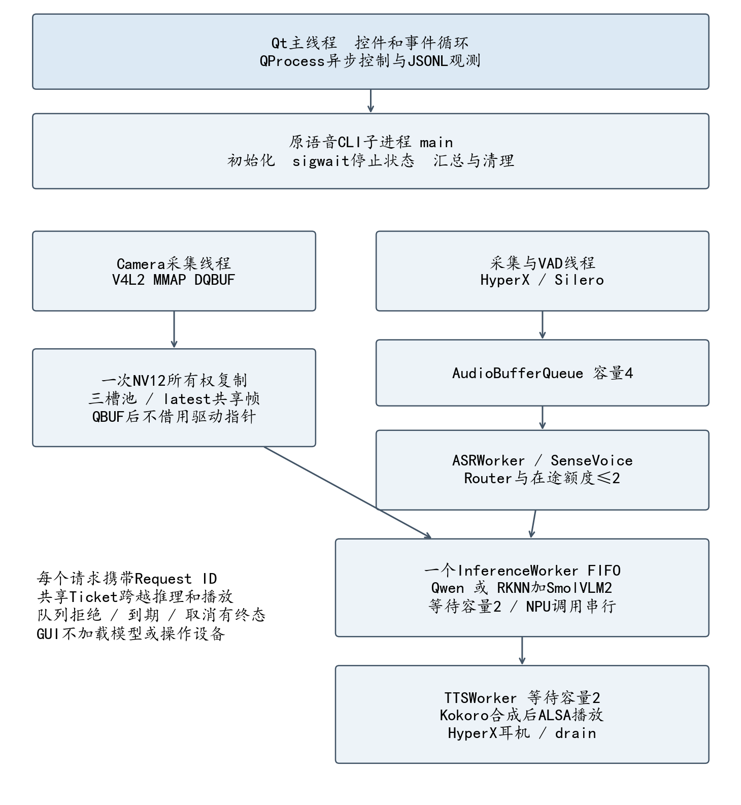
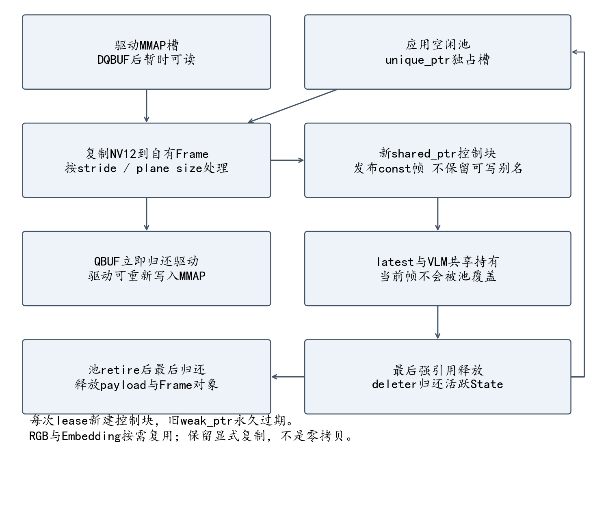
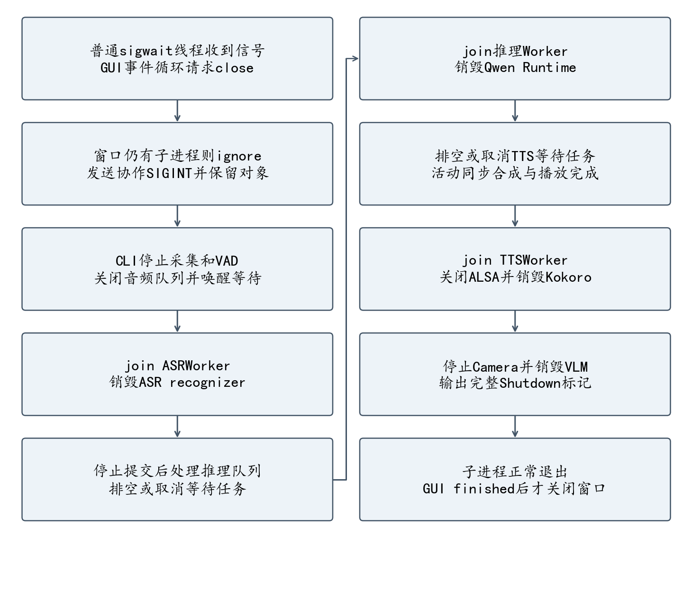

# 5.5 当前修改源码全文

由 `tools/stage5_05_export.py` 从真实文件生成。逐句语义解释见 [stage5_05_statement_notes.md](stage5_05_statement_notes.md)，架构与实测见 [stage5_05_final_acceptance.md](stage5_05_final_acceptance.md)。本附录不省略入口及测试，不代替板端版本哈希或执行证据。

## 修改前 1：CMakeLists.txt

```cmake
cmake_minimum_required(VERSION 3.16)
project(rk3576_multimodal LANGUAGES CXX)

set(CMAKE_CXX_STANDARD 17)
set(CMAKE_CXX_STANDARD_REQUIRED ON)
set(CMAKE_CXX_EXTENSIONS OFF)
find_package(Threads REQUIRED)

option(BUILD_WITH_RKLLM "Build the real Rockchip RKLLM backend" OFF)
option(BUILD_WITH_VLM "Build SmolVLM2 RKNN + RKLLM real VLM backend" OFF)
option(ENABLE_SHERPA_ASR "Build ALSA + sherpa-onnx audio pipeline" OFF)
set(SHERPA_ONNX_ROOT
    "${CMAKE_CURRENT_SOURCE_DIR}/../asr_runtime/sherpa-onnx-v1.13.8-linux-aarch64-shared-cpu"
    CACHE PATH "Root of sherpa-onnx aarch64 shared CPU runtime")

# 真实视觉 SDK 仅在 RK3576 aarch64 Linux 上启用。
set(RKNN_INCLUDE_DIR "${CMAKE_CURRENT_SOURCE_DIR}/../rknn_test/include"
    CACHE PATH "Directory containing rknn_api.h")
set(RKNN_RUNTIME_LIBRARY "/usr/lib/librknnrt.so"
    CACHE FILEPATH "RKNN runtime shared library")

set(RKLLM_SDK_ROOT "${CMAKE_CURRENT_SOURCE_DIR}/../rkllm_sdk"
    CACHE PATH "Root directory of the RKLLM SDK")

if(BUILD_WITH_RKLLM OR BUILD_WITH_VLM)
    if(NOT CMAKE_SYSTEM_NAME STREQUAL "Linux")
        message(FATAL_ERROR "The real RKLLM backend currently requires Linux.")
    endif()

    if(NOT CMAKE_SYSTEM_PROCESSOR MATCHES "^(aarch64|arm64)$")
        message(FATAL_ERROR "The current RKLLM library requires Linux AArch64.")
    endif()

    set(RKLLM_API_DIR "${RKLLM_SDK_ROOT}/rkllm-runtime/Linux/librkllm_api")
    set(RKLLM_INCLUDE_DIR "${RKLLM_API_DIR}/include")
    set(RKLLM_RUNTIME_LIBRARY "${RKLLM_API_DIR}/aarch64/librkllmrt.so")

    if(NOT EXISTS "${RKLLM_INCLUDE_DIR}/rkllm.h")
        message(FATAL_ERROR "RKLLM header not found: ${RKLLM_INCLUDE_DIR}/rkllm.h")
    endif()

    if(NOT EXISTS "${RKLLM_RUNTIME_LIBRARY}")
        message(FATAL_ERROR "RKLLM runtime library not found: ${RKLLM_RUNTIME_LIBRARY}")
    endif()

    message(STATUS "RKLLM SDK library available")
    message(STATUS "RKLLM include: ${RKLLM_INCLUDE_DIR}")
    message(STATUS "RKLLM library: ${RKLLM_RUNTIME_LIBRARY}")
endif()

function(project_warnings target)
    if(MSVC)
        target_compile_options(${target} PRIVATE /W4 /utf-8)
    else()
        target_compile_options(${target} PRIVATE -Wall -Wextra -Wpedantic)
    endif()
endfunction()

add_library(multimodal_core
    src/video/latest_frame_buffer.cpp
    src/video/image_preprocessor.cpp
    src/ai/llm_engine.cpp
    src/ai/llm_worker.cpp
    src/ai/vlm_engine.cpp
    src/ai/rk_backends_unavailable.cpp
    src/router/intent_router.cpp
    src/app/request_processor.cpp
)

target_include_directories(multimodal_core PUBLIC ${CMAKE_CURRENT_SOURCE_DIR}/include)
target_link_libraries(multimodal_core PUBLIC Threads::Threads)

if(BUILD_WITH_RKLLM)
    target_sources(multimodal_core PRIVATE src/ai/rkllm_backend.cpp)
    target_include_directories(multimodal_core PRIVATE "${RKLLM_INCLUDE_DIR}")
    target_link_libraries(multimodal_core PUBLIC "${RKLLM_RUNTIME_LIBRARY}")
    target_compile_definitions(multimodal_core PRIVATE RK3576_WITH_RKLLM=1)
endif()

if(BUILD_WITH_VLM)
    if(NOT EXISTS "${RKNN_INCLUDE_DIR}/rknn_api.h")
        message(FATAL_ERROR "RKNN header missing: ${RKNN_INCLUDE_DIR}/rknn_api.h")
    endif()
    if(NOT EXISTS "${RKNN_RUNTIME_LIBRARY}")
        message(FATAL_ERROR "RKNN runtime missing: ${RKNN_RUNTIME_LIBRARY}")
    endif()
    target_sources(multimodal_core PRIVATE src/ai/rk3576_vlm_backend.cpp)
    target_include_directories(multimodal_core PRIVATE "${RKNN_INCLUDE_DIR}" "${RKLLM_INCLUDE_DIR}")
    target_link_libraries(multimodal_core PUBLIC "${RKNN_RUNTIME_LIBRARY}" "${RKLLM_RUNTIME_LIBRARY}")
    target_compile_definitions(multimodal_core PRIVATE RK3576_WITH_VLM=1)
    message(STATUS "Real SmolVLM2 RKNN + RKLLM backend enabled")
endif()

project_warnings(multimodal_core)

if(CMAKE_SYSTEM_NAME STREQUAL "Linux")
    set(CAMERA_CAPTURE_SOURCE src/video/video_capture.cpp)
else()
    set(CAMERA_CAPTURE_SOURCE src/video/video_capture_unavailable.cpp)
    message(STATUS "V4L2 unavailable: building portable core/CLI with explicit camera error")
endif()

add_library(multimodal_camera
    src/video/camera_service.cpp
    ${CAMERA_CAPTURE_SOURCE}
)

target_link_libraries(multimodal_camera PUBLIC multimodal_core)
project_warnings(multimodal_camera)

add_executable(rk3576_multimodal
    src/main.cpp
    src/app/cli.cpp
)

target_link_libraries(rk3576_multimodal PRIVATE multimodal_camera)
project_warnings(rk3576_multimodal)

# 操作 2.8：真实 RKLLMWorker 实机验证。
if(BUILD_WITH_RKLLM)
    add_executable(
        rkllm_worker_smoke
        src/ai/llm_worker_smoke.cpp
    )

    target_link_libraries(
        rkllm_worker_smoke
        PRIVATE multimodal_core
    )

    project_warnings(rkllm_worker_smoke)
endif()


# Optional audio pipeline. Disabled in the original portable/RKLLM-only builds.
if(ENABLE_SHERPA_ASR)
    if(NOT CMAKE_SYSTEM_NAME STREQUAL "Linux")
        message(FATAL_ERROR "ALSA audio pipeline currently requires Linux")
    endif()

    find_package(ALSA REQUIRED)
    set(SHERPA_INCLUDE_DIR "${SHERPA_ONNX_ROOT}/include")
    set(SHERPA_LIBRARY "${SHERPA_ONNX_ROOT}/lib/libsherpa-onnx-c-api.so")
    if(NOT EXISTS "${SHERPA_INCLUDE_DIR}/sherpa-onnx/c-api/c-api.h")
        message(FATAL_ERROR "sherpa-onnx C API header missing: ${SHERPA_INCLUDE_DIR}")
    endif()
    if(NOT EXISTS "${SHERPA_LIBRARY}")
        message(FATAL_ERROR "sherpa-onnx C API library missing: ${SHERPA_LIBRARY}")
    endif()

    add_library(multimodal_audio
        src/audio/audio_capture.cpp
        src/audio/audio_preprocessor.cpp
        src/audio/asr_service.cpp
        src/audio/asr_pipeline.cpp
        src/audio/audio_worker.cpp
        src/audio/vad_audio_worker.cpp
    )
    target_include_directories(multimodal_audio PUBLIC
        ${CMAKE_CURRENT_SOURCE_DIR}/include
        "${SHERPA_INCLUDE_DIR}")
    target_link_libraries(multimodal_audio PUBLIC
        Threads::Threads ALSA::ALSA "${SHERPA_LIBRARY}")
    project_warnings(multimodal_audio)
    if(BUILD_TESTING)
        add_executable(stage5_04_asr_bench tests/stage5_04_asr_bench.cpp)
        target_link_libraries(stage5_04_asr_bench PRIVATE multimodal_audio)
        project_warnings(stage5_04_asr_bench)
    endif()

    # Restore previously used ASR verification targets.
    foreach(smoke IN ITEMS audio_capture_smoke asr_live_smoke
                           asr_pipeline_smoke asr_vad_smoke)
        add_executable(${smoke} "src/audio/${smoke}.cpp")
        target_link_libraries(${smoke} PRIVATE multimodal_audio)
        project_warnings(${smoke})
    endforeach()

    add_executable(asr_route_smoke src/audio/asr_route_smoke.cpp)
    target_link_libraries(asr_route_smoke PRIVATE multimodal_audio multimodal_camera)
    project_warnings(asr_route_smoke)

    # Operation 2.9: actual mic -> VAD -> ASR -> asynchronous RKLLM.
    if(BUILD_WITH_RKLLM)
        add_executable(asr_llm_smoke src/audio/asr_llm_smoke.cpp)
        target_link_libraries(asr_llm_smoke PRIVATE multimodal_audio multimodal_core)
        project_warnings(asr_llm_smoke)
    endif()
endif()


include(CTest)

if(BUILD_TESTING)
    add_executable(request_profile_tests tests/request_profile_tests.cpp)
    target_link_libraries(request_profile_tests PRIVATE multimodal_core)
    project_warnings(request_profile_tests)
    add_test(NAME request_profile_tests COMMAND request_profile_tests "${CMAKE_CURRENT_BINARY_DIR}/request_profile_test.jsonl")
    set_tests_properties(request_profile_tests PROPERTIES TIMEOUT 10)
    add_executable(image_pipeline_tests tests/image_pipeline_tests.cpp
        tests/camera_test_capture.cpp src/video/camera_service.cpp)
    target_include_directories(image_pipeline_tests PRIVATE tests)
    target_link_libraries(image_pipeline_tests PRIVATE multimodal_core)
    project_warnings(image_pipeline_tests)
    add_test(NAME image_pipeline_tests COMMAND image_pipeline_tests)
    set_tests_properties(image_pipeline_tests PROPERTIES TIMEOUT 30)

    add_executable(async_pipeline_tests tests/async_pipeline_tests.cpp
        src/audio/asr_pipeline.cpp src/audio/audio_preprocessor.cpp src/audio/tts_worker.cpp)
    target_link_libraries(async_pipeline_tests PRIVATE multimodal_core)
    project_warnings(async_pipeline_tests)
    add_test(NAME async_pipeline_tests COMMAND async_pipeline_tests)
    set_tests_properties(async_pipeline_tests PROPERTIES TIMEOUT 20)
    if(BUILD_WITH_RKLLM AND BUILD_WITH_VLM)
        find_path(STAGE5_RGA_INCLUDE_DIR im2d.h PATH_SUFFIXES rga)
        find_library(STAGE5_RGA_LIBRARY rga)
        if(STAGE5_RGA_INCLUDE_DIR AND STAGE5_RGA_LIBRARY)
            add_executable(stage5_03_rga_probe tests/stage5_03_rga_probe.cpp)
            target_include_directories(stage5_03_rga_probe PRIVATE "${STAGE5_RGA_INCLUDE_DIR}" "${RKNN_INCLUDE_DIR}")
            target_link_libraries(stage5_03_rga_probe PRIVATE multimodal_core "${STAGE5_RGA_LIBRARY}")
            project_warnings(stage5_03_rga_probe)
        endif()
        add_executable(stage5_03_memory_probe tests/stage5_03_memory_probe.cpp)
        target_link_libraries(stage5_03_memory_probe PRIVATE multimodal_camera)
        project_warnings(stage5_03_memory_probe)
        add_executable(stage5_04_vision_bench tests/stage5_04_vision_bench.cpp)
        target_link_libraries(stage5_04_vision_bench PRIVATE multimodal_core)
        project_warnings(stage5_04_vision_bench)
        add_executable(stage5_02_npu_probe tests/stage5_02_npu_probe.cpp)
        target_link_libraries(stage5_02_npu_probe PRIVATE multimodal_camera)
        project_warnings(stage5_02_npu_probe)
        # Manual hardware diagnostic only; never auto-register it in CTest.
    endif()

    # Portable production pipeline with a test-only ASRService implementation.
    # No ALSA, sherpa-onnx, model or NPU is used by this target.
    add_executable(asr_pipeline_tests
        tests/asr_pipeline_tests.cpp
        src/audio/asr_pipeline.cpp
        src/audio/audio_preprocessor.cpp)
    target_include_directories(asr_pipeline_tests PRIVATE ${CMAKE_CURRENT_SOURCE_DIR}/include)
    target_link_libraries(asr_pipeline_tests PRIVATE Threads::Threads)
    project_warnings(asr_pipeline_tests)
    add_test(NAME asr_pipeline_tests COMMAND asr_pipeline_tests)
    set_tests_properties(asr_pipeline_tests PROPERTIES TIMEOUT 15)

    add_executable(audio_preprocessor_tests
        tests/audio_preprocessor_tests.cpp
        src/audio/audio_preprocessor.cpp)
    target_include_directories(audio_preprocessor_tests PRIVATE ${CMAKE_CURRENT_SOURCE_DIR}/include)
    project_warnings(audio_preprocessor_tests)
    add_test(NAME audio_preprocessor_tests COMMAND audio_preprocessor_tests)
    set_tests_properties(audio_preprocessor_tests PROPERTIES TIMEOUT 10)

    # Mock Backend 测试，不加载模型、不使用 NPU。
    add_executable(llm_worker_tests tests/llm_worker_tests.cpp)
    target_link_libraries(llm_worker_tests PRIVATE multimodal_core)
    project_warnings(llm_worker_tests)
    add_test(NAME llm_worker_tests COMMAND llm_worker_tests)
    set_tests_properties(llm_worker_tests PROPERTIES TIMEOUT 15)

    if(NOT BUILD_WITH_RKLLM AND NOT BUILD_WITH_VLM)
        add_executable(core_tests tests/core_tests.cpp)
        target_link_libraries(core_tests PRIVATE multimodal_core)
        project_warnings(core_tests)
        add_test(NAME core_tests COMMAND core_tests)

        add_test(NAME cli_smoke COMMAND ${CMAKE_COMMAND}
            -DAPP=$<TARGET_FILE:rk3576_multimodal>
            -DTEST_DATA=${CMAKE_CURRENT_SOURCE_DIR}/tests
            -P ${CMAKE_CURRENT_SOURCE_DIR}/tests/cli_smoke.cmake)

        set_tests_properties(core_tests cli_smoke PROPERTIES TIMEOUT 20)
    endif()

    add_executable(camera_service_tests
        tests/camera_service_tests.cpp
        tests/camera_test_capture.cpp
        src/video/camera_service.cpp)

    target_include_directories(camera_service_tests PRIVATE tests)
    target_link_libraries(camera_service_tests PRIVATE multimodal_core)
    project_warnings(camera_service_tests)
    add_test(NAME camera_service_tests COMMAND camera_service_tests)
    set_tests_properties(camera_service_tests PROPERTIES TIMEOUT 20)

endif()
# ==========================================================
# Stage 3.2: Offline TTSService + WAV smoke test
# ==========================================================

if(ENABLE_SHERPA_ASR)
    add_executable(tts_smoke
        src/audio/tts_smoke.cpp
    )

    target_link_libraries(tts_smoke
        PRIVATE multimodal_tts
    )

    project_warnings(tts_smoke)
endif()


# ==========================================================
# Stage 3.3: TTS -> ALSA Playback smoke test
# ==========================================================

if(ENABLE_SHERPA_ASR)
    add_executable(tts_playback_smoke
        src/audio/tts_playback_smoke.cpp
    )

    target_link_libraries(tts_playback_smoke
        PRIVATE multimodal_tts
    )

    project_warnings(tts_playback_smoke)
endif()


# ==========================================================
# Stage 3.4: Reusable TTS library + asynchronous worker
# ==========================================================

if(ENABLE_SHERPA_ASR)

    add_library(multimodal_tts STATIC
        src/audio/tts_service.cpp
        src/audio/alsa_playback_service.cpp
        src/audio/tts_worker.cpp
    )

    target_include_directories(multimodal_tts PUBLIC
        ${CMAKE_CURRENT_SOURCE_DIR}/include
    )

    target_link_libraries(multimodal_tts PUBLIC
        multimodal_audio
    )

    project_warnings(multimodal_tts)
    if(BUILD_TESTING)
        add_executable(stage5_04_tts_bench tests/stage5_04_tts_bench.cpp)
        target_link_libraries(stage5_04_tts_bench PRIVATE multimodal_tts)
        target_compile_definitions(stage5_04_tts_bench PRIVATE STAGE5_BENCH_TRACE=1)
        project_warnings(stage5_04_tts_bench)
    endif()

    add_executable(tts_worker_smoke
        src/audio/tts_worker_smoke.cpp
    )

    target_link_libraries(tts_worker_smoke PRIVATE
        multimodal_tts
    )

    project_warnings(tts_worker_smoke)

endif()
# Stage 3.4: TTSWorker queue and shutdown verification
if(ENABLE_SHERPA_ASR)
    add_executable(tts_worker_queue_smoke
        src/audio/tts_worker_queue_smoke.cpp
    )

    target_link_libraries(tts_worker_queue_smoke
        PRIVATE multimodal_tts
    )

    project_warnings(tts_worker_queue_smoke)
endif()
# ==========================================================
# Stage 3.5: ASR -> LLM -> TTS -> ALSA
# ==========================================================

if(ENABLE_SHERPA_ASR AND BUILD_WITH_RKLLM)

    add_executable(asr_llm_tts_smoke
        src/audio/asr_llm_tts_smoke.cpp
    )

    target_link_libraries(asr_llm_tts_smoke PRIVATE
        multimodal_audio
        multimodal_core
        multimodal_camera
        multimodal_tts
    )

    project_warnings(asr_llm_tts_smoke)

endif()
```

## 修改后 1：CMakeLists.txt

SHA256：`58c5192721f3aea66bb1e9252bc66d5346ce21ba284bdc284dbe8ed5753ceded`；431 行。

```cmake
cmake_minimum_required(VERSION 3.16)
project(rk3576_multimodal LANGUAGES CXX)

set(CMAKE_CXX_STANDARD 17)
set(CMAKE_CXX_STANDARD_REQUIRED ON)
set(CMAKE_CXX_EXTENSIONS OFF)
find_package(Threads REQUIRED)

option(BUILD_WITH_RKLLM "Build the real Rockchip RKLLM backend" OFF)
option(BUILD_WITH_VLM "Build SmolVLM2 RKNN + RKLLM real VLM backend" OFF)
option(ENABLE_SHERPA_ASR "Build ALSA + sherpa-onnx audio pipeline" OFF)
option(BUILD_QT_GUI "Optional Qt Widgets adapter for the existing voice CLI" OFF)
set(SHERPA_ONNX_ROOT
    "${CMAKE_CURRENT_SOURCE_DIR}/../asr_runtime/sherpa-onnx-v1.13.8-linux-aarch64-shared-cpu"
    CACHE PATH "Root of sherpa-onnx aarch64 shared CPU runtime")

# 真实视觉 SDK 仅在 RK3576 aarch64 Linux 上启用。
set(RKNN_INCLUDE_DIR "${CMAKE_CURRENT_SOURCE_DIR}/../rknn_test/include"
    CACHE PATH "Directory containing rknn_api.h")
set(RKNN_RUNTIME_LIBRARY "/usr/lib/librknnrt.so"
    CACHE FILEPATH "RKNN runtime shared library")

set(RKLLM_SDK_ROOT "${CMAKE_CURRENT_SOURCE_DIR}/../rkllm_sdk"
    CACHE PATH "Root directory of the RKLLM SDK")

if(BUILD_WITH_RKLLM OR BUILD_WITH_VLM)
    if(NOT CMAKE_SYSTEM_NAME STREQUAL "Linux")
        message(FATAL_ERROR "The real RKLLM backend currently requires Linux.")
    endif()

    if(NOT CMAKE_SYSTEM_PROCESSOR MATCHES "^(aarch64|arm64)$")
        message(FATAL_ERROR "The current RKLLM library requires Linux AArch64.")
    endif()

    set(RKLLM_API_DIR "${RKLLM_SDK_ROOT}/rkllm-runtime/Linux/librkllm_api")
    set(RKLLM_INCLUDE_DIR "${RKLLM_API_DIR}/include")
    set(RKLLM_RUNTIME_LIBRARY "${RKLLM_API_DIR}/aarch64/librkllmrt.so")

    if(NOT EXISTS "${RKLLM_INCLUDE_DIR}/rkllm.h")
        message(FATAL_ERROR "RKLLM header not found: ${RKLLM_INCLUDE_DIR}/rkllm.h")
    endif()

    if(NOT EXISTS "${RKLLM_RUNTIME_LIBRARY}")
        message(FATAL_ERROR "RKLLM runtime library not found: ${RKLLM_RUNTIME_LIBRARY}")
    endif()

    message(STATUS "RKLLM SDK library available")
    message(STATUS "RKLLM include: ${RKLLM_INCLUDE_DIR}")
    message(STATUS "RKLLM library: ${RKLLM_RUNTIME_LIBRARY}")
endif()

function(project_warnings target)
    if(MSVC)
        target_compile_options(${target} PRIVATE /W4 /utf-8)
    else()
        target_compile_options(${target} PRIVATE -Wall -Wextra -Wpedantic)
    endif()
endfunction()

add_library(multimodal_core
    src/video/latest_frame_buffer.cpp
    src/video/image_preprocessor.cpp
    src/ai/llm_engine.cpp
    src/ai/llm_worker.cpp
    src/ai/vlm_engine.cpp
    src/ai/rk_backends_unavailable.cpp
    src/router/intent_router.cpp
    src/app/request_processor.cpp
)

target_include_directories(multimodal_core PUBLIC ${CMAKE_CURRENT_SOURCE_DIR}/include)
target_link_libraries(multimodal_core PUBLIC Threads::Threads)

if(BUILD_WITH_RKLLM)
    target_sources(multimodal_core PRIVATE src/ai/rkllm_backend.cpp)
    target_include_directories(multimodal_core PRIVATE "${RKLLM_INCLUDE_DIR}")
    target_link_libraries(multimodal_core PUBLIC "${RKLLM_RUNTIME_LIBRARY}")
    target_compile_definitions(multimodal_core PRIVATE RK3576_WITH_RKLLM=1)
endif()

if(BUILD_WITH_VLM)
    if(NOT EXISTS "${RKNN_INCLUDE_DIR}/rknn_api.h")
        message(FATAL_ERROR "RKNN header missing: ${RKNN_INCLUDE_DIR}/rknn_api.h")
    endif()
    if(NOT EXISTS "${RKNN_RUNTIME_LIBRARY}")
        message(FATAL_ERROR "RKNN runtime missing: ${RKNN_RUNTIME_LIBRARY}")
    endif()
    target_sources(multimodal_core PRIVATE src/ai/rk3576_vlm_backend.cpp)
    target_include_directories(multimodal_core PRIVATE "${RKNN_INCLUDE_DIR}" "${RKLLM_INCLUDE_DIR}")
    target_link_libraries(multimodal_core PUBLIC "${RKNN_RUNTIME_LIBRARY}" "${RKLLM_RUNTIME_LIBRARY}")
    target_compile_definitions(multimodal_core PRIVATE RK3576_WITH_VLM=1)
    message(STATUS "Real SmolVLM2 RKNN + RKLLM backend enabled")
endif()

project_warnings(multimodal_core)

if(CMAKE_SYSTEM_NAME STREQUAL "Linux")
    set(CAMERA_CAPTURE_SOURCE src/video/video_capture.cpp)
else()
    set(CAMERA_CAPTURE_SOURCE src/video/video_capture_unavailable.cpp)
    message(STATUS "V4L2 unavailable: building portable core/CLI with explicit camera error")
endif()

add_library(multimodal_camera
    src/video/camera_service.cpp
    ${CAMERA_CAPTURE_SOURCE}
)

target_link_libraries(multimodal_camera PUBLIC multimodal_core)
project_warnings(multimodal_camera)

add_executable(rk3576_multimodal
    src/main.cpp
    src/app/cli.cpp
)

target_link_libraries(rk3576_multimodal PRIVATE multimodal_camera)
project_warnings(rk3576_multimodal)

# 操作 2.8：真实 RKLLMWorker 实机验证。
if(BUILD_WITH_RKLLM)
    add_executable(
        rkllm_worker_smoke
        src/ai/llm_worker_smoke.cpp
    )

    target_link_libraries(
        rkllm_worker_smoke
        PRIVATE multimodal_core
    )

    project_warnings(rkllm_worker_smoke)
endif()


# Optional audio pipeline. Disabled in the original portable/RKLLM-only builds.
if(ENABLE_SHERPA_ASR)
    if(NOT CMAKE_SYSTEM_NAME STREQUAL "Linux")
        message(FATAL_ERROR "ALSA audio pipeline currently requires Linux")
    endif()

    find_package(ALSA REQUIRED)
    set(SHERPA_INCLUDE_DIR "${SHERPA_ONNX_ROOT}/include")
    set(SHERPA_LIBRARY "${SHERPA_ONNX_ROOT}/lib/libsherpa-onnx-c-api.so")
    if(NOT EXISTS "${SHERPA_INCLUDE_DIR}/sherpa-onnx/c-api/c-api.h")
        message(FATAL_ERROR "sherpa-onnx C API header missing: ${SHERPA_INCLUDE_DIR}")
    endif()
    if(NOT EXISTS "${SHERPA_LIBRARY}")
        message(FATAL_ERROR "sherpa-onnx C API library missing: ${SHERPA_LIBRARY}")
    endif()

    add_library(multimodal_audio
        src/audio/audio_capture.cpp
        src/audio/audio_preprocessor.cpp
        src/audio/asr_service.cpp
        src/audio/asr_pipeline.cpp
        src/audio/audio_worker.cpp
        src/audio/vad_audio_worker.cpp
    )
    target_include_directories(multimodal_audio PUBLIC
        ${CMAKE_CURRENT_SOURCE_DIR}/include
        "${SHERPA_INCLUDE_DIR}")
    target_link_libraries(multimodal_audio PUBLIC
        Threads::Threads ALSA::ALSA "${SHERPA_LIBRARY}")
    project_warnings(multimodal_audio)
    if(BUILD_TESTING)
        add_executable(stage5_04_asr_bench tests/stage5_04_asr_bench.cpp)
        target_link_libraries(stage5_04_asr_bench PRIVATE multimodal_audio)
        project_warnings(stage5_04_asr_bench)
    endif()

    # Restore previously used ASR verification targets.
    foreach(smoke IN ITEMS audio_capture_smoke asr_live_smoke
                           asr_pipeline_smoke asr_vad_smoke)
        add_executable(${smoke} "src/audio/${smoke}.cpp")
        target_link_libraries(${smoke} PRIVATE multimodal_audio)
        project_warnings(${smoke})
    endforeach()

    add_executable(asr_route_smoke src/audio/asr_route_smoke.cpp)
    target_link_libraries(asr_route_smoke PRIVATE multimodal_audio multimodal_camera)
    project_warnings(asr_route_smoke)

    # Operation 2.9: actual mic -> VAD -> ASR -> asynchronous RKLLM.
    if(BUILD_WITH_RKLLM)
        add_executable(asr_llm_smoke src/audio/asr_llm_smoke.cpp)
        target_link_libraries(asr_llm_smoke PRIVATE multimodal_audio multimodal_core)
        project_warnings(asr_llm_smoke)
    endif()
endif()


include(CTest)

if(BUILD_TESTING)
    add_executable(request_profile_tests tests/request_profile_tests.cpp)
    target_link_libraries(request_profile_tests PRIVATE multimodal_core)
    project_warnings(request_profile_tests)
    add_test(NAME request_profile_tests COMMAND request_profile_tests "${CMAKE_CURRENT_BINARY_DIR}/request_profile_test.jsonl")
    set_tests_properties(request_profile_tests PROPERTIES TIMEOUT 10)
    add_executable(image_pipeline_tests tests/image_pipeline_tests.cpp
        tests/camera_test_capture.cpp src/video/camera_service.cpp)
    target_include_directories(image_pipeline_tests PRIVATE tests)
    target_link_libraries(image_pipeline_tests PRIVATE multimodal_core)
    project_warnings(image_pipeline_tests)
    add_test(NAME image_pipeline_tests COMMAND image_pipeline_tests)
    set_tests_properties(image_pipeline_tests PROPERTIES TIMEOUT 30)

    add_executable(async_pipeline_tests tests/async_pipeline_tests.cpp
        src/audio/asr_pipeline.cpp src/audio/audio_preprocessor.cpp src/audio/tts_worker.cpp)
    target_link_libraries(async_pipeline_tests PRIVATE multimodal_core)
    project_warnings(async_pipeline_tests)
    add_test(NAME async_pipeline_tests COMMAND async_pipeline_tests)
    set_tests_properties(async_pipeline_tests PROPERTIES TIMEOUT 20)
    if(BUILD_WITH_RKLLM AND BUILD_WITH_VLM)
        find_path(STAGE5_RGA_INCLUDE_DIR im2d.h PATH_SUFFIXES rga)
        find_library(STAGE5_RGA_LIBRARY rga)
        if(STAGE5_RGA_INCLUDE_DIR AND STAGE5_RGA_LIBRARY)
            add_executable(stage5_03_rga_probe tests/stage5_03_rga_probe.cpp)
            target_include_directories(stage5_03_rga_probe PRIVATE "${STAGE5_RGA_INCLUDE_DIR}" "${RKNN_INCLUDE_DIR}")
            target_link_libraries(stage5_03_rga_probe PRIVATE multimodal_core "${STAGE5_RGA_LIBRARY}")
            project_warnings(stage5_03_rga_probe)
        endif()
        add_executable(stage5_03_memory_probe tests/stage5_03_memory_probe.cpp)
        target_link_libraries(stage5_03_memory_probe PRIVATE multimodal_camera)
        project_warnings(stage5_03_memory_probe)
        add_executable(stage5_04_vision_bench tests/stage5_04_vision_bench.cpp)
        target_link_libraries(stage5_04_vision_bench PRIVATE multimodal_core)
        project_warnings(stage5_04_vision_bench)
        add_executable(stage5_02_npu_probe tests/stage5_02_npu_probe.cpp)
        target_link_libraries(stage5_02_npu_probe PRIVATE multimodal_camera)
        project_warnings(stage5_02_npu_probe)
        # Manual hardware diagnostic only; never auto-register it in CTest.
    endif()

    # Portable production pipeline with a test-only ASRService implementation.
    # No ALSA, sherpa-onnx, model or NPU is used by this target.
    add_executable(asr_pipeline_tests
        tests/asr_pipeline_tests.cpp
        src/audio/asr_pipeline.cpp
        src/audio/audio_preprocessor.cpp)
    target_include_directories(asr_pipeline_tests PRIVATE ${CMAKE_CURRENT_SOURCE_DIR}/include)
    target_link_libraries(asr_pipeline_tests PRIVATE Threads::Threads)
    project_warnings(asr_pipeline_tests)
    add_test(NAME asr_pipeline_tests COMMAND asr_pipeline_tests)
    set_tests_properties(asr_pipeline_tests PROPERTIES TIMEOUT 15)

    add_executable(audio_preprocessor_tests
        tests/audio_preprocessor_tests.cpp
        src/audio/audio_preprocessor.cpp)
    target_include_directories(audio_preprocessor_tests PRIVATE ${CMAKE_CURRENT_SOURCE_DIR}/include)
    project_warnings(audio_preprocessor_tests)
    add_test(NAME audio_preprocessor_tests COMMAND audio_preprocessor_tests)
    set_tests_properties(audio_preprocessor_tests PROPERTIES TIMEOUT 10)

    # Mock Backend 测试，不加载模型、不使用 NPU。
    add_executable(llm_worker_tests tests/llm_worker_tests.cpp)
    target_link_libraries(llm_worker_tests PRIVATE multimodal_core)
    project_warnings(llm_worker_tests)
    add_test(NAME llm_worker_tests COMMAND llm_worker_tests)
    set_tests_properties(llm_worker_tests PROPERTIES TIMEOUT 15)

    if(NOT BUILD_WITH_RKLLM AND NOT BUILD_WITH_VLM)
        add_executable(core_tests tests/core_tests.cpp)
        target_link_libraries(core_tests PRIVATE multimodal_core)
        project_warnings(core_tests)
        add_test(NAME core_tests COMMAND core_tests)

        add_test(NAME cli_smoke COMMAND ${CMAKE_COMMAND}
            -DAPP=$<TARGET_FILE:rk3576_multimodal>
            -DTEST_DATA=${CMAKE_CURRENT_SOURCE_DIR}/tests
            -P ${CMAKE_CURRENT_SOURCE_DIR}/tests/cli_smoke.cmake)

        set_tests_properties(core_tests cli_smoke PROPERTIES TIMEOUT 20)
    endif()

    add_executable(camera_service_tests
        tests/camera_service_tests.cpp
        tests/camera_test_capture.cpp
        src/video/camera_service.cpp)

    target_include_directories(camera_service_tests PRIVATE tests)
    target_link_libraries(camera_service_tests PRIVATE multimodal_core)
    project_warnings(camera_service_tests)
    add_test(NAME camera_service_tests COMMAND camera_service_tests)
    set_tests_properties(camera_service_tests PROPERTIES TIMEOUT 20)

endif()
# ==========================================================
# Stage 3.2: Offline TTSService + WAV smoke test
# ==========================================================

if(ENABLE_SHERPA_ASR)
    add_executable(tts_smoke
        src/audio/tts_smoke.cpp
    )

    target_link_libraries(tts_smoke
        PRIVATE multimodal_tts
    )

    project_warnings(tts_smoke)
endif()


# ==========================================================
# Stage 3.3: TTS -> ALSA Playback smoke test
# ==========================================================

if(ENABLE_SHERPA_ASR)
    add_executable(tts_playback_smoke
        src/audio/tts_playback_smoke.cpp
    )

    target_link_libraries(tts_playback_smoke
        PRIVATE multimodal_tts
    )

    project_warnings(tts_playback_smoke)
endif()


# ==========================================================
# Stage 3.4: Reusable TTS library + asynchronous worker
# ==========================================================

if(ENABLE_SHERPA_ASR)

    add_library(multimodal_tts STATIC
        src/audio/tts_service.cpp
        src/audio/alsa_playback_service.cpp
        src/audio/tts_worker.cpp
    )

    target_include_directories(multimodal_tts PUBLIC
        ${CMAKE_CURRENT_SOURCE_DIR}/include
    )

    target_link_libraries(multimodal_tts PUBLIC
        multimodal_audio
    )

    project_warnings(multimodal_tts)
    if(BUILD_TESTING)
        add_executable(stage5_04_tts_bench tests/stage5_04_tts_bench.cpp)
        target_link_libraries(stage5_04_tts_bench PRIVATE multimodal_tts)
        target_compile_definitions(stage5_04_tts_bench PRIVATE STAGE5_BENCH_TRACE=1)
        project_warnings(stage5_04_tts_bench)
    endif()

    add_executable(tts_worker_smoke
        src/audio/tts_worker_smoke.cpp
    )

    target_link_libraries(tts_worker_smoke PRIVATE
        multimodal_tts
    )

    project_warnings(tts_worker_smoke)

endif()
# Stage 3.4: TTSWorker queue and shutdown verification
if(ENABLE_SHERPA_ASR)
    add_executable(tts_worker_queue_smoke
        src/audio/tts_worker_queue_smoke.cpp
    )

    target_link_libraries(tts_worker_queue_smoke
        PRIVATE multimodal_tts
    )

    project_warnings(tts_worker_queue_smoke)
endif()
# ==========================================================
# Stage 3.5: ASR -> LLM -> TTS -> ALSA
# ==========================================================

if(ENABLE_SHERPA_ASR AND BUILD_WITH_RKLLM)

    add_executable(asr_llm_tts_smoke
        src/audio/asr_llm_tts_smoke.cpp
    )

    target_link_libraries(asr_llm_tts_smoke PRIVATE
        multimodal_audio
        multimodal_core
        multimodal_camera
        multimodal_tts
    )

    project_warnings(asr_llm_tts_smoke)

endif()

# Qt is optional; the original CLI and SDK-free tests remain independently usable.
if(BUILD_QT_GUI)
    if(NOT CMAKE_SYSTEM_NAME STREQUAL "Linux")
        message(FATAL_ERROR "The GUI process adapter currently uses Linux cooperative signals")
    endif()
    find_package(Qt5 5.15 REQUIRED COMPONENTS Widgets)
    add_library(multimodal_gui_adapter
        src/gui/backend_session.cpp src/gui/session_window.cpp
        include/gui/backend_session.h include/gui/session_window.h)
    set_target_properties(multimodal_gui_adapter PROPERTIES AUTOMOC ON)
    target_include_directories(multimodal_gui_adapter PUBLIC "${CMAKE_CURRENT_SOURCE_DIR}/include")
    target_link_libraries(multimodal_gui_adapter PUBLIC Qt5::Widgets)
    project_warnings(multimodal_gui_adapter)
    add_executable(rk3576_multimodal_gui src/gui/main.cpp)
    target_link_libraries(rk3576_multimodal_gui PRIVATE multimodal_gui_adapter Threads::Threads)
    project_warnings(rk3576_multimodal_gui)
endif()


if(BUILD_QT_GUI AND BUILD_TESTING)
    find_package(Qt5 5.15 REQUIRED COMPONENTS Test)
    add_executable(gui_fake_backend tests/gui_fake_backend.cpp)
    target_link_libraries(gui_fake_backend PRIVATE Threads::Threads)
    add_executable(gui_session_tests tests/gui_session_tests.cpp)
    set_target_properties(gui_session_tests PROPERTIES AUTOMOC ON)
    target_link_libraries(gui_session_tests PRIVATE multimodal_gui_adapter Qt5::Test Threads::Threads)
    add_dependencies(gui_session_tests gui_fake_backend)
    add_test(NAME gui_session_tests COMMAND gui_session_tests)
    file(MAKE_DIRECTORY "${CMAKE_CURRENT_BINARY_DIR}/qt_test_tmp/cache"
        "${CMAKE_CURRENT_BINARY_DIR}/qt_test_tmp/config"
        "${CMAKE_CURRENT_BINARY_DIR}/qt_test_tmp/data")
    set_tests_properties(gui_session_tests PROPERTIES TIMEOUT 20
        ENVIRONMENT "QT_QPA_PLATFORM=offscreen;TMPDIR=${CMAKE_CURRENT_BINARY_DIR}/qt_test_tmp;XDG_CACHE_HOME=${CMAKE_CURRENT_BINARY_DIR}/qt_test_tmp/cache;XDG_CONFIG_HOME=${CMAKE_CURRENT_BINARY_DIR}/qt_test_tmp/config;XDG_DATA_HOME=${CMAKE_CURRENT_BINARY_DIR}/qt_test_tmp/data")
endif()
```

## 修改后 2：include/app/stop_signals.h

SHA256：`c8fd4e74fc35c910c195ca789aaaa627c1127c77e018d28e983a860ebb69b5bf`；63 行。

```cpp
#pragma once
#include <atomic>
#include <cerrno>
#include <stdexcept>
#include <thread>
#include <pthread.h>
#include <signal.h>

// Construct before SDKs/workers: all descendant threads inherit the blocked set.
// sigtimedwait runs in an ordinary thread; there is no asynchronous signal handler.
class StopSignals {
public:
    StopSignals()
    {
        sigemptyset(&signals_);
        sigaddset(&signals_, SIGINT);
        sigaddset(&signals_, SIGTERM);
        if (pthread_sigmask(SIG_BLOCK, &signals_, &previous_) != 0)
            throw std::runtime_error("Cannot block stop signals");
        try
        {
            thread_ = std::thread([this] {
                const timespec interval{0, 100000000};
                while (!finished_.load())
                {
                    const int received = sigtimedwait(&signals_, nullptr, &interval);
                    if (received == SIGINT || received == SIGTERM)
                    {
                        int empty = 0;
                        signal_.compare_exchange_strong(empty, received);
                    }
                    else if (received < 0 && errno != EAGAIN && errno != EINTR)
                    {
                        wait_failed_.store(true);
                        break;
                    }
                }
            });
        }
        catch (...)
        {
            pthread_sigmask(SIG_SETMASK, &previous_, nullptr);
            throw;
        }
    }
    ~StopSignals()
    {
        finished_.store(true);
        if (thread_.joinable()) thread_.join();
        pthread_sigmask(SIG_SETMASK, &previous_, nullptr);
    }
    StopSignals(const StopSignals&) = delete;
    StopSignals& operator=(const StopSignals&) = delete;
    int received() const noexcept { return signal_.load(); }
    bool failed() const noexcept { return wait_failed_.load(); }
private:
    sigset_t signals_{};
    sigset_t previous_{};
    std::atomic<int> signal_{0};
    std::atomic<bool> finished_{false};
    std::atomic<bool> wait_failed_{false};
    std::thread thread_;
};
```

## 修改前 3：include/common/image_profile.h

```cpp
#pragma once
#include <chrono>
#include <cstddef>
#include <stdexcept>
#include <cstdint>
#include <cstdlib>
#include <fstream>
#include <iostream>
#include <mutex>
#include <string>

// Frame IDs and request IDs belong to different namespaces. SDK callbacks carry
// an explicit RequestTrace; ordinary synchronous stages inherit this scoped ID.
inline thread_local std::uint64_t image_profile_request_id=0;

// Optional diagnostic JSONL. Each duration ends before file I/O; no frame data held.
class ImageProfile {
public:
    using Clock=std::chrono::steady_clock;
    static double ms(Clock::time_point start,Clock::time_point end=Clock::now()) {
        return std::chrono::duration<double,std::milli>(end-start).count();
    }
    static ImageProfile& instance(){static ImageProfile profile;return profile;}
    bool enabled() const noexcept {return enabled_;}
    void sample(const char* stage,double duration,std::uint64_t id=0,std::size_t bytes=0,std::size_t allocations=0) noexcept {
        if(!enabled_ || (!background_ && image_profile_request_id==0))return;
        try {
            std::lock_guard<std::mutex> lock(mutex_);
            output_<<"{\"stage\":\""<<stage<<"\",\"ms\":"<<duration<<",\"id\":"<<id<<",\"request_id\":"<<image_profile_request_id<<",\"bytes\":"<<bytes<<",\"allocations\":"<<allocations<<"}\n";
            output_.flush();
            if(!output_ && !failed_){failed_=true;std::cerr<<"[ImageProfile ERROR] write failed\n";}
        } catch(...) {std::cerr<<"[ImageProfile ERROR] exception\n";}
    }
    void request(std::uint64_t id,const char* event,Clock::time_point at,double value=-1) noexcept {
        if(!enabled_)return;
        try {
            const auto ns=std::chrono::duration_cast<std::chrono::nanoseconds>(at.time_since_epoch()).count();
            std::lock_guard<std::mutex> lock(mutex_);
            output_<<"{\"kind\":\"request\",\"stage\":\"request_event\",\"ms\":0,\"id\":0,\"bytes\":0,\"allocations\":0,\"request_id\":"<<id<<",\"event\":\""<<event<<"\",\"at_ns\":"<<ns<<",\"value\":"<<value<<"}\n";
            output_.flush();
            if(!output_ && !failed_){failed_=true;std::cerr<<"[ImageProfile ERROR] request write failed\n";}
        }catch(...){std::cerr<<"[ImageProfile ERROR] request exception\n";}
    }
private:
    ImageProfile(){
        const char* path=std::getenv("STAGE5_PROFILE");
        background_=path==nullptr; // Legacy image profiling retains all Camera samples.
        if(!path)path=std::getenv("STAGE5_IMAGE_PROFILE");
        if(path) {
            enabled_=true;output_.open(path,std::ios::out|std::ios::trunc);
            if(!output_){enabled_=false;failed_=true;std::cerr<<"[ImageProfile ERROR] cannot open log\n";}
        }
    }
    bool enabled_=false,failed_=false,background_=true;
    std::mutex mutex_;
    std::ofstream output_;
};
inline void imageSample(const char* stage,double ms,std::uint64_t id=0,std::size_t bytes=0,std::size_t allocations=0) {
    ImageProfile::instance().sample(stage,ms,id,bytes,allocations);
}
```

## 修改后 3：include/common/image_profile.h

SHA256：`6e783903faeb499ef6e704df1dc4d2e0e13f4214ed06fa3822fb94a9f167cf63`；84 行。

```cpp
#pragma once
#include <chrono>
#include <cstddef>
#include <stdexcept>
#include <cstdint>
#include <cstdlib>
#include <fstream>
#include <iostream>
#include <mutex>
#include <string>
#include <string_view>

// Frame IDs and request IDs belong to different namespaces. SDK callbacks carry
// an explicit RequestTrace; ordinary synchronous stages inherit this scoped ID.
inline thread_local std::uint64_t image_profile_request_id=0;

// Optional diagnostic JSONL. Each duration ends before file I/O; no frame data held.
class ImageProfile {
public:
    using Clock=std::chrono::steady_clock;
    static double ms(Clock::time_point start,Clock::time_point end=Clock::now()) {
        return std::chrono::duration<double,std::milli>(end-start).count();
    }
    static ImageProfile& instance(){static ImageProfile profile;return profile;}
    bool enabled() const noexcept {return enabled_;}
    void sample(const char* stage,double duration,std::uint64_t id=0,std::size_t bytes=0,std::size_t allocations=0) noexcept {
        if(!enabled_ || (!background_ && image_profile_request_id==0))return;
        try {
            std::lock_guard<std::mutex> lock(mutex_);
            output_<<"{\"stage\":\""<<stage<<"\",\"ms\":"<<duration<<",\"id\":"<<id<<",\"request_id\":"<<image_profile_request_id<<",\"bytes\":"<<bytes<<",\"allocations\":"<<allocations<<"}\n";
            output_.flush();
            if(!output_ && !failed_){failed_=true;std::cerr<<"[ImageProfile ERROR] write failed\n";}
        } catch(...) {std::cerr<<"[ImageProfile ERROR] exception\n";}
    }
    void request(std::uint64_t id,const char* event,Clock::time_point at,double value=-1) noexcept {
        if(!enabled_)return;
        try {
            const auto ns=std::chrono::duration_cast<std::chrono::nanoseconds>(at.time_since_epoch()).count();
            std::lock_guard<std::mutex> lock(mutex_);
            output_<<"{\"kind\":\"request\",\"stage\":\"request_event\",\"ms\":0,\"id\":0,\"bytes\":0,\"allocations\":0,\"request_id\":"<<id<<",\"event\":\""<<event<<"\",\"at_ns\":"<<ns<<",\"value\":"<<value<<"}\n";
            output_.flush();
            if(!output_ && !failed_){failed_=true;std::cerr<<"[ImageProfile ERROR] request write failed\n";}
        }catch(...){std::cerr<<"[ImageProfile ERROR] request exception\n";}
    }
    // Complete user-visible text shares the existing JSONL mutex and clock.
    // Console streaming from several threads is not a reliable GUI protocol.
    void text(std::uint64_t id,const char* event,std::string_view value) noexcept {
        if(!enabled_)return;
        try {
            const auto ns=std::chrono::duration_cast<std::chrono::nanoseconds>(Clock::now().time_since_epoch()).count();
            std::lock_guard<std::mutex> lock(mutex_);
            output_<<"{\"kind\":\"request\",\"stage\":\"request_event\",\"ms\":0,\"id\":0,\"request_id\":"<<id
                   <<",\"event\":\""<<event<<"\",\"at_ns\":"<<ns<<",\"value\":-1,\"text\":\"";
            constexpr char hex[]="0123456789abcdef";
            for(unsigned char c:value) {
                if(c=='"')output_<<"\\\"";
                else if(c=='\\')output_<<"\\\\";
                else if(c=='\n')output_<<"\\n";
                else if(c=='\r')output_<<"\\r";
                else if(c=='\t')output_<<"\\t";
                else if(c<0x20)output_<<"\\u00"<<hex[c>>4]<<hex[c&15];
                else output_.put(static_cast<char>(c));
            }
            output_<<"\"}\n";output_.flush();
            if(!output_ && !failed_){failed_=true;std::cerr<<"[ImageProfile ERROR] text write failed\n";}
        }catch(...){std::cerr<<"[ImageProfile ERROR] text exception\n";}
    }
private:
    ImageProfile(){
        const char* path=std::getenv("STAGE5_PROFILE");
        background_=path==nullptr; // Legacy image profiling retains all Camera samples.
        if(!path)path=std::getenv("STAGE5_IMAGE_PROFILE");
        if(path) {
            enabled_=true;output_.open(path,std::ios::out|std::ios::trunc);
            if(!output_){enabled_=false;failed_=true;std::cerr<<"[ImageProfile ERROR] cannot open log\n";}
        }
    }
    bool enabled_=false,failed_=false,background_=true;
    std::mutex mutex_;
    std::ofstream output_;
};
inline void imageSample(const char* stage,double ms,std::uint64_t id=0,std::size_t bytes=0,std::size_t allocations=0) {
    ImageProfile::instance().sample(stage,ms,id,bytes,allocations);
}
```

## 修改前 4：include/common/request_trace.h

```cpp
#pragma once
#include "common/image_profile.h"
#include <memory>
#include <utility>

// One bounded-lifetime object travels through existing queue/task ownership.
// No central map retains completed requests. Raw timestamps use steady_clock.
class RequestTrace {
public:
    using Clock=std::chrono::steady_clock;
    explicit RequestTrace(std::uint64_t id):id_(id){}
    std::uint64_t id() const noexcept {return id_;}
    void mark(const char* event,Clock::time_point at=Clock::now(),double value=-1) const noexcept {
        ImageProfile::instance().request(id_,event,at,value);
    }
private:
    const std::uint64_t id_;
};
using RequestTracePtr=std::shared_ptr<RequestTrace>;
inline RequestTracePtr makeRequestTrace(std::uint64_t id) {
    return ImageProfile::instance().enabled()?std::make_shared<RequestTrace>(id):RequestTracePtr{};
}
inline RequestTracePtr& currentRequestTrace(){static thread_local RequestTracePtr trace;return trace;}
class RequestTraceScope {
public:
    explicit RequestTraceScope(RequestTracePtr trace):previous_(std::move(currentRequestTrace())),previous_id_(image_profile_request_id) {
        currentRequestTrace()=std::move(trace);image_profile_request_id=currentRequestTrace()?currentRequestTrace()->id():0;
    }
    ~RequestTraceScope(){currentRequestTrace()=std::move(previous_);image_profile_request_id=previous_id_;}
    RequestTraceScope(const RequestTraceScope&)=delete;
    RequestTraceScope& operator=(const RequestTraceScope&)=delete;
private:
    RequestTracePtr previous_;
    std::uint64_t previous_id_;
};
inline void traceMark(const char* event,RequestTrace::Clock::time_point at=RequestTrace::Clock::now(),double value=-1) noexcept {
    if(currentRequestTrace())currentRequestTrace()->mark(event,at,value);
}
```

## 修改后 4：include/common/request_trace.h

SHA256：`6a7b6303e5289c50d8f09f727ea549f634f73a9914d7d3c8ebf74bf858b0b21e`；41 行。

```cpp
#pragma once
#include "common/image_profile.h"
#include <memory>
#include <utility>

// One bounded-lifetime object travels through existing queue/task ownership.
// No central map retains completed requests. Raw timestamps use steady_clock.
class RequestTrace {
public:
    using Clock=std::chrono::steady_clock;
    explicit RequestTrace(std::uint64_t id):id_(id){}
    std::uint64_t id() const noexcept {return id_;}
    void mark(const char* event,Clock::time_point at=Clock::now(),double value=-1) const noexcept {
        ImageProfile::instance().request(id_,event,at,value);
    }
    void text(const char* event,std::string_view value) const noexcept {
        ImageProfile::instance().text(id_,event,value);
    }
private:
    const std::uint64_t id_;
};
using RequestTracePtr=std::shared_ptr<RequestTrace>;
inline RequestTracePtr makeRequestTrace(std::uint64_t id) {
    return ImageProfile::instance().enabled()?std::make_shared<RequestTrace>(id):RequestTracePtr{};
}
inline RequestTracePtr& currentRequestTrace(){static thread_local RequestTracePtr trace;return trace;}
class RequestTraceScope {
public:
    explicit RequestTraceScope(RequestTracePtr trace):previous_(std::move(currentRequestTrace())),previous_id_(image_profile_request_id) {
        currentRequestTrace()=std::move(trace);image_profile_request_id=currentRequestTrace()?currentRequestTrace()->id():0;
    }
    ~RequestTraceScope(){currentRequestTrace()=std::move(previous_);image_profile_request_id=previous_id_;}
    RequestTraceScope(const RequestTraceScope&)=delete;
    RequestTraceScope& operator=(const RequestTraceScope&)=delete;
private:
    RequestTracePtr previous_;
    std::uint64_t previous_id_;
};
inline void traceMark(const char* event,RequestTrace::Clock::time_point at=RequestTrace::Clock::now(),double value=-1) noexcept {
    if(currentRequestTrace())currentRequestTrace()->mark(event,at,value);
}
```

## 修改后 5：include/gui/backend_session.h

SHA256：`d08247679bfe26454c0d27ffa82fedb68c3910d4a711d42ea2b15e46ca2720fa`；32 行。

```cpp
#pragma once
#include <QObject>
#include <QProcess>
#include <QProcessEnvironment>
#include <QFile>
#include <QTimer>

// Owns one CLI child. No SDK or device calls execute on the Qt thread.
// Owner must defer destruction until finished; stop never calls waitForFinished/kill.
class BackendSession final : public QObject {
    Q_OBJECT
public:
    explicit BackendSession(QObject* parent=nullptr);
    ~BackendSession() override;
    bool start(const QString& executable,const QStringList& arguments,
               const QProcessEnvironment& environment,const QString& terminalPath);
    void requestStop();
    bool active() const { return process_.state()!=QProcess::NotRunning; }
    qint64 pid() const { return process_.processId(); }
signals:
    void lineReceived(QString line);
    void problem(QString message);
    void running();
    void finished(int code,bool orderly);
private:
    void consume();
    QProcess process_;
    QFile terminal_;
    QByteArray partial_;
    QTimer stopDeadline_;
    bool stopping_=false,shutdownSeen_=false;
};
```

## 修改后 6：include/gui/session_window.h

SHA256：`92ba03778b34f2c64d26b7981d998330e1408e9e74d0e00133ec0b0485feff98`；54 行。

```cpp
#pragma once
#include "gui/backend_session.h"
#include <QWidget>
#include <QMap>
#include <QLabel>
#include <QPushButton>
#include <QComboBox>
#include <QPlainTextEdit>
#include <QElapsedTimer>

struct GuiLaunch {
    QString program;
    QStringList arguments;
    QProcessEnvironment environment;
    QString reportRoot;
    int threadArgument=10; // stdbuf argv: -oL -eL CLI device ... seconds threads sid ...
    bool automatic=false;
    int stopAfterAnswers=0;
    int cycles=1;
};
class SessionWindow final:public QWidget {
    Q_OBJECT
public:
    explicit SessionWindow(GuiLaunch settings,QWidget* parent=nullptr);
    bool active() const {return backend_.active();}
    bool verified() const {return lastOrderly_;}
    int heartbeatCount() const {return heartbeats_;}
    int completedCycles() const {return completedCycles_;}
public slots:
    void startSession();
    void stopSession();
protected:
    void closeEvent(QCloseEvent* event) override;
private:
    void line(const QString& text);
    void pollProfile();
    void screenshot(const QString& leaf);
    GuiLaunch settings_;
    BackendSession backend_;
    QPushButton *start_,*stop_;
    QComboBox *threads_,*stopMode_;
    QLabel *status_,*asr_,*route_,*metrics_,*queue_,*error_;
    QPlainTextEdit *answers_,*logs_;
    QMap<QString,QLabel*> modules_;
    struct QueueEvent {qint64 timestamp=0;bool pending=false;};
    QMap<quint64,QMap<QString,QueueEvent>> tasks_;
    QFile profile_;
    QByteArray profilePartial_;
    QString runFolder_;
    QTimer poll_;
    QElapsedTimer stopClock_;
    bool closing_=false,stopping_=false,lastOrderly_=true;
    int completedAnswers_=0,completedCycles_=0,heartbeats_=0;
};
```

## 修改后 7：README_STAGE5_FINAL.md

SHA256：`52dcadd7ce3ef86a0e920d8c47574e8d841304b9c453e876071e61db8447418d`；58 行。

```cpp
# RK3576 第五阶段最终隔离版本操作说明

本说明对应`stage5_05_source_final_v2`及`build/stage5_05_final_v2`，不把隔离版本覆盖为主工程。最终结果以`docs/stage5_05_final_acceptance.md`、`reports/stage5_05_local/validation_summary.json`和原始板端日志为准。

## 启动已有 Qt 版本

在开发板当前cat用户的桌面终端执行：

```bash
cd /home/cat/projects/RK3576/rk3576_multimodal_stage5_review
bash tools/stage5_05_launch_gui.sh 4
```

参数`4`为Kokoro线程数，可改为`2`；窗口也可在停止后切换。启动前保持Camera、HyperX和NPU无其他测试进程占用。脚本动态按HyperX名称和双工PCM发现设备，不写死数字声卡，引用原模型和SDK。新建专属报告/缓存目录，已有目录不会覆盖。使用现有X11桌面和认证，不能假装SSH终端自带屏幕。

点击开始后，GUI通过QProcess异步启动原语音入口；模型加载期间界面可操作。说“一加一等于几”，或“前面有什么”。等待耳机回答；本系统没有AEC和语音打断。停止方式可选排空或取消等待；正在执行的同步SDK请求仍允许完成。关闭窗口会先请求SIGINT，待后台清理后关闭，不要把外部强杀当安全退出。停止后再点击开始会创建新进程并重新加载模型。

每次`manual_gui_.../run_.../`保存终端、Request ID JSONL、结果和实际窗口截图。识别/回答来自结构化事件，诊断文本可能跨线程交错。界面只展示最近100行回答和400行诊断，完整日志不截断。2/4线程可配置不代表两者在任意散热环境下都有同样性能。

## 桌面DRM基线变化时重新只读预检

NPU实际使用`/dev/dri/card1`，已有systemd、logind和Xorg会持有桌面/seat相关DRM句柄。工具要求Camera/ALSA/render节点无持有者，primary节点只能保留已冻结的精确PID、启动标识、UID和命令行集合；新增模型进程拒绝。不能关闭系统桌面进程来强求所有DRM句柄为空。重启或显示会话更换后旧身份会失效，先运行只读检查生成全新基线并人工查看输出：

```bash
set -a
source tools/stage5_board_paths.sh
set +a
owner_baseline="$STAGE5_REVIEW/reports/stage5_05_board/owners_$(date -u +%Y%m%d_%H%M%S)_$$.json"
python3 -I -B tools/stage5_05_npu_inventory.py --output "$owner_baseline"
export STAGE5_NPU_OWNER_BASELINE="$owner_baseline"
bash tools/stage5_05_launch_gui.sh 4
```

`--output`必须为隔离reports下尚不存在的文件。未知持有者会拒绝；此操作不停止进程、不改设备权限或系统配置，也不把打开DRM句柄等同于可信NPU利用率。常规同一启动会话可继续使用当前已验证默认基线。

## 独立重新构建

`tools/stage5_board_paths.sh`包含已验证SDK和模型路径，不复制模型。用全新构建目录替换下面的示例名；目录已存在时停止，不能清理旧验收构建腾空间。

```bash
set -a
source tools/stage5_board_paths.sh
set +a
new_build="$STAGE5_REVIEW/build/stage5_05_reproduce_USER_LABEL"
test ! -e "$new_build" || exit 1
test "$(df -B1 --output=avail "$STAGE5_REVIEW" | tail -1)" -ge 524288000 || exit 1
cmake -S "$STAGE5_REVIEW/stage5_05_source_final_v2" -B "$new_build" -DCMAKE_BUILD_TYPE=Release -DBUILD_TESTING=ON -DBUILD_QT_GUI=ON -DBUILD_WITH_RKLLM=ON -DBUILD_WITH_VLM=ON -DENABLE_SHERPA_ASR=ON -DSHERPA_ONNX_ROOT="$STAGE5_SHERPA" -DRKLLM_SDK_ROOT="$STAGE5_RKLLM" -DRKNN_INCLUDE_DIR="$STAGE5_RKNN_INCLUDE" -DRKNN_RUNTIME_LIBRARY="$STAGE5_RKNN_LIBRARY"
cmake --build "$new_build" --parallel 3
ctest --test-dir "$new_build" --output-on-failure --timeout 30
```

以上配置键与真实成功命令一致，环境变量由现有`stage5_board_paths.sh`定义。Qt可用性不足时`BUILD_QT_GUI=OFF`保留CLI。CTest使用Fake验证确定性逻辑，不等同于真实硬件全链路。

## 证据与复现

详见`docs/RK3576_STAGE5_ENGINEERING_MANUAL.md`及同名DOCX，源码逐文件全文见`docs/stage5_05_source_appendix.md`。基线冻结在`backups/stage5_05_before/`；完整Git格式差异、字节回放验证、CSV/JSON和证据索引在`reports/stage5_05_local/`。板端测试日志始终在隔离工程的`reports/stage5_05_board/`，本地`collected_*`保存逐文件SHA一致副本。

运行时不安装软件、不改设备树、驱动、内核、thermal或CPU governor。温度阈值来自本板Linux trip配置；本次90℃是保守测试护栏，不是芯片额定值。更换环境后需重新验证热条件。
```

## 修改前 8：src/audio/asr_llm_tts_smoke.cpp

```cpp

#include "audio/asr_pipeline.h"
#include "app/pipeline_admission.h"
#include "app/pipeline_metrics.h"
#include "app/profiling_inputs.h"
#include <fstream>
#include "audio/asr_service.h"
#include "audio/vad_audio_worker.h"
#include "audio/tts_service.h"
#include "audio/alsa_playback_service.h"
#include "audio/tts_worker.h"

#include "ai/llm_worker.h"
#include "ai/rk_backends.h"
#include "router/intent_router.h"
#include "ai/vlm_engine.h"
#include "video/camera_service.h"
#include "video/latest_frame_buffer.h"

#include <chrono>
#include <algorithm>
#include <fstream>
#include <sstream>
#include <cstdlib>
#include <atomic>
#include <cerrno>
#include <condition_variable>
#include <cstddef>
#include <cstdint>
#include <exception>
#include <iostream>
#include <memory>
#include <mutex>
#include <stdexcept>
#include <string>
#include <utility>
#include <thread>

#include <pthread.h>
#include <signal.h>

#include <unistd.h>

namespace {
// Construct before SDKs/workers: all descendant threads inherit the blocked set.
// sigtimedwait runs in an ordinary thread; there is no asynchronous signal handler.
class StopSignals {
public:
    StopSignals()
    {
        sigemptyset(&signals_);
        sigaddset(&signals_, SIGINT);
        sigaddset(&signals_, SIGTERM);
        if (pthread_sigmask(SIG_BLOCK, &signals_, &previous_) != 0)
            throw std::runtime_error("Cannot block stop signals");
        try
        {
            thread_ = std::thread([this] {
                const timespec interval{0, 100000000};
                while (!finished_.load())
                {
                    const int received = sigtimedwait(&signals_, nullptr, &interval);
                    if (received == SIGINT || received == SIGTERM)
                    {
                        int empty = 0;
                        signal_.compare_exchange_strong(empty, received);
                    }
                    else if (received < 0 && errno != EAGAIN && errno != EINTR)
                    {
                        wait_failed_.store(true);
                        break;
                    }
                }
            });
        }
        catch (...)
        {
            pthread_sigmask(SIG_SETMASK, &previous_, nullptr);
            throw;
        }
    }
    ~StopSignals()
    {
        finished_.store(true);
        if (thread_.joinable()) thread_.join();
        pthread_sigmask(SIG_SETMASK, &previous_, nullptr);
    }
    StopSignals(const StopSignals&) = delete;
    StopSignals& operator=(const StopSignals&) = delete;
    int received() const noexcept { return signal_.load(); }
    bool failed() const noexcept { return wait_failed_.load(); }
private:
    sigset_t signals_{};
    sigset_t previous_{};
    std::atomic<int> signal_{0};
    std::atomic<bool> finished_{false};
    std::atomic<bool> wait_failed_{false};
    std::thread thread_;
};
} // namespace

// ==========================================================
// Stage 3.5
//
// ALSA Capture
//     ↓
// Silero VAD
//     ↓
// SenseVoice ASR
//     ↓
// IntentRouter
//     ↓
// LLMWorker -> RKLLM / Qwen2.5
//     ↓
// TTSWorker -> Kokoro
//     ↓
// AlsaPlaybackService
//     ↓
// USB Headset
//
// TEXT and VISION share one asynchronous bounded inference FIFO.
// ==========================================================

int main(int argc, char** argv) try
{
    // ------------------------------------------------------
    // 1. 命令行参数检查
    // ------------------------------------------------------

    if (argc < 7 || (argc > 10 && argc != 13))
    {
        std::cerr
            << "Usage: asr_llm_tts_smoke "
            << "<capture_device> "
            << "<asr_model_dir> "
            << "<vad_model> "
            << "<rkllm_model> "
            << "<kokoro_dir> "
            << "<playback_device> "
            << "[record_seconds=12] "
            << "[tts_threads=4] "
            << "[sid=17] "
            << "[vlm_rkllm vision_rknn camera_device]\n";

        return 2;
    }

    const std::string capture_device = argv[1];
    const std::string asr_dir = argv[2];
    const std::string vad_model = argv[3];
    const std::string llm_model = argv[4];
    const std::string kokoro_dir = argv[5];
    const std::string playback_device = argv[6];

    unsigned int record_seconds = 12;

    int tts_threads = 4;
    int sid = 17;

    // 兼容旧命令。新增三项参数时启用完整视觉语音链路。
    // 语音模式须传三个原有可选参数，再传 VLM 模型与 Camera 设备。
    const bool enable_vision = (argc == 13);
    const std::string vlm_model = enable_vision ? argv[10] : "";
    const std::string vision_model = enable_vision ? argv[11] : "";
    const std::string camera_device = enable_vision ? argv[12] : "";

    // ------------------------------------------------------
    // 2. 解析可选参数
    // ------------------------------------------------------

    try
    {
        const auto parse = [](
            const char* arg,
            int lo,
            int hi
        ) -> int
        {
            const std::string value(arg);

            std::size_t used = 0;

            const int result =
                std::stoi(value, &used);

            if (used != value.size() ||
                result < lo ||
                result > hi)
            {
                throw std::invalid_argument(
                    "out of range"
                );
            }

            return result;
        };

        if (argc >= 8)
        {
            record_seconds =
                static_cast<unsigned int>(
                    parse(argv[7], 1, 120)
                );
        }

        if (argc >= 9)
        {
            tts_threads =
                parse(argv[8], 1, 8);
        }

        if (argc >= 10)
        {
            sid =
                parse(argv[9], 0, 10000);
        }
    }
    catch (const std::exception&)
    {
        std::cerr
            << "[Args] Invalid record_seconds / "
            << "threads / sid\n";

        return 2;
    }

    // ------------------------------------------------------
    // 3. 检查 ASR / VAD / LLM 模型文件
    // ------------------------------------------------------

    const std::string asr_model =
        asr_dir + "/model.int8.onnx";

    const std::string asr_tokens =
        asr_dir + "/tokens.txt";

    for (const auto& path :
         {asr_model, asr_tokens, vad_model, llm_model})
    {
        if (::access(path.c_str(), R_OK) != 0)
        {
            std::cerr
                << "[Init] Cannot read model file: "
                << path
                << '\n';

            return 1;
        }
    }

    if (enable_vision)
    {
        for (const auto& path : {vlm_model, vision_model})
        {
            if (::access(path.c_str(), R_OK) != 0)
            {
                std::cerr << "[Init] Cannot read VLM file: " << path << '\n';
                return 1;
            }
        }
    }

    std::string error;

    StopSignals stop_signals;

    // ------------------------------------------------------
    // 4. 初始化 RKLLM
    // ------------------------------------------------------

    LLMEngine llm(
        std::make_unique<RKLLMBackend>()
    );

    std::cout
        << "[Init] Loading RKLLM...\n"
        << std::flush;

    if (!llm.initialize(
            BackendConfig{llm_model, {}},
            error))
    {
        std::cerr
            << "[Init] RKLLM failed: "
            << error
            << '\n';

        return 1;
    }

    // ------------------------------------------------------
    // 5. 初始化 SenseVoice
    // ------------------------------------------------------

    ASRService asr;

    std::cout
        << "[Init] Loading SenseVoice...\n"
        << std::flush;

    if (!asr.initialize(
            asr_model,
            asr_tokens,
            error))
    {
        std::cerr
            << "[Init] ASR failed: "
            << error
            << '\n';

        llm.shutdown();

        return 1;
    }

    // ------------------------------------------------------
    // 6. 初始化 Kokoro TTS
    // ------------------------------------------------------

    TTSService tts;

    std::cout
        << "[Init] Loading Kokoro...\n"
        << std::flush;

    if (!tts.initialize(
            kokoro_dir,
            error,
            tts_threads,
            sid))
    {
        std::cerr
            << "[Init] Kokoro failed: "
            << error
            << '\n';

        llm.shutdown();

        return 1;
    }

    // ------------------------------------------------------
    // 7. 初始化 ALSA Playback
    // ------------------------------------------------------

    AlsaPlaybackService playback;

    if (!playback.open(
            playback_device,
            tts.sampleRate(),
            error))
    {
        std::cerr
            << "[Init] ALSA playback failed: "
            << error
            << '\n';

        llm.shutdown();

        return 1;
    }

    // Callback state precedes workers: reverse destruction joins workers first.
    // ------------------------------------------------------
    // 10. 创建 ASR 音频队列和线程同步对象
    // ------------------------------------------------------

    AudioBufferQueue audio_queue(4);

    // 保护不同线程的日志输出。
    std::mutex print_mutex;

    // 保护 LLM/TTS 任务完成计数。
    std::mutex state_mutex;

    // 通知主线程有任务完成。
    std::condition_variable completed_cv;

    IntentRouter router;

    // 由单个 ASRWorker 回调生成请求 ID。
    std::uint64_t next_id = 1;

    const int max_inflight = pipelineEnv("STAGE5_MAX_INFLIGHT", 2, 1, 8);
    const int request_lifetime_ms = pipelineEnv("STAGE5_REQUEST_LIFETIME_MS", 45000, 1, 300000);
    const int inference_queue_ms = pipelineEnv("STAGE5_INFERENCE_QUEUE_MS", 10000, 1, 60000);
    const int tts_queue_ms = pipelineEnv("STAGE5_TTS_QUEUE_MS", 12000, 1, 60000);
    const char* stop_value = std::getenv("STAGE5_STOP_MODE");
    const std::string stop_mode = stop_value ? stop_value : "drain";
    if (stop_mode != "drain" && stop_mode != "cancel_pending") throw std::invalid_argument("Invalid STAGE5_STOP_MODE");
    PipelineAdmission admission(static_cast<std::size_t>(max_inflight));
    std::size_t dispatch_calls=0, pipeline_rejected=0, cancelled_before_submit=0;
    std::size_t vision_accepted=0, vision_rejected=0;
    std::size_t llm_cancelled=0, llm_expired=0, vision_cancelled=0, vision_expired=0;
    std::size_t tts_cancelled=0, tts_expired=0, downstream_cancelled=0;
    // Must outlive the asynchronous inference worker, including exception unwinding.
    LatestFrameBuffer frames;
    std::unique_ptr<CameraService> camera;
    std::unique_ptr<VLMEngine> vlm;
    LatestFrameBuffer::FramePtr profiling_frame;
    if(const char* folder=std::getenv("STAGE5_REPLAY_FRAME_DIR")){
        if(!enable_vision || (!std::getenv("STAGE5_REPLAY_FILE") && !std::getenv("STAGE5_REPLAY_AUDIO_FILE")))throw std::invalid_argument("Fixed frame is allowed only with explicit replay and VISION");
        profiling_frame=loadProfilingFrame(folder);
        std::cout<<"[InputMode] fixed NV12 for replay VLM; Camera still captures independently\n";
    }

    // ------------------------------------------------------
    // 11. LLM 和 TTS 统计
    // ------------------------------------------------------

    std::size_t llm_accepted = 0;
    std::size_t llm_completed = 0;
    std::size_t llm_successful = 0;
    std::size_t llm_failed = 0;
    std::size_t llm_rejected = 0;

    std::size_t skipped_vision = 0;
    std::size_t vision_completed = 0;
    std::size_t vision_successful = 0;
    std::size_t vision_failed = 0;

    std::size_t tts_accepted = 0;
    std::size_t tts_completed = 0;
    std::size_t tts_successful = 0;
    std::size_t tts_failed = 0;
    std::size_t tts_rejected = 0;
    std::size_t tts_empty = 0;

    // ------------------------------------------------------
    // 8. 创建并启动 TTSWorker
    // ------------------------------------------------------
    //
    // TTSWorker 不拥有 TTSService 和 PlaybackService。
    // 两个 Service 必须比 Worker 活得更久。
    //
    // capacity=2 表示最多允许两个等待任务。
    // ------------------------------------------------------

    TTSWorker tts_worker(
        tts,
        playback,
        2
    );

    if (!tts_worker.start(error))
    {
        std::cerr
            << "[Init] TTSWorker failed: "
            << error
            << '\n';

        llm.shutdown();

        return 1;
    }

    // ------------------------------------------------------
    // 9. 创建并启动 LLMWorker
    // ------------------------------------------------------

    LLMWorker llm_worker(
        llm,
        2
    );

    if (!llm_worker.start(error))
    {
        std::cerr
            << "[Init] LLMWorker failed: "
            << error
            << '\n';

        tts_worker.requestStop();
        tts_worker.join();

        llm.shutdown();

        return 1;
    }

    // Stage 4: 正式 Camera + VLM Backend。保持旧的 TEXT 链路不变。
    if (enable_vision)
    {
        constexpr std::uint32_t nv12 = std::uint32_t('N') |
            (std::uint32_t('V') << 8) |
            (std::uint32_t('1') << 16) |
            (std::uint32_t('2') << 24);

        camera = std::make_unique<CameraService>(
            camera_device, 3840, 2160, nv12, frames);
        if (!camera->start())
        {
            std::cerr << "[Init] Camera failed: "
                      << camera->stats().last_error << '\n';
            llm_worker.requestStop();
            llm_worker.join();
            tts_worker.requestStop();
            tts_worker.join();
            llm.shutdown();
            return 1;
        }

        vlm = std::make_unique<VLMEngine>(
            std::make_unique<RK3576VLMBackend>());
        std::cout << "[Init] Loading SmolVLM2 RKNN + RKLLM...\n"
                  << std::flush;
        if (!vlm->initialize(
            BackendConfig{vlm_model, vision_model}, error))
        {
            std::cerr << "[Init] VLM failed: " << error << '\n';
            camera->stop();
            llm_worker.requestStop();
            llm_worker.join();
            tts_worker.requestStop();
            tts_worker.join();
            llm.shutdown();
            return 1;
        }
        std::cout << "[Init] VLM and Camera ready\n";
    }

    // ------------------------------------------------------
    // 12. ASR 识别完成回调
    // ------------------------------------------------------
    //
    // 此回调在 ASRWorker 线程执行。
    //
    // recognized 是 SenseVoice 的识别结果。
    // ------------------------------------------------------

    const auto on_text =
        [&](const std::string& recognized, RequestTracePtr supplied_trace = {})
    {
        const auto request_id = supplied_trace ? supplied_trace->id() : next_id++;
        if(supplied_trace)next_id=std::max(next_id,request_id+1);
        const auto trace=supplied_trace ? std::move(supplied_trace) : makeRequestTrace(request_id);
        RequestTraceScope trace_scope(trace);
        traceMark("business_dispatch_begin");
        DispatchTimer dispatch_timer{print_mutex, ++dispatch_calls};
        // --------------------------------------------------
        // 12.1 意图判断
        // --------------------------------------------------

        const RouteDecision route =
            router.route(recognized);

        auto ticket = admission.tryAcquire(request_id, std::chrono::milliseconds(request_lifetime_ms));
        if (!ticket)
        {
            traceMark("pipeline_rejected_busy");
            ++pipeline_rejected;
            std::lock_guard<std::mutex> out(print_mutex);
            std::cout << "[Pipeline rejected #" << request_id << "] route=" << requestTypeName(route.type)
                      << " reason=busy_or_closed limit=" << max_inflight << '\n';
            return;
        }

        if (route.type == RequestType::Vision)
        {
            if (!enable_vision || !vlm)
            {
                traceMark("vision_disabled");
                ++skipped_vision;
                std::lock_guard<std::mutex> out(print_mutex);
                std::cout << "\n[Route] VISION disabled: "
                          << recognized << '\n';
                return;
            }

            const auto question_at = std::chrono::steady_clock::now();
            // 先复用已在实机验证的英语单图问答；中文语音负责触发路由。
            // 避免 256M 模型不稳定的中文指令影响最终闭环验收。
            const std::string vlm_question =
                "What do you see? Answer briefly.";

            {
                std::lock_guard<std::mutex> out(print_mutex);
                std::cout << "\n[ASR->VISION #" << request_id << "] "
                          << recognized << '\n';
            }

            const auto status = llm_worker.submitTask(request_id,
                [&, vlm_question](const LLMStreamCallback&) {
                    // Fetch a fresh owned frame when the task executes, never pin queued full frames.
                    return vlm->infer(profiling_frame?profiling_frame:frames.getLatest(), vlm_question);
                }, {},
                [&, question_at, ticket, trace](std::uint64_t request_id, const InferenceResult& result, double inference_wait_ms)
                {
                    {
                        std::lock_guard<std::mutex> lock(state_mutex);
                        ++vision_completed;
                        if (result.disposition==TaskDisposition::Cancelled) ++vision_cancelled;
                        else if (result.disposition==TaskDisposition::Expired) ++vision_expired;
                        else if (result.success && !result.text.empty()) ++vision_successful;
                        else ++vision_failed;
                    }

                    {
                        std::lock_guard<std::mutex> out(print_mutex);
                        std::cout << "[VLM done #" << request_id << "] success="
                                  << (result.success ? "true" : "false")
                                  << " queue_ms=" << inference_wait_ms
                                  << " disposition=" << dispositionName(result.disposition)
                                  << " frame_id=" << result.frame_id
                                  << " frame_age_ms=" << result.frame_age_ms
                                  << " latency_ms=" << result.latency_ms
                                  << '\n';
                        if (result.success)
                            std::cout << "[VLM Answer #" << request_id << "] "
                                      << result.text << '\n';
                        else
                            std::cout << (result.disposition==TaskDisposition::Completed ? "[VLM Error] " : "[VLM terminal] ") << result.error_message << '\n';
                    }

                    if (result.success && !result.text.empty() && ticket->cancelled())
                    {
                        { std::lock_guard<std::mutex> lock(state_mutex); ++downstream_cancelled; }
                        std::lock_guard<std::mutex> out(print_mutex);
                        std::cout << "[Pipeline downstream cancelled #" << request_id << "] stage=tts\n";
                    }
                    if (result.success && !result.text.empty() && !ticket->cancelled())
                    {
                        const auto status = tts_worker.submit(
                            request_id, result.text,
                            [&, question_at, ticket](
                                std::uint64_t done_id,
                                const TTSWorkerResult& outcome,
                                double queue_ms)
                            {
                                const double e2e_ms = std::chrono::duration<
                                    double, std::milli>(
                                    std::chrono::steady_clock::now() - question_at
                                ).count();
                                {
                                    std::lock_guard<std::mutex> out(print_mutex);
                                    std::cout << "[VISION TTS done #" << done_id
                                              << "] success="
                                              << (outcome.success ? "true" : "false")
                                              << " queue_ms=" << queue_ms
                                              << " synth_ms=" << outcome.synthesis_ms
                                              << " playback_ms=" << outcome.playback_ms
                                              << " asr_text_to_end_ms=" << e2e_ms
                                              << '\n';
                                    if (!outcome.success)
                                        std::cout << (outcome.disposition==TaskDisposition::Completed ? "[TTS error] " : "[TTS terminal] ")
                                                  << outcome.error_message << '\n';
                                }
                                {
                                    std::lock_guard<std::mutex> lock(state_mutex);
                                    ++tts_completed;
                                    if (outcome.success) ++tts_successful;
                                    else if (outcome.disposition==TaskDisposition::Cancelled) ++tts_cancelled;
                                    else if (outcome.disposition==TaskDisposition::Expired) ++tts_expired;
                                    else ++tts_failed;
                                }
                                completed_cv.notify_all();
                    }, ticket->options(std::chrono::milliseconds(tts_queue_ms), trace));

                {
                    std::lock_guard<std::mutex> lock(state_mutex);
                    if (status == TTSSubmitStatus::Accepted)
                        ++tts_accepted;
                    else
                        ++tts_rejected;
                }
                if (status != TTSSubmitStatus::Accepted)
                {
                    std::lock_guard<std::mutex> out(print_mutex);
                    std::cout << "[VISION TTS rejected #" << request_id
                              << "] status=" << static_cast<int>(status)
                              << '\n';
                }
            }
            else if (result.success && result.text.empty())
            {
                std::lock_guard<std::mutex> lock(state_mutex);
                ++tts_empty;
            }
            // Inference/done run on the shared worker; ASR only submits.
                }, ticket->options(std::chrono::milliseconds(inference_queue_ms), trace));
            {
                std::lock_guard<std::mutex> lock(state_mutex);
                if (status==LLMSubmitStatus::Accepted) ++vision_accepted;
                else if (status==LLMSubmitStatus::NotRunning && ticket->cancelled()) ++cancelled_before_submit;
                else ++vision_rejected;
            }
            if (status!=LLMSubmitStatus::Accepted)
            {
                std::lock_guard<std::mutex> out(print_mutex);
                std::cout << (ticket->cancelled() ? "[VISION submission cancelled #" : "[VISION rejected #") << request_id << "] status=" << static_cast<int>(status) << '\n';
            }
            return;
        }

        // --------------------------------------------------
        // 12.2 分配请求 ID
        // --------------------------------------------------

        const std::uint64_t id =
            request_id;

        // 记录 ASR 输出文本的时刻。
        const auto question_at =
            std::chrono::steady_clock::now();

        // 记录 LLM 是否已经输出前缀。
        auto prefix_printed =
            std::make_shared<bool>(false);

        {
            std::lock_guard<std::mutex>
                out(print_mutex);

            std::cout
                << "\n[ASR->LLM #" << id << "] "
                << recognized
                << '\n';
        }

        // --------------------------------------------------
        // 12.3 构造 LLM Prompt
        // --------------------------------------------------
        //
        // 限制回答长度，降低当前 Kokoro 的合成等待。
        // 不改变 ASR 原始文本。
        // --------------------------------------------------

        const std::string prompt =
            recognized +
            "\n请直接用一句话回答，不超过25个汉字。";

        // --------------------------------------------------
        // 12.4 非阻塞提交 LLMWorker
        // --------------------------------------------------

        const auto status =
            llm_worker.submit(
                id,
                prompt,

                // ------------------------------------------
                // LLM 流式文本回调
                // ------------------------------------------

                [&, prefix_printed](
                    std::uint64_t request_id,
                    const std::string& chunk)
                {
                    if (chunk.empty())
                    {
                        return;
                    }

                    std::lock_guard<std::mutex>
                        out(print_mutex);

                    if (!*prefix_printed)
                    {
                        std::cout
                            << "\n[LLM #"
                            << request_id
                            << "] ";

                        *prefix_printed = true;
                    }

                    std::cout
                        << chunk
                        << std::flush;
                },

                // ------------------------------------------
                // LLM 推理完成回调
                // ------------------------------------------
                //
                // 关键：这里把 LLM 答案交给 TTSWorker。
                // ------------------------------------------

                [&, prefix_printed, question_at, ticket, trace](
                    std::uint64_t request_id,
                    const InferenceResult& result,
                    double llm_queue_ms)
                {
                    {
                        std::lock_guard<std::mutex>
                            out(print_mutex);

                        if (*prefix_printed)
                        {
                            std::cout << '\n';
                        }

                        std::cout
                            << "[LLM done #"
                            << request_id
                            << "] success="
                            << (result.success
                                ? "true"
                                : "false")
                            << " queue_ms="
                            << llm_queue_ms
                            << " first_text_ms="
                            << result.first_text_ms
                            << " latency_ms="
                            << result.latency_ms
                            << '\n';

                        if (!result.success)
                        {
                            std::cout
                                << (result.disposition==TaskDisposition::Completed ? "[LLM error] " : "[LLM terminal] ")
                                << result.error_message
                                << '\n';
                        }
                    }

                    // --------------------------------------
                    // 12.5 判断 LLM 是否产生有效文本
                    // --------------------------------------

                    TTSSubmitStatus tts_status =
                        TTSSubmitStatus::NotRunning;

                    std::string tts_submit_error;

                    if (result.success && !result.text.empty() && ticket->cancelled())
                    {
                        { std::lock_guard<std::mutex> lock(state_mutex); ++downstream_cancelled; }
                        std::lock_guard<std::mutex> out(print_mutex);
                        std::cout << "[Pipeline downstream cancelled #" << request_id << "] stage=tts\n";
                    }
                    const bool has_answer =
                        result.success &&
                        !result.text.empty() && !ticket->cancelled();

                    if (has_answer)
                    {
                        try
                        {
                            // ------------------------------
                            // 12.6 向 TTSWorker 提交答案
                            // ------------------------------

                            tts_status =
                                tts_worker.submit(
                                    request_id,
                                    result.text,

                                    // ----------------------
                                    // TTS 完成回调
                                    // ----------------------

                                    [&, question_at, ticket](
                                        std::uint64_t tts_id,
                                        const TTSWorkerResult& tts_result,
                                        double tts_queue_ms)
                                    {
                                        // 从 ASR 输出文本到
                                        // 播放任务结束的耗时。
                                        const double e2e_ms =
                                            std::chrono::duration<
                                                double,
                                                std::milli
                                            >(
                                                std::chrono::
                                                    steady_clock::now()
                                                - question_at
                                            ).count();

                                        {
                                            std::lock_guard<
                                                std::mutex
                                            > out(print_mutex);

                                            std::cout
                                                << "[TTS done #"
                                                << tts_id
                                                << "] success="
                                                << (tts_result.success
                                                    ? "true"
                                                    : "false")
                                                << " queue_ms="
                                                << tts_queue_ms
                                                << " synth_ms="
                                                << tts_result.synthesis_ms
                                                << " audio_sec="
                                                << tts_result.audio_seconds
                                                << " playback_ms="
                                                << tts_result.playback_ms
                                                << " xruns="
                                                << tts_result.xrun_count
                                                << " asr_text_to_end_ms="
                                                << e2e_ms
                                                << '\n';

                                            if (!tts_result.success)
                                            {
                                                std::cout
                                                    << (tts_result.disposition==TaskDisposition::Completed ? "[TTS error] " : "[TTS terminal] ")
                                                    << tts_result.error_message
                                                    << '\n';
                                            }
                                        }

                                        // ------------------
                                        // 更新 TTS 任务统计
                                        // ------------------

                                        {
                                            std::lock_guard<
                                                std::mutex
                                            > lock(state_mutex);

                                            ++tts_completed;

                                            if (tts_result.success)
                                            {
                                                ++tts_successful;
                                            }
                                            else if (tts_result.disposition==TaskDisposition::Cancelled) ++tts_cancelled;
                                            else if (tts_result.disposition==TaskDisposition::Expired) ++tts_expired;
                                            else ++tts_failed;
                                        }

                                        // 唤醒等待中的主线程。
                                        completed_cv.notify_all();
                                    }, ticket->options(std::chrono::milliseconds(tts_queue_ms), trace)
                                );
                        }
                        catch (const std::exception& e)
                        {
                            tts_submit_error = e.what();
                        }
                        catch (...)
                        {
                            tts_submit_error =
                                "unknown exception";
                        }

                        // ----------------------------------
                        // 12.7 处理 TTS 提交失败
                        // ----------------------------------

                        if (tts_status !=
                            TTSSubmitStatus::Accepted)
                        {
                            std::lock_guard<std::mutex>
                                out(print_mutex);

                            std::cout
                                << "[TTS rejected #"
                                << request_id
                                << "] ";

                            if (!tts_submit_error.empty())
                            {
                                std::cout
                                    << tts_submit_error;
                            }
                            else if (
                                tts_status ==
                                TTSSubmitStatus::QueueFull)
                            {
                                std::cout
                                    << "queue full";
                            }
                            else
                            {
                                std::cout
                                    << "not running";
                            }

                            std::cout << '\n';
                        }
                    }
                    else if (result.success)
                    {
                        // LLM 成功但回答为空，
                        // 不能向 TTS 提交空文本。
                        std::lock_guard<std::mutex>
                            out(print_mutex);

                        std::cout
                            << "[TTS skipped #"
                            << request_id
                            << "] LLM returned empty answer\n";
                    }

                    // --------------------------------------
                    // 12.8 更新任务计数
                    // --------------------------------------
                    //
                    // 重要：
                    // 先提交 TTS，再标记 LLM completed。
                    //
                    // 这样主线程等完所有 LLM 后，
                    // 就能确认不再产生新的 TTS 请求。
                    // --------------------------------------

                    {
                        std::lock_guard<std::mutex>
                            lock(state_mutex);

                        ++llm_completed;

                        if (result.success)
                        {
                            ++llm_successful;
                        }
                        else if (result.disposition==TaskDisposition::Cancelled) ++llm_cancelled;
                        else if (result.disposition==TaskDisposition::Expired) ++llm_expired;
                        else ++llm_failed;

                        if (result.success &&
                            result.text.empty())
                        {
                            ++tts_empty;
                        }

                        if (has_answer)
                        {
                            if (tts_status ==
                                TTSSubmitStatus::Accepted)
                            {
                                ++tts_accepted;
                            }
                            else
                            {
                                ++tts_rejected;
                            }
                        }
                    }

                    completed_cv.notify_all();
                }, ticket->options(std::chrono::milliseconds(inference_queue_ms), trace)
            );

        // --------------------------------------------------
        // 12.9 处理 LLM 任务提交结果
        // --------------------------------------------------

        if (status == LLMSubmitStatus::Accepted)
        {
            std::lock_guard<std::mutex>
                lock(state_mutex);

            ++llm_accepted;
        }
        else
        {
            // 只有 ASRWorker 修改该计数。
            {
                std::lock_guard<std::mutex> lock(state_mutex);
                if (status==LLMSubmitStatus::NotRunning && ticket->cancelled()) ++cancelled_before_submit;
                else ++llm_rejected;
            }

            std::lock_guard<std::mutex>
                out(print_mutex);

            std::cout
                << (ticket->cancelled() ? "[LLM submission cancelled #" : "[LLM rejected #")
                << id
                << "] "
                << (status ==
                    LLMSubmitStatus::QueueFull
                    ? "queue full"
                    : "not running")
                << '\n';
        }
    };

    // ------------------------------------------------------
    // 13. 创建 ASRWorker 和 VadAudioWorker
    // ------------------------------------------------------

    ASRWorker consumer(
        audio_queue,
        asr,
        print_mutex,
        {},
        [&](const std::string& text,const AudioSegment& segment){on_text(text,segment.trace);}
    );

    VadAudioWorker producer(
        capture_device,
        vad_model,
        audio_queue,
        print_mutex,
        record_seconds
    );

    const char* replay_path=std::getenv("STAGE5_REPLAY_FILE");
    const char* audio_replay_path=std::getenv("STAGE5_REPLAY_AUDIO_FILE");
    if(replay_path && audio_replay_path)throw std::invalid_argument("Text and audio replay are mutually exclusive");
    const bool replay_mode=replay_path!=nullptr || audio_replay_path!=nullptr;
    if (!replay_mode)
    {
        std::cout
            << "[Listen] "
            << record_seconds
            << " seconds. "
            << (enable_vision ? "Ask ONE short voice question (text or camera).\n"
                               : "Ask ONE short text question and pause.\n")
            << std::flush;
    }
    else std::cout << (audio_replay_path?"[Replay ready] fixed presegmented audio; real ASR, no microphone/VAD\n":"[Replay ready] controlled text; microphone/VAD/ASR not run\n") << std::flush;

    // ------------------------------------------------------
    // 14. 启动录音/VAD 和 ASR 工作线程
    // ------------------------------------------------------

    if (replay_mode)
    {
        std::ifstream input(audio_replay_path?audio_replay_path:replay_path);
        if (!input) throw std::runtime_error("Cannot open replay input");
        std::cout << (audio_replay_path?"[InputMode] replay_audio REAL_ASR_NO_MICROPHONE_OR_VAD\n":"[InputMode] replay_only NO_MICROPHONE_ASR_OR_VAD_INFERENCE\n") << std::flush;
        if(audio_replay_path)consumer.start();
        const auto replay_start=std::chrono::steady_clock::now();
        std::uint64_t audio_replay_sequence=1; // Producer-only; next_id belongs to the ASR callback thread.
        std::string line;
        while (std::getline(input,line))
        {
            if (line.empty()) continue;
            const auto tab=line.find('\t');
            if (tab==std::string::npos) throw std::runtime_error("Invalid replay line");
            std::size_t used=0;
            const long delay=std::stol(line.substr(0,tab),&used);
            if (used!=tab || delay<0 || delay>120000) throw std::runtime_error("Invalid replay offset");
            const auto scheduled=replay_start+std::chrono::milliseconds(delay);
            while(stop_signals.received()==0 && std::chrono::steady_clock::now()<scheduled)
                std::this_thread::sleep_for(std::chrono::milliseconds(20));
            if (stop_signals.received()!=0) break;
            std::cout << "[Replay] scheduled_ms=" << delay << (audio_replay_path?" source=fixed_audio\n":" source=controlled_text\n") << std::flush;
            if(audio_replay_path){
                AudioSegment segment;segment.sequence=audio_replay_sequence++;
                segment.trace=makeRequestTrace(segment.sequence);
                segment.samples=loadProfilingAudio(line.substr(tab+1));
                segment.enqueued_at=std::chrono::steady_clock::now();
                if(segment.trace)segment.trace->mark("offline_audio_ready",segment.enqueued_at);
                if(!audio_queue.push(std::move(segment)))throw std::runtime_error("Audio replay queue closed");
            }else on_text(line.substr(tab+1));
        }
        audio_queue.close();
        if(audio_replay_path)consumer.join();
    }
    else
    {
    try
    {
        // ASR 消费者先启动。
        consumer.start();

        // VAD 录音生产者后启动。
        producer.start();
    }
    catch (const std::exception& e)
    {
        std::cerr
            << "[Start] Cannot start capture/ASR thread: "
            << e.what()
            << '\n';

        producer.requestStop();
        audio_queue.close();

        producer.join();
        consumer.join();

        llm_worker.requestStop();
        llm_worker.join();

        tts_worker.requestStop();
        tts_worker.join();

        llm.shutdown();

        return 1;
    }

    // ------------------------------------------------------
    // 15. 等待录音/VAD 和 ASR 完成
    // ------------------------------------------------------

    bool stop_reported = false;
    while (!producer.isFinished())
    {
        if (stop_signals.received() != 0 || stop_signals.failed())
        {
            producer.requestStop();
            if (stop_mode == "cancel_pending")
            {
                admission.close(true);
                llm_worker.requestStop(StopMode::CancelPending);
            }
            if (!stop_reported)
            {
                std::lock_guard<std::mutex> out(print_mutex);
                std::cout << "[Shutdown] signal=" << stop_signals.received()
                          << " stopping capture; draining accepted work\n" << std::flush;
                stop_reported = true;
            }
        }
        std::this_thread::sleep_for(std::chrono::milliseconds(20));
    }
    producer.join();

    consumer.join();
    }
    asr.shutdown();
    admission.close(false);
    std::cout << (replay_mode ? "[Shutdown] replay input closed; recognizer destroyed\n" : "[Shutdown] capture/VAD and ASR joined; recognizer destroyed\n") << std::flush;

    // 此时 ASRWorker 已经退出，
    // 不会继续向 LLMWorker 提交新请求。

    // ------------------------------------------------------
    // 16. 通用 Worker 完成等待函数
    // ------------------------------------------------------
    //
    // 在等待期间，主线程每 2 秒输出一次进度。
    //
    // accepted / completed 都必须由 state_mutex 保护。
    // ------------------------------------------------------

    const auto wait_for_jobs = [&](const char* stage, auto& worker, int deadline_seconds) -> bool
    {
        const auto deadline=std::chrono::steady_clock::now()+std::chrono::seconds(deadline_seconds);
        while (!worker.waitIdleFor(std::chrono::milliseconds(100)))
        {
            if ((stop_signals.received()!=0 || stop_signals.failed()) && stop_mode=="cancel_pending")
            {
                admission.close(true);
                llm_worker.requestStop(StopMode::CancelPending);
            }
            if (std::chrono::steady_clock::now()>=deadline)
            {
                std::cerr << "[Timeout] " << stage << " did not become idle\n";
                return false;
            }
        }
        return true;
    };

    // ------------------------------------------------------
    // 17. 等待全部 LLM 任务完成
    // ------------------------------------------------------

    const bool llm_drained =
        wait_for_jobs(
            "LLM",
            llm_worker,
            180
        );

    if (!llm_drained)
    {
        std::cerr
            << "[Timeout] LLM tasks "
            << "did not finish in 180s\n";
    }

    // ------------------------------------------------------
    // 18. 停止 LLMWorker
    // ------------------------------------------------------
    //
    // 必须等 LLMWorker 完全停止，
    // 才能确认不会再向 TTSWorker 提交任务。
    // ------------------------------------------------------

    llm_worker.requestStop();
    llm_worker.join();

    // LLM 不再被工作线程访问后，
    // 才允许释放 RKLLM Runtime。
    llm.shutdown();

    std::cout << "[Shutdown] LLM joined; Qwen runtime destroyed\n" << std::flush;

    // ------------------------------------------------------
    // 19. 等待全部 TTS 任务完成
    // ------------------------------------------------------
    //
    // 必须先等待 accepted == completed，
    // 然后再 requestStop。
    //
    // 否则会把队列中等待的 TTS 任务取消。
    // ------------------------------------------------------

    const bool tts_drained =
        wait_for_jobs(
            "TTS",
            tts_worker,
            600
        );

    if (!tts_drained)
    {
        std::cerr
            << "[Timeout] TTS tasks "
            << "did not finish in 600s\n";
    }

    // ------------------------------------------------------
    // 20. 停止 TTSWorker
    // ------------------------------------------------------

    tts_worker.requestStop();
    tts_worker.join();

    std::cout << "[Shutdown] TTS joined; playback_xruns=" << playback.xrunCount()
              << '\n' << std::flush;

    // 只有 Worker 退出以后，
    // 才能安全关闭 ALSA 和 TTSService。
    playback.close();
    tts.shutdown();
    if (camera) camera->stop();
    if (vlm) vlm->shutdown();
    std::cout << "[Shutdown] playback/TTS closed; Camera stopped; VLM destroyed\n"
              << "[Shutdown] complete signal=" << stop_signals.received() << '\n'
              << std::flush;

    // ------------------------------------------------------
    // 21. 输出整个语音交互链路的统计
    // ------------------------------------------------------

    {
        std::lock_guard<std::mutex>
            out(print_mutex);

        std::cout
            << "\n=== ASR -> LLM -> TTS summary ===\n"

            << "VAD segments: "
            << producer.producedCount()
            << '\n'

            << "ASR recognized: "
            << consumer.processedCount()
            << '\n'

            << "Audio queue dropped: "
            << audio_queue.droppedCount()
            << '\n'

            << "LLM accepted/completed/"
            << "success/failed/rejected: "
            << llm_accepted
            << '/'
            << llm_completed
            << '/'
            << llm_successful
            << '/'
            << llm_failed
            << '/'
            << llm_rejected
            << '\n'

            << "TTS accepted/completed/"
            << "success/failed/rejected/empty: "
            << tts_accepted
            << '/'
            << tts_completed
            << '/'
            << tts_successful
            << '/'
            << tts_failed
            << '/'
            << tts_rejected
            << '/'
            << tts_empty
            << '\n'

            << "Skipped VISION: "
            << skipped_vision
            << '\n'
            << "VISION completed/success/failed: "
            << vision_completed << '/'
            << vision_successful << '/'
            << vision_failed << '\n';

        if (!replay_mode && !producer.ok())
        {
            std::cerr
                << "[VAD] "
                << producer.error()
                << '\n';
        }

        if ((!replay_mode || audio_replay_path) && !consumer.ok())
        {
            std::cerr
                << "[ASR] "
                << consumer.error()
                << '\n';
        }
    }

    const auto audio_stats=audio_queue.stats();
    std::cout << "[AudioQueueStats] pushed=" << audio_stats.pushed << " popped=" << audio_stats.popped
              << " dropped=" << audio_stats.dropped << " rejected_closed=" << audio_stats.rejected_closed
              << " peak=" << audio_stats.peak << " pending=" << audio_stats.pending << '\n';
    const auto inference_stats=llm_worker.stats();
    const auto tts_stats=tts_worker.stats();
    const auto admission_stats=admission.stats();
    printWorkerStats("inference", inference_stats);
    printWorkerStats("tts", tts_stats);
    std::cout << "[PipelineStats] dispatched=" << dispatch_calls << " accepted=" << admission_stats.accepted
              << " rejected=" << pipeline_rejected << " inflight=" << admission_stats.inflight
              << " peak=" << admission_stats.peak << " limit=" << max_inflight
              << " vision_accepted=" << vision_accepted << " vision_rejected=" << vision_rejected
              << " llm_cancelled=" << llm_cancelled << " llm_expired=" << llm_expired
              << " vision_cancelled=" << vision_cancelled << " vision_expired=" << vision_expired
              << " cancelled_before_submit=" << cancelled_before_submit
              << " downstream_cancelled=" << downstream_cancelled
              << " tts_cancelled=" << tts_cancelled << " tts_expired=" << tts_expired << '\n';

    // ------------------------------------------------------
    // 22. 最终验收条件
    // ------------------------------------------------------

    const bool passed =
        (replay_mode ? (!audio_replay_path || consumer.ok()) : (producer.ok() && consumer.ok())) && audio_queue.droppedCount()==0 &&
        llm_drained && tts_drained && !stop_signals.failed() &&
        (stop_signals.received()!=0 || llm_successful+vision_successful>0) &&
        inference_stats.accepted==inference_stats.completed && tts_stats.accepted==tts_stats.completed &&
        inference_stats.failed==0 && tts_stats.failed==0 &&
        inference_stats.callback_errors==0 && tts_stats.callback_errors==0 &&
        admission_stats.inflight==0 && llm_rejected==0 && vision_rejected==0 && tts_rejected==0;

    std::cout
        << (passed ? (stop_signals.received() != 0 ? "STOPPED\n" : "PASS\n") : "FAIL\n");

    return passed ? 0 : 1;
}
catch (const std::exception& e)
{
    std::cerr << "[Fatal] Voice pipeline exception: " << e.what() << '\n';
    return 1;
}
catch (...)
{
    std::cerr << "[Fatal] Voice pipeline: unknown exception\n";
    return 1;
}
```

## 修改后 8：src/audio/asr_llm_tts_smoke.cpp

SHA256：`8ab743462e5896bf840fdba3da3e85c17792a10efcb30c5c030c77369405cb12`；1395 行。

```cpp
#include "app/stop_signals.h"

#include "audio/asr_pipeline.h"
#include "app/pipeline_admission.h"
#include "app/pipeline_metrics.h"
#include "app/profiling_inputs.h"
#include <fstream>
#include "audio/asr_service.h"
#include "audio/vad_audio_worker.h"
#include "audio/tts_service.h"
#include "audio/alsa_playback_service.h"
#include "audio/tts_worker.h"

#include "ai/llm_worker.h"
#include "ai/rk_backends.h"
#include "router/intent_router.h"
#include "ai/vlm_engine.h"
#include "video/camera_service.h"
#include "video/latest_frame_buffer.h"

#include <chrono>
#include <algorithm>
#include <fstream>
#include <sstream>
#include <cstdlib>
#include <atomic>
#include <cerrno>
#include <condition_variable>
#include <cstddef>
#include <cstdint>
#include <exception>
#include <iostream>
#include <memory>
#include <mutex>
#include <stdexcept>
#include <string>
#include <utility>
#include <thread>

#include <pthread.h>
#include <signal.h>

#include <unistd.h>


// ==========================================================
// Stage 3.5
//
// ALSA Capture
//     ↓
// Silero VAD
//     ↓
// SenseVoice ASR
//     ↓
// IntentRouter
//     ↓
// LLMWorker -> RKLLM / Qwen2.5
//     ↓
// TTSWorker -> Kokoro
//     ↓
// AlsaPlaybackService
//     ↓
// USB Headset
//
// TEXT and VISION share one asynchronous bounded inference FIFO.
// ==========================================================

int main(int argc, char** argv) try
{
    // ------------------------------------------------------
    // 1. 命令行参数检查
    // ------------------------------------------------------

    if (argc < 7 || (argc > 10 && argc != 13))
    {
        std::cerr
            << "Usage: asr_llm_tts_smoke "
            << "<capture_device> "
            << "<asr_model_dir> "
            << "<vad_model> "
            << "<rkllm_model> "
            << "<kokoro_dir> "
            << "<playback_device> "
            << "[record_seconds=12] "
            << "[tts_threads=4] "
            << "[sid=17] "
            << "[vlm_rkllm vision_rknn camera_device]\n";

        return 2;
    }

    const std::string capture_device = argv[1];
    const std::string asr_dir = argv[2];
    const std::string vad_model = argv[3];
    const std::string llm_model = argv[4];
    const std::string kokoro_dir = argv[5];
    const std::string playback_device = argv[6];

    unsigned int record_seconds = 12;

    int tts_threads = 4;
    int sid = 17;

    // 兼容旧命令。新增三项参数时启用完整视觉语音链路。
    // 语音模式须传三个原有可选参数，再传 VLM 模型与 Camera 设备。
    const bool enable_vision = (argc == 13);
    const std::string vlm_model = enable_vision ? argv[10] : "";
    const std::string vision_model = enable_vision ? argv[11] : "";
    const std::string camera_device = enable_vision ? argv[12] : "";

    // ------------------------------------------------------
    // 2. 解析可选参数
    // ------------------------------------------------------

    try
    {
        const auto parse = [](
            const char* arg,
            int lo,
            int hi
        ) -> int
        {
            const std::string value(arg);

            std::size_t used = 0;

            const int result =
                std::stoi(value, &used);

            if (used != value.size() ||
                result < lo ||
                result > hi)
            {
                throw std::invalid_argument(
                    "out of range"
                );
            }

            return result;
        };

        if (argc >= 8)
        {
            record_seconds =
                static_cast<unsigned int>(
                    parse(argv[7], 1, 3600)
                );
        }

        if (argc >= 9)
        {
            tts_threads =
                parse(argv[8], 1, 8);
        }

        if (argc >= 10)
        {
            sid =
                parse(argv[9], 0, 10000);
        }
    }
    catch (const std::exception&)
    {
        std::cerr
            << "[Args] Invalid record_seconds / "
            << "threads / sid\n";

        return 2;
    }

    // ------------------------------------------------------
    // 3. 检查 ASR / VAD / LLM 模型文件
    // ------------------------------------------------------

    const std::string asr_model =
        asr_dir + "/model.int8.onnx";

    const std::string asr_tokens =
        asr_dir + "/tokens.txt";

    for (const auto& path :
         {asr_model, asr_tokens, vad_model, llm_model})
    {
        if (::access(path.c_str(), R_OK) != 0)
        {
            std::cerr
                << "[Init] Cannot read model file: "
                << path
                << '\n';

            return 1;
        }
    }

    if (enable_vision)
    {
        for (const auto& path : {vlm_model, vision_model})
        {
            if (::access(path.c_str(), R_OK) != 0)
            {
                std::cerr << "[Init] Cannot read VLM file: " << path << '\n';
                return 1;
            }
        }
    }

    std::string error;

    StopSignals stop_signals;

    // ------------------------------------------------------
    // 4. 初始化 RKLLM
    // ------------------------------------------------------

    LLMEngine llm(
        std::make_unique<RKLLMBackend>()
    );

    std::cout
        << "[Init] Loading RKLLM...\n"
        << std::flush;

    if (!llm.initialize(
            BackendConfig{llm_model, {}},
            error))
    {
        std::cerr
            << "[Init] RKLLM failed: "
            << error
            << '\n';

        return 1;
    }

    // ------------------------------------------------------
    // 5. 初始化 SenseVoice
    // ------------------------------------------------------

    ASRService asr;

    std::cout
        << "[Init] Loading SenseVoice...\n"
        << std::flush;

    if (!asr.initialize(
            asr_model,
            asr_tokens,
            error))
    {
        std::cerr
            << "[Init] ASR failed: "
            << error
            << '\n';

        llm.shutdown();

        return 1;
    }

    // ------------------------------------------------------
    // 6. 初始化 Kokoro TTS
    // ------------------------------------------------------

    TTSService tts;

    std::cout
        << "[Init] Loading Kokoro...\n"
        << std::flush;

    if (!tts.initialize(
            kokoro_dir,
            error,
            tts_threads,
            sid))
    {
        std::cerr
            << "[Init] Kokoro failed: "
            << error
            << '\n';

        llm.shutdown();

        return 1;
    }

    // ------------------------------------------------------
    // 7. 初始化 ALSA Playback
    // ------------------------------------------------------

    AlsaPlaybackService playback;

    if (!playback.open(
            playback_device,
            tts.sampleRate(),
            error))
    {
        std::cerr
            << "[Init] ALSA playback failed: "
            << error
            << '\n';

        llm.shutdown();

        return 1;
    }

    // Callback state precedes workers: reverse destruction joins workers first.
    // ------------------------------------------------------
    // 10. 创建 ASR 音频队列和线程同步对象
    // ------------------------------------------------------

    AudioBufferQueue audio_queue(4);

    // 保护不同线程的日志输出。
    std::mutex print_mutex;

    // 保护 LLM/TTS 任务完成计数。
    std::mutex state_mutex;

    // 通知主线程有任务完成。
    std::condition_variable completed_cv;

    IntentRouter router;

    // 由单个 ASRWorker 回调生成请求 ID。
    std::uint64_t next_id = 1;

    const int max_inflight = pipelineEnv("STAGE5_MAX_INFLIGHT", 2, 1, 8);
    const int request_lifetime_ms = pipelineEnv("STAGE5_REQUEST_LIFETIME_MS", 45000, 1, 300000);
    const int inference_queue_ms = pipelineEnv("STAGE5_INFERENCE_QUEUE_MS", 10000, 1, 60000);
    const int tts_queue_ms = pipelineEnv("STAGE5_TTS_QUEUE_MS", 12000, 1, 60000);
    const char* stop_value = std::getenv("STAGE5_STOP_MODE");
    const std::string stop_mode = stop_value ? stop_value : "drain";
    if (stop_mode != "drain" && stop_mode != "cancel_pending") throw std::invalid_argument("Invalid STAGE5_STOP_MODE");
    PipelineAdmission admission(static_cast<std::size_t>(max_inflight));
    std::size_t dispatch_calls=0, pipeline_rejected=0, cancelled_before_submit=0;
    std::size_t vision_accepted=0, vision_rejected=0;
    std::size_t llm_cancelled=0, llm_expired=0, vision_cancelled=0, vision_expired=0;
    std::size_t tts_cancelled=0, tts_expired=0, downstream_cancelled=0;
    // Must outlive the asynchronous inference worker, including exception unwinding.
    LatestFrameBuffer frames;
    std::unique_ptr<CameraService> camera;
    std::unique_ptr<VLMEngine> vlm;
    LatestFrameBuffer::FramePtr profiling_frame;
    if(const char* folder=std::getenv("STAGE5_REPLAY_FRAME_DIR")){
        if(!enable_vision || (!std::getenv("STAGE5_REPLAY_FILE") && !std::getenv("STAGE5_REPLAY_AUDIO_FILE")))throw std::invalid_argument("Fixed frame is allowed only with explicit replay and VISION");
        profiling_frame=loadProfilingFrame(folder);
        std::cout<<"[InputMode] fixed NV12 for replay VLM; Camera still captures independently\n";
    }

    // ------------------------------------------------------
    // 11. LLM 和 TTS 统计
    // ------------------------------------------------------

    std::size_t llm_accepted = 0;
    std::size_t llm_completed = 0;
    std::size_t llm_successful = 0;
    std::size_t llm_failed = 0;
    std::size_t llm_rejected = 0;

    std::size_t skipped_vision = 0;
    std::size_t vision_completed = 0;
    std::size_t vision_successful = 0;
    std::size_t vision_failed = 0;

    std::size_t tts_accepted = 0;
    std::size_t tts_completed = 0;
    std::size_t tts_successful = 0;
    std::size_t tts_failed = 0;
    std::size_t tts_rejected = 0;
    std::size_t tts_empty = 0;

    // ------------------------------------------------------
    // 8. 创建并启动 TTSWorker
    // ------------------------------------------------------
    //
    // TTSWorker 不拥有 TTSService 和 PlaybackService。
    // 两个 Service 必须比 Worker 活得更久。
    //
    // capacity=2 表示最多允许两个等待任务。
    // ------------------------------------------------------

    TTSWorker tts_worker(
        tts,
        playback,
        2
    );

    if (!tts_worker.start(error))
    {
        std::cerr
            << "[Init] TTSWorker failed: "
            << error
            << '\n';

        llm.shutdown();

        return 1;
    }

    // ------------------------------------------------------
    // 9. 创建并启动 LLMWorker
    // ------------------------------------------------------

    LLMWorker llm_worker(
        llm,
        2
    );

    if (!llm_worker.start(error))
    {
        std::cerr
            << "[Init] LLMWorker failed: "
            << error
            << '\n';

        tts_worker.requestStop();
        tts_worker.join();

        llm.shutdown();

        return 1;
    }

    // Stage 4: 正式 Camera + VLM Backend。保持旧的 TEXT 链路不变。
    if (enable_vision)
    {
        constexpr std::uint32_t nv12 = std::uint32_t('N') |
            (std::uint32_t('V') << 8) |
            (std::uint32_t('1') << 16) |
            (std::uint32_t('2') << 24);

        camera = std::make_unique<CameraService>(
            camera_device, 3840, 2160, nv12, frames);
        if (!camera->start())
        {
            std::cerr << "[Init] Camera failed: "
                      << camera->stats().last_error << '\n';
            llm_worker.requestStop();
            llm_worker.join();
            tts_worker.requestStop();
            tts_worker.join();
            llm.shutdown();
            return 1;
        }

        vlm = std::make_unique<VLMEngine>(
            std::make_unique<RK3576VLMBackend>());
        std::cout << "[Init] Loading SmolVLM2 RKNN + RKLLM...\n"
                  << std::flush;
        if (!vlm->initialize(
            BackendConfig{vlm_model, vision_model}, error))
        {
            std::cerr << "[Init] VLM failed: " << error << '\n';
            camera->stop();
            llm_worker.requestStop();
            llm_worker.join();
            tts_worker.requestStop();
            tts_worker.join();
            llm.shutdown();
            return 1;
        }
        std::cout << "[Init] VLM and Camera ready\n";
    }

    // ------------------------------------------------------
    // 12. ASR 识别完成回调
    // ------------------------------------------------------
    //
    // 此回调在 ASRWorker 线程执行。
    //
    // recognized 是 SenseVoice 的识别结果。
    // ------------------------------------------------------

    const auto on_text =
        [&](const std::string& recognized, RequestTracePtr supplied_trace = {})
    {
        const bool recognized_by_asr=static_cast<bool>(supplied_trace);
        const auto request_id = supplied_trace ? supplied_trace->id() : next_id++;
        if(supplied_trace)next_id=std::max(next_id,request_id+1);
        const auto trace=supplied_trace ? std::move(supplied_trace) : makeRequestTrace(request_id);
        RequestTraceScope trace_scope(trace);
        if(trace)trace->text(recognized_by_asr?"asr_text":"input_text",recognized);
        traceMark("business_dispatch_begin");
        DispatchTimer dispatch_timer{print_mutex, ++dispatch_calls};
        // --------------------------------------------------
        // 12.1 意图判断
        // --------------------------------------------------

        const RouteDecision route =
            router.route(recognized);

        auto ticket = admission.tryAcquire(request_id, std::chrono::milliseconds(request_lifetime_ms));
        if (!ticket)
        {
            traceMark("pipeline_rejected_busy");
            ++pipeline_rejected;
            std::lock_guard<std::mutex> out(print_mutex);
            std::cout << "[Pipeline rejected #" << request_id << "] route=" << requestTypeName(route.type)
                      << " reason=busy_or_closed limit=" << max_inflight << '\n';
            return;
        }

        if (route.type == RequestType::Vision)
        {
            if (!enable_vision || !vlm)
            {
                traceMark("vision_disabled");
                ++skipped_vision;
                std::lock_guard<std::mutex> out(print_mutex);
                std::cout << "\n[Route] VISION disabled: "
                          << recognized << '\n';
                return;
            }

            const auto question_at = std::chrono::steady_clock::now();
            // 先复用已在实机验证的英语单图问答；中文语音负责触发路由。
            // 避免 256M 模型不稳定的中文指令影响最终闭环验收。
            const std::string vlm_question =
                "What do you see? Answer briefly.";

            {
                std::lock_guard<std::mutex> out(print_mutex);
                std::cout << "\n[ASR->VISION #" << request_id << "] "
                          << recognized << '\n';
            }

            const auto status = llm_worker.submitTask(request_id,
                [&, vlm_question](const LLMStreamCallback&) {
                    // Fetch a fresh owned frame when the task executes, never pin queued full frames.
                    return vlm->infer(profiling_frame?profiling_frame:frames.getLatest(), vlm_question);
                }, {},
                [&, question_at, ticket, trace](std::uint64_t request_id, const InferenceResult& result, double inference_wait_ms)
                {
                    if(trace)trace->text(result.success?"answer_text":result.disposition==TaskDisposition::Completed?"request_error":"request_terminal",result.success?result.text:result.error_message);
                    {
                        std::lock_guard<std::mutex> lock(state_mutex);
                        ++vision_completed;
                        if (result.disposition==TaskDisposition::Cancelled) ++vision_cancelled;
                        else if (result.disposition==TaskDisposition::Expired) ++vision_expired;
                        else if (result.success && !result.text.empty()) ++vision_successful;
                        else ++vision_failed;
                    }

                    {
                        std::lock_guard<std::mutex> out(print_mutex);
                        std::cout << "[VLM done #" << request_id << "] success="
                                  << (result.success ? "true" : "false")
                                  << " queue_ms=" << inference_wait_ms
                                  << " disposition=" << dispositionName(result.disposition)
                                  << " frame_id=" << result.frame_id
                                  << " frame_age_ms=" << result.frame_age_ms
                                  << " latency_ms=" << result.latency_ms
                                  << '\n';
                        if (result.success)
                            std::cout << "[VLM Answer #" << request_id << "] "
                                      << result.text << '\n';
                        else
                            std::cout << (result.disposition==TaskDisposition::Completed ? "[VLM Error] " : "[VLM terminal] ") << result.error_message << '\n';
                    }

                    if (result.success && !result.text.empty() && ticket->cancelled())
                    {
                        { std::lock_guard<std::mutex> lock(state_mutex); ++downstream_cancelled; }
                        std::lock_guard<std::mutex> out(print_mutex);
                        std::cout << "[Pipeline downstream cancelled #" << request_id << "] stage=tts\n";
                    }
                    if (result.success && !result.text.empty() && !ticket->cancelled())
                    {
                        const auto status = tts_worker.submit(
                            request_id, result.text,
                            [&, question_at, ticket](
                                std::uint64_t done_id,
                                const TTSWorkerResult& outcome,
                                double queue_ms)
                            {
                                const double e2e_ms = std::chrono::duration<
                                    double, std::milli>(
                                    std::chrono::steady_clock::now() - question_at
                                ).count();
                                {
                                    std::lock_guard<std::mutex> out(print_mutex);
                                    std::cout << "[VISION TTS done #" << done_id
                                              << "] success="
                                              << (outcome.success ? "true" : "false")
                                              << " queue_ms=" << queue_ms
                                              << " synth_ms=" << outcome.synthesis_ms
                                              << " playback_ms=" << outcome.playback_ms
                                              << " asr_text_to_end_ms=" << e2e_ms
                                              << '\n';
                                    if (!outcome.success)
                                        std::cout << (outcome.disposition==TaskDisposition::Completed ? "[TTS error] " : "[TTS terminal] ")
                                                  << outcome.error_message << '\n';
                                }
                                {
                                    std::lock_guard<std::mutex> lock(state_mutex);
                                    ++tts_completed;
                                    if (outcome.success) ++tts_successful;
                                    else if (outcome.disposition==TaskDisposition::Cancelled) ++tts_cancelled;
                                    else if (outcome.disposition==TaskDisposition::Expired) ++tts_expired;
                                    else ++tts_failed;
                                }
                                completed_cv.notify_all();
                    }, ticket->options(std::chrono::milliseconds(tts_queue_ms), trace));

                {
                    std::lock_guard<std::mutex> lock(state_mutex);
                    if (status == TTSSubmitStatus::Accepted)
                        ++tts_accepted;
                    else
                        ++tts_rejected;
                }
                if (status != TTSSubmitStatus::Accepted)
                {
                    std::lock_guard<std::mutex> out(print_mutex);
                    std::cout << "[VISION TTS rejected #" << request_id
                              << "] status=" << static_cast<int>(status)
                              << '\n';
                }
            }
            else if (result.success && result.text.empty())
            {
                std::lock_guard<std::mutex> lock(state_mutex);
                ++tts_empty;
            }
            // Inference/done run on the shared worker; ASR only submits.
                }, ticket->options(std::chrono::milliseconds(inference_queue_ms), trace));
            {
                std::lock_guard<std::mutex> lock(state_mutex);
                if (status==LLMSubmitStatus::Accepted) ++vision_accepted;
                else if (status==LLMSubmitStatus::NotRunning && ticket->cancelled()) ++cancelled_before_submit;
                else ++vision_rejected;
            }
            if (status!=LLMSubmitStatus::Accepted)
            {
                std::lock_guard<std::mutex> out(print_mutex);
                std::cout << (ticket->cancelled() ? "[VISION submission cancelled #" : "[VISION rejected #") << request_id << "] status=" << static_cast<int>(status) << '\n';
            }
            return;
        }

        // --------------------------------------------------
        // 12.2 分配请求 ID
        // --------------------------------------------------

        const std::uint64_t id =
            request_id;

        // 记录 ASR 输出文本的时刻。
        const auto question_at =
            std::chrono::steady_clock::now();

        // 记录 LLM 是否已经输出前缀。
        auto prefix_printed =
            std::make_shared<bool>(false);

        {
            std::lock_guard<std::mutex>
                out(print_mutex);

            std::cout
                << "\n[ASR->LLM #" << id << "] "
                << recognized
                << '\n';
        }

        // --------------------------------------------------
        // 12.3 构造 LLM Prompt
        // --------------------------------------------------
        //
        // 限制回答长度，降低当前 Kokoro 的合成等待。
        // 不改变 ASR 原始文本。
        // --------------------------------------------------

        const std::string prompt =
            recognized +
            "\n请直接用一句话回答，不超过25个汉字。";

        // --------------------------------------------------
        // 12.4 非阻塞提交 LLMWorker
        // --------------------------------------------------

        const auto status =
            llm_worker.submit(
                id,
                prompt,

                // ------------------------------------------
                // LLM 流式文本回调
                // ------------------------------------------

                [&, prefix_printed](
                    std::uint64_t request_id,
                    const std::string& chunk)
                {
                    if (chunk.empty())
                    {
                        return;
                    }

                    std::lock_guard<std::mutex>
                        out(print_mutex);

                    if (!*prefix_printed)
                    {
                        std::cout
                            << "\n[LLM #"
                            << request_id
                            << "] ";

                        *prefix_printed = true;
                    }

                    std::cout
                        << chunk
                        << std::flush;
                },

                // ------------------------------------------
                // LLM 推理完成回调
                // ------------------------------------------
                //
                // 关键：这里把 LLM 答案交给 TTSWorker。
                // ------------------------------------------

                [&, prefix_printed, question_at, ticket, trace](
                    std::uint64_t request_id,
                    const InferenceResult& result,
                    double llm_queue_ms)
                {
                    if(trace)trace->text(result.success?"answer_text":result.disposition==TaskDisposition::Completed?"request_error":"request_terminal",result.success?result.text:result.error_message);
                    {
                        std::lock_guard<std::mutex>
                            out(print_mutex);

                        if (*prefix_printed)
                        {
                            std::cout << '\n';
                        }

                        std::cout
                            << "[LLM done #"
                            << request_id
                            << "] success="
                            << (result.success
                                ? "true"
                                : "false")
                            << " queue_ms="
                            << llm_queue_ms
                            << " first_text_ms="
                            << result.first_text_ms
                            << " latency_ms="
                            << result.latency_ms
                            << '\n';

                        if (!result.success)
                        {
                            std::cout
                                << (result.disposition==TaskDisposition::Completed ? "[LLM error] " : "[LLM terminal] ")
                                << result.error_message
                                << '\n';
                        }
                    }

                    // --------------------------------------
                    // 12.5 判断 LLM 是否产生有效文本
                    // --------------------------------------

                    TTSSubmitStatus tts_status =
                        TTSSubmitStatus::NotRunning;

                    std::string tts_submit_error;

                    if (result.success && !result.text.empty() && ticket->cancelled())
                    {
                        { std::lock_guard<std::mutex> lock(state_mutex); ++downstream_cancelled; }
                        std::lock_guard<std::mutex> out(print_mutex);
                        std::cout << "[Pipeline downstream cancelled #" << request_id << "] stage=tts\n";
                    }
                    const bool has_answer =
                        result.success &&
                        !result.text.empty() && !ticket->cancelled();

                    if (has_answer)
                    {
                        try
                        {
                            // ------------------------------
                            // 12.6 向 TTSWorker 提交答案
                            // ------------------------------

                            tts_status =
                                tts_worker.submit(
                                    request_id,
                                    result.text,

                                    // ----------------------
                                    // TTS 完成回调
                                    // ----------------------

                                    [&, question_at, ticket](
                                        std::uint64_t tts_id,
                                        const TTSWorkerResult& tts_result,
                                        double tts_queue_ms)
                                    {
                                        // 从 ASR 输出文本到
                                        // 播放任务结束的耗时。
                                        const double e2e_ms =
                                            std::chrono::duration<
                                                double,
                                                std::milli
                                            >(
                                                std::chrono::
                                                    steady_clock::now()
                                                - question_at
                                            ).count();

                                        {
                                            std::lock_guard<
                                                std::mutex
                                            > out(print_mutex);

                                            std::cout
                                                << "[TTS done #"
                                                << tts_id
                                                << "] success="
                                                << (tts_result.success
                                                    ? "true"
                                                    : "false")
                                                << " queue_ms="
                                                << tts_queue_ms
                                                << " synth_ms="
                                                << tts_result.synthesis_ms
                                                << " audio_sec="
                                                << tts_result.audio_seconds
                                                << " playback_ms="
                                                << tts_result.playback_ms
                                                << " xruns="
                                                << tts_result.xrun_count
                                                << " asr_text_to_end_ms="
                                                << e2e_ms
                                                << '\n';

                                            if (!tts_result.success)
                                            {
                                                std::cout
                                                    << (tts_result.disposition==TaskDisposition::Completed ? "[TTS error] " : "[TTS terminal] ")
                                                    << tts_result.error_message
                                                    << '\n';
                                            }
                                        }

                                        // ------------------
                                        // 更新 TTS 任务统计
                                        // ------------------

                                        {
                                            std::lock_guard<
                                                std::mutex
                                            > lock(state_mutex);

                                            ++tts_completed;

                                            if (tts_result.success)
                                            {
                                                ++tts_successful;
                                            }
                                            else if (tts_result.disposition==TaskDisposition::Cancelled) ++tts_cancelled;
                                            else if (tts_result.disposition==TaskDisposition::Expired) ++tts_expired;
                                            else ++tts_failed;
                                        }

                                        // 唤醒等待中的主线程。
                                        completed_cv.notify_all();
                                    }, ticket->options(std::chrono::milliseconds(tts_queue_ms), trace)
                                );
                        }
                        catch (const std::exception& e)
                        {
                            tts_submit_error = e.what();
                        }
                        catch (...)
                        {
                            tts_submit_error =
                                "unknown exception";
                        }

                        // ----------------------------------
                        // 12.7 处理 TTS 提交失败
                        // ----------------------------------

                        if (tts_status !=
                            TTSSubmitStatus::Accepted)
                        {
                            std::lock_guard<std::mutex>
                                out(print_mutex);

                            std::cout
                                << "[TTS rejected #"
                                << request_id
                                << "] ";

                            if (!tts_submit_error.empty())
                            {
                                std::cout
                                    << tts_submit_error;
                            }
                            else if (
                                tts_status ==
                                TTSSubmitStatus::QueueFull)
                            {
                                std::cout
                                    << "queue full";
                            }
                            else
                            {
                                std::cout
                                    << "not running";
                            }

                            std::cout << '\n';
                        }
                    }
                    else if (result.success)
                    {
                        // LLM 成功但回答为空，
                        // 不能向 TTS 提交空文本。
                        std::lock_guard<std::mutex>
                            out(print_mutex);

                        std::cout
                            << "[TTS skipped #"
                            << request_id
                            << "] LLM returned empty answer\n";
                    }

                    // --------------------------------------
                    // 12.8 更新任务计数
                    // --------------------------------------
                    //
                    // 重要：
                    // 先提交 TTS，再标记 LLM completed。
                    //
                    // 这样主线程等完所有 LLM 后，
                    // 就能确认不再产生新的 TTS 请求。
                    // --------------------------------------

                    {
                        std::lock_guard<std::mutex>
                            lock(state_mutex);

                        ++llm_completed;

                        if (result.success)
                        {
                            ++llm_successful;
                        }
                        else if (result.disposition==TaskDisposition::Cancelled) ++llm_cancelled;
                        else if (result.disposition==TaskDisposition::Expired) ++llm_expired;
                        else ++llm_failed;

                        if (result.success &&
                            result.text.empty())
                        {
                            ++tts_empty;
                        }

                        if (has_answer)
                        {
                            if (tts_status ==
                                TTSSubmitStatus::Accepted)
                            {
                                ++tts_accepted;
                            }
                            else
                            {
                                ++tts_rejected;
                            }
                        }
                    }

                    completed_cv.notify_all();
                }, ticket->options(std::chrono::milliseconds(inference_queue_ms), trace)
            );

        // --------------------------------------------------
        // 12.9 处理 LLM 任务提交结果
        // --------------------------------------------------

        if (status == LLMSubmitStatus::Accepted)
        {
            std::lock_guard<std::mutex>
                lock(state_mutex);

            ++llm_accepted;
        }
        else
        {
            // 只有 ASRWorker 修改该计数。
            {
                std::lock_guard<std::mutex> lock(state_mutex);
                if (status==LLMSubmitStatus::NotRunning && ticket->cancelled()) ++cancelled_before_submit;
                else ++llm_rejected;
            }

            std::lock_guard<std::mutex>
                out(print_mutex);

            std::cout
                << (ticket->cancelled() ? "[LLM submission cancelled #" : "[LLM rejected #")
                << id
                << "] "
                << (status ==
                    LLMSubmitStatus::QueueFull
                    ? "queue full"
                    : "not running")
                << '\n';
        }
    };

    // ------------------------------------------------------
    // 13. 创建 ASRWorker 和 VadAudioWorker
    // ------------------------------------------------------

    ASRWorker consumer(
        audio_queue,
        asr,
        print_mutex,
        {},
        [&](const std::string& text,const AudioSegment& segment){on_text(text,segment.trace);}
    );

    VadAudioWorker producer(
        capture_device,
        vad_model,
        audio_queue,
        print_mutex,
        record_seconds
    );

    const char* replay_path=std::getenv("STAGE5_REPLAY_FILE");
    const char* audio_replay_path=std::getenv("STAGE5_REPLAY_AUDIO_FILE");
    if(replay_path && audio_replay_path)throw std::invalid_argument("Text and audio replay are mutually exclusive");
    const bool replay_mode=replay_path!=nullptr || audio_replay_path!=nullptr;
    if (!replay_mode)
    {
        std::cout
            << "[Listen] "
            << record_seconds
            << " seconds. "
            << (enable_vision ? "Ask ONE short voice question (text or camera).\n"
                               : "Ask ONE short text question and pause.\n")
            << std::flush;
    }
    else std::cout << (audio_replay_path?"[Replay ready] fixed presegmented audio; real ASR, no microphone/VAD\n":"[Replay ready] controlled text; microphone/VAD/ASR not run\n") << std::flush;

    // ------------------------------------------------------
    // 14. 启动录音/VAD 和 ASR 工作线程
    // ------------------------------------------------------

    if (replay_mode)
    {
        std::ifstream input(audio_replay_path?audio_replay_path:replay_path);
        if (!input) throw std::runtime_error("Cannot open replay input");
        std::cout << (audio_replay_path?"[InputMode] replay_audio REAL_ASR_NO_MICROPHONE_OR_VAD\n":"[InputMode] replay_only NO_MICROPHONE_ASR_OR_VAD_INFERENCE\n") << std::flush;
        if(audio_replay_path)consumer.start();
        const auto replay_start=std::chrono::steady_clock::now();
        std::uint64_t audio_replay_sequence=1; // Producer-only; next_id belongs to the ASR callback thread.
        std::string line;
        while (std::getline(input,line))
        {
            if (line.empty()) continue;
            const auto tab=line.find('\t');
            if (tab==std::string::npos) throw std::runtime_error("Invalid replay line");
            std::size_t used=0;
            const long delay=std::stol(line.substr(0,tab),&used);
            if (used!=tab || delay<0 || delay>3600000) throw std::runtime_error("Invalid replay offset");
            const auto scheduled=replay_start+std::chrono::milliseconds(delay);
            while(stop_signals.received()==0 && std::chrono::steady_clock::now()<scheduled)
                std::this_thread::sleep_for(std::chrono::milliseconds(20));
            if (stop_signals.received()!=0) break;
            std::cout << "[Replay] scheduled_ms=" << delay << (audio_replay_path?" source=fixed_audio\n":" source=controlled_text\n") << std::flush;
            if(audio_replay_path){
                AudioSegment segment;segment.sequence=audio_replay_sequence++;
                segment.trace=makeRequestTrace(segment.sequence);
                segment.samples=loadProfilingAudio(line.substr(tab+1));
                segment.enqueued_at=std::chrono::steady_clock::now();
                if(segment.trace)segment.trace->mark("offline_audio_ready",segment.enqueued_at);
                if(!audio_queue.push(std::move(segment)))throw std::runtime_error("Audio replay queue closed");
            }else on_text(line.substr(tab+1));
        }
        audio_queue.close();
        if(audio_replay_path)consumer.join();
    }
    else
    {
    try
    {
        // ASR 消费者先启动。
        consumer.start();

        // VAD 录音生产者后启动。
        producer.start();
    }
    catch (const std::exception& e)
    {
        std::cerr
            << "[Start] Cannot start capture/ASR thread: "
            << e.what()
            << '\n';

        producer.requestStop();
        audio_queue.close();

        producer.join();
        consumer.join();

        llm_worker.requestStop();
        llm_worker.join();

        tts_worker.requestStop();
        tts_worker.join();

        llm.shutdown();

        return 1;
    }

    // ------------------------------------------------------
    // 15. 等待录音/VAD 和 ASR 完成
    // ------------------------------------------------------

    bool stop_reported = false;
    while (!producer.isFinished())
    {
        if (stop_signals.received() != 0 || stop_signals.failed())
        {
            producer.requestStop();
            if (stop_mode == "cancel_pending")
            {
                admission.close(true);
                llm_worker.requestStop(StopMode::CancelPending);
            }
            if (!stop_reported)
            {
                std::lock_guard<std::mutex> out(print_mutex);
                std::cout << "[Shutdown] signal=" << stop_signals.received()
                          << " stopping capture; draining accepted work\n" << std::flush;
                stop_reported = true;
            }
        }
        std::this_thread::sleep_for(std::chrono::milliseconds(20));
    }
    producer.join();

    consumer.join();
    }
    asr.shutdown();
    admission.close(false);
    std::cout << (replay_mode ? "[Shutdown] replay input closed; recognizer destroyed\n" : "[Shutdown] capture/VAD and ASR joined; recognizer destroyed\n") << std::flush;

    // 此时 ASRWorker 已经退出，
    // 不会继续向 LLMWorker 提交新请求。

    // ------------------------------------------------------
    // 16. 通用 Worker 完成等待函数
    // ------------------------------------------------------
    //
    // 在等待期间，主线程每 2 秒输出一次进度。
    //
    // accepted / completed 都必须由 state_mutex 保护。
    // ------------------------------------------------------

    const auto wait_for_jobs = [&](const char* stage, auto& worker, int deadline_seconds) -> bool
    {
        const auto deadline=std::chrono::steady_clock::now()+std::chrono::seconds(deadline_seconds);
        while (!worker.waitIdleFor(std::chrono::milliseconds(100)))
        {
            if ((stop_signals.received()!=0 || stop_signals.failed()) && stop_mode=="cancel_pending")
            {
                admission.close(true);
                llm_worker.requestStop(StopMode::CancelPending);
            }
            if (std::chrono::steady_clock::now()>=deadline)
            {
                std::cerr << "[Timeout] " << stage << " did not become idle\n";
                return false;
            }
        }
        return true;
    };

    // ------------------------------------------------------
    // 17. 等待全部 LLM 任务完成
    // ------------------------------------------------------

    const bool llm_drained =
        wait_for_jobs(
            "LLM",
            llm_worker,
            180
        );

    if (!llm_drained)
    {
        std::cerr
            << "[Timeout] LLM tasks "
            << "did not finish in 180s\n";
    }

    // ------------------------------------------------------
    // 18. 停止 LLMWorker
    // ------------------------------------------------------
    //
    // 必须等 LLMWorker 完全停止，
    // 才能确认不会再向 TTSWorker 提交任务。
    // ------------------------------------------------------

    llm_worker.requestStop();
    llm_worker.join();

    // LLM 不再被工作线程访问后，
    // 才允许释放 RKLLM Runtime。
    llm.shutdown();

    std::cout << "[Shutdown] LLM joined; Qwen runtime destroyed\n" << std::flush;

    // ------------------------------------------------------
    // 19. 等待全部 TTS 任务完成
    // ------------------------------------------------------
    //
    // 必须先等待 accepted == completed，
    // 然后再 requestStop。
    //
    // 否则会把队列中等待的 TTS 任务取消。
    // ------------------------------------------------------

    const bool tts_drained =
        wait_for_jobs(
            "TTS",
            tts_worker,
            600
        );

    if (!tts_drained)
    {
        std::cerr
            << "[Timeout] TTS tasks "
            << "did not finish in 600s\n";
    }

    // ------------------------------------------------------
    // 20. 停止 TTSWorker
    // ------------------------------------------------------

    tts_worker.requestStop();
    tts_worker.join();

    std::cout << "[Shutdown] TTS joined; playback_xruns=" << playback.xrunCount()
              << '\n' << std::flush;

    // 只有 Worker 退出以后，
    // 才能安全关闭 ALSA 和 TTSService。
    playback.close();
    tts.shutdown();
    if (camera) camera->stop();
    if (vlm) vlm->shutdown();
    std::cout << "[Shutdown] playback/TTS closed; Camera stopped; VLM destroyed\n"
              << "[Shutdown] complete signal=" << stop_signals.received() << '\n'
              << std::flush;

    // ------------------------------------------------------
    // 21. 输出整个语音交互链路的统计
    // ------------------------------------------------------

    {
        std::lock_guard<std::mutex>
            out(print_mutex);

        std::cout
            << "\n=== ASR -> LLM -> TTS summary ===\n"

            << "VAD segments: "
            << producer.producedCount()
            << '\n'

            << "ASR recognized: "
            << consumer.processedCount()
            << '\n'

            << "Audio queue dropped: "
            << audio_queue.droppedCount()
            << '\n'

            << "LLM accepted/completed/"
            << "success/failed/rejected: "
            << llm_accepted
            << '/'
            << llm_completed
            << '/'
            << llm_successful
            << '/'
            << llm_failed
            << '/'
            << llm_rejected
            << '\n'

            << "TTS accepted/completed/"
            << "success/failed/rejected/empty: "
            << tts_accepted
            << '/'
            << tts_completed
            << '/'
            << tts_successful
            << '/'
            << tts_failed
            << '/'
            << tts_rejected
            << '/'
            << tts_empty
            << '\n'

            << "Skipped VISION: "
            << skipped_vision
            << '\n'
            << "VISION completed/success/failed: "
            << vision_completed << '/'
            << vision_successful << '/'
            << vision_failed << '\n';

        if (!replay_mode && !producer.ok())
        {
            std::cerr
                << "[VAD] "
                << producer.error()
                << '\n';
        }

        if ((!replay_mode || audio_replay_path) && !consumer.ok())
        {
            std::cerr
                << "[ASR] "
                << consumer.error()
                << '\n';
        }
    }

    const auto audio_stats=audio_queue.stats();
    std::cout << "[AudioQueueStats] pushed=" << audio_stats.pushed << " popped=" << audio_stats.popped
              << " dropped=" << audio_stats.dropped << " rejected_closed=" << audio_stats.rejected_closed
              << " peak=" << audio_stats.peak << " pending=" << audio_stats.pending << '\n';
    const auto inference_stats=llm_worker.stats();
    const auto tts_stats=tts_worker.stats();
    const auto admission_stats=admission.stats();
    printWorkerStats("inference", inference_stats);
    printWorkerStats("tts", tts_stats);
    std::cout << "[PipelineStats] dispatched=" << dispatch_calls << " accepted=" << admission_stats.accepted
              << " rejected=" << pipeline_rejected << " inflight=" << admission_stats.inflight
              << " peak=" << admission_stats.peak << " limit=" << max_inflight
              << " vision_accepted=" << vision_accepted << " vision_rejected=" << vision_rejected
              << " llm_cancelled=" << llm_cancelled << " llm_expired=" << llm_expired
              << " vision_cancelled=" << vision_cancelled << " vision_expired=" << vision_expired
              << " cancelled_before_submit=" << cancelled_before_submit
              << " downstream_cancelled=" << downstream_cancelled
              << " tts_cancelled=" << tts_cancelled << " tts_expired=" << tts_expired << '\n';

    // ------------------------------------------------------
    // 22. 最终验收条件
    // ------------------------------------------------------

    const bool passed =
        (replay_mode ? (!audio_replay_path || consumer.ok()) : (producer.ok() && consumer.ok())) && audio_queue.droppedCount()==0 &&
        llm_drained && tts_drained && !stop_signals.failed() &&
        (stop_signals.received()!=0 || llm_successful+vision_successful>0) &&
        inference_stats.accepted==inference_stats.completed && tts_stats.accepted==tts_stats.completed &&
        inference_stats.failed==0 && tts_stats.failed==0 &&
        inference_stats.callback_errors==0 && tts_stats.callback_errors==0 &&
        admission_stats.inflight==0 && llm_rejected==0 && vision_rejected==0 && tts_rejected==0;

    std::cout
        << (passed ? (stop_signals.received() != 0 ? "STOPPED\n" : "PASS\n") : "FAIL\n");

    return passed ? 0 : 1;
}
catch (const std::exception& e)
{
    std::cerr << "[Fatal] Voice pipeline exception: " << e.what() << '\n';
    return 1;
}
catch (...)
{
    std::cerr << "[Fatal] Voice pipeline: unknown exception\n";
    return 1;
}
```

## 修改后 9：src/gui/backend_session.cpp

SHA256：`b724f970b6636aef8e9c582fa6dea7691c0035af35bacb6f4a7b72a368857225`；82 行。

```cpp
#include "gui/backend_session.h"
#include <QFileInfo>
#include <cerrno>
#include <cstring>
#include <signal.h>
#include <sys/types.h>
#include <cstdio>

BackendSession::BackendSession(QObject* parent):QObject(parent) {
    process_.setProcessChannelMode(QProcess::MergedChannels);
    connect(&process_,&QProcess::readyReadStandardOutput,this,&BackendSession::consume);
    connect(&process_,&QProcess::started,this,[this] {
        emit running();
        if(stopping_)requestStop(); // Stop pressed during asynchronous startup.
    });
    connect(&process_,&QProcess::errorOccurred,this,[this](QProcess::ProcessError error) {
        emit problem(process_.errorString());
        if(error==QProcess::FailedToStart) {
            stopDeadline_.stop();terminal_.close();emit finished(-1,false);
        }
    });
    connect(&process_,qOverload<int,QProcess::ExitStatus>(&QProcess::finished),this,
            [this](int code,QProcess::ExitStatus status) {
        consume();
        if(!partial_.isEmpty()){emit lineReceived(QString::fromUtf8(partial_));partial_.clear();}
        stopDeadline_.stop();terminal_.close();
        emit finished(code,status==QProcess::NormalExit && code==0 && shutdownSeen_);
    });
    stopDeadline_.setSingleShot(true);
    connect(&stopDeadline_,&QTimer::timeout,this,[this] {
        emit problem(QStringLiteral("停止等待超过90秒，退出未通过；仍保留窗口和进程，不以强杀冒充安全退出"));
    });
}
BackendSession::~BackendSession() {
    stopDeadline_.stop();
    QObject::disconnect(&process_,nullptr,this,nullptr);
    // Normal owners wait for finished. If an unrelated emergency destroys an
    // active owner, prevent callbacks into already-destroyed member buffers.
    // QProcess fallback cleanup in that failure path is never counted orderly.
    if(active())std::fprintf(stderr,"[GUI FAILURE] active backend destruction; emergency cleanup is NOT graceful\n");
}
bool BackendSession::start(const QString& executable,const QStringList& arguments,
                           const QProcessEnvironment& environment,const QString& terminalPath) {
    if(active()){emit problem(QStringLiteral("已有交互进程，拒绝重复启动"));return false;}
    if(!QFileInfo(executable).isExecutable()){emit problem(QStringLiteral("入口程序不可执行"));return false;}
    terminal_.setFileName(terminalPath);
    if(!terminal_.open(QIODevice::WriteOnly|QIODevice::NewOnly)) {
        emit problem(QStringLiteral("拒绝覆盖日志或无法创建日志"));return false;
    }
    partial_.clear();stopping_=shutdownSeen_=false;
    process_.setProcessEnvironment(environment);
    // argv is structured; paths/text are never interpolated into a shell.
    process_.start(executable,arguments,QIODevice::ReadOnly);
    return true;
}
void BackendSession::requestStop() {
    if(!active())return;
    stopping_=true;
    if(process_.state()!=QProcess::Running)return;
    const auto child=process_.processId();
    if(child<=0)return;
    if(::kill(static_cast<pid_t>(child),SIGINT)!=0 && errno!=ESRCH)
        emit problem(QStringLiteral("发送SIGINT失败: ")+QString::fromLocal8Bit(std::strerror(errno)));
    if(!stopDeadline_.isActive())stopDeadline_.start(90000);
}
void BackendSession::consume() {
    const auto data=process_.readAllStandardOutput();
    if(terminal_.isOpen() && !data.isEmpty()) {
        if(terminal_.write(data)!=data.size())emit problem(QStringLiteral("终端日志写入失败"));
        terminal_.flush();
    }
    partial_+=data;
    for(int end;(end=partial_.indexOf('\n'))>=0;) {
        const auto bytes=partial_.left(end);partial_.remove(0,end+1);
        const auto line=QString::fromUtf8(bytes);
        shutdownSeen_|=line.contains(QStringLiteral("[Shutdown] complete"));
        emit lineReceived(line);
    }
    if(partial_.size()>65536) {
        partial_.clear();emit problem(QStringLiteral("异常超长未换行输出已丢弃，原始内容仍在终端日志"));
    }
}
```

## 修改后 10：src/gui/main.cpp

SHA256：`0ffdb49603f373c5cf4feaebd43abfe1f1773bfd20ccc3eb12f750180b0a3820`；52 行。

```cpp
#include "app/stop_signals.h"
#include "gui/session_window.h"
#include <QApplication>
#include <QCommandLineParser>
#include <QDir>
#include <QFileInfo>
#include <QTextStream>
#include <QScreen>

int main(int argc,char** argv) try {
    StopSignals stopSignals; // Must precede QApplication and every descendant thread.
    QApplication app(argc,argv);
    app.setApplicationName("rk3576_multimodal_gui");
    QCommandLineParser parser;parser.addHelpOption();
    parser.addOption({"capture","ALSA capture device, rediscover HyperX before launch","device"});
    parser.addOption({"playback","ALSA playback device","device"});
    parser.addOption({"report-root","Existing isolated report directory; each run creates a new child","path"});
    parser.addOption({"threads","Kokoro threads (2 or 4)","number","4"});
    parser.addOption({"seconds","Finite listening duration, 1..3600","number","120"});
    parser.addOption({"auto-start","Automated regression: click start after event loop begins"});
    parser.addOption({"stop-after-answers","Automated regression: stop after N successful TTS answers","number","0"});
    parser.addOption({"cycles","Automated regression: fresh child sessions, 1..4","number","1"});
    parser.process(app);
    const auto env=QProcessEnvironment::systemEnvironment();
    const auto review=env.value("STAGE5_REVIEW");
    const auto reports=QFileInfo(parser.value("report-root")).canonicalFilePath();
    if(review.isEmpty() || reports.isEmpty() || !reports.startsWith(QDir(review).canonicalPath()+"/reports/stage5_05_board/"))
        throw std::runtime_error("report-root must be an existing isolated Stage5.5 report directory");
    const auto number=[&](const char* key,int lo,int hi){bool ok=false;int n=parser.value(key).toInt(&ok);if(!ok || n<lo || n>hi)throw std::runtime_error("invalid numeric GUI argument");return n;};
    const int threads=number("threads",2,4),seconds=number("seconds",1,3600);
    if(threads!=2 && threads!=4)throw std::runtime_error("threads must be 2 or 4");
    if(parser.value("capture").isEmpty() || parser.value("playback").isEmpty())throw std::runtime_error("explicit ALSA devices required");
    for(const auto* key:{"STAGE5_ASR","STAGE5_VAD","STAGE5_QWEN","STAGE5_KOKORO","STAGE5_VLM","STAGE5_VISION"})
        if(env.value(key).isEmpty())throw std::runtime_error("source and export stage5_board_paths.sh first");
    GuiLaunch launch;launch.program="/usr/bin/stdbuf";launch.environment=env;launch.reportRoot=reports;
    launch.arguments=QStringList{"-oL","-eL",QCoreApplication::applicationDirPath()+"/asr_llm_tts_smoke",parser.value("capture"),env.value("STAGE5_ASR"),env.value("STAGE5_VAD"),env.value("STAGE5_QWEN"),env.value("STAGE5_KOKORO"),parser.value("playback"),QString::number(seconds),QString::number(threads),"17",env.value("STAGE5_VLM"),env.value("STAGE5_VISION"),"/dev/video11"};
    launch.automatic=parser.isSet("auto-start");launch.stopAfterAnswers=number("stop-after-answers",0,32);launch.cycles=number("cycles",1,4);
    SessionWindow window(std::move(launch));
    if(auto* screen=QGuiApplication::primaryScreen()) {
        const auto size=screen->availableGeometry().size();
        window.resize(qMin(980,size.width()-40),qMin(700,size.height()-60));
    }
    window.show();
    QTimer pollSignals;pollSignals.setInterval(100);
    QObject::connect(&pollSignals,&QTimer::timeout,&window,[&] {
        if(stopSignals.received() || stopSignals.failed())window.close();
    });pollSignals.start();
    const int code=app.exec();
    return code?code:(stopSignals.failed() || !window.verified()?1:0);
} catch(const std::exception& error) {
    QTextStream(stderr)<<"[GUI fatal] "<<error.what()<<Qt::endl;return 1;
}
```

## 修改后 11：src/gui/session_window.cpp

SHA256：`30021fd3b2d9c4641a80fa740447bb30f0ae5b023f73a23d03de69f98766bd65`；170 行。

```cpp
#include "gui/session_window.h"
#include <QCloseEvent>
#include <QDateTime>
#include <QDir>
#include <QGridLayout>
#include <QJsonDocument>
#include <QJsonObject>
#include <QRegularExpression>
#include <QTextStream>
#include <QThread>
#include <QApplication>
#include <QUuid>
#include <QVariant>
#include <utility>

SessionWindow::SessionWindow(GuiLaunch settings,QWidget* parent)
    :QWidget(parent),settings_(std::move(settings)) {
    setWindowTitle(QStringLiteral("RK3576 端侧多模态交互系统"));resize(980,700);
    auto* grid=new QGridLayout(this);
    auto* title=new QLabel(QStringLiteral("RK3576 多模态语音交互"));
    title->setStyleSheet("font-size:22px;font-weight:bold");grid->addWidget(title,0,0,1,5);
    int column=0;
    for(const auto& name:{"Camera","ASR","LLM","VLM","TTS"}) {
        auto* label=new QLabel(QString::fromLatin1(name)+QStringLiteral("：未启动"));
        label->setObjectName(QString::fromLatin1(name));modules_[name]=label;grid->addWidget(label,1,column++);
    }
    start_=new QPushButton(QStringLiteral("开始语音交互"));start_->setObjectName("start");
    stop_=new QPushButton(QStringLiteral("安全停止"));stop_->setObjectName("stop");stop_->setEnabled(false);
    threads_=new QComboBox;threads_->addItems({"TTS 2线程","TTS 4线程"});
    threads_->setCurrentIndex(settings_.threadArgument>=0 && settings_.arguments.value(settings_.threadArgument)=="2"?0:1);
    stopMode_=new QComboBox;stopMode_->addItems({QStringLiteral("排空已接收任务"),QStringLiteral("取消等待任务")});
    stopMode_->setCurrentIndex(settings_.environment.value("STAGE5_STOP_MODE")=="cancel_pending"?1:0);
    grid->addWidget(start_,2,0);grid->addWidget(stop_,2,1);grid->addWidget(threads_,2,2);grid->addWidget(stopMode_,2,3,1,2);
    status_=new QLabel(QStringLiteral("就绪，点击开始；首次启动需要加载模型"));
    asr_=new QLabel(QStringLiteral("识别文本：等待"));asr_->setObjectName("transcript");
    route_=new QLabel(QStringLiteral("路由：等待"));route_->setObjectName("route");
    status_->setWordWrap(true);asr_->setWordWrap(true);route_->setWordWrap(true);
    metrics_=new QLabel(QStringLiteral("延迟：尚无实测数据"));metrics_->setWordWrap(true);
    queue_=new QLabel(QStringLiteral("推理等待：0  TTS等待：0（异步事件快照）"));
    error_=new QLabel;error_->setWordWrap(true);error_->setStyleSheet("color:#a02020");
    grid->addWidget(status_,3,0,1,5);grid->addWidget(asr_,4,0,1,5);grid->addWidget(route_,5,0,1,5);
    grid->addWidget(metrics_,6,0,1,5);grid->addWidget(queue_,7,0,1,5);grid->addWidget(error_,8,0,1,5);
    answers_=new QPlainTextEdit;answers_->setReadOnly(true);answers_->setObjectName("answers");answers_->setMaximumBlockCount(100);
    answers_->setPlaceholderText(QStringLiteral("模型回答，显示最近100行，完整内容保留在本轮日志"));
    logs_=new QPlainTextEdit;logs_->setReadOnly(true);logs_->setMaximumBlockCount(400);
    grid->addWidget(answers_,9,0,1,5);grid->addWidget(logs_,10,0,1,5);grid->setRowStretch(9,2);grid->setRowStretch(10,1);
    connect(start_,&QPushButton::clicked,this,&SessionWindow::startSession);
    connect(stop_,&QPushButton::clicked,this,&SessionWindow::stopSession);
    connect(&backend_,&BackendSession::lineReceived,this,&SessionWindow::line);
    connect(&backend_,&BackendSession::problem,this,[this](const QString& message){error_->setText(message);QTextStream(stdout)<<"[GUI error] "<<message<<Qt::endl;});
    connect(&backend_,&BackendSession::running,this,[this]{status_->setText(QStringLiteral("后台进程已启动，正在加载"));});
    connect(&backend_,&BackendSession::finished,this,[this](int code,bool orderly){
        pollProfile();profile_.close();stopping_=false;lastOrderly_=orderly;++completedCycles_;
        start_->setEnabled(true);stop_->setEnabled(false);threads_->setEnabled(true);stopMode_->setEnabled(true);
        status_->setText(QStringLiteral("进程退出码 %1；%2").arg(code).arg(orderly?QStringLiteral("清理完成"):QStringLiteral("未通过安全退出检查")));
        if(!orderly)error_->setText(QStringLiteral("启动或运行失败，请查看保留的原始日志"));
        for(auto* label:modules_)label->setText(label->objectName()+QStringLiteral("：进程已退出"));
        QTextStream(stdout)<<"[GUI finished] code="<<code<<" orderly="<<orderly<<" cycles="<<completedCycles_<<" heartbeat="<<heartbeats_<<Qt::endl;
        QFile result(runFolder_+"/result.json");
        if(result.open(QIODevice::WriteOnly|QIODevice::NewOnly)) {
            QJsonObject object{{"returncode",code},{"orderly",orderly},{"heartbeat",heartbeats_},{"answers_completed",completedAnswers_},{"cycles_completed",completedCycles_}};
            result.write(QJsonDocument(object).toJson());
        } else error_->setText(QStringLiteral("结果写入失败"));
        screenshot("finished.png");
        if(!closing_ && settings_.automatic && completedCycles_<settings_.cycles && orderly)QTimer::singleShot(200,this,&SessionWindow::startSession);
        else if(closing_ || settings_.automatic)QTimer::singleShot(0,this,&QWidget::close);
    });
    poll_.setInterval(100);
    connect(&poll_,&QTimer::timeout,this,[this]{++heartbeats_;pollProfile();});poll_.start();
    if(settings_.automatic)QTimer::singleShot(100,start_,&QPushButton::click);
}
void SessionWindow::startSession() {
    if(backend_.active() || closing_)return;
    runFolder_=QDir(settings_.reportRoot).filePath("run_"+QDateTime::currentDateTimeUtc().toString("yyyyMMdd_HHmmss_zzz")+"_"+QUuid::createUuid().toString(QUuid::Id128));
    if(!QDir().mkdir(runFolder_)){error_->setText(QStringLiteral("无法创建独占运行目录"));return;}
    auto env=settings_.environment;
    env.insert("STAGE5_PROFILE",runFolder_+"/profile.jsonl");
    env.insert("STAGE5_STOP_MODE",stopMode_->currentIndex()==0?"drain":"cancel_pending");
    auto args=settings_.arguments;
    if(settings_.threadArgument>=0 && settings_.threadArgument<args.size())args[settings_.threadArgument]=threads_->currentIndex()==0?"2":"4";
    completedAnswers_=0;lastOrderly_=false;stopping_=false;tasks_.clear();profilePartial_.clear();profile_.close();
    profile_.setFileName(runFolder_+"/profile.jsonl");
    error_->clear();answers_->clear();logs_->clear();
    asr_->setText(QStringLiteral("识别文本：等待新会话"));route_->setText(QStringLiteral("路由：等待新会话"));
    metrics_->setText(QStringLiteral("延迟：等待新会话实测"));
    queue_->setText(QStringLiteral("推理等待：0  TTS等待：0（异步事件快照）"));
    if(backend_.start(settings_.program,args,env,runFolder_+"/terminal.log")) {
        start_->setEnabled(false);stop_->setEnabled(true);threads_->setEnabled(false);stopMode_->setEnabled(false);
        status_->setText(QStringLiteral("异步启动中"));
        QTextStream(stdout)<<"[GUI run] "<<runFolder_<<Qt::endl;
    } else if(settings_.automatic)QTimer::singleShot(0,this,&QWidget::close);
}
void SessionWindow::stopSession() {
    if(!backend_.active() || stopping_)return;
    stopping_=true;stopClock_.start();backend_.requestStop();stop_->setEnabled(false);
    status_->setText(QStringLiteral("正在协作停止，等待后台线程和资源释放"));
    screenshot("stopping.png");
}
void SessionWindow::closeEvent(QCloseEvent* event) {
    if(backend_.active()){closing_=true;event->ignore();stopSession();return;}
    event->accept();
}
void SessionWindow::screenshot(const QString& leaf) {
    if(!runFolder_.isEmpty() && !grab().save(runFolder_+'/'+leaf))error_->setText(QStringLiteral("界面截图保存失败"));
}
void SessionWindow::line(const QString& text) {
    Q_ASSERT(QThread::currentThread()==qApp->thread());
    logs_->appendPlainText(text);QTextStream(stdout)<<text<<Qt::endl;
    const auto module=[this](const char* key,const QString& state){modules_[key]->setText(QString::fromLatin1(key)+"："+state);};
    if(text.contains("Loading RKLLM"))module("LLM",QStringLiteral("加载中"));
    if(text.contains("Loading SenseVoice")){module("LLM",QStringLiteral("已加载"));module("ASR",QStringLiteral("加载中"));}
    if(text.contains("Loading Kokoro")){module("ASR",QStringLiteral("已加载"));module("TTS",QStringLiteral("加载中"));}
    if(text.contains("[ALSA config]"))module("TTS",QStringLiteral("已加载"));
    if(text.contains("VLM and Camera ready")){module("Camera",QStringLiteral("采集中"));module("VLM",QStringLiteral("已加载"));}
    if(text.contains("[Listen]") || text.contains("[Replay ready]")){status_->setText(text);screenshot("listening.png");}
    if(text.contains("success=false") || text.contains("[Fatal]") || (text.contains("[Init]") && text.contains("failed")) || text.contains("rejected #") || text.contains("[TTS expired"))error_->setText(text);
}
void SessionWindow::pollProfile() {
    if(!backend_.active() && !profile_.isOpen())return; // Do not replay old events while idle.
    if(!profile_.isOpen() && !profile_.fileName().isEmpty() && QFile::exists(profile_.fileName()))profile_.open(QIODevice::ReadOnly);
    if(!profile_.isOpen())return;
    profilePartial_+=profile_.read(65536);
    for(int end;(end=profilePartial_.indexOf('\n'))>=0;) {
        const auto bytes=profilePartial_.left(end);profilePartial_.remove(0,end+1);
        const auto object=QJsonDocument::fromJson(bytes).object();
        if(object.value("kind")!="request")continue;
        const auto id=object.value("request_id").toVariant().toULongLong();
        const auto name=object.value("event").toString();
        const auto at=object.value("at_ns").toVariant().toLongLong();
        const QStringList timed={"asr_enqueued","asr_begin","asr_end","inference_begin","inference_end","tts_enqueued","tts_dequeued","tts_generate_begin","tts_generate_end","alsa_first_submit_begin","request_complete"};
        if(timed.contains(name))tasks_[id]["at:"+name].timestamp=at;
        if(name=="asr_text" || name=="input_text")asr_->setText((name=="asr_text"?QStringLiteral("识别 #%1："):QStringLiteral("文本输入 #%1：")).arg(id)+object.value("text").toString());
        if(name=="router_end")route_->setText(QStringLiteral("路由 #%1：%2").arg(id).arg(object.value("value").toInt()==1?"VISION":"TEXT"));
        if(name=="answer_text")answers_->appendPlainText(QStringLiteral("回答 #%1：%2").arg(id).arg(object.value("text").toString()));
        if(name=="request_error")error_->setText(object.value("text").toString());
        if(name=="request_terminal")status_->setText(object.value("text").toString());
        if(name.contains("rejected") || name.contains("failed") || name.endsWith("_error"))
            error_->setText(QStringLiteral("请求#%1 阶段状态：%2，详情见本轮日志").arg(id).arg(name));
        if(name.endsWith("_expired") || name.endsWith("_cancelled"))
            status_->setText(QStringLiteral("请求#%1：%2").arg(id).arg(name));
        for(const auto& stage:{QString("inference"),QString("tts")}) {
            if(name==stage+"_enqueued" || name==stage+"_dequeued") {
                auto& record=tasks_[id][stage];
                if(at>=record.timestamp){record.timestamp=at;record.pending=name.endsWith("_enqueued");}
            }
        }
        if(name.endsWith("_begin"))status_->setText(QStringLiteral("执行 #%1：%2").arg(id).arg(name));
        if(timed.contains(name)) {
            const auto& task=tasks_[id];
            const auto duration=[&](const char* begin,const char* end) {
                const auto a=task.value("at:"+QString::fromLatin1(begin)).timestamp;
                const auto b=task.value("at:"+QString::fromLatin1(end)).timestamp;
                return a>0 && b>=a?QString::number((b-a)/1e6,'f',1)+" ms":QStringLiteral("未测量");
            };
            metrics_->setText(QStringLiteral("请求#%1  ASR %2  推理 %3  TTS %4  TTS排队 %5  ASR入队→首次提交 %6")
                .arg(id).arg(duration("asr_begin","asr_end"),duration("inference_begin","inference_end"),
                    duration("tts_generate_begin","tts_generate_end"),duration("tts_enqueued","tts_dequeued"),
                    duration("asr_enqueued","alsa_first_submit_begin")));
        }
        if(name=="request_complete") {
            ++completedAnswers_;screenshot("answer_"+QString::number(completedAnswers_)+".png");
            if(settings_.stopAfterAnswers>0 && completedAnswers_>=settings_.stopAfterAnswers)stopSession();
        }
        while(tasks_.size()>64)tasks_.erase(tasks_.begin());
    }
    if(profilePartial_.size()>65536){profilePartial_.clear();error_->setText(QStringLiteral("异常超长诊断事件，已记录错误"));}
    int inference=0,tts=0;
    for(const auto& task:tasks_){inference+=task.value("inference").pending;tts+=task.value("tts").pending;}
    queue_->setText(QStringLiteral("推理等待：%1  TTS等待：%2（异步事件快照）").arg(inference).arg(tts));
}
```

## 修改前 12：tests/async_pipeline_tests.cpp

```cpp
#include "ai/llm_worker.h"
#include "app/pipeline_admission.h"
#include "audio/asr_pipeline.h"
#include "audio/asr_service.h"
#include "audio/tts_worker.h"
#include <atomic>
#include <future>
#include <iostream>
#include <stdexcept>
#include <vector>
using namespace std::chrono_literals;
namespace {
void check(bool value,const char* message){if(!value)throw std::runtime_error(message);}
struct Gate {
    std::promise<void> entered,release;
    std::shared_future<void> ready=entered.get_future().share(),go=release.get_future().share();
    bool opened=false;
    void open(){if(!opened){opened=true;release.set_value();}}
};
struct OpenOnExit {Gate& gate;~OpenOnExit(){gate.open();}};
InferenceResult answer(){InferenceResult r;r.success=true;r.text="fake answer";return r;}
std::atomic<int> recognizes{0};
std::function<void()> synth_hook;
void testASRContinues() {
    recognizes=0;Gate gate;std::mutex output,done_mutex;std::vector<std::uint64_t> done;
    ASRService asr;AudioBufferQueue queue(4);InferenceWorker worker(4);std::string error;
    check(worker.start(error),"ASR test worker start");OpenOnExit unblock{gate};
    std::atomic<int> submitted{0};std::atomic<int> executed{0};
    ASRWorker consumer(queue,asr,output,[&](const std::string& text){
        const auto id=static_cast<std::uint64_t>(std::stoi(text));
        const auto caller=std::this_thread::get_id();
        auto status=worker.submitTask(id,[&,id,caller](const LLMStreamCallback&){
            check(std::this_thread::get_id()!=caller,"inference ran on ASR thread");
            if(id==1){gate.entered.set_value();gate.go.wait();}
            ++executed;return answer();
        },{},[&](std::uint64_t id,const InferenceResult& r,double){
            check(r.success,"alternating task failed");std::lock_guard<std::mutex> lock(done_mutex);done.push_back(id);
        });
        check(status==LLMSubmitStatus::Accepted,"alternating submit");++submitted;
    });
    for(int id=1;id<=3;++id){AudioSegment s;s.sequence=id;s.samples.assign(160,static_cast<float>(id));queue.push(std::move(s));}
    queue.close();consumer.start();
    check(gate.ready.wait_for(2s)==std::future_status::ready,"first fake VLM not executing");
    const auto deadline=std::chrono::steady_clock::now()+2s;
    while(submitted.load()!=3 && std::chrono::steady_clock::now()<deadline)std::this_thread::yield();
    const bool continued=submitted==3 && recognizes==3 && executed==0;
    consumer.join();gate.open();worker.requestStop(StopMode::Drain);worker.join();
    check(continued,"ASR did not advance while first VLM blocked");
    check(consumer.ok() && done==std::vector<std::uint64_t>({1,2,3}),"TEXT/VISION FIFO/ASR completion");
}
void testBoundCancelExpireRestart() {
    Gate gate;std::vector<TaskDisposition> results;std::mutex mutex;InferenceWorker worker(1);std::string error;
    check(worker.start(error),"start bounded");OpenOnExit unblock{gate};
    auto done=[&](std::uint64_t,const InferenceResult& r,double){std::lock_guard<std::mutex> lock(mutex);results.push_back(r.disposition);};
    worker.submitTask(1,[&](const LLMStreamCallback&){gate.entered.set_value();gate.go.wait();return answer();},{},done);
    check(gate.ready.wait_for(2s)==std::future_status::ready,"active gate");
    TaskOptions options;options.cancelled=std::make_shared<std::atomic<bool>>(false);
    check(worker.submitTask(2,[](const LLMStreamCallback&){throw std::runtime_error("cancelled body executed");return answer();},{},done,options)==LLMSubmitStatus::Accepted,"pending submit");
    check(worker.submitTask(3,[](const LLMStreamCallback&){return answer();})==LLMSubmitStatus::QueueFull,"full not rejected");
    options.cancelled->store(true);gate.open();check(worker.waitIdleFor(2s),"cancel idle");
    TaskOptions expired;expired.deadline=TaskOptions::Clock::now()-1ms;
    worker.submitTask(4,[](const LLMStreamCallback&){throw std::runtime_error("expired body executed");return answer();},{},done,expired);
    check(worker.waitIdleFor(2s),"expiry idle");worker.requestStop(StopMode::Drain);worker.join();
    auto stats=worker.stats();check(stats.started==1 && stats.cancelled==1 && stats.expired==1 && stats.rejected_full==1 && stats.completed==3,"terminal stats");
    check(results==std::vector<TaskDisposition>({TaskDisposition::Completed,TaskDisposition::Cancelled,TaskDisposition::Expired}),"terminal callbacks");
    check(!worker.start(error),"implicit restart contract changed");check(worker.restart(error),"explicit restart failed");
    worker.submitTask(5,[](const LLMStreamCallback&){return answer();},{},[](std::uint64_t,const InferenceResult&,double){throw 1;});
    check(worker.waitIdleFor(2s),"throwing done stranded owner");worker.requestStop();worker.join();
    check(worker.stats().generation==2 && worker.stats().callback_errors==1,"restart/error publication");
}
void testStopModes() {
    for(auto mode:{StopMode::Drain,StopMode::CancelPending}) {
        Gate gate;InferenceWorker worker(1);std::string error;std::atomic<int> executed{0};
        check(worker.start(error),"stop worker start");OpenOnExit unblock{gate};
        worker.submitTask(1,[&](const LLMStreamCallback&){gate.entered.set_value();gate.go.wait();++executed;return answer();});
        check(gate.ready.wait_for(2s)==std::future_status::ready,"stop active gate");
        worker.submitTask(2,[&](const LLMStreamCallback&){++executed;return answer();});
        worker.requestStop(mode);check(worker.submitTask(3,[](const LLMStreamCallback&){return answer();})==LLMSubmitStatus::NotRunning,"accept after close");
        gate.open();worker.join();check(executed==(mode==StopMode::Drain?2:1),"drain/cancel semantics");
        check(worker.stats().completed==2,"lost terminal count");
    }
}
void testAdmission() {
    PipelineAdmission admission(2);
    auto first=admission.tryAcquire(1,1s),second=admission.tryAcquire(2,1s);
    check(first && second && !admission.tryAcquire(3,1s),"pipeline capacity");
    check(admission.cancel(2) && second->cancelled(),"cancel by id");first.reset();
    auto next=admission.tryAcquire(3,1s);check(bool(next),"credit not recovered");
    admission.close(true);check(next->cancelled() && !admission.tryAcquire(4,1s),"close/cancel flags");
    second.reset();next.reset();check(admission.stats().inflight==0 && admission.stats().peak==2,"ticket lifetime");
    // Race final ticket release against cancellation; cancellation map holds flags, not tickets.
    for(int i=0;i<200;++i){PipelineAdmission a(1);auto ticket=a.tryAcquire(1,1s);std::thread close([&]{a.close(true);});ticket.reset();close.join();check(a.stats().inflight==0,"release/cancel deadlock");}
}
void testTTS() {
    TTSService tts;AlsaPlaybackService playback;std::string error;
    check(tts.initialize("fake",error) && playback.open("fake",16000,error),"fake services init");
    Gate gate;synth_hook=[&]{gate.entered.set_value();gate.go.wait();};
    TTSWorker worker(tts,playback,1);check(worker.start(error),"tts start");OpenOnExit unblock{gate};
    worker.submit(1,"first");check(gate.ready.wait_for(2s)==std::future_status::ready,"tts synth active");
    TaskOptions expired;expired.deadline=TaskOptions::Clock::now()-1ms;
    check(worker.submit(2,"stale",{},expired)==TTSSubmitStatus::Accepted,"tts pending");
    check(worker.submit(3,"full")==TTSSubmitStatus::QueueFull,"tts bound");
    gate.open();check(worker.waitIdleFor(2s),"tts drain");worker.requestStop(StopMode::Drain);worker.join();
    check(worker.stats().started==1 && worker.stats().expired==1 && worker.stats().completed==2,"tts expiry accounting");
    synth_hook={};check(worker.restart(error),"tts restart");
    worker.submit(4,"again",[](std::uint64_t,const TTSWorkerResult&,double){throw 1;});
    check(worker.waitIdleFor(2s),"tts callback failure idle");worker.requestStop();worker.join();
    check(worker.stats().generation==2 && worker.stats().callback_errors==1,"tts callback errors");
}
void testTraceOwnership() {
    auto trace=std::make_shared<RequestTrace>(777);std::weak_ptr<RequestTrace> weak=trace;
    {
        RequestTraceScope outer(trace);check(currentRequestTrace()==trace && image_profile_request_id==777,"trace scope enter");
        {RequestTraceScope empty({});check(!currentRequestTrace() && image_profile_request_id==0,"trace nested clear");}
        check(currentRequestTrace()==trace && image_profile_request_id==777,"trace scope restore");
    }
    check(!currentRequestTrace() && image_profile_request_id==0,"trace scope leaked TLS");
    TaskOptions options;options.trace=trace;std::string error;InferenceWorker inference(1);
    check(inference.start(error),"trace inference start");std::atomic<bool> infer_ok{false},done_ok{false};
    inference.submitTask(777,[&](const LLMStreamCallback&){infer_ok=currentRequestTrace()==trace && image_profile_request_id==777;return answer();},{},[&](std::uint64_t,const InferenceResult&,double){done_ok=currentRequestTrace()==trace;},options);
    check(inference.waitIdleFor(2s),"trace inference wait");inference.requestStop();inference.join();
    check(infer_ok && done_ok,"trace did not propagate through inference/callback");
    TTSService tts;AlsaPlaybackService playback;check(tts.initialize("fake",error) && playback.open("fake",16000,error),"trace fake init");
    std::atomic<bool> tts_ok{false};synth_hook=[&]{tts_ok=currentRequestTrace()==trace && image_profile_request_id==777;};
    TTSWorker worker(tts,playback,1);check(worker.start(error),"trace TTS start");
    worker.submit(777,"trace",{},options);check(worker.waitIdleFor(2s),"trace TTS wait");worker.requestStop();worker.join();synth_hook={};check(tts_ok,"trace did not propagate to TTS");
    ASRService asr;AudioBufferQueue queue(1);std::mutex output;std::atomic<bool> context_ok{false};
    ASRWorker consumer(queue,asr,output,{},[&](const std::string&,const AudioSegment& segment){context_ok=segment.sequence==777 && segment.trace==trace && currentRequestTrace()==trace;});
    AudioSegment segment;segment.sequence=777;segment.trace=trace;segment.samples={1};queue.push(std::move(segment));queue.close();consumer.start();consumer.join();check(consumer.ok() && context_ok,"trace ASR context callback");
    options.trace.reset();trace.reset();check(weak.expired(),"completed requests retained profiling ownership");
}
} // namespace

// Test-only service implementations: no SDK, ALSA, model or device is called.
ASRService::~ASRService()=default;
bool ASRService::recognize(const std::vector<float>& samples,std::string& text,double& latency,std::string& error){++recognizes;text=std::to_string(static_cast<int>(samples.at(0)));latency=0;error.clear();return true;}
struct SherpaOnnxOfflineTts {};
struct _snd_pcm {};
TTSService::~TTSService(){shutdown();}
bool TTSService::initialize(const std::string&,std::string&,std::int32_t,std::int32_t){static SherpaOnnxOfflineTts fake;tts_=&fake;return true;}
bool TTSService::synthesize(const std::string&,TTSAudio& output,std::string&){if(synth_hook)synth_hook();output.sample_rate=16000;output.samples.assign(160,0);return true;}
void TTSService::shutdown() noexcept {tts_=nullptr;}
AlsaPlaybackService::~AlsaPlaybackService(){close();}
bool AlsaPlaybackService::open(const std::string&,std::int32_t,std::string&){static _snd_pcm fake;pcm_=&fake;return true;}
bool AlsaPlaybackService::play(const float*,std::size_t,std::string&){return true;}
void AlsaPlaybackService::close() noexcept {pcm_=nullptr;}
int main() try {
    testASRContinues();testBoundCancelExpireRestart();testStopModes();testAdmission();testTTS();testTraceOwnership();
    std::cout<<"PASS deterministic async pipeline: ASR progression, alternating FIFO, overload, cancel/expiry, restart, callback failures, ticket races, TTS. Fake services only.\n";return 0;
} catch(const std::exception& e){std::cerr<<e.what()<<'\n';return 1;}
```

## 修改后 12：tests/async_pipeline_tests.cpp

SHA256：`8d68e45c93f164dd4103d4796227c19ebc32e38704f57f3392bba902db0eea9a`；182 行。

```cpp
#include "ai/llm_worker.h"
#include "app/pipeline_admission.h"
#include "audio/asr_pipeline.h"
#include "audio/asr_service.h"
#include "audio/tts_worker.h"
#include <atomic>
#include <future>
#include <iostream>
#include <stdexcept>
#include <vector>
using namespace std::chrono_literals;
namespace {
void check(bool value,const char* message){if(!value)throw std::runtime_error(message);}
struct Gate {
    std::promise<void> entered,release;
    std::shared_future<void> ready=entered.get_future().share(),go=release.get_future().share();
    bool opened=false;
    void open(){if(!opened){opened=true;release.set_value();}}
};
struct OpenOnExit {Gate& gate;~OpenOnExit(){gate.open();}};
InferenceResult answer(){InferenceResult r;r.success=true;r.text="fake answer";return r;}
std::atomic<int> recognizes{0};
std::function<void()> synth_hook;
int tts_fault=0; // Test-only, changed only while the worker is idle.
bool playback_fault=false;
void testASRContinues() {
    recognizes=0;Gate gate;std::mutex output,done_mutex;std::vector<std::uint64_t> done;
    ASRService asr;AudioBufferQueue queue(4);InferenceWorker worker(4);std::string error;
    check(worker.start(error),"ASR test worker start");OpenOnExit unblock{gate};
    std::atomic<int> submitted{0};std::atomic<int> executed{0};
    ASRWorker consumer(queue,asr,output,[&](const std::string& text){
        const auto id=static_cast<std::uint64_t>(std::stoi(text));
        const auto caller=std::this_thread::get_id();
        auto status=worker.submitTask(id,[&,id,caller](const LLMStreamCallback&){
            check(std::this_thread::get_id()!=caller,"inference ran on ASR thread");
            if(id==1){gate.entered.set_value();gate.go.wait();}
            ++executed;return answer();
        },{},[&](std::uint64_t id,const InferenceResult& r,double){
            check(r.success,"alternating task failed");std::lock_guard<std::mutex> lock(done_mutex);done.push_back(id);
        });
        check(status==LLMSubmitStatus::Accepted,"alternating submit");++submitted;
    });
    for(int id=1;id<=3;++id){AudioSegment s;s.sequence=id;s.samples.assign(160,static_cast<float>(id));queue.push(std::move(s));}
    queue.close();consumer.start();
    check(gate.ready.wait_for(2s)==std::future_status::ready,"first fake VLM not executing");
    const auto deadline=std::chrono::steady_clock::now()+2s;
    while(submitted.load()!=3 && std::chrono::steady_clock::now()<deadline)std::this_thread::yield();
    const bool continued=submitted==3 && recognizes==3 && executed==0;
    consumer.join();gate.open();worker.requestStop(StopMode::Drain);worker.join();
    check(continued,"ASR did not advance while first VLM blocked");
    check(consumer.ok() && done==std::vector<std::uint64_t>({1,2,3}),"TEXT/VISION FIFO/ASR completion");
}
void testBoundCancelExpireRestart() {
    Gate gate;std::vector<TaskDisposition> results;std::mutex mutex;InferenceWorker worker(1);std::string error;
    check(worker.start(error),"start bounded");OpenOnExit unblock{gate};
    auto done=[&](std::uint64_t,const InferenceResult& r,double){std::lock_guard<std::mutex> lock(mutex);results.push_back(r.disposition);};
    worker.submitTask(1,[&](const LLMStreamCallback&){gate.entered.set_value();gate.go.wait();return answer();},{},done);
    check(gate.ready.wait_for(2s)==std::future_status::ready,"active gate");
    TaskOptions options;options.cancelled=std::make_shared<std::atomic<bool>>(false);
    check(worker.submitTask(2,[](const LLMStreamCallback&){throw std::runtime_error("cancelled body executed");return answer();},{},done,options)==LLMSubmitStatus::Accepted,"pending submit");
    check(worker.submitTask(3,[](const LLMStreamCallback&){return answer();})==LLMSubmitStatus::QueueFull,"full not rejected");
    options.cancelled->store(true);gate.open();check(worker.waitIdleFor(2s),"cancel idle");
    TaskOptions expired;expired.deadline=TaskOptions::Clock::now()-1ms;
    worker.submitTask(4,[](const LLMStreamCallback&){throw std::runtime_error("expired body executed");return answer();},{},done,expired);
    check(worker.waitIdleFor(2s),"expiry idle");worker.requestStop(StopMode::Drain);worker.join();
    auto stats=worker.stats();check(stats.started==1 && stats.cancelled==1 && stats.expired==1 && stats.rejected_full==1 && stats.completed==3,"terminal stats");
    check(results==std::vector<TaskDisposition>({TaskDisposition::Completed,TaskDisposition::Cancelled,TaskDisposition::Expired}),"terminal callbacks");
    check(!worker.start(error),"implicit restart contract changed");check(worker.restart(error),"explicit restart failed");
    worker.submitTask(5,[](const LLMStreamCallback&){return answer();},{},[](std::uint64_t,const InferenceResult&,double){throw 1;});
    check(worker.waitIdleFor(2s),"throwing done stranded owner");worker.requestStop();worker.join();
    check(worker.stats().generation==2 && worker.stats().callback_errors==1,"restart/error publication");
}
void testStopModes() {
    for(auto mode:{StopMode::Drain,StopMode::CancelPending}) {
        Gate gate;InferenceWorker worker(1);std::string error;std::atomic<int> executed{0};
        check(worker.start(error),"stop worker start");OpenOnExit unblock{gate};
        worker.submitTask(1,[&](const LLMStreamCallback&){gate.entered.set_value();gate.go.wait();++executed;return answer();});
        check(gate.ready.wait_for(2s)==std::future_status::ready,"stop active gate");
        worker.submitTask(2,[&](const LLMStreamCallback&){++executed;return answer();});
        worker.requestStop(mode);check(worker.submitTask(3,[](const LLMStreamCallback&){return answer();})==LLMSubmitStatus::NotRunning,"accept after close");
        gate.open();worker.join();check(executed==(mode==StopMode::Drain?2:1),"drain/cancel semantics");
        check(worker.stats().completed==2,"lost terminal count");
    }
}
void testAdmission() {
    PipelineAdmission admission(2);
    auto first=admission.tryAcquire(1,1s),second=admission.tryAcquire(2,1s);
    check(first && second && !admission.tryAcquire(3,1s),"pipeline capacity");
    check(admission.cancel(2) && second->cancelled(),"cancel by id");first.reset();
    auto next=admission.tryAcquire(3,1s);check(bool(next),"credit not recovered");
    admission.close(true);check(next->cancelled() && !admission.tryAcquire(4,1s),"close/cancel flags");
    second.reset();next.reset();check(admission.stats().inflight==0 && admission.stats().peak==2,"ticket lifetime");
    // Race final ticket release against cancellation; cancellation map holds flags, not tickets.
    for(int i=0;i<200;++i){PipelineAdmission a(1);auto ticket=a.tryAcquire(1,1s);std::thread close([&]{a.close(true);});ticket.reset();close.join();check(a.stats().inflight==0,"release/cancel deadlock");}
}
void testTTS() {
    TTSService tts;AlsaPlaybackService playback;std::string error;
    check(tts.initialize("fake",error) && playback.open("fake",16000,error),"fake services init");
    Gate gate;synth_hook=[&]{gate.entered.set_value();gate.go.wait();};
    TTSWorker worker(tts,playback,1);check(worker.start(error),"tts start");OpenOnExit unblock{gate};
    worker.submit(1,"first");check(gate.ready.wait_for(2s)==std::future_status::ready,"tts synth active");
    TaskOptions expired;expired.deadline=TaskOptions::Clock::now()-1ms;
    check(worker.submit(2,"stale",{},expired)==TTSSubmitStatus::Accepted,"tts pending");
    check(worker.submit(3,"full")==TTSSubmitStatus::QueueFull,"tts bound");
    gate.open();check(worker.waitIdleFor(2s),"tts drain");worker.requestStop(StopMode::Drain);worker.join();
    check(worker.stats().started==1 && worker.stats().expired==1 && worker.stats().completed==2,"tts expiry accounting");
    synth_hook={};check(worker.restart(error),"tts restart");
    worker.submit(4,"again",[](std::uint64_t,const TTSWorkerResult&,double){throw 1;});
    check(worker.waitIdleFor(2s),"tts callback failure idle");worker.requestStop();worker.join();
    check(worker.stats().generation==2 && worker.stats().callback_errors==1,"tts callback errors");
}
void testTraceOwnership() {
    auto trace=std::make_shared<RequestTrace>(777);std::weak_ptr<RequestTrace> weak=trace;
    {
        RequestTraceScope outer(trace);check(currentRequestTrace()==trace && image_profile_request_id==777,"trace scope enter");
        {RequestTraceScope empty({});check(!currentRequestTrace() && image_profile_request_id==0,"trace nested clear");}
        check(currentRequestTrace()==trace && image_profile_request_id==777,"trace scope restore");
    }
    check(!currentRequestTrace() && image_profile_request_id==0,"trace scope leaked TLS");
    TaskOptions options;options.trace=trace;std::string error;InferenceWorker inference(1);
    check(inference.start(error),"trace inference start");std::atomic<bool> infer_ok{false},done_ok{false};
    inference.submitTask(777,[&](const LLMStreamCallback&){infer_ok=currentRequestTrace()==trace && image_profile_request_id==777;return answer();},{},[&](std::uint64_t,const InferenceResult&,double){done_ok=currentRequestTrace()==trace;},options);
    check(inference.waitIdleFor(2s),"trace inference wait");inference.requestStop();inference.join();
    check(infer_ok && done_ok,"trace did not propagate through inference/callback");
    TTSService tts;AlsaPlaybackService playback;check(tts.initialize("fake",error) && playback.open("fake",16000,error),"trace fake init");
    std::atomic<bool> tts_ok{false};synth_hook=[&]{tts_ok=currentRequestTrace()==trace && image_profile_request_id==777;};
    TTSWorker worker(tts,playback,1);check(worker.start(error),"trace TTS start");
    worker.submit(777,"trace",{},options);check(worker.waitIdleFor(2s),"trace TTS wait");worker.requestStop();worker.join();synth_hook={};check(tts_ok,"trace did not propagate to TTS");
    ASRService asr;AudioBufferQueue queue(1);std::mutex output;std::atomic<bool> context_ok{false};
    ASRWorker consumer(queue,asr,output,{},[&](const std::string&,const AudioSegment& segment){context_ok=segment.sequence==777 && segment.trace==trace && currentRequestTrace()==trace;});
    AudioSegment segment;segment.sequence=777;segment.trace=trace;segment.samples={1};queue.push(std::move(segment));queue.close();consumer.start();consumer.join();check(consumer.ok() && context_ok,"trace ASR context callback");
    options.trace.reset();trace.reset();check(weak.expired(),"completed requests retained profiling ownership");
}
void testInferenceAndTTSFailuresRecover() {
    std::string error;InferenceWorker inference(2);check(inference.start(error),"fault inference start");
    for(bool unknown:{false,true}) {
        inference.submitTask(1,[unknown](const LLMStreamCallback&)->InferenceResult {
            if(unknown)throw 42;
            throw std::runtime_error("injected inference failure");
        });
        check(inference.waitIdleFor(2s),"inference exception stranded worker");
    }
    inference.submitTask(2,[](const LLMStreamCallback&){return answer();});
    check(inference.waitIdleFor(2s),"inference did not recover");inference.requestStop();inference.join();
    check(inference.stats().failed==2 && inference.stats().completed==3,"inference failure accounting");
    TTSService tts;AlsaPlaybackService playback;
    check(tts.initialize("fake",error) && playback.open("fake",16000,error),"fault fake services");
    TTSWorker worker(tts,playback,1);check(worker.start(error),"fault TTS start");
    std::vector<TTSWorkerResult> results;std::mutex results_mutex;
    auto done=[&](std::uint64_t,const TTSWorkerResult& value,double) {
        std::lock_guard<std::mutex> lock(results_mutex);results.push_back(value);
    };
    for(int mode=1;mode<=4;++mode) {
        tts_fault=mode<4?mode:0;playback_fault=mode==4;
        check(worker.submit(mode,"fault",done)==TTSSubmitStatus::Accepted,"fault submit");
        check(worker.waitIdleFor(2s),"TTS failure stranded worker");
    }
    tts_fault=0;playback_fault=false;
    check(worker.submit(5,"recovered",done)==TTSSubmitStatus::Accepted,"recovery submit");
    check(worker.waitIdleFor(2s),"TTS recovery idle");worker.requestStop();worker.join();
    check(results.size()==5 && results.back().success && worker.stats().failed==4 && worker.stats().completed==5,"TTS failure/recovery accounting");
    for(std::size_t i=0;i<4;++i)check(!results[i].success && !results[i].error_message.empty(),"TTS failure lost diagnostics");
}
} // namespace

// Test-only service implementations: no SDK, ALSA, model or device is called.
ASRService::~ASRService()=default;
bool ASRService::recognize(const std::vector<float>& samples,std::string& text,double& latency,std::string& error){++recognizes;text=std::to_string(static_cast<int>(samples.at(0)));latency=0;error.clear();return true;}
struct SherpaOnnxOfflineTts {};
struct _snd_pcm {};
TTSService::~TTSService(){shutdown();}
bool TTSService::initialize(const std::string&,std::string&,std::int32_t,std::int32_t){static SherpaOnnxOfflineTts fake;tts_=&fake;return true;}
bool TTSService::synthesize(const std::string&,TTSAudio& output,std::string& error){if(synth_hook)synth_hook();if(tts_fault==1){error="injected synth failure";return false;}if(tts_fault==2)throw std::runtime_error("injected synth exception");if(tts_fault==3)return true;output.sample_rate=16000;output.samples.assign(160,0);return true;}
void TTSService::shutdown() noexcept {tts_=nullptr;}
AlsaPlaybackService::~AlsaPlaybackService(){close();}
bool AlsaPlaybackService::open(const std::string&,std::int32_t,std::string&){static _snd_pcm fake;pcm_=&fake;return true;}
bool AlsaPlaybackService::play(const float*,std::size_t,std::string& error){if(playback_fault){error="injected playback failure";return false;}return true;}
void AlsaPlaybackService::close() noexcept {pcm_=nullptr;}
int main() try {
    testASRContinues();testBoundCancelExpireRestart();testStopModes();testAdmission();testTTS();testTraceOwnership();testInferenceAndTTSFailuresRecover();
    std::cout<<"PASS deterministic async pipeline: ASR progression, alternating FIFO, overload, cancel/expiry, restart, callback failures, ticket races, TTS. Fake services only.\n";return 0;
} catch(const std::exception& e){std::cerr<<e.what()<<'\n';return 1;}
```

## 修改后 13：tests/gui_fake_backend.cpp

SHA256：`67b3890b880f67a1329977e1067a2b5aef29622236a4a2d414e70b44352ee74b`；26 行。

```cpp
// Deterministic test process. Never loads SDKs or opens hardware.
#include <atomic>
#include <chrono>
#include <iostream>
#include <thread>
#include <csignal>
#include <pthread.h>
#include <cstdlib>
#include <fstream>
static volatile std::sig_atomic_t stopped=0;
static void stop(int) { stopped=1; }
int main() {
    sigset_t set;sigemptyset(&set);sigaddset(&set,SIGINT);sigaddset(&set,SIGTERM);
    std::signal(SIGINT,stop);std::signal(SIGTERM,stop);
    pthread_sigmask(SIG_UNBLOCK,&set,nullptr);
    if(const char* path=std::getenv("STAGE5_PROFILE")) {
        std::ofstream events(path);
        events<<"{\"kind\":\"request\",\"request_id\":1,\"at_ns\":1,\"event\":\"asr_text\",\"text\":\"fake transcript\"}\n"
              <<"{\"kind\":\"request\",\"request_id\":1,\"at_ns\":2,\"event\":\"router_end\",\"value\":0}\n"
              <<"{\"kind\":\"request\",\"request_id\":1,\"at_ns\":3,\"event\":\"answer_text\",\"text\":\"fake answer\"}\n";
    }
    std::cout<<"[Init] Loading SenseVoice...\n[Init] Loading Kokoro...\n[ALSA config] fake\n[Init] VLM and Camera ready\n[Listen] FAKE UNIT TEST\n"
             <<"[ASR] Segment #1: fake transcript | latency=0 ms\n[ASR->LLM #1] fake\n[LLM #1] fake answer\n"<<std::flush;
    while(!stopped)std::this_thread::sleep_for(std::chrono::milliseconds(5));
    std::cout<<"[Shutdown] complete signal=2\n"<<std::flush;return 0;
}
```

## 修改后 14：tests/gui_session_tests.cpp

SHA256：`1ae1079851144b12f0b28f01fa445f4eac722daa116d519cea64bb74c21a5a36`；62 行。

```cpp
#include "gui/session_window.h"
#include "app/stop_signals.h"
#include <QApplication>
#include <QElapsedTimer>
#include <QTemporaryDir>
#include <QTest>
#include <iostream>

class GuiTests:public QObject {
    Q_OBJECT
private slots:
    void startStopRestartAndClose() {
        QTemporaryDir report;QVERIFY(report.isValid());
        GuiLaunch settings;settings.program=QCoreApplication::applicationDirPath()+"/gui_fake_backend";
        settings.environment=QProcessEnvironment::systemEnvironment();settings.reportRoot=report.path();settings.threadArgument=-1;
        SessionWindow window(settings);window.show();
        auto* start=window.findChild<QPushButton*>("start");auto* stop=window.findChild<QPushButton*>("stop");
        QVERIFY(start && stop);QTest::mouseClick(start,Qt::LeftButton);
        QTRY_VERIFY(window.findChild<QLabel*>("transcript")->text().contains("fake transcript"));
        QVERIFY(window.findChild<QPlainTextEdit*>("answers")->toPlainText().contains("fake answer"));
        QVERIFY(!start->isEnabled());QTest::qWait(120);QVERIFY(window.heartbeatCount()>0);
        QTest::mouseClick(stop,Qt::LeftButton);QTRY_VERIFY(!window.active());QVERIFY(window.verified());
        QCOMPARE(window.completedCycles(),1);QVERIFY(start->isEnabled());
        QTest::mouseClick(start,Qt::LeftButton);QTRY_VERIFY(window.active());
        // Closing a live window must wait for cooperative child exit.
        window.close();QTRY_VERIFY(!window.active());QVERIFY(window.verified());
        QTRY_VERIFY(!window.isVisible());QCOMPARE(window.completedCycles(),2);
    }
    void launchFailureAndRecovery() {
        QTemporaryDir report;BackendSession session;int problems=0;
        connect(&session,&BackendSession::problem,this,[&](const QString&){++problems;});
        QVERIFY(!session.start("/nonexistent/stage5_fake",{},QProcessEnvironment::systemEnvironment(),report.path()+"/failure.log"));
        QVERIFY(problems==1 && !session.active());
        bool finished=false,orderly=false;
        connect(&session,&BackendSession::finished,this,[&](int,bool ok){finished=true;orderly=ok;});
        QFile invalid(report.path()+"/bad_interpreter");QVERIFY(invalid.open(QIODevice::WriteOnly));
        invalid.write("#!/nonexistent/stage5_interpreter\n");invalid.close();
        QVERIFY(invalid.setPermissions(QFileDevice::ReadOwner|QFileDevice::WriteOwner|QFileDevice::ExeOwner));
        QVERIFY(session.start(invalid.fileName(),{},QProcessEnvironment::systemEnvironment(),report.path()+"/exec_error.log"));
        QTRY_VERIFY(finished);QVERIFY(!orderly && !session.active());finished=false;
        QVERIFY(session.start(QCoreApplication::applicationDirPath()+"/gui_fake_backend",{},QProcessEnvironment::systemEnvironment(),report.path()+"/recover.log"));
        QTest::qWait(100);session.requestStop();QTRY_VERIFY(finished);QVERIFY(orderly);
        QVERIFY(!session.start(QCoreApplication::applicationDirPath()+"/gui_fake_backend",{},QProcessEnvironment::systemEnvironment(),report.path()+"/recover.log"));
        QVERIFY(!session.active()); // Existing evidence must never be truncated.
    }
    void automaticCloseDoesNotRestart() {
        QTemporaryDir report;GuiLaunch settings;
        settings.program=QCoreApplication::applicationDirPath()+"/gui_fake_backend";
        settings.environment=QProcessEnvironment::systemEnvironment();settings.reportRoot=report.path();settings.threadArgument=-1;
        settings.automatic=true;settings.cycles=2;
        SessionWindow window(settings);window.show();QTRY_VERIFY(window.active());
        window.close();QTRY_VERIFY(!window.active());QTRY_VERIFY(!window.isVisible());
        QTest::qWait(300);QVERIFY(!window.active());QCOMPARE(window.completedCycles(),1);
        QVERIFY(window.verified());
    }
};
int main(int argc,char** argv) {
    StopSignals stopSignals; // Match production inheritance for a stop during Starting.
    QApplication app(argc,argv);GuiTests tests;
    return QTest::qExec(&tests,argc,argv);
}
#include "gui_session_tests.moc"
```

## 修改前 15：tests/request_profile_tests.cpp

```cpp
#include "common/request_trace.h"
#include "app/profiling_inputs.h"
#include <limits>
#include <cstdlib>
#include <fstream>
#include <iostream>
#include <sstream>
#include <stdexcept>
#include <thread>
namespace {
void fixtureChecks(const std::filesystem::path& log){
    const auto folder=log.parent_path()/("profiling_fixtures_"+std::to_string(RequestTrace::Clock::now().time_since_epoch().count()));
    if(!std::filesystem::create_directory(folder))throw std::runtime_error("fixture directory collision");
    auto rejects=[](auto action){bool failed=false;try{action();}catch(const std::exception&){failed=true;}if(!failed)throw std::runtime_error("invalid fixture accepted");};
    const std::vector<float> pcm{0.0f,0.5f,-0.5f};dumpProfilingAudio(folder,1,pcm);
    if(loadProfilingAudio(folder/"segment_1.f32")!=pcm)throw std::runtime_error("PCM fixture changed");
    rejects([&]{dumpProfilingAudio(folder,1,pcm);});
    {const float invalid=std::numeric_limits<float>::quiet_NaN();std::ofstream out(folder/"invalid.f32",std::ios::binary);out.write(reinterpret_cast<const char*>(&invalid),sizeof(invalid));}
    rejects([&]{loadProfilingAudio(folder/"invalid.f32");});
    {std::ofstream out(folder/"frame_0.nv12",std::ios::binary);const char nv12[6]={0,1,2,3,4,5};out.write(nv12,6);}
    auto metadata=[&](int stride){std::ofstream out(folder/"frame_0.json");out<<"{\"width\":2,\"height\":2,\"stride\":"<<stride<<",\"bytes\":6,\"frame_id\":7}";};
    metadata(2);auto frame=loadProfilingFrame(folder);
    if(frame->data.size()!=6||frame->width!=2||frame->data[5]!=5||frame->received_at!=std::chrono::steady_clock::time_point{})throw std::runtime_error("fixed frame ownership/timestamp");
    metadata(1);rejects([&]{loadProfilingFrame(folder);});
    for(const auto& file:std::filesystem::directory_iterator(folder))std::filesystem::remove(file.path());std::filesystem::remove(folder);
}
}
int main(int argc,char** argv) try {
    if(argc!=2)throw std::runtime_error("profile log path required");
#ifdef _WIN32
    _putenv_s("STAGE5_PROFILE",argv[1]);
#else
    setenv("STAGE5_PROFILE",argv[1],1);
#endif
    fixtureChecks(argv[1]);
    auto trace=makeRequestTrace(42);if(!trace)throw std::runtime_error("profile did not enable");
    const auto before=RequestTrace::Clock::now();trace->mark("begin",before);
    {RequestTraceScope scope(trace);traceMark("scoped");imageSample("test_stage",1.25,999,8,1);
     std::thread callback([trace]{trace->mark("sdk_callback");});callback.join();}
    if(currentRequestTrace() || image_profile_request_id)throw std::runtime_error("TLS leaked");
    trace->mark("end");std::ifstream input(argv[1]);std::stringstream data;data<<input.rdbuf();const auto text=data.str();
    for(const char* expected:{"\"request_id\":42","\"event\":\"begin\"","\"event\":\"scoped\"","\"event\":\"sdk_callback\"","\"event\":\"end\"","\"stage\":\"test_stage\"","\"id\":999","\"at_ns\":"})
        if(text.find(expected)==std::string::npos)throw std::runtime_error(expected);
    std::size_t count=0;for(char c:text)count+=c=='\n';if(count!=5)throw std::runtime_error("unexpected event count");
    std::cout<<"PASS request profiling: scoped request ID, distinct frame ID, explicit SDK callback, steady timestamps, flushed JSONL\n";return 0;
}catch(const std::exception& e){std::cerr<<e.what()<<'\n';return 1;}
```

## 修改后 15：tests/request_profile_tests.cpp

SHA256：`5bd3cf32c918967eeab1d740fcbef962371aa850773e2ca3bf3e599b2d600918`；50 行。

```cpp
#include "common/request_trace.h"
#include "app/profiling_inputs.h"
#include <limits>
#include <cstdlib>
#include <fstream>
#include <iostream>
#include <sstream>
#include <stdexcept>
#include <thread>
namespace {
void fixtureChecks(const std::filesystem::path& log){
    const auto folder=log.parent_path()/("profiling_fixtures_"+std::to_string(RequestTrace::Clock::now().time_since_epoch().count()));
    if(!std::filesystem::create_directory(folder))throw std::runtime_error("fixture directory collision");
    auto rejects=[](auto action){bool failed=false;try{action();}catch(const std::exception&){failed=true;}if(!failed)throw std::runtime_error("invalid fixture accepted");};
    const std::vector<float> pcm{0.0f,0.5f,-0.5f};dumpProfilingAudio(folder,1,pcm);
    if(loadProfilingAudio(folder/"segment_1.f32")!=pcm)throw std::runtime_error("PCM fixture changed");
    rejects([&]{dumpProfilingAudio(folder,1,pcm);});
    {const float invalid=std::numeric_limits<float>::quiet_NaN();std::ofstream out(folder/"invalid.f32",std::ios::binary);out.write(reinterpret_cast<const char*>(&invalid),sizeof(invalid));}
    rejects([&]{loadProfilingAudio(folder/"invalid.f32");});
    {std::ofstream out(folder/"frame_0.nv12",std::ios::binary);const char nv12[6]={0,1,2,3,4,5};out.write(nv12,6);}
    auto metadata=[&](int stride){std::ofstream out(folder/"frame_0.json");out<<"{\"width\":2,\"height\":2,\"stride\":"<<stride<<",\"bytes\":6,\"frame_id\":7}";};
    metadata(2);auto frame=loadProfilingFrame(folder);
    if(frame->data.size()!=6||frame->width!=2||frame->data[5]!=5||frame->received_at!=std::chrono::steady_clock::time_point{})throw std::runtime_error("fixed frame ownership/timestamp");
    metadata(1);rejects([&]{loadProfilingFrame(folder);});
    for(const auto& file:std::filesystem::directory_iterator(folder))std::filesystem::remove(file.path());std::filesystem::remove(folder);
}
}
int main(int argc,char** argv) try {
    if(argc!=2)throw std::runtime_error("profile log path required");
#ifdef _WIN32
    _putenv_s("STAGE5_PROFILE",argv[1]);
#else
    setenv("STAGE5_PROFILE",argv[1],1);
#endif
    fixtureChecks(argv[1]);
    auto trace=makeRequestTrace(42);if(!trace)throw std::runtime_error("profile did not enable");
    const auto before=RequestTrace::Clock::now();trace->mark("begin",before);
    {RequestTraceScope scope(trace);traceMark("scoped");imageSample("test_stage",1.25,999,8,1);
     std::thread callback([trace]{trace->mark("sdk_callback");});callback.join();}
    if(currentRequestTrace() || image_profile_request_id)throw std::runtime_error("TLS leaked");
    trace->text("answer_text",std::string(u8"中\"\\\n\r\t")+char(1));
    std::thread first([trace]{for(int i=0;i<25;++i)trace->text("parallel_text","first");});
    std::thread second([trace]{for(int i=0;i<25;++i)trace->text("parallel_text","second");});first.join();second.join();
    trace->mark("end");std::ifstream input(argv[1]);std::stringstream data;data<<input.rdbuf();const auto text=data.str();
    for(const char* expected:{"\"request_id\":42","\"event\":\"begin\"","\"event\":\"scoped\"","\"event\":\"sdk_callback\"","\"event\":\"end\"","\"stage\":\"test_stage\"","\"id\":999","\"at_ns\":"})
        if(text.find(expected)==std::string::npos)throw std::runtime_error(expected);
    if(text.find(u8"\"text\":\"中\\\"\\\\\\n\\r\\t\\u0001\"")==std::string::npos)throw std::runtime_error("JSON text escaping");
    std::size_t count=0;for(char c:text)count+=c=='\n';if(count!=56)throw std::runtime_error("unexpected event count");
    std::cout<<"PASS request profiling: scoped request ID, distinct frame ID, explicit SDK callback, steady timestamps, flushed JSONL\n";return 0;
}catch(const std::exception& e){std::cerr<<e.what()<<'\n';return 1;}
```

## 修改后 16：tools/stage5_05_analyze.py

SHA256：`6fbff1f5a94e18d34a6d1e39781c935ee696acfe7c477f2723bd168e72d4407e`；168 行。

```python
#!/usr/bin/env python3
"""Analyze raw Stage 5.5 CSV/JSONL; missing observations remain null, never zero."""
from pathlib import Path
import argparse,csv,json,math,re,statistics,collections
ROOT=Path(__file__).resolve().parents[1]
def load(p):return json.loads(p.read_text(encoding='utf-8-sig'))
def jsonlines(p):return [json.loads(line) for line in p.read_text(encoding='utf-8').splitlines() if line.strip()]
def stats(values):
    xs=sorted(x for x in values if x is not None and math.isfinite(x))
    if not xs:return None
    return dict(n=len(xs),mean=statistics.mean(xs),p50=xs[math.ceil(len(xs)*.5)-1],p95=xs[math.ceil(len(xs)*.95)-1],minimum=xs[0],maximum=xs[-1])
PAIRS={
 'vad_endpoint_host_estimate_ms':('audio_end_estimated','vad_endpoint_confirmed'),
 'asr_enqueue_to_first_submit_ms':('asr_enqueued','alsa_first_submit_begin'),
 'asr_enqueue_to_playback_end_ms':('asr_enqueued','alsa_drain_complete'),
 'asr_queue_ms':('asr_enqueued','asr_dequeued'),
 'asr_preprocess_ms':('asr_dequeued','asr_begin'),
 'asr_api_ms':('asr_begin','asr_end'),
 'asr_decode_ms':('asr_decode_begin','asr_decode_end'),
 'router_ms':('router_begin','router_end'),
 'inference_queue_ms':('inference_enqueued','inference_dequeued'),
 'inference_service_ms':('inference_begin','inference_end'),
 'decoder_ms':('decoder_begin','decoder_end'),
 'decoder_first_text_chunk_ms':('decoder_begin','first_text_chunk'),
 'inference_first_text_chunk_ms':('inference_begin','first_text_chunk'),
 'tts_queue_ms':('tts_enqueued','tts_dequeued'),
 'tts_generate_api_ms':('tts_generate_begin','tts_generate_end'),
 'tts_first_audio_callback_ms':('tts_generate_begin','tts_first_audio_callback'),
 'tts_pcm_copy_ms':('tts_pcm_copy_begin','tts_pcm_copy_end'),
 'tts_full_audio_ready_ms':('tts_synthesis_begin','tts_full_audio_ready'),
 'tts_api_return_ms':('tts_synthesis_begin','tts_api_return'),
 'playback_conversion_ms':('playback_convert_begin','playback_convert_end'),
 'first_submit_call_duration_ms':('alsa_first_submit_begin','alsa_first_submit_complete'),
 'synthesis_to_first_submit_ms':('tts_synthesis_begin','alsa_first_submit_begin'),
 'tts_enqueue_to_first_submit_ms':('tts_enqueued','alsa_first_submit_begin'),
 'playback_call_ms':('playback_convert_begin','alsa_drain_complete'),
 'alsa_submit_to_drain_ms':('alsa_first_submit_begin','alsa_drain_complete'),
 'alsa_drain_wait_ms':('alsa_drain_begin','alsa_drain_complete'),
 'business_to_first_submit_ms':('business_dispatch_begin','alsa_first_submit_begin'),
 'business_to_playback_end_ms':('business_dispatch_begin','alsa_drain_complete'),
 'vad_detected_to_first_submit_ms':('vad_detected_start','alsa_first_submit_begin'),
 'speech_start_host_estimate_to_submit_ms':('audio_start_estimated','alsa_first_submit_begin'),
 'speech_end_host_estimate_to_submit_ms':('audio_end_estimated','alsa_first_submit_begin'),
 'speech_start_host_estimate_to_playback_end_ms':('audio_start_estimated','alsa_drain_complete'),
 'speech_end_host_estimate_to_playback_end_ms':('audio_end_estimated','alsa_drain_complete')}
def procstat(text):
    x=text[text.rfind(')')+2:].split()
    return dict(ticks=int(x[11])+int(x[12]),cpu=int(x[36]))
def resources(path):
    if not path.exists():return None
    rows=jsonlines(path);cpu=[];rss=[];hwm=[];threads=[];frequencies=collections.defaultdict(list);temps=collections.defaultdict(list);npu=collections.defaultdict(list);affinity=collections.Counter()
    previous=None
    for row in rows:
        if 'stat' not in row:continue
        current=procstat(row['stat']);now=row['monotonic']
        if previous:
            dt=now-previous[0]
            if dt>0:cpu.append(dict(monotonic=now,percent_one_core=100*(current['ticks']-previous[1])/(100*dt)))
        previous=(now,current['ticks'])
        for line in row['status'].splitlines():
            key,value=line.split(':',1)
            if key in {'VmRSS','VmHWM'}:(rss if key=='VmRSS' else hwm).append(int(value.split()[0])/1024)
            if key=='Threads':threads.append(int(value))
        for task in row.get('tasks',{}).values():
            for allowed in task.get('allowed',[]):affinity[allowed.split(':',1)[-1].strip()]+=1
        for name,value in row.get('sysfs',{}).items():
            if not isinstance(value,str):continue
            if 'scaling_cur_freq' in name:frequencies[name].append(int(value))
            elif '/thermal/' in name and name.endswith('/temp'):temps[name].append(int(value)/1000)
            elif 'npu' in name:npu[name].append(value)
    # The board reports CLK_TCK in system_before.json. Do not assume host HZ.
    hz=load(path.parent/'system_before.json').get('clock_ticks') if (path.parent/'system_before.json').exists() else None
    if hz:
        for row in cpu:row['percent_one_core']*=100/hz
    else:cpu=[]
    start=next((x['monotonic'] for x in rows if 'monotonic' in x),0)
    warm=[x['percent_one_core'] for x in cpu if x['monotonic']>=start+80]
    return dict(samples=len(rows),cpu_percent_one_core=stats([x['percent_one_core'] for x in cpu]),cpu_percent_after_80s=stats(warm),rss_MiB=stats(rss),VmHWM_observed_MiB=stats(hwm),threads=stats(threads),affinity_sample_counts=dict(affinity),cpu_frequency_kHz={k:stats(v) for k,v in frequencies.items()},temperature_C={k:stats(v) for k,v in temps.items()},npu_raw_unique={k:sorted(set(v)) for k,v in npu.items()},npu_utilization_percent=None,cpu_samples=cpu)
def main():
    parser=argparse.ArgumentParser();parser.add_argument('--collection',type=Path,required=True);args=parser.parse_args()
    base=args.collection/'files/reports/stage5_05_board';out=ROOT/'reports/stage5_05_local/analysis';out.mkdir(exist_ok=True)
    cases={};requests=[];table=[];tts_raw=[];asr_raw=[];vision_raw=[]
    folders=[p for p in base.iterdir() if p.is_dir() and p.name!="final_acceptance"]
    folders += [run for p in list(folders) for run in p.glob("run_*") if run.is_dir()]
    for folder in sorted(folders):
        if not folder.is_dir():continue
        case={};name=folder.relative_to(base).as_posix();phases={}
        if (folder/'result.json').exists():case['result']=load(folder/'result.json')
        if (folder/'resources.jsonl').exists():case['resources']=resources(folder/'resources.jsonl')
        if (folder/'terminal.log').exists():
            terminal=(folder/'terminal.log').read_text(encoding='utf-8',errors='replace')
            if (folder/'stderr.log').exists():terminal+='\n'+(folder/'stderr.log').read_text(encoding='utf-8',errors='replace')
            counters={}
            for line in terminal.splitlines():
                marker=re.match(r'^\[(QueueStats|AudioQueueStats|PipelineStats|CameraCounters|FramePool|ALSA)\] (.*)',line)
                if not marker:continue
                values={k:(float(v) if any(c in v for c in '.eE') else int(v)) if re.fullmatch(r'[+-]?(?:[0-9]+(?:\.[0-9]*)?|\.[0-9]+)(?:[eE][+-]?[0-9]+)?',v) else v for k,v in re.findall(r'(\w+)=([^ ]+)',marker[2])}
                key=marker[1]+('/'+values['stage'] if 'stage' in values else '');counters[key]=values
            case['terminal_counters']=counters
            case['terminal_errors']={'profile_error':terminal.count('[ImageProfile ERROR]'),'asr_error':terminal.count('[ASR ERROR]'),'timeouts':terminal.count('[Timeout]'),'warnings_existing_unknown_phonemes':terminal.count('Skip unknown phonemes')}
            case['answers']={kind:{key:text for key,text in re.findall(pattern,terminal)} for kind,pattern in [('VISION',r'\[VLM Answer #(\d+)\] ([^\n]*)'),('TEXT',r'\[LLM #(\d+)\] ([^\n]*)')]}
            case['downstream_cancelled_ids']=re.findall(r'\[Pipeline downstream cancelled #(\d+)\]',terminal)
        if (folder/'user_feedback.json').exists():case['user_feedback']=load(folder/'user_feedback.json')
        for kind,filename,metrics,raw in [('tts','tts_samples.csv',['synthesis_ms','call_wall_ms','audio_seconds','rtf','peak','rms'],tts_raw),('asr','asr_samples.csv',['api_ms','wall_ms','audio_seconds','rtf'],asr_raw),('vision','vision_samples.csv',['latency_ms','decoder_first_text_ms'],vision_raw)]:
            p=folder/filename
            if not p.exists():continue
            values=list(csv.DictReader(p.open(encoding='utf-8')))
            for row in values:
                raw.append(dict(case=name,**row))
                key=int(row['iteration'])*2+(2 if row.get('language')=='en' else 1) if kind=='tts' else int(row['iteration'])+1
                phases[key]=(row['phase'],row.get('language','vision' if kind=='vision' else 'asr'))
            groups={}
            for row in values:groups.setdefault((row.get('language','fixture_'+row['fixture'] if kind=='vision' else 'zh'),row['phase']),[]).append(row)
            case[kind]={}
            for (language,phase),rows in groups.items():
                key=language+'/'+phase;case[kind][key]={metric:stats([float(r[metric]) for r in rows]) for metric in metrics}
                for metric,s in case[kind][key].items():
                    if s:table.append(dict(case=name,group=kind+'/'+key,metric=metric,**s))
        profile=folder/'profile.jsonl'
        if profile.exists():
            grouped=collections.defaultdict(dict);other=collections.defaultdict(list);counts=collections.Counter();session=[]
            for row in jsonlines(profile):
                if row.get('kind')=='request' and row['request_id']!=0:
                    key=row['request_id'];event=row['event']
                    if event in grouped[key]:raise ValueError(f'duplicate event {name}/{key}/{event}')
                    grouped[key][event]=row
                    if any(x in event for x in ['rejected','cancelled','expired','failed','dropped']):counts[event]+=1
                elif row.get('kind')=='request':session.append(row)
                elif 'stage' in row:other[row['stage']].append(row['ms'])
            case['session_events']=session;case['profile_counts']=dict(counts);case['profile_requests']=len(grouped);case['profile_events']={str(k):v for k,v in grouped.items()}
            case['request_metrics']={};byroute=collections.defaultdict(list)
            for key,events in grouped.items():
                row={'case':name,'request_id':key,'route':'VISION' if events.get('router_end',{}).get('value')==1 else 'TEXT' if 'router_end' in events else 'NOT_ROUTED','phase':phases.get(key,('interactive_or_replay',''))[0]}
                if name in ('baseline_pipeline_pairs_2t','candidate_pipeline_pairs_4t'):row['phase']='first_pair' if key<=2 else 'warm_pair'
                row['status']='success' if 'request_complete' in events else 'cancelled' if any('cancelled' in x for x in events) else 'expired' if any('expired' in x for x in events) else 'rejected' if any('rejected' in x for x in events) else 'failed' if any('failed' in x for x in events) else 'cancelled_downstream' if str(key) in case.get('downstream_cancelled_ids',[]) else 'stage_only_or_incomplete'
                for metric,(first,last) in PAIRS.items():
                    row[metric]=(events[last]['at_ns']-events[first]['at_ns'])/1e6 if first in events and last in events else None
                    if row[metric] is not None and row[metric]<0:raise ValueError(f'negative duration {name}/{key}/{metric}')
                requests.append(row);group=row['route']+'/'+row['phase']+'/'+row['status']+('/'+phases[key][1] if key in phases else '');byroute[group].append(row)
            for route,rows in byroute.items():
                case['request_metrics'][route]={metric:stats([r[metric] for r in rows]) for metric in PAIRS}
                for metric,s in case['request_metrics'][route].items():
                    if s:table.append(dict(case=name,group=route,metric=metric,**s))
            case['image_stages']={k:stats(v) for k,v in other.items()}
            for stage,value in case['image_stages'].items():
                if value:table.append(dict(case=name,group='image/all_observed_including_first_use',metric=stage,**value))
        for p in folder.glob('ort_profile*.json'):
            data=load(p);runs=[x for x in data if x.get('name')=='model_run'];nodes=[x for x in data if x.get('cat')=='Node' and x.get('ph')=='X']
            op=collections.defaultdict(list)
            for node in nodes:op[node.get('args',{}).get('op_name','unknown')].append(node.get('dur',0)/1000)
            case['ort_profile']={'file':str(p.relative_to(base)),'model_run_ms':stats([x['dur']/1000 for x in runs]),'model_run_events':runs,'operator_sum_ms':{k:sum(v) for k,v in sorted(op.items(),key=lambda x:-sum(x[1]))},'note':'ORT tracing is a separate diagnostic, not the fair speed comparison; operator sums can overlap threads'}
        if case.get('resources'):
            resource=case['resources']
            for metric in ['cpu_percent_one_core','cpu_percent_after_80s','rss_MiB','VmHWM_observed_MiB','threads']:
                if resource.get(metric):table.append(dict(case=name,group='resources/observed',metric=metric,**resource[metric]))
            for category in ['cpu_frequency_kHz','temperature_C']:
                for sensor,value in resource[category].items():
                    if value:table.append(dict(case=name,group='resources/'+category,metric=sensor,**value))
        if case:cases[name]=case
    def write_csv(name,rows):
        if not rows:return
        fields=list(dict.fromkeys(k for row in rows for k in row))
        with (out/name).open('w',newline='',encoding='utf-8') as f:w=csv.DictWriter(f,fieldnames=fields);w.writeheader();w.writerows(rows)
    write_csv('statistics.csv',table);write_csv('requests.csv',requests);write_csv('tts_raw.csv',tts_raw);write_csv('asr_raw.csv',asr_raw);write_csv('vision_raw.csv',vision_raw)
    result={'collection':str(args.collection),'quantiles':'nearest-rank','clock':'C++ steady_clock; recorded raw monotonic ns','cases':cases,'notes':['Request IDs reset per process; pair ID with case name','First text chunk is observable; true token-granular TTFT unmeasured','ALSA submission/drain is not acoustic timing','Estimated speech clocks depend on capture sample mapping; not ADC timestamps','NPU load sysfs raw values retained, utilization unvalidated','Missing values remain null; no synthetic samples']}
    (out/'performance.json').write_text(json.dumps(result,ensure_ascii=False,indent=2)+'\n',encoding='utf-8')
    print('ANALYZED',len(cases),'cases;',len(requests),'requests;',len(tts_raw),'TTS rows;',len(asr_raw),'ASR rows;',len(vision_raw),'vision rows')
if __name__=='__main__':main()
```

## 修改后 17：tools/stage5_05_build_docx.py

SHA256：`28ba2c96623be9da2cd5df4edccfcf36f9c419cb9ea07a61b7eb0666eced3187`；150 行。

```python
"""Build the manual from its Markdown using the selected bundled python-docx runtime."""
from pathlib import Path
import argparse,hashlib,json,re
from docx import Document
from docx.shared import Pt,Mm,RGBColor
from docx.enum.text import WD_ALIGN_PARAGRAPH
from docx.oxml import OxmlElement
from docx.oxml.ns import qn
from docx.enum.table import WD_TABLE_ALIGNMENT,WD_CELL_VERTICAL_ALIGNMENT

ROOT=Path(__file__).resolve().parents[1]
def fonts(style,code=False):
    style.font.name='Consolas' if code else 'Times New Roman'
    style.font.size=Pt(9.5 if code else 12);style.font.color.rgb=RGBColor(0,0,0)
    prop=style.element.get_or_add_rPr();family=prop.find(qn('w:rFonts'))
    if family is None:family=OxmlElement('w:rFonts');prop.insert(0,family)
    for key in ['asciiTheme','hAnsiTheme','eastAsiaTheme','cstheme','csTheme']:family.attrib.pop(qn('w:'+key),None)
    for key,value in [('ascii',style.font.name),('hAnsi',style.font.name),('eastAsia','楷体'),('cs','Times New Roman')]:family.set(qn('w:'+key),value)
    lang=OxmlElement('w:lang');lang.set(qn('w:val'),'en-US');lang.set(qn('w:eastAsia'),'zh-CN');prop.append(lang)

def inline(paragraph,text):
    # Formatting tokens are removed only outside source fences.
    tokens=re.split(r'(\*\*[^*]+\*\*|`[^`]+`|!?\[[^\]]+\]\([^)]+\))',text)
    for token in tokens:
        if not token:continue
        bold=token.startswith('**') and token.endswith('**')
        code=token.startswith('`') and token.endswith('`')
        link=re.fullmatch(r'!?\[([^\]]+)\]\(([^)]+)\)',token)
        value=token[2:-2] if bold else token[1:-1] if code else link[1] if link else token
        run=paragraph.add_run(value)
        if bold:run.bold=True
        if code:run.font.name='Consolas';run.font.size=Pt(10)

def zero_indent(paragraph_format,element):
    paragraph_format.first_line_indent=Pt(0)
    ind=element.get_or_add_pPr().find(qn('w:ind'))
    if ind is not None:ind.set(qn('w:firstLineChars'),'0')

def main():
    parser=argparse.ArgumentParser();parser.add_argument('--markdown',type=Path,required=True);parser.add_argument('--output',type=Path,required=True);a=parser.parse_args()
    source=a.markdown.resolve();output=a.output.resolve()
    assert source.is_relative_to(ROOT) and output.is_relative_to(ROOT)
    text=source.read_text(encoding='utf-8');lines=text.splitlines();doc=Document()
    section=doc.sections[0];section.page_width=Mm(215.9);section.page_height=Mm(279.4)
    section.top_margin=section.bottom_margin=Mm(20);section.left_margin=section.right_margin=Mm(20)
    normal=doc.styles['Normal'];fonts(normal);normal.paragraph_format.line_spacing=1.5
    normal.paragraph_format.first_line_indent=Pt(24);normal.paragraph_format.space_after=Pt(4)
    normal.paragraph_format.widow_control=True
    # Word uses firstLineChars=200 for two full body characters.
    ind=normal.element.get_or_add_pPr().find(qn('w:ind'))
    if ind is not None:ind.set(qn('w:firstLineChars'),'200')
    for name in ['Title','Heading 1','Heading 2','Heading 3','Heading 4','Heading 5','Heading 6']:
        style=doc.styles[name];fonts(style);style.font.bold=True
        style.paragraph_format.first_line_indent=Pt(0);style.paragraph_format.line_spacing=1.5
        style.paragraph_format.space_before=Pt(12);style.paragraph_format.space_after=Pt(6)
        style.paragraph_format.keep_with_next=True
        zero_indent(style.paragraph_format,style.element)
    code=doc.styles.add_style('Source Code',1);fonts(code,True)
    code.paragraph_format.line_spacing=1.05;code.paragraph_format.space_before=Pt(0);code.paragraph_format.space_after=Pt(0)
    code.paragraph_format.first_line_indent=Pt(0);code.paragraph_format.keep_together=False;code.paragraph_format.widow_control=False
    zero_indent(code.paragraph_format,code.element)
    for name in ['List Bullet','List Number']:
        style=doc.styles[name];fonts(style);style.paragraph_format.line_spacing=1.5;style.paragraph_format.first_line_indent=Pt(0)
        zero_indent(style.paragraph_format,style.element)
    footer=section.footer.paragraphs[0];footer.alignment=WD_ALIGN_PARAGRAPH.CENTER;footer.paragraph_format.first_line_indent=Pt(0)
    zero_indent(footer.paragraph_format,footer._p)
    page=OxmlElement('w:fldSimple');page.set(qn('w:instr'),'PAGE');footer._p.append(page)
    doc.core_properties.author='';doc.core_properties.title='RK3576 端侧多模态系统集成与性能优化工程手册'
    doc.core_properties.subject='Stage5 5.1 to 5.5 verified engineering records'
    index=0;code_blocks=[];image_count=0
    while index<len(lines):
        line=lines[index]
        if line.startswith('```'):
            block=[];index+=1
            while index<len(lines) and not lines[index].startswith('```'):
                block.append(lines[index]);doc.add_paragraph(lines[index],style='Source Code');index+=1
            assert index<len(lines),'unclosed source fence';code_blocks.append(block);doc.add_paragraph()
        elif line=='<!-- WORD_TOC -->':
            paragraph=doc.add_paragraph();zero_indent(paragraph.paragraph_format,paragraph._p)
            field=OxmlElement('w:fldSimple');field.set(qn('w:instr'),'TOC \\o "1-2" \\h \\z \\u');paragraph._p.append(field)
        elif line=='<!-- PAGE_BREAK -->':doc.add_page_break()
        elif line.startswith('<!--'):pass
        elif re.match(r'^#{1,6} ',line):
            marker,title=line.split(' ',1);paragraph=doc.add_paragraph(style='Title' if len(marker)==1 else 'Heading '+str(len(marker)-1))
            inline(paragraph,title)
        elif line.startswith('!['):
            match=re.fullmatch(r'!\[([^\]]*)\]\(([^)]+)\)',line)
            if match:
                path=(source.parent/match[2]).resolve();assert path.is_file(),path
                paragraph=doc.add_paragraph();paragraph.paragraph_format.first_line_indent=Pt(0);paragraph.alignment=WD_ALIGN_PARAGRAPH.CENTER
                zero_indent(paragraph.paragraph_format,paragraph._p)
                paragraph.add_run().add_picture(str(path),width=Mm(164));image_count+=1
                caption=doc.add_paragraph(match[1]);caption.paragraph_format.first_line_indent=Pt(0);caption.alignment=WD_ALIGN_PARAGRAPH.CENTER
                zero_indent(caption.paragraph_format,caption._p)
            else:inline(doc.add_paragraph(),line)
        elif line.startswith('|'):
            rows=[]
            while index<len(lines) and lines[index].startswith('|'):
                row=re.split(r'(?<!\\)\|',lines[index].strip().strip('|'))
                if not all(re.fullmatch(r'\s*:?-+:?\s*',cell) for cell in row):rows.append([x.strip().replace('\\|','|') for x in row])
                index+=1
            columns=max(map(len,rows));table=doc.add_table(rows=0,cols=columns);table.alignment=WD_TABLE_ALIGNMENT.CENTER;table.autofit=False
            lengths=[max(4,min(28,max((len(row[k]) if k<len(row) else 0) for row in rows))) for k in range(columns)]
            widths=[170*n/sum(lengths) for n in lengths]
            if rows[0][:2]==['模块','真实模型或Runtime']:
                widths=[22]+[148*n/sum(lengths[1:]) for n in lengths[1:]]
            elif columns==6 and rows[0][0]=='case' and rows[0][1]=='信号':
                widths=[50,24,27,20,27,22]
            for k,column in enumerate(table.columns):column.width=Mm(widths[k])
            borders=OxmlElement('w:tblBorders')
            for edge in ['top','left','bottom','right','insideH','insideV']:
                node=OxmlElement('w:'+edge);node.set(qn('w:val'),'single');node.set(qn('w:sz'),'4');node.set(qn('w:color'),'D9D9D9');borders.append(node)
            table._tbl.tblPr.append(borders)
            for n,row in enumerate(rows):
                cells=table.add_row().cells
                if n==0:
                    repeated=OxmlElement('w:tblHeader');table.rows[-1]._tr.get_or_add_trPr().append(repeated)
                for k,cell in enumerate(cells):
                    cell.width=Mm(widths[k]);cell.vertical_alignment=WD_CELL_VERTICAL_ALIGNMENT.CENTER
                    p=cell.paragraphs[0];p.paragraph_format.first_line_indent=Pt(0);p.paragraph_format.space_before=Pt(3);p.paragraph_format.space_after=Pt(3)
                    zero_indent(p.paragraph_format,p._p)
                    inline(p,row[k] if k<len(row) else '')
                    if n==0 or re.fullmatch(r'[-+0-9.%/ ]+',row[k] if k<len(row) else ''):p.alignment=WD_ALIGN_PARAGRAPH.CENTER
                    if n==0:
                        for run in p.runs:run.bold=True
                        shade=OxmlElement('w:shd');shade.set(qn('w:fill'),'E9EDF2');cell._tc.get_or_add_tcPr().append(shade)
            doc.add_paragraph();continue
        elif line.strip():
            match=re.match(r'^(- |\d+\. )(.*)',line)
            paragraph=doc.add_paragraph(style='List Bullet' if match and match[1]=='- ' else 'List Number' if match else 'Normal')
            inline(paragraph,match[2] if match else line.removeprefix('> '))
        index+=1
    # The default Word template can contain a blue Title border. Remove it,
    # along with theme color overrides, before native Word reopens the artifact.
    for element in [doc.styles.element,doc.element]:
        for border in list(element.iter(qn('w:pBdr'))):border.getparent().remove(border)
    for style in doc.styles:
        if style.name=='Title' or style.name.startswith('Heading'):
            prop=style.element.get_or_add_rPr();color=prop.find(qn('w:color'))
            if color is not None:
                color.set(qn('w:val'),'000000')
                for key in ['themeColor','themeTint','themeShade']:color.attrib.pop(qn('w:'+key),None)
    settings=doc.settings.element;update=OxmlElement('w:updateFields');update.set(qn('w:val'),'true');settings.append(update)
    output.parent.mkdir(parents=True,exist_ok=True);doc.save(output)
    reopened=Document(output);code_lines=[p.text for p in reopened.paragraphs if p.style.name=='Source Code']
    expected=[line for block in code_blocks for line in block];assert code_lines==expected,'source code text was altered'
    result={'markdown_sha256':hashlib.sha256(source.read_bytes()).hexdigest(),'docx_sha256':hashlib.sha256(output.read_bytes()).hexdigest(),'source_code_blocks':len(code_blocks),'source_code_lines':len(expected),'all_source_code_lines_preserved':True,'images':image_count,'paragraphs':len(reopened.paragraphs),'tables':len(reopened.tables),'fonts':'body Chinese KaiTi and Latin Times New Roman 12pt; code Consolas 9.5pt','body_spacing':1.5,'body_first_line_chars':2,'status':'authored and OOXML checked; rendering still required'}
    (ROOT/'reports/stage5_05_local/document_build.json').write_text(json.dumps(result,indent=2)+'\n')
    print('DOCX_BUILT',json.dumps(result))
if __name__=='__main__':main()
```

## 修改后 18：tools/stage5_05_camera_recheck.py

SHA256：`31393129f98f59027eaf6e520c6fbcc7eb0beb437c73d2df5d17b8e25d900a5a`；37 行。

```python
"""Targeted live Camera/VLM check after one driver sequence gap; no source change."""
from pathlib import Path
import hashlib,json,os,re,resource,signal,subprocess,sys,time
r=Path('/home/cat/projects/RK3576/rk3576_multimodal_stage5_review');sys.path.insert(0,str(r/'tools'))
from stage5_05_voice_run import discover_audio,devices,query
from stage5_board_readonly_inventory import fingerprint
from stage5_04_run import sample
out=r/'reports/stage5_05_board/camera_gap_recheck';out.mkdir()
def save(p,x):p.write_text(json.dumps(x,indent=2)+'\n')
audio=discover_audio();pre=devices(audio);save(out/'devices_before.json',pre);assert pre['clear'];original=fingerprint();save(out/'stable_before.json',original)
raw=subprocess.check_output(['bash','-c','set -a; source "$1/tools/stage5_board_paths.sh"; env -0','recheck',str(r)],timeout=15);env=dict(x.decode().split('=',1) for x in raw.split(b'\0') if b'=' in x)
for key in list(env):
 if key.startswith('STAGE5_REPLAY') or key in {'STAGE5_PROFILE','STAGE5_IMAGE_PROFILE','STAGE5_FIXED_FRAMES'}:env.pop(key)
env['STAGE5_CAPTURE_FIXTURES']='0'
command=[str(r/'build/stage5_05_final_v2/stage5_03_memory_probe'),env['STAGE5_VLM'],env['STAGE5_VISION'],'/dev/video11',str(out),'64'];save(out/'command.json',command);save(out/'system_before.json',{'clock_ticks':os.sysconf('SC_CLK_TCK'),'dmesg':query(['dmesg','--ctime'])})
resource.setrlimit(resource.RLIMIT_CORE,(0,0));start=time.monotonic();sent=None;reason=None;forced=False
with (out/'terminal.log').open('xb') as log,(out/'resources.jsonl').open('x') as readings:
 child=subprocess.Popen(command,cwd=r,env=env,stdin=subprocess.DEVNULL,stdout=log,stderr=subprocess.STDOUT,start_new_session=True);token=Path(f'/proc/{child.pid}/stat').read_text().split()[21];index=0
 while child.poll() is None:
  row=sample(child.pid,index);index+=1;readings.write(json.dumps(row)+'\n');readings.flush();now=time.monotonic()
  temps=[int(x.read_text())/1000 for x in Path('/sys/class/thermal').glob('thermal_zone*/temp')]
  if not temps or max(temps)>=90:reason='thermal_guard'
  if os.statvfs(r).f_bavail*os.statvfs(r).f_frsize<500*1024**2:reason='disk_guard'
  available=int(re.search(r'^MemAvailable:\s+(\d+)',Path('/proc/meminfo').read_text(),re.M)[1])
  if available<256*1024:reason='memory_guard'
  if now-start>240:reason=reason or 'timeout'
  def checked(sig):
   assert Path(f'/proc/{child.pid}/exe').resolve()==Path(command[0]) and Path(f'/proc/{child.pid}/stat').read_text().split()[21]==token
   os.kill(child.pid,sig)
  if reason and sent is None:checked(signal.SIGTERM);sent=now
  if sent and now-sent>30:checked(signal.SIGKILL);forced=True;child.wait(timeout=10)
  time.sleep(1)
code=child.wait();post=devices(audio);save(out/'devices_after.json',post);after=fingerprint();save(out/'stable_after.json',after);save(out/'system_after.json',{'dmesg':query(['dmesg','--ctime']),'memory':query(['free','-b'])})
import csv
rows=list(csv.DictReader((out/'requests.csv').open())) if (out/'requests.csv').exists() else []
result={'returncode':code,'duration_seconds':time.monotonic()-start,'termination_reason':reason,'forced_kill':forced,'timeout':reason=='timeout','process_gone':not Path(f'/proc/{child.pid}').exists(),'devices_released':post['clear'],'original_321_unchanged':original==after,'samples':len(rows),'all_VLM_success':len(rows)==64 and all(x['success']=='1' for x in rows),'input_mode':'LIVE Camera and real VLM only; no ASR, Qwen or TTS; no pixel/semantic ground truth for every frame','scope':'counter and kernel-log recheck, not a claimed fix of the isolated sequence gap'}
save(out/'result.json',result);print('CAMERA_RECHECK',json.dumps(result));raise SystemExit(0 if code==0 and not reason and not forced and post['clear'] and result['all_VLM_success'] and result['original_321_unchanged'] else 1)
```

## 修改后 19：tools/stage5_05_collect.py

SHA256：`6716c9f626e7c4110f2ca856e724811e85259305f29c08dbbb60121d56a2126c`；41 行。

```python
#!/usr/bin/env python3
"""Read only the isolated Stage 5.5 reports, preserving raw logs locally."""
from datetime import datetime
import hashlib,json,tarfile,argparse
from pathlib import Path,PurePosixPath
import stage5_phase2_deploy as transport

def main():
 parser=argparse.ArgumentParser();parser.add_argument('--complete-only',action='store_true');args=parser.parse_args()
 report=transport.ROOT/'reports/stage5_05_board'/('collected_'+datetime.now().strftime('%Y%m%d_%H%M%S'))
 report.mkdir()
 payload=('ONLY_COMPLETE='+repr(args.complete_only)+'\n').encode()+b'''from pathlib import Path
import sys,tarfile
root=Path('/home/cat/projects/RK3576/rk3576_multimodal_stage5_review')
selected=root/'reports/stage5_05_board'
assert selected.is_dir() and not root.is_symlink()
with tarfile.open(fileobj=sys.stdout.buffer,mode='w|gz') as package:
 for p in sorted(selected.rglob('*')):
  if p.is_file() and not p.is_symlink():
   parts=p.relative_to(selected).parts
   if ONLY_COMPLETE and len(parts)>1 and parts[0] not in {'baseline_5_3_source','raw_baseline_build'} and not (selected/parts[0]/'result.json').exists():continue
   assert p.resolve().is_relative_to(selected) and p.stat().st_size<128*1024**2
   package.add(p,arcname=str(p.relative_to(root)),recursive=False)
'''
 code=transport.run_step(report,'collection',transport.remote_command(),payload,120,binary=True)
 if code:return code
 destination=report/'files';destination.mkdir();manifest=[];total=0
 with tarfile.open(report/'collection.tgz','r:gz') as package:
  for item in package:
   relative=PurePosixPath(item.name)
   assert item.isfile() and not relative.is_absolute() and '..' not in relative.parts
   assert relative.parts[:2]==('reports','stage5_05_board') and item.size<128*1024**2
   total+=item.size;assert total<512*1024**2
   target=destination/Path(*relative.parts);assert target.resolve().is_relative_to(destination.resolve())
   target.parent.mkdir(parents=True,exist_ok=True);content=package.extractfile(item).read()
   with target.open('xb') as output:output.write(content)
   manifest.append(dict(file=item.name,bytes=len(content),sha256=hashlib.sha256(content).hexdigest()))
 (report/'manifest.json').write_text(json.dumps(manifest,indent=2)+'\n')
 print('COLLECTED',report,'files',len(manifest),'bytes',total)
 return 0
if __name__=='__main__':raise SystemExit(main())
```

## 修改后 20：tools/stage5_05_delivery.py

SHA256：`5e14fdb56574580b1844754f7e69a02aa3f02c000e53aac8d24edfc9ffa9b6b3`；52 行。

```python
"""Package exact final sources and canonical five-stage evidence; no model/build trees."""
from pathlib import Path
import argparse,hashlib,json,tarfile,sys
ROOT=Path(__file__).resolve().parents[1]
def sha(p):return hashlib.sha256(p.read_bytes()).hexdigest()
def main():
 p=argparse.ArgumentParser();p.add_argument('--collection',type=Path,required=True);a=p.parse_args();local=ROOT/'reports/stage5_05_local'
 v=json.loads((local/'validation_summary.json').read_text(encoding='utf-8'));assert v['all_checks_passed'] and v['document_gate_required']
 selected=set()
 def add_tree(folder,exclude=()):
  for p in folder.rglob('*'):
   rel=p.relative_to(folder)
   if p.is_file() and not p.is_symlink() and not any(x in rel.parts for x in exclude):selected.add(p.resolve())
 for name in ['include','src','tests','config','tools','docs','backups']:
  add_tree(ROOT/name,('__pycache__',))
 for p in ROOT.glob('README_STAGE5*'):selected.add(p.resolve())
 for name in ['CMakeLists.txt','STAGE5_CODEX_TASK.md']:selected.add((ROOT/name).resolve())
 for stage in range(1,6):
  folder=ROOT/f'reports/stage5_0{stage}_local'
  for p in folder.rglob('*'):
   if not p.is_file() or p.is_symlink():continue
   rel=p.relative_to(folder)
   if any(x.startswith(('snapshot_','render_','delivery_','instrumentation_')) for x in rel.parts):continue
   if any(x in {'payloads','__pycache__','baseline_5_3_source'} for x in rel.parts):continue
   if p.suffix in {'.tgz','.docx','.pdf'}:continue
   if p.name in {'final_delivery_receipt.json','final_archive_manifest.json','final_archive.json'}:continue
   selected.add(p.resolve())
 # Preserve renderer failure/native-export logs, but not internal QA PDFs/PNGs.
 for folder in local.glob('render_*'):
  for p in folder.iterdir():
   if p.is_file() and p.suffix in {'.json','.log'}:selected.add(p.resolve())
 # Stage1 keeps actual terminal captures directly; do not reupload its declined tgz.
 add_tree(ROOT/'reports/stage5_01_board',('stage5_01_acceptance_local.tgz',))
 canonical={2:ROOT/'reports/stage5_02_board/collected_20261017_195843',3:ROOT/'reports/stage5_03_board/collected_20261017_205548',4:ROOT/'reports/stage5_04_board/collected_20261017_231748',5:a.collection.resolve()}
 for stage,folder in canonical.items():
  assert folder.is_dir(),folder
  add_tree(folder/'files',('final_acceptance',))
  if (folder/'manifest.json').exists():selected.add((folder/'manifest.json').resolve())
 # Preserve current Stage5.5 host transport commands and failures without old duplicates.
 for folder in (ROOT/'reports/stage5_05_board').glob('ssh_*'):add_tree(folder)
 for p in selected:
  assert p.is_relative_to(ROOT) and not p.is_symlink() and p.stat().st_size<128*1024**2,p
  assert 'models' not in p.relative_to(ROOT).parts,p
 manifest=[{'file':p.relative_to(ROOT).as_posix(),'bytes':p.stat().st_size,'sha256':sha(p)} for p in sorted(selected)]
 total=sum(x['bytes'] for x in manifest);assert total<768*1024**2,total
 (local/'final_archive_manifest.json').write_text(json.dumps(manifest,ensure_ascii=False,indent=2)+'\n',encoding='utf-8');selected.add((local/'final_archive_manifest.json').resolve())
 out=local/'RK3576_STAGE5_FINAL_REVIEW.tgz';assert not out.exists(),'never overwrite a final delivery archive'
 with tarfile.open(out,'w:gz',compresslevel=6) as package:
  for p in sorted(selected):package.add(p,arcname=p.relative_to(ROOT).as_posix(),recursive=False)
 result={'archive':out.relative_to(ROOT).as_posix(),'bytes':out.stat().st_size,'uncompressed_bytes':total,'files':len(selected),'sha256':sha(out),'canonical_collections':{str(k):str(x.relative_to(ROOT)) for k,x in canonical.items()},'models_included':False,'stable_replaced':False,'user_review_pending':True}
 (local/'final_archive.json').write_text(json.dumps(result,ensure_ascii=False,indent=2)+'\n',encoding='utf-8');print('FINAL_ARCHIVE',json.dumps(result))
if __name__=='__main__':main()
```

## 修改后 21：tools/stage5_05_diagrams.py

SHA256：`9a0a9770a482d39bca2e8698550a9d6ec4605c0271fd558369973cb18182d905`；60 行。

```python
"""Draw engineering diagrams from the audited current ownership/call relationships."""
from pathlib import Path
import matplotlib
matplotlib.use('Agg')
import matplotlib.pyplot as plt
from matplotlib.patches import FancyBboxPatch
from matplotlib.font_manager import FontProperties
ROOT=Path(__file__).resolve().parents[1]
FONT=FontProperties(fname='C:/Windows/Fonts/simkai.ttf',size=13)

def setup(height):
 fig,ax=plt.subplots(figsize=(8,height),layout='constrained');ax.set_xlim(0,8);ax.set_ylim(0,height);ax.invert_yaxis();ax.axis('off');return fig,ax
def node(ax,x,y,w,h,text,color='#edf3f8'):
 ax.add_patch(FancyBboxPatch((x,y),w,h,boxstyle='round,pad=0.04',linewidth=1,edgecolor='#425466',facecolor=color))
 ax.text(x+w/2,y+h/2,text,ha='center',va='center',fontproperties=FONT)
 return x+w/2,y+h/2,w,h
def arrow(ax,start,end):
 dx=end[0]-start[0];dy=end[1]-start[1]
 def distance(point):return min((point[2]/2+.045)/abs(dx) if dx else float('inf'),(point[3]/2+.045)/abs(dy) if dy else float('inf'))
 first=distance(start);last=distance(end)
 ax.annotate('',xy=(end[0]-dx*last,end[1]-dy*last),xytext=(start[0]+dx*first,start[1]+dy*first),arrowprops={'arrowstyle':'->','lw':1.2,'color':'#425466','shrinkA':0,'shrinkB':0})
def save(fig,out,name):fig.savefig(out/(name+'.png'),dpi=180,bbox_inches='tight');fig.savefig(out/(name+'.svg'),bbox_inches='tight');plt.close(fig)

def main():
 out=ROOT/'reports/stage5_05_local/plots';out.mkdir(exist_ok=True)
 fig,ax=setup(8.7)
 ui=node(ax,.3,.1,7.4,.75,'Qt主线程  控件和事件循环\nQProcess异步控制与JSONL观测','#dce9f4')
 main=node(ax,.3,1.2,7.4,.75,'原语音CLI子进程 main\n初始化  sigwait停止状态  汇总与清理')
 arrow(ax,ui,main)
 cam=node(ax,.3,2.5,3.05,.8,'Camera采集线程\nV4L2 MMAP DQBUF')
 frame=node(ax,.3,3.8,3.05,1,'一次NV12所有权复制\n三槽池 / latest共享帧\nQBUF后不借用驱动指针')
 capture=node(ax,4.1,2.5,3.6,.8,'采集与VAD线程\nHyperX / Silero')
 aq=node(ax,4.1,3.7,3.6,.65,'AudioBufferQueue 容量4')
 asr=node(ax,4.1,4.7,3.6,.8,'ASRWorker / SenseVoice\nRouter与在途额度≤2')
 inference=node(ax,3.65,5.9,4.05,1,'一个InferenceWorker FIFO\nQwen 或 RKNN加SmolVLM2\n等待容量2 / NPU调用串行')
 tts=node(ax,3.65,7.3,4.05,1,'TTSWorker 等待容量2\nKokoro合成后ALSA播放\nHyperX耳机 / drain')
 for a,b in [(cam,frame),(capture,aq),(aq,asr),(asr,inference),(frame,inference),(inference,tts)]:arrow(ax,a,b)
 ax.text(.3,6.2,'每个请求携带Request ID\n共享Ticket跨越推理和播放\n队列拒绝 / 到期 / 取消有终态\nGUI不加载模型或操作设备',fontproperties=FONT,va='top')
 save(fig,out,'system_architecture')
 fig,ax=setup(6.8)
 positions=[(.25,.15,3.35,.95,'驱动MMAP槽\nDQBUF后暂时可读'),(4.15,.15,3.6,.95,'应用空闲池\nunique_ptr独占槽'),(.25,1.65,3.35,.95,'复制NV12到自有Frame\n按stride / plane size处理'),(4.15,1.65,3.6,.95,'新shared_ptr控制块\n发布const帧 不保留可写别名'),(.25,3.15,3.35,.95,'QBUF立即归还驱动\n驱动可重新写入MMAP'),(4.15,3.15,3.6,.95,'latest与VLM共享持有\n当前帧不会被池覆盖'),(4.15,4.65,3.6,.95,'最后强引用释放\ndeleter归还活跃State'),(.25,4.65,3.35,.95,'池retire后最后归还\n释放payload与Frame对象')]
 points=[node(ax,*p) for p in positions]
 for a,b in [(0,2),(1,2),(2,3),(2,4),(3,5),(5,6),(6,7)]:arrow(ax,points[a],points[b])
 ax.plot([7.8,7.97,7.97],[points[6][1],points[6][1],points[1][1]],color='#425466',lw=1.2)
 ax.annotate('',xy=(7.8,points[1][1]),xytext=(7.97,points[1][1]),arrowprops={'arrowstyle':'->','color':'#425466','shrinkA':0,'shrinkB':0})
 ax.text(.3,6,'每次lease新建控制块，旧weak_ptr永久过期。\nRGB与Embedding按需复用；保留显式复制，不是零拷贝。',fontproperties=FONT)
 save(fig,out,'buffer_lifecycle')
 fig,ax=setup(6.8)
 labels=['普通sigwait线程收到信号\nGUI事件循环请求close','窗口仍有子进程则ignore\n发送协作SIGINT并保留对象','CLI停止采集和VAD\n关闭音频队列并唤醒等待','join ASRWorker\n销毁ASR recognizer','停止提交后处理推理队列\n排空或取消等待任务','join推理Worker\n销毁Qwen Runtime','排空或取消TTS等待任务\n活动同步合成与播放完成','join TTSWorker\n关闭ALSA并销毁Kokoro','停止Camera并销毁VLM\n输出完整Shutdown标记','子进程正常退出\nGUI finished后才关闭窗口']
 points=[]
 for i,label in enumerate(labels):
  col=0 if i<5 else 1;row=i%5;points.append(node(ax,.2+col*4,row*1.25+.15,3.6,.9,label))
 for i in range(9):
  if i!=4:arrow(ax,points[i],points[i+1])
  else:
   ax.plot([3.85,4,4],[points[4][1],points[4][1],points[5][1]],color='#425466',lw=1.2)
   ax.annotate('',xy=(4.15,points[5][1]),xytext=(4,points[5][1]),arrowprops={'arrowstyle':'->','color':'#425466','shrinkA':0,'shrinkB':0})
 save(fig,out,'shutdown_order')
 print('AUDITED_DIAGRAMS',out)
if __name__=='__main__':main()
```

## 修改后 22：tools/stage5_05_doccheck.py

SHA256：`34764c1519ed8764f3447d84594527ad59ebec8bc1eb48a36571af87864e15ac`；39 行。

```python
"""Post-Word roundtrip and formatting validation; visual ledger is a separate input."""
from pathlib import Path
import argparse,hashlib,json,re
from docx import Document
from docx.oxml.ns import qn
ROOT=Path(__file__).resolve().parents[1]
def main():
 p=argparse.ArgumentParser();p.add_argument('--render',type=Path,required=True);p.add_argument('--ledger',type=Path,required=True);a=p.parse_args()
 docx=ROOT/'docs/RK3576_STAGE5_ENGINEERING_MANUAL.docx';md=ROOT/'docs/RK3576_STAGE5_ENGINEERING_MANUAL.md';doc=Document(docx)
 expected=[];fence=False
 for line in md.read_text(encoding='utf-8').splitlines():
  if line.startswith('```'):fence=not fence
  elif fence:expected.append(line)
 actual=[p.text for p in doc.paragraphs if p.style.name=='Source Code'];assert expected==actual,'Word Save changed source code text'
 normal=doc.styles['Normal'];family=normal.element.get_or_add_rPr().find(qn('w:rFonts'));ind=normal.element.get_or_add_pPr().find(qn('w:ind'))
 assert family.get(qn('w:ascii'))=='Times New Roman' and family.get(qn('w:eastAsia')) in {'楷体','KaiTi'}
 assert normal.font.size.pt==12 and normal.paragraph_format.line_spacing==1.5 and ind.get(qn('w:firstLineChars'))=='200'
 def inherited(style,getter):
  while style is not None:
   value=getter(style)
   if value is not None:return value
   style=style.base_style
  return None
 def font_value(style,key):
  family=style.element.get_or_add_rPr().find(qn('w:rFonts'))
  return family.get(qn('w:'+key)) if family is not None else None
 for name in ['Title' ,'Heading 1','Heading 2','Heading 3','Heading 4','Heading 5','Heading 6']:
  style=doc.styles[name];assert inherited(style,lambda x:x.font.bold) and inherited(style,lambda x:x.font.size).pt==12
  family=style.element.get_or_add_rPr().find(qn('w:rFonts'));assert inherited(style,lambda x:font_value(x,'ascii'))=='Times New Roman' and inherited(style,lambda x:font_value(x,'eastAsia')) in {'楷体','KaiTi'}
  assert family is None or not any('Theme' in key for key in family.attrib)
  color=style.element.get_or_add_rPr().find(qn('w:color'));assert color is None or color.get(qn('w:val'))=='000000'
 render=json.loads((a.render/'result.json').read_text());ledger=json.loads(a.ledger.read_text());pages=render['pages'];ids=sorted(set(ledger['inspected_pages']));assert ids==list(range(1,pages+1)),'not all pages have been visually inspected'
 assert ledger['clean'] and ledger['render_folder']==str(a.render.as_posix())
 assert all(ledger['page_sha256'].get(str(i))==hashlib.sha256((a.render/'pages'/f'page-{i}.png').read_bytes()).hexdigest() for i in ids),'visual ledger PNG hash mismatch'
 digest=hashlib.sha256(docx.read_bytes()).hexdigest();assert digest==render['docx_sha256'],'render does not match current DOCX'
 manifest=json.loads((ROOT/'reports/stage5_05_local/manual_source_manifest.json').read_text(encoding='utf-8'));assert all(hashlib.sha256((ROOT/r['file']).read_bytes()).hexdigest()==r['file_sha256'] for r in manifest)
 result={'all_pages_inspected':True,'clean':True,'pages':pages,'inspected_pages':ids,'docx_sha256':digest,'markdown_sha256':hashlib.sha256(md.read_bytes()).hexdigest(),'all_source_code_lines_preserved_after_Word_Save':True,'source_code_lines':len(actual),'body_Chinese':'楷体12pt','body_Latin':'Times New Roman12pt','line_spacing':1.5,'first_line_chars':2,'headings_bold_black':True,'render':str(a.render.as_posix()),'limitations':'PNG visual review plus OOXML checks; does not validate hardware outcomes'}
 (ROOT/'reports/stage5_05_local/document_QA.json').write_text(json.dumps(result,ensure_ascii=False,indent=2)+'\n',encoding='utf-8');print('DOCUMENT_QA_PASSED',pages,'pages;',len(actual),'source lines')
if __name__=='__main__':main()
```

## 修改后 23：tools/stage5_05_export.py

SHA256：`44485353f131b3ab84bfa566c8c14419cb252d98dc3af7bfda23527cf038d3b5`；69 行。

```python
#!/usr/bin/env python3
"""Export Stage 5.5 full current source, hashes and Git-format patch; no remote writes."""
from pathlib import Path
import difflib,hashlib,json,subprocess,tempfile,shutil
ROOT=Path(__file__).resolve().parents[1]
def sha(p):return hashlib.sha256(p.read_bytes()).hexdigest() if p.is_file() else None

def main():
 before=ROOT/'backups/stage5_05_before';report=ROOT/'reports/stage5_05_local'
 baseline=json.loads((report/'baseline_manifest.json').read_text())
 assert all(sha(before/r['file'])==r['sha256'] for r in baseline),'baseline snapshot drift'
 paths={Path('CMakeLists.txt')}
 for directory in ['include','src','tests','config']:
  paths.update(p.relative_to(ROOT) for p in (ROOT/directory).rglob('*') if p.is_file() and p.suffix in {'.h','.cpp','.hpp','.cmake','.txt','.tsv'})
 paths.update(Path(row['file']) for row in baseline)
 paths.update(p.relative_to(ROOT) for p in (ROOT/'tools').glob('stage5_05*') if p.is_file())
 paths.update(p.relative_to(ROOT) for p in (ROOT/'docs').glob('stage5_05*.md'))
 paths.update(p.relative_to(ROOT) for p in (ROOT/'docs').glob('RK3576_STAGE5_ENGINEERING_MANUAL.*'))
 paths.update(p.relative_to(ROOT) for p in ROOT.glob('README_STAGE5_FINAL*'))
 changed=sorted(p for p in paths if sha(before/p)!=sha(ROOT/p))
 source=[p for p in changed if p.parts[0] not in {'docs'} and p.suffix not in {'.docx'}]
 appendix=['# 5.5 当前修改源码全文\n\n','由 `tools/stage5_05_export.py` 从真实文件生成。逐句语义解释见 [stage5_05_statement_notes.md](stage5_05_statement_notes.md)，架构与实测见 [stage5_05_final_acceptance.md](stage5_05_final_acceptance.md)。本附录不省略入口及测试，不代替板端版本哈希或执行证据。\n\n']
 for i,p in enumerate(source,1):
  lang='cmake' if p.name=='CMakeLists.txt' else {'.py':'python','.sh':'bash','.tsv':'text','.ps1':'powershell'}.get(p.suffix,'cpp')
  content=(ROOT/p).read_text(encoding='utf-8-sig')
  if (before/p).exists():
   previous=(before/p).read_text(encoding='utf-8-sig');appendix.append(f'## 修改前 {i}：{p.as_posix()}\n\n```{lang}\n{previous.rstrip()}\n```\n\n')
  appendix.append(f'## 修改后 {i}：{p.as_posix()}\n\nSHA256：`{sha(ROOT/p)}`；{len(content.splitlines())} 行。\n\n```{lang}\n{content.rstrip()}\n```\n\n')
 (ROOT/'docs/stage5_05_source_appendix.md').write_text(''.join(appendix),encoding='utf-8',newline='\n')
 changed=sorted(set(changed+[Path('docs/stage5_05_source_appendix.md')]))
 manifest=[dict(file=p.as_posix(),before_sha256=sha(before/p),after_sha256=sha(ROOT/p),status='modified' if (before/p).exists() else 'added') for p in changed]
 # Use real git diff --no-index, including byte-level line-ending changes.
 scratch=Path(tempfile.mkdtemp(prefix='stage5_05_diff_'));patch=[]
 for p in changed:
  a=scratch/'a'/p;b=scratch/'b'/p;b.parent.mkdir(parents=True,exist_ok=True);shutil.copyfile(ROOT/p,b)
  if (before/p).is_file():a.parent.mkdir(parents=True,exist_ok=True);shutil.copyfile(before/p,a);old=(Path('a')/p).as_posix()
  else:old='/dev/null'
  command=['git','-c','core.quotepath=false','-c','core.autocrlf=false','diff','--no-index','--no-textconv','--no-ext-diff','--binary','--src-prefix=','--dst-prefix=',old,(Path('b')/p).as_posix()]
  result=subprocess.run(command,cwd=scratch,capture_output=True,timeout=30)
  assert result.returncode in (0,1),result.stderr
  content=result.stdout
  lines=content.splitlines(keepends=True)
  lines[0]=('diff --git a/'+p.as_posix()+' b/'+p.as_posix()+'\n').encode()
  content=b''.join(lines)
  patch.append(content)
 (report/'changes.patch').write_bytes(b''.join(patch))
 (report/'change_manifest.json').write_text(json.dumps(manifest,ensure_ascii=False,indent=2)+'\n',encoding='utf-8')
 # Apply to exact baseline bytes in a new temporary tree, never to the real workspace.
 check=scratch/'apply';shutil.copytree(before,check)
 command=['git','-c','core.autocrlf=false','apply','--check',str(report/'changes.patch')]
 result=subprocess.run(command,cwd=check,capture_output=True,timeout=60)
 (report/'patch_check.json').write_text(json.dumps(dict(command=command,exit_code=result.returncode,stdout=result.stdout.decode(errors='replace'),stderr=result.stderr.decode(errors='replace')),indent=2))
 assert result.returncode==0,result.stderr.decode(errors='replace')
 applied=subprocess.run(['git','-c','core.autocrlf=false','apply',str(report/'changes.patch')],cwd=check,capture_output=True,timeout=60)
 verification={p.as_posix():sha(check/p)==sha(ROOT/p) for p in changed}
 (report/'patch_roundtrip.json').write_text(json.dumps(dict(exit_code=applied.returncode,all_bytes_match=all(verification.values()),files=verification,stderr=applied.stderr.decode(errors='replace')),indent=2))
 assert applied.returncode==0 and all(verification.values()),verification
 invariant_paths=['src/video/image_preprocessor.cpp','include/video/image_preprocessor.h','include/video/owned_frame_pool.h','src/video/video_capture.cpp','src/video/camera_service.cpp','src/video/latest_frame_buffer.cpp','src/audio/audio_capture.cpp','src/ai/llm_worker.cpp','include/ai/llm_worker.h','src/audio/tts_service.cpp','src/audio/tts_worker.cpp','src/ai/rk3576_vlm_backend.cpp','src/ai/rkllm_backend.cpp']
 assert all((before/n).is_file() and (ROOT/n).is_file() for n in invariant_paths),'invariant path must exist in both versions'
 invariants=[dict(file=n,before=sha(before/n),after=sha(ROOT/n),unchanged=sha(before/n)==sha(ROOT/n)) for n in invariant_paths]
 from stage5_05_manual import block
 signal_same=block('include/app/stop_signals.h','class StopSignals').strip() in (before/'src/audio/asr_llm_tts_smoke.cpp').read_text(encoding='utf-8')
 candidate=json.loads((report/'final_v2_deployment_manifest.json').read_text())
 current_matches=all(sha(ROOT/r['file'])==r['sha256'] for r in candidate)
 output=dict(checks=invariants,StopSignals_class_body_unchanged=signal_same,final_source_matches_ARM64_final_v2=current_matches,scope='Source equality only; runtime evidence is separate')
 (report/'source_invariants.json').write_text(json.dumps(output,indent=2))
 assert signal_same and current_matches and all(item['unchanged'] for item in invariants)
 print('EXPORTED',len(source),'source files;',len(manifest),'changes; patch check',result.returncode)
if __name__=='__main__':main()
```

## 修改后 24：tools/stage5_05_faults.py

SHA256：`423c7723e58526bd6e8eea8d600a8a57b699a857762f95f2842eeb8056aba3df`；43 行。

```python
"""Bounded invalid-path fault tests; expected failures retain actual exit codes."""
from pathlib import Path
import json,os,re,resource,signal,subprocess,sys,time
r=Path('/home/cat/projects/RK3576/rk3576_multimodal_stage5_review');sys.path.insert(0,str(r/'tools'))
from stage5_05_voice_run import discover_audio,devices,query
from stage5_board_readonly_inventory import fingerprint
from stage5_04_run import sample
base=r/'reports/stage5_05_board';report=base/'real_invalid_paths';report.mkdir()
def save(p,x):p.write_text(json.dumps(x,indent=2)+'\n')
audio=discover_audio();save(report/'audio_detection.json',audio);before=fingerprint();save(report/'stable_before.json',before)
raw=subprocess.check_output(['bash','-c','set -a; source "$1/tools/stage5_board_paths.sh"; env -0','faults',str(r)],timeout=15)
env=dict(x.decode().split('=',1) for x in raw.split(b'\0') if b'=' in x)
for key in list(env):
 if key.startswith('STAGE5_REPLAY') or key in {'STAGE5_PROFILE','STAGE5_IMAGE_PROFILE'}:env.pop(key)
resource.setrlimit(resource.RLIMIT_CORE,(0,0));out=[]
original=[str(r/'build/stage5_05_final_v2/asr_llm_tts_smoke'),audio['alsa_device'],env['STAGE5_ASR'],env['STAGE5_VAD'],env['STAGE5_QWEN'],env['STAGE5_KOKORO'],audio['alsa_device'],'2','4','17',env['STAGE5_VLM'],env['STAGE5_VISION'],'/dev/video11']
for name,index,value in [('microphone_missing',1,'stage5_missing_capture'),('camera_missing',12,str(r/'reports/stage5_05_board/does_not_exist_video')),('playback_missing',6,'stage5_missing_playback'),('asr_model_missing',2,str(r/'reports/stage5_05_board/does_not_exist_asr'))]:
 case=report/name;case.mkdir();pre=devices(audio);save(case/'devices_before.json',pre);assert pre['clear']
 command=original.copy();command[index]=value;save(case/'command.json',command)
 start=time.monotonic();reason=None;sent=None;forced=False;last=0
 with (case/'terminal.log').open('xb') as log,(case/'resources.jsonl').open('x') as metrics:
  child=subprocess.Popen(command,env=env,cwd=r,stdin=subprocess.DEVNULL,stdout=log,stderr=subprocess.STDOUT,start_new_session=True)
  token=Path(f'/proc/{child.pid}/stat').read_text().split()[21]
  while child.poll() is None:
   now=time.monotonic()
   if now-last>=1:
    row=sample(child.pid,0);metrics.write(json.dumps(row)+'\n');metrics.flush();last=now
    temps=[int(x.read_text())/1000 for x in Path('/sys/class/thermal').glob('thermal_zone*/temp')]
    if not temps or max(temps)>=90:reason='thermal_guard'
    if os.statvfs(r).f_bavail*os.statvfs(r).f_frsize<500*1024**2:reason='disk_guard'
    available=int(re.search(r'^MemAvailable:\s+(\d+)',Path('/proc/meminfo').read_text(),re.M)[1])
    if available<256*1024:reason='memory_guard'
   if now-start>120:reason=reason or 'timeout'
   def checked(sig):
    assert (Path(f'/proc/{child.pid}/exe')).resolve()==Path(command[0]) and Path(f'/proc/{child.pid}/stat').read_text().split()[21]==token
    os.kill(child.pid,sig)
   if reason and sent is None:checked(signal.SIGTERM);sent=now
   if sent and now-sent>70:checked(signal.SIGKILL);forced=True;child.wait(timeout=10)
   time.sleep(.1)
 post=devices(audio);save(case/'devices_after.json',post)
 result={'returncode':child.returncode,'expected_nonzero':True,'duration_seconds':time.monotonic()-start,'termination_reason':reason,'forced_kill':forced,'devices_released':post['clear'],'process_gone':not Path(f'/proc/{child.pid}').exists(),'scope':'invalid device/model name, not physical disconnection or SDK internal corruption'}
 result['expected_failure_clean']=result['returncode']!=0 and not reason and not forced and post['clear'] and result['process_gone'];save(case/'result.json',result);out.append({'case':name,**result});assert result['expected_failure_clean'],result
save(report/'result.json',{'complete':True,'cases':out,'original_321_unchanged':before==fingerprint(),'devices_released':devices(audio)['clear']});print('REAL_INVALID_PATHS_RESULT',json.dumps(out))
```

## 修改后 25：tools/stage5_05_gui_run.py

SHA256：`ab3b06835734ad82db0a08df9ef7f652054b650f3180f7a8fd343602b7e7fbf3`；222 行。

```python
"""Run actual Qt/CLI processes on the existing X11 display, guarded and PID-owned."""

from pathlib import Path

import argparse,hashlib,json,os,queue,re,resource,signal,subprocess,sys,threading,time

ROOT=Path('/home/cat/projects/RK3576/rk3576_multimodal_stage5_review')

sys.path.insert(0,str(ROOT/'tools'))

from stage5_05_voice_run import discover_audio,devices,query

from stage5_board_readonly_inventory import fingerprint

from stage5_04_run import sample


def save(path,value):path.write_text(json.dumps(value,ensure_ascii=False,indent=2)+'\n',encoding='utf-8')

def main():

 p=argparse.ArgumentParser();p.add_argument('--name',required=True);p.add_argument('--build',required=True)

 p.add_argument('--mode',choices=['paired_restart','sigterm_vision','microphone','stability'],required=True)

 p.add_argument('--timeout',type=int,default=260);p.add_argument('--threads',type=int,default=4);p.add_argument('--seconds',type=int,default=180);p.add_argument('--audio-replay-file')

 a=p.parse_args();assert re.fullmatch(r'[A-Za-z0-9_-]+',a.name) and re.fullmatch(r'stage5_05_\w+',a.build)

 assert 30<=a.timeout<=2400 and 1<=a.seconds<=3600 and a.threads in {2,4} and ROOT.resolve()==ROOT

 report=ROOT/'reports/stage5_05_board'/a.name;report.mkdir()

 audio=discover_audio();pre=devices(audio);save(report/'audio_detection.json',audio);save(report/'devices_before.json',pre);assert pre['clear']

 original=fingerprint();save(report/'stable_before.json',original)

 raw=subprocess.check_output(['bash','-c','set -a; source "$1/tools/stage5_board_paths.sh"; env -0','stage5_05',str(ROOT)],timeout=15)

 env=dict(x.decode().split('=',1) for x in raw.split(b'\0') if b'=' in x)

 env.update(DISPLAY=':0',XAUTHORITY='/run/user/1000/gdm/Xauthority',XDG_RUNTIME_DIR='/run/user/1000',QT_QPA_PLATFORM='xcb')

 for key,leaf in [('XDG_CACHE_HOME','cache'),('XDG_CONFIG_HOME','config'),('XDG_DATA_HOME','data'),('TMPDIR','tmp'),('QT_SHADER_CACHE_DIR','shader_cache')]:

  path=report/leaf;path.mkdir();env[key]=str(path)

 for key in ['STAGE5_REPLAY_FILE','STAGE5_REPLAY_AUDIO_FILE','STAGE5_REPLAY_FRAME_DIR','STAGE5_CAPTURE_AUDIO_FIXTURES','STAGE5_PROFILE']:env.pop(key,None)

 env['STAGE5_TTS_QUEUE_MS']='12000' if a.mode=='stability' else '60000';env['STAGE5_REQUEST_LIFETIME_MS']='45000' if a.mode=='stability' else '180000'

 if a.mode=='stability':env['STAGE5_STOP_MODE']='cancel_pending'

 if a.mode!='microphone':

  f=ROOT/'reports/stage5_04_board/baseline_voice_2t/audio_fixtures'

  replay=report/'input.tsv';replay.write_text('0\t'+str(f/'segment_2.f32')+'\n1000\t'+str(f/'segment_1.f32')+'\n100000\t'+str(f/'segment_2.f32')+'\n')

  if a.audio_replay_file:

   replay=Path(a.audio_replay_file);assert replay.resolve().is_relative_to(ROOT) and replay.is_file()

  env['STAGE5_REPLAY_AUDIO_FILE']=str(replay)

  if a.mode in {'paired_restart','stability'}:env['STAGE5_REPLAY_FRAME_DIR']=str(ROOT/'reports/stage5_03_board/raw_5_2_baseline')

  save(report/'replay_input.json',{'path':str(replay),'sha256':hashlib.sha256(replay.read_bytes()).hexdigest(),'contents':replay.read_text()})

 command=[str(ROOT/'build'/a.build/'rk3576_multimodal_gui'),'--capture',audio['alsa_device'],'--playback',audio['alsa_device'],'--report-root',str(report),'--seconds',str(a.seconds),'--threads',str(a.threads),'--auto-start','--stop-after-answers','2' if a.mode in {'paired_restart','microphone'} else '0','--cycles','2' if a.mode=='paired_restart' else '1']

 save(report/'command.json',command);save(report/'parameters.json',vars(a));save(report/'system_before.json',{'clock_ticks':os.sysconf('SC_CLK_TCK'),'memory':query(['free','-b'])})

 save(report/'environment.json',{k:v for k,v in env.items() if k.startswith(('STAGE5_','XDG_','QT_')) or k in {'DISPLAY','XAUTHORITY','LD_LIBRARY_PATH','TMPDIR'}})

 resource.setrlimit(resource.RLIMIT_CORE,(0,0))

 child=subprocess.Popen(command,env=env,cwd=ROOT,stdin=subprocess.DEVNULL,stdout=subprocess.PIPE,stderr=subprocess.STDOUT,start_new_session=True)

 token=Path(f'/proc/{child.pid}/stat').read_text().split()[21]

 save(report/'pid.json',{'pid':child.pid,'exe':command[0],'token':token})

 messages=queue.Queue()

 def reader():

  for line in iter(child.stdout.readline,b''):messages.put(line)

  messages.put(None)

 thread=threading.Thread(target=reader,daemon=True);thread.start()

 start=time.monotonic();eof=False;sent=None;reason=None;forced=False;trigger=None;last_sample=0;index=0;lines=[];owned_children={};active_run=None

 def checked(pid,exe,start_token,value):

  proc=Path('/proc')/str(pid)

  assert (proc/'exe').resolve()==Path(exe).resolve() and (proc/'stat').read_text().split()[21]==start_token

  os.kill(pid,value)

 with (report/'terminal.log').open('xb') as log,(report/'resources.jsonl').open('x') as resources:

  while child.poll() is None or not eof:

   try:

    item=messages.get(timeout=.1)

    if item is None:eof=True

    else:

     log.write(item);log.flush();sys.stdout.buffer.write(item);sys.stdout.buffer.flush();text=item.decode(errors='replace');lines.append(text)

     if '[GUI run] ' in text:

      active_run=Path(text.strip().split('[GUI run] ',1)[1]);assert active_run.resolve().is_relative_to(report)

      save(active_run/'system_before.json',{'clock_ticks':os.sysconf('SC_CLK_TCK'),'scope':'backend process samples; GUI process resource log is separate'})

     if '[ASR->VISION #' in text and trigger is None:trigger=time.monotonic()

   except queue.Empty:pass

   now=time.monotonic()

   if child.poll() is None and now-last_sample>=1:

    last_sample=now;resources.write(json.dumps(sample(child.pid,index))+'\n');resources.flush();index+=1

    # Record only this GUI's direct child, for bounded last-resort failure cleanup.

    # This kernel omits CONFIG_CHECKPOINT_RESTORE children files.

    # Resolve direct children by PPid, then verify executable and start token.

    child_pids=[]

    for candidate in Path('/proc').iterdir():

     if not candidate.name.isdigit():continue

     try:

      state=(candidate/'status').read_text()

      parent=re.search(r'^PPid:\s+(\d+)$',state,re.M)

      if parent and int(parent[1])==child.pid:child_pids.append(candidate.name)

     except OSError:pass

    for value in child_pids:

     proc=Path('/proc')/value

     try:

      exe=str((proc/'exe').resolve());tok=(proc/'stat').read_text().split()[21]

      if Path(exe).is_relative_to(ROOT/'build'/a.build):

       owned_children[int(value)]={'exe':exe,'token':tok}

       if active_run:

        reading=sample(int(value),index)

        reading['cooling_and_maxfreq']={str(x):x.read_text().strip() for pattern in ['sys/class/thermal/cooling_device*/cur_state','sys/devices/system/cpu/cpu*/cpufreq/scaling_max_freq'] for x in Path('/').glob(pattern)}

        with (active_run/'resources.jsonl').open('a') as backend_samples:backend_samples.write(json.dumps(reading)+'\n')

     except OSError:pass

    temps=[int(x.read_text())/1000 for x in Path('/sys/class/thermal').glob('thermal_zone*/temp')]

    if max(temps)>=90:reason='conservative_90C_guard'

    available=next(int(x.split()[1]) for x in Path('/proc/meminfo').read_text().splitlines() if x.startswith('MemAvailable:'))

    if available<256*1024:reason='MemAvailable_below_256MiB'

    if os.statvfs(ROOT).f_bavail*os.statvfs(ROOT).f_frsize<500*1024**2:reason='disk_below_500MiB'

   if child.poll() is None and sent is None and (reason or now-start>a.timeout or a.mode=='sigterm_vision' and trigger is not None and now-trigger>=.2):

    if now-start>a.timeout:reason='timeout'

    checked(child.pid,command[0],token,signal.SIGTERM);sent=now

   if child.poll() is None and sent is not None and now-sent>90:

    # Failure only, never used to claim orderly shutdown. Every PID is rechecked.

    for pid,info in owned_children.items():

     if Path(f'/proc/{pid}').exists():checked(pid,info['exe'],info['token'],signal.SIGKILL)

    checked(child.pid,command[0],token,signal.SIGKILL);forced=True;child.wait(timeout=10)

   if child.poll() is not None and not eof and now-start>a.timeout+110:raise RuntimeError('Qt child output not closed')

 ended=time.monotonic();code=child.wait();thread.join(timeout=5)

 post=devices(audio);save(report/'devices_after.json',post);save(report/'stable_after.json',fingerprint())

 sessions=[json.loads(x.read_text()) for x in sorted(report.glob('run_*/result.json'))]

 expected=2 if a.mode=='paired_restart' else 1

 result={'returncode':code,'duration_seconds':ended-start,'signal_to_exit_seconds':None if sent is None else ended-sent,'sent_signal':None if sent is None else 'SIGTERM','termination_reason':reason,'forced_kill':forced,'timeout':reason=='timeout','process_gone':not Path(f'/proc/{child.pid}').exists(),'devices_released':post['clear'],'original_321_unchanged':original==fingerprint(),'sessions':sessions,'all_sessions_orderly':len(sessions)==expected and all(x['orderly'] and x['returncode']==0 for x in sessions),'platform':'xcb DISPLAY :0 actual existing desktop','input_mode':a.mode,'owned_children':owned_children,'user_audible_confirmation':None}

 save(report/'result.json',result);print('GUI_RUN_RESULT',json.dumps(result),flush=True)

 return 0 if code==0 and not forced and not reason and result['all_sessions_orderly'] and post['clear'] and result['original_321_unchanged'] else 1

if __name__=='__main__':raise SystemExit(main())
```

## 修改后 26：tools/stage5_05_index.py

SHA256：`f12b2821b1eb953d00ebd78d15efa0794d5d8195d7848f2417fce1ba0704d61b`；15 行。

```python
"""Generate a final evidence index, separating unit, hardware and human evidence."""
from pathlib import Path
import argparse,json
ROOT=Path(__file__).resolve().parents[1]
def main():
 p=argparse.ArgumentParser();p.add_argument('--collection',type=Path,required=True);a=p.parse_args();local=ROOT/'reports/stage5_05_local'
 load=lambda p:json.loads(p.read_text(encoding='utf-8'));v=load(local/'validation_summary.json');data=load(local/'analysis/performance.json');base=a.collection/'files/reports/stage5_05_board'
 lines=['# 第五阶段最终结果与证据索引\n\n','5.1～5.4已由用户验收。5.5提交最终用户审核，隔离版未覆盖主稳定工程。最终手册为docs/RK3576_STAGE5_ENGINEERING_MANUAL.docx与同名.md；报告为docs/stage5_05_final_acceptance.md。\n\n',f"工程机器检查：{sum(v['checks'].values())}/{len(v['checks'])}；all_checks_passed={v['all_checks_passed']}。每个check的具体证据见validation_summary.json。\n\n",'## 文件分类\n\n| 类型 | 真实位置 |\n|---|---|\n| 完整Git格式差异 | changes.patch，change_manifest.json |\n| 精确补丁还原 | patch_check.json，patch_roundtrip.json |\n| 源码版本与算法不变量 | source_invariants.json，final_v2_deployment_manifest.json |\n| 最终源码全文与解释 | docs/stage5_05_source_appendix.md，statement_notes.md，line_notes.md |\n| 请求与统计 | analysis/requests.csv，statistics.csv，performance.json |\n| 温度内存与RTF | analysis/stability_requests.csv，stability_resources.csv，stability_statistics.csv，stability.json |\n| 科学绘图与架构 | plots/*.png及.svg，figures/gui_*.png |\n| Word正文及逐页检查 | document_build.json，document_QA.json，manual_source_manifest.json |\n| 原始板端日志 | '+a.collection.as_posix()+'/files/reports/stage5_05_board/ |\n| 主机SSH命令与原始返回 | reports/stage5_05_board/ssh_*/remote.* |\n| 本地Fake测试 | portable_structured_text/，structured_text_validation.json；不等于ARM |\n\n','## 实机案例索引\n\n| Case | 退出码 | 时间秒 | 实际范围 |\n|---|---|---|---|\n']
 for name,c in data['cases'].items():
  result=c.get('result',{})
  if '/run_' in name:continue
  if 'returncode' in result:lines.append(f"| {name} | {result['returncode']} | {result.get('duration_seconds')} | {result.get('input_mode','见参数/环境')}；原始result.json及terminal.log |\n")
 lines+=['\nARM64注册8项均为Fake/确定性测试，真实SDK运行另列；人工HyperX和GUI反馈保存于gui_microphone_final_v2/user_feedback.json。最终Qt长测的父/子资源分开，首轮mic/paired后台采样缺失不补造。实际无效路径4项期待返回1并清理；其日志位于real_invalid_paths各子目录。\n\n','## 历史验收与保留局限\n\n5.1架构/生命周期报告，5.2异步/性能报告，5.3memory_pipeline与失败RGA，5.4performance_profiling与2/4线程n30均在docs/。阶段冻结源位于backups/及板端各stage5_XX_source*；不修改过去的失败记录或用户审核前状态。完整历史原始证据使用交付归档清单列出的canonical collections，模型/SDK继续原路径。\n\n','声学输出、精确token TTFT、可靠NPU利用率/功耗未测；未实现零拷贝、RGA生产、AEC/PTT和全真实拔插恢复；没有单进程60分钟保证。4线程默认适用已记录负载，2线程可配，Linux thermal限频确有观测，不能称无热代价。\n\n','## 最终归档\n\nRK3576_STAGE5_FINAL_REVIEW.tgz按final_archive_manifest.json逐文件SHA生成，包含全部源码/文档及五阶段canonical证据，排除模型、重复构建和内部QA PNG/PDF。final_archive.json记录外层SHA；final_delivery_receipt.json是归档完成后的外部收据，不能将自身收据递归放入同一个归档。板端仅保存于授权reports/stage5_05_board/final_acceptance，不解压覆盖、不升级稳定版本。\n']
 (local/'INDEX.md').write_text(''.join(lines),encoding='utf-8');print('INDEX_WRITTEN',len(data['cases']),'cases')
if __name__=='__main__':main()
```

## 修改后 27：tools/stage5_05_launch_gui.sh

SHA256：`e044f1979855405f280989b04a03ff480d6d037ed0f4c122f788f8150c72a773`；22 行。

```bash
#!/usr/bin/env bash
# Existing desktop only. No installation, permission changes, or stable overwrite.
set -euo pipefail
root=/home/cat/projects/RK3576/rk3576_multimodal_stage5_review
cd "$root"
set -a
source "$root/tools/stage5_board_paths.sh"
set +a
threads="${1:-4}"
[[ "$threads" == 2 || "$threads" == 4 ]] || { echo 'threads must be 2 or 4' >&2; exit 2; }
audio=$(python3 -I -B -c 'import sys; sys.path.insert(0,sys.argv[1]+"/tools"); from stage5_05_voice_run import discover_audio,devices; audio=discover_audio(); state=devices(audio); assert state["clear"], "Camera/ALSA/NPU busy or inspection failed: "+str(state["query"]); print(audio["alsa_device"])' "$root")
report="$root/reports/stage5_05_board/manual_gui_$(date -u +%Y%m%d_%H%M%S)_$$"
mkdir -m 700 "$report"
for leaf in cache config data tmp shader_cache; do mkdir -m 700 "$report/$leaf"; done
export DISPLAY="${DISPLAY:-:0}"
export XAUTHORITY="${XAUTHORITY:-/run/user/1000/gdm/Xauthority}"
export XDG_RUNTIME_DIR="${XDG_RUNTIME_DIR:-/run/user/1000}"
export XDG_CACHE_HOME="$report/cache" XDG_CONFIG_HOME="$report/config" XDG_DATA_HOME="$report/data" TMPDIR="$report/tmp" QT_SHADER_CACHE_DIR="$report/shader_cache"
export QT_QPA_PLATFORM=xcb
unset STAGE5_REPLAY_FILE STAGE5_REPLAY_AUDIO_FILE STAGE5_REPLAY_FRAME_DIR STAGE5_CAPTURE_AUDIO_FIXTURES
printf 'HyperX=%s\nLogs=%s\n' "$audio" "$report"
exec "$root/build/stage5_05_final_v2/rk3576_multimodal_gui" --capture "$audio" --playback "$audio" --report-root "$report" --threads "$threads" --seconds 3600
```

## 修改后 28：tools/stage5_05_line_notes.py

SHA256：`4d73a15553ed39d851e04ab2f13cc9227af27e5cbb060dd24c7a912a23963209`；61 行。

```python
"""Generate source-line learning notes tied to exact current file line numbers."""
from pathlib import Path
import hashlib,re
ROOT=Path(__file__).resolve().parents[1]
roles={
 'src/gui/backend_session.cpp':'Qt主线程中的QProcess适配，不加载模型；QObject context限制回调寿命，停止是向确认子PID发SIGINT',
 'src/gui/session_window.cpp':'Qt窗口只更新控件和读取有界结构化事件；关闭活动窗口先等待后台清理，重新开始创建新进程',
 'src/gui/main.cpp':'在QApplication及子线程之前建立StopSignals，校验隔离路径和参数，再进入Qt事件循环',
 'include/app/stop_signals.h':'沿用已验收sigwait普通线程，退出前join并恢复owner线程原信号mask',
 'include/gui/backend_session.h':'定义QProcess所有权、停止状态及QObject信号；值成员的析构顺序必须配合显式disconnect',
 'include/gui/session_window.h':'窗口拥有适配器及控件，任务诊断缓存有界，不持有AI回调内的借用Buffer'}
def explain(line):
 s=line.strip()
 code=re.sub(r'"(?:\\.|[^"\\])*"','""',s)
 if s.startswith('#include'):return '预处理阶段引入该实际声明；不创建对象、不启动线程。'
 if s.startswith('//'):return '该注释说明相邻代码的工程约束，本行不执行。'
 if s in {'{','}','};','});',');'}:return '结束或开始当前作用域/调用；离开拥有局部RAII对象的作用域时自动析构。'
 if 'disconnect(' in s:return '断开指定QObject信号连接；本调用不注册新连接，防止成员析构阶段回调访问已销毁缓冲。'
 if 'connect(' in s:return '注册Qt信号到槽或带context的lambda；由事件循环触发，context销毁会断开连接；不在此同步推理。'
 if 'Q_ASSERT' in s:return '调试断言要求GUI线程上下文；不是跨线程锁，也不替代发布构建的生命周期设计。'
 if 'QTimer::singleShot' in s:return '把动作推迟到事件循环执行，并提供QObject上下文，避免向已销毁窗口调用。'
 if 'kill(' in s:return '请求本对象持有且已确认的后台进程协作退出；调用返回不等于设备已经释放。'
 if 'sigtimedwait' in s:return '在普通信号接收线程限时等待被阻塞信号；此处不是异步signal handler。'
 if 'sigaddset' in s:return '把SIGINT或SIGTERM加入本线程将阻塞和同步等待的信号集合；不向任何进程发送信号。'
 if 'pthread_sigmask' in s:return '保存/设置调用线程信号mask，后续新线程继承；析构恢复owner线程原mask。'
 if '.join(' in s:return '等待所拥有线程真正结束，必须先发布停止条件；join前不能销毁线程借用对象。'
 if 'disconnect' in s:return '在成员销毁之前断开本对象回调，避免QProcess析构期间访问已销毁的缓冲。'
 if 'process_.start' in s:return '用独立程序路径与QStringList异步启动子进程，不拼接shell，不阻塞等待模型加载。'
 if '.read(' in s or 'readAllStandardOutput' in s:return '读取当前可用数据，保留未完整行片段；这不是对AI设备的阻塞推理调用。'
 if 'waitForFinished' in s:return '与阻塞等待有关的约束；正常GUI事件路径不使用这种等待。'
 if '.store(' in s or '.load(' in s:return '通过atomic读写线程间标志，避免普通bool数据竞争；对象寿命仍须由join保证。'
 if re.search(r'\bnew\s+[A-Za-z_]',code):return '构造QObject/控件或Qt内部值对象；布局接管控件parent，不能让异步回调借用裸临时地址。'
 if 'QJson' in s:return '按本行字段构造或解析JSON值；请求事件与会话结果具有不同schema，不从交错stdout猜业务文本。'
 if 'profilePartial_' in s or 'partial_' in s:return '维护跨read边界的字节片段，完整行后再解析，另有64KiB异常上限，避免半个UTF8字符被错误解码。'
 if 'QIODevice::NewOnly' in s:return '要求文件不存在才创建，防止重复启动覆盖已有终端或验收结果。'
 if 'canonical' in s or 'startsWith' in s or 'report-root' in s:return '验证真实路径或隔离报告根边界，限制输出在授权目录；不会修改模型路径。'
 if 'setMaximumBlockCount' in s or 'tasks_.size()>64' in s:return '限制GUI保留的诊断/回答历史，完整业务证据另存文件，不静默删除任务本身。'
 if 'request_complete' in s:return '使用同Request ID的真实完成事件更新成功回答计数；自动测试只在规定完成数后停止。'
 if 'timestamp' in s or 'at_ns' in s:return '保存steady_clock纳秒或按单调时间比较，抵抗并发入队/出队日志写入顺序颠倒。'
 if 'duration(' in code or 'duration=' in code or '1e6' in code:return '用同一请求的时钟差换算毫秒；缺少任一端点显示未测量，不补零。'
 if 'screenshot' in s or 'grab()' in s:return '截取真实运行的当前QWidget并保存本次case，不合成运行画面。'
 if 'closeEvent' in s or 'event->ignore' in s:return '活动后台未退出时阻止窗口销毁，先协作停止；空闲状态才允许接受关闭。'
 if 'setEnabled' in s:return '根据活动状态启用或禁用控制项，防止运行中重复开始或改变当前会话参数。'
 if '.arg(' in s or 'setText(' in s:return '构造并显示带实际数值/状态的Qt字符串，不把显示动作当成后台任务完成证据。'
 if 'throw ' in s or 'catch(' in s:return '将非法输入或异常转换为明确错误状态/退出码；不是吞掉异常后继续假报成功。'
 if 'if(' in s or 'if (' in s:return '按当前条件分支决定是否执行后续语句；必须结合括号作用域判断，不能仅按缩进推断。'
 if 'for(' in s or 'for (' in s or 'while(' in s:return '遍历当前已有事件/控件或有限缓存；耗时模型循环仍在后台进程。'
 if 'return' in s:return '返回结果或提前结束本次函数；局部RAII仍正常析构，后台是否已结束由状态机另行保证。'
 if s.startswith('signals:'):return 'Qt moc为信号生成元对象代码，signal发射不是后台模型工作线程。'
 if s.startswith(('public:','private:','private slots:')):return '指定C++成员访问权限或Qt槽声明，影响接口可见性而不创建线程。'
 if s.startswith(('class ','struct ','void ','bool ','int ','qint64 ','const ','auto ','QString','QFile','QTimer','QProcess','QLabel','QPushButton','QComboBox','QPlainTextEdit','std::')):return '声明/定义当前类型、函数或有作用域的值对象；具体所有权与线程角色见本文件职责和相邻语句。'
 return '执行本作用域的成员更新、函数参数续行或声明；与相邻语句共同构成上述状态机，不能脱离作用域理解生命周期。'
def main():
 out=['# 5.5 新增关键源码逐行学习索引\n\n本附录按最终真实文件行号定位，每条保留原句并给出语法提示；提示不是C++解析器或独立的完整业务语义证明，具体变量、条件和所有权需与前述人工状态机讲解及完整源码连读。完整文件见source_appendix，设计流程见statement_notes。生成器不会把说明插入生产源码。\n\n']
 for name,role in roles.items():
  p=ROOT/name;out.append('## '+name+'\n\n职责：'+role+'。SHA256：`'+hashlib.sha256(p.read_bytes()).hexdigest()+'`。\n\n')
  for i,line in enumerate(p.read_text(encoding='utf-8').splitlines(),1):
   if not line.strip():continue
   out.append('行'+str(i)+' `'+line.strip().replace('`','\u0060')+'`：'+explain(line)+'\n\n')
 (ROOT/'docs/stage5_05_line_notes.md').write_text(''.join(out),encoding='utf-8');print('LINE_NOTES',len(''.join(out).encode()))
if __name__=='__main__':main()
```

## 修改后 29：tools/stage5_05_local_build.py

SHA256：`6e782acc4e3db0ea2385a40b5180127163abde091d7cef21520065725efb409b`；29 行。

```python
#!/usr/bin/env python3
"""Portable-only validation, explicitly not RK3576/SDK verification."""
from pathlib import Path
import argparse,json,shutil,subprocess,tempfile,time,hashlib
ROOT=Path(__file__).resolve().parents[1]
def main():
    parser=argparse.ArgumentParser();parser.add_argument('--label',required=True);args=parser.parse_args();assert args.label.isidentifier()
    report=ROOT/'reports/stage5_05_local'/args.label;report.mkdir()
    scratch=Path(tempfile.mkdtemp(prefix='rk3576_stage5_05_'));source=scratch/'source';source.mkdir();build=scratch/'build'
    selected=[ROOT/'CMakeLists.txt']
    for name in ['include','src','tests']:
        selected.extend(p for p in (ROOT/name).rglob('*') if p.is_file() and p.suffix in {'.h','.hpp','.cpp','.cmake','.tsv','.txt'})
    manifest=[]
    for path in selected:
        rel=path.relative_to(ROOT);p=source/rel;p.parent.mkdir(parents=True,exist_ok=True);shutil.copyfile(path,p);manifest.append({'file':rel.as_posix(),'sha256':hashlib.sha256(p.read_bytes()).hexdigest()})
    (report/'source_manifest.json').write_text(json.dumps(manifest,indent=2))
    commands=[('configure',['cmake','-S',str(source),'-B',str(build),'-G','MinGW Makefiles','-DCMAKE_BUILD_TYPE=Debug','-DBUILD_TESTING=ON','-DBUILD_WITH_RKLLM=OFF','-DBUILD_WITH_VLM=OFF','-DENABLE_SHERPA_ASR=OFF'],90),('build',['cmake','--build',str(build),'--parallel','3'],240),('ctest',['ctest','--test-dir',str(build),'--output-on-failure','--timeout','30','--output-junit',str(report/'ctest.xml')],120)]
    results=[]
    for label,command,limit in commands:
        start=time.monotonic()
        with (report/(label+'.stdout.log')).open('wb') as out,(report/(label+'.stderr.log')).open('wb') as err:
            code=subprocess.run(command,stdout=out,stderr=err,timeout=limit).returncode
        value={'command':command,'returncode':code,'seconds':time.monotonic()-start};results.append(value);(report/(label+'.result.json')).write_text(json.dumps(value,indent=2))
        print(label,code,round(value['seconds'],3),flush=True)
        if code:
            print((report/(label+'.stdout.log')).read_text(encoding='utf-8',errors='replace')[-6000:]);print((report/(label+'.stderr.log')).read_text(encoding='utf-8',errors='replace')[-5000:]);break
    (report/'result.json').write_text(json.dumps({'platform':'Windows portable SDK off','hardware_verification':False,'steps':results,'successful':len(results)==3 and all(x['returncode']==0 for x in results)},indent=2))
    return 0 if len(results)==3 and all(x['returncode']==0 for x in results) else 1
if __name__=='__main__':raise SystemExit(main())
```

## 修改后 30：tools/stage5_05_manual.py

SHA256：`54d480be49284dd0087e5c5628d533b8084cf3e5ee09652895611e1f90963294`；190 行。

```python
"""Compile one matching Markdown/Word source from real reports, code and evidence."""
from pathlib import Path
import argparse,hashlib,json,re
ROOT=Path(__file__).resolve().parents[1]

def block(path,token=None):
 text=(ROOT/path).read_text(encoding='utf-8-sig')
 if token is None:return text
 start=text.index(token);pos=text.index('{',start);depth=0;state='code';i=pos
 while i<len(text):
  c=text[i];next=text[i:i+2]
  if state=='line':
   if c=='\n':state='code'
  elif state=='comment':
   if next=='*/':state='code';i+=1
  elif state in {'"',"'"}:
   if c=='\\':i+=1
   elif c==state:state='code'
  elif next=='//':state='line';i+=1
  elif next=='/*':state='comment';i+=1
  elif c in {'"',"'"}:state=c
  elif c=='{':depth+=1
  elif c=='}':
   depth-=1
   if depth==0:
    end=i+1
    if text[end:end+1]==';':end+=1
    return text[start:end]+'\n'
  i+=1
 raise ValueError((path,token,'unbalanced function'))

def main():
 p=argparse.ArgumentParser();p.add_argument('--allow-incomplete',action='store_true');a=p.parse_args()
 local=ROOT/'reports/stage5_05_local';validation_path=local/'validation_summary.json'
 validation=json.loads(validation_path.read_text(encoding='utf-8')) if validation_path.exists() else None
 if not a.allow_incomplete:assert validation and validation['all_checks_passed'],'Do not publish an unverified final manual'
 sections=[];sources=[]
 def add(text):sections.append(text.strip()+'\n\n')
 def source(path,token=None):
  text=block(path,token);sources.append({'file':path,'symbol':token,'file_sha256':hashlib.sha256((ROOT/path).read_bytes()).hexdigest(),'extracted_sha256':hashlib.sha256(text.encode()).hexdigest(),'lines':len(text.splitlines())})
  add('### 完整关键源码 '+path+((' '+token) if token else ''))
  add('```'+('cmake' if path=='CMakeLists.txt' else 'cpp')+'\n'+text.rstrip()+'\n```')
 def document(path,level=1):
  text=(ROOT/path).read_text(encoding='utf-8')
  if path=='docs/stage5_02_performance.md':
   lines=text.splitlines();result=[];i=0
   while i<len(lines):
    if lines[i].startswith('| case | 推理峰值 / TTS 峰值 |'):
     table=[]
     while i<len(lines) and lines[i].startswith('|'):
      cells=[x.strip() for x in lines[i].strip('|').split('|')]
      if not all(re.fullmatch(r':?-+:?',x) for x in cells):table.append(cells)
      i+=1
     for title,indices in [('峰值与退出状态',[0,1,2,7]),('实际执行 完整交付与策略终态',[0,3,4,5,6])]:
      result+=['','### '+title,'','| '+' | '.join(table[0][k] for k in indices)+' |','|'+'---|'*len(indices)]
      result+=['| '+' | '.join(row[k] for k in indices)+' |' for row in table[1:]]
      result.append('')
    else:result.append(lines[i]);i+=1
   text='\n'.join(result)
  if path=='docs/stage5_05_final_acceptance.md':
   compact=[]
   for line in text.splitlines():
    if line.startswith('| final_'):
     cells=[x.strip() for x in line.strip().strip('|').split('|')]
     if len(cells)==4 and 'devices=' in cells[3]:
      import ast
      offset=cells[3].find('{')
      counters=ast.literal_eval(cells[3][offset:]) if offset>=0 else {}
      prefix=cells[3][:offset].rstrip(' ;；') if offset>=0 else cells[3]
      keys=['dispatched','accepted','rejected','inflight','tts_cancelled','tts_expired']
      summary=', '.join(k+'='+str(counters[k]) for k in keys if k in counters)
      cells[3]=prefix+'; '+(summary or 'preflight rejected; program not started')
      if cells[2]!='None':cells[2]=format(float(cells[2]),'.3f')
      line='| '+' | '.join(cells)+' |'
    compact.append(line)
   text='\n'.join(compact)
  text=re.sub(r'^(#{1,5}) ',lambda m:'#'*min(6,len(m[1])+level)+' ',text,flags=re.M)
  add(text)
 add('# RK3576 端侧多模态系统集成与性能优化工程手册')
 add('本手册面向Linux C++与嵌入式AI工程学习、复现和项目验收，覆盖RK3576上的Camera、ASR、Qwen、SmolVLM2、Kokoro、异步任务、性能测量、Qt与稳定性。5.1～5.4已经用户验收；5.5的最终审核以本节验收清单及真实日志为准。隔离版本没有覆盖主工程。')
 if a.allow_incomplete:add('当前为编写中的完整工作稿。5.5尚在执行，缺失项不作为通过；交付时将根据最终验证重新生成。')
 else:add('本版已完成记录场景内的工程验证，等待用户对最终项目审核。未独立测量的声学延迟、精确首Token与可靠NPU利用率继续保留为空；有限长测不等于任意工况的永久稳定保证。')
 add('<!-- WORD_TOC -->')
 add('<!-- PAGE_BREAK -->')
 add('## 1 工程环境与证据规则')
 add('硬件为LubanCat 3 RK3576，4个Cortex A53和4个Cortex A72，约4GB物理内存、当前无Swap；Linux 6.1.99-rk3576、aarch64、Debian GCC12.2.0、CMake/CTest3.25.1。IMX415通过V4L2 `/dev/video11`采集3840×2160 NV12，stride3840、sizeimage12441600，四个MMAP驱动槽。HyperX Cloud III每次动态发现，历史实际ID为III，不能把历史数字声卡写死。')
 add('| 模块 | 真实模型或Runtime | 执行与限制 |\n|---|---|---|\n| ASR | Silero VAD与SenseVoice INT8，sherpa onnx1.13.8 | CPU；实时采集与预分段回放必须区分 |\n| TEXT | Qwen2.5 1.5B W4A16，RKLLM1.3.1 | 模型制品toolkit1.2.3；RKNPU driver0.9.8 |\n| VISION | SmolVLM2 256M W4A16加scatterfix RKNN Vision | RGB512×512，64×576浮点特征；语言制品toolkit1.3.1 |\n| TTS | Kokoro multi lang v1_1，ORT1.28.2 | CPU，sid17，speed1，silence_scale0.2，24kHz |\n| Qt | Qt5.15.8 Widgets与Test | 可选构建，现有xcb桌面，不安装新软件 |')
 add('原稳定目录是`/home/cat/projects/RK3576/rk3576_multimodal`，唯一授权写目录是其同级`rk3576_multimodal_stage5_review`。模型及SDK继续引用原路径，源码和构建使用新目录。根目录历史笔记和早期architecture/run文档不能替代源码或终端；没有Git仓库时使用真实git diff no-index并验证补丁，不虚构commit。')
 add('```bash\n'+(ROOT/'tools/stage5_board_paths.sh').read_text(encoding='utf-8').split('stage5_cache_value()',1)[0].rstrip()+'\n```')
 add('路径变量只是环境引用，不复制模型。`source`影响当前shell，`set -a`使变量导出到子进程；LD_LIBRARY_PATH仅为本次进程指定已存在共享库，不修改系统缓存。每次实际参数、版本、声卡、PID、退出码、原工程指纹都与对应case共同保留。')
 add('## 2 开发时间线与最终系统关系')
 add('| 阶段 | 时间依据 | 具体目标与结果 |\n|---|---|---|\n| 5.1 | 2026年10月17日报告及SSH日志 | 生命周期审计、RKLLM回调/输出释放、协作式SIGINT和SIGTERM |\n| 5.2 | 2026年10月17日报告及ARM日志 | ASR解耦、共同推理FIFO、有界背压、取消与排空 |\n| 5.3 | 2026年10月17日报告及固定帧 | 三槽自有帧池、缓存预处理，RGA失败保留 |\n| 5.4 | 2026年10月17日固定输入与听音 | 统一请求计时、TTS2/4线程同条件n30比较 |\n| 5.5 | 2026年10月17日晚至18日实测 | Qt适配、热对照、最终源码长测、异常与完整交付 |')
 add('最终语音入口直接使用IntentRouter，没有经过另一个CLI中的RequestProcessor。Camera、采集/VAD、ASR、推理、TTS和信号接收分别承担职责。InferenceWorker是include/ai/llm_worker.h中的using别名，实际实现为src/ai/llm_worker.cpp的LLMWorker，并不存在另一个inference_worker.cpp。TEXT和VISION共用同一个推理消费者；ASR只提交，不同步执行VLM。TTS仍先合成完整PCM再播放，下一条不能越过当前合成和drain。本节没有引入新的AI框架或模型。')
 for name,caption in [('system_architecture','最终进程和线程架构'),('buffer_lifecycle','Camera到VLM的所有权生命周期'),('shutdown_order','安全退出和资源释放顺序')]:
  if (local/'plots'/f'{name}.png').exists():add(f'')
 add('## 3 第五阶段 5.1 生命周期审计和安全退出')
 add('审计首先发现两个真实入口、Worker对Service的借用、lambda引用捕获以及SDK回调状态的寿命边界。join只等待，不通知；开放空ASR队列会使析构永久等待。正确顺序是停止输入并关闭/唤醒队列，join使用者，再销毁Service和Runtime。5.1原完整语音入口没有协作式信号处理，先记录真实缺陷，再最小修复，不能把SIGKILL叫安全退出。')
 add('RKLLM的Pimpl保存参数和callback，析构先destroy handle，随后成员才析构；每次同步run的RunContext与用户callback状态持续到run返回。RKNN输出只在outputs_get成功后归owner，业务先复制Embedding，再在正常/异常退栈路径release。release自身仍可能失败，当前记录错误；这不是SDK所有内部失败路径的证明。')
 source('include/app/stop_signals.h')
 source('src/ai/rkllm_backend.cpp','struct RunContext')
 source('src/ai/rkllm_backend.cpp','int onRKLLMResult(')
 source('src/ai/rkllm_backend.cpp','struct RKLLMBackend::Impl')
 source('src/ai/rk3576_vlm_backend.cpp','struct RknnOutputOwner')
 source('src/audio/asr_service.cpp','bool ASRService::recognize(')
 source('src/audio/asr_pipeline.cpp','void ASRWorker::run()')
 source('src/audio/asr_pipeline.cpp','void ASRWorker::runImpl()')
 add('语法与执行次序：`std::thread(&ASRWorker::run,this)`借用对象地址，因此对象必须活到join之后。入口catch捕获标准和未知异常，设置错误并关闭队列；不能让异常穿出线程入口触发terminate。`lock_guard`在return或异常时自动解锁；`unique_lock`允许condition_variable临时释放并重新获取锁。状态与谓词在同一mutex下更新，notify_all使空队列等待者重新判断closed；通知本身不是可累计事件。')
 add('`StopSignals`在所有线程创建前阻塞SIGINT/SIGTERM，普通线程调用sigtimedwait，atomic发布首个信号。析构置finished、join、恢复原mask。没有handler调用Qt、日志、malloc、mutex或join。构造/析构应由同一owner线程执行。活动同步推理仍允许完成；无法保证闭源SDK永久卡住时存在硬截止。')
 add('5.1最终实机注册CTest4/4、完整TEXT/VISION语音、实际耳机、自然及信号退出和321项保护检查通过。Windows当时6/6只证明portable逻辑，不能替代ARM64。完整缺陷原表现、修复diff和日志在stage5_01_board_acceptance及相应reports目录。')
 add('### 本节面试题与完整答案')
 old=(ROOT/'docs/stage5_01_architecture_audit.md').read_text(encoding='utf-8')
 old=old[old.index('### 1. 为什么只使用智能指针'):old.index('### 下一步',old.index('### 1. 为什么只使用智能指针'))]
 add('以下问题保留5.1当时语境，其Windows6项计数与当时双Engine并发问题不是最终版本现状。')
 add(old)
 add('### 9 为什么不能在signal handler中调用条件变量\n\nPOSIX异步信号可能打断持有同一锁的线程；mutex、condition_variable和Qt操作不保证异步信号安全，会死锁或破坏运行状态。本项目通过阻塞信号加普通sigwait线程，把通知和停止放回正常线程上下文。')
 add('### 10 析构顺序为什么是并发接口的一部分\n\n局部对象逆声明顺序析构，成员也逆声明顺序析构。Worker持有的引用不会自动延长Service、mutex或counter寿命；必须在析构依赖对象前stop/join。只把句柄换成智能指针而不检查谁仍在使用它，仍可能造成use-after-free。')
 add('## 4 第五阶段 5.2 有界异步任务和NPU调度')
 document('docs/stage5_02_async_pipeline.md',1)
 document('docs/stage5_02_performance.md',1)
 add('前文是5.2当时完成记录；其“后续5.3”属于时间线。最终仍复用同一队列和Worker，而非两套并行Demo。')
 source('include/ai/llm_worker.h')
 source('src/ai/llm_worker.cpp')
 source('include/app/pipeline_admission.h')
 source('src/audio/tts_worker.cpp','void TTSWorker::run()')
 document('docs/stage5_02_statement_notes.md',1)
 add('### 核心实测取舍\n\n真实SDK每类n3：顺序Qwen调用均值945.432ms，重叠时2338.717ms；Vision加Smol从1927.090ms到2667.267ms。6/6对均成功，所以没有证明并行必崩；选择共同消费者是降低竞争、明确顺序与背压。异步VISION回调1737.730ms到0.034758ms是提交阻塞改善，不能当VLM推理变成0.035ms。')
 add('5.2 ARM64 CTest5/5，所有是Fake/确定性逻辑测试；真实耳机和交替/连续输入另行验证。过载可以拒绝输入或过期旧任务，必须统计全部终态。推理成功率的分母是实际执行，语音交付率的分母是全部输入，不能混用。')
 add('## 5 第五阶段 5.3 Camera内存和预处理')
 add('V4L2采用MMAP，不是DMA-BUF。DQBUF后按实际plane stride/size复制到自有NV12，再QBUF。驱动随即可以重用映射内存，因此异步VLM不能借用映射裸指针。LatestFrameBuffer发布/读取只交换共享指针，没有每次再复制整帧；CPU预处理融合NV12到RGB和Resize，单独转换与Resize时间未拆分。')
 add('每帧仍有一次12,441,600字节自有NV12复制，按需生成786,432字节RGB，SDK输入内部转换/复制不透明，Vision输出复制147,456字节浮点Embedding。池有三槽，空闲是unique_ptr独占，发布是shared_ptr<const ImageFrame>，最后强引用释放才归还。每次lease新建控制块，旧weak_ptr不能在地址复用后复活。池满只做DQBUF/QBUF并计数，不无界分配。')
 source('include/video/owned_frame_pool.h')
 source('src/video/latest_frame_buffer.cpp')
 source('src/video/image_preprocessor.cpp')
 source('src/ai/rk3576_vlm_backend.cpp','InferenceResult RK3576VLMBackend::infer(')
 document('docs/stage5_03_statement_notes.md',1)
 add('| 5.3指标 | 优化前 | 优化后 | 统计边界 |\n|---|---|---|---|\n| 融合预处理平均/P50/P95 ms | 11.052/10.540/12.640 | 8.325/8.378/9.495 | 各n12，含首次调用 |\n| 显式NV12复制平均ms | 9.459 | 9.736 | 每帧仍一次全帧复制，没有加速 |\n| Frame Age平均ms | 26.851 | 28.384 | 各n9，剔除前三个保存fixture请求，未改善 |\n| RKNN run平均ms | 1160.708 | 1163.491 | 各n12，模型计算没有加速 |\n| Vision进程采样RSS峰值MiB | 554.426 | 552.043 | 非完整多模态进程，不宣称大幅省内存 |')
 add('预处理平均下降24.67%，约2.727ms，不等于完整语音按比例加速。暖态源码可见每帧分配点5降1，最终636次acquire、633次复用、3帧创建、0满池，停止in_use=0；每次lease控制块仍分配，不是零分配。RGA三条硬件路径首job失败，未用于生产；未实现端到端零拷贝。NV12元数据Full Range与原limited算法的既有差异、模型内部mean/std未反查等限制保留，优化只要求与原CPU路径回归一致。')
 document('docs/stage5_03_interview.md',1)
 add('## 6 第五阶段 5.4 统一Profiling和TTS优化')
 add('统一使用steady_clock，Request ID随AudioSegment、TaskOptions及完成回调传递。scope恢复线程局部上下文，SDK回调显式携带共享Trace，没有全局无界请求map。Frame ID和Request ID不同，不能拼错。每次请求记录VAD检测与端点、ASR队列与推理、路由、推理队列/执行、首文本chunk、整段答案、TTS队列/合成、首音频回调、自有PCM、ALSA首次成功提交及drain。')
 add('SDK首个非空文本chunk不等于精确首token；首音频callback只保证一批借用float，当前实现仍等待完整生成再播放。ALSA首次writei提交与drain不是耳机真实声学输出。ASR API包括stream、AcceptWaveform、Decode与取文本；VAD采样索引给出的是主机时间估算，XRUN使其无效。所有缺失观测保持未测量，不能用0或文本长度推算。')
 source('include/common/request_trace.h')
 source('include/common/image_profile.h')
 source('src/audio/tts_service.cpp','bool TTSService::synthesize(')
 source('src/audio/alsa_playback_service.cpp','bool AlsaPlaybackService::play(')
 document('docs/stage5_04_statement_notes.md',1)
 add('| 固定文本 每语言n30 | 2线程平均/P50/P95 ms | 4线程平均/P50/P95 ms | 平均RTF前后 |\n|---|---|---|---|\n| 一加一等于二 | 9945.095/9952.273/10112.211 | 6920.197/6925.889/7042.744 | 5.090→3.545 |\n| A computer monitor displaying a webpage with some text and images | 17758.202/17730.550/18084.155 | 12476.125/12473.974/12609.867 | 4.316→3.032 |')
 add('同一台板、同一冻结5.3 TTS库和benchmark、同模型、sid17、speed1、silence_scale0.2及相同文本；唯一参数差为线程数。每种语言另记first-use与warmup，不混入30暖态样本。中文与英文平均合成耗时分别下降30.42%和29.74%，RTF仍大于1；CPU约199.65%到398.44%（单核100%），最高观测温度76.692℃到85.888℃。这是短时合成收益及资源代价，不是所有子系统都变快。')
 add('独立ORT诊断6次中model_run累计占Generate API约99.9766%，支持主要瓶颈为计算；文本前端/音素化没有独立回调，残差不能叫纯音素化时间。没有重复初始化，因此没有编造“去掉重加载”的收益。1线程更慢，6线程中文更慢且CPU更高，原实验保留未采用。没有更换声音、语速、截断回答或增加并发合成实例。')
 add('同音频/固定帧三组VISION→TEXT有限观测：VISION从ASR入队至drain均值19.914→16.693秒，TEXT29.630→24.334秒；两边均使用60秒TTS等待和180秒期限，避免靠过期制造收益。TEXT模型服务本身1149.5→1422.1ms有回退，不能藏在总延迟下降中。生产12秒/45秒默认策略仍保留。')
 for name,caption in [('tts_latency','5.4固定文本暖态合成分布'),('tts_rtf_cdf','5.4 RTF实测分布')]:add(f'')
 document('docs/stage5_04_interview.md',1)
 add('## 7 第五阶段 5.5 Qt和持续稳定性')
 add('5.5的真实问题、热条件、失败记录、所有版本与验收边界以本节报告为准。下面引用的工作记录在正式生成时与最终数据同步；不把较早热对照源码冒充最后GUI/结构化文本修复的精确版本。')
 document('docs/stage5_05_final_acceptance.md',1)
 document('docs/stage5_05_statement_notes.md',1)
 document('docs/stage5_05_line_notes.md',1)
 for path in ['include/gui/backend_session.h','src/gui/backend_session.cpp','include/gui/session_window.h','src/gui/session_window.cpp','src/gui/main.cpp']:
  source(path)
 source('src/audio/asr_llm_tts_smoke.cpp')
 document('docs/stage5_05_interview.md',1)
 add('## 8 构建运行复现和重要命令')
 document('README_STAGE5_FINAL.md',1)
 if (ROOT/'docs/stage5_05_commands.md').exists():document('docs/stage5_05_commands.md',1)
 else:add('正式命令章节将在最终ARM64、Qt与长测结束后，从command.json和原始退出码生成；当前没有补造输出。')
 add('### 5.3 重要采集 固定帧和RGA命令')
 document('docs/stage5_03_commands.md',2)
 add('### 5.4 固定输入与ORT诊断重要命令')
 old_commands=(ROOT/'docs/stage5_04_commands.md').read_text(encoding='utf-8')
 old_sections=re.split(r'(?m)(?=^## )',old_commands)
 for old_section in old_sections:
  if any(old_section.startswith('## 操作 '+name) for name in ['raw_tts_baseline_2t/run','raw_tts_final_4t/run','baseline_asr_30/run','baseline_vision_30/run','baseline_tts_ort_detail/run','candidate_pipeline_pairs_4t/run']):
   add(re.sub(r'^(#{1,5}) ',lambda m:'#'*min(6,len(m[1])+2)+' ',old_section,flags=re.M))
 add('所有源码/构建/报告目录必须新建且不存在。源码包先核对SHA和安全相对路径，普通cat用户构建；磁盘低于500MiB停止，不删除历史文件腾空间。主工程、模型、SDK、驱动、设备树和内核保持只读。复现时使用新label/case，不直接重跑会覆盖同名证据的命令。')
 add('## 9 最终验收边界和局限')
 add('最终版本不得自动覆盖主稳定工程。Windows CTest、Fake/Mock、真实SDK固定输入、自然麦克风/耳机与GUI交互分别计数；同一请求ID必须带case或会话名。热对照与最终GUI长测标明源码版本、时长、输入间隔、冷却条件和保护停止。原始失败保留，若4线程触发测试护栏必须如实选择默认配置并重测，不能把强杀当优雅退出。')
 add('未测量或未实现：真实声学输出延迟、精确token粒度TTFT、可信NPU利用率/带宽/功耗、完整SDK内部故障注入、DMA-BUF端到端零拷贝、成功RGA生产路径、AEC/PTT/语音打断和任意环境下的永久稳定性。有限RSS稳定不是所有代码无泄漏证明，Linux trip不等于芯片额定安全阈值。')
 add('## 10 简历项目描述与面试讲述')
 add('项目描述可写为：在RK3576端侧集成USB语音采集、Silero VAD、SenseVoice、Qwen2.5、IMX415、RKNN加SmolVLM2、Kokoro与ALSA，完成普通/视觉语音交互。使用C++17 RAII、条件变量、有界Worker及跨阶段额度管理请求寿命，提供协作SIGINT/SIGTERM和可选Qt异步控制页面。')
 add('可核验性能成果：将同步VLM从ASR回调解耦，受控VISION提交由1737.730ms变为0.034758ms，此为调度改善；缓存CPU预处理在n12比较中平均下降24.67%；固定中英文各n30的4线程TTS合成平均耗时分别下降30.42%与29.74%，同时记录近双倍CPU和温度代价。持续稳定性与最终默认线程数必须附5.5真实条件，不能只写“全链路提速30%”。')
 add('面试叙述顺序：先画实际线程和所有权图，解释ASR阻塞与回调寿命问题；再给出有界队列和取消/排空契约；用固定输入、样本量和原始日志说明局部优化；最后主动说明RGA失败、没有零拷贝、TTS仍非实时以及热稳定性的取舍。不要宣称训练了这些模型、修改了驱动或实现了尚无证据的功能。')
 add('## 11 结果索引和源码一致性')
 add('本手册正文是Word与Markdown的共同来源。完整逐文件源码附录、Git格式diff、逐文件SHA、补丁apply检查和字节roundtrip、原始终端日志、CSV/JSON、真实GUI截图、输入及环境清单随最终归档交付。所选关键函数代码从当前真实文件抽取，文件和片段SHA记录在`reports/stage5_05_local/manual_source_manifest.json`，不使用省略号代替函数体。')
 if validation:add('```json\n'+json.dumps({'all_checks_passed':validation.get('all_checks_passed'),'user_acceptance_pending':True,'validation_summary':'reports/stage5_05_local/validation_summary.json'},ensure_ascii=False,indent=2)+'\n```')
 text=''.join(sections)
 # Existing notes point to local documentation; images remain relative to docs/.
 (ROOT/'docs/RK3576_STAGE5_ENGINEERING_MANUAL.md').write_text(text,encoding='utf-8',newline='\n')
 (local/'manual_source_manifest.json').write_text(json.dumps(sources,ensure_ascii=False,indent=2)+'\n',encoding='utf-8')
 print('MANUAL_MARKDOWN',len(text.encode()),'bytes;',len(sources),'complete source blocks;',sum(x['lines'] for x in sources),'source lines; incomplete',a.allow_incomplete)
if __name__=='__main__':main()
```

## 修改后 31：tools/stage5_05_matrix.py

SHA256：`154a19ccaafbd02dc27eefb326dad8dba7ef7cef224f1ce805610e1fe1551d6d`；45 行。

```python
"""Final exact-source GUI and CLI regression matrix; never modifies SDK/system."""
from pathlib import Path
import hashlib,json,os,subprocess,sys,time
r=Path('/home/cat/projects/RK3576/rk3576_multimodal_stage5_review');base=r/'reports/stage5_05_board';out=base/'final_matrix';out.mkdir()
results=[]
def save(p,x):p.write_text(json.dumps(x,indent=2)+'\n')
def run(name,command,timeout):
 save(out/(name+'_command.json'),command)
 with (out/(name+'_runner.log')).open('xb') as f:rc=subprocess.run(command,stdout=f,stderr=subprocess.STDOUT,timeout=timeout).returncode
 result=json.loads((base/name/'result.json').read_text());results.append(dict(case=name,runner_returncode=rc,result=result));save(out/'progress.json',results)
 assert rc==0 and result['returncode']==0 and not result.get('forced_kill') and result['devices_released'] and result['original_321_unchanged'],(name,result)
 return result
def gui(name,mode,extra=(),timeout=400):
 return run(name,[sys.executable,'-I','-B',str(r/'tools/stage5_05_gui_run.py'),'--name',name,'--build','stage5_05_final_v2','--mode',mode,*extra],timeout)
# The microphone case is already in progress; do not compete for its devices.
start=time.monotonic()
while not (base/'gui_microphone_final_v2/result.json').exists():
 assert time.monotonic()-start<420,'microphone case did not finish';time.sleep(2)
mic=json.loads((base/'gui_microphone_final_v2/result.json').read_text());assert mic['all_sessions_orderly'] and mic['devices_released']
gui('gui_paired_restart_final_v2','paired_restart')
gui('gui_sigterm_vision_final_v2','sigterm_vision',('--timeout','240'))
# Separate cooldown before the final 30-minute process.
start=time.monotonic()
with (out/'final_gui_cooldown.jsonl').open('x') as f:
 while True:
  temps={str(p):int(p.read_text())/1000 for p in Path('/sys/class/thermal').glob('thermal_zone*/temp')};assert temps
  f.write(json.dumps({'monotonic':time.monotonic(),'temperature_C':temps})+'\n');f.flush()
  if max(temps.values())<=55:break
  assert time.monotonic()-start<600,'cooldown exceeded600s';time.sleep(10)
gui('gui_mixed_1800s_4t_final_v2','stability',('--seconds','1800','--timeout','1990','--threads','4','--audio-replay-file',str(base/'thermal_matrix/mixed_1800s_4t.tsv')),timeout=2100)
# Deterministic real-ASR load, shutdown and expiry cases on the exact final CLI.
f=r/'reports/stage5_04_board/baseline_voice_2t/audio_fixtures';vision=f/'segment_2.f32';text=f/'segment_1.f32'
fixtures={'burst':[(0,vision),(1000,text),(2000,vision),(3000,text)],'pair':[(0,vision),(1000,text),(100000,vision)],'single':[(0,vision),(100000,text)]}
for name,rows in fixtures.items():
 with (out/(name+'.tsv')).open('x') as f:f.write(''.join(str(t)+'\t'+str(p)+'\n' for t,p in rows))
common=[sys.executable,'-I','-B',str(r/'tools/stage5_05_voice_run.py'),'--build-name','stage5_05_final_v2','--tts-threads','4','--seconds','120','--timeout','180','--grace','70','--fixed-frame-dir',str(r/'reports/stage5_03_board/raw_5_2_baseline')]
for name,fixture,options in [
 ('final_burst_audio','burst',['--signal','SIGINT','--trigger','both_done','--delay','0.1']),
 ('final_expiry_audio','pair',['--tts-queue-ms','1','--signal','SIGTERM','--trigger','ready','--delay','25']),
 ('final_sigint_drain','single',['--signal','SIGINT','--trigger','vision','--delay','0.1']),
 ('final_sigterm_cancel_waiting','pair',['--signal','SIGTERM','--trigger','vision','--delay','5','--stop-mode','cancel_pending']),
 ('final_sigterm_initialization','single',['--signal','SIGTERM','--trigger','init','--delay','0.2']),
 ('final_sigint_asr','single',['--signal','SIGINT','--trigger','ready','--delay','0.2'])]:
 run(name,common+['--name',name,'--audio-replay-file',str(out/(fixture+'.tsv'))]+options,280)
save(out/'result.json',{'complete':True,'cases':results,'scope':'all real final_v2 SDK except separately registered Fake tests; 30min GUI plus bounded lifecycle cases'})
```

## 修改后 32：tools/stage5_05_matrix_retry1.py

SHA256：`04771d65df31567d411ad2a3980d3ffd82c481411de10ba5d9174114d8af5c40`；32 行。

```python
"""Final exact-source GUI and CLI regression matrix; never modifies SDK/system."""
from pathlib import Path
import hashlib,json,os,subprocess,sys,time
r=Path('/home/cat/projects/RK3576/rk3576_multimodal_stage5_review');base=r/'reports/stage5_05_board';out=base/'final_matrix_retry1';out.mkdir()
results=[]
def save(p,x):p.write_text(json.dumps(x,indent=2)+'\n')
def run(name,command,timeout):
 save(out/(name+'_command.json'),command)
 with (out/(name+'_runner.log')).open('xb') as f:rc=subprocess.run(command,stdout=f,stderr=subprocess.STDOUT,timeout=timeout).returncode
 result=json.loads((base/name/'result.json').read_text());results.append(dict(case=name,runner_returncode=rc,result=result));save(out/'progress.json',results)
 assert rc==0 and result['returncode']==0 and not result.get('forced_kill') and result['devices_released'] and result['original_321_unchanged'],(name,result)
 return result
def gui(name,mode,extra=(),timeout=400):
 return run(name,[sys.executable,'-I','-B',str(r/'tools/stage5_05_gui_run.py'),'--name',name,'--build','stage5_05_final_v2','--mode',mode,*extra],timeout)
# Deterministic real-ASR load, shutdown and expiry cases on the exact final CLI.
f=r/'reports/stage5_04_board/baseline_voice_2t/audio_fixtures';vision=f/'segment_2.f32';text=f/'segment_1.f32'
fixtures={'burst':[(0,vision),(1000,text),(2000,vision),(3000,text)],'pair':[(0,vision),(1000,text),(100000,vision)],'single':[(0,vision),(100000,text)]}
for name,rows in fixtures.items():
 with (out/(name+'.tsv')).open('x') as f:f.write(''.join(str(t)+'\t'+str(p)+'\n' for t,p in rows))
common=[sys.executable,'-I','-B',str(r/'tools/stage5_05_voice_run.py'),'--build-name','stage5_05_final_v2','--tts-threads','4','--seconds','120','--timeout','180','--grace','70','--fixed-frame-dir',str(r/'reports/stage5_03_board/raw_5_2_baseline')]
for name,fixture,options in [
 ('final_burst_audio_retry1','burst',['--tts-queue-ms','60000','--request-lifetime-ms','180000','--signal','SIGINT','--trigger','both_done','--delay','0.1']),
 ('final_expiry_audio','pair',['--tts-queue-ms','1','--signal','SIGTERM','--trigger','ready','--delay','25']),
 ('final_sigint_drain','single',['--signal','SIGINT','--trigger','vision','--delay','0.1']),
 ('final_sigterm_cancel_waiting','pair',['--signal','SIGTERM','--trigger','vision','--delay','5','--stop-mode','cancel_pending']),
 ('final_sigterm_initialization','single',['--signal','SIGTERM','--trigger','init','--delay','0.2']),
 ('final_sigint_asr','single',['--signal','SIGINT','--trigger','ready','--delay','0.2'])]:
 run(name,common+['--name',name,'--audio-replay-file',str(out/(fixture+'.tsv'))]+options,280)
for tool in ['stage5_05_faults.py','stage5_05_protect.py']:
 with (out/(tool+'_runner.log')).open('xb') as f:rc=subprocess.run([sys.executable,'-I','-B',str(r/'tools'/tool)],stdout=f,stderr=subprocess.STDOUT,timeout=900).returncode
 assert rc==0,tool
save(out/'result.json',{'complete':True,'cases':results,'scope':'continuation after corrected primary DRM baseline; original GUI long passed separately'})
```

## 修改后 33：tools/stage5_05_npu_inventory.py

SHA256：`0344efda15d83388e4b82f894558b8f2a8113bbfc2691a43fa0469824dba6f45`；25 行。

```python
"""Read-only exact DRM desktop-owner baseline; unknown model processes refuse."""
from pathlib import Path
import argparse,json,os,re,sys
ROOT=Path('/home/cat/projects/RK3576/rk3576_multimodal_stage5_review')
sys.path.insert(0,str(ROOT/'tools'))
from stage5_05_voice_run import query,owner_identity
def main():
 p=argparse.ArgumentParser();p.add_argument('--output',type=Path,required=True);a=p.parse_args()
 assert a.output.resolve().parent==(ROOT/'reports/stage5_05_board').resolve() and not a.output.exists()
 nodes=[]
 for path in Path('/sys/class/drm').iterdir():
  if re.fullmatch(r'card\d+',path.name) and (path/'device/driver').exists() and 'rknpu' in str((path/'device/driver').resolve()).lower():nodes.append('/dev/dri/'+path.name)
 assert nodes
 result={'primary_nodes':{},'scope':'read-only snapshot of exact existing seat/display holders; not a measurement of NPU utilization; unknown model holders refuse'}
 roles={'systemd':(0,{'init','systemd'}),'systemd-logind':(0,{'systemd-logind'}),'Xorg':(os.getuid(),{'Xorg'})}
 for node in nodes:
  q=query(['sudo','-n','--','/usr/bin/fuser','-v',node]);assert q['exit_code'] in (0,1)
  identities=[owner_identity(int(x)) for x in q['stdout'].split() if x.isdigit()]
  for x in identities:
   assert x['comm'] in roles,'unknown holder, do not accept as desktop: '+str(x)
   uid,commands=roles[x['comm']];assert x['uid']==uid and Path(x['cmdline'].split()[0]).name in commands,x
  result['primary_nodes'][node]={'query':q,'identities':identities}
 with a.output.open('x') as f:json.dump(result,f,indent=2)
 print('DRM_BASELINE_SAVED',a.output,json.dumps(result))
if __name__=='__main__':main()
```

## 修改后 34：tools/stage5_05_plots.py

SHA256：`7d8eb78d426ca41a02b1906b6606ed86a10a456dafc7551d4149439dd455d383`；54 行。

```python
"""Plot only recorded time series and requests; no fabricated comparison samples."""
from pathlib import Path
import csv,json
import matplotlib
matplotlib.use('Agg')
import matplotlib.pyplot as plt
from statistics import median
ROOT=Path(__file__).resolve().parents[1]

def main():
 local=ROOT/'reports/stage5_05_local';data=json.loads((local/'analysis/stability.json').read_text(encoding='utf-8'))
 raw=list(csv.DictReader((local/'analysis/stability_resources.csv').open(encoding='utf-8')))
 requests=list(csv.DictReader((local/'analysis/stability_requests.csv').open(encoding='utf-8')))
 out=local/'plots';out.mkdir(exist_ok=True)
 names=[x for x in ['mixed_1800s_2t','mixed_1800s_4t'] if x in data['cases']]
 if not names:names=[x for x in ['mixed_180s_2t','mixed_180s_4t'] if x in data['cases']]
 fig,axes=plt.subplots(4,1,figsize=(11,10),sharex=True,layout='constrained')
 for name in names:
  rows=[r for r in raw if r['case']==name];x=[float(r['process_offset_s'])/60 for r in rows];label=name.rsplit('_',1)[1]
  temperature=[max(float(v) for k,v in r.items() if k.startswith('temp_') and v) for r in rows]
  cpu=[float(r['cpu_percent_one_core']) if r['cpu_percent_one_core'] else float('nan') for r in rows]
  # Medians are display smoothing only. Raw CSV remains unchanged.
  smoothed=[median(cpu[max(1,i-15):min(len(cpu),i+15)]) if i>0 else float('nan') for i in range(len(cpu))]
  axes[0].plot(x,temperature,label=label);axes[1].plot(x,smoothed,label=label)
  axes[2].plot(x,[float(r['rss_MiB']) for r in rows],label=label)
  axes[3].plot(x,[float(r['freq_cpu4_kHz'])/1e6 if r.get('freq_cpu4_kHz') else float('nan') for r in rows],label=label)
 axes[0].axhline(90,color='r',ls='--',label='90 C test stop guard')
 axes[0].axhline(85,color='gray',ls=':',label='85 C little-core passive trip')
 for ax,label in zip(axes,['Highest observed temperature (C)','Process CPU % (one core = 100%)','Observed process RSS (MiB)','CPU4 current frequency (GHz)']):
  ax.set_ylabel(label);ax.grid(alpha=.25);ax.legend(loc='upper right')
 axes[3].set_xlabel('Minutes from process launch (includes initialization)')
 fig.suptitle('RK3576 matched fixed-audio / fixed-frame mixed workload')
 fig.savefig(out/'thermal_cpu_memory.png',dpi=150);fig.savefig(out/'thermal_cpu_memory.svg');plt.close(fig)
 fig,axes=plt.subplots(1,2,figsize=(11,4.5),layout='constrained')
 for axis,metric,title in [(axes[0],'tts_rtf','TTS RTF (TEXT and VISION separated)'),(axes[1],'asr_rtf','ASR RTF (same two input segments)')]:
  labels=[];values=[]
  for name in names:
   for route in ['TEXT','VISION']:
    rows=[r for r in requests if r['case']==name and r['route']==route and r['status']=='success' and (r['phase']=='warm_after_5min' if '1800s' in name else True) and r.get(metric)]
    if rows:labels.append(name.rsplit('_',1)[1]+' '+route+'\nn='+str(len(rows)));values.append([float(r[metric]) for r in rows])
  if values:axis.boxplot(values,labels=labels,showmeans=True)
  axis.set_title(title);axis.set_ylabel(metric+' = model time / audio duration');axis.grid(axis='y',alpha=.25)
 fig.savefig(out/'warm_rtf.png',dpi=150);fig.savefig(out/'warm_rtf.svg');plt.close(fig)
 fig,ax=plt.subplots(figsize=(10,4),layout='constrained')
 for name in names:
  trend=data['cases'][name].get('resources')
  if trend:
   bins=[v for v in trend['five_minute_RSS_bins'] if 5<=v['start_minute']<30]
   ax.plot([b['start_minute']+2.5 for b in bins],[b['rss_MiB']['p50'] for b in bins],marker='o',label=name.rsplit('_',1)[1])
 ax.set_xlabel('Process-offset five-minute bin midpoint (minutes)');ax.set_ylabel('RSS median per bin (MiB)')
 ax.set_title('Warmed RSS trend; finite workload evidence, not a proof of no leaks');ax.grid(alpha=.25);ax.legend()
 fig.savefig(out/'warmed_rss.png',dpi=150);fig.savefig(out/'warmed_rss.svg');plt.close(fig)
 print('STABILITY_PLOTS',out)
if __name__=='__main__':main()
```

## 修改后 35：tools/stage5_05_prepare.py

SHA256：`1d4ab6d8d0b9b7cdd7c55d9fbff6d61f3036d250465f052675ba518eb1c40648`；52 行。

```python
"""Freeze an exclusive Stage5.5 source, deploy within review, and build with existing SDKs."""
from pathlib import Path
import argparse,base64,hashlib,json
import stage5_phase2_deploy as transport
ROOT=Path(__file__).resolve().parents[1]
def main():
 p=argparse.ArgumentParser();p.add_argument('--label',required=True);p.add_argument('--qt',action='store_true');a=p.parse_args();assert a.label.isidentifier()
 previous={x['file']:x['sha256'] for x in json.loads((ROOT/'reports/stage5_04_local/candidate_v3_deployment_manifest.json').read_text())}
 selected=[Path('CMakeLists.txt')]
 for folder in ['include','src','tests']:
  selected.extend(p.relative_to(ROOT) for p in (ROOT/folder).rglob('*') if p.is_file() and p.suffix in {'.h','.hpp','.cpp','.cmake','.tsv','.txt'})
 snap=ROOT/'reports/stage5_05_local'/('snapshot_'+a.label);snap.mkdir();rows=[]
 for path in sorted(selected):
  content=(ROOT/path).read_bytes();target=snap/path;target.parent.mkdir(parents=True,exist_ok=True);target.write_bytes(content)
  rows.append({'file':path.as_posix(),'before':previous.get(path.as_posix()),'sha256':hashlib.sha256(content).hexdigest(),'data':base64.b64encode(content).decode()})
 local=ROOT/'reports/stage5_05_local'
 (local/(a.label+'_deployment_manifest.json')).write_text(json.dumps([{k:v for k,v in x.items() if k!='data'} for x in rows],indent=2))
 source=transport.fingerprint_code()+'\nimport base64,sys\nROWS='+repr(rows)+'\nLABEL='+repr(a.label)+'\nQT='+repr(a.qt)+'\n'
 source+='''
assert os.getuid()==1000 and not REVIEW.is_symlink()
sys.path.insert(0,str(REVIEW/'tools'))
from stage5_04_voice_run import discover_audio,devices
assert devices(discover_audio())['clear']
original=fingerprint()
accepted=json.loads((REVIEW/'reports/stage5_05_board/accepted_binaries_before.json').read_text())
report=REVIEW/'reports/stage5_05_board'/('build_'+LABEL);report.mkdir()
source=REVIEW/('stage5_05_source_'+LABEL);assert not source.exists()
shutil.copytree(REVIEW/'stage5_04_source_v3',source)
for row in ROWS:
 p=source/row['file'];assert p.resolve().is_relative_to(source) and not p.is_symlink()
 if p.exists():assert hashlib.sha256(p.read_bytes()).hexdigest()==row['before'],row['file']
 data=base64.b64decode(row['data']);assert hashlib.sha256(data).hexdigest()==row['sha256']
 p.parent.mkdir(parents=True,exist_ok=True);p.write_bytes(data)
(report/'source_manifest.json').write_text(json.dumps([{k:v for k,v in x.items() if k!='data'} for x in ROWS],indent=2))
results=[]
'''
 old=(ROOT/'reports/stage5_02_local/payloads/02_install_build.py').read_text(encoding='utf-8')
 source+=old[old.index('def step(label,cmd,limit):'):old.index('ok=True\nfor variant')]
 source+='''
build=REVIEW/'build'/('stage5_05_'+LABEL);assert not build.exists()
config='source "$1/tools/stage5_board_paths.sh"; exec cmake -S "$2" -B "$3" -DCMAKE_BUILD_TYPE=Release -DBUILD_TESTING=ON -DBUILD_WITH_RKLLM=ON -DBUILD_WITH_VLM=ON -DENABLE_SHERPA_ASR=ON -DSHERPA_ONNX_ROOT="$STAGE5_SHERPA" -DRKLLM_SDK_ROOT="$STAGE5_RKLLM" -DRKNN_INCLUDE_DIR="$STAGE5_RKNN_INCLUDE" -DRKNN_RUNTIME_LIBRARY="$STAGE5_RKNN_LIBRARY" -DBUILD_QT_GUI="$4"'
ok=step('configure',['bash','-c',config,'stage5_05',str(REVIEW),str(source),str(build),'ON' if QT else 'OFF'],180)
if ok:ok=step('build',['cmake','--build',str(build),'--parallel','3'],600)
if ok:
 config='source "$1/tools/stage5_board_paths.sh"; QT_QPA_PLATFORM=offscreen exec ctest --test-dir "$2" --output-on-failure --timeout 30 --output-junit "$3"'
 ok=step('ctest',['bash','-c',config,'stage5_05',str(REVIEW),str(build),str(report/'ctest.xml')],180)
summary={'steps':results,'original_321_unchanged':original==fingerprint(),'accepted_binaries_unchanged':all(hashlib.sha256((REVIEW/p).read_bytes()).hexdigest()==h for p,h in accepted.items()),'disk_free_bytes':shutil.disk_usage(REVIEW).free,'successful':ok}
(report/'result.json').write_text(json.dumps(summary,indent=2));print('BUILD_SUMMARY',json.dumps(summary),flush=True)
raise SystemExit(0 if ok and summary['original_321_unchanged'] and summary['accepted_binaries_unchanged'] else 1)
'''
 payload=local/'payloads'/('02_build_'+a.label+'.py');payload.write_text(source,encoding='utf-8');print(payload.relative_to(ROOT),len(rows),'files')
if __name__=='__main__':main()
```

## 修改后 36：tools/stage5_05_protect.py

SHA256：`1fe162bc0c2845dc7234ba4e1dc8d24ffc9c7b009a731b4f496db13bdf4ec869`；28 行。

```python
"""Read-only final protection and device/kernel/memory evidence, new report only."""
from pathlib import Path
import hashlib,json,os,shutil,sys,argparse
r=Path('/home/cat/projects/RK3576/rk3576_multimodal_stage5_review');sys.path.insert(0,str(r/'tools'))
from stage5_board_readonly_inventory import fingerprint
from stage5_05_voice_run import discover_audio,devices,query
parser=argparse.ArgumentParser();parser.add_argument('--name',default='protection_final');args=parser.parse_args()
assert args.name.replace('_','').isalnum()
b=r/'reports/stage5_05_board';out=b/args.name;out.mkdir()
def save(p,x):p.write_text(json.dumps(x,indent=2)+'\n')
def sha(p):return hashlib.sha256(p.read_bytes()).hexdigest()
original=json.loads((b/'original_before.json').read_text());after=fingerprint();save(out/'original_after.json',after)
accepted=json.loads((b/'accepted_binaries_before.json').read_text());binary={p:sha(r/p)==s for p,s in accepted.items()}
frozen={}
for source,rows in [('stage5_04_source_v3',json.loads((b/'source_before.json').read_text())),('stage5_05_source_thermal',json.loads((b/'build_thermal/source_manifest.json').read_text())),('stage5_05_source_final_v2',json.loads((b/'build_final_v2/source_manifest.json').read_text()))]:
 frozen[source]={x['file']:sha(r/source/x['file'])==x['sha256'] for x in rows}
audio=discover_audio();d=devices(audio);save(out/'devices.json',d)
status={'memory':query(['free','-b']),'disk':query(['df','-B1',str(r)]),'dmesg':query(['dmesg','--ctime']),'thermal':{str(p):p.read_text() for p in Path('/sys/class/thermal').glob('thermal_zone*/temp')}};save(out/'system.json',status)
# Raw dmesg is preserved. Filter only the new window since the first short test.
previous=json.loads((b/'mixed_180s_2t/system_after.json').read_text())['dmesg']['stdout'].splitlines();current=status['dmesg']['stdout'].splitlines();last=previous[-1] if previous else None
if last in current:new=current[len(current)-1-current[::-1].index(last)+1:];window='since end of first 180s short test'
else:new=current;window='baseline tail not found; entire available ring, cannot isolate new messages'
import re
suspicious=[s for s in new if re.search(r'out of memory|oom-kill|segfault|kernel panic|rknpu.*(error|failed)|hung task|blocked for more than',s,re.I)]
save(out/'kernel_window.json',{'scope':window,'lines':new,'suspicious':suspicious,'dmesg_returncode':status['dmesg']['exit_code']})
checks={'original321_exact':original==after,'four_accepted_binaries':all(binary.values()),'frozen_sources':all(all(x.values()) for x in frozen.values()),'devices_clear':d['clear'],'disk_above500MiB':shutil.disk_usage(r).free>=500*1024**2,'no_new_suspicious_kernel_messages':not suspicious and status['dmesg']['exit_code']==0}
result={'checks':checks,'accepted_binaries':binary,'frozen_source_file_counts':{k:len(v) for k,v in frozen.items()},'frozen_sources':frozen,'disk_free_bytes':shutil.disk_usage(r).free,'final_executable_SHA256':{p.name:sha(p) for p in (r/'build/stage5_05_final_v2').glob('*') if p.is_file() and p.name in {'asr_llm_tts_smoke','rk3576_multimodal_gui'}},'no_stable_promotion':True}
save(out/'result.json',result);print('PROTECTION_RESULT',json.dumps({k:v for k,v in result.items() if k!='frozen_sources'}));raise SystemExit(0 if all(checks.values()) else 1)
```

## 修改后 37：tools/stage5_05_render_docx.py

SHA256：`6dbe5871de6a35886d77fe7500db4bdcbee2c9eeae28ce06712af5924d2e9ea2`；43 行。

```python
"""Use packaged render_docx rasterization with diagnosed native Word PDF fallback."""
from pathlib import Path
import argparse,importlib.util,json,os,subprocess,sys,time,hashlib
ROOT=Path(__file__).resolve().parents[1]
RUNTIME=Path('C:/Users/53009/.cache/codex-runtimes/codex-primary-runtime')
SKILL=Path('C:/Users/53009/.codex/plugins/cache/openai-primary-runtime/documents/26.1015.12040/skills/documents')

def main():
 p=argparse.ArgumentParser();p.add_argument('--document',type=Path,required=True);p.add_argument('--label',required=True);a=p.parse_args()
 assert a.label.isidentifier() and a.document.resolve().is_relative_to(ROOT)
 report=ROOT/'reports/stage5_05_local'/('render_'+a.label);report.mkdir()
 env=dict(os.environ);env['PATH']=str(RUNTIME/'dependencies/native/poppler/Library/bin')+os.pathsep+env.get('PATH','')
 command=[sys.executable,str(SKILL/'render_docx.py'),str(a.document.resolve()),'--output_dir',str(report/'packaged_attempt'),'--verbose']
 start=time.monotonic()
 with (report/'packaged.stdout.log').open('wb') as out,(report/'packaged.stderr.log').open('wb') as err:
  process=subprocess.run(command,env=env,stdout=out,stderr=err,timeout=90)
 (report/'packaged.result.json').write_text(json.dumps({'command':command,'returncode':process.returncode,'seconds':time.monotonic()-start},indent=2))
 if process.returncode==0:
  print('PACKAGED_RENDER_SUCCEEDED',report);return 0
 error=(report/'packaged.stderr.log').read_text(encoding='utf-8',errors='replace')
 assert 'soffice' in error and 'not found' in error,'Unexpected renderer failure; diagnose instead of hiding it'
 pdf=report/'word_export.pdf'
 command=['powershell.exe','-NoProfile','-ExecutionPolicy','Bypass','-File',str(ROOT/'tools/stage5_05_word_export.ps1'),'-InputDocument',str(a.document.resolve()),'-OutputPdf',str(pdf)]
 start=time.monotonic()
 with (report/'word.stdout.log').open('wb') as out,(report/'word.stderr.log').open('wb') as err:
  process=subprocess.run(command,stdout=out,stderr=err,timeout=300)
 (report/'word.result.json').write_text(json.dumps({'command':command,'returncode':process.returncode,'seconds':time.monotonic()-start},indent=2))
 assert process.returncode==0 and pdf.is_file(),(report/'word.stderr.log').read_text(errors='replace')
 os.environ['PATH']=env['PATH']
 spec=importlib.util.spec_from_file_location('packaged_docx_renderer',SKILL/'render_docx.py')
 renderer=importlib.util.module_from_spec(spec);spec.loader.exec_module(renderer)
 # Keep packaged PDF-to-PNG machinery; replace only its unavailable LO conversion.
 renderer.convert_to_pdf=lambda *args,**kwargs:(str(pdf),'Native Word PDF export, recorded in word.result.json')
 output=report/'pages';renderer.rasterize(str(a.document.resolve()),str(output),120,False,False)
 pages=sorted(output.glob('page-*.png'));assert pages
 from pypdf import PdfReader
 document=PdfReader(str(pdf));assert len(document.pages)==len(pages)
 for page in document.pages:assert (page.extract_text() or '').strip(),'unexpected empty page'
 result={'pages':len(pages),'word_pdf_sha256':hashlib.sha256(pdf.read_bytes()).hexdigest(),'docx_sha256':hashlib.sha256(a.document.read_bytes()).hexdigest(),'renderer':'Word COM to PDF, packaged render_docx.py PDF rasterization','packaged_LO_failure_retained':True,'all_PNG_exist':True,'visual_review_complete':False}
 (report/'result.json').write_text(json.dumps(result,indent=2)+'\n')
 print('RENDERED',json.dumps(result),report)
 return 0
if __name__=='__main__':raise SystemExit(main())
```

## 修改后 38：tools/stage5_05_report.py

SHA256：`03d806a9d247b805d4f0c7646aab5ad3db9febc02ab0dfc43eb47b279878d610`；172 行。

```python
"""Create the Stage5.5 report directly from the collected raw observations."""
from pathlib import Path
import json,shlex,re,csv
from stage5_05_analyze import stats
ROOT=Path(__file__).resolve().parents[1]
def load(p):return json.loads(p.read_text(encoding='utf-8'))
def fmt(s):
 if not s:return '未测量'
 return '/'.join(f'{s[k]:.3f}' for k in ['mean','p50','p95','minimum','maximum'])+f" (n={s['n']})"
def main():
 local=ROOT/'reports/stage5_05_local';perf=load(local/'analysis/performance.json');st=load(local/'analysis/stability.json');cases=perf['cases'];base=Path(perf['collection']).resolve()/'files/reports/stage5_05_board'
 sections=[]
 def add(s):sections.append(s.strip()+'\n\n')
 add('# 5.5 Qt 集成与最终系统工程验收报告')
 add('本报告记录2026年10月17日至18日香港时间在同一台RK3576隔离工程的真实开发与验证。5.1～5.4已经用户验收；本节工程检查结果以validation_summary.json为准，最终用户审核仍待确认。没有将隔离版本覆盖为原稳定工程。有限长测只支持记录工况内结论。')
 add('## 1 继承版本与实际改动')
 add('先以SHA256核对5.4最终v3的96项源码，再冻结171项源码、工具、测试、配置与文档至backups/stage5_05_before。原稳定目录321项、5.1～5.4四个已验收程序和5.4源码分别留存清单。最终生产源码104项位于stage5_05_source_final_v2，构建为build/stage5_05_final_v2。较早stage5_05_source_thermal仅放宽原CLI记录秒数及回放偏移上限，用于同版本2/4线程热对照；不能拿它冒充最后Qt与结构化日志版本。final_v1、qt_v1是未部署的本地中间快照。')
 add('最小改动：CMake增加默认关闭的BUILD_QT_GUI；StopSignals类正文从CLI原样移到共用头文件；CLI监听上限120→3600秒、回放偏移上限120000→3600000ms，默认12秒和20ms信号轮询不变；复用ImageProfile的steady_clock、mutex和JSONL新增完整识别/回答字符串事件。5.3池、图像预处理、RKNN/RKLLM后端、TTS合成与播放算法及5.2队列保持字节不变，未更换模型或生成参数。')
 add('实际语音入口VADAudioWorker→音频段队列→ASRWorker→IntentRouter→额度管理→单消费者InferenceWorker→Qwen或Camera/RKNN/SmolVLM2→TTSWorker/Kokoro/ALSA，没有经过另一个CLI入口的RequestProcessor。Qt通过QProcess复用完整入口，后台原线程运行模型与设备；Qt主线程只处理事件、有限日志和控件，不进行SDK加载、推理或等待音频。')
 add('')
 add('')
 add('')
 add('## 2 Qt 运行环境与实际验收')
 add('板端已有Qt5.15.8 Widgets/Test、头文件、平台插件和GNOME/X11 DISPLAY :0；DSI已连接。本节没有安装系统软件、迁移车载工程、修改显示或权限配置。实际运行采用xcb与现有cat认证。QWidget::grab截取本次真实窗口，未生成模拟截图。启动时libGL报告rockchip DRI加载失败，但普通Widgets页面正常显示；这不能视为硬件OpenGL渲染已验证。Kokoro已有未知token/phoneme警告如实保留，不等于本节新引入崩溃。')
 add('GUI显示五模块、识别、TEXT/VISION、完整回答、阶段、队列事件快照、错误、ASR/推理/TTS/首次提交延迟。选项支持2/4线程及排空/取消等待。活动时禁止更改配置，关闭事件先ignore→SIGINT→等待QProcess finished→关闭窗口；90秒未退出报告失败，不把强杀算作成功。信号在QApplication及SDK线程创建前阻塞，由普通sigwait线程接收；没有异步handler调用Qt或锁。QProcess连接带QObject context，正常窗口关闭先等待后台，避免回调触达已销毁对象。重新开始是新进程和新UUID目录，并非宣称闭源SDK实例内重启。')
 for name in ['gui_microphone_final_v2','gui_paired_restart_final_v2','gui_sigterm_vision_final_v2','gui_mixed_1800s_4t_final_v2']:
  if name in cases:
   x=cases[name]['result'];add(f"实际case `{name}`：退出码{x['returncode']}，持续{x['duration_seconds']:.3f}秒，所有会话有序退出={x['all_sessions_orderly']}，强制终止={x['forced_kill']}，设备释放={x['devices_released']}。原始记录：`{(base/name/'result.json').as_posix()}`。")
 if 'gui_mixed_1800s_4t_final_v2' in cases:
  rows=['| 最终进程 | CPU平均/P95 %（80s后） | RSS峰值MiB | VmHWM观测峰值MiB | 线程峰值 | 温度峰值℃ |','|---|---|---|---|---|---|']
  for name,c in cases.items():
   if not name.startswith('gui_mixed_1800s_4t_final_v2'):continue
   res=c.get('resources')
   if not res:continue
   cpu=res.get('cpu_percent_after_80s');temperature=max((x['maximum'] for x in res.get('temperature_C',{}).values()),default=None)
   rows.append('| '+('后台AI' if '/run_' in name else 'Qt父进程')+' | '+(f"{cpu['mean']:.2f}/{cpu['p95']:.2f}" if cpu else '未测量')+f" | {res['rss_MiB']['maximum']:.3f} | {res['VmHWM_observed_MiB']['maximum']:.3f} | {res['threads']['maximum']} | {temperature} |")
  add('\n'.join(rows))
 feedback=base/'gui_microphone_final_v2/user_feedback.json'
 if feedback.exists():
  f=load(feedback);add('本次人工确认原文：“'+f['user_exact_reply']+'”。针对该轮明确问题，已记录两个回答均通过HyperX实际听到、视觉描述大致相符、Qt显示识别文本/路由/回答。不能将程序success=true替代这份确认。自然语音仅TEXT/VISION各1条，不能据此推导大样本音质或识别率。')
 for name,caption in [('gui_listening','本次真实xcb界面进入监听'),('gui_answer_2','本次真实视觉回答和延迟'),('gui_finished','本次有序停止后的真实界面')]:
  if (local/'figures'/f'{name}.png').exists():add(f'')
 add('## 3 ARM64 构建和确定性测试')
 for name in ['build_thermal','build_final_v2']:
  if name not in cases:continue
  x=cases[name]['result'];targets=re.findall(r'Built target (\S+)',(base/name/'build.stdout.log').read_text(encoding='utf-8',errors='replace'));add(f"`{name}`：成功={x['successful']}，去重目标{len(set(targets))}个；各步骤真实记录：`"+json.dumps(x['steps'],ensure_ascii=False)+'`。')
 add('| 注册测试 | 具体验证 | 实际SDK边界 |\n|---|---|---|\n| request_profile_tests | 固定音频输入与请求计时、UTF8/控制字符转义、并发完整文本事件 | 无模型 |\n| image_pipeline_tests | stride、池复用、weak_ptr生命周期、缓存RGB与像素一致 | CPU/Fake帧 |\n| async_pipeline_tests | 连续/交替、满载、取消、过期、停止重启、推理和TTS/播放异常后恢复 | Fake Backend/Service |\n| asr_pipeline_tests | 空队列停止唤醒、ASR异常与回调异常、队列终态 | Fake ASR |\n| audio_preprocessor_tests | 音频转换与边界 | CPU |\n| llm_worker_tests | 生命周期、停止/重启、异常和回调 | Fake LLM |\n| camera_service_tests | 打开失败、超时、异常、停止、重启和帧所有权 | Fake Camera |\n| gui_session_tests | 主线程心跳、显示、无覆盖启动、错误恢复、停止/重启、活跃窗口关闭、关闭优先于自动重启 | offscreen Qt与明确Fake子进程 |')
 add('最终ARM64 CTest的8项通过与Windows portable 9项分别保存；它们是确定性逻辑测试，真实SDK和硬件回归另列。编译残留未使用函数、测试缩进和RGA SDK匿名struct警告保留，不能改写成零警告。')
 add('## 4 热测试条件与安全边界')
 add('同板、同模型/Runtime、相同真实语音段和固定NV12、相同推理参数，2/4线程依次180秒短测、1800秒混合输入长测。所有读到的zone低于55℃才开始，最长冷却600秒；保持ondemand、不改CPU频率、亲和性或风扇。长测每15秒一个输入，TEXT/TEXT/VISION/VISION/TEXT/VISION循环，共121条；生产TTS等待12秒、请求期限45秒，排队满载明确拒绝。固定音频绕过麦克风/VAD，Camera真实持续采集，但Vision读取同一固定帧，因此固定场景Frame Age未测量。')
 add('实际thermal_zone2 little passive为75℃/85℃，critical为115℃。这些是Linux当前配置，不是芯片额定安全温度证明。测试护栏为任一温度≥90℃、温度不可读、MemAvailable<256MiB或磁盘<500MiB立即向确认PID发SIGTERM；有限宽限后若仍卡住，只能强制终止本次确认PID并记失败。实际没有修改thermal/sysfs配置。采样每秒，smaps约每5次；CPU按一核100%，HZ来自本板sysconf。')
 add('| 真实case | 进程秒数 | 输入/完成 | 峰值温度℃ |\n|---|---|---|---|')
 for name in ['mixed_180s_2t','mixed_180s_4t','mixed_1800s_2t','mixed_1800s_4t']:
  if name not in cases:continue
  c=cases[name];res=c['resources'];temp=max(s['maximum'] for s in res['temperature_C'].values());ctr=c['terminal_counters'];cpu=res['cpu_percent_after_80s'];add(f"| {name} | {c['result']['duration_seconds']:.3f} | {ctr['PipelineStats']['dispatched']}/{ctr['QueueStats/tts']['completed']} | {temp:.3f} |")
 rows=['| 同一case资源 | 峰值RSS MiB | CPU均值/P95 %（80s后） | 峰值线程 |','|---|---|---|---|']
 for name in ['mixed_180s_2t','mixed_180s_4t','mixed_1800s_2t','mixed_1800s_4t']:
  c=cases[name];res=c['resources'];cpu=res['cpu_percent_after_80s'];rows.append(f"| {name} | {res['rss_MiB']['maximum']:.3f} | {cpu['mean']:.2f}/{cpu['p95']:.2f} | {res['threads']['maximum']} |")
 add('\n'.join(rows))
 # Consecutive rows must remain one Markdown table.
 add('2/4线程长测TSV的SHA均为`5e9f356f3647cdcdbbb31117e0a312f65bee2f9abe58d43e4bf570dd932585b7`，121行。两轮每条成功完成，失败/超时/拒绝/丢弃均为0，队列峰值1、在途峰值2，Camera均29.997FPS。原始队列计数、资源样本及统计口径在CSV/JSON。2线程最高86.777℃，4线程85.888℃；此节奏混合负载不能据此推论4线程总是更凉。5.4连续独立合成中4线程更热，两类负载占空比与DVFS不同。')
 add('## 5 热对照的暖态延迟分布')
 add('请求暖态边界从首个asr_enqueued起算5分钟，RSS趋势则从进程首次资源采样起算，二者不混用。每轮前5分钟请求单列，以下仅warm_after_5min：TEXT n50、VISION n51。时间单位ms，格式为均值/P50/P95/最小/最大(n)。合成输出长度可能略变，额外按每条实际PCM长度计算RTF；不混合中英文回答直接算模型加速。首次提交是ALSA write调用边界，drain是软件排空，均非直接声学测量。')
 for route in ['TEXT','VISION']:
  add('### '+route+' 同输入路线对照')
  rows=['| 指标 | 2线程 | 4线程 |','|---|---|---|']
  for metric in ['asr_rtf','asr_decode_ms','asr_api_ms','inference_queue_ms','inference_service_ms','tts_queue_ms','tts_generate_api_ms','tts_rtf','synthesis_to_first_submit_ms','asr_enqueue_to_first_submit_ms','asr_enqueue_to_playback_end_ms']:
   vals=[]
   for n in ['mixed_1800s_2t','mixed_1800s_4t']:vals.append(fmt(st['cases'][n]['metrics'].get(route+'/warm_after_5min/success',{}).get(metric)))
   rows.append('| '+metric+' | '+' | '.join(vals)+' |')
  add('\n'.join(rows))
 add('4线程在本次混合工况下ASR没有出现饥饿：TEXT平均ASR RTF约0.446→0.370，VISION约0.465→0.399。模型计算、调度、温度和输入节奏共同作用，不能从这些非随机交叉的整系统数据归因每个子系统必然加速。两边都是每15秒到达，30分钟总体完成数相同，不宣称吞吐提升30%。TTS纯同条件计算收益仍引用5.4固定文本各语言n30的30.42%/29.74%，不篡改比较条件。')
 for name,caption in [('thermal_cpu_memory','实际热与CPU及频率时间序列'),('warm_rtf','暖态请求RTF分布'),('warmed_rss','预热后的RSS分段变化')]:add(f'')
 add('## 6 RSS趋势与Linux降频证据')
 for name in ['mixed_1800s_2t','mixed_1800s_4t']:
  trend=st['cases'][name]['resources'];add(f"`{name}`：5～30分钟RSS斜率{trend['RSS_slope_MiB_per_minute']:.6f} MiB/min，5～10分钟中位数{trend['median_5_to_10min_MiB']:.3f} MiB，25～30分钟中位数{trend['median_25_to_30min_MiB']:.3f} MiB。排除初次模型页驻留与退出下降，不用开始/结束两个点证明无泄漏。")
  rows=['| cooling设备或频率 | 实际读数 |','|---|---|']
  for path,value in trend['cooling'].items():rows.append(f"| {path} | 最大state={value['max_state']}，positive={value['positive_samples']}/{value['samples']} |")
  for path,value in trend['scaling_max_frequency_kHz'].items():
   if '/cpu0/' in path or '/cpu4/' in path:rows.append(f"| {path} | min={value['minimum']:.0f}，max={value['maximum']:.0f} kHz |")
  add('\n'.join(rows))
 add('cooling_device0/1对应cpufreq-cpu0/cpu4，2对应devfreq GPU，3为devfreq-dmc，4为devfreq NPU，以实际inventory type为准。CPU cooling为正并伴随scaling_max_freq收紧，支持发生Linux热管理限频；仅ondemand的scaling_cur_freq变化不能单独证明热降频。GPU cooling为正不能冒充CPU降频。本轮有热管理活动，但未出现90℃护栏、崩溃、明显ASR饥饿或持续RSS增长，默认保留4线程，2线程可回退。这个选择仅适用于现有散热与记录负载，更高占空比应再测。')
 add('4线程较早加载后的RSS增加不直接判为泄漏。中段与末段真实smaps映射比较：DRI RSS 1,369,584kB、heap 903,064kB、匿名映射424,592kB、video11 48,608kB保持一致，小量变化集中于文件映射页；暖态中位数仅约0.516MiB变化，未见该窗口持续堆/匿名增长。4线程比2线程峰值约多64MiB。没有LeakSanitizer/闭源SDK泄漏证明，不能写“系统绝无内存泄漏”。')
 add('## 7 最终源码性能与自然输入复核')
 for name,c in cases.items():
  if '/run_' not in name or not any(k in name for k in ['gui_mixed_1800s_','gui_microphone_']):continue
  add('### '+name)
  ctr=c.get('terminal_counters',{});add('实际最终计数：`'+json.dumps(ctr,ensure_ascii=False)+'`。')
  metrics=c.get('request_metrics',{});rows=['| 指标 | 真实统计 |','|---|---|']
  # request_metrics uses route-prefixed groups; retain exact schema as evidence.
  for group,values in st['cases'].get(name,{}).get('metrics',{}).items():
   for key in ['frame_age_ms','asr_rtf','inference_service_ms','tts_generate_api_ms','tts_rtf','tts_queue_ms','asr_enqueue_to_first_submit_ms','asr_enqueue_to_playback_end_ms']:
    if values.get(key):rows.append(f'| {group} {key} | {fmt(values[key])} |')
  for key,value in c.get('image_stages',{}).items():rows.append(f'| {key} | {fmt(value)} |')
  add('\n'.join(rows))
  if c.get('resources'):add('后台CPU/RSS/线程/温度完整统计记录在analysis/performance.json和stability_resources.csv，GUI父进程另有资源样本，不能只报GUI几十MiB来冒充整机占用。')
 if 'camera_gap_recheck' in cases:
  c=cases['camera_gap_recheck'];rows=list(csv.DictReader((base/'camera_gap_recheck/requests.csv').open(encoding='utf-8')))
  add('### Camera序号缺口复核')
  add('最终Qt长测Camera发布54397帧，29.9952FPS，记录1次driver_sequence_gaps，pool_discarded=0、timeout=0，不能称零丢帧。源码video_capture.cpp在DQBUF成功后比较驱动sequence差值，大于1才计缺口；pool满时的显式discard另外计数，重启时have_sequence重置。现有代码没有记录每次缺口的发生时间，因此无法从总计数定位唯一时刻，更不能编造CPU饥饿或硬件故障根因。')
  add('追加使用最终已有stage5_03_memory_probe，不改生产源码、内核或设备配置，64次真实最新Camera/VLM调用全部成功，持续112.841秒，3337帧29.9528FPS，驱动序号缺口0、pool满丢弃0、timeout0。较早长测1次缺口保留为未确定具体原因的非致命风险，不把未复现写成已修复；功能闭环成功不等于严格零丢帧。')
  lines=['| 64次真实最新帧指标 | 均值/P50/P95/最小/最大(n) ms |','|---|---|']
  for key in ['frame_age_ms','get_latest_wall_ms','vlm_ms']:lines.append('| '+key+' | '+fmt(stats([float(x[key]) for x in rows]))+' |')
  add('\n'.join(lines))
  add('该复核只测真实Camera与VLM，不包含ASR/Qwen/TTS，也没有每帧语义人工标注。内核日志完整保留于camera_gap_recheck与protection_final_after_camera，未发现该窗口新增OOM、segfault、RKNPU失败等匹配项；Camera具体单帧缺口仍未归因。')
 add('ASR打印RTF按ASRService内部创建stream至结果文本复制后的latency_ms除以16kHz语音时长计算，结束点在unique_ptr清理前；asr_begin→asr_end是外层recognize调用墙钟，包含返回前Result/Stream清理，因此两者不应强行相等。纯Decode区间另列asr_decode_ms，不把整个API耗时冒充单个NPU或CPU算子。自然麦克风的VAD语音起/止是主机估计，不是ADC硬件时间戳；完整阶段见requests.csv。固定输入没有VAD事件时保持空。真实声学输出延迟、精确单token TTFT、可信NPU利用率/带宽/功耗仍未测量。RKNN run与整体VLM时长分列，首次文本chunk不能改称精确首token。')
 add('## 8 退出背压异常及设备释放')
 rows=['| 实际case | 退出码 | 信号到退出秒数 | 终态与清理 |','|---|---|---|---|']
 for name,c in cases.items():
  if not name.startswith('final_') or 'returncode' not in c.get('result',{}):continue
  x=c['result'];rows.append(f"| {name} | {x['returncode']} | {x.get('signal_to_exit_seconds')} | devices={x.get('devices_released')} forced={x.get('forced_kill')}；{json.dumps(c.get('terminal_counters',{}).get('PipelineStats',{}),ensure_ascii=False)} |")
 add('\n'.join(rows))
 faults=base/'real_invalid_paths/result.json'
 if faults.exists():
  x=load(faults);rows=['| 真实故障输入 | 真实退出码 | 秒数 | 设备释放与预期失败 |','|---|---|---|---|']
  for c in x['cases']:rows.append(f"| {c['case']} | {c['returncode']} | {c['duration_seconds']:.3f} | {c['devices_released']} / {c['expected_failure_clean']} |")
  add('\n'.join(rows))
 add('真实非法路径只验证打开/初始化失败的清理，不模拟拔掉设备、内核故障或SDK内存破坏。ASR推理异常、Camera超时/异常、TTS失败/抛异常/无效PCM、播放失败和后续恢复通过Fake验证；真实运行期间没有人为破坏设备。取消等待不强行打断已进入SDK的活动请求；排空停止输入后完成已经接收任务。超时和拒绝不算推理成功。生命周期检查结合完整shutdown日志、队列pending/active=0、pool in_use=0、进程消失与fuser/ALSA状态，不能只看exit0。')
 add('## 9 实际问题与修复记录')
 add('真实长测中2线程请求86/104、4线程41/107等stdout诊断插入流式回答；后台完整字符串和合成内容未受影响，但直接用终端解析GUI会错。修复是在既有ImageProfile互斥JSONL中一次写入完整UTF8识别/回答，明确input_text与asr_text，GUI读取该结构化通道；原始stdout保留诊断。控制字符转义、50并发文本和模型真实回答均检查，未改变模型输出。')
 add('最终文档复核还发现一处历史检查脚本的空路径漏洞：5.4的source_invariants列过并不存在的src/ai/inference_worker.cpp，前后都不存在时旧sha辅助函数都返回null，误显示unchanged。真实InferenceWorker是include/ai/llm_worker.h中LLMWorker的using别名，实现在llm_worker.cpp；5.5已改为校验这两个真实文件并强制两侧存在。历史JSON保留原样，并未借此否定另有96项真实SHA匹配的5.4验收；本节记录这个检查自身的局限并修正。')
 add('长测中段真实fd快照还显示RKNN/RKLLM打开/dev/dri/card1，GUI自身没有Camera/ALSA/NPU句柄；早期fuser仅查对应renderD129，NPU占用检查范围不足。保留旧工具，5.5统一补查同rknpu驱动的card和render节点。新增primary检查先拒绝了systemd/logind/Xorg既有桌面句柄，AI程序尚未启动；保留这次工具保护中止。随后只读核实PID1/932/1619，固定PID、启动标识、UID及命令行，Xorg真实UID为1000而fuser显示其有效root身份。Camera/ALSA/render必须为空，primary只允许这组精确基线，未知进程仍拒绝；不结束系统服务。最终CLI故障/生命周期与保护检查使用这一严格前后对照，资源释放指本次AI句柄消失并恢复桌面基线，不能说所有primary句柄都关闭。较早退出进程已消失、销毁日志仍有效，但不能声称当时已经查询过card1。GUI与后台主线程实际SigBlk均0x4002，即SIGINT与SIGTERM被阻塞，由普通sigwait线程处理。')
 add('首轮GUI监控使用/proc/PID/task/PID/children，但本内核没有该文件，首轮mic及首轮paired无后台资源采样；不填造这些数据。修复监控工具为PPid查询并核实exe/start-token，原工具保存在gui_sampler_original.py，最终长测包含GUI和后台分开采样。这个工具修复没有更改已构建生产源码。')
 add('主机绘图旧matplotlib不支持tick_labels，改labels后重跑；Git全局docx textconv曾使差异变成文本抽取，字节回放失败，保留失败JSON后禁用--no-textconv/--no-ext-diff，二进制补丁回放成功；Word沙箱COM失败，使用已授权原生Word导出；初次Word对象HWND为空改用Document.ActiveWindow.Hwnd。打包renderer缺少LibreOffice，保留错误并用现有Word生成PDF后复用同一renderer光栅化。没有安装软件，不终止用户原Word进程。所有失败实验保留，不能作为成功运行计数。')
 add('## 10 保护复现与交付结论')
 add('最终保护核对原稳定321项SHA/大小/mtime、四个历史可执行文件、冻结5.4和本节源码、设备、内存/磁盘及内核错误窗口。最新保护结果以protection_final_after_camera/result.json为准，较早protection_final保留。Camera/ALSA/render无持有者，primary恢复精确桌面基线；原稳定321项及四个历史程序均一致。测试结束磁盘剩余1,740,128,256字节，归档后的空间另见final_delivery_receipt.json。所有写入仅隔离目录；SDK/模型按原有路径读取，没有删除、覆盖模型或修改系统配置。')
 add('运行说明见README_STAGE5_FINAL.md和tools/stage5_05_launch_gui.sh；重要命令逐项说明见stage5_05_commands.md；完整前后源码见stage5_05_source_appendix.md；关键语句与寿命见stage5_05_statement_notes.md；12道完整问答见stage5_05_interview.md。最终Word和Markdown手册共同源自RK3576_STAGE5_ENGINEERING_MANUAL.md，包含5.1～5.5及可复核性能成果、真实局限和简历表述。Git格式patch通过全新临时树apply和逐字节SHA回放，不虚构Git提交。')
 add('考虑到已出现Linux热限频，本轮不继续扩大为单进程60分钟负载。没有单进程60分钟验收；本节完成记录中的2/4线程各约30分钟对照和最终GUI约30分钟时，仍只支持有限工况。当前VISION入口把中文识别结果用于路由，向VLM提交固定英文问题`What do you see? Answer briefly.`，不宣称支持任意中文视觉问题原样推理。Frame Age基于现有主机采集时间戳，不是传感器曝光时间。未实现RGA生产路径或DMA-BUF端到端零拷贝；TTS RTF仍>1、播放与合成仍串行、没有AEC/PTT/语音打断。原稳定版本升级须另经用户审核，当前不执行。')
 validation=local/'validation_summary.json'
 if validation.exists():
  v=load(validation)
  add('### 最终工程判定')
  add(('记录工况内工程检查通过，具备提交最终用户审核条件。' if v['all_checks_passed'] else '尚未满足工程检查，不能宣告最终通过。')+'5.1～5.4保持原验收成果，本节未覆盖稳定主工程。完整机器检查项在validation_summary.json；Word逐页检查和最终归档收据单独核对。未完成单进程60分钟、高占空比任意散热、真实拔插故障或声学仪器测量，不扩大结论。')
 # add() separates paragraphs; remove blank rows only inside consecutive tables.
 text=''.join(sections);text=re.sub(r'(?m)^(\|[^\n]*\|)\n\n(?=\|)',r'\1\n',text)
 (ROOT/'docs/stage5_05_final_acceptance.md').write_text(text,encoding='utf-8')
 commands=['# 5.5 重要命令及真实输出解析\n\n以下命令来自保存的argv，复现应选不存在的新case和build目录。模型/SDK仅引用现有路径。SSH传输码和测试子进程退出码分别保存，故意非法路径必须非零且完成清理。\n\n']
 selected=[]
 for folder in [base/'build_final_v2',base/'thermal_matrix',base/'gui_microphone_final_v2',base/'gui_paired_restart_final_v2',base/'gui_sigterm_vision_final_v2',base/'gui_mixed_1800s_4t_final_v2',base/'final_matrix',base/'final_matrix_retry1',base/'real_invalid_paths',base/'final_camera_followup',base/'camera_gap_recheck']:
  if folder.exists():selected.extend(sorted(folder.glob('*command.json')))
 selected.extend(sorted((base/'real_invalid_paths').glob('*/command.json')))
 for file in selected:
  command=load(file)
  if not isinstance(command,list):continue
  label=file.stem.replace('.command','');folder=file.parent;outcome_path=folder/(label+'.result.json');outcome=load(outcome_path) if outcome_path.exists() else (load(folder/'result.json') if (folder/'result.json').exists() else None)
  if folder.name in {'final_matrix','final_matrix_retry1'} and (base/file.name.replace('_command.json','')/'result.json').exists():outcome=load(base/file.name.replace('_command.json','')/'result.json')
  if folder.name=='thermal_matrix':outcome=next((x for x in outcome.get('cases',[]) if x['case'] in file.name),{}) if outcome else None
  commands.append('## '+folder.name+' '+label+'\n\n目的：'+('用现有ARM64 SDK配置、全量构建或运行确定性测试。' if folder.name=='build_final_v2' else '在记录输入与有限时限内验证GUI、模型链路、负载或错误清理。')+'\n\n```bash\n'+shlex.join(command)+'\n```\n\n')
  descriptions={'--output':'全新且位于隔离reports下的NPU桌面身份基线JSON，不覆盖旧记录','--name':'独占case目录，存在则拒绝覆盖','--build':'指定冻结ARM64构建','--build-name':'指定冻结ARM64构建','--mode':'区分microphone真实输入、paired_restart重启、sigterm_vision推理中退出或stability长测','--seconds':'有限输入监听秒数','--threads':'Kokoro线程数','--tts-threads':'Kokoro线程数','--timeout':'运行截止秒数，超时必须记失败','--grace':'信号后协作清理宽限秒数，超出强制终止只算失败','--audio-replay-file':'预分段真实语音TSV，执行真实ASR但跳过麦克风/VAD','--fixed-frame-dir':'固定NV12夹具目录，Camera仍真实采集，Frame Age不可用','--signal':'实际发出的SIGINT或SIGTERM','--trigger':'从真实日志定位发送阶段','--delay':'触发后等待秒数','--stop-mode':'排空或取消等待，活动同步SDK不被强行中断','--tts-queue-ms':'TTS最大等待毫秒数','--request-lifetime-ms':'请求绝对寿命毫秒数','--capture':'当轮动态发现的HyperX采集设备','--playback':'当轮动态发现的HyperX播放设备','--report-root':'已存在的隔离日志根，每次创建UUID子目录','--auto-start':'测试时进入事件循环后点击开始','--stop-after-answers':'测试收到指定成功完成数后停止，0表示不按回答数停止','--cycles':'fresh子进程会话轮数，不是在同SDK句柄内重启'}
  if folder.name=='build_final_v2':
   commands.append('参数逐项：`bash -c`执行保存的脚本，后续占位名为$0，再依次$1/$2/$3/$4；source只加载本次环境。`cmake -S`冻结源码、`-B`独立产物、`-DCMAKE_BUILD_TYPE=Release`优化、`BUILD_TESTING=ON`测试；`BUILD_WITH_RKLLM/BUILD_WITH_VLM/ENABLE_SHERPA_ASR=ON`链接真实SDK，ROOT/INCLUDE/RUNTIME_LIBRARY指定原路径，`BUILD_QT_GUI=ON`启用Qt5 Widgets/Test。`--build --parallel 3`最多3编译任务；`ctest --test-dir`选构建、`--timeout 30`逐项上限、`--output-on-failure`保留错误、`--output-junit`保存XML。\n\n')
  else:
   explanations=[]
   if Path(command[0]).name=='asr_llm_tts_smoke':
    roles=['采集设备','SenseVoice目录','Silero VAD模型','Qwen RKLLM模型','Kokoro目录','播放设备','有限监听秒数','TTS线程数','sid','SmolVLM2语言模型','RKNN Vision模型','Camera节点']
    explanations.append('CLI位置参数1～12依次为'+ '、'.join(roles)+'。本case故意将一个设备或模型路径改为不存在值，预期返回1并清理，不能当成正常模型请求成功。')
   for i,arg in enumerate(command):
    if arg in descriptions:explanations.append('`'+arg+'`'+descriptions[arg]+('，实际值`'+command[i+1]+'`' if i+1<len(command) and not command[i+1].startswith('--') else '')+'。')
   if any(x in command for x in ['-I','-B']):explanations.insert(0,'`python3 -I -B`隔离用户Python环境并禁止字节码写入。')
   commands.append('参数逐项：'+' '.join(explanations)+'\n\n')
  if outcome and 'result' in outcome:outcome=outcome['result']
  if outcome:commands.append('真实退出记录节选：\n\n```json\n'+json.dumps({k:v for k,v in outcome.items() if k not in {'cases','sessions','owned_children'}},ensure_ascii=False,indent=2)+'\n```\n\n')
  logs=[folder/(label+'.stdout.log'),folder/'terminal.log']
  if folder.name in {'thermal_matrix','final_matrix','final_matrix_retry1','final_camera_followup'}:logs=[folder/(label.replace('_command','')+'_runner.log')]
  for log in logs:
   if not log.exists():continue
   lines=log.read_text(encoding='utf-8',errors='replace').splitlines();excerpt=lines[-7:];commands.append('真实输出节选（完整`'+log.relative_to(ROOT).as_posix()+'`）：\n\n```text\n'+'\n'.join(x[:360] for x in excerpt)+'\n```\n\n')
  commands.append('解释与成功判断：编译需返回0且目标生成，CTest需注册项全部通过；Fake不能替代硬件。真实测试需子进程退出符合预期、无超时/强杀、shutdown、设备释放和原工程指纹一致；拒绝/到期/取消须核对预期计数。环境影响仅新隔离源码、构建、日志与本次设备占用，不改系统/模型。该命令的结论以对应result.json及上述原始日志为准，不从SSH退出0推测模型成功。\n\n')
 commands.append('## 主机收集统计与文档生成\n\n```powershell\npython tools/stage5_05_collect.py --complete-only\npython tools/stage5_05_analyze.py --collection '+str(Path(perf['collection']).as_posix())+'\npython tools/stage5_05_stability.py --collection '+str(Path(perf['collection']).as_posix())+'\npython tools/stage5_05_plots.py\npython tools/stage5_05_export.py\npython tools/stage5_05_validate.py --collection '+str(Path(perf['collection']).as_posix())+'\npython tools/stage5_05_manual.py\n```\n\ncollect只读打包本节完成目录，--complete-only跳过活动case，逐个验证普通文件/安全相对路径和总字节上限，保留SHA。analyze按case+request_id关联steady ns，缺失值为null；stability排除前5分钟并计算RSS趋势和逐条RTF；plots只用真实CSV，不生成假数据。export用真实git diff --no-index --binary，core.autocrlf=false避免换行转换，再在临时树apply后逐文件SHA。validate核对全部证据，不把本地测试替代ARM。manual从最终报告和当前源码抽取完整函数。成功输出和结果分别在collection manifest、analysis、patch_roundtrip、validation_summary及manual_source_manifest。\n\n文档创建使用已解析的Codex bundled Python运行stage5_05_build_docx.py，字体为楷体/Times New Roman 12pt、1.5倍行距、两字符缩进，代码等宽。packaged renderer因缺少LibreOffice失败的日志保留；原生Word只打开本次文档、更新目录并导出PDF，然后复用packaged rasterizer生成PNG。仅关闭本任务新建且无其他文档的Word实例，不结束用户Word。每页视觉核对与代码逐行回读在document_build、render结果与document_QA保存，不能只靠XML检查声称排版成功。\n')
 (ROOT/'docs/stage5_05_commands.md').write_text(''.join(commands),encoding='utf-8')
 print('REPORT_GENERATED',len(text.encode()),'bytes; commands',len(selected))
if __name__=='__main__':main()
```

## 修改后 39：tools/stage5_05_ssh.py

SHA256：`cde239f4594dc5956bad045c23ef3be6f2629b37a89257b2860402f07b07d975`；25 行。

```python
#!/usr/bin/env python3
"""Stage 5.5 authorized isolated payload transport; records raw output and status."""
import argparse
from datetime import datetime
import sys
from pathlib import Path
import stage5_phase2_deploy as transport

def main():
    sys.stdout.reconfigure(encoding='utf-8',errors='backslashreplace')
    parser=argparse.ArgumentParser(description=__doc__)
    parser.add_argument('--payload',type=Path,required=True)
    parser.add_argument('--timeout',type=int,default=300)
    args=parser.parse_args()
    path=args.payload.resolve();assert path.is_relative_to(transport.ROOT)
    source=path.read_bytes();compile(source,'<remote>','exec')
    report=transport.ROOT/'reports/stage5_05_board'/('ssh_'+datetime.now().strftime('%Y%m%d_%H%M%S_%f'))
    report.mkdir()
    code=transport.run_step(report,'remote',transport.remote_command(),source,args.timeout)
    print('REPORT_DIRECTORY',report.relative_to(transport.ROOT),flush=True)
    for name in ('remote.stdout.log','remote.stderr.log'):
        print((report/name).read_text(encoding='utf-8',errors='replace')[-14000:],flush=True)
    return code

if __name__=='__main__':raise SystemExit(main())
```

## 修改后 40：tools/stage5_05_stability.py

SHA256：`7c9997bdd80f7a09e826d96cba3b62cb8edce4ec786f15c0beea137e44e9837d`；95 行。

```python
"""Extend reused request profiling with raw thermal, cooling and warmed RSS trends."""
from pathlib import Path
import argparse,collections,csv,hashlib,json,math,re,statistics
from stage5_04_analyze import stats,jsonlines,load,procstat
ROOT=Path(__file__).resolve().parents[1]

def slope(points):
    if len(points)<2:return None
    mx=statistics.mean(x for x,y in points);my=statistics.mean(y for x,y in points)
    den=sum((x-mx)**2 for x,y in points)
    return None if den==0 else sum((x-mx)*(y-my) for x,y in points)/den

def main():
 p=argparse.ArgumentParser();p.add_argument('--collection',type=Path,required=True);a=p.parse_args()
 base=a.collection/'files/reports/stage5_05_board';local=ROOT/'reports/stage5_05_local/analysis'
 data=load(local/'performance.json');requests=list(csv.DictReader((local/'requests.csv').open(encoding='utf-8')))
 result={};details=[];resource_rows=[];metrics_rows=[]
 for name,case in data['cases'].items():
  folder=base/name
  if not (folder/'terminal.log').exists():continue
  terminal=(folder/'terminal.log').read_text(encoding='utf-8',errors='replace')
  asr={int(id):{'asr_logged_latency_ms':float(ms),'asr_rtf':float(rtf)} for id,ms,rtf in re.findall(r'\[ASR\] Segment #(\d+): .*? \| latency=([0-9.]+) ms \| RTF=([0-9.]+)',terminal)}
  ages={int(id):float(age) for id,age in re.findall(r'\[VLM done #(\d+)\].*?frame_age_ms=(-?[0-9.]+)',terminal)}
  config=re.search(r'\[ALSA config\] buffer_frames=(\d+).*?buffer_ms=([0-9.]+)',terminal)
  app_rate=None if not config else round(int(config[1])*1000/float(config[2]))
  selected=[r for r in requests if r['case']==name];events=case.get('profile_events',{})
  first=min((e.get('asr_enqueued',{}).get('at_ns',math.inf) for e in events.values()),default=math.inf)
  groups=collections.defaultdict(list)
  for row in selected:
   id=int(row['request_id']);e=events[str(id)];offset=(e.get('asr_enqueued',{}).get('at_ns',first)-first)/1e9
   phase=('initial_5min' if offset<300 else 'warm_after_5min') if '1800s_' in name else 'all_observed'
   extra={'case':name,'request_id':id,'route':row['route'],'status':row['status'],'phase':phase,'offset_from_first_ASR_enqueue_s':offset}
   extra.update(asr.get(id,{}));extra['frame_age_ms']=ages.get(id) if ages.get(id,-1)>=0 else None
   samples=e.get('tts_full_audio_ready',{}).get('value');extra['audio_sample_count']=samples;extra['app_sample_rate_derived_from_config']=app_rate
   seconds=samples/app_rate if samples and app_rate else None
   extra['tts_audio_seconds']=seconds
   extra['tts_rtf']=float(row['tts_generate_api_ms'])/(seconds*1000) if seconds and row['tts_generate_api_ms'] else None
   for key in ['asr_api_ms','asr_decode_ms','asr_queue_ms','inference_queue_ms','inference_service_ms','tts_queue_ms','tts_generate_api_ms','tts_first_audio_callback_ms','synthesis_to_first_submit_ms','asr_enqueue_to_first_submit_ms','asr_enqueue_to_playback_end_ms']:
    extra[key]=float(row[key]) if row[key] else None
   details.append(extra);groups[(row['route'],phase,row['status'])].append(extra)
  summaries={}
  names=['asr_logged_latency_ms','asr_rtf','frame_age_ms','tts_audio_seconds','tts_rtf','asr_api_ms','asr_decode_ms','asr_queue_ms','inference_queue_ms','inference_service_ms','tts_queue_ms','tts_generate_api_ms','tts_first_audio_callback_ms','synthesis_to_first_submit_ms','asr_enqueue_to_first_submit_ms','asr_enqueue_to_playback_end_ms']
  for group,rows in groups.items():
   key='/'.join(group);summaries[key]={metric:stats([x.get(metric) for x in rows]) for metric in names}
   for metric,value in summaries[key].items():
    if value:metrics_rows.append({'case':name,'group':key,'metric':metric,**value})
  resource=folder/'resources.jsonl';trend=None
  if resource.exists():
   rows=jsonlines(resource);origin=rows[0]['monotonic'];rss=[];cooling=collections.defaultdict(list);maxfreq=collections.defaultdict(list);percase=[]
   smaps_series=collections.defaultdict(list)
   excluded_no_RSS=0
   previous=None;hz=load(folder/'system_before.json').get('clock_ticks')
   for row in rows:
    if 'stat' not in row:continue
    offset=row['monotonic']-origin;status=dict(line.split(':',1) for line in row['status'].splitlines() if ':' in line)
    if 'VmRSS' not in status or 'Threads' not in status:
     excluded_no_RSS+=1;continue # Exited/zombie samples have no resident mapping, never fill with zero.
    mem=float(status['VmRSS'].split()[0])/1024;rss.append((offset/60,mem))
    t=procstat(row['stat'])['ticks'];cpu=None
    if previous and hz:cpu=100*(t-previous[1])/(hz*(row['monotonic']-previous[0]))
    previous=(row['monotonic'],t)
    point={'case':name,'process_offset_s':offset,'rss_MiB':mem,'threads':int(status['Threads']),'cpu_percent_one_core':cpu}
    for path,value in row.get('sysfs',{}).items():
     if isinstance(value,str) and path.endswith('/temp'):point['temp_'+Path(path).parent.name+'_C']=int(value)/1000
     elif isinstance(value,str) and path.endswith('scaling_cur_freq'):point['freq_'+path.split('/')[-3]+'_kHz']=int(value)
    for path,value in row.get('cooling_and_maxfreq',{}).items():
     if 'cooling_device' in path:
      cooling[path].append(int(value));point['cooling_'+Path(path).parent.name]=int(value)
     elif path.endswith('scaling_max_freq'):maxfreq[path].append(int(value))
    if isinstance(row.get('smaps_rollup'),str):
     for field in ['Anonymous','Pss_Anon','Pss_File','Private_Dirty','Private_Clean','Rss']:
      match=re.search(r'^'+field+r':\s+(\d+) kB',row['smaps_rollup'],re.M)
      if match and 300<=offset<=1800:smaps_series[field].append((offset/60,int(match[1])/1024))
    percase.append(point);resource_rows.append(point)
   warmed=[(x,y) for x,y in rss if 5<=x<=30]
   start_bin=[y for x,y in warmed if x<10];end_bin=[y for x,y in warmed if x>=25]
   bins=[]
   for minute in range(0,35,5):
    values=[y for x,y in rss if minute<=x<minute+5]
    if values:bins.append({'start_minute':minute,'rss_MiB':stats(values)})
   trend={'RSS_scope':'process offsets 5..30 min; first 5 minutes excluded; no teardown samples after 30min in slope','warmed_RSS_MiB':stats([y for x,y in warmed]),'RSS_slope_MiB_per_minute':slope(warmed),'median_5_to_10min_MiB':statistics.median(start_bin) if start_bin else None,'median_25_to_30min_MiB':statistics.median(end_bin) if end_bin else None,'five_minute_RSS_bins':bins,'cooling':{path:{'max_state':max(v),'positive_samples':sum(x>0 for x in v),'samples':len(v)} for path,v in cooling.items()},'scaling_max_frequency_kHz':{path:stats(v) for path,v in maxfreq.items()},'warmed_smaps':{key:{'MiB':stats([y for x,y in values]),'slope_MiB_per_minute':slope(values),'median_5_to_10min_MiB':stats([y for x,y in values if x<10]),'median_25_to_30min_MiB':stats([y for x,y in values if x>=25])} for key,values in smaps_series.items()},'raw_time_series_samples':len(percase),'excluded_resource_samples_without_RSS':excluded_no_RSS,'interpretation':'Positive cooling state indicates Linux cooling activity; ordinary frequency variation alone is not proof of thermal throttling. Stable RSS in this finite workload is not a proof of no leak.'}
  counts=collections.Counter(r['status'] for r in selected);counter=case.get('terminal_counters',{})
  result[name]={'metrics':summaries,'request_status_counts':dict(counts),'observed_requests':len(selected),'app_sample_rate_from_buffer_frames_and_ms':app_rate,'audio_duration_method':'tts_full_audio_ready sample count divided by the application rate derived from logged ALSA buffer_frames/buffer_ms; not acoustic duration','resources':trend,'terminal_counters':counter,'image_stages':case.get('image_stages',{}),'result':case.get('result')}
 def write(name,rows):
  if not rows:return
  fields=list(dict.fromkeys(k for r in rows for k in r))
  with (local/name).open('w',newline='',encoding='utf-8') as f:w=csv.DictWriter(f,fieldnames=fields);w.writeheader();w.writerows(rows)
 write('stability_requests.csv',details);write('stability_resources.csv',resource_rows);write('stability_statistics.csv',metrics_rows)
 comparison={}
 for name in ['mixed_1800s_2t','mixed_1800s_4t']:
  inp=base/'thermal_matrix'/(name+'.tsv')
  if inp.exists():comparison[name]={'input_sha256':hashlib.sha256(inp.read_bytes()).hexdigest(),'lines':len(inp.read_text().splitlines())}
 output={'cases':result,'matched_long_test_inputs':comparison,'quantiles':'nearest rank; mean/P50/P95/min/max/n','limits':['Fixed presegmented audio skips microphone and VAD','Fixed image Frame Age unavailable','ALSA submission/drain not acoustic latency','Exact token TTFT and reliable NPU utilization unmeasured','Thermal thresholds are Linux trip points and a conservative test guard, not a chip safety rating','No 60-minute single-process claim unless such a case is explicitly recorded']}
 (local/'stability.json').write_text(json.dumps(output,ensure_ascii=False,indent=2)+'\n',encoding='utf-8');print('STABILITY_ANALYZED',len(result),'cases;',len(details),'requests;',len(resource_rows),'resource samples')
if __name__=='__main__':main()
```

## 修改后 41：tools/stage5_05_upload_delivery.py

SHA256：`d6ecc8164a23bac7e5a342de3e568077920ec4c60d47fdd2b8d005f90f8e5000`；45 行。

```python
"""Upload only a new final review archive; verify without extracting or promoting."""
from pathlib import Path
import json,hashlib
import stage5_phase2_deploy as t
ROOT=Path(__file__).resolve().parents[1]
def main():
 local=ROOT/'reports/stage5_05_local';info=json.loads((local/'final_archive.json').read_text(encoding='utf-8'));archive=ROOT/info['archive'];assert hashlib.sha256(archive.read_bytes()).hexdigest()==info['sha256']
 log=local/'delivery_transport';log.mkdir();remote=t.REMOTE+'/reports/stage5_05_board/final_acceptance';name=archive.name
 guard=f'''from pathlib import Path
import os,shutil,json
r=Path({t.REMOTE!r});p=Path({remote!r})
assert os.getuid()==1000 and not r.is_symlink() and p.resolve().is_relative_to(r)
assert not p.exists(),'refuse existing final delivery directory'
assert shutil.disk_usage(r).free>{info['bytes']}+500*1024**2
p.mkdir(mode=0o700)
print('CREATED_FINAL_REVIEW_ONLY',p)
'''
 rc=t.run_step(log,'01_create',t.remote_command(),guard.encode(),30);assert rc==0,'guard failed; no upload'
 rc=t.run_step(log,'02_scp',[t.SCP,'-S',t.SSH,*t.OPTIONS,str(archive.relative_to(ROOT)),'cat@192.168.10.27:'+remote+'/'+name],timeout=180);assert rc==0,'upload failed; preserve partial artifact, do not overwrite'
 verify=f'''from pathlib import Path,PurePosixPath
import hashlib,json,tarfile,shutil,sys
r=Path({t.REMOTE!r});out=Path({remote!r});archive=out/{name!r}
assert archive.is_file() and not archive.is_symlink()
digest=hashlib.sha256(archive.read_bytes()).hexdigest();assert digest=={info['sha256']!r}
manifest_name='reports/stage5_05_local/final_archive_manifest.json'
with tarfile.open(archive,'r:gz') as package:
 members=package.getmembers();names=[m.name for m in members];assert len(names)==len(set(names))=={info['files']}
 assert sum(m.size for m in members)<768*1024**2
 for m in members:
  p=PurePosixPath(m.name);assert m.isfile() and not p.is_absolute() and '..' not in p.parts and 'models' not in p.parts and '.git' not in p.parts
 manifest=json.loads(package.extractfile(manifest_name).read());assert {{x['file'] for x in manifest}}==set(names)-{{manifest_name}}
 for row in manifest:
  data=package.extractfile(row['file']).read();assert len(data)==row['bytes'] and hashlib.sha256(data).hexdigest()==row['sha256'],row['file']
sys.path.insert(0,str(r/'tools'))
from stage5_board_readonly_inventory import fingerprint
same=fingerprint()==json.loads((r/'reports/stage5_05_board/original_before.json').read_text());assert same
free=shutil.disk_usage(r).free;assert free>500*1024**2
result={{'archive':str(archive),'sha256':digest,'bytes':archive.stat().st_size,'files':len(names),'all_member_SHA256_match':True,'safe_paths':True,'extracted':False,'stable_promoted':False,'original_321_unchanged':same,'disk_free_bytes':free,'user_review_pending':True}}
with (out/'result.json').open('x') as f:json.dump(result,f,indent=2)
print('FINAL_DELIVERY_RECEIPT',json.dumps(result))
'''
 rc=t.run_step(log,'03_verify',t.remote_command(),verify.encode(),180);assert rc==0,'archive validation failed; preserve logs'
 text=(log/'03_verify.stdout.log').read_text(encoding='utf-8');receipt=json.loads(next(x.split('FINAL_DELIVERY_RECEIPT ',1)[1] for x in text.splitlines() if x.startswith('FINAL_DELIVERY_RECEIPT ')))
 (local/'final_delivery_receipt.json').write_text(json.dumps(receipt,ensure_ascii=False,indent=2)+'\n',encoding='utf-8');print('FINAL_DELIVERY_VERIFIED',json.dumps(receipt))
if __name__=='__main__':main()
```

## 修改后 42：tools/stage5_05_validate.py

SHA256：`38cc10ea1011eb13c2625f04d4ed2602ece69b78e5f588c26dba257ada20e3ba`；59 行。

```python
"""Verify Stage5.5 using exact outcomes; a transport success is not hardware success."""
from pathlib import Path
import argparse,hashlib,json,re,xml.etree.ElementTree as ET
ROOT=Path(__file__).resolve().parents[1]
def load(p):return json.loads(p.read_text(encoding='utf-8'))
def main():
 p=argparse.ArgumentParser();p.add_argument('--collection',type=Path,required=True);p.add_argument('--require-document',action='store_true');a=p.parse_args()
 base=a.collection/'files/reports/stage5_05_board';local=ROOT/'reports/stage5_05_local';data=load(local/'analysis/performance.json');cases=data['cases'];st=load(local/'analysis/stability.json');checks={}
 for name in ['mixed_180s_2t','mixed_180s_4t','mixed_1800s_2t','mixed_1800s_4t','gui_microphone_final_v2','gui_paired_restart_final_v2','gui_sigterm_vision_final_v2','gui_mixed_1800s_4t_final_v2','final_burst_audio_retry1','final_expiry_audio','final_sigint_drain','final_sigterm_cancel_waiting','final_sigterm_initialization','final_sigint_asr']:
  r=cases[name]['result'];checks[name+'_clean']=r['returncode']==0 and not r.get('timeout') and not r.get('termination_reason') and not r['forced_kill'] and r['devices_released'] and r['process_gone'] and r['original_321_unchanged']
  if name.startswith('gui_'):checks[name+'_sessions']=r['all_sessions_orderly']
 for name in ['mixed_1800s_2t','mixed_1800s_4t']:
  c=cases[name];q=c['terminal_counters'];checks[name+'_121_full_answers']=q['PipelineStats']['dispatched']==121 and q['PipelineStats']['accepted']==121 and q['PipelineStats']['rejected']==0 and q['QueueStats/tts']['completed']==121 and q['QueueStats/tts']['failed']==q['QueueStats/tts']['expired']==q['QueueStats/tts']['cancelled']==0
  checks[name+'_no_audio_drop']=q['AudioQueueStats']['dropped']==0
  resource=st['cases'][name]['resources'];checks[name+'_RSS_observed_plateau']=abs(resource['RSS_slope_MiB_per_minute'])<1 and abs(resource['median_25_to_30min_MiB']-resource['median_5_to_10min_MiB'])<16
 inputs=st['matched_long_test_inputs'];checks['matched_thermal_inputs']=inputs['mixed_1800s_2t']['input_sha256']==inputs['mixed_1800s_4t']['input_sha256'] and all(x['lines']==121 for x in inputs.values())
 gui=[(n,c) for n,c in cases.items() if n.startswith('gui_mixed_1800s_4t_final_v2/run_')];checks['one_final_GUI_long_session']=len(gui)==1
 if gui:
  n,c=gui[0];q=c['terminal_counters'];checks['final_GUI_long_121_answers']=q['PipelineStats']['dispatched']==q['QueueStats/tts']['completed']==121 and q['PipelineStats']['rejected']==0 and q['QueueStats/tts']['failed']==q['QueueStats/tts']['expired']==0
  checks['final_GUI_long_backend_samples']=c['resources']['samples']>=1500
  res=st['cases'][n]['resources'];checks['final_GUI_RSS_observed_plateau']=abs(res['RSS_slope_MiB_per_minute'])<1 and abs(res['median_25_to_30min_MiB']-res['median_5_to_10min_MiB'])<16
 for n,c in cases.items():
  if 'terminal.log' not in [p.name for p in (base/n).glob('terminal.log')]:continue
  if n.startswith(('mixed_','final_')) or '/run_' in n:
   ctr=c.get('terminal_counters',{});checks[n+'_no_active_or_pending']=all(q.get('pending',0)==0 and q.get('active',0)==0 for k,q in ctr.items() if k.startswith('QueueStats/'))
   checks[n+'_frame_pool_released']=ctr.get('FramePool',{}).get('in_use')==0
   text=(base/n/'terminal.log').read_text(encoding='utf-8',errors='replace');checks[n+'_no_XRUN']='xruns=1' not in text and not re.search(r'\[ALSA\] XRUN=[1-9]',text)
  res=c.get('resources')
  if res and res.get('temperature_C'):checks[n+'_below_test_guard']=max(v['maximum'] for v in res['temperature_C'].values())<90
 checks['final_burst_backpressure_observed']=cases['final_burst_audio_retry1']['terminal_counters']['PipelineStats']['rejected']>=1
 checks['final_expiry_observed']=cases['final_expiry_audio']['terminal_counters']['QueueStats/tts']['expired']>=1
 checks['final_cancel_waiting_observed']=cases['final_sigterm_cancel_waiting']['terminal_counters']['QueueStats/tts']['cancelled']>=1
 for name,expected in [('final_sigint_drain','SIGINT'),('final_sigterm_cancel_waiting','SIGTERM'),('final_sigterm_initialization','SIGTERM'),('final_sigint_asr','SIGINT')]:
  x=cases[name]['result'];checks[name+'_signal']=x['sent_signal']==expected and x['trigger_observed'] and x['shutdown_complete_marker'] and x['signal_to_exit_seconds']<90
 checks['gui_SIGTERM_active_vision']=cases['gui_sigterm_vision_final_v2']['result']['sent_signal']=='SIGTERM' and cases['gui_sigterm_vision_final_v2']['result']['signal_to_exit_seconds']<90
 f=load(base/'gui_microphone_final_v2/user_feedback.json');checks['user_heard_TEXT_and_VISION']=f['both_TEXT_VISION_audible'] is True;checks['user_saw_GUI_and_matching_scene']=f['vision_roughly_matches'] is True and f['GUI_recognition_route_answer_visible'] is True
 fault=load(base/'real_invalid_paths/result.json');checks['real_invalid_paths_expected_clean']=fault['complete'] and len(fault['cases'])==4 and all(x['expected_failure_clean'] and x['returncode']==1 for x in fault['cases']) and fault['devices_released'] and fault['original_321_unchanged']
 build=load(base/'build_final_v2/result.json');checks['ARM64_config_build_CTest']=build['successful'] and all(x['returncode']==0 and not x['reason'] for x in build['steps'])
 xml=ET.parse(base/'build_final_v2/ctest.xml').getroot();tests=xml.findall('.//testcase');checks['ARM64_8_CTest']=len(tests)==8 and not xml.findall('.//failure') and not xml.findall('.//error')
 portable=load(local/'portable_structured_text/result.json');checks['portable_9_tests']=portable['successful'];checks['structured_text_roundtrip']=(lambda t:t['all_lines_parse'] and t['UTF8_quote_backslash_newline_CR_tab_control_roundtrip'] and t['concurrent_text_events']==50)(load(local/'structured_text_validation.json'))
 for n,c in cases.items():
  path=base/n/'profile.jsonl'
  if not path.exists():continue
  events=[json.loads(s) for s in path.read_text(encoding='utf-8').splitlines() if s.strip()]
  checks[n+'_valid_JSONL']=all(isinstance(e,dict) for e in events)
  if n.startswith('gui_') and '/run_' in n:
   answers=[x for x in events if x.get('event')=='answer_text'];checks[n+'_structured_answers']=len(answers)>=c['result']['answers_completed'] and all(isinstance(x.get('text'),str) and x['text'].strip() for x in answers)
 protection=load(base/'protection_final_after_camera/result.json');checks['original_and_frozen_protection']=all(protection['checks'].values())
 camera=cases['camera_gap_recheck'];r=camera['result'];checks['live_camera_VLM_64_recheck']=r['returncode']==0 and r['all_VLM_success'] and r['samples']==64 and r['devices_released'] and r['original_321_unchanged'] and not r['termination_reason'] and not r['forced_kill']
 checks['camera_recheck_no_sequence_gap']=camera['terminal_counters']['CameraCounters']['driver_sequence_gaps']==0
 primary=load(base/'protection_final_after_camera/devices.json');checks['NPU_primary_owners_restored_exactly']=all(x['matches_frozen_desktop_owners'] for x in primary['primary_owner_queries'].values()) and primary['query']['exit_code']==1
 patch=load(local/'patch_roundtrip.json');invariants=load(local/'source_invariants.json');checks['patch_roundtrip']=patch['exit_code']==0 and patch['all_bytes_match'];checks['exact_ARM64_source']=invariants['final_source_matches_ARM64_final_v2'];checks['inherited_algorithms_and_signals']=invariants['StopSignals_class_body_unchanged'] and all(x['unchanged'] for x in invariants['checks'])
 if a.require_document:
  qa=load(local/'document_QA.json');checks['all_Word_pages_visually_checked']=qa['all_pages_inspected'] and qa['clean'] and qa['pages']==len(qa['inspected_pages'])
  checks['document_hash_matches_QA']=hashlib.sha256((ROOT/'docs/RK3576_STAGE5_ENGINEERING_MANUAL.docx').read_bytes()).hexdigest()==qa['docx_sha256']
 targets=sorted(set(re.findall(r'Built target (\S+)',(base/'build_final_v2/build.stdout.log').read_text(encoding='utf-8',errors='replace'))))
 result=dict(stage='5.5',all_checks_passed=all(checks.values()),checks=checks,engineering_status='verified in recorded finite scenarios; final user review pending' if all(checks.values()) else 'NOT PASSED',user_acceptance_pending=True,stable_promoted=False,next_stage_started=False,collection=str(a.collection),final_source='stage5_05_source_final_v2',ARM64_targets=targets,ARM64_CTest=dict(total=len(tests),passed=sum(not t.findall('failure') and not t.findall('error') for t in tests),seconds=sum(float(t.attrib.get('time',0)) for t in tests),type='Fake/deterministic; real hardware separate'),document_gate_required=a.require_document,limitations=st['limits']+['Final GUI long test had one driver sequence gap; targeted 64-call live recheck did not reproduce; exact cause unresolved','No proof all closed SDK allocations are leak free','No physical unplug or SDK internal corruption injection','Qt Widgets succeeded despite existing DRI warnings','No stable version replacement'])
 (local/'validation_summary.json').write_text(json.dumps(result,ensure_ascii=False,indent=2)+'\n',encoding='utf-8');print('VALIDATION',sum(checks.values()),'/',len(checks),'FAILED',[k for k,v in checks.items() if not v]);return 0 if result['all_checks_passed'] else 1
if __name__=='__main__':raise SystemExit(main())
```

## 修改后 43：tools/stage5_05_voice_run.py

SHA256：`f6630b0c4bdaf54f2956cec7f0c2c168c29ec459fbc8a8995ba863c490eb7af6`；249 行。

```python
#!/usr/bin/env python3
"""Stage 5.5 hardware/replay comparisons; explicit input mode and PID-safe timeout guards."""
import argparse
import hashlib
import json
import os
from pathlib import Path
import queue
import re
import resource
import signal
import subprocess
import sys
import threading
import time

ROOT=Path('/home/cat/projects/RK3576/rk3576_multimodal_stage5_review')
sys.path.insert(0,str(ROOT/'tools'))
from stage5_board_readonly_inventory import fingerprint
from stage5_04_run import sample as profile_sample


def save(path, value):
    path.write_text(json.dumps(value,indent=2)+'\n')


def query(command):
    r=subprocess.run(command,capture_output=True,timeout=15)
    return {'command':command,'exit_code':r.returncode,'stdout':r.stdout.decode(errors='replace'),'stderr':r.stderr.decode(errors='replace')}


def discover_audio():
    cards=Path('/proc/asound/cards').read_text()
    matches=re.findall(r'^\s*(\d+)\s+\[([^\]]+)\]\s*:\s*USB-Audio - HyperX Cloud III\s*$',cards,re.M)
    assert len(matches)==1,'expected exactly one HyperX Cloud III'
    card,card_id=matches[0]; card_id=card_id.strip()
    capture={re.search(r'pcm(\d+)c$',p.name).group(1) for p in Path('/proc/asound',f'card{card}').glob('pcm*c')}
    playback={re.search(r'pcm(\d+)p$',p.name).group(1) for p in Path('/proc/asound',f'card{card}').glob('pcm*p')}
    common=capture & playback
    assert len(common)==1, 'expected unique duplex PCM device'
    device=common.pop()
    return {'cards':cards,'capture_listing':query(['arecord','-l']),'playback_listing':query(['aplay','-l']),
            'card_number':int(card),'card_id':card_id,'pcm_device':int(device),
            'alsa_device':f'plughw:CARD={card_id},DEV={device}',
            'nodes':[f'/dev/snd/pcmC{card}D{device}c',f'/dev/snd/pcmC{card}D{device}p']}


def owner_identity(pid):
    proc=Path('/proc')/str(pid);status=(proc/'status').read_text()
    uid=int(re.search(r'^Uid:\s+(\d+)',status,re.M)[1])
    stat=(proc/'stat').read_text();fields=stat[stat.rfind(')')+2:].split()
    return {'pid':int(pid),'start_token':fields[19],'uid':uid,'comm':(proc/'comm').read_text().strip(),'cmdline':(proc/'cmdline').read_bytes().replace(b'\0',b' ').decode(errors='replace').strip()}


def devices(audio):
    npu=[]
    for p in Path('/sys/class/drm').iterdir():
        if not re.fullmatch(r'(?:card|renderD)\d+',p.name):continue
        driver=p/'device/driver'
        if driver.exists() and 'rknpu' in str(driver.resolve()).lower():npu.append('/dev/dri/'+p.name)
    assert npu,'RKNPU DRM node required'
    nodes=['/dev/video11',*audio['nodes'],*sorted(npu)]
    strict=['/dev/video11',*audio['nodes'],*[p for p in npu if Path(p).name.startswith('renderD')]]
    strict_query=query(['sudo','-n','--','/usr/bin/fuser','-v',*strict])
    strict_clear=strict_query['exit_code']==1 and not strict_query['stdout'].strip() and not strict_query['stderr'].strip()
    baseline_path=Path(os.environ.get('STAGE5_NPU_OWNER_BASELINE',str(ROOT/'reports/stage5_05_board/npu_primary_baseline.json')))
    assert baseline_path.resolve().is_relative_to(ROOT),'baseline must be inside isolated project'
    baseline=json.loads(baseline_path.read_text());primary={};matched=True
    for node in npu:
        if not Path(node).name.startswith('card'):continue
        q=query(['sudo','-n','--','/usr/bin/fuser','-v',node])
        identities=[owner_identity(int(x)) for x in q['stdout'].split() if x.isdigit()]
        expected=baseline['primary_nodes'].get(node,{}).get('identities')
        unchanged=q['exit_code'] in (0,1) and expected is not None and identities==expected
        primary[node]={'query':q,'identities':identities,'matches_frozen_desktop_owners':unchanged};matched &= unchanged
    return {'nodes':nodes,'NPU_nodes':sorted(npu),'query':strict_query,'primary_owner_queries':primary,'desktop_owner_baseline':str(baseline_path),'clear':strict_clear and matched,
            'scope':'Camera/ALSA/render empty; NPU primary may retain EXACT frozen root systemd/logind/Xorg owners; unknown owners reject',
            'alsa_status':{str(p):p.read_text() for p in Path('/proc/asound',f"card{audio['card_number']}").glob('pcm*/sub*/status')}}


def sample(pid):
    result={'time':time.time(),'pid':pid}
    try:
        for line in Path(f'/proc/{pid}/status').read_text().splitlines():
            k=line.split(':',1)[0]
            if k in {'State','Threads','VmRSS','VmHWM','VmSize'}:
                result[k]=line.split(':',1)[1].strip()
        result['fds']={p.name:os.readlink(p) for p in Path(f'/proc/{pid}/fd').iterdir()}
        result['tasks']=sorted(p.name for p in Path(f'/proc/{pid}/task').iterdir())
    except OSError as e:
        result['sample_error']=str(e)
    return result


def main():
    parser=argparse.ArgumentParser(description=__doc__)
    parser.add_argument('--name',required=True)
    parser.add_argument('--build-name',default='stage5_05_thermal')
    parser.add_argument('--tts-threads',type=int,default=2)
    parser.add_argument('--variant',choices=('baseline','candidate'),default='candidate')
    parser.add_argument('--revision',choices=('v1','v2','v3'),default='v3')
    parser.add_argument('--capture-fixtures',action='store_true')
    parser.add_argument('--audio-replay-file')
    parser.add_argument('--fixed-frame-dir')
    parser.add_argument('--replay',action='store_true')
    parser.add_argument('--replay-source',choices=('four','pair'),default='four')
    parser.add_argument('--stop-mode',choices=('drain','cancel_pending'),default='drain')
    parser.add_argument('--tts-queue-ms',type=int,default=12000)
    parser.add_argument('--request-lifetime-ms',type=int,default=45000)
    parser.add_argument('--signal',choices=('SIGINT','SIGTERM'))
    parser.add_argument('--trigger',choices=('init','ready','llm','vision','tts','both_done'),default='ready')
    parser.add_argument('--delay',type=float,default=2)
    parser.add_argument('--seconds',type=int,default=120)
    parser.add_argument('--timeout',type=int,default=240)
    parser.add_argument('--grace',type=int,default=40)
    args=parser.parse_args()
    assert Path(__file__).resolve().parents[1]==ROOT and not ROOT.is_symlink()
    assert re.fullmatch(r'[A-Za-z0-9_-]+',args.name)
    assert 1<=args.seconds<=3600 and 1<=args.timeout<=4200 and 1<=args.grace<=90 and args.delay>=0
    report=ROOT/'reports/stage5_05_board'/args.name
    report.mkdir()
    before=fingerprint(); save(report/'stable_before.json',before)
    audio=discover_audio(); save(report/'audio_detection.json',audio)
    pre=devices(audio);save(report/'devices_before.json',pre)
    assert pre['clear'],'target device occupied'
    assert os.statvfs(ROOT).f_bavail*os.statvfs(ROOT).f_frsize>=500*1024**2
    save(report/'system_before.json',{'memory':query(['free','-b']),'disk':query(['df','-B1',str(ROOT)]),'clock_ticks':os.sysconf('SC_CLK_TCK')})
    envout=subprocess.check_output(['bash','-c','source "$1/tools/stage5_board_paths.sh"; env -0','phase3',str(ROOT)],timeout=15)
    env=dict(part.decode().split('=',1) for part in envout.split(b'\0') if b'=' in part)
    assert 1<=args.tts_threads<=8
    assert 1<=args.tts_queue_ms<=60000 and 1<=args.request_lifetime_ms<=300000
    env.pop('STAGE5_IMAGE_PROFILE',None)
    env['STAGE5_PROFILE']=str(report/'profile.jsonl')
    env['STAGE5_STOP_MODE']=args.stop_mode
    env['STAGE5_TTS_QUEUE_MS']=str(args.tts_queue_ms)
    env['STAGE5_REQUEST_LIFETIME_MS']=str(args.request_lifetime_ms)
    for key in ('STAGE5_CAPTURE_AUDIO_FIXTURES','STAGE5_REPLAY_AUDIO_FILE','STAGE5_REPLAY_FRAME_DIR'):env.pop(key,None)
    assert not (args.replay and args.audio_replay_file)
    if args.capture_fixtures:
        assert not args.replay and not args.audio_replay_file
        (report/'audio_fixtures').mkdir();env['STAGE5_CAPTURE_AUDIO_FIXTURES']=str(report/'audio_fixtures')
    if args.fixed_frame_dir:
        fixed=Path(args.fixed_frame_dir);assert fixed.resolve().is_relative_to(ROOT) and (args.replay or args.audio_replay_file)
        env['STAGE5_REPLAY_FRAME_DIR']=str(fixed)
    if args.audio_replay_file:
        replay=Path(args.audio_replay_file);assert replay.resolve().is_relative_to(ROOT)
        env['STAGE5_REPLAY_AUDIO_FILE']=str(replay)
        save(report/'replay_input.json',{'path':str(replay),'sha256':hashlib.sha256(replay.read_bytes()).hexdigest(),'text':replay.read_text()})
    if args.replay:
        replay=ROOT/('tests/stage5_02_replay.tsv' if args.replay_source=='four' else 'tests/stage5_02_replay_pair.tsv')
        env['STAGE5_REPLAY_FILE']=str(replay)
        save(report/'replay_input.json',{'path':str(replay),'sha256':hashlib.sha256(replay.read_bytes()).hexdigest(),'text':replay.read_text()})
    else: env.pop('STAGE5_REPLAY_FILE',None)
    base='/home/cat/projects/RK3576'
    suffix='' if args.revision=='v1' else '_'+args.revision
    assert re.fullmatch(r'stage5_05_[A-Za-z0-9_]+',args.build_name)
    exe=ROOT/'build'/args.build_name/'asr_llm_tts_smoke'
    command=['stdbuf','-oL','-eL',str(exe),audio['alsa_device'],
             base+'/asr_runtime/sherpa-onnx-sense-voice-zh-en-ja-ko-yue-int8-2024-07-17',
             base+'/asr_runtime/vad/silero_vad.onnx',base+'/rkllm_sdk/models/Qwen2.5-1.5B-Instruct_RK3576_w4a16.rkllm',
             base+'/tts_runtime/models/kokoro-multi-lang-v1_1',audio['alsa_device'],str(args.seconds),str(args.tts_threads),'17',
             base+'/rk3576_multimodal/models/vlm/smolvlm2_256m_w4a16_rk3576.rkllm',
             base+'/rk3576_multimodal/models/vlm/smolvlm_vision_scatterfix_rk3576.rknn','/dev/video11']
    save(report/'command.json',command)
    save(report/'test_parameters.json',vars(args))
    resource.setrlimit(resource.RLIMIT_CORE,(0,0))
    child=subprocess.Popen(command,cwd=ROOT,env=env,stdin=subprocess.DEVNULL,stdout=subprocess.PIPE,stderr=subprocess.STDOUT,start_new_session=True)
    events=queue.Queue()
    def reader():
        for line in iter(child.stdout.readline,b''):
            events.put(line)
        events.put(None)
    thread=threading.Thread(target=reader,daemon=True);thread.start()
    start=time.monotonic(); trigger_at=None; sent_at=None; eof=False; forced=False; timed_out=False; signaled=None
    input_closed_at=None; safety_reason=None
    sample_number=0; pid_token=None; text_done=False; vision_done=False; lines=[]; next_sample=start
    save(report/'pid.json',{'pid':child.pid,'exe':str(exe),'started':time.time()})
    def checked_signal(value):
        nonlocal pid_token
        assert child.poll() is None
        assert Path(f'/proc/{child.pid}/exe').resolve()==exe.resolve(),'PID/executable mismatch; refuse signal'
        current=Path(f'/proc/{child.pid}/stat').read_text().split()[21]
        if pid_token is None: pid_token=current
        assert current==pid_token,'PID start token mismatch'
        os.kill(child.pid,value) # exactly the child PID, no shared process group
    with (report/'terminal.log').open('wb') as terminal,(report/'resources.jsonl').open('w') as samples,(report/'events.jsonl').open('w') as eventlog:
        while child.poll() is None or not eof:
            try:
                line=events.get(timeout=0.1)
                if line is None: eof=True
                else:
                    terminal.write(line);terminal.flush();sys.stdout.buffer.write(line);sys.stdout.buffer.flush()
                    s=line.decode(errors='replace');lines.append(s)
                    milestone=('[Shutdown] replay input closed' in s or '[Shutdown] capture/VAD and ASR joined' in s)
                    if milestone and input_closed_at is None:
                        input_closed_at=time.monotonic()
                        eventlog.write(json.dumps({'event':'input_closed','elapsed':input_closed_at-start})+'\n');eventlog.flush()

                    text_done |= bool(re.search(r'(?<!VISION )\[TTS done .*success=true',s))
                    vision_done |= '[VISION TTS done ' in s and 'success=true' in s
                    found=(args.trigger=='init' and '[Init] Loading RKLLM' in s or args.trigger=='ready' and ('[Listen]' in s or '[Replay ready]' in s) or args.trigger=='llm' and '[ASR->LLM #' in s or args.trigger=='vision' and '[ASR->VISION #' in s or args.trigger=='tts' and '[ALSA write]' in s or args.trigger=='both_done' and text_done and vision_done)
                    if trigger_at is None and found:
                        trigger_at=time.monotonic()
                        eventlog.write(json.dumps({'event':'trigger','elapsed':trigger_at-start,'trigger':args.trigger})+'\n');eventlog.flush()
            except queue.Empty: pass
            now=time.monotonic()
            if child.poll() is None and now>=next_sample:
                reading=profile_sample(child.pid,sample_number)
                extra={str(p):p.read_text().strip() for pattern in ['/sys/class/thermal/cooling_device*/cur_state','/sys/devices/system/cpu/cpu*/cpufreq/scaling_max_freq'] for p in Path('/').glob(pattern.lstrip('/'))}
                reading['cooling_and_maxfreq']=extra
                samples.write(json.dumps(reading)+'\n');samples.flush();next_sample=now+1;sample_number+=1
                temps=[int(v)/1000 for k,v in reading.get('sysfs',{}).items() if k.endswith('/temp') and isinstance(v,str)]
                if not temps: safety_reason='temperature_unreadable'
                elif max(temps)>=90: safety_reason='temperature_at_or_above_conservative_90C_guard'
                if os.statvfs(ROOT).f_bavail*os.statvfs(ROOT).f_frsize<500*1024**2:safety_reason='disk_below_500MiB'
                available=next(int(x.split()[1]) for x in Path('/proc/meminfo').read_text().splitlines() if x.startswith('MemAvailable:'))
                if available<256*1024:safety_reason='MemAvailable_below_256MiB'
            if child.poll() is None and sent_at is None:
                requested=args.signal and trigger_at is not None and now-trigger_at>=args.delay
                timed_out=now-start>args.timeout
                if requested or timed_out or safety_reason:
                    signaled='SIGTERM' if timed_out or safety_reason else args.signal
                    checked_signal(getattr(signal,signaled));sent_at=now
                    eventlog.write(json.dumps({'event':'signal','signal':signaled,'elapsed':now-start,'pid':child.pid,'pid_start_token':pid_token,'timeout':timed_out,'safety_reason':safety_reason})+'\n');eventlog.flush()
            if child.poll() is None and sent_at is not None and now-sent_at>args.grace:
                checked_signal(signal.SIGKILL);forced=True
                eventlog.write(json.dumps({'event':'FORCED_KILL_EXIT_FAILURE','pid':child.pid,'elapsed':now-start})+'\n');eventlog.flush()
                child.wait(timeout=10)
            if child.poll() is not None and not eof and now-start>args.timeout+args.grace+10:
                raise RuntimeError('child ended but output did not close')
    code=child.wait(); ended=time.monotonic(); thread.join(timeout=5)
    terminal=''.join(lines)
    post=devices(audio);save(report/'devices_after.json',post)
    after=fingerprint();save(report/'stable_after.json',after)
    summary={'pid':child.pid,'returncode':code,'termination_reason':safety_reason,'sent_signal':signaled,'trigger_observed':trigger_at is not None,'forced_kill':forced,'timeout':timed_out,
             'duration_seconds':ended-start,'input_closed_to_exit_seconds':None if input_closed_at is None else ended-input_closed_at,'signal_to_exit_seconds':None if sent_at is None else ended-sent_at,
             'timing_scope':'child exit/output EOF, excludes subsequent device/fingerprint queries',
             'process_gone':not Path(f'/proc/{child.pid}').exists(),'devices_released':post['clear'],'original_321_unchanged':before==after,
             'image_profile_errors':'[ImageProfile ERROR]' in terminal,'shutdown_complete_marker':'[Shutdown] complete' in terminal,'program_PASS':bool(re.search(r'^PASS\s*$',terminal,re.M)),
             'text_tts_completed':text_done,'vision_tts_completed':vision_done,'user_audible_confirmation':None,'variant':args.variant,'input_mode':'fixed_audio_REAL_ASR_no_microphone_VAD' if args.audio_replay_file else ('controlled_text_no_microphone_ASR' if args.replay else 'real_microphone_ASR'),'stop_mode':args.stop_mode}
    save(report/'system_after.json',{'memory':query(['free','-b']),'disk':query(['df','-B1',str(ROOT)]),'dmesg':query(['dmesg','--ctime'])})
    save(report/'result.json',summary)
    print('STAGE5_05_RUN_RESULT',json.dumps(summary),flush=True)
    print('REMOTE_REPORT',report,flush=True)
    return 0 # transport succeeded; child return code remains explicitly recorded above


if __name__=='__main__':
    raise SystemExit(main())
```

## 修改后 44：tools/stage5_05_word_export.ps1

SHA256：`27bf876310565b437de10d035ec135db2f2b7f25e304a07058b3544993c4f5a6`；51 行。

```powershell
param([Parameter(Mandatory=$true)][string]$InputDocument,
      [Parameter(Mandatory=$true)][string]$OutputPdf)
$ErrorActionPreference = 'Stop'
$stageWorkspace = [IO.Path]::GetFullPath((Join-Path $PSScriptRoot '..'))
$stageDocPath = [IO.Path]::GetFullPath($InputDocument)
$stagePdfPath = [IO.Path]::GetFullPath($OutputPdf)
if (-not $stageDocPath.StartsWith($stageWorkspace + '\', [StringComparison]::OrdinalIgnoreCase) -or
    -not $stagePdfPath.StartsWith($stageWorkspace + '\', [StringComparison]::OrdinalIgnoreCase)) {
    throw 'Only this workspace document and QA output are permitted'
}
Add-Type @'
using System;
using System.Runtime.InteropServices;
public static class Stage5WordNative {
 [DllImport("user32.dll")] public static extern uint GetWindowThreadProcessId(IntPtr hWnd, out uint processId);
}
'@
$stageExistingIds = @(Get-Process WINWORD -ErrorAction SilentlyContinue | ForEach-Object {$_.Id})
$stageApplication = $null
$stageDocument = $null
$stageOwnServer = $false
try {
    $stageApplication = New-Object -ComObject Word.Application
    [uint32]$stageServerId = 0
    # Only our generated file is opened. Never close other documents or change templates.
    $stageDocument = $stageApplication.Documents.Open($stageDocPath,$false,$false,$false)
    $stageDocumentWindow = $stageDocument.ActiveWindow
    if ($null -ne $stageDocumentWindow -and $null -ne $stageDocumentWindow.Hwnd) {
        [Stage5WordNative]::GetWindowThreadProcessId([IntPtr]$stageDocumentWindow.Hwnd,[ref]$stageServerId) | Out-Null
        $stageOwnServer = $stageServerId -gt 0 -and $stageServerId -notin $stageExistingIds
    }
    if ($stageOwnServer) { $stageApplication.Visible=$false; $stageApplication.DisplayAlerts=0 }
    $stageDocument.Repaginate()
    foreach ($stageToc in $stageDocument.TablesOfContents) { $stageToc.Update() }
    $stageDocument.Fields.Update() | Out-Null
    $stageDocument.Save()
    $stagePageCount = $stageDocument.ComputeStatistics(2)
    $stageDocument.ExportAsFixedFormat($stagePdfPath,17)
    Write-Output ('WORD_RENDER_RESULT ' + (@{version=$stageApplication.Version;server_pid=$stageServerId;
        own_server=$stageOwnServer;pages=$stagePageCount;pdf=$stagePdfPath;docx=$stageDocPath;
        renderer='Native Microsoft Word COM PDF export; no LibreOffice installed'} | ConvertTo-Json -Compress))
} finally {
    if ($null -ne $stageDocument) {
        $stageDocument.Close(0)
        [Runtime.InteropServices.Marshal]::ReleaseComObject($stageDocument) | Out-Null
    }
    if ($null -ne $stageApplication) {
        if ($stageOwnServer -and $stageApplication.Documents.Count -eq 0) { $stageApplication.Quit() }
        [Runtime.InteropServices.Marshal]::ReleaseComObject($stageApplication) | Out-Null
    }
}
```

