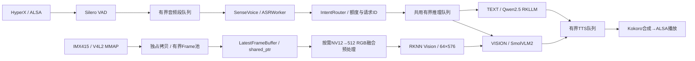

# RK3576 端侧多模态车载终端 · Stage 5 RC1

基于 RK3576 的 Linux/C++17 端侧 AI 工程：把语音采集、意图路由、NPU 文本/视觉推理和语音播放接成可演示的系统，并通过有界异步队列、资源生命周期和性能证据解释工程取舍。用于嵌入式 Linux、C++、端侧部署实践及实习/秋招项目；不是经过7×24商用认证的车载产品。

**状态：**5.1～5.5已在限定工况通过ARM64工程验收；本版仅冻结和整理，无核心推理修改。默认Kokoro 4线程，保留2线程。尚未切换主稳定工程。本地不是Git仓库，Git Commit及Tag均不存在；准确快照标识见 [VERSION.json](VERSION.json) 和 [SOURCE_MANIFEST.json](SOURCE_MANIFEST.json)。

## 系统链路



Camera持续采集，VLM执行时读取最新的有所有权Frame；不逐帧推理。采集Buffer在V4L2归还之前复制到受控CPU内存，异步线程不会借用已归还的MMAP指针。融合预处理缓存512×512 RGB和坐标表，生产路径为CPU，RKNN输入准备仍有SDK边界。

VAD采集、ASR、共用InferenceWorker、TTSWorker与Camera独立运行。ASR只提交任务，不同步等待VLM。TEXT和VISION共享单消费者队列，在该业务入口串行调用RKNN/RKLLM；不是声称两个Engine自己的mutex提供跨模型锁。Request ID与steady_clock贯穿排队、推理、合成和音频提交；超时、过期、拒绝和取消均有日志和计数。

Qt5 Widgets通过QProcess复用已有CLI，主事件循环不执行模型加载、阻塞推理或音频等待。窗口显示模块状态、识别文本、路由、回答、队列快照、错误和少量阶段延迟，支持开始/停止、2/4线程和排空/取消等待。关闭窗口先发协作信号，后台清理完成后才关闭。没有摄像头实时预览和AEC。

## 环境和依赖

LubanCat-3 / RK3576，IMX415 3840×2160 NV12，HyperX Cloud III USB双工音频；Linux 6.1.99-rk3576 aarch64，约3.8GiB RAM、无Swap。当前板已有Qt5.15.8、CMake、GCC、ALSA、RKNN及RKLLM，详细实查见 [DEPENDENCIES.md](DEPENDENCIES.md) 和机器可核对的 [DEPENDENCIES.json](DEPENDENCIES.json)。

| 子系统 | 模型/Runtime | 运行位置 |
|---|---|---|
| ASR/VAD | SenseVoice INT8、Silero；sherpa-onnx1.13.8 / ORT1.28.2 | CPU |
| TEXT | Qwen2.5-1.5B-Instruct W4A16，RKLLM | NPU |
| VISION | SmolVLM2-256M W4A16 + RKNN Vision；输入RGB512，输出64×576 | NPU |
| TTS | Kokoro multi-lang v1_1，sid17，24kHz | CPU，默认4线程 |
| Camera/播放 | V4L2 MMAP / ALSA | 原有内核与设备 |

模型、SDK、系统动态库**不包含在发布包**，通过现有绝对路径只读复用；未复制权重、未声称重新训练模型。`tools/stage5_board_paths.sh`可只读读取原稳定CMakeCache中的SDK路径。启动器还复用当前隔离目录中已审计的HyperX发现及DRM持有者检查工具，明确依赖 `.../rk3576_multimodal_stage5_review/tools/` 和已有桌面身份基线；因此本包不是任意Linux上直接解压即运行的独立包。

VISION分支将中文识别结果用于路由，实际问题固定为 **What do you see? Answer briefly.**，不是任意中文视觉问答。TEXT保留原有简短回答提示；本轮未改变Prompt、声音、语速、模型或推理参数。

## 目录与版本边界

```text
stage5-rc1/
  source/             唯一构建源：104项已验收CMake/C++/测试文件
  config/             配置入口说明；当前语音入口主要使用位置参数
  tools/              RC构建/启动与路径脚本
  docs/               五节报告、源码讲解及完整手册
  evidence/           历史证据归档、五节Diff、校验与数据索引
  reports/            文档使用的真实图片及本轮RC结果
  VERSION.json        版本及源码快照标识；git_commit=null
  SOURCE_MANIFEST.json / PACKAGE_MANIFEST.json / SHA256SUMS
```

历史源码只在 `evidence/` 内作为取证材料，未加入正式启动路径。包内没有旧二进制、模型或SDK。`source/tests`保留历史探针以复现；RGA仅可选手动实验目标，未用于正常启动。新构建产物在板端RC自己的 `build/`，不进入源码归档。

## ARM64 构建与测试

在本板普通cat用户终端执行；同名build已存在时脚本停止，不自动清理：

```bash
rc=/home/cat/projects/RK3576/rk3576_multimodal_stage5_review/releases/stage5-rc1
cd "$rc"
sha256sum -c SHA256SUMS
python3 -I -B tools/build.py
```

构建脚本验证104文件SHA，配置Release、真实SDK和可选Qt，最多3个并行编译任务。逐步骤90/600/150秒超时；可用磁盘低于500MiB停止并保留日志。原始命令、stdout/stderr、CTest XML与退出码保存到隔离 `reports/stage5_rc1_board/build/`。精确CMake参数如下；手工重建时必须选全新的build和日志目录：

```bash
set -a
source tools/stage5_board_paths.sh
set +a
cmake -S source -B build -DCMAKE_BUILD_TYPE=Release -DBUILD_TESTING=ON \
  -DBUILD_QT_GUI=ON -DBUILD_WITH_RKLLM=ON -DBUILD_WITH_VLM=ON \
  -DENABLE_SHERPA_ASR=ON -DSHERPA_ONNX_ROOT="$STAGE5_SHERPA" \
  -DRKLLM_SDK_ROOT="$STAGE5_RKLLM" -DRKNN_INCLUDE_DIR="$STAGE5_RKNN_INCLUDE" \
  -DRKNN_RUNTIME_LIBRARY="$STAGE5_RKNN_LIBRARY"
cmake --build build --parallel 3
QT_QPA_PLATFORM=offscreen ctest --test-dir build --output-on-failure --timeout 30
```

`-S/-B`区分源码与产物；ON配置链接真实SDK，不代表CTest调用真实模型。ARM64注册8项是确定性/Fake测试（Qt使用真实Qt、Fake子进程）；真实硬件闭环的日志独立保存。Qt缺失时可 `BUILD_QT_GUI=OFF` 保留CLI，但不能据此宣称GUI已验证。

## Qt 与 CLI 演示

当前桌面cat终端执行，先接回HyperX；脚本动态发现CARD ID，不使用历史数字声卡：

```bash
bash "$rc/tools/launch.sh" gui 4
# CPU负担或散热条件不适合时，可明确选2线程
bash "$rc/tools/launch.sh" gui 2
# 保留完整CLI入口，Ctrl+C协作退出
bash "$rc/tools/launch.sh" cli 4
```

GUI点击开始，等待监听后问“一加一等于几”，听完再问“前面有什么”。监听180秒，之后可重新开始；不是后台常驻服务。模型加载可能耗时，GUI保持事件响应。安全停止可排空已接受任务，或取消等待任务；正在执行的同步SDK请求允许完成。SIGINT/SIGTERM由普通等待线程协作处理，handler不调用Qt、mutex或join。

GUI复用现有xcb桌面与认证；SSH本身不提供图形显示。不得安装软件或改系统权限来绕过缺依赖。若桌面会话重启导致DRM基线变更，按既有最终操作说明运行只读 `stage5_05_npu_inventory.py`生成新文件并人工核查；不得结束systemd/logind/Xorg来让DRM句柄归零。日志写入隔离 `reports/stage5_05_board/rc1_manual_.../`。

## 实测成果与统计口径

| 工作 | 实测结果 | 结论边界 |
|---|---|---|
| 5.2 ASR与VLM解耦 | 受控VISION业务提交1737.730ms→0.034758ms | 提交调度改善，不是NPU计算同比加速 |
| 5.3 CPU融合预处理 | n=12比较，平均耗时降低24.67% | 局部预处理，不冒充完整交互加速 |
| 5.4 Kokoro 2→4线程 | 固定中文/英文暖态各n=30，平均合成耗时分别降低30.42%/29.74% | 同模型/文本/声音；CPU明显增加，RTF仍>1 |
| 5.5 2/4线程混合负载 | 各约30分钟，分别121/121完成 | 预分段固定音频，真实ASR，绕过麦克风/VAD |
| 最终Qt版本 | 1837.782秒，121/121完成，Camera29.9952FPS，XRUN0 | 固定输入混合负载；一次Camera序号间隙 |
| 真实麦克风/耳机/Qt | 用户确认两类回答听到、视觉大致相符、窗口信息正确 | 有限自然输入；独立于自动长测 |

完整均值、P50/P95、输入、暖态规则、RSS和CPU样本见证据索引，不能混用单次样本与分布。Qt长测后台RSS峰值约2715MiB、Qt约89MiB，RSS在所测区间趋稳不是闭源SDK绝无泄漏的证明。一次发布收尾不重复先前长测。

## 已知限制

- TTS合成和播放仍串行处理一个任务，RTF>1，4线程增加CPU资源消耗；保留2线程回退。
- 历史记录出现Linux热限制活动；有限节奏混合负载结果不代表持续饱和或任意散热环境。本轮不额外分析温控、不改变温控配置。
- Qt长测出现一次V4L2 driver sequence gap；后续64次真实视觉调用未复现，根因未明确。LatestFrameBuffer主动替换旧帧、驱动DQBUF序号间隙、消费者读到的帧ID不连续是不同指标。未来可同时记录DQBUF序号/时间戳、发布/丢弃计数及请求读取ID，与内核日志关联；本轮不继续专项排查。
- RGA实验失败路径如实保留，未启用生产RGA；未实现端到端Zero-copy。
- 无AEC/PTT、语音打断、任意中文视觉问答；部分真实拔插/SDK内部异常及更长运行未验证。
- 无可信NPU利用率、功耗、真实声学输出时间戳；“首次ALSA提交”不等于人耳实际听到时刻，精确Token级TTFT未直接测量。

## 文档、复现与发布

- [完整工程手册 Markdown](docs/RK3576_STAGE5_ENGINEERING_MANUAL.md) / [Word](docs/RK3576_STAGE5_ENGINEERING_MANUAL.docx)：正文与已验收源码一致，RC Word仅将历史Letter修正为A4；包含61道面试题，历史252页版保留在证据归档。
- [5.1架构审计](docs/stage5_01_architecture_audit.md)、[5.2异步Pipeline](docs/stage5_02_async_pipeline.md)、[5.3内存链路](docs/stage5_03_memory_pipeline.md)、[5.4性能Profiling](docs/stage5_04_performance_profiling.md)、[5.5验收](docs/stage5_05_final_acceptance.md)。具体历史文件以 [EVIDENCE_INDEX.md](EVIDENCE_INDEX.md) 实查索引为准。
- [依赖及实际模型指纹](DEPENDENCIES.md)、[安全升级与回滚](DEPLOY_AND_ROLLBACK.md)、[RC验收结论](RC_ACCEPTANCE.md)。
- 完整五节Git格式Diff位于 `evidence/stage5_0*/changes.patch`，原始日志、CSV/JSON、失败实验和历史源码位于内层 `evidence/RK3576_STAGE5_FINAL_REVIEW.tgz`，查阅时只解到全新证据目录，不用于正式启动。

本轮不公开推送、不切换默认入口、不覆盖原 `build/stage5_full`。正式切换前接回HyperX做两条必要冒烟，并由用户明确批准；否则保持双版本独立命令运行。
